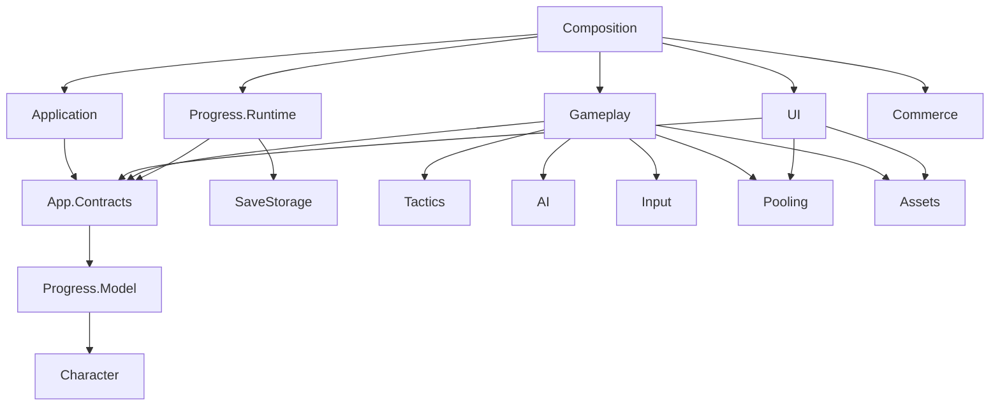

# Архитектура Aethel после рефакторинга

Дата: 29.10.2026. Проект: D:\UnityPetProject\PetProject. Базовая ветка: refactore/systems.

Это актуальная карта кода. Предыдущие заметки Obsidian описывают состояние до переноса. Итоги и ограничения: [отчёт](Refactoring-Report.md).

> Обновление 30.10.2026: `Encounter` разделён на внутренние классы состава участников, состояния актёра, инициативы, движения и ближней атаки. Публичный API сохранён. [Полный справочник с исходниками всех систем](../Codebase/Aethel-Systems-Codebase.md), [отчёт этапа и ограничения проверки](Class-Refactoring-2026-10-30.md). Снимок включает также свежий полигон TestMotion.

<!-- TACTICS-D1 -->
> **Дополнение D1:** реализованы независимое тактическое ядро и технический полигон. [Отчёт D1](../Design/Tactics-D1-Report.md), [контракты систем](../Design/Systems/README.md). Основной игровой цикл пока использует прежние адаптеры; подключение полноценного отряда относится к D2/D3.

## Сборки

В CodeBase — 28 asmdef: 15 основных runtime-сборок, 4 самостоятельные runtime-библиотеки, 4 Editor-сборки и 5 сборок тестов/поддержки тестов. TestSupport содержит только компонент тестового пула и помечен TestAssemblies; это не новая игровая подсистема.

| Сборка | Ответственность | Прямые проектные зависимости |
|---|---|---|
| PetProject.Tactics | Независимые правила столкновения, сетка, очередь, команды, RNG; noEngineReferences=true | — |
| PetProject.Character | Модель героя, атрибуты, модификаторы, черновик создания | — |
| PetProject.AI | Blackboard, behaviour tree, стратегии и эксперты | — |
| PetProject.App.Contracts | Порты прогресса, меню, мира, окружения и интеграций | Progress.Model, Character |
| PetProject.Application | Сценарии меню, сессия персонажа, состояния и переходы | App.Contracts, Progress.Model, Character, Input, Pooling |
| PetProject.Assets | Загрузка Addressables и владение экземплярами | — |
| PetProject.Commerce | Адаптеры Ads/IAP и SDK-зависимости | App.Contracts, Progress.Model |
| PetProject.Composition | Zenject installers, конкретные фабрики, сборка мира | Application, App.Contracts, Progress.Runtime, Progress.Model, Character, UI, Gameplay, AI, Input, Pooling, Assets, Commerce |
| PetProject.Gameplay | Герой, враги, бой, добыча, мир, игровые конфиги; адаптер полигона | App.Contracts, Progress.Model, Character, AI, Input, Pooling, Assets, Tactics |
| PetProject.Input | Сырые действия ввода, generated Input Actions, блокировка меню | — |
| PetProject.Pooling | Типизированные пулы и их жизненный цикл | — |
| PetProject.Progress.Model | Сериализуемые данные прогресса и игровой save DTO | Character |
| PetProject.Progress.Runtime | Реестр capture/apply, адаптер игровых слотов | App.Contracts, Progress.Model, Character, SaveStorage |
| PetProject.UI | Представление меню/атрибутов/слотов, HUD, старые окна | App.Contracts, Progress.Model, Character, Input, Assets, Pooling |
| PetProject.SaveStorage | Файлы слотов, checksum, backup, архивирование | — |

Таблица перечисляет собственные PetProject-зависимости. Полные ссылки на Zenject, UniRx, UniTask, Unity и свои Audio/VFX-библиотеки находятся в asmdef и [текущей инвентаризации D1](../Design/_audit/tactics-d1-assemblies-2026-10-29.json). Ссылки на asmdef записаны через GUID. ZLinq подключается как auto-referenced DLL, а не как несуществующая asmdef.

Сохранены Game.Infrastructure.AudioSystem, Game.Infrastructure.VFXSystem, Game.Utils, DialogueSystemExtensions. Editor-код VFX теперь имеет отдельную Game.Infrastructure.VFXSystem.Editor; GoogleSheetConfig.Editor и AudioSystem.Editor остаются самостоятельными.

## Направление зависимостей

Диаграмма показывает основные границы; полная таблица выше включает дополнительные прямые зависимости. Обратных ссылок на Composition нет. В runtime нет ссылок на predefined Assembly-CSharp или проектные Editor-сборки.

## Где теперь искать код

- Modules/Application: CharacterMenuService, CharacterSession, State, SceneLoader, переходы.
- Modules/UI: CharacterMenuPresentation, CharacterAssets, представления меню/слотов/атрибутов, Legacy, WindowsCatalog.
- Modules/Progress.Model: PlayerProgress и сериализуемые структуры; Modules/Progress.Runtime: ProgressRegistry, SaveLoadService, SaveEnvironment.
- Modules/Gameplay: Hero, Enemies, World, StaticData, Factories и интерпретация целей ввода.
- Modules/Composition: BootstrapInstaller, AudioInstaller, GameWorldBuilder, WorldAssetFactory, HeroFactory, EnemyFactory, LootFactory, GameFactory.
- Modules/AI, Input, Pooling, Assets, Commerce: соответствующие системы.
- Modules/Tactics/Runtime: чистое C#-ядро; Modules/Tactics/Tests/Editor: тесты. Gameplay/TacticsSandbox и Editor/Tactics: отдельный технический полигон.
- Character/Domain, SaveStorage, _myPlugins: сохранены самостоятельными модулями.
- Editor и Tests: инструменты и проверки. Generated PlayerInputAction остаётся в Assets/_project/InputSystem; asmref включает его в PetProject.Input.

Имена пространств имён в основном сохранены. Старый namespace может содержать Infrastructure/Factory, хотя файл теперь принадлежит Gameplay или Composition. Это осознанное ограничение текущей миграции, чтобы не совмещать перенос сборок с массовым переименованием типов.

## Владение состоянием и ресурсами

| Владелец | Что контролирует | Освобождение |
|---|---|---|
| CharacterSession | Текущий профиль, пересчёт HP/урона и подписки характеристик | Смена профиля очищает подписки, Dispose завершает сессию |
| CharacterMenuService | Сценарии создания/выбора/загрузки, флаги перехода | CancellationTokenSource и loading lease |
| CharacterMenuPresentation | Один активный экран, toolbar, пауза окна | Clear/Dispose закрывают экран и lease |
| ProgressRegistry | Участники текущего мира | Unregister при подборе/возврате; Clear при смене мира |
| AssetProvider | Кэш загруженных ресурсов и экземпляры текущего мира | CleanUp освобождает экземпляры; Dispose — кэш |
| PoolService / Pool | Пулы приложения, активные и свободные экземпляры | Despawn/DespawnAllActive; Dispose очищает объекты и принадлежащий пулу root |
| GameWorldBuilder | Порядок создания и восстановления мира | IWorldBuilder.CleanUp, затем BuildAsync |
| Composition | Связывание конкретных реализаций и lifecycle Zenject | DI-регистрация IDisposable/IInitializable/ITickable |

## Запуск и восстановление

BootstrapState → WarmUpState → MainMenuState. Выбор сохранения или подтверждение героя → ReloadGameState → LoadProgressState → LoadLevelState → GameLoopState.

LoadLevelState ждёт IWorldBuilder.BuildAsync. Мир создаёт спавнеры, добычу, триггеры, героя и HUD, затем ProgressRegistry.ApplyAsync восстанавливает участников. IAsyncProgressReader позволяет дождаться создания врагов. Только после этого меню отмечает мир готовым и снимает блокировку загрузки.

Данные слота не зависят от GameFactory: SaveLoadService вызывает IProgressRegistry.Capture и сохраняет через JsonSlotStore. UI получает SaveSlotInfo, не внутреннюю структуру файлового хранилища. В Editor пути тестов и выход из Play mode передаются через отдельные адаптеры.

## Правила дальнейшего расширения

1. Игровую логику помещать в соответствующую систему; отдельная сборка нужна при самостоятельной ответственности, а не для каждого класса.
2. Runtime-сервисы получают явные зависимости. DiContainer остаётся в Composition; StateFactory разрешает состояния только на этой границе.
3. UI отправляет команды через ICharacterMenuActions и отображает модель. Конкретный экран не становится зависимостью Application или Gameplay.
4. Новый участник сохранения регистрируется в IProgressRegistry; при завершении жизни удаляет регистрацию. Асинхронное восстановление реализует IAsyncProgressReader.
5. Один владелец освобождает подписки, lease, Addressables handle или pooled object. Не добавлять вторую систему владения тем же экземпляром.
6. Сохранять .meta при переносе. Изменение JSON-полей/схемы оформлять отдельно с миграционными fixtures.
7. После изменения границ проверять компиляцию, регрессионные проверки и затронутый игровой сценарий. Editor compile не заменяет player build.
