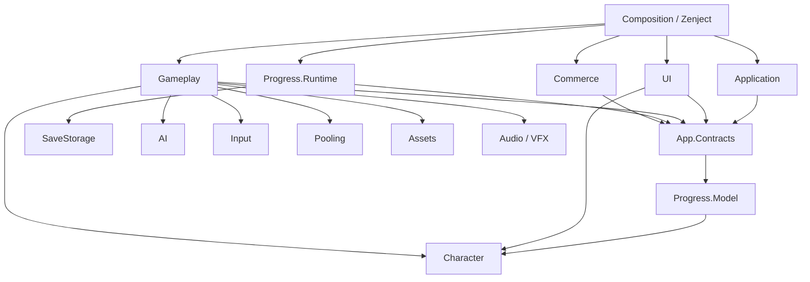

# План рефакторинга систем и разделения на asmdef

<!-- EXECUTION-STATUS -->
> Это исторический план. Пользователь разрешил реализацию; актуальный результат и ограничения — в [отчёте](Refactoring-Report.md), целевое развитие — в [плане GDD](../Design/GDD-Migration-Plan.md). Формулировки «реализация не начата» ниже относятся к подготовке плана.

**Проект:** PetProject, Unity 6000.3.5f2. **Дата:** 29.10.2026. **Статус:** предложение для согласования, реализация не начата.

## 1. Предлагаемое решение

Разделить код по ответственности и направлению зависимостей. Сначала устранить связи, мешающие выделению модулей, затем переносить их небольшими проверяемыми пакетами. Сохранить работающие атрибуты, меню, файловые слоты и текущие уровни.

Рекомендуемый масштаб — **14 проектных runtime-сборок**, включая уже существующие Character и SaveStorage; плюс существующие библиотеки Audio, VFX, Dialogue и Shared, отдельные Editor-сборки и необходимые тестовые сборки. Это целевой ориентир: дополнительная сборка появляется при самостоятельной ответственности или отдельной платформе, а не для каждой папки, интерфейса или класса.

На первом проходе Hero и Enemies остаются в общей Gameplay-сборке. Отдельные сборки для героя, врагов, боя и добычи можно выделить позже, когда между ними появятся устойчивые контракты. Не создавать общий Infrastructure.asmdef над нынешней папкой: она содержит слишком разные обязанности.

**Новые сборки называем PetProject.*. Существующие имена Game.Infrastructure.AudioSystem, Game.Infrastructure.VFXSystem, Game.Utils и DialogueSystemExtensions пока сохраняем.** Одновременное переименование сборок, namespaces и сериализованных классов заметно увеличит объём миграции.

## 2. Что проверено в текущем коде

Область инвентаризации — `Assets/_project/CodeBase`, без исходников сторонних плагинов и пакетов. Снимок находится в `_audit/asmdef-inventory-2026-10-29.json` рядом с этим документом.

| Текущая сборка | C#-файлов |
|---|---:|
| Assembly-CSharp | 249 |
| Assembly-CSharp-Editor | 8 |
| Game.Infrastructure.AudioSystem | 142 |
| AudioSystem.Editor | 2 |
| Game.Infrastructure.VFXSystem | 46 |
| PetProject.Character | 23 |
| PetProject.Character.Tests | 1 |
| PetProject.SaveStorage | 2 |
| PetProject.SaveStorage.Tests | 1 |
| Game.Utils | 5 |
| DialogueSystemExtensions | 5 |
| GoogleSheetConfig.Editor | 10 |
| **Итого** | **494** |

В этой области 10 asmdef. Принадлежность файлов определена по ближайшему asmdef и сверена с последними локальными Editor `.rsp` Unity. Граф связей между папками в JSON построен лексически: это указатель для ручной проверки, не семантический анализ Roslyn. В рамках подготовки плана компиляция и Player build не запускались.

### Основные препятствия

| Наблюдение и пример | Почему мешает asmdef | Предлагаемое изменение |
|---|---|---|
| `IGameFactory` возвращает HeroFacade и LootPiece, создаёт HUD; `GameFactory` знает gameplay, окна, ассеты, сохранения, аудио и VFX | Общая фабрика связывает несколько будущих сборок | Разделить фабрики героя/врагов/добычи и HUD; создание целого мира собрать адаптером в Composition |
| `HeroHealth.BindStats` принимает конкретный CharacterMenuService | Gameplay зависит от меню и управления приложением | Передавать узкий источник характеристик/уведомлений; меню не владеет здоровьем героя |
| CharacterMenuService открывает окна, читает профиль, управляет state machine, паузой, вводом и производными stats | Нельзя выделить UI и Application, сохранив двусторонние ссылки | Разделить управление приложением, привязку характеристик и представления; связать через контракты |
| SaveLoadService получает GameFactory через IServiceFactory ради ProgressWriters | Хранилище зависит от создания мира | Выделить реестр участников capture/apply; GameFactory регистрирует участников, SaveLoadService работает с реестром |
| `WindowConfig` лежит в StaticData и содержит UI.WindowBase; IStaticDataService одновременно возвращает WindowConfig и данные уровней/монстров | Общий каталог создаёт обратную связь StaticData ↔ UI | Данные окон и их каталог отдать UI; данные уровней/монстров — Gameplay |
| UI зависит от SDK-описаний IAP через сервисы покупок | Интерфейс магазина затягивает платёжный SDK в UI | Передавать собственные DTO товара и результаты операций, SDK оставить в Commerce |
| VFXSystem/Editor/VFXEditorWindow.cs входит в runtime asmdef; `using UnityEditor` расположен до `#if UNITY_EDITOR_WIN` | Папка Editor сама по себе здесь не отделяет код; риск ошибки Player build | Добавить отдельную Editor-only сборку VFX и проверить Player compilation |
| DialogueSystemExtensions.asmdef содержит Assembly-CSharp, Assembly-CSharp-firstpass, ссылки на Editor-сборки, UniRx.Examples и Editor.Tests URP | Недопустимые и лишние направления ссылок; runtime-библиотека связана с редактором и примерами | Пересобрать минимальный список по пяти реальным исходникам; удалить ссылки на predefined и неиспользуемые Editor/Examples/Tests |
| GoogleSheetConfig.Editor ссылается на GUID `178e44472bf53ee4591af02b903f5f59`, который не найден в проверенных asmdef | Ненадёжная ссылка на удалённую/переименованную сборку | Установить назначение ссылки по фактическому использованию; удалить лишнюю либо восстановить правильную |
| Game.Utils с пятью исходниками объявляет TMP и Input System, хотя по исходникам видны главным образом UniRx/UniTask | Избыточные связи распространяются на потребителей | Проверить и сократить references без изменения публичных типов |
| Runtime содержит условные обращения к UnityEditor.SessionState и остановке Editor PlayMode | Тестовая среда и редакторский запуск встроены в игровые сервисы | Передавать окружение хранилища и выход из приложения через адаптеры; тестовый код оставить Editor |

Условный код под корректным `UNITY_EDITOR` сам по себе не доказывает ошибку сборки. Недействительные ссылки в asmdef также нужно подтвердить диагностикой Unity: этот аудит не утверждает, что текущая игра не запускается.

## 3. Целевая структура сборок

В таблице перечислены прямые проектные зависимости. Пакеты Unity, UniTask, UniRx и другие библиотеки добавляются только там, где используются их типы; зависимости не считаются транзитивным разрешением пользоваться чужими типами.

| Сборка | Ответственность и текущие источники | Прямые проектные зависимости |
|---|---|---|
| **PetProject.Character** — существует | Атрибуты, классы, черновик героя, формулы, модели предметов и эффектов из Character/Domain | Сохраняем текущие UniRx/UniTask на первом проходе; без UI, Gameplay, DI и сохранений |
| **PetProject.SaveStorage** — существует | Envelope, checksum, файлы, backup, архивирование слотов из SaveStorage | Без остальных проектных модулей; Unity JsonUtility пока остаётся |
| **PetProject.Progress.Model** | Data/*, DTO ProfileProgress/LevelProgress/RunProgress и GameSaveAdapter; SerializableDictionary из Utils | Character |
| **PetProject.App.Contracts** | Границы приложения: навигация, сессия, capture/apply прогресса, источник характеристик, операции слотов, представление загрузки, публичные DTO результатов | Progress.Model, Character при необходимости в сигнатурах |
| **PetProject.AI** | BehaviourTree, Blackboard, Arbiter из Infrastructure/Services/AIServices; без конкретного героя и врагов | Game.Utils только при реальном использовании; Unity допустим для текущих адаптеров |
| **PetProject.Input** | ClickInputHandler, InputHandlerService, InputService, их интерфейсы и MenuInputScope | Минимум внешних пакетов; без UI-окон, Gameplay и Application |
| **PetProject.Pooling** | Pool, PoolService, IPool/IPoolable и расширения | Без игрового прогресса и фабрики мира |
| **PetProject.Assets** | IAsset/AssetProvider и общие операции загрузки/владения Addressables | Без сценовых игровых компонентов и UI-конкретики |
| **PetProject.Progress.Runtime** | PersistentProgressService, SaveLoadService, реестр capture/apply, legacy import и выбор актуального слота | App.Contracts, Progress.Model, SaveStorage |
| **PetProject.Gameplay** | Hero, Enemies, бой, лут, спавнеры, триггеры, камеры, игровые Configs/StaticData и связанные Components | App.Contracts, Progress.Model, Character, AI, Input, Pooling, Assets; существующие Audio/VFX для используемых API |
| **PetProject.UI** | HUD, старые окна, Character/UI, SaveSlotsView, MainMenuView, Toolbar, LoadingCurtain, UI-фабрика/каталог окон, ресурсы представлений | App.Contracts, Progress.Model, Character, Input; Assets для загрузки ресурсов представлений; Pooling для существующих окон |
| **PetProject.Application** | Состояния приложения, загрузка сцен, сценарии New Game/Continue/Load, координация переходов и привязки профиля | App.Contracts, Progress.Model, Character; Input при управлении блокировкой ввода |
| **PetProject.Commerce** | Ads, IAP provider/service и преобразование SDK-ответов | App.Contracts, Progress.Model; нужные SDK |
| **PetProject.Composition** | BootstrapInstaller, запуск Game, Zenject bindings, сборка фабрик мира, адаптеры IWorldLoader и связи UI ↔ runtime | Все используемые реализации; это единственная общая точка сборки приложения |

App.Contracts не должен превратиться в папку для всех интерфейсов. Контракты локального пула остаются в Pooling, AI — в AI, конкретных gameplay-фабрик — в Gameplay, окон — в UI. В App.Contracts попадают только типы, которыми действительно обмениваются независимые модули приложения.

`ISaveSlotService` сейчас выдаёт `SaveSlot<GameSaveData>` из файлового хранилища. Целевой UI получает `SlotSummary`, статус и типизированный результат загрузки из App.Contracts. Generic-тип JsonSlotStore остаётся деталью Progress.Runtime.

### Существующие библиотеки и редактор

| Сборка | Решение |
|---|---|
| Game.Infrastructure.AudioSystem | Сохранить; Editor-утилиты отделить/проверить, не дробить 142 файла на множество сборок в первом проходе |
| AudioSystem.Editor | Сохранить Editor-only, оставить минимальные ссылки Runtime/Odin и реально используемые DLL |
| Game.Infrastructure.VFXSystem | Сохранить runtime API и GUID asmdef |
| **Game.Infrastructure.VFXSystem.Editor** — новая | Вынести VFXEditorWindow, только Editor; ссылка на VFX runtime и необходимые editor/DLL зависимости |
| DialogueSystemExtensions | Сохранить небольшой модуль интеграции Pixel Crushers, очистить ссылки; gameplay-зависимости добавлять через адаптеры |
| Game.Utils | Сохранить небольшой Shared-модуль; сократить лишние ссылки |
| GoogleSheetConfig.Editor | Сохранить Editor-only; проверить GUID, SDK Google и Odin, убрать ненужные зависимости |
| **PetProject.Editor** — новая | Инспекторы Blackboard/Level/SpawnMarker/UniqueId, проектные команды и миграционные инструменты; `includePlatforms: [Editor]` |
| Character.Tests, SaveStorage.Tests | Сохранить существующие тесты и имена; добавить тесты границ и интеграции там, где меняется поведение/связь |

Внешние Zenject, UniRx, UniTask, Wwise, Pixel Crushers, Odin, MicroVerse и Unity packages сохраняют собственные asmdef. Их исходники не входят в массовое перемещение. Legacy AudioService с AudioPoolItem и игровыми AudioConfig сначала остаётся в Gameplay как существующий адаптер; объединять его с Wwise или удалять только после отдельной проверки использования.

## 4. Направление зависимостей

Стрелка означает «использует типы из». Диаграмма показывает основные границы; полный список — в таблице выше.

Правила границ:

1. Application не использует HeroFacade, WindowBase, DiContainer или конкретный SaveLoadService. Для этого есть порты мира, представления и прогресса.
2. Gameplay не использует CharacterMenuService и конкретные окна. HUD получает состояние через интерфейсы/модель.
3. UI не запускает state machine напрямую и не знает SDK покупок. Он отправляет команды и отображает результат.
4. Progress.Runtime не получает список writers из GameFactory и не создаёт героя.
5. Character и SaveStorage не ссылаются на приложение. No Engine References пока не включаем: Character использует Unity-математику, SaveStorage — JsonUtility.
6. Composition зависит от реализаций; остальные сборки не зависят от Composition. Общий IServiceFactory/ServiceFactory постепенно убирается из runtime-потребителей.
7. Не добавлять обратную ссылку ради одной ошибки компиляции. Либо переносить контракт к правильному владельцу, либо оставлять тесно связанные типы в одной сборке.

Такой граф соответствует ограничениям Unity: custom asmdef не может ссылаться на predefined-сборку, а циклические ссылки сборок запрещены. См. [Unity 6.3: Referencing assemblies](https://docs.unity3d.com/6000.3/Documentation/Manual/assembly-definitions-referencing.html).

## 5. Изменения центральных систем до выделения сборок

| Сейчас | Целевая граница | Минимальный первый шаг |
|---|---|---|
| CharacterMenuService | Application-сценарии + отдельная привязка профиля/stats + UI views | HeroHealth получает источник изменения stats; View получает команды, не меню-сервис целиком |
| GameFactory/IGameFactory | Gameplay-фабрики героя/врага/добычи; UI HUD-фабрика; Composition WorldBuilder | Убрать ProgressReaders/Writers из публичной фабрики в реестр прогресса |
| SaveLoadService | Progress.Runtime, захват/проверка/запись, без навигации и DI-resolve | Реестр участников и окружение путей передаются явно |
| IStaticDataService | Отдельные каталоги gameplay и UI | WindowConfig и WindowId остаются рядом с системой окон; не переносятся в общий низкоуровневый Data |
| UIFactory reflection warmup | Типизированная регистрация поддерживаемых окон | Проверить необходимость MakeGenericMethod и AOT-поведение; не менять одновременно всё pooling-поведение |
| ServiceFactory/StateFactory | Явные зависимости + фабрики в Composition | Последовательно убрать runtime Resolve; state machine получает готовые состояния/фабрику без обратной ссылки на Composition |
| SceneLoader/LoadLevelState | Application transition и Composition-адаптер сборки мира | Переход завершён только после создания и восстановления мира; сохранить текущий Single-flow |
| SaveStorageSmoke и CharacterMenuSmoke | Editor-инструменты, тестовое окружение через override | Убрать чтение SessionState из production SaveLoadService; сохранить изоляцию пользовательских файлов |

Не вводить универсальный EventBus как замену всем зависимостям. Сначала использовать конструкторы, узкие интерфейсы и события конкретной модели. Переписывание UniRx на другой механизм и замена Zenject не входят в этот рефакторинг.

Отдельно обработать маркер `IService` и ограничение `CreateService<T> where T : IService`: самостоятельные Assets/Input/Pooling/AI не должны зависеть от верхнего слоя только ради service locator. Перед их извлечением убрать это ограничение у временного локатора либо устранить соответствующие вызовы; маркерные интерфейсы без собственного контракта не распространять на новые модули. Lifecycle-интерфейсы Zenject при необходимости заменить явными Initialize/Dispose и вызвать их из Composition-адаптера.

Области жизни во время переноса сохраняем: сервисы приложения и прогресса — ProjectContext; герой, враги и регистрации capture/apply — текущий мир; подписки окна — экземпляр окна. Аудио/VFX, уже перенесённые в ProjectContext, не возвращать в SceneContext ради удобства сборки. В R0 фиксируется таблица владельцев кэшей Addressables, активных pooled objects, UI и CancellationTokenSource; один владелец отвечает за освобождение каждого ресурса.

## 6. Порядок выполнения

Каждый пакет заканчивается компилируемым состоянием. Пакет — единица проверки и отката, а не обязательно один день. Если один этап велик, он делится на несколько пакетов с теми же границами.

| Этап | Работа | Готовый результат и проверка |
|---|---|---|
| **R0. Зафиксировать исходное состояние** | Снимок рабочих изменений Git/Plastic, карта GUID и типов, fixtures сохранений, текущие asmdef/defines/профили сборки; замер времени компиляции и запуска | Рабочий старт, новая игра, загрузка слота, бой, UI, аудио/VFX; 8 проверок атрибутов и 14+4 проверки сохранений; baseline Player build либо перечень уже существовавших блокеров |
| **R1. Привести существующие asmdef в порядок** | Отделить VFX Editor, очистить Dialogue refs, проверить Google GUID, убрать лишние Game.Utils refs; классифицировать Audio Editor/debug/test код | Editor-компиляция и Player compilation; runtime не затягивает Editor/Examples/Tests. Исходные namespaces и имена типов сохраняются |
| **R2. Выделить Progress.Model и App.Contracts** | Data, DTO, адаптер, SerializableDictionary; вынести cross-module порты; убрать зависимости этих типов от конкретных сервисов | Модели/контракты выделены как нижний слой; JSON старых сейвов читается, Character и SaveStorage не получили обратных ссылок |
| **R3. Выделить самостоятельные сервисы** | AI, Input, Pooling, Assets — по одному asmdef за пакет, с фактическими references | При изменении листового модуля перечень пересобранных сборок ожидаем; ввод, пауза, pooling и владение Addressables работают как baseline |
| **R4. Отделить прогресс и Commerce** | Реестр capture/apply, прямые зависимости вместо GameFactory Resolve, окружение путей; публичные DTO магазина; вынести Progress.Runtime и Commerce | 14 файловых + 4 adapter checks, импорт legacy, backup, слоты, тест ошибки записи; UI не требует Purchasing SDK-типы |
| **R5. Разорвать связи Gameplay/UI/Application** | Разделить CharacterMenuService, IGameFactory и каталоги; HeroHealth отвязать от меню; разделить создание мира и представление | Пока можно оставаться в Assembly-CSharp: важна совместимость контрактов и поведения. Не создавать asmdef Gameplay/UI до устранения обратных ссылок |
| **R6. Выделить Gameplay и UI** | Перенести сгруппированные runtime-компоненты, конфиги и views с .meta; добавить отдельные asmdef и редакторские границы | Герой/враги, загрузка, HUD, два семейства WindowBase, шторка и окна атрибутов работают; нет Missing Script и разорванных UnityEvent |
| **R7. Выделить Application и Composition** | Вынести состояния и координаторы; собрать реализации/фабрики через Zenject в Composition; перенести оставшиеся runtime Editor-адаптеры | Bootstrap загружает приложение без service locator в нижних модулях; нужные скоупы и порядок инициализации сохранены |
| **R8. Закрепить границы и документацию** | Проверка dependency graph, architecture checks, Editor tools/tests, лишние references; повторный Player build и замеры | Наш код не остаётся в Assembly-CSharp; нет ссылок на него из asmdef; подтверждена совместимость данных и согласованные направления зависимостей |

Сначала извлекаем нижние модули: временно Assembly-CSharp продолжает использовать их через Auto Referenced. Извлечённые сборки не могут использовать ещё не извлечённые реализации; именно поэтому сначала выносятся контракты и устраняются обратные связи.

Во время R5–R7 кратковременно может потребоваться пакет, содержащий несколько связанных переносов. Не оставлять репозиторий с намеренно некомпилирующимся промежуточным asmdef.

## 7. Размещение файлов и правила asmdef

Предлагаемая финальная организация — `Assets/_project/CodeBase/Modules/<Module>/Runtime`, при необходимости соседние `Editor` и `Tests`. Composition, Gameplay и UI могут иметь внутренние подпапки. Существующие Character/Domain, SaveStorage и `_myPlugins` не перемещаем одновременно ради одинакового дерева: их физическое выравнивание — отдельный поздний пакет, если оно действительно нужно.

- Начинать с минимального перемещения файлов; временный asmref допустим для объединения разнесённых папок в **одну** сборку. Он не разрывает зависимости и не делает отдельный модуль.
- Переносить `.cs` вместе с `.meta`, сохранять GUID asmdef и ассетов. Сцены, Resources, Addressables-адреса и конфиги автоматически в новое дерево не переносить.
- Новые ссылки на custom asmdef хранить через GUID; до переноса проверять их разрешение. На первом проходе не переводить все старые references на другой формат без необходимости.
- Auto Referenced оставить включённым у модулей, пока их потребляет Assembly-CSharp. После полного выделения проверить использование и при необходимости выключать адресно. Само выключение не устраняет ссылки между custom asmdef.
- Editor-сборки ограничить Editor-платформой. Вложенная папка Editor под runtime asmdef требует собственной сборки или asmref. См. [Unity: Creating assembly assets](https://docs.unity3d.com/6000.3/Documentation/Manual/assembly-definitions-creating.html).
- Override References использовать для контроля конкретных precompiled DLL, например Odin/Google SDK. Это не замена списку references на другие asmdef.
- `allowUnsafeCode`, define constraints, version defines и платформы менять только по необходимости модуля. Не ставить `noEngineReferences: true` всему «доменному» коду без проверки используемых Unity-типов.
- В обычный runtime не должны попадать NUnit, TestRunner, editor-only SDK и тестовые фикстуры. Новые тестовые сборки создавать под конкретный контракт/сценарий, а не под каждую папку.

## 8. Сериализация, данные и безопасный перенос

В prefab/asset-файлах уже есть строки `m_EditorClassIdentifier: Assembly-CSharp::...`; в UI диалогов встречается Assembly-CSharp-firstpass. Кроме MonoScript GUID проверить UnityEvent persistent targets, SerializeReference/managedReference и поиск типов через reflection.

Сохранение `.meta` необходимо, но не заменяет проверку этих путей. Не делать массовую текстовую замену Assembly-CSharp в YAML: сторонние типы и wrapper-компоненты могут иметь другое назначение. Для реально затронутых managed-reference/assembly-qualified типов подготовить адресную миграцию и при необходимости `MovedFrom`, затем открыть и пересохранить проверяемые ассеты в Unity.

Публичные имена сериализуемых полей и JSON-полей профиля в этом рефакторинге не меняем. Разделение сборок само по себе не должно требовать новой версии файлового save. Если изменение формы данных всё же необходимо — это отдельная schema migration с fixture старого сейва.

Во время проверок использовать изолированные каталоги и ключи; реальные пользовательские файлы не перезаписывать. Миграционные инструменты этапов 1–2 должны остаться доступны и после переноса; их reflection-зависимости от имён тестовых сборок тоже входят в проверку.

## 9. Критерии приёмки

### Архитектура

- Для всех 494 текущих файлов зафиксирован владелец; спорные файлы распределены до переноса конкретного пакета.
- Проектный runtime-код не находится в Assembly-CSharp. Сторонние legacy-скрипты могут оставаться в predefined-сборках; их не переносим ради нулевого общего счётчика.
- Граф custom asmdef без циклов, неразрешённых GUID и ссылок на predefined-сборки.
- Прямые ссылки соответствуют утверждённой таблице; нижние сборки не используют Composition/DiContainer, окна и фабрику всего мира.
- Editor, runtime и tests разделены; существующие безопасные editor guard переходного периода перечислены явно, а не считаются новой ошибкой по одному совпадению строки UnityEditor.

### Поведение и данные

- Новая игра, отмена, продолжение, выбор/перезапись/удаление слотов, повреждённый файл и backup проходят проверку.
- Старые fixtures PlayerPrefs и файловых save читаются; окно характеристик показывает фактические HP/урон; создание профиля не перезаписывает соседний слот.
- Ввод и пауза, повторное открытие окон, здоровье/атака героя, враги, лут и переходы уровней сохраняют поведение.
- По 10 циклам открытия/закрытия окон и нескольким сменам уровня не растут подписки, обработчики ввода, регистрации прогресса и живые экземпляры сверх baseline.
- Audio/VFX и диалоговая интеграция проверены в затронутых сценах. Существующие проблемы Wwise фиксируются отдельно от регрессий текущего пакета.
- Player build хотя бы Windows Development; IL2CPP/AOT smoke для reflection/stripping и Zenject — если этот backend входит в утверждённую целевую сборку. Не считать один успешный Editor compile достаточным.

### Результат по скорости разработки

Замерить изменение одного файла Character, AI, UI и Composition до/после: время компиляции, перечень пересобранных сборок, domain reload и время входа в PlayMode. Цель — сократить область пересборки и сделать границы проверяемыми. Ускорение в процентах до замеров не обещается: широкая зависимость Composition и обновление auto-referenced DLL могут сохранять дорогую пересборку.

## 10. Границы задачи и точки согласования

Включено: модульные границы, asmdef/asmref, необходимые изменения контрактов/фабрик/DI, разделение Editor, перенос с сохранением ссылок, проверки и документация.

Отдельно от этого плана: замена Zenject/UniRx, смена Unity, обновление IAP/Wwise SDK, новый инвентарь, хаб/волны, перебалансировка, новая система сохранений и массовый переход на UPM-пакеты. Модули можно упаковать в UPM позже после стабилизации API.

| Решение для согласования | Рекомендуемый вариант | Альтернатива и последствия |
|---|---|---|
| **A. Масштаб Gameplay** | Одна Gameplay-сборка на первом проходе | Сразу Hero/Enemies/Combat/Loot отдельно: больше портов, миграционных пакетов и риска циклов |
| **B. Переиспользование своих плагинов** | Сохранить Audio/VFX/Dialogue/Shared самостоятельными модулями без зависимости от PetProject | Делать их частью конкретной игры: проще отдельные интеграции, сложнее переносить в другие проекты |
| **C. Имена и структура** | Новые PetProject.*, существующие имена сохранить; namespaces менять отдельными пакетами | Сразу единый namespace и переименование всех сборок: увеличивается проверка сериализации и reflection |
| **D. Монетизация** | Изолировать Commerce, сохранив текущее поведение | Удалить Ads/IAP — это отдельное продуктовое решение с проверкой ассетов магазина |

После согласования A–D предлагаю начать **только с R0–R1**: baseline и исправление существующих asmdef. Затем показать фактический граф и результаты первой сборки перед извлечением моделей и контрактов. Само обсуждение этого документа не запускает перенос игрового кода.
