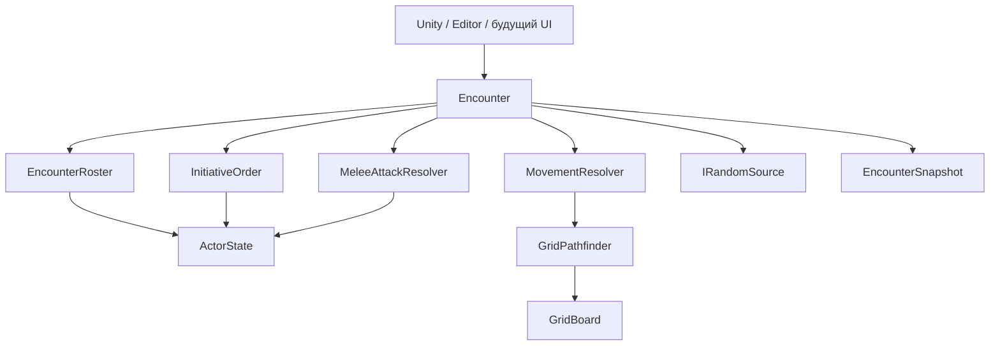

# Aethel — кодовая база систем и руководство разработчика

<!-- GENERATED BY Tools/export-system-code.mjs -->

Снимок: 2026-10-30T16:00:05.547Z (UTC). Базовый commit: `1c5dbbb`; ветка: `refactore/systems`. В снимок входят текущие файлы рабочего дерева, включая незакоммиченные изменения.

**561 C#-файлов; 28 asmdef; 1 asmref; 28 875 строк исходников/конфигурации/инструментов.**

Охват: все `.cs`, `.asmdef`, `.asmref` внутри `Assets/_project`, два локальных инструмента из Tools, manifest UPM и версия Editor. Включён generated PlayerInputAction и один FX-скрипт из Resources. Тесты и Editor-код явно отнесены к своим сборкам.

За пределами снимка: сторонние SDK/пакеты вне Assets/_project, shader-код, сцены/prefab/материалы, бинарные ассеты, пользовательские сохранения, секреты окружения, Library и Wwise-проект. Это справочник кодовых систем, а не переносимый архив всей Unity-игры. Локальные JSON с идентификаторами сервисов не экспортируются.

## Как работать с этой заметкой

Это справочник и полный текстовый снимок исходников систем проекта Aethel. Он предназначен для чтения в Obsidian, поиска классов и продолжения разработки вручную. Источник истины — файлы Unity-проекта. Правки внутри блоков кода этой заметки не попадают в `.cs` автоматически.

Корень проекта: `D:\UnityPetProject\PetProject`. Исходники: `Assets/_project/CodeBase`. В конце каждой группы находятся полные файлы, включая интерфейсы, тесты и asmdef. Для каждого файла указаны относительный путь, SHA-256 исходных байтов и число строк. Пути в блоках относятся к корню проекта. Встроенное оглавление Obsidian позволяет перейти к конкретной сборке или файлу.

Для обновления снимка после правок выполните из корня проекта:

```powershell
node Tools/export-system-code.mjs
node Tools/export-system-code.mjs --verify
```

Первая команда пересобирает `Docs/Codebase/Aethel-Systems-Codebase.md`; вторая сверяет состав файлов, содержимое всех кодовых блоков, контрольные суммы и карту сборок. Копию в Obsidian можно обновить этой командой, если в неё не добавлены ручные записи:

```powershell
Copy-Item -LiteralPath 'D:\UnityPetProject\PetProject\Docs\Codebase\Aethel-Systems-Codebase.md' -Destination 'C:\Users\п\OneDrive\Documents\Делишки\Aethel\01_Архитектура\04_Кодовая_база_систем.md'
```

Ручные проектные решения записывайте в отдельных заметках GD, а пояснения для будущих экспортов — в `Docs/Codebase/Handbook-Guide.md`. Экспорт перезаписывает только сгенерированные файлы в `Docs/Codebase`; автоматического импорта кода из Markdown нет.

## Что реализовано сейчас

Проект находится в переходе от прототипа RPG с одним героем и боем в реальном времени к изометрической тактической RPG по актуальному GDD. Основной игровой запуск пока использует прежние системы. Независимое тактическое ядро D1 и два технических полигона уже существуют отдельно от кампании.

Цель GDD: главный герой и четыре фиксированных спутника, шесть характеристик, тактические столкновения, кампания, путешествия, лагерь и развитие. Само наличие типов `Encounter`, `ActorDefinition` и `MotionTestSession` ещё не означает, что отряд, сохранение боя или полноценная кампания подключены к игре.

| Контур | Текущее состояние | Основная точка входа |
|---|---|---|
| Приложение | Запуск, главное меню, выбор слотов, создание героя, загрузка мира | `BootstrapInstaller`, `CharacterMenuService`, состояния приложения |
| Персонаж | Пять старых характеристик и их модификаторы, создание профиля | `Character/Domain`, `CharacterSession` |
| Сохранения | JSON-слоты, checksum, резервная копия, адаптер старого прогресса | `JsonSlotStore<T>`, `SaveLoadService`, `GameSaveAdapter` |
| Старый игровой мир | Один герой, враги, спавнеры, добыча, старый HUD | `GameWorldBuilder`, фабрики, `Gameplay` |
| Тактика D1 | Сетка, направленные переходы, путь, инициатива, ОД, ближняя атака d20, победа | `Encounter` |
| Полигон D1 | Два участника, ручные команды обеих сторон из EditorWindow | `TacticsSandboxBehaviour`, `TacticsSandboxWindow` |
| Полигон движения | NavMesh, сеточное движение одного героя, камера, предпросмотр ОД | `MotionTestWorld`, `MotionTestController`, `MotionTestSession` |
| Инфраструктура | Addressables, пулы, ввод, Audio/VFX, AI/Blackboard | Соответствующие модули и `_myPlugins` |

Unity: **6000.3.5f2**, URP. Указание Unity 2022 в старом GDD не является инструкцией по откату Editor. Точные версии UPM находятся в приложенном `Packages/manifest.json`; Zenject, UniRx, Wwise, Odin и другие зависимости также могут находиться в Assets, поэтому один UPM manifest не описывает все SDK.

## Карта ответственности

| Область | Где менять код | Чего эта область не должна брать на себя |
|---|---|---|
| `PetProject.Tactics` | `Modules/Tactics/Runtime`: чистые правила, команды, состояние боя | Transform, поиск объектов сцены, загрузка ассетов, UI, чтение файлов |
| `PetProject.Character` | `Character/Domain`: атрибуты, модификаторы, профиль, черновик создания | Открытие меню, смена сцены, файловые слоты |
| `PetProject.App.Contracts` | `Modules/App.Contracts`: порты меню, прогресса, мира и SDK | Реализация представлений, конкретные фабрики и SDK-клиенты |
| `PetProject.Application` | `Modules/Application`: сценарии меню, сессия, состояния загрузки | Построение Canvas, конкретная геометрия уровня |
| `PetProject.UI` | `Modules/UI`: окна, слоты, атрибуты, HUD, презентация | Правила боя и владение долгоживущим игровым прогрессом |
| `PetProject.Progress.Model` | `Modules/Progress.Model`: сериализуемые данные и игровой адаптер | Прямое чтение/запись файлов, создание GameObject |
| `PetProject.Progress.Runtime` | `Modules/Progress.Runtime`: capture/apply, слоты и окружение | Правила характеристик и интерфейс конкретного окна |
| `PetProject.SaveStorage` | `SaveStorage`: envelope, проверка, backup, архивирование | Знание о герое, кампании, фабриках мира |
| `PetProject.Gameplay` | `Modules/Gameplay`: Unity-компоненты героя, врагов, мира и полигонов | Разрешение DI-контейнера и копия правил тактического ядра |
| `PetProject.Composition` | `Modules/Composition`: installers, фабрики, связывание, сборка мира | Правила урона, начисление атрибутов и поведение экранов |
| `PetProject.Input` | `Modules/Input` и generated Input Actions | Правила атаки/передвижения и сохранение состояния |
| `PetProject.Pooling` | `Modules/Pooling`: аренда/возврат и очистка экземпляров | Регистрация убийств и выдача награды |
| `PetProject.Assets` | `Modules/Assets`: загрузка ресурсов и владение экземплярами | Правила отряда и кампании |
| `PetProject.AI` | `Modules/AI`: Blackboard, дерево поведения, стратегии | Зависимость от Composition и конкретного UI |
| `PetProject.Commerce` | `Modules/Commerce`: старые Ads/IAP | Экономика NPC и правила покупки предметов за игровые монеты |
| Audio / VFX / Shared / Dialogue | `_myPlugins`: собственные адаптеры и библиотеки | Неявное управление жизненным циклом кампании |
| Editor / Tests | `Editor`, соответствующие каталоги Tests | Обязательные runtime-зависимости player-сборок |

Ссылки asmdef через GUID сохраняют связи при переносе. Новая сборка нужна для самостоятельной границы зависимостей, а не для каждого класса. Точный граф прямых ссылок приведён ниже. Auto-referenced DLL и неявные зависимости Unity этот граф не заменяет.

## Порядок запуска и владельцы состояния

Основной маршрут: `BootstrapState → WarmUpState → MainMenuState`. Подтверждение героя или выбор слота запускает `ReloadGameState → LoadProgressState → LoadLevelState → GameLoopState`.

`CharacterMenuService` координирует пользовательские сценарии; `CharacterMenuPresentation` владеет представлениями; `CharacterSession` — восстановленным персонажем и подписками характеристик. `GameWorldBuilder` создаёт и восстанавливает мир. `ProgressRegistry.ApplyAsync` ждёт асинхронных участников, после чего загрузка может объявить мир готовым.

| Ресурс | Владелец | Завершение жизни |
|---|---|---|
| Характеристики и подписки профиля | `CharacterSession` | Смена профиля / Dispose |
| Активное окно, блокировка ввода/пауза окна | `CharacterMenuPresentation` | Clear / Dispose |
| Блокировка ввода при загрузке | `CharacterMenuService` | WorldLoaded / ошибка / Dispose |
| Участники capture/apply | `ProgressRegistry` | Unregister при уходе объекта, Clear при смене мира |
| Addressables handles / экземпляры | `AssetProvider` | CleanUp / Dispose |
| Активные и свободные pooled objects | `PoolService` / `Pool<T>` | Despawn / Dispose |
| Логическое состояние боя и RNG | `Encounter` и закрытые от внешнего кода collaborators | Жизнь одного столкновения |
| Логическая позиция и ОД одиночного полигона | `MotionTestSession` | Reset сессии |
| Воспроизведение маршрута и Transform | `MotionTestController` | Завершение принятого маршрута / Reset / разрушение |

## Устройство тактического ядра после разделения

Публичный вход для боя — `Encounter`; внутренние mutable-типы наружу не выдаются. UI и Unity-компоненты читают immutable snapshots и отправляют команды.

| Тип | Ответственность |
|---|---|
| `Encounter` | Проверка общих условий команды, idempotent replay, маршрутизация, ревизия и снимок |
| `EncounterRoster` | Создание участников, уникальность ID/клеток, живая занятость, определение победы |
| `ActorState` | Инкапсулированные HP/ОД/позиция/инициатива участника |
| `InitiativeOrder` | Каноническое распределение бросков, сортировка, пропуск погибших, раунды, восстановление ОД |
| `MovementResolver` | Предпросмотр пути и проверка полной стоимости перед перемещением |
| `MeleeAttackResolver` | Проверки цели/дальности/высоты/ОД, d20, урон и события поражения |
| `GridBoard`, `GridCell`, `GridTransition` | Неизменяемый рельеф, цена входа, высота и запреты направленных переходов |
| `GridPathfinder`, `GridPath` | Взвешенный поиск Dijkstra с воспроизводимым разрешением равных стоимостей |
| `TacticalCommand`, `CommandResult`, `TacticalEvent` | Командный контракт и результат для адаптера/представления |
| `EncounterSnapshot`, `ActorSnapshot` | Снимок для чтения; не DTO сохранённой кампании |
| `IRandomSource`, `DeterministicRandom` | Единственный поток RNG боя, xorshift32-v1 |
| `MotionTestSession`, `MotionMoveResult` | Отдельная тестовая сессия одного героя, без выдуманной второй фракции |



Не меняйте порядок общих проверок без теста: replay принятой команды обрабатывается до проверки завершённости боя и текущего хода. Replay возвращает прежнюю ревизию результата, не расходует ОД/RNG и не повторяет события. Отклонённый ID не резервируется. Новый пользовательский запрос должен получать новый ID; повтор передачи того же запроса использует старый.

Пример использования существующего API (его можно поместить внутрь метода теста/адаптера):

```csharp
var battle = new PetProject.Tactics.Encounter(
    new PetProject.Tactics.GridBoard(8, 5),
    new[]
    {
        new PetProject.Tactics.ActorDefinition("hero", "allies",
            new PetProject.Tactics.GridPosition(1, 1), initiativeBonus: 20),
        new PetProject.Tactics.ActorDefinition("enemy", "enemies",
            new PetProject.Tactics.GridPosition(5, 1))
    },
    new PetProject.Tactics.DeterministicRandom(718));

var result = battle.Execute(PetProject.Tactics.TacticalCommand.Move(
    "input-001", "hero", new PetProject.Tactics.GridPosition(2, 1)));
if (result.Accepted && !result.IsReplay)
{
    var snapshot = battle.GetSnapshot();
    // Передать snapshot/events представлению; не менять HP/ОД в Unity-компоненте.
}
```

Числа полигона условные. D1 пока не реализует натуральные 1/20, критические попадания, LOS, укрытия, дальний бой, заклинания, сетевую репликацию и сохранение столкновения. Ограничения прохода через рёбра участвуют в движении; правила ближней атаки пока проверяют соседство и высоту, отдельного LOS нет.

## Как продолжать разработку вручную

### Добавление игрового правила

1. Опишите наблюдаемое поведение и пограничные случаи в GD. Отделите утверждённое правило от временного значения полигона.
2. Правило без Unity-зависимостей помещайте в соответствующий доменный модуль. Для тактики используйте `Modules/Tactics/Runtime`.
3. Изменение атаки начинайте с `MeleeAttackResolver`; очереди — с `InitiativeOrder`; рельефа/проходимости — с `GridBoard` и `GridPathfinder`. `Encounter` сохраняет общую командную границу.
4. Новую команду проводите через `TacticalCommandKind`, фабрику команды, маршрутизацию `Encounter` и типизированный результат. Проверяйте replay, конфликт ID и отказ без частичного изменения состояния.
5. Unity-адаптер воспроизводит принятый результат. Не дублируйте расход ОД/урон в `MonoBehaviour`.

### Изменение атрибутов и сохранений

Текущие сохранения используют пять атрибутов со старым ключом `inte`. `CharacterProfileData.Restore` проверяет старый формат; простое добавление `CHA` сделает его несовместимым. Не переименовывайте JSON-поля и не ограничивайте старые значения молча: старое создание допускает значения выше будущего базового лимита 20.

Для D2 сначала нужны версия данных кампании, fixtures старых профилей, политика конвертации/резервной копии и тесты чтения. Разделяйте definition персонажа и instance кампании. Поля старого `RunProgress` пока обслуживают прежний цикл и не являются готовой моделью трёх актов GDD.

Новый участник сохранений регистрируется через существующий `IProgressRegistry`; при подборе/возврате в пул/удалении снимает регистрацию. Если восстановление создаёт объекты асинхронно, реализуйте `IAsyncProgressReader`: готовность мира объявляется после завершения apply. Файловые операции остаются в SaveStorage; UI получает `SaveSlotInfo`, а не внутренний JSON envelope.

### Добавление экрана и Unity-компонента

Экран открывается через application-сценарий и существующее представление. Сохраняйте владельца подписок и блокировки ввода. Для pooled-компонента отдельно проверьте повторный spawn/despawn, очистку ссылок и остановку незавершённых async/coroutine.

Привязку конкретных реализаций добавляйте в Composition. Не передавайте `DiContainer` в доменные правила и не создавайте второй глобальный service locator. При переносе существующего `.cs` переносите вместе с ним `.meta`; при переименовании сериализованного поля используйте `FormerlySerializedAs` и проверьте prefab overrides.

### Проверка изменений

Независимое ядро можно проверить без работающего Editor при установленном .NET 9 и ранее загруженном пакете Unity NUnit:

```powershell
node Tools/check-tactics.mjs current
# Те же текущие тесты на исходниках Runtime из HEAD:
node Tools/check-tactics.mjs comparison --head
```

Это вспомогательный синхронный reflection runner, а не Unity Test Runner: он не проверяет сцены, MonoBehaviour, player API и полный жизненный цикл NUnit. При неподдерживаемых TestCase/async/lifecycle hooks он завершает работу с ошибкой. Полный прогон в Unity: Test Runner → EditMode → `PetProject.Tactics.Tests`.

Если установлен нужный Editor по стандартному пути, та же команда сначала компилирует production-исходники его Roslyn-компилятором с reference `.NET Standard 2.1`. Для нестандартной установки можно задать `UNITY_EDITOR_DATA`. Эта дополнительная проверка совместимости C# не запускает Editor, импорт ассетов или player build. Результаты находятся в `Library/TacticsCodeChecks`.

Для проверки интеграций используйте существующие меню:

- `Tools/PetProject/Refactoring/Run Regression Checks` — собственные регрессии и ссылки prefab.
- `Tools/PetProject/Tactics/Run Runtime Checks` — изолированное столкновение D1.
- `Tools/PetProject/Motion/Run Runtime Checks` — движение/камера/переходы полигона.
- `Tools/PetProject/Motion/Run Editor Checks` — генерация и Undo/Redo полигона.

Перед runtime-проверкой сохраните текущую сцену и выйдите из Play. После изменения Unity-компонентов нужна проверка в Play; после изменения платформенных зависимостей — соответствующая player-сборка. Старый успешный отчёт в Library не доказывает состояние нового кода.

## Следующие границы работ по GDD

1. **D2:** шесть характеристик, определения/экземпляры персонажей, версии кампании и безопасная миграция старых профилей.
2. **D3:** отряд из пяти персонажей, управление выбранным участником, связывание кампании и столкновения.
3. **D4:** способности, дальность/LOS, укрытия, эффекты, классы и ресурсы боя — после фиксации правил в GD.
4. **Дальше:** инвентарь/экипировка/отдых, повествование, карта и лагерь, вертикальный срез, проверка PC-релиза.

Отдельные инженерные долги: широкие старые AudioService/AudioFacade и парсер Google Sheets, валидация отсутствующих ссылок Wwise/SteamAudio, окончательное отделение Ads/IAP от премиальной модели GDD. Эти системы включены в снимок для дальнейшей работы; наличие исходника не означает завершённый аудит SDK или реализацию соответствующего пункта GDD.


## Оглавление исходников по сборкам

| Сборка / группа | C# | Всего файлов | Назначение |
|---|---:|---:|---|
| [PetProject.Tactics](#system-1) | 24 | 25 | Независимая сетка, правила столкновения, очередь и команды; одиночная motion-сессия. |
| [PetProject.AI](#system-2) | 44 | 45 | Blackboard, дерево поведения, эксперты и стратегии. |
| [PetProject.App.Contracts](#system-3) | 21 | 22 | Порты и DTO границ приложения, мира, меню и прогресса. |
| [PetProject.Application](#system-4) | 17 | 18 | Сценарии меню, сессия героя, состояния и загрузка сцен. |
| [PetProject.Architecture.Tests](#system-5) | 2 | 3 | Тесты соответствующего модуля (не runtime-система игры). |
| [PetProject.Assets](#system-6) | 3 | 4 | Загрузка Addressables, кэш и жизненный цикл экземпляров. |
| [PetProject.Character](#system-7) | 23 | 24 | Персонаж, профиль, характеристики, модификаторы, создание и экипировка старой модели. |
| [PetProject.Character.Tests](#system-8) | 1 | 2 | Тесты соответствующего модуля (не runtime-система игры). |
| [PetProject.Commerce](#system-9) | 6 | 7 | Старые адаптеры Ads/IAP и SDK. |
| [PetProject.Composition](#system-10) | 14 | 15 | Zenject installers, конкретные фабрики и сборка мира. |
| [PetProject.Editor](#system-11) | 19 | 20 | Инструменты миграции, полигонов и проверок проекта. |
| [PetProject.Gameplay](#system-12) | 90 | 91 | Unity-компоненты героя/врагов/мира и адаптеры технических полигонов. |
| [PetProject.Input](#system-13) | 6 | 8 | Сырой ввод, блокировки меню и generated Input Actions. |
| [PetProject.Pooling](#system-14) | 6 | 7 | Типизированные пулы и жизненный цикл активных/свободных объектов. |
| [PetProject.Progress.Model](#system-15) | 15 | 16 | Сериализуемый прогресс и преобразование игрового payload. |
| [PetProject.Progress.Runtime](#system-16) | 4 | 5 | Регистрация capture/apply, игровые слоты, окружение сохранений. |
| [PetProject.SaveStorage](#system-17) | 2 | 3 | Файловое JSON-хранилище слотов, checksum, backup и архивирование. |
| [PetProject.SaveStorage.Tests](#system-18) | 1 | 2 | Тесты соответствующего модуля (не runtime-система игры). |
| [PetProject.Tactics.Tests](#system-19) | 4 | 5 | Тесты соответствующего модуля (не runtime-система игры). |
| [PetProject.TestSupport](#system-20) | 1 | 2 | Runtime-компонент тестового пула, TestAssemblies. |
| [PetProject.UI](#system-21) | 47 | 48 | Представления меню/атрибутов/слотов, HUD, старые окна и каталог. |
| [Game.Infrastructure.AudioSystem](#system-22) | 142 | 143 | Собственная аудиосистема и адаптеры Wwise. |
| [Game.Infrastructure.VFXSystem](#system-23) | 45 | 46 | Собственная VFX-система: события, сущности, датчики и сервисы. |
| [Game.Infrastructure.VFXSystem.Editor](#system-24) | 1 | 2 | Редактор VFX. |
| [Game.Utils](#system-25) | 5 | 6 | Общие типы, идентификаторы, константы и утилиты. |
| [Assembly-CSharp (resource sample)](#system-26) | 1 | 1 | RandomizeLightStreak из ресурса FX; находится вне CodeBase и собственных asmdef. |
| [AudioSystem.Editor](#system-27) | 2 | 3 | Редактор аудиобазы. |
| [Development tools](#system-28) | 0 | 2 | Повторяемые локальные проверки и экспорт этого справочника. |
| [DialogueSystemExtensions](#system-29) | 5 | 6 | Собственные расширения интеграции диалогов. |
| [GoogleSheetConfig.Editor](#system-30) | 10 | 11 | Редакторская загрузка/парсинг конфигурации Google Sheets. |
| [Project configuration](#system-31) | 0 | 2 | Версия Editor и прямые UPM-зависимости; не все SDK проекта. |

## Прямые зависимости сборок

Собственные GUID-ссылки разрешены в имена. Внешние GUID оставлены как в asmdef: они не объявляются ошибками или отсутствующими SDK только потому, что находятся за пределами снимка. Runtime/Editor определяется конфигурацией самой сборки; test assemblies указаны в их исходниках.

| Сборка | Прямые собственные зависимости | Остальные прямые ссылки |
|---|---|---|
| AudioSystem.Editor | Game.Infrastructure.AudioSystem | — |
| DialogueSystemExtensions | — | `GUID:cd0624525ae0db442b9d3d7f27953406`, `GUID:25bb11dd35c063e4aa2c7cccc0212586` |
| Game.Infrastructure.AudioSystem | Game.Utils | `GUID:0d8beb7f090555447a6cf5ce9e54dbb4`, `GUID:3308bf66d1e54c544aa5e0b1729b9bc3`, `GUID:073df54755fa07a46942e505bff03711`, `GUID:c6a96d81d6329cb46849d34b46ad643b`, `GUID:2c578fd18087ea54cb1187b695afab26`, `GUID:0e17cbbb8c13f0e40b216acbe5145b4d`, `GUID:560b04d1a97f54a4e82edc0cbbb69285`, `GUID:f51ebe6a0ceec4240a699833d6309b23`, `GUID:5c01796d064528144a599661eaab93a6` |
| Game.Infrastructure.VFXSystem | Game.Utils | `GUID:0d8beb7f090555447a6cf5ce9e54dbb4`, `GUID:560b04d1a97f54a4e82edc0cbbb69285`, `GUID:df380645f10b7bc4b97d4f5eb6303d95`, `GUID:f51ebe6a0ceec4240a699833d6309b23`, `GUID:15fc0a57446b3144c949da3e2b9737a9` |
| Game.Infrastructure.VFXSystem.Editor | Game.Infrastructure.VFXSystem | — |
| Game.Utils | — | `GUID:560b04d1a97f54a4e82edc0cbbb69285`, `GUID:f51ebe6a0ceec4240a699833d6309b23` |
| GoogleSheetConfig.Editor | Game.Infrastructure.AudioSystem | — |
| PetProject.AI | Game.Utils | `GUID:560b04d1a97f54a4e82edc0cbbb69285`, `GUID:f51ebe6a0ceec4240a699833d6309b23` |
| PetProject.App.Contracts | PetProject.Progress.Model, PetProject.Character | `GUID:f51ebe6a0ceec4240a699833d6309b23`, `GUID:560b04d1a97f54a4e82edc0cbbb69285` |
| PetProject.Application | PetProject.App.Contracts, PetProject.Progress.Model, PetProject.Character, PetProject.Input, PetProject.Pooling | `GUID:560b04d1a97f54a4e82edc0cbbb69285`, `GUID:f51ebe6a0ceec4240a699833d6309b23`, `GUID:75469ad4d38634e559750d17036d5f7c` |
| PetProject.Architecture.Tests | PetProject.App.Contracts, PetProject.Progress.Model, PetProject.Progress.Runtime, PetProject.Character, PetProject.Pooling, PetProject.TestSupport, PetProject.Gameplay | `GUID:f51ebe6a0ceec4240a699833d6309b23` |
| PetProject.Assets | — | `GUID:0d8beb7f090555447a6cf5ce9e54dbb4`, `GUID:f51ebe6a0ceec4240a699833d6309b23`, `GUID:9e24947de15b9834991c9d8411ea37cf`, `GUID:84651a3751eca9349aac36a66bba901b` |
| PetProject.Character | — | `GUID:560b04d1a97f54a4e82edc0cbbb69285`, `GUID:f51ebe6a0ceec4240a699833d6309b23` |
| PetProject.Character.Tests | PetProject.Character | `GUID:560b04d1a97f54a4e82edc0cbbb69285`, `GUID:f51ebe6a0ceec4240a699833d6309b23` |
| PetProject.Commerce | PetProject.App.Contracts, PetProject.Progress.Model | `GUID:0d8beb7f090555447a6cf5ce9e54dbb4`, `GUID:60bfecf5cb232594891bc622f40d6bed`, `GUID:08d1c582746949b40ba6a45cdb776bdf`, `GUID:ff6de30450f3748908ff580f6ec64d9a` |
| PetProject.Composition | PetProject.Application, PetProject.App.Contracts, PetProject.Progress.Runtime, PetProject.Progress.Model, PetProject.Character, PetProject.UI, PetProject.Gameplay, PetProject.AI, PetProject.Input, PetProject.Pooling, PetProject.Assets, PetProject.Commerce, Game.Infrastructure.AudioSystem, Game.Infrastructure.VFXSystem, Game.Utils | `GUID:0d8beb7f090555447a6cf5ce9e54dbb4`, `GUID:560b04d1a97f54a4e82edc0cbbb69285`, `GUID:f51ebe6a0ceec4240a699833d6309b23`, `GUID:9e24947de15b9834991c9d8411ea37cf`, `GUID:84651a3751eca9349aac36a66bba901b`, `GUID:6055be8ebefd69e48b49212b09b47b2f` |
| PetProject.Editor | PetProject.Composition, PetProject.Application, PetProject.App.Contracts, PetProject.Progress.Runtime, PetProject.Progress.Model, PetProject.Character, PetProject.SaveStorage, PetProject.UI, PetProject.Gameplay, PetProject.AI, PetProject.Input, Game.Infrastructure.AudioSystem, Game.Infrastructure.VFXSystem, PetProject.Pooling, PetProject.Tactics | `GUID:75469ad4d38634e559750d17036d5f7c`, `GUID:4307f53044263cf4b835bd812fc161a4`, `GUID:8c4dd21966739024fbd72155091d199e`, `GUID:0d8beb7f090555447a6cf5ce9e54dbb4`, `GUID:560b04d1a97f54a4e82edc0cbbb69285`, `GUID:f51ebe6a0ceec4240a699833d6309b23`, `GUID:9e24947de15b9834991c9d8411ea37cf`, `GUID:69448af7b92c7f342b298e06a37122aa`, `GUID:84651a3751eca9349aac36a66bba901b`, `GUID:6055be8ebefd69e48b49212b09b47b2f`, `GUID:2bafac87e7f4b9b418d9448d219b01ab` |
| PetProject.Gameplay | PetProject.App.Contracts, PetProject.Progress.Model, PetProject.Character, PetProject.AI, PetProject.Input, PetProject.Pooling, PetProject.Assets, Game.Infrastructure.AudioSystem, Game.Infrastructure.VFXSystem, Game.Utils, PetProject.Tactics | `GUID:75469ad4d38634e559750d17036d5f7c`, `GUID:4307f53044263cf4b835bd812fc161a4`, `GUID:8c4dd21966739024fbd72155091d199e`, `GUID:0d8beb7f090555447a6cf5ce9e54dbb4`, `GUID:560b04d1a97f54a4e82edc0cbbb69285`, `GUID:f51ebe6a0ceec4240a699833d6309b23`, `GUID:6055be8ebefd69e48b49212b09b47b2f`, `GUID:9e24947de15b9834991c9d8411ea37cf`, `GUID:84651a3751eca9349aac36a66bba901b` |
| PetProject.Input | — | `GUID:0d8beb7f090555447a6cf5ce9e54dbb4`, `GUID:75469ad4d38634e559750d17036d5f7c`, `GUID:2bafac87e7f4b9b418d9448d219b01ab` |
| PetProject.Pooling | — | `GUID:f51ebe6a0ceec4240a699833d6309b23` |
| PetProject.Progress.Model | PetProject.Character | — |
| PetProject.Progress.Runtime | PetProject.App.Contracts, PetProject.Progress.Model, PetProject.Character, PetProject.SaveStorage | `GUID:f51ebe6a0ceec4240a699833d6309b23` |
| PetProject.SaveStorage | — | — |
| PetProject.SaveStorage.Tests | PetProject.SaveStorage | — |
| PetProject.Tactics | — | — |
| PetProject.Tactics.Tests | PetProject.Tactics | — |
| PetProject.TestSupport | PetProject.Pooling | — |
| PetProject.UI | PetProject.App.Contracts, PetProject.Progress.Model, PetProject.Character, PetProject.Input, PetProject.Assets, PetProject.Pooling | `GUID:560b04d1a97f54a4e82edc0cbbb69285`, `GUID:f51ebe6a0ceec4240a699833d6309b23`, `GUID:6055be8ebefd69e48b49212b09b47b2f`, `GUID:2bafac87e7f4b9b418d9448d219b01ab`, `GUID:9e24947de15b9834991c9d8411ea37cf`, `GUID:84651a3751eca9349aac36a66bba901b` |

<a id="system-1"></a>

## PetProject.Tactics

Независимая сетка, правила столкновения, очередь и команды; одиночная motion-сессия.

| Файл | Строк |
|---|---:|
| [Assets/_project/CodeBase/Modules/Tactics/Runtime/Commands/CommandError.cs](#source-0283) | 9 |
| [Assets/_project/CodeBase/Modules/Tactics/Runtime/Commands/CommandResult.cs](#source-0284) | 24 |
| [Assets/_project/CodeBase/Modules/Tactics/Runtime/Commands/TacticalCommand.cs](#source-0285) | 41 |
| [Assets/_project/CodeBase/Modules/Tactics/Runtime/Commands/TacticalEvent.cs](#source-0286) | 25 |
| [Assets/_project/CodeBase/Modules/Tactics/Runtime/Encounter.cs](#source-0287) | 71 |
| [Assets/_project/CodeBase/Modules/Tactics/Runtime/Grid/GridBoard.cs](#source-0288) | 56 |
| [Assets/_project/CodeBase/Modules/Tactics/Runtime/Grid/GridCell.cs](#source-0289) | 21 |
| [Assets/_project/CodeBase/Modules/Tactics/Runtime/Grid/GridPath.cs](#source-0290) | 19 |
| [Assets/_project/CodeBase/Modules/Tactics/Runtime/Grid/GridPathfinder.cs](#source-0291) | 59 |
| [Assets/_project/CodeBase/Modules/Tactics/Runtime/Grid/GridPosition.cs](#source-0292) | 19 |
| [Assets/_project/CodeBase/Modules/Tactics/Runtime/Grid/GridTransition.cs](#source-0293) | 15 |
| [Assets/_project/CodeBase/Modules/Tactics/Runtime/MotionMoveResult.cs](#source-0294) | 23 |
| [Assets/_project/CodeBase/Modules/Tactics/Runtime/MotionTestSession.cs](#source-0295) | 51 |
| [Assets/_project/CodeBase/Modules/Tactics/Runtime/PetProject.Tactics.asmdef](#source-0296) | 7 |
| [Assets/_project/CodeBase/Modules/Tactics/Runtime/Rules/DeterministicRandom.cs](#source-0297) | 35 |
| [Assets/_project/CodeBase/Modules/Tactics/Runtime/Rules/EncounterRules.cs](#source-0298) | 22 |
| [Assets/_project/CodeBase/Modules/Tactics/Runtime/Rules/IRandomSource.cs](#source-0299) | 8 |
| [Assets/_project/CodeBase/Modules/Tactics/Runtime/Rules/MeleeAttackResolver.cs](#source-0300) | 41 |
| [Assets/_project/CodeBase/Modules/Tactics/Runtime/Rules/MovementResolver.cs](#source-0301) | 37 |
| [Assets/_project/CodeBase/Modules/Tactics/Runtime/State/ActorDefinition.cs](#source-0302) | 33 |
| [Assets/_project/CodeBase/Modules/Tactics/Runtime/State/ActorSnapshot.cs](#source-0303) | 23 |
| [Assets/_project/CodeBase/Modules/Tactics/Runtime/State/ActorState.cs](#source-0304) | 42 |
| [Assets/_project/CodeBase/Modules/Tactics/Runtime/State/EncounterRoster.cs](#source-0305) | 44 |
| [Assets/_project/CodeBase/Modules/Tactics/Runtime/State/EncounterSnapshot.cs](#source-0306) | 28 |
| [Assets/_project/CodeBase/Modules/Tactics/Runtime/State/InitiativeOrder.cs](#source-0307) | 43 |

<a id="source-0283"></a>

### Assets/_project/CodeBase/Modules/Tactics/Runtime/Commands/CommandError.cs

[Открыть исходник](<D:/UnityPetProject/PetProject/Assets/_project/CodeBase/Modules/Tactics/Runtime/Commands/CommandError.cs>) · SHA-256: `b2cc0324f329c6d1aa6257ab4f3048d649bb5beb11733c778ecce117af15cd84` · строк: 9

<!-- CODE-BEGIN Assets/_project/CodeBase/Modules/Tactics/Runtime/Commands/CommandError.cs -->
```csharp
namespace PetProject.Tactics
{
    public enum CommandError
    {
        None, CommandIdConflict, EncounterCompleted, UnknownActor, ActorDefeated, WrongTurn,
        InvalidDestination, AlreadyAtDestination, NoPath, NotEnoughActions,
        UnknownTarget, TargetDefeated, FriendlyTarget, TargetOutOfRange
    }
}
```
<!-- CODE-END Assets/_project/CodeBase/Modules/Tactics/Runtime/Commands/CommandError.cs -->

<a id="source-0284"></a>

### Assets/_project/CodeBase/Modules/Tactics/Runtime/Commands/CommandResult.cs

[Открыть исходник](<D:/UnityPetProject/PetProject/Assets/_project/CodeBase/Modules/Tactics/Runtime/Commands/CommandResult.cs>) · SHA-256: `2be325ae5234e1647d6673549425744b2af23448dbfb122d8da88b1d2a593fc2` · строк: 24

<!-- CODE-BEGIN Assets/_project/CodeBase/Modules/Tactics/Runtime/Commands/CommandResult.cs -->
```csharp
using System;
using System.Collections.Generic;

namespace PetProject.Tactics
{
    public sealed class CommandResult
    {
        public bool Accepted => Error == CommandError.None;
        public bool IsReplay { get; }
        public CommandError Error { get; }
        public long Revision { get; }
        public IReadOnlyList<TacticalEvent> Events { get; }

        internal CommandResult(CommandError error, long revision, TacticalEvent[] events, bool replay = false)
        {
            Error = error;
            Revision = revision;
            Events = Array.AsReadOnly(events);
            IsReplay = replay;
        }

        internal CommandResult AsReplay() => new CommandResult(Error, Revision, Array.Empty<TacticalEvent>(), true);
    }
}
```
<!-- CODE-END Assets/_project/CodeBase/Modules/Tactics/Runtime/Commands/CommandResult.cs -->

<a id="source-0285"></a>

### Assets/_project/CodeBase/Modules/Tactics/Runtime/Commands/TacticalCommand.cs

[Открыть исходник](<D:/UnityPetProject/PetProject/Assets/_project/CodeBase/Modules/Tactics/Runtime/Commands/TacticalCommand.cs>) · SHA-256: `8e24801b1a8fbb26e05b73b72e8390308ae9c924d0c2f32fbe02a54a78be92dd` · строк: 41

<!-- CODE-BEGIN Assets/_project/CodeBase/Modules/Tactics/Runtime/Commands/TacticalCommand.cs -->
```csharp
using System;

namespace PetProject.Tactics
{
    public enum TacticalCommandKind { Move, Attack, EndTurn }

    public sealed class TacticalCommand : IEquatable<TacticalCommand>
    {
        public string Id { get; }
        public string ActorId { get; }
        public TacticalCommandKind Kind { get; }
        public GridPosition Destination { get; }
        public string TargetId { get; }

        private TacticalCommand(string id, string actorId, TacticalCommandKind kind, GridPosition destination, string targetId)
        {
            if (string.IsNullOrWhiteSpace(id)) throw new ArgumentException("Command ID is required", nameof(id));
            if (string.IsNullOrWhiteSpace(actorId)) throw new ArgumentException("Actor ID is required", nameof(actorId));
            Id = id;
            ActorId = actorId;
            Kind = kind;
            Destination = destination;
            TargetId = targetId;
        }

        public static TacticalCommand Move(string id, string actorId, GridPosition destination) =>
            new TacticalCommand(id, actorId, TacticalCommandKind.Move, destination, null);
        public static TacticalCommand Attack(string id, string actorId, string targetId)
        {
            if (string.IsNullOrWhiteSpace(targetId)) throw new ArgumentException("Target ID is required", nameof(targetId));
            return new TacticalCommand(id, actorId, TacticalCommandKind.Attack, default, targetId);
        }
        public static TacticalCommand EndTurn(string id, string actorId) =>
            new TacticalCommand(id, actorId, TacticalCommandKind.EndTurn, default, null);

        public bool Equals(TacticalCommand other) => other != null && Id == other.Id && ActorId == other.ActorId &&
            Kind == other.Kind && Destination == other.Destination && TargetId == other.TargetId;
        public override bool Equals(object obj) => obj is TacticalCommand other && Equals(other);
        public override int GetHashCode() => StringComparer.Ordinal.GetHashCode(Id);
    }
}
```
<!-- CODE-END Assets/_project/CodeBase/Modules/Tactics/Runtime/Commands/TacticalCommand.cs -->

<a id="source-0286"></a>

### Assets/_project/CodeBase/Modules/Tactics/Runtime/Commands/TacticalEvent.cs

[Открыть исходник](<D:/UnityPetProject/PetProject/Assets/_project/CodeBase/Modules/Tactics/Runtime/Commands/TacticalEvent.cs>) · SHA-256: `a975c28e8893e72e86ae22470a7ade9889e3333ebaf6541e110926082b76407b` · строк: 25

<!-- CODE-BEGIN Assets/_project/CodeBase/Modules/Tactics/Runtime/Commands/TacticalEvent.cs -->
```csharp
namespace PetProject.Tactics
{
    public enum TacticalEventKind { Moved, AttackHit, AttackMiss, ActorDefeated, TurnEnded, TurnStarted, EncounterCompleted }

    public readonly struct TacticalEvent
    {
        public TacticalEventKind Kind { get; }
        public string ActorId { get; }
        public string TargetId { get; }
        public GridPosition Position { get; }
        public int Amount { get; }
        public int Roll { get; }

        internal TacticalEvent(TacticalEventKind kind, string actorId, string targetId = null,
            GridPosition position = default, int amount = 0, int roll = 0)
        {
            Kind = kind;
            ActorId = actorId;
            TargetId = targetId;
            Position = position;
            Amount = amount;
            Roll = roll;
        }
    }
}
```
<!-- CODE-END Assets/_project/CodeBase/Modules/Tactics/Runtime/Commands/TacticalEvent.cs -->

<a id="source-0287"></a>

### Assets/_project/CodeBase/Modules/Tactics/Runtime/Encounter.cs

[Открыть исходник](<D:/UnityPetProject/PetProject/Assets/_project/CodeBase/Modules/Tactics/Runtime/Encounter.cs>) · SHA-256: `bfb3d7eff777be73aeadb9768b86a961855dd62f5550b192be1e71b598e3da8e` · строк: 71

<!-- CODE-BEGIN Assets/_project/CodeBase/Modules/Tactics/Runtime/Encounter.cs -->
```csharp
using System;
using System.Collections.Generic;

namespace PetProject.Tactics
{
    /// <summary>Single authority for a prototype encounter. Only accepted commands mutate combat state.</summary>
    public sealed class Encounter
    {
        private readonly EncounterRoster _roster;
        private readonly InitiativeOrder _turns;
        private readonly MovementResolver _movement;
        private readonly MeleeAttackResolver _attacks;
        private readonly Dictionary<string, (TacticalCommand command, CommandResult result)> _accepted =
            new Dictionary<string, (TacticalCommand, CommandResult)>(StringComparer.Ordinal);
        private readonly IRandomSource _random;
        private long _revision;
        public GridBoard Board { get; }
        public EncounterRules Rules { get; }
        public string CurrentActorId => _roster.WinningFactionId == null ? _turns.Current.Definition.Id : null;

        public Encounter(GridBoard board, IEnumerable<ActorDefinition> actors, IRandomSource random, EncounterRules rules = null)
        {
            Board = board ?? throw new ArgumentNullException(nameof(board));
            _random = random ?? throw new ArgumentNullException(nameof(random));
            Rules = rules ?? new EncounterRules();
            _roster = new EncounterRoster(board, actors);
            _turns = new InitiativeOrder(_roster.Actors, Rules.ActionsPerTurn, RollD20);
            _movement = new MovementResolver(board, Rules, _roster);
            _attacks = new MeleeAttackResolver(board, Rules, _roster, RollD20);
        }

        public EncounterSnapshot GetSnapshot() => new EncounterSnapshot(_revision, _turns.Round, CurrentActorId,
            _roster.WinningFactionId, _random.State, _turns.CaptureActors());

        public GridPath PreviewMove(string actorId, GridPosition destination) => _movement.Preview(actorId, destination);

        public CommandResult Execute(TacticalCommand command)
        {
            if (command == null) throw new ArgumentNullException(nameof(command));
            // A completed encounter still acknowledges a retry of an accepted command.
            if (_accepted.TryGetValue(command.Id, out var previous))
                return previous.command.Equals(command) ? previous.result.AsReplay() : Reject(CommandError.CommandIdConflict);
            if (_roster.WinningFactionId != null) return Reject(CommandError.EncounterCompleted);
            if (!_roster.TryGet(command.ActorId, out var actor)) return Reject(CommandError.UnknownActor);
            if (!actor.IsAlive) return Reject(CommandError.ActorDefeated);
            if (CurrentActorId != command.ActorId) return Reject(CommandError.WrongTurn);

            var events = new List<TacticalEvent>();
            CommandError error;
            switch (command.Kind)
            {
                case TacticalCommandKind.Move: error = _movement.TryMove(actor, command.Destination, events); break;
                case TacticalCommandKind.Attack: error = _attacks.TryAttack(actor, command.TargetId, events); break;
                case TacticalCommandKind.EndTurn: _turns.EndTurn(events); error = CommandError.None; break;
                default: throw new ArgumentOutOfRangeException(nameof(command));
            }
            if (error != CommandError.None) return Reject(error);
            var result = new CommandResult(CommandError.None, ++_revision, events.ToArray());
            _accepted.Add(command.Id, (command, result));
            return result;
        }

        private CommandResult Reject(CommandError error) => new CommandResult(error, _revision, Array.Empty<TacticalEvent>());
        private int RollD20()
        {
            var roll = _random.NextInt(1, 21);
            if (roll < 1 || roll > 20) throw new InvalidOperationException("Random source returned an invalid d20 roll");
            return roll;
        }
    }
}
```
<!-- CODE-END Assets/_project/CodeBase/Modules/Tactics/Runtime/Encounter.cs -->

<a id="source-0288"></a>

### Assets/_project/CodeBase/Modules/Tactics/Runtime/Grid/GridBoard.cs

[Открыть исходник](<D:/UnityPetProject/PetProject/Assets/_project/CodeBase/Modules/Tactics/Runtime/Grid/GridBoard.cs>) · SHA-256: `86f75ffc42fadcf5983e625a34922e2ffed4fede875a0773224eaf8a1640ad67` · строк: 56

<!-- CODE-BEGIN Assets/_project/CodeBase/Modules/Tactics/Runtime/Grid/GridBoard.cs -->
```csharp
using System;
using System.Collections.Generic;

namespace PetProject.Tactics
{
    /// <summary>Immutable terrain. Actor occupancy belongs to the encounter, not this definition.</summary>
    public sealed class GridBoard
    {
        private readonly GridCell[] _cells;
        private readonly HashSet<GridTransition> _blockedTransitions;
        public int Width { get; }
        public int Height { get; }

        public GridBoard(int width, int height, IEnumerable<GridCell> overrides = null,
            IEnumerable<GridTransition> blockedTransitions = null)
        {
            if (width < 1 || height < 1 || (long)width * height > 1_000_000)
                throw new ArgumentOutOfRangeException(nameof(width), "Board must contain 1..1,000,000 cells");
            Width = width;
            Height = height;
            _blockedTransitions = blockedTransitions == null
                ? new HashSet<GridTransition>() : new HashSet<GridTransition>(blockedTransitions);
            foreach (var edge in _blockedTransitions)
                if (!Contains(edge.From) || !Contains(edge.To) || edge.From.DistanceTo(edge.To) != 1)
                    throw new ArgumentException("Blocked transitions must join adjacent board cells", nameof(blockedTransitions));
            _cells = new GridCell[width * height];
            for (var y = 0; y < height; ++y)
                for (var x = 0; x < width; ++x)
                    _cells[y * width + x] = new GridCell(new GridPosition(x, y));
            if (overrides == null) return;
            var seen = new HashSet<GridPosition>();
            foreach (var cell in overrides)
            {
                if (!Contains(cell.Position) || cell.MoveCost < 1 || !seen.Add(cell.Position))
                    throw new ArgumentException("Invalid or duplicate terrain override", nameof(overrides));
                _cells[Index(cell.Position)] = cell;
            }
        }

        public bool Contains(GridPosition position) => position.X >= 0 && position.Y >= 0 && position.X < Width && position.Y < Height;
        public bool CanTraverse(GridPosition from, GridPosition to, int maxHeightStep)
        {
            if (maxHeightStep < 0) throw new ArgumentOutOfRangeException(nameof(maxHeightStep));
            return Contains(from) && Contains(to) && from.DistanceTo(to) == 1 &&
                GetCell(from).Walkable && GetCell(to).Walkable &&
                Math.Abs((long)GetCell(from).Height - GetCell(to).Height) <= maxHeightStep &&
                !_blockedTransitions.Contains(new GridTransition(from, to));
        }
        public GridCell GetCell(GridPosition position)
        {
            if (!Contains(position)) throw new ArgumentOutOfRangeException(nameof(position));
            return _cells[Index(position)];
        }
        private int Index(GridPosition position) => position.Y * Width + position.X;
    }
}
```
<!-- CODE-END Assets/_project/CodeBase/Modules/Tactics/Runtime/Grid/GridBoard.cs -->

<a id="source-0289"></a>

### Assets/_project/CodeBase/Modules/Tactics/Runtime/Grid/GridCell.cs

[Открыть исходник](<D:/UnityPetProject/PetProject/Assets/_project/CodeBase/Modules/Tactics/Runtime/Grid/GridCell.cs>) · SHA-256: `74509e678ba81dfd32682b1f11e1179e988c7353becfe0355fcd0308fd72254b` · строк: 21

<!-- CODE-BEGIN Assets/_project/CodeBase/Modules/Tactics/Runtime/Grid/GridCell.cs -->
```csharp
using System;

namespace PetProject.Tactics
{
    public readonly struct GridCell
    {
        public GridPosition Position { get; }
        public bool Walkable { get; }
        public int Height { get; }
        public int MoveCost { get; }

        public GridCell(GridPosition position, bool walkable = true, int height = 0, int moveCost = 1)
        {
            if (moveCost < 1) throw new ArgumentOutOfRangeException(nameof(moveCost));
            Position = position;
            Walkable = walkable;
            Height = height;
            MoveCost = moveCost;
        }
    }
}
```
<!-- CODE-END Assets/_project/CodeBase/Modules/Tactics/Runtime/Grid/GridCell.cs -->

<a id="source-0290"></a>

### Assets/_project/CodeBase/Modules/Tactics/Runtime/Grid/GridPath.cs

[Открыть исходник](<D:/UnityPetProject/PetProject/Assets/_project/CodeBase/Modules/Tactics/Runtime/Grid/GridPath.cs>) · SHA-256: `ec965c9ed958d7e96ad8103865c9177e864ea900b5a3ef218dbf1320c4d4c9db` · строк: 19

<!-- CODE-BEGIN Assets/_project/CodeBase/Modules/Tactics/Runtime/Grid/GridPath.cs -->
```csharp
using System;
using System.Collections.Generic;

namespace PetProject.Tactics
{
    public sealed class GridPath
    {
        public static GridPath Unreachable { get; } = new GridPath(false, 0, Array.Empty<GridPosition>());
        public bool Found { get; }
        public long Cost { get; }
        public IReadOnlyList<GridPosition> Cells { get; }
        internal GridPath(bool found, long cost, GridPosition[] cells)
        {
            Found = found;
            Cost = cost;
            Cells = Array.AsReadOnly(cells);
        }
    }
}
```
<!-- CODE-END Assets/_project/CodeBase/Modules/Tactics/Runtime/Grid/GridPath.cs -->

<a id="source-0291"></a>

### Assets/_project/CodeBase/Modules/Tactics/Runtime/Grid/GridPathfinder.cs

[Открыть исходник](<D:/UnityPetProject/PetProject/Assets/_project/CodeBase/Modules/Tactics/Runtime/Grid/GridPathfinder.cs>) · SHA-256: `d97b05207b59f266537bfd848cff3717877eb18a99660100b989c3c25053af4e` · строк: 59

<!-- CODE-BEGIN Assets/_project/CodeBase/Modules/Tactics/Runtime/Grid/GridPathfinder.cs -->
```csharp
using System;
using System.Collections.Generic;

namespace PetProject.Tactics
{
    public static class GridPathfinder
    {
        private static readonly GridPosition[] Directions =
        {
            new GridPosition(1, 0), new GridPosition(0, 1), new GridPosition(-1, 0), new GridPosition(0, -1)
        };

        /// <summary>Dijkstra: terrain costs may differ. Equal costs are resolved by coordinates.</summary>
        public static GridPath FindPath(GridBoard board, GridPosition start, GridPosition goal,
            IEnumerable<GridPosition> occupied = null, int maxHeightStep = 1)
        {
            if (board == null) throw new ArgumentNullException(nameof(board));
            if (maxHeightStep < 0) throw new ArgumentOutOfRangeException(nameof(maxHeightStep));
            if (!board.Contains(start) || !board.Contains(goal) || !board.GetCell(start).Walkable || !board.GetCell(goal).Walkable)
                return GridPath.Unreachable;
            var blocked = occupied == null ? new HashSet<GridPosition>() : new HashSet<GridPosition>(occupied);
            blocked.Remove(start);
            if (blocked.Contains(goal)) return GridPath.Unreachable;
            var costs = new Dictionary<GridPosition, long> { [start] = 0 };
            var previous = new Dictionary<GridPosition, GridPosition>();
            var frontier = new SortedSet<(long cost, int x, int y)> { (0, start.X, start.Y) };
            while (frontier.Count > 0)
            {
                var item = frontier.Min;
                frontier.Remove(item);
                var current = new GridPosition(item.x, item.y);
                if (costs[current] != item.cost) continue;
                if (current == goal) return BuildPath(start, goal, item.cost, previous);
                foreach (var direction in Directions)
                {
                    var next = new GridPosition(current.X + direction.X, current.Y + direction.Y);
                    if (!board.Contains(next) || blocked.Contains(next)) continue;
                    var tile = board.GetCell(next);
                    if (!board.CanTraverse(current, next, maxHeightStep)) continue;
                    var cost = item.cost + tile.MoveCost;
                    if (costs.TryGetValue(next, out var known) && known <= cost) continue;
                    costs[next] = cost;
                    previous[next] = current;
                    frontier.Add((cost, next.X, next.Y));
                }
            }
            return GridPath.Unreachable;
        }

        private static GridPath BuildPath(GridPosition start, GridPosition goal, long cost,
            IReadOnlyDictionary<GridPosition, GridPosition> previous)
        {
            var cells = new List<GridPosition> { goal };
            while (cells[cells.Count - 1] != start) cells.Add(previous[cells[cells.Count - 1]]);
            cells.Reverse();
            return new GridPath(true, cost, cells.ToArray());
        }
    }
}
```
<!-- CODE-END Assets/_project/CodeBase/Modules/Tactics/Runtime/Grid/GridPathfinder.cs -->

<a id="source-0292"></a>

### Assets/_project/CodeBase/Modules/Tactics/Runtime/Grid/GridPosition.cs

[Открыть исходник](<D:/UnityPetProject/PetProject/Assets/_project/CodeBase/Modules/Tactics/Runtime/Grid/GridPosition.cs>) · SHA-256: `f0909cde7c4ea89e760af2b9b5a7f68c6bd6ac87d13dbef7b208d497ed67e1f2` · строк: 19

<!-- CODE-BEGIN Assets/_project/CodeBase/Modules/Tactics/Runtime/Grid/GridPosition.cs -->
```csharp
using System;

namespace PetProject.Tactics
{
    public readonly struct GridPosition : IEquatable<GridPosition>
    {
        public int X { get; }
        public int Y { get; }

        public GridPosition(int x, int y) { X = x; Y = y; }
        public long DistanceTo(GridPosition other) => Math.Abs((long)X - other.X) + Math.Abs((long)Y - other.Y);
        public bool Equals(GridPosition other) => X == other.X && Y == other.Y;
        public override bool Equals(object obj) => obj is GridPosition other && Equals(other);
        public override int GetHashCode() => unchecked((X * 397) ^ Y);
        public override string ToString() => $"({X}, {Y})";
        public static bool operator ==(GridPosition left, GridPosition right) => left.Equals(right);
        public static bool operator !=(GridPosition left, GridPosition right) => !left.Equals(right);
    }
}
```
<!-- CODE-END Assets/_project/CodeBase/Modules/Tactics/Runtime/Grid/GridPosition.cs -->

<a id="source-0293"></a>

### Assets/_project/CodeBase/Modules/Tactics/Runtime/Grid/GridTransition.cs

[Открыть исходник](<D:/UnityPetProject/PetProject/Assets/_project/CodeBase/Modules/Tactics/Runtime/Grid/GridTransition.cs>) · SHA-256: `138421c26e3dd48259128db6ad3b8d023cfb2d3883b9f0159564d7a91619729a` · строк: 15

<!-- CODE-BEGIN Assets/_project/CodeBase/Modules/Tactics/Runtime/Grid/GridTransition.cs -->
```csharp
using System;

namespace PetProject.Tactics
{
    /// <summary>A directed, immutable terrain edge. Unity adapters can forbid physically impossible steps.</summary>
    public readonly struct GridTransition : IEquatable<GridTransition>
    {
        public GridPosition From { get; }
        public GridPosition To { get; }
        public GridTransition(GridPosition from, GridPosition to) { From = from; To = to; }
        public bool Equals(GridTransition other) => From == other.From && To == other.To;
        public override bool Equals(object obj) => obj is GridTransition other && Equals(other);
        public override int GetHashCode() => unchecked(From.GetHashCode() * 397 ^ To.GetHashCode());
    }
}
```
<!-- CODE-END Assets/_project/CodeBase/Modules/Tactics/Runtime/Grid/GridTransition.cs -->

<a id="source-0294"></a>

### Assets/_project/CodeBase/Modules/Tactics/Runtime/MotionMoveResult.cs

[Открыть исходник](<D:/UnityPetProject/PetProject/Assets/_project/CodeBase/Modules/Tactics/Runtime/MotionMoveResult.cs>) · SHA-256: `0fa796348867d42251f1ec45a944a2a19bc949d1319f84857a1904a9eb7e7a9d` · строк: 23

<!-- CODE-BEGIN Assets/_project/CodeBase/Modules/Tactics/Runtime/MotionMoveResult.cs -->
```csharp
namespace PetProject.Tactics
{
    public sealed class MotionMoveResult
    {
        public GridPosition Destination { get; }
        public long ExpectedRevision { get; }
        public GridPath Path { get; }
        public string Error { get; }
        public bool Accepted => Error == null;
        public bool IsReplay { get; }

        internal MotionMoveResult(GridPosition destination, long revision, GridPath path, string error, bool replay)
        {
            Destination = destination;
            ExpectedRevision = revision;
            Path = path;
            Error = error;
            IsReplay = replay;
        }

        internal MotionMoveResult Replay() => new MotionMoveResult(Destination, ExpectedRevision, Path, Error, true);
    }
}
```
<!-- CODE-END Assets/_project/CodeBase/Modules/Tactics/Runtime/MotionMoveResult.cs -->

<a id="source-0295"></a>

### Assets/_project/CodeBase/Modules/Tactics/Runtime/MotionTestSession.cs

[Открыть исходник](<D:/UnityPetProject/PetProject/Assets/_project/CodeBase/Modules/Tactics/Runtime/MotionTestSession.cs>) · SHA-256: `3e4b84ef135b09ac0ff5777408c2587b5231c8dfbc625db894f1a6f1e3c4af2e` · строк: 51

<!-- CODE-BEGIN Assets/_project/CodeBase/Modules/Tactics/Runtime/MotionTestSession.cs -->
```csharp
using System;
using System.Collections.Generic;

namespace PetProject.Tactics
{
    /// <summary>Single-actor movement fixture. It shares terrain/path rules with Encounter, without inventing a second faction.</summary>
    public sealed class MotionTestSession
    {
        private readonly GridBoard _board;
        private readonly int _heightStep;
        private readonly Dictionary<string, MotionMoveResult> _accepted = new Dictionary<string, MotionMoveResult>();
        public GridPosition Position { get; private set; }
        public int Actions { get; private set; }
        public int Budget { get; }
        public long Revision { get; private set; }

        public MotionTestSession(GridBoard board, GridPosition start, int budget, int maxHeightStep = 4)
        {
            _board = board ?? throw new ArgumentNullException(nameof(board));
            if (!board.Contains(start) || !board.GetCell(start).Walkable) throw new ArgumentException("Invalid spawn", nameof(start));
            if (budget < 1 || maxHeightStep < 0) throw new ArgumentOutOfRangeException(nameof(budget));
            Position = start; Actions = Budget = budget; _heightStep = maxHeightStep;
        }

        public GridPath Preview(GridPosition destination) => GridPathfinder.FindPath(_board, Position, destination, null, _heightStep);

        public MotionMoveResult Move(string id, GridPosition destination, long expectedRevision)
        {
            if (string.IsNullOrWhiteSpace(id)) throw new ArgumentException("Command ID required", nameof(id));
            if (_accepted.TryGetValue(id, out var previous))
                return previous.Destination == destination && previous.ExpectedRevision == expectedRevision
                    ? previous.Replay() : Reject(destination, expectedRevision, "CommandIdConflict");
            if (Revision != expectedRevision) return Reject(destination, expectedRevision, "StalePreview");
            if (!_board.Contains(destination)) return Reject(destination, expectedRevision, "OutsideBoard");
            if (destination == Position) return Reject(destination, expectedRevision, "AlreadyAtDestination");
            var path = Preview(destination);
            if (!path.Found) return Reject(destination, expectedRevision, "NoPath");
            if (path.Cost > Actions) return Reject(destination, expectedRevision, "NotEnoughActions");
            Position = destination;
            Actions -= (int)path.Cost;
            ++Revision;
            var result = new MotionMoveResult(destination, expectedRevision, path, null, false);
            _accepted.Add(id, result);
            return result;
        }

        public void NewTurn() { Actions = Budget; ++Revision; }
        private static MotionMoveResult Reject(GridPosition destination, long revision, string error) =>
            new MotionMoveResult(destination, revision, GridPath.Unreachable, error, false);
    }
}
```
<!-- CODE-END Assets/_project/CodeBase/Modules/Tactics/Runtime/MotionTestSession.cs -->

<a id="source-0296"></a>

### Assets/_project/CodeBase/Modules/Tactics/Runtime/PetProject.Tactics.asmdef

[Открыть исходник](<D:/UnityPetProject/PetProject/Assets/_project/CodeBase/Modules/Tactics/Runtime/PetProject.Tactics.asmdef>) · SHA-256: `54f1934f246bad4c1228df6687d5546e2e6db34270bbea88f530d42c036e7d43` · строк: 7

<!-- CODE-BEGIN Assets/_project/CodeBase/Modules/Tactics/Runtime/PetProject.Tactics.asmdef -->
```json
{
  "name": "PetProject.Tactics",
  "rootNamespace": "PetProject.Tactics",
  "references": [],
  "autoReferenced": false,
  "noEngineReferences": true
}
```
<!-- CODE-END Assets/_project/CodeBase/Modules/Tactics/Runtime/PetProject.Tactics.asmdef -->

<a id="source-0297"></a>

### Assets/_project/CodeBase/Modules/Tactics/Runtime/Rules/DeterministicRandom.cs

[Открыть исходник](<D:/UnityPetProject/PetProject/Assets/_project/CodeBase/Modules/Tactics/Runtime/Rules/DeterministicRandom.cs>) · SHA-256: `669c8e642a55cd1d857d922f178a328d27ce3e726beace00ccd48ddd1780a111` · строк: 35

<!-- CODE-BEGIN Assets/_project/CodeBase/Modules/Tactics/Runtime/Rules/DeterministicRandom.cs -->
```csharp
using System;

namespace PetProject.Tactics
{
    /// <summary>xorshift32-v1. Its stream is independent of Unity and presentation randomness.</summary>
    public sealed class DeterministicRandom : IRandomSource
    {
        public uint State { get; private set; }
        public DeterministicRandom(uint state)
        {
            if (state == 0) throw new ArgumentOutOfRangeException(nameof(state), "Random state must be nonzero");
            State = state;
        }

        public int NextInt(int minimumInclusive, int maximumExclusive)
        {
            if (minimumInclusive >= maximumExclusive) throw new ArgumentOutOfRangeException(nameof(maximumExclusive));
            var width = (uint)((long)maximumExclusive - minimumInclusive);
            var threshold = unchecked(0u - width) % width;
            uint value;
            do { value = NextUInt(); } while (value < threshold);
            return (int)(minimumInclusive + (long)(value % width));
        }

        private uint NextUInt()
        {
            var value = State;
            value ^= value << 13;
            value ^= value >> 17;
            value ^= value << 5;
            State = value;
            return value;
        }
    }
}
```
<!-- CODE-END Assets/_project/CodeBase/Modules/Tactics/Runtime/Rules/DeterministicRandom.cs -->

<a id="source-0298"></a>

### Assets/_project/CodeBase/Modules/Tactics/Runtime/Rules/EncounterRules.cs

[Открыть исходник](<D:/UnityPetProject/PetProject/Assets/_project/CodeBase/Modules/Tactics/Runtime/Rules/EncounterRules.cs>) · SHA-256: `2b2160a1c19b8b79e51738de73f7a945a0b8095252fc3f9385ee02fe6115b9ab` · строк: 22

<!-- CODE-BEGIN Assets/_project/CodeBase/Modules/Tactics/Runtime/Rules/EncounterRules.cs -->
```csharp
using System;

namespace PetProject.Tactics
{
    /// <summary>Prototype rules, not a complete D&D implementation. Basic attacks are adjacent only.</summary>
    public sealed class EncounterRules
    {
        public int ActionsPerTurn { get; }
        public int AttackCost { get; }
        public int MaxHeightStep { get; }

        public EncounterRules(int actionsPerTurn = 3, int attackCost = 1, int maxHeightStep = 1)
        {
            if (actionsPerTurn < 1) throw new ArgumentOutOfRangeException(nameof(actionsPerTurn));
            if (attackCost < 1 || attackCost > actionsPerTurn) throw new ArgumentOutOfRangeException(nameof(attackCost));
            if (maxHeightStep < 0) throw new ArgumentOutOfRangeException(nameof(maxHeightStep));
            ActionsPerTurn = actionsPerTurn;
            AttackCost = attackCost;
            MaxHeightStep = maxHeightStep;
        }
    }
}
```
<!-- CODE-END Assets/_project/CodeBase/Modules/Tactics/Runtime/Rules/EncounterRules.cs -->

<a id="source-0299"></a>

### Assets/_project/CodeBase/Modules/Tactics/Runtime/Rules/IRandomSource.cs

[Открыть исходник](<D:/UnityPetProject/PetProject/Assets/_project/CodeBase/Modules/Tactics/Runtime/Rules/IRandomSource.cs>) · SHA-256: `4e9ace3f7b1827e36de2fef7d0b599f39671b8eb5feb3b64fa49f092cb3eb1c7` · строк: 8

<!-- CODE-BEGIN Assets/_project/CodeBase/Modules/Tactics/Runtime/Rules/IRandomSource.cs -->
```csharp
namespace PetProject.Tactics
{
    public interface IRandomSource
    {
        uint State { get; }
        int NextInt(int minimumInclusive, int maximumExclusive);
    }
}
```
<!-- CODE-END Assets/_project/CodeBase/Modules/Tactics/Runtime/Rules/IRandomSource.cs -->

<a id="source-0300"></a>

### Assets/_project/CodeBase/Modules/Tactics/Runtime/Rules/MeleeAttackResolver.cs

[Открыть исходник](<D:/UnityPetProject/PetProject/Assets/_project/CodeBase/Modules/Tactics/Runtime/Rules/MeleeAttackResolver.cs>) · SHA-256: `5b57a9c7e911bd84c56df4da85cc6b1b3c13e046539e56f5283df18d6e74c654` · строк: 41

<!-- CODE-BEGIN Assets/_project/CodeBase/Modules/Tactics/Runtime/Rules/MeleeAttackResolver.cs -->
```csharp
using System;
using System.Collections.Generic;

namespace PetProject.Tactics
{
    /// <summary>Adjacent melee rules. Rejections happen before AP, HP or RNG changes.</summary>
    internal sealed class MeleeAttackResolver
    {
        private readonly GridBoard _board;
        private readonly EncounterRules _rules;
        private readonly EncounterRoster _roster;
        private readonly Func<int> _rollD20;

        public MeleeAttackResolver(GridBoard board, EncounterRules rules, EncounterRoster roster, Func<int> rollD20)
        {
            _board = board;
            _rules = rules;
            _roster = roster;
            _rollD20 = rollD20;
        }

        public CommandError TryAttack(ActorState actor, string targetId, List<TacticalEvent> events)
        {
            if (!_roster.TryGet(targetId, out var target)) return CommandError.UnknownTarget;
            if (!target.IsAlive) return CommandError.TargetDefeated;
            if (target.Definition.FactionId == actor.Definition.FactionId) return CommandError.FriendlyTarget;
            if (actor.Position.DistanceTo(target.Position) != 1 ||
                Math.Abs((long)_board.GetCell(actor.Position).Height - _board.GetCell(target.Position).Height) > _rules.MaxHeightStep)
                return CommandError.TargetOutOfRange;
            if (actor.ActionPoints < _rules.AttackCost) return CommandError.NotEnoughActions;
            var roll = _rollD20();
            var hit = (long)roll + actor.Definition.AttackBonus >= target.Definition.Defense;
            actor.SpendActions(_rules.AttackCost);
            var damage = hit ? target.TakeDamage(actor.Definition.Damage) : 0;
            events.Add(new TacticalEvent(hit ? TacticalEventKind.AttackHit : TacticalEventKind.AttackMiss,
                actor.Definition.Id, targetId, target.Position, damage, roll));
            if (!target.IsAlive) _roster.RecordDefeat(target, actor.Definition.Id, events);
            return CommandError.None;
        }
    }
}
```
<!-- CODE-END Assets/_project/CodeBase/Modules/Tactics/Runtime/Rules/MeleeAttackResolver.cs -->

<a id="source-0301"></a>

### Assets/_project/CodeBase/Modules/Tactics/Runtime/Rules/MovementResolver.cs

[Открыть исходник](<D:/UnityPetProject/PetProject/Assets/_project/CodeBase/Modules/Tactics/Runtime/Rules/MovementResolver.cs>) · SHA-256: `f6f775b1c50dfbb8ecc5e2a2a97a1a7eb1245c6054d7050bd496e9e3be6793dd` · строк: 37

<!-- CODE-BEGIN Assets/_project/CodeBase/Modules/Tactics/Runtime/Rules/MovementResolver.cs -->
```csharp
using System.Collections.Generic;

namespace PetProject.Tactics
{
    /// <summary>Terrain/occupancy preview and atomic movement cost validation.</summary>
    internal sealed class MovementResolver
    {
        private readonly GridBoard _board;
        private readonly EncounterRules _rules;
        private readonly EncounterRoster _roster;

        public MovementResolver(GridBoard board, EncounterRules rules, EncounterRoster roster)
        {
            _board = board;
            _rules = rules;
            _roster = roster;
        }

        public GridPath Preview(string actorId, GridPosition destination)
        {
            if (!_roster.TryGet(actorId, out var actor) || !actor.IsAlive) return GridPath.Unreachable;
            return GridPathfinder.FindPath(_board, actor.Position, destination, _roster.OccupiedCells(), _rules.MaxHeightStep);
        }

        public CommandError TryMove(ActorState actor, GridPosition destination, List<TacticalEvent> events)
        {
            if (!_board.Contains(destination)) return CommandError.InvalidDestination;
            if (actor.Position == destination) return CommandError.AlreadyAtDestination;
            var path = Preview(actor.Definition.Id, destination);
            if (!path.Found) return CommandError.NoPath;
            if (path.Cost > actor.ActionPoints) return CommandError.NotEnoughActions;
            actor.MoveTo(destination, (int)path.Cost);
            events.Add(new TacticalEvent(TacticalEventKind.Moved, actor.Definition.Id, position: destination, amount: (int)path.Cost));
            return CommandError.None;
        }
    }
}
```
<!-- CODE-END Assets/_project/CodeBase/Modules/Tactics/Runtime/Rules/MovementResolver.cs -->

<a id="source-0302"></a>

### Assets/_project/CodeBase/Modules/Tactics/Runtime/State/ActorDefinition.cs

[Открыть исходник](<D:/UnityPetProject/PetProject/Assets/_project/CodeBase/Modules/Tactics/Runtime/State/ActorDefinition.cs>) · SHA-256: `004d845a9705c226b63280deb5c47e82139f15ecad9e75afe28fe6da153a4fb6` · строк: 33

<!-- CODE-BEGIN Assets/_project/CodeBase/Modules/Tactics/Runtime/State/ActorDefinition.cs -->
```csharp
using System;

namespace PetProject.Tactics
{
    public sealed class ActorDefinition
    {
        public string Id { get; }
        public string FactionId { get; }
        public GridPosition Position { get; }
        public int MaxHealth { get; }
        public int InitiativeBonus { get; }
        public int AttackBonus { get; }
        public int Defense { get; }
        public int Damage { get; }

        public ActorDefinition(string id, string factionId, GridPosition position, int maxHealth = 12,
            int initiativeBonus = 0, int attackBonus = 3, int defense = 12, int damage = 4)
        {
            if (string.IsNullOrWhiteSpace(id)) throw new ArgumentException("Actor ID is required", nameof(id));
            if (string.IsNullOrWhiteSpace(factionId)) throw new ArgumentException("Faction ID is required", nameof(factionId));
            if (maxHealth < 1) throw new ArgumentOutOfRangeException(nameof(maxHealth));
            if (damage < 1) throw new ArgumentOutOfRangeException(nameof(damage));
            Id = id;
            FactionId = factionId;
            Position = position;
            MaxHealth = maxHealth;
            InitiativeBonus = initiativeBonus;
            AttackBonus = attackBonus;
            Defense = defense;
            Damage = damage;
        }
    }
}
```
<!-- CODE-END Assets/_project/CodeBase/Modules/Tactics/Runtime/State/ActorDefinition.cs -->

<a id="source-0303"></a>

### Assets/_project/CodeBase/Modules/Tactics/Runtime/State/ActorSnapshot.cs

[Открыть исходник](<D:/UnityPetProject/PetProject/Assets/_project/CodeBase/Modules/Tactics/Runtime/State/ActorSnapshot.cs>) · SHA-256: `d24cf91e0e4f263bb933efe367bc645bd62bdba93f8e3e0588faba859096d945` · строк: 23

<!-- CODE-BEGIN Assets/_project/CodeBase/Modules/Tactics/Runtime/State/ActorSnapshot.cs -->
```csharp
namespace PetProject.Tactics
{
    public sealed class ActorSnapshot
    {
        public ActorDefinition Definition { get; }
        public string Id => Definition.Id;
        public string FactionId => Definition.FactionId;
        public GridPosition Position { get; }
        public int Health { get; }
        public int ActionPoints { get; }
        public long Initiative { get; }
        public bool IsAlive => Health > 0;

        internal ActorSnapshot(ActorDefinition definition, GridPosition position, int health, int actionPoints, long initiative)
        {
            Definition = definition;
            Position = position;
            Health = health;
            ActionPoints = actionPoints;
            Initiative = initiative;
        }
    }
}
```
<!-- CODE-END Assets/_project/CodeBase/Modules/Tactics/Runtime/State/ActorSnapshot.cs -->

<a id="source-0304"></a>

### Assets/_project/CodeBase/Modules/Tactics/Runtime/State/ActorState.cs

[Открыть исходник](<D:/UnityPetProject/PetProject/Assets/_project/CodeBase/Modules/Tactics/Runtime/State/ActorState.cs>) · SHA-256: `d7b00d7751dc597ea4bba1031acd995d5e37ab848947ed0fef606ebf4f8cf81d` · строк: 42

<!-- CODE-BEGIN Assets/_project/CodeBase/Modules/Tactics/Runtime/State/ActorState.cs -->
```csharp
using System;

namespace PetProject.Tactics
{
    /// <summary>Mutable combat state, accessible only inside the encounter assembly.</summary>
    internal sealed class ActorState
    {
        public ActorDefinition Definition { get; }
        public GridPosition Position { get; private set; }
        public int Health { get; private set; }
        public int ActionPoints { get; private set; }
        public long Initiative { get; private set; }
        public bool IsAlive => Health > 0;

        public ActorState(ActorDefinition definition)
        {
            Definition = definition;
            Position = definition.Position;
            Health = definition.MaxHealth;
        }

        public void AssignInitiative(long initiative) => Initiative = initiative;
        public void BeginTurn(int budget) => ActionPoints = budget;
        public void EndTurn() => ActionPoints = 0;
        public void SpendActions(int cost) => ActionPoints -= cost;

        public void MoveTo(GridPosition position, int cost)
        {
            Position = position;
            SpendActions(cost);
        }

        public int TakeDamage(int damage)
        {
            var applied = Math.Min(Health, damage);
            Health -= applied;
            return applied;
        }

        public ActorSnapshot Snapshot() => new ActorSnapshot(Definition, Position, Health, ActionPoints, Initiative);
    }
}
```
<!-- CODE-END Assets/_project/CodeBase/Modules/Tactics/Runtime/State/ActorState.cs -->

<a id="source-0305"></a>

### Assets/_project/CodeBase/Modules/Tactics/Runtime/State/EncounterRoster.cs

[Открыть исходник](<D:/UnityPetProject/PetProject/Assets/_project/CodeBase/Modules/Tactics/Runtime/State/EncounterRoster.cs>) · SHA-256: `e497cfa9fab3e912ff92f8b45ca2a9a7df119b933a223712abdd15b52a028dc9` · строк: 44

<!-- CODE-BEGIN Assets/_project/CodeBase/Modules/Tactics/Runtime/State/EncounterRoster.cs -->
```csharp
using System;
using System.Collections.Generic;
using System.Linq;

namespace PetProject.Tactics
{
    /// <summary>Owns participants, spawn invariants, living occupancy and victory state.</summary>
    internal sealed class EncounterRoster
    {
        private readonly Dictionary<string, ActorState> _actors = new Dictionary<string, ActorState>(StringComparer.Ordinal);
        public IEnumerable<ActorState> Actors => _actors.Values;
        public string WinningFactionId { get; private set; }

        public EncounterRoster(GridBoard board, IEnumerable<ActorDefinition> actors)
        {
            if (actors == null) throw new ArgumentNullException(nameof(actors));
            var occupied = new HashSet<GridPosition>();
            var factions = new HashSet<string>(StringComparer.Ordinal);
            foreach (var definition in actors)
            {
                if (definition == null || _actors.ContainsKey(definition.Id) || !board.Contains(definition.Position) ||
                    !board.GetCell(definition.Position).Walkable || !occupied.Add(definition.Position))
                    throw new ArgumentException("Actors need unique IDs and distinct walkable spawn cells", nameof(actors));
                _actors.Add(definition.Id, new ActorState(definition));
                factions.Add(definition.FactionId);
            }
            if (factions.Count < 2) throw new ArgumentException("An encounter needs at least two factions", nameof(actors));
        }

        public bool TryGet(string id, out ActorState actor) => _actors.TryGetValue(id, out actor);
        public IEnumerable<GridPosition> OccupiedCells() => _actors.Values.Where(a => a.IsAlive).Select(a => a.Position);

        public void RecordDefeat(ActorState target, string attackerId, List<TacticalEvent> events)
        {
            target.EndTurn();
            events.Add(new TacticalEvent(TacticalEventKind.ActorDefeated, target.Definition.Id));
            var aliveFactions = _actors.Values.Where(a => a.IsAlive).Select(a => a.Definition.FactionId)
                .Distinct(StringComparer.Ordinal).ToArray();
            if (aliveFactions.Length != 1) return;
            WinningFactionId = aliveFactions[0];
            events.Add(new TacticalEvent(TacticalEventKind.EncounterCompleted, attackerId));
        }
    }
}
```
<!-- CODE-END Assets/_project/CodeBase/Modules/Tactics/Runtime/State/EncounterRoster.cs -->

<a id="source-0306"></a>

### Assets/_project/CodeBase/Modules/Tactics/Runtime/State/EncounterSnapshot.cs

[Открыть исходник](<D:/UnityPetProject/PetProject/Assets/_project/CodeBase/Modules/Tactics/Runtime/State/EncounterSnapshot.cs>) · SHA-256: `4b64dba944ef47cfac20fde1ab6f713cd69606f2742e1ce3a0058663667c1fc2` · строк: 28

<!-- CODE-BEGIN Assets/_project/CodeBase/Modules/Tactics/Runtime/State/EncounterSnapshot.cs -->
```csharp
using System;
using System.Collections.Generic;

namespace PetProject.Tactics
{
    /// <summary>Read-only view data. Disk persistence and campaign schema migration are separate work.</summary>
    public sealed class EncounterSnapshot
    {
        public long Revision { get; }
        public int Round { get; }
        public string CurrentActorId { get; }
        public string WinningFactionId { get; }
        public bool IsCompleted => WinningFactionId != null;
        public uint RandomState { get; }
        public IReadOnlyList<ActorSnapshot> Actors { get; }

        internal EncounterSnapshot(long revision, int round, string currentActorId, string winningFactionId,
            uint randomState, ActorSnapshot[] actors)
        {
            Revision = revision;
            Round = round;
            CurrentActorId = currentActorId;
            WinningFactionId = winningFactionId;
            RandomState = randomState;
            Actors = Array.AsReadOnly(actors);
        }
    }
}
```
<!-- CODE-END Assets/_project/CodeBase/Modules/Tactics/Runtime/State/EncounterSnapshot.cs -->

<a id="source-0307"></a>

### Assets/_project/CodeBase/Modules/Tactics/Runtime/State/InitiativeOrder.cs

[Открыть исходник](<D:/UnityPetProject/PetProject/Assets/_project/CodeBase/Modules/Tactics/Runtime/State/InitiativeOrder.cs>) · SHA-256: `a3083373f67e68f13bd35489b8053581d7a27c48d234d4e02d16ae77d1bce585` · строк: 43

<!-- CODE-BEGIN Assets/_project/CodeBase/Modules/Tactics/Runtime/State/InitiativeOrder.cs -->
```csharp
using System;
using System.Collections.Generic;
using System.Linq;

namespace PetProject.Tactics
{
    /// <summary>Stable initiative order, AP reset and round advancement; defeated participants are skipped.</summary>
    internal sealed class InitiativeOrder
    {
        private readonly List<ActorState> _actors;
        private readonly int _actionsPerTurn;
        private int _index;
        public int Round { get; private set; } = 1;
        public ActorState Current => _actors[_index];

        public InitiativeOrder(IEnumerable<ActorState> actors, int actionsPerTurn, Func<int> rollD20)
        {
            _actionsPerTurn = actionsPerTurn;
            // Assign rolls in canonical ID order before sorting; scene enumeration must not affect RNG.
            _actors = actors.OrderBy(a => a.Definition.Id, StringComparer.Ordinal).ToList();
            foreach (var actor in _actors)
                actor.AssignInitiative((long)rollD20() + actor.Definition.InitiativeBonus);
            _actors = _actors.OrderByDescending(a => a.Initiative)
                .ThenBy(a => a.Definition.Id, StringComparer.Ordinal).ToList();
            Current.BeginTurn(_actionsPerTurn);
        }

        public ActorSnapshot[] CaptureActors() => _actors.Select(a => a.Snapshot()).ToArray();

        public void EndTurn(List<TacticalEvent> events)
        {
            Current.EndTurn();
            events.Add(new TacticalEvent(TacticalEventKind.TurnEnded, Current.Definition.Id));
            do
            {
                _index = (_index + 1) % _actors.Count;
                if (_index == 0) ++Round;
            } while (!Current.IsAlive);
            Current.BeginTurn(_actionsPerTurn);
            events.Add(new TacticalEvent(TacticalEventKind.TurnStarted, Current.Definition.Id, amount: Current.ActionPoints));
        }
    }
}
```
<!-- CODE-END Assets/_project/CodeBase/Modules/Tactics/Runtime/State/InitiativeOrder.cs -->

<a id="system-2"></a>

## PetProject.AI

Blackboard, дерево поведения, эксперты и стратегии.

| Файл | Строк |
|---|---:|
| [Assets/_project/CodeBase/Modules/AI/ArbiterLogic/IArbiter.cs](#source-0047) | 11 |
| [Assets/_project/CodeBase/Modules/AI/ArbiterLogic/IExpert.cs](#source-0048) | 10 |
| [Assets/_project/CodeBase/Modules/AI/ArbiterLogic/IRegisterExpert.cs](#source-0049) | 8 |
| [Assets/_project/CodeBase/Modules/AI/ArbiterLogic/Listeners/Arbiter.cs](#source-0050) | 48 |
| [Assets/_project/CodeBase/Modules/AI/ArbiterLogic/Listeners/Scout.cs](#source-0051) | 55 |
| [Assets/_project/CodeBase/Modules/AI/BehaviourTree/BehaviourTreeExtansions/BehaviourNodeExtensions.cs](#source-0052) | 17 |
| [Assets/_project/CodeBase/Modules/AI/BehaviourTree/BehaviourTreeExtansions/ListExtensions.cs](#source-0053) | 24 |
| [Assets/_project/CodeBase/Modules/AI/BehaviourTree/Core/BehaviourLeaf.cs](#source-0054) | 16 |
| [Assets/_project/CodeBase/Modules/AI/BehaviourTree/Core/BehaviourNode.cs](#source-0055) | 35 |
| [Assets/_project/CodeBase/Modules/AI/BehaviourTree/Core/BehaviourTree.cs](#source-0056) | 22 |
| [Assets/_project/CodeBase/Modules/AI/BehaviourTree/Core/IBehaviourNode.cs](#source-0057) | 14 |
| [Assets/_project/CodeBase/Modules/AI/BehaviourTree/Core/IStrategy.cs](#source-0058) | 12 |
| [Assets/_project/CodeBase/Modules/AI/BehaviourTree/Factories/BehaviourFactory.cs](#source-0059) | 144 |
| [Assets/_project/CodeBase/Modules/AI/BehaviourTree/Nodes/Composite/BehaviourParallel.cs](#source-0060) | 35 |
| [Assets/_project/CodeBase/Modules/AI/BehaviourTree/Nodes/Composite/BehaviourPrioritySelector.cs](#source-0061) | 40 |
| [Assets/_project/CodeBase/Modules/AI/BehaviourTree/Nodes/Composite/BehaviourRandomSelector.cs](#source-0062) | 15 |
| [Assets/_project/CodeBase/Modules/AI/BehaviourTree/Nodes/Composite/BehaviourSelector.cs](#source-0063) | 36 |
| [Assets/_project/CodeBase/Modules/AI/BehaviourTree/Nodes/Composite/BehaviourSequence.cs](#source-0064) | 28 |
| [Assets/_project/CodeBase/Modules/AI/BehaviourTree/Nodes/Decorators/BehaviourCooldown.cs](#source-0065) | 54 |
| [Assets/_project/CodeBase/Modules/AI/BehaviourTree/Nodes/Decorators/BehaviourFailer.cs](#source-0066) | 19 |
| [Assets/_project/CodeBase/Modules/AI/BehaviourTree/Nodes/Decorators/BehaviourInverter.cs](#source-0067) | 25 |
| [Assets/_project/CodeBase/Modules/AI/BehaviourTree/Nodes/Decorators/BehaviourRateLimiter.cs](#source-0068) | 45 |
| [Assets/_project/CodeBase/Modules/AI/BehaviourTree/Nodes/Decorators/BehaviourRepeater.cs](#source-0069) | 24 |
| [Assets/_project/CodeBase/Modules/AI/BehaviourTree/Nodes/Decorators/BehaviourSucceeder.cs](#source-0070) | 22 |
| [Assets/_project/CodeBase/Modules/AI/BehaviourTree/Nodes/Decorators/BehaviourTimeout.cs](#source-0071) | 58 |
| [Assets/_project/CodeBase/Modules/AI/BehaviourTree/Nodes/Decorators/BehaviourUntilFail.cs](#source-0072) | 26 |
| [Assets/_project/CodeBase/Modules/AI/BehaviourTree/Nodes/Decorators/BehaviourUntilSuccess.cs](#source-0073) | 21 |
| [Assets/_project/CodeBase/Modules/AI/BehaviourTree/Nodes/Decorators/BehaviourWait.cs](#source-0074) | 52 |
| [Assets/_project/CodeBase/Modules/AI/BehaviourTree/Nodes/Leaf/ActionStrategy.cs](#source-0075) | 21 |
| [Assets/_project/CodeBase/Modules/AI/BehaviourTree/Nodes/Leaf/Condition.cs](#source-0076) | 18 |
| [Assets/_project/CodeBase/Modules/AI/BehaviourTree/Nodes/Leaf/WaitForCondition.cs](#source-0077) | 21 |
| [Assets/_project/CodeBase/Modules/AI/Blackboard/ArbiterBlackboardService.cs](#source-0078) | 36 |
| [Assets/_project/CodeBase/Modules/AI/Blackboard/Blackboard.cs](#source-0079) | 73 |
| [Assets/_project/CodeBase/Modules/AI/Blackboard/BlackboardEntry.cs](#source-0080) | 23 |
| [Assets/_project/CodeBase/Modules/AI/Blackboard/BlackboardExtensions/GameObjectExtensions.cs](#source-0081) | 19 |
| [Assets/_project/CodeBase/Modules/AI/Blackboard/BlackboardExtensions/Preconditions.cs](#source-0082) | 48 |
| [Assets/_project/CodeBase/Modules/AI/Blackboard/BlackboardExtensions/StringExtensions.cs](#source-0083) | 22 |
| [Assets/_project/CodeBase/Modules/AI/Blackboard/BlackboardKey.cs](#source-0084) | 27 |
| [Assets/_project/CodeBase/Modules/AI/Blackboard/BlackboardService.cs](#source-0085) | 11 |
| [Assets/_project/CodeBase/Modules/AI/Blackboard/Data/AnyValue.cs](#source-0086) | 48 |
| [Assets/_project/CodeBase/Modules/AI/Blackboard/Data/BlackboardData.cs](#source-0087) | 19 |
| [Assets/_project/CodeBase/Modules/AI/Blackboard/Data/BlackboardEntryData.cs](#source-0088) | 33 |
| [Assets/_project/CodeBase/Modules/AI/Blackboard/IArbiterBlackboardService.cs](#source-0089) | 8 |
| [Assets/_project/CodeBase/Modules/AI/Blackboard/IBlackboardService.cs](#source-0090) | 9 |
| [Assets/_project/CodeBase/Modules/AI/PetProject.AI.asmdef](#source-0091) | 9 |

<a id="source-0047"></a>

### Assets/_project/CodeBase/Modules/AI/ArbiterLogic/IArbiter.cs

[Открыть исходник](<D:/UnityPetProject/PetProject/Assets/_project/CodeBase/Modules/AI/ArbiterLogic/IArbiter.cs>) · SHA-256: `88c4ba3d3ba3e48494b52649cb0e9e5218a0a93104b981cbfca5daca1a1384d2` · строк: 11

<!-- CODE-BEGIN Assets/_project/CodeBase/Modules/AI/ArbiterLogic/IArbiter.cs -->
```csharp
using CodeBase.Infrastructure.Services.AIServices.BlackboardSystem;
using System;
using System.Collections.Generic;

namespace CodeBase.Infrastructure.Services.AIServices.ArbiterLogic
{
    public interface IArbiter : IRegisterExpert
    { 
        List<Action> BlackboardIterartion(Blackboard blackboard);
    }
}
```
<!-- CODE-END Assets/_project/CodeBase/Modules/AI/ArbiterLogic/IArbiter.cs -->

<a id="source-0048"></a>

### Assets/_project/CodeBase/Modules/AI/ArbiterLogic/IExpert.cs

[Открыть исходник](<D:/UnityPetProject/PetProject/Assets/_project/CodeBase/Modules/AI/ArbiterLogic/IExpert.cs>) · SHA-256: `a4fa708296d84c48e6b50cb09610ae20ccae12f68768fa23d8f394a41cadee48` · строк: 10

<!-- CODE-BEGIN Assets/_project/CodeBase/Modules/AI/ArbiterLogic/IExpert.cs -->
```csharp
using CodeBase.Infrastructure.Services.AIServices.BlackboardSystem;

namespace CodeBase.Infrastructure.Services.AIServices.ArbiterLogic
{
    public interface IExpert
    {
        int GetInsistence(Blackboard blackboard);
        void Execute(Blackboard blackboard);
    }
}
```
<!-- CODE-END Assets/_project/CodeBase/Modules/AI/ArbiterLogic/IExpert.cs -->

<a id="source-0049"></a>

### Assets/_project/CodeBase/Modules/AI/ArbiterLogic/IRegisterExpert.cs

[Открыть исходник](<D:/UnityPetProject/PetProject/Assets/_project/CodeBase/Modules/AI/ArbiterLogic/IRegisterExpert.cs>) · SHA-256: `e09f523df760e8430420b25a8c2cb74777e5f17814df0b8094e2ae52f37dbfbe` · строк: 8

<!-- CODE-BEGIN Assets/_project/CodeBase/Modules/AI/ArbiterLogic/IRegisterExpert.cs -->
```csharp
namespace CodeBase.Infrastructure.Services.AIServices.ArbiterLogic
{
    public interface IRegisterExpert
    {
        void RegisterExpert(IExpert expert);
        void DeregisterExpert(IExpert expert);
    }
}
```
<!-- CODE-END Assets/_project/CodeBase/Modules/AI/ArbiterLogic/IRegisterExpert.cs -->

<a id="source-0050"></a>

### Assets/_project/CodeBase/Modules/AI/ArbiterLogic/Listeners/Arbiter.cs

[Открыть исходник](<D:/UnityPetProject/PetProject/Assets/_project/CodeBase/Modules/AI/ArbiterLogic/Listeners/Arbiter.cs>) · SHA-256: `cd46b5c23ab53f2d3da206a96329554a00f07e57282223b6a7177e6f0c0644ef` · строк: 48

<!-- CODE-BEGIN Assets/_project/CodeBase/Modules/AI/ArbiterLogic/Listeners/Arbiter.cs -->
```csharp
using CodeBase.Infrastructure.Services.AIServices.BlackboardSystem;
using CodeBase.Infrastructure.Services.AIServices.BlackboardSystem.BlackboardExtensions;
using System;
using System.Collections.Generic;

namespace CodeBase.Infrastructure.Services.AIServices.ArbiterLogic.Listeners
{
    public class Arbiter : IArbiter
    {
        private readonly List<IExpert> _experts = new();

        public void RegisterExpert(IExpert expert)
        {
            Preconditions.CheckNotNull(expert);
            _experts.Add(expert);
        }
        public void DeregisterExpert(IExpert expert)
        {
            Preconditions.CheckNotNull(expert);
            _experts.Remove(expert);
        }

        public List<Action> BlackboardIterartion(Blackboard blackboard)
        {
            IExpert bestExpert = null;
            int highestInsistence = 0;

            foreach (IExpert expert in _experts)
            {
                int insistence = expert.GetInsistence(blackboard);
                if (insistence > highestInsistence)
                {
                    highestInsistence = insistence;
                    bestExpert = expert;
                }
            }

            bestExpert?.Execute(blackboard);

            var actions = blackboard.PassedActions;
            blackboard.ClearActions();

            // Return or execute the actions here

            return actions;
        }
    }
}
```
<!-- CODE-END Assets/_project/CodeBase/Modules/AI/ArbiterLogic/Listeners/Arbiter.cs -->

<a id="source-0051"></a>

### Assets/_project/CodeBase/Modules/AI/ArbiterLogic/Listeners/Scout.cs

[Открыть исходник](<D:/UnityPetProject/PetProject/Assets/_project/CodeBase/Modules/AI/ArbiterLogic/Listeners/Scout.cs>) · SHA-256: `3a03b29f6f8d454bfb3ad0c5d076a62635aec4bb44dce585b5dda250e880928f` · строк: 55

<!-- CODE-BEGIN Assets/_project/CodeBase/Modules/AI/ArbiterLogic/Listeners/Scout.cs -->
```csharp
using CodeBase.Infrastructure.Services.AIServices.BlackboardSystem;
using UnityEngine;

namespace CodeBase.Infrastructure.Services.AIServices.ArbiterLogic.Listeners
{
    public class Scout : MonoBehaviour, IExpert
    {
        private Blackboard _blackboard;
        private BlackboardKey _isGetDamageKey;

        private bool _isTakeDamageSensor;

        private void Start()
        {
            //TODO В примере более развернутый ServiceLocator - надо дописать свой
            //_blackboard = ServiceLocator.GetService<IBlackboardController>().GetBlackboard();
           // ServiceLocator.GetService<IBlackboardController>().RegisterExpert(this);
            _isGetDamageKey = _blackboard.GetOrRegisterKey("IsGetDamage");
        }

        private void Update()
        {
            if (Input.GetKeyUp(KeyCode.Tab))
            {
                if (_blackboard.TryGetValue(_isGetDamageKey, out bool isGetDamage))
                {
                    _blackboard.SetValue(_isGetDamageKey, !isGetDamage);
                    Debug.Log($"IsTakeDamage: {isGetDamage}");
                }

                if (_isGetDamageKey == null)
                {
                    Debug.Log("Key == null");
                }
                Debug.Log("GetKey");
            }
        }

        public void Execute(Blackboard blackboard)
        {
            blackboard.AddAction(() =>
            {
                if (blackboard.TryGetValue(_isGetDamageKey, out bool isGetDamage))
                {
                    _blackboard.SetValue(_isGetDamageKey, !isGetDamage);
                }
            });
        }

        public int GetInsistence(Blackboard blackboard)
        {
            return _isTakeDamageSensor ? 100 : 0;
        }
    }
}
```
<!-- CODE-END Assets/_project/CodeBase/Modules/AI/ArbiterLogic/Listeners/Scout.cs -->

<a id="source-0052"></a>

### Assets/_project/CodeBase/Modules/AI/BehaviourTree/BehaviourTreeExtansions/BehaviourNodeExtensions.cs

[Открыть исходник](<D:/UnityPetProject/PetProject/Assets/_project/CodeBase/Modules/AI/BehaviourTree/BehaviourTreeExtansions/BehaviourNodeExtensions.cs>) · SHA-256: `e6b4013f15398417be142b377a4bc165baaa8b4e46177ace0b2ad7b8f91458e8` · строк: 17

<!-- CODE-BEGIN Assets/_project/CodeBase/Modules/AI/BehaviourTree/BehaviourTreeExtansions/BehaviourNodeExtensions.cs -->
```csharp
using CodeBase.Infrastructure.Services.AIServices.BehaviourTree.Core;

namespace CodeBase.Infrastructure.Services.AIServices.BehaviourTree.BehaviourTreeExtansions
{
    public static class BehaviourNodeExtensions
    {
        /// <summary>
        /// Добавляет ребёнка и возвращает сам узел, 
        /// чтобы можно было строить дерево в цепочке.
        /// </summary>
        public static T Add<T>(this T node, BehaviourNode child) where T : BehaviourNode
        {
            node.Children.Add(child);
            return node;
        }
    }
}
```
<!-- CODE-END Assets/_project/CodeBase/Modules/AI/BehaviourTree/BehaviourTreeExtansions/BehaviourNodeExtensions.cs -->

<a id="source-0053"></a>

### Assets/_project/CodeBase/Modules/AI/BehaviourTree/BehaviourTreeExtansions/ListExtensions.cs

[Открыть исходник](<D:/UnityPetProject/PetProject/Assets/_project/CodeBase/Modules/AI/BehaviourTree/BehaviourTreeExtansions/ListExtensions.cs>) · SHA-256: `b0f8561dd5866528dc39d9d3404edab93adac04decf34fde2fb87381771df080` · строк: 24

<!-- CODE-BEGIN Assets/_project/CodeBase/Modules/AI/BehaviourTree/BehaviourTreeExtansions/ListExtensions.cs -->
```csharp
using System;
using System.Collections.Generic;

namespace CodeBase.Infrastructure.Services.AIServices.BehaviourTree.BehaviourTreeExtansions
{
    public static class ListExtensions
    {
        static Random rng;

        public static IList<T> Shuffle<T>(this IList<T> list)
        {
            if (rng == null) rng = new Random();
            int count = list.Count;
            while (count > 1)
            {
                --count;
                int index = rng.Next(count + 1);
                (list[index], list[count]) = (list[index], list[count]);
            }

            return list;
        }
    }
}
```
<!-- CODE-END Assets/_project/CodeBase/Modules/AI/BehaviourTree/BehaviourTreeExtansions/ListExtensions.cs -->

<a id="source-0054"></a>

### Assets/_project/CodeBase/Modules/AI/BehaviourTree/Core/BehaviourLeaf.cs

[Открыть исходник](<D:/UnityPetProject/PetProject/Assets/_project/CodeBase/Modules/AI/BehaviourTree/Core/BehaviourLeaf.cs>) · SHA-256: `75f3107103ae925986ee9517dcdbf71c8ff9028ceff79616d05289f9fbe6e91b` · строк: 16

<!-- CODE-BEGIN Assets/_project/CodeBase/Modules/AI/BehaviourTree/Core/BehaviourLeaf.cs -->
```csharp
namespace CodeBase.Infrastructure.Services.AIServices.BehaviourTree.Core
{
    public class BehaviourLeaf : BehaviourNode
    {
        readonly IStrategy strategy;
        public BehaviourLeaf(string name, IStrategy strategy, int priority = 0) : base(name, priority)
        {
            this.strategy = strategy;
        }

        public override Status Process() => strategy.Process();

        public override void Reset() => strategy.Reset();
    }
}

```
<!-- CODE-END Assets/_project/CodeBase/Modules/AI/BehaviourTree/Core/BehaviourLeaf.cs -->

<a id="source-0055"></a>

### Assets/_project/CodeBase/Modules/AI/BehaviourTree/Core/BehaviourNode.cs

[Открыть исходник](<D:/UnityPetProject/PetProject/Assets/_project/CodeBase/Modules/AI/BehaviourTree/Core/BehaviourNode.cs>) · SHA-256: `e1a7537666b2e0e8cab8d76324ed4e2550b761ea460ca4cf69792b5150099529` · строк: 35

<!-- CODE-BEGIN Assets/_project/CodeBase/Modules/AI/BehaviourTree/Core/BehaviourNode.cs -->
```csharp
using System.Collections.Generic;

namespace CodeBase.Infrastructure.Services.AIServices.BehaviourTree.Core
{
    public abstract class BehaviourNode: IBehaviourNode
    {
        public enum Status { Success, Failure, Running }

        public readonly string _name;
        public readonly int _priority;
        public readonly List<IBehaviourNode> Children = new();
        protected int _currentChild;
        public int Priority { get; }

        public BehaviourNode(string name = "Mode", int priority = 0)
        {
            _name = name;
            _priority = priority;
            Priority = priority;
        }

        // Вот тут стоит подумать, поскольку данный метод имеет смысл только для композитных нодов
        public void AddChild(IBehaviourNode child) => Children.Add(child);
        public virtual Status Process() => Children[_currentChild].Process();
        public virtual void Reset()
        {
            _currentChild = 0;
            foreach (var child in Children)
            {
                child.Reset();
            }
        }
    }
}

```
<!-- CODE-END Assets/_project/CodeBase/Modules/AI/BehaviourTree/Core/BehaviourNode.cs -->

<a id="source-0056"></a>

### Assets/_project/CodeBase/Modules/AI/BehaviourTree/Core/BehaviourTree.cs

[Открыть исходник](<D:/UnityPetProject/PetProject/Assets/_project/CodeBase/Modules/AI/BehaviourTree/Core/BehaviourTree.cs>) · SHA-256: `a0e37dbc9ca3aa2310e473a1b9368c071383ac102322ee2fb9f75de645b2349e` · строк: 22

<!-- CODE-BEGIN Assets/_project/CodeBase/Modules/AI/BehaviourTree/Core/BehaviourTree.cs -->
```csharp
namespace CodeBase.Infrastructure.Services.AIServices.BehaviourTree.Core
{
    public class BehaviourTree : BehaviourNode
    {
        public BehaviourTree(string name) : base(name) { }

        public override Status Process()
        {
            while (_currentChild < Children.Count)
            {
                var status = Children[_currentChild].Process();
                if (status != Status.Success)
                {
                    return status;
                }
                _currentChild++;
            }
            return Status.Success;
        }
    }
}

```
<!-- CODE-END Assets/_project/CodeBase/Modules/AI/BehaviourTree/Core/BehaviourTree.cs -->

<a id="source-0057"></a>

### Assets/_project/CodeBase/Modules/AI/BehaviourTree/Core/IBehaviourNode.cs

[Открыть исходник](<D:/UnityPetProject/PetProject/Assets/_project/CodeBase/Modules/AI/BehaviourTree/Core/IBehaviourNode.cs>) · SHA-256: `abadb97cf42dcf5704ddd4eb9d7d372bdf242c565e6577a922e09867a7a6a78f` · строк: 14

<!-- CODE-BEGIN Assets/_project/CodeBase/Modules/AI/BehaviourTree/Core/IBehaviourNode.cs -->
```csharp
namespace CodeBase.Infrastructure.Services.AIServices.BehaviourTree.Core
{
    public interface IBehaviourNode
    {
        public int Priority { get; }

        public BehaviourNode.Status Process();

        public void AddChild(IBehaviourNode child);

        public void Reset();
    }
}

```
<!-- CODE-END Assets/_project/CodeBase/Modules/AI/BehaviourTree/Core/IBehaviourNode.cs -->

<a id="source-0058"></a>

### Assets/_project/CodeBase/Modules/AI/BehaviourTree/Core/IStrategy.cs

[Открыть исходник](<D:/UnityPetProject/PetProject/Assets/_project/CodeBase/Modules/AI/BehaviourTree/Core/IStrategy.cs>) · SHA-256: `6352f7965460e67b88aecc9585bbee179c6a9a7ddfdc4714097c17c2af0ddbe8` · строк: 12

<!-- CODE-BEGIN Assets/_project/CodeBase/Modules/AI/BehaviourTree/Core/IStrategy.cs -->
```csharp
namespace CodeBase.Infrastructure.Services.AIServices.BehaviourTree.Core
{
    public interface IStrategy
    {
        BehaviourNode.Status Process();
        void Reset()
        {
            // noop
        }
    }
}

```
<!-- CODE-END Assets/_project/CodeBase/Modules/AI/BehaviourTree/Core/IStrategy.cs -->

<a id="source-0059"></a>

### Assets/_project/CodeBase/Modules/AI/BehaviourTree/Factories/BehaviourFactory.cs

[Открыть исходник](<D:/UnityPetProject/PetProject/Assets/_project/CodeBase/Modules/AI/BehaviourTree/Factories/BehaviourFactory.cs>) · SHA-256: `c703b4ade4a9d613351bda051525c5faee79837909c0aa4620c10707ef6c8656` · строк: 144

<!-- CODE-BEGIN Assets/_project/CodeBase/Modules/AI/BehaviourTree/Factories/BehaviourFactory.cs -->
```csharp
using CodeBase.Infrastructure.Services.AIServices.BehaviourTree.Core;
using CodeBase.Infrastructure.Services.AIServices.BehaviourTree.Nodes.Composite;
using CodeBase.Infrastructure.Services.AIServices.BehaviourTree.Nodes.Decorators;
using UnityEngine;

namespace CodeBase.Infrastructure.Services.AIServices.BehaviourTree.Factories
{
    
    /// <summary>
    /// Абстрактная фабрика, даёт:
    ///  - шаблонный метод BuildTree()
    ///  - базовые методы-сворки для всех стандартных узлов
    ///  - возможность в наследнике описать своё CreateRoot()
    /// </summary>
    public abstract class BehaviourFactory
    {
        /// <summary>
        /// Финальный метод, который вызывает ваш CreateRoot и возвращает
        /// готовое дерево.
        /// </summary>
        public IBehaviourNode BuildTree()
        {
            var root = CreateRoot();
            if (root == null)
                Debug.LogError("BehaviourFactory: CreateRoot вернул null!");
            return root;
        }
        /// <summary>
        /// В наследнике опишите постройку корня дерева и подпроектов.
        /// </summary>
        protected abstract BehaviourNode CreateRoot();

        #region Helpers for standard nodes

        /// <summary>
        /// Композитный нод вызывающий последовательно всех детей до первого фейла (логический элемент И).
        /// </summary>
        protected BehaviourSequence Sequence(string name, int priority = 0)
            => new(name, priority);

        /// <summary>
        /// Композитный нод последовательно вызывающий детей до первого успеха (логический элемент ИЛИ).
        /// </summary>
        protected BehaviourSelector Selector(string name, int priority = 0)
            => new(name, priority);

        /// <summary>
        /// Композитный нод приорететно вызывающий детей до первого успеха (логический элемент ИЛИ).
        /// </summary>
        protected BehaviourPrioritySelector PrioritySelector(string name, int priority = 0)
            => new(name, priority);

        /// <summary>
        /// Композитный нод случайно вызывающий детей до первого успеха (логический элемент ИЛИ).
        /// </summary>
        protected BehaviourRandomSelector RandomSelector(string name, int priority = 0)
            => new(name, priority);

        /// <summary>
        /// Композитный нод паралельно вызывающий детей пока не будет фейла.
        /// </summary>
        protected BehaviourParallel Parallel(string name, int priority = 0)
            => new(name, priority);

        /// <summary>
        /// Конечный Нод, выполняющий какую либо статегию, не имеет детей.
        /// </summary>
        protected BehaviourLeaf Leaf(string name, IStrategy strategy, int priority = 0)
            => new(name, strategy, priority);

        /// <summary>
        /// Декоратор: пропускает вызов дочернего узла только если с последнего
        /// завершённого запуска (Success или Failure) прошло >= cooldown секунд.
        /// Иначе сразу возвращает Failure.
        /// </summary>
        protected BehaviourCooldown Cooldown(string name, float seconds, int priority = 0)
            => new(name, seconds, priority);

        /// <summary>
        /// Декоратор: всегда возвращает Failure.
        /// Дочерний узел выполнится, но его результат будет выброшен.
        /// </summary>
        protected BehaviourFailer Failer(string name, int priority = 0)
            => new(name, priority);

        /// <summary>
        /// Декоратор: всегда возвращает обратный результат.
        /// </summary>
        protected BehaviourInverter Inverter(string name, int priority = 0)
            => new(name, priority);

        /// <summary>
        /// Декоратор-лимитер по времени: даёт дочернему узлу право отработать один раз 
        /// и затем «закрывает» его на заданный интервал, возвращая Running.
        /// </summary>
        protected BehaviourRateLimiter RateLimiter(string name, float intervalSeconds, int priority = 0)
            => new(name, intervalSeconds, priority);

        /// <summary>
        /// Декоратор: Зацикливает выполнение дерева
        /// </summary>
        protected BehaviourRepeater Repeater(string name, int priority = 0)
            => new(name, priority);

        /// <summary>
        /// Декоратор: всегда возвращает Success.
        /// Дочерний узел выполняется, но его результат игнорируется.
        /// </summary>
        protected BehaviourSucceeder Succeeder(string name, int priority = 0)
            => new(name, priority);

        /// <summary>
        /// Декоратор-таймаут:
        /// если дочерний узел не завершился в течение timeoutSeconds – отменяет его и возвращает Failure;
        /// если завершился – отдает его статус;
        /// пока ребенок бегает – возвращает Running.
        /// </summary>
        protected BehaviourTimeout Timeout(string name, float timeoutSeconds, int priority = 0)
            => new(name, timeoutSeconds, priority);

        /// <summary>
        /// Декоратор: выполняет ребёнка до первого Failure, пока он не провалится – возвращает Running.
        /// По провалу сбрасывает состояние и возвращает Failure.
        /// </summary>
        protected BehaviourUntilFail UntilFail(string name, int priority = 0)
            => new(name, priority);

        /// <summary>
        /// Декоратор: выполняет ребёнка до первого Success, пока он не успешен – возвращает Running.
        /// По провалу сбрасывает состояние и возвращает Success.
        /// </summary>
        protected BehaviourUntilSuccess UntilSuccess(string name, int priority = 0)
            => new(name, priority);

        /// <summary>
        /// Декоратор: ждёт первые waitDuration секунд, затем отдаёт управление ребёнку (если он есть),
        /// и после его завершения сбрасывается, чтобы на следующем входе снова ждать.
        /// </summary>
        protected BehaviourWait Wait(string name, float waitDuration, int priority = 0)
            => new(name, waitDuration, priority);

        #endregion
    } 
}
```
<!-- CODE-END Assets/_project/CodeBase/Modules/AI/BehaviourTree/Factories/BehaviourFactory.cs -->

<a id="source-0060"></a>

### Assets/_project/CodeBase/Modules/AI/BehaviourTree/Nodes/Composite/BehaviourParallel.cs

[Открыть исходник](<D:/UnityPetProject/PetProject/Assets/_project/CodeBase/Modules/AI/BehaviourTree/Nodes/Composite/BehaviourParallel.cs>) · SHA-256: `561a928e95ba7de14a38c16169c22986301e40ad2e713304e5e0efb8b84d75ae` · строк: 35

<!-- CODE-BEGIN Assets/_project/CodeBase/Modules/AI/BehaviourTree/Nodes/Composite/BehaviourParallel.cs -->
```csharp
using CodeBase.Infrastructure.Services.AIServices.BehaviourTree.Core;

namespace CodeBase.Infrastructure.Services.AIServices.BehaviourTree.Nodes.Composite
{
    public class BehaviourParallel : BehaviourNode
    {
        public BehaviourParallel(string name, int priority = 0) : base(name, priority) { }

        public override Status Process()
        {
            bool anyRunning = false;

            foreach (var child in Children)
            {
                var result = child.Process();

                if (result == Status.Failure)
                {
                    return Status.Failure;
                }
                if (result == Status.Running)
                {
                    anyRunning = true;
                }
            }

            return anyRunning ? Status.Running : Status.Success;
        }

        public override void Reset()
        {
            base.Reset();
        }
    }
}
```
<!-- CODE-END Assets/_project/CodeBase/Modules/AI/BehaviourTree/Nodes/Composite/BehaviourParallel.cs -->

<a id="source-0061"></a>

### Assets/_project/CodeBase/Modules/AI/BehaviourTree/Nodes/Composite/BehaviourPrioritySelector.cs

[Открыть исходник](<D:/UnityPetProject/PetProject/Assets/_project/CodeBase/Modules/AI/BehaviourTree/Nodes/Composite/BehaviourPrioritySelector.cs>) · SHA-256: `53143c9e67353781aeebd5265b5f505ae797a2be6e429dc19b3c61ade68ee177` · строк: 40

<!-- CODE-BEGIN Assets/_project/CodeBase/Modules/AI/BehaviourTree/Nodes/Composite/BehaviourPrioritySelector.cs -->
```csharp
using CodeBase.Infrastructure.Services.AIServices.BehaviourTree.Core;
using System.Collections.Generic;
using System.Linq;

namespace CodeBase.Infrastructure.Services.AIServices.BehaviourTree.Nodes.Composite
{
    public class BehaviourPrioritySelector : BehaviourSelector
    {
        List<IBehaviourNode> sortedChildren;
        List<IBehaviourNode> SortedChildren => sortedChildren ??= SortChildren();

        public BehaviourPrioritySelector(string name, int priority = 0) : base(name, priority) { }

        public override void Reset()
        {
            base.Reset();
            sortedChildren = null;
        }

        public override Status Process()
        {
            foreach (var child in SortedChildren)
            {
                switch (child.Process())
                {
                    case Status.Running:
                        return Status.Running;
                    case Status.Success:
                        return Status.Success;
                    default:
                        continue;
                }
            }

            return Status.Failure;
        }

        protected virtual List<IBehaviourNode> SortChildren() => Children.OrderByDescending(child => child.Priority).ToList();
    }
}
```
<!-- CODE-END Assets/_project/CodeBase/Modules/AI/BehaviourTree/Nodes/Composite/BehaviourPrioritySelector.cs -->

<a id="source-0062"></a>

### Assets/_project/CodeBase/Modules/AI/BehaviourTree/Nodes/Composite/BehaviourRandomSelector.cs

[Открыть исходник](<D:/UnityPetProject/PetProject/Assets/_project/CodeBase/Modules/AI/BehaviourTree/Nodes/Composite/BehaviourRandomSelector.cs>) · SHA-256: `5c697529406d7a5a2aacc0819b8040d7e09012eb8bc8242b4d14374c007fc2d0` · строк: 15

<!-- CODE-BEGIN Assets/_project/CodeBase/Modules/AI/BehaviourTree/Nodes/Composite/BehaviourRandomSelector.cs -->
```csharp
using CodeBase.Infrastructure.Services.AIServices.BehaviourTree.Core;
using System.Collections.Generic;
using CodeBase.Infrastructure.Services.AIServices.BehaviourTree.BehaviourTreeExtansions;
using System.Linq;

namespace CodeBase.Infrastructure.Services.AIServices.BehaviourTree.Nodes.Composite
{
    public class BehaviourRandomSelector : BehaviourPrioritySelector
    {
        protected override List<IBehaviourNode> SortChildren() => Children.Shuffle().ToList();

        public BehaviourRandomSelector(string name, int priority = 0) : base(name, priority) { }

    }
}
```
<!-- CODE-END Assets/_project/CodeBase/Modules/AI/BehaviourTree/Nodes/Composite/BehaviourRandomSelector.cs -->

<a id="source-0063"></a>

### Assets/_project/CodeBase/Modules/AI/BehaviourTree/Nodes/Composite/BehaviourSelector.cs

[Открыть исходник](<D:/UnityPetProject/PetProject/Assets/_project/CodeBase/Modules/AI/BehaviourTree/Nodes/Composite/BehaviourSelector.cs>) · SHA-256: `3c10a0c8776019787e9d7d484eab805ab3676eb453cd3f97f70b0a5a88359c71` · строк: 36

<!-- CODE-BEGIN Assets/_project/CodeBase/Modules/AI/BehaviourTree/Nodes/Composite/BehaviourSelector.cs -->
```csharp
using CodeBase.Infrastructure.Services.AIServices.BehaviourTree.Core;

namespace CodeBase.Infrastructure.Services.AIServices.BehaviourTree.Nodes.Composite
{
    public class BehaviourSelector : BehaviourNode
    {
        public BehaviourSelector(string name, int priority = 0) : base(name, priority) { }

        public override Status Process()
        {
            if (_currentChild < Children.Count)
            {
                switch (Children[_currentChild].Process())
                {
                    case Status.Running:
                        return Status.Running;
                    case Status.Success:
                        Reset();
                        return Status.Success;
                    default:
                        _currentChild++;
                        return Status.Running;
                }
            }

            Reset();
            return Status.Failure;
        }

        public override void Reset()
        {
            base.Reset();
            _currentChild = 0;
        }
    }
}
```
<!-- CODE-END Assets/_project/CodeBase/Modules/AI/BehaviourTree/Nodes/Composite/BehaviourSelector.cs -->

<a id="source-0064"></a>

### Assets/_project/CodeBase/Modules/AI/BehaviourTree/Nodes/Composite/BehaviourSequence.cs

[Открыть исходник](<D:/UnityPetProject/PetProject/Assets/_project/CodeBase/Modules/AI/BehaviourTree/Nodes/Composite/BehaviourSequence.cs>) · SHA-256: `4ee01b063e2c692b8c4131d8c3940811dc9e0ebc54a03872f5695234c0ab7846` · строк: 28

<!-- CODE-BEGIN Assets/_project/CodeBase/Modules/AI/BehaviourTree/Nodes/Composite/BehaviourSequence.cs -->
```csharp
using CodeBase.Infrastructure.Services.AIServices.BehaviourTree.Core;

namespace CodeBase.Infrastructure.Services.AIServices.BehaviourTree.Nodes.Composite
{
    public class BehaviourSequence : BehaviourNode
    {
        public BehaviourSequence(string name, int priority = 0) : base(name, priority) { }

        public override Status Process()
        {
            if (_currentChild < Children.Count)
            {
                switch (Children[_currentChild].Process())
                {
                    case Status.Running:
                        return Status.Running;
                    case Status.Failure:
                        return Status.Failure;
                    default:
                        _currentChild++;
                        return _currentChild == Children.Count ? Status.Success : Status.Running;
                }
            }
            Reset();
            return Status.Success;
        }
    }
}
```
<!-- CODE-END Assets/_project/CodeBase/Modules/AI/BehaviourTree/Nodes/Composite/BehaviourSequence.cs -->

<a id="source-0065"></a>

### Assets/_project/CodeBase/Modules/AI/BehaviourTree/Nodes/Decorators/BehaviourCooldown.cs

[Открыть исходник](<D:/UnityPetProject/PetProject/Assets/_project/CodeBase/Modules/AI/BehaviourTree/Nodes/Decorators/BehaviourCooldown.cs>) · SHA-256: `3f3143edaf96438ef9a0eba0ef60604d0b63326fa4f0e06b9af9f3a702425b0d` · строк: 54

<!-- CODE-BEGIN Assets/_project/CodeBase/Modules/AI/BehaviourTree/Nodes/Decorators/BehaviourCooldown.cs -->
```csharp
using CodeBase.Infrastructure.Services.AIServices.BehaviourTree.Core;
using UnityEngine;

namespace CodeBase.Infrastructure.Services.AIServices.BehaviourTree.Nodes.Decorators
{
    /// <summary>
    /// Декоратор: пропускает вызов дочернего узла только если с последнего
    /// завершённого запуска (Success или Failure) прошло >= cooldown секунд.
    /// Иначе сразу возвращает Failure.
    /// </summary>
    public class BehaviourCooldown : BehaviourNode
    {
        private readonly float _cooldown;
        private float _nextAvailableTime;

        public BehaviourCooldown(string name, float cooldownSeconds, int priority = 0)
            : base(name, priority)
        {
            _cooldown = cooldownSeconds;
            _nextAvailableTime = 0f;
        }

        public override Status Process()
        {
            // Убедимся, что есть ровно один дочерний узел
            if (Children.Count == 0)
                return Status.Failure;

            // Если время ещё не пришло — сразу провал
            if (Time.time < _nextAvailableTime)
                return Status.Failure;

            // Иначе вызываем ребёнка
            Status childStatus = Children[0].Process();

            // Если ребёнок завершился — запускаем cooldown
            if (childStatus != Status.Running)
            {
                // следующий доступное время
                _nextAvailableTime = Time.time + _cooldown;
                // сбросим состояние ребёнка на будущее
                Children[0].Reset();
            }

            return childStatus;
        }

        public override void Reset()
        {
            base.Reset();
            _nextAvailableTime = 0f;
        }
    }
}
```
<!-- CODE-END Assets/_project/CodeBase/Modules/AI/BehaviourTree/Nodes/Decorators/BehaviourCooldown.cs -->

<a id="source-0066"></a>

### Assets/_project/CodeBase/Modules/AI/BehaviourTree/Nodes/Decorators/BehaviourFailer.cs

[Открыть исходник](<D:/UnityPetProject/PetProject/Assets/_project/CodeBase/Modules/AI/BehaviourTree/Nodes/Decorators/BehaviourFailer.cs>) · SHA-256: `1a9123de2046058e13b8b0c50ce00d07612ad16a9f313b8d51beee8f238f0151` · строк: 19

<!-- CODE-BEGIN Assets/_project/CodeBase/Modules/AI/BehaviourTree/Nodes/Decorators/BehaviourFailer.cs -->
```csharp
using CodeBase.Infrastructure.Services.AIServices.BehaviourTree.Core;

namespace CodeBase.Infrastructure.Services.AIServices.BehaviourTree.Nodes.Decorators
{
    /// <summary>
    /// Декоратор: всегда возвращает Failure.
    /// Дочерний узел выполнится, но его результат будет выброшен.
    /// </summary>
    public class BehaviourFailer : BehaviourNode
    {
        public BehaviourFailer(string name, int priority = 0) : base(name, priority) { }

        public override Status Process()
        {
            Children[0].Process();
            return Status.Failure;
        }
    }
}
```
<!-- CODE-END Assets/_project/CodeBase/Modules/AI/BehaviourTree/Nodes/Decorators/BehaviourFailer.cs -->

<a id="source-0067"></a>

### Assets/_project/CodeBase/Modules/AI/BehaviourTree/Nodes/Decorators/BehaviourInverter.cs

[Открыть исходник](<D:/UnityPetProject/PetProject/Assets/_project/CodeBase/Modules/AI/BehaviourTree/Nodes/Decorators/BehaviourInverter.cs>) · SHA-256: `cc20f9b3f5844888a76e05670a28f4a8261a3eec01f918bd300bfa44b6f03eda` · строк: 25

<!-- CODE-BEGIN Assets/_project/CodeBase/Modules/AI/BehaviourTree/Nodes/Decorators/BehaviourInverter.cs -->
```csharp
using CodeBase.Infrastructure.Services.AIServices.BehaviourTree.Core;

namespace CodeBase.Infrastructure.Services.AIServices.BehaviourTree.Nodes.Decorators
{
    /// <summary>
    /// Декоратор: всегда возвращает обратный результат.
    /// </summary>
    public class BehaviourInverter : BehaviourNode
    {
        public BehaviourInverter(string name, int priority = 0) : base(name, priority) { }

        public override Status Process()
        {
            switch (Children[0].Process())
            {
                case Status.Running:
                    return Status.Running;
                case Status.Failure:
                    return Status.Success;
                default:
                    return Status.Failure;
            }
        }
    }
}
```
<!-- CODE-END Assets/_project/CodeBase/Modules/AI/BehaviourTree/Nodes/Decorators/BehaviourInverter.cs -->

<a id="source-0068"></a>

### Assets/_project/CodeBase/Modules/AI/BehaviourTree/Nodes/Decorators/BehaviourRateLimiter.cs

[Открыть исходник](<D:/UnityPetProject/PetProject/Assets/_project/CodeBase/Modules/AI/BehaviourTree/Nodes/Decorators/BehaviourRateLimiter.cs>) · SHA-256: `277aeef23f1f72049408dee827a516c9f2115271fb3253d47889dd93a090d1b0` · строк: 45

<!-- CODE-BEGIN Assets/_project/CodeBase/Modules/AI/BehaviourTree/Nodes/Decorators/BehaviourRateLimiter.cs -->
```csharp
using CodeBase.Infrastructure.Services.AIServices.BehaviourTree.Core;
using UnityEngine;

namespace CodeBase.Infrastructure.Services.AIServices.BehaviourTree.Nodes.Decorators
{
    /// <summary>
    /// Декоратор-лимитер по времени: даёт дочернему узлу право отработать один раз 
    /// и затем «закрывает» его на заданный интервал, возвращая Running.
    /// </summary>
    public class BehaviourRateLimiter : BehaviourNode
    {
        private readonly float _intervalSeconds;
        private float _nextAllowedTime = 0f;

        public BehaviourRateLimiter(string name, float intervalSeconds, int priority = 0) : base(name, priority)
        {
            _intervalSeconds = intervalSeconds;
        }

        public override Status Process()
        {
            if (Children.Count == 0)
                return Status.Running;

            if (Time.time < _nextAllowedTime)
            {
                return Status.Running;
            }

            if (Children[0].Process() != Status.Running)
            {
                _nextAllowedTime = Time.time + _intervalSeconds;
                Children[0].Reset();
            }

            return Children[0].Process();
        }

        public override void Reset()
        {
            base.Reset();
            _nextAllowedTime = 0f;
        }
    }
}
```
<!-- CODE-END Assets/_project/CodeBase/Modules/AI/BehaviourTree/Nodes/Decorators/BehaviourRateLimiter.cs -->

<a id="source-0069"></a>

### Assets/_project/CodeBase/Modules/AI/BehaviourTree/Nodes/Decorators/BehaviourRepeater.cs

[Открыть исходник](<D:/UnityPetProject/PetProject/Assets/_project/CodeBase/Modules/AI/BehaviourTree/Nodes/Decorators/BehaviourRepeater.cs>) · SHA-256: `110fef60dec8b0c607a1461240b84304e62051c9d1a40327496c40261cd0cf9b` · строк: 24

<!-- CODE-BEGIN Assets/_project/CodeBase/Modules/AI/BehaviourTree/Nodes/Decorators/BehaviourRepeater.cs -->
```csharp
using CodeBase.Infrastructure.Services.AIServices.BehaviourTree.Core;

namespace CodeBase.Infrastructure.Services.AIServices.BehaviourTree.Nodes.Decorators
{
    /// <summary>
    /// Декоратор: Зацикливает выполнение дерева
    /// </summary>
    public class BehaviourRepeater : BehaviourNode
    {
        public BehaviourRepeater(string name, int priority = 0) : base(name, priority) { }

        public override Status Process()
        {
            if (Children[_currentChild].Process() == Status.Running)
            {
                return Status.Running;
            }

            _currentChild = (_currentChild + 1) % Children.Count;
            return Children[_currentChild].Process() == Status.Success ? Status.Running : Status.Failure;

        }
    }
}
```
<!-- CODE-END Assets/_project/CodeBase/Modules/AI/BehaviourTree/Nodes/Decorators/BehaviourRepeater.cs -->

<a id="source-0070"></a>

### Assets/_project/CodeBase/Modules/AI/BehaviourTree/Nodes/Decorators/BehaviourSucceeder.cs

[Открыть исходник](<D:/UnityPetProject/PetProject/Assets/_project/CodeBase/Modules/AI/BehaviourTree/Nodes/Decorators/BehaviourSucceeder.cs>) · SHA-256: `233f4bb45bbe91ade318959e4cb58692ea579fb3202025a7d37a8107b0b228ea` · строк: 22

<!-- CODE-BEGIN Assets/_project/CodeBase/Modules/AI/BehaviourTree/Nodes/Decorators/BehaviourSucceeder.cs -->
```csharp
using CodeBase.Infrastructure.Services.AIServices.BehaviourTree.Core;

namespace CodeBase.Infrastructure.Services.AIServices.BehaviourTree.Nodes.Decorators
{
    /// <summary>
    /// Декоратор: всегда возвращает Success.
    /// Дочерний узел выполняется, но его результат игнорируется.
    /// </summary>
    public class BehaviourSucceeder : BehaviourNode
    {
        public BehaviourSucceeder(string name, int priority = 0) : base(name, priority) { }

        public override Status Process()
        {
            if (Children.Count == 0)
                return Status.Success;

            Children[0].Process(); // либо _currentChild
            return Status.Success;
        }
    }
}
```
<!-- CODE-END Assets/_project/CodeBase/Modules/AI/BehaviourTree/Nodes/Decorators/BehaviourSucceeder.cs -->

<a id="source-0071"></a>

### Assets/_project/CodeBase/Modules/AI/BehaviourTree/Nodes/Decorators/BehaviourTimeout.cs

[Открыть исходник](<D:/UnityPetProject/PetProject/Assets/_project/CodeBase/Modules/AI/BehaviourTree/Nodes/Decorators/BehaviourTimeout.cs>) · SHA-256: `f581680cbc707617ada6f5ad17b357facd40840cacfa141e88c45208dc4c80cb` · строк: 58

<!-- CODE-BEGIN Assets/_project/CodeBase/Modules/AI/BehaviourTree/Nodes/Decorators/BehaviourTimeout.cs -->
```csharp
using CodeBase.Infrastructure.Services.AIServices.BehaviourTree.Core;
using UnityEngine;

namespace CodeBase.Infrastructure.Services.AIServices.BehaviourTree.Nodes.Decorators
{
    /// <summary>
    /// Декоратор-таймаут:
    /// если дочерний узел не завершился в течение timeoutSeconds – отменяет его и возвращает Failure;
    /// если завершился – отдает его статус;
    /// пока ребенок бегает – возвращает Running.
    /// </summary>
    public class BehaviourTimeout : BehaviourNode
    {
        private readonly float _timeoutSeconds;
        private float _startTime;
        private bool _started;

        public BehaviourTimeout(string name, float timeoutSeconds, int priority = 0) : base(name, priority)
        {
            _timeoutSeconds = timeoutSeconds;
        }

        public override Status Process()
        {
            if (Children.Count == 0)
                return Status.Failure;


            if (!_started)
            {
                _started = true;
                _startTime = Time.time;
            }

            if (Time.time - _startTime > _timeoutSeconds)
            {
                Children[0].Reset();
                _started = false;
                return Status.Failure;
            }

            if (Children[0].Process() != Status.Running)
            {
                _started = false;
                return Children[0].Process();
            }

            return Status.Running;

        }

        public override void Reset()
        {
            base.Reset();
            _started = false;
        }
    }
}
```
<!-- CODE-END Assets/_project/CodeBase/Modules/AI/BehaviourTree/Nodes/Decorators/BehaviourTimeout.cs -->

<a id="source-0072"></a>

### Assets/_project/CodeBase/Modules/AI/BehaviourTree/Nodes/Decorators/BehaviourUntilFail.cs

[Открыть исходник](<D:/UnityPetProject/PetProject/Assets/_project/CodeBase/Modules/AI/BehaviourTree/Nodes/Decorators/BehaviourUntilFail.cs>) · SHA-256: `97ff1731a64e1e280556198ed4185554ff79a7b086ea8464173a0c4875dbea3e` · строк: 26

<!-- CODE-BEGIN Assets/_project/CodeBase/Modules/AI/BehaviourTree/Nodes/Decorators/BehaviourUntilFail.cs -->
```csharp
using CodeBase.Infrastructure.Services.AIServices.BehaviourTree.Core;

namespace CodeBase.Infrastructure.Services.AIServices.BehaviourTree.Nodes.Decorators
{
    /// <summary>
    /// Декоратор: выполняет ребёнка до первого Failure, пока он не провалится – возвращает Running.
    /// По провалу сбрасывает состояние и возвращает Failure.
    /// </summary>
    public class BehaviourUntilFail : BehaviourNode
    {
        public BehaviourUntilFail(string name, int priority = 0) : base(name, priority) { }

        public override Status Process()
        {
            if (Children.Count == 0)
                return Status.Running;

            if (Children[0].Process() == Status.Failure)
            {
                Reset();
                return Status.Failure;
            }
            return Status.Running;
        }
    }
}
```
<!-- CODE-END Assets/_project/CodeBase/Modules/AI/BehaviourTree/Nodes/Decorators/BehaviourUntilFail.cs -->

<a id="source-0073"></a>

### Assets/_project/CodeBase/Modules/AI/BehaviourTree/Nodes/Decorators/BehaviourUntilSuccess.cs

[Открыть исходник](<D:/UnityPetProject/PetProject/Assets/_project/CodeBase/Modules/AI/BehaviourTree/Nodes/Decorators/BehaviourUntilSuccess.cs>) · SHA-256: `4ac6bc6ba988e874cb1f6a1a972c19836b14f9410cac2acd513fc6df51c379d9` · строк: 21

<!-- CODE-BEGIN Assets/_project/CodeBase/Modules/AI/BehaviourTree/Nodes/Decorators/BehaviourUntilSuccess.cs -->
```csharp
using CodeBase.Infrastructure.Services.AIServices.BehaviourTree.Core;

namespace CodeBase.Infrastructure.Services.AIServices.BehaviourTree.Nodes.Decorators
{
    /// <summary>
    /// Декоратор: выполняет ребёнка до первого Success
    /// </summary>
    public class BehaviourUntilSuccess : BehaviourNode
    {
        public BehaviourUntilSuccess(string name, int priority = 0) : base(name, priority) { }
        public override Status Process()
        {
            if (Children[0].Process() == Status.Success)
            {
                Reset();
                return Status.Success;
            }
            return Status.Running;
        }
    }
}
```
<!-- CODE-END Assets/_project/CodeBase/Modules/AI/BehaviourTree/Nodes/Decorators/BehaviourUntilSuccess.cs -->

<a id="source-0074"></a>

### Assets/_project/CodeBase/Modules/AI/BehaviourTree/Nodes/Decorators/BehaviourWait.cs

[Открыть исходник](<D:/UnityPetProject/PetProject/Assets/_project/CodeBase/Modules/AI/BehaviourTree/Nodes/Decorators/BehaviourWait.cs>) · SHA-256: `c1adc2f693a8647e6dbedf7dfd0f8475b880d43c95cb9660a360f1d51c4eca2f` · строк: 52

<!-- CODE-BEGIN Assets/_project/CodeBase/Modules/AI/BehaviourTree/Nodes/Decorators/BehaviourWait.cs -->
```csharp
using CodeBase.Infrastructure.Services.AIServices.BehaviourTree.Core;
using UnityEngine;

namespace CodeBase.Infrastructure.Services.AIServices.BehaviourTree.Nodes.Decorators
{
    /// <summary>
    /// Декоратор: ждёт первые waitDuration секунд, затем отдаёт управление ребёнку (если он есть),
    /// и после его завершения сбрасывается, чтобы на следующем входе снова ждать.
    /// </summary>
    public class BehaviourWait : BehaviourNode
    {
        private readonly float _waitDuration;
        private float _startTime;
        private bool _waiting;

        public BehaviourWait(string name, float waitDuration, int priority = 0) : base(name, priority)
        {
            _waitDuration = waitDuration;
        }

        public override Status Process()
        {
            if (!_waiting)
            {
                _waiting = true;
                _startTime = Time.time;
            }
            if (Time.time - _startTime < _waitDuration)
            {
                return Status.Running;
            }
            if (Children.Count > 0)
            {
                if (Children[0].Process() != Status.Running)
                {
                    Children[0].Reset();
                    _waiting = false;
                }
                return Children[0].Process();
            }

            _waiting = false;
            return Status.Success;
        }

        public override void Reset()
        {
            base.Reset();
            _waiting = false;
        }
    }
}
```
<!-- CODE-END Assets/_project/CodeBase/Modules/AI/BehaviourTree/Nodes/Decorators/BehaviourWait.cs -->

<a id="source-0075"></a>

### Assets/_project/CodeBase/Modules/AI/BehaviourTree/Nodes/Leaf/ActionStrategy.cs

[Открыть исходник](<D:/UnityPetProject/PetProject/Assets/_project/CodeBase/Modules/AI/BehaviourTree/Nodes/Leaf/ActionStrategy.cs>) · SHA-256: `76254dfbc7dea3d0c1c5cc1c4fcda254acec9a7b6bff768f23688233a6adad18` · строк: 21

<!-- CODE-BEGIN Assets/_project/CodeBase/Modules/AI/BehaviourTree/Nodes/Leaf/ActionStrategy.cs -->
```csharp
using CodeBase.Infrastructure.Services.AIServices.BehaviourTree.Core;
using System;

namespace CodeBase.Infrastructure.Services.AIServices.BehaviourTree.Nodes.Leaf
{
    public class ActionStrategy : IStrategy
    {
        readonly Action doSomething;

        public ActionStrategy(Action doSomething)
        {
            this.doSomething = doSomething;
        }

        public BehaviourNode.Status Process()
        {
            doSomething();
            return BehaviourNode.Status.Success;
        }
    }
}
```
<!-- CODE-END Assets/_project/CodeBase/Modules/AI/BehaviourTree/Nodes/Leaf/ActionStrategy.cs -->

<a id="source-0076"></a>

### Assets/_project/CodeBase/Modules/AI/BehaviourTree/Nodes/Leaf/Condition.cs

[Открыть исходник](<D:/UnityPetProject/PetProject/Assets/_project/CodeBase/Modules/AI/BehaviourTree/Nodes/Leaf/Condition.cs>) · SHA-256: `ffd2e2a5112a8480fa5c65fff14fd551b7473d591c0b7d17ca469f8f7d6050cf` · строк: 18

<!-- CODE-BEGIN Assets/_project/CodeBase/Modules/AI/BehaviourTree/Nodes/Leaf/Condition.cs -->
```csharp
using CodeBase.Infrastructure.Services.AIServices.BehaviourTree.Core;
using System;


namespace CodeBase.Infrastructure.Services.AIServices.BehaviourTree.Nodes.Leaf
{
    public class Condition : IStrategy
    {
        readonly Func<bool> predicate;

        public Condition(Func<bool> predicate)
        {
            this.predicate = predicate;
        }

        public BehaviourNode.Status Process() => predicate() ? BehaviourNode.Status.Success : BehaviourNode.Status.Failure;
    }
}
```
<!-- CODE-END Assets/_project/CodeBase/Modules/AI/BehaviourTree/Nodes/Leaf/Condition.cs -->

<a id="source-0077"></a>

### Assets/_project/CodeBase/Modules/AI/BehaviourTree/Nodes/Leaf/WaitForCondition.cs

[Открыть исходник](<D:/UnityPetProject/PetProject/Assets/_project/CodeBase/Modules/AI/BehaviourTree/Nodes/Leaf/WaitForCondition.cs>) · SHA-256: `452929ae289adcba796f113407215da34c1dac0c26416ca950ae951314b7e72d` · строк: 21

<!-- CODE-BEGIN Assets/_project/CodeBase/Modules/AI/BehaviourTree/Nodes/Leaf/WaitForCondition.cs -->
```csharp
using CodeBase.Infrastructure.Services.AIServices.BehaviourTree.Core;
using System;


namespace CodeBase.Infrastructure.Services.AIServices.BehaviourTree.Nodes.Leaf
{
    public class WaitForCondition : IStrategy
    {
        private readonly Func<bool> _predicate;

        public WaitForCondition(Func<bool> predicate)
        {
            _predicate = predicate;
        }

        public BehaviourNode.Status Process()
        {
            return _predicate() ? BehaviourNode.Status.Success : BehaviourNode.Status.Running;
        }
    }
}
```
<!-- CODE-END Assets/_project/CodeBase/Modules/AI/BehaviourTree/Nodes/Leaf/WaitForCondition.cs -->

<a id="source-0078"></a>

### Assets/_project/CodeBase/Modules/AI/Blackboard/ArbiterBlackboardService.cs

[Открыть исходник](<D:/UnityPetProject/PetProject/Assets/_project/CodeBase/Modules/AI/Blackboard/ArbiterBlackboardService.cs>) · SHA-256: `ef4a8b907126109e2959fccc8bee8056bf321f6e1164ffc838114e11f1dffe40` · строк: 36

<!-- CODE-BEGIN Assets/_project/CodeBase/Modules/AI/Blackboard/ArbiterBlackboardService.cs -->
```csharp
using CodeBase.Infrastructure.Services.AIServices.ArbiterLogic;
using CodeBase.Infrastructure.Services.AIServices.ArbiterLogic.Listeners;
using CodeBase.Infrastructure.Services.AIServices.BlackboardSystem;
using CodeBase.Infrastructure.Services.AIServices.BlackboardSystem.Data;
using UnityEngine;

namespace Assets._project.CodeBase.Infrastructure.Services.AIServices.BlackboardSystem
{
    public class ArbiterBlackboardService: MonoBehaviour, IArbiterBlackboardService
    {
        [SerializeField] private BlackboardData _blackboardData; // Вот тут должен быть InLineEditor
        private readonly Blackboard _blackboard = new Blackboard();
        private readonly IArbiter _arbiter = new Arbiter();

        private void Awake()
        {
            // ServiceLocator.RegisterService<IArbiterBlackboardService>(this);
            _blackboardData.SetValuesOnBlackboard(_blackboard);
            _blackboard.Debug();
        }

        private void Update()
        {
            //Execute all agreed actions from the current iteration
            foreach (var action in _arbiter.BlackboardIterartion(_blackboard))
            {
                action();
            }
        }

        public Blackboard GetBlackboard() => _blackboard;

        public void RegisterExpert(IExpert expert) => _arbiter.RegisterExpert(expert);
        public void DeregisterExpert(IExpert expert) => _arbiter.DeregisterExpert(expert);
    }
}
```
<!-- CODE-END Assets/_project/CodeBase/Modules/AI/Blackboard/ArbiterBlackboardService.cs -->

<a id="source-0079"></a>

### Assets/_project/CodeBase/Modules/AI/Blackboard/Blackboard.cs

[Открыть исходник](<D:/UnityPetProject/PetProject/Assets/_project/CodeBase/Modules/AI/Blackboard/Blackboard.cs>) · SHA-256: `3c5c7b914d6c4339d1ad289cc7b3b8757f8adc502ae764c24a242314ea261037` · строк: 73

<!-- CODE-BEGIN Assets/_project/CodeBase/Modules/AI/Blackboard/Blackboard.cs -->
```csharp
using CodeBase.Infrastructure.Services.AIServices.BlackboardSystem.BlackboardExtensions;
using System;
using System.Collections.Generic;

namespace CodeBase.Infrastructure.Services.AIServices.BlackboardSystem
{
    [Serializable]
    public class Blackboard
    {
        private readonly Dictionary<string, BlackboardKey> _keyRegistry = new();
        private readonly Dictionary<BlackboardKey, object> _entries = new();

        public List<Action> PassedActions { get; } = new();

        public void AddAction(Action action)
        {
            Preconditions.CheckNotNull(action);
            PassedActions.Add(action);
        }

        public void ClearActions() => PassedActions.Clear();

        public void Debug()
        {
            foreach (var entry in _entries)
            {
                var entryType = entry.Value.GetType();

                if (entryType.IsGenericType && entryType.GetGenericTypeDefinition() == typeof(BlackboardEntry<>))
                {
                    var valueProperty = entryType.GetProperty("Value");
                    if (valueProperty == null) continue;
                    var value = valueProperty.GetValue(entry.Value);
                    UnityEngine.Debug.Log($"Key: {entry.Key}, Value: {value}");
                }
            }
        }

        public bool TryGetValue<T>(BlackboardKey key, out T value)
        {
            if (_entries.TryGetValue(key, out var entry) && entry is BlackboardEntry<T> castedEntry)
            {
                value = castedEntry.Value;
                return true;
            }

            value = default;
            return false;
        }

        public void SetValue<T>(BlackboardKey key, T value)
        {
            _entries[key] = new BlackboardEntry<T>(key, value);
        }

        public BlackboardKey GetOrRegisterKey(string keyName)
        {
            Preconditions.CheckNotNull(keyName);

            if (!_keyRegistry.TryGetValue(keyName, out BlackboardKey key))
            {
                key = new BlackboardKey(keyName);
                _keyRegistry[keyName] = key;
            }

            return key;
        }

        public bool ContainsKey(BlackboardKey key) => _entries.ContainsKey(key);

        public void Remove(BlackboardKey key) => _entries.Remove(key);
    }
}
```
<!-- CODE-END Assets/_project/CodeBase/Modules/AI/Blackboard/Blackboard.cs -->

<a id="source-0080"></a>

### Assets/_project/CodeBase/Modules/AI/Blackboard/BlackboardEntry.cs

[Открыть исходник](<D:/UnityPetProject/PetProject/Assets/_project/CodeBase/Modules/AI/Blackboard/BlackboardEntry.cs>) · SHA-256: `3bbd44b853702521ab684d1d1d1ecb22dafee89e73cfff69e812b46bfbd404b8` · строк: 23

<!-- CODE-BEGIN Assets/_project/CodeBase/Modules/AI/Blackboard/BlackboardEntry.cs -->
```csharp
using System;

namespace CodeBase.Infrastructure.Services.AIServices.BlackboardSystem
{
    [Serializable]
    public class BlackboardEntry<T>
    {
        public BlackboardKey Key { get; }
        public T Value { get; }
        public Type ValueType { get; }

        public BlackboardEntry(BlackboardKey key, T value)
        {
            Key = key;
            Value = value;
            ValueType = typeof(T);
        }

        public override bool Equals(object obj) => obj is BlackboardEntry<T> other && other.Key == Key;
        public override int GetHashCode() => Key.GetHashCode();

    }
}
```
<!-- CODE-END Assets/_project/CodeBase/Modules/AI/Blackboard/BlackboardEntry.cs -->

<a id="source-0081"></a>

### Assets/_project/CodeBase/Modules/AI/Blackboard/BlackboardExtensions/GameObjectExtensions.cs

[Открыть исходник](<D:/UnityPetProject/PetProject/Assets/_project/CodeBase/Modules/AI/Blackboard/BlackboardExtensions/GameObjectExtensions.cs>) · SHA-256: `73490bbbb83d4ab824332f205200899000bf6c7ef0c1d5f207ae4e2b3d27111f` · строк: 19

<!-- CODE-BEGIN Assets/_project/CodeBase/Modules/AI/Blackboard/BlackboardExtensions/GameObjectExtensions.cs -->
```csharp
namespace CodeBase.Infrastructure.Services.AIServices.BlackboardSystem.BlackboardExtensions
{
    public static class GameObjectExtensions
    {
        /// <summary>
        /// Returns the object itself if it exists, null otherwise.
        /// </summary>
        /// <remarks>
        /// This method helps differentiate between a null reference and a destroyed Unity object. Unity's "== null" check
        /// can incorrectly return true for destroyed objects, leading to misleading behaviour. The OrNull method use
        /// Unity's "null check", and if the object has been marked for destruction, it ensures an actual null reference is returned,
        /// aiding in correctly chaining operations and preventing NullReferenceExceptions.
        /// </remarks>
        /// <typeparam _name="T">The type of the object.</typeparam>
        /// <param _name="obj">The object being checked.</param>
        /// <returns>The object itself if it exists and not destroyed, null otherwise.</returns>
        public static T OrNull<T>(this T obj) where T : UnityEngine.Object => obj ? obj : null;
    }
}
```
<!-- CODE-END Assets/_project/CodeBase/Modules/AI/Blackboard/BlackboardExtensions/GameObjectExtensions.cs -->

<a id="source-0082"></a>

### Assets/_project/CodeBase/Modules/AI/Blackboard/BlackboardExtensions/Preconditions.cs

[Открыть исходник](<D:/UnityPetProject/PetProject/Assets/_project/CodeBase/Modules/AI/Blackboard/BlackboardExtensions/Preconditions.cs>) · SHA-256: `8b6e77b10a5339d5d076618121d38b1ab38dc6b78916f180a14a918a70b8bc16` · строк: 48

<!-- CODE-BEGIN Assets/_project/CodeBase/Modules/AI/Blackboard/BlackboardExtensions/Preconditions.cs -->
```csharp
using System;

namespace CodeBase.Infrastructure.Services.AIServices.BlackboardSystem.BlackboardExtensions
{
    public class Preconditions
    {
        Preconditions() { }

        public static T CheckNotNull<T>(T reference)
        {
            return CheckNotNull(reference, null);
        }

        public static T CheckNotNull<T>(T reference, string message)
        {
            // Can find OrNull Extension Method (and others) here: https://github.com/adammyhre/Unity-Utils
            if (reference is UnityEngine.Object obj && obj.OrNull() == null)
            {
                throw new ArgumentNullException(message);
            }
            if (reference is null)
            {
                throw new ArgumentNullException(message);
            }
            return reference;
        }

        public static void CheckState(bool expression)
        {
            CheckState(expression, null);
        }

        public static void CheckState(bool expression, string messageTemplate, params object[] messageArgs)
        {
            CheckState(expression, string.Format(messageTemplate, messageArgs));
        }

        public static void CheckState(bool expression, string message)
        {
            if (expression)
            {
                return;
            }

            throw message == null ? new InvalidOperationException() : new InvalidOperationException(message);
        }
    }
}
```
<!-- CODE-END Assets/_project/CodeBase/Modules/AI/Blackboard/BlackboardExtensions/Preconditions.cs -->

<a id="source-0083"></a>

### Assets/_project/CodeBase/Modules/AI/Blackboard/BlackboardExtensions/StringExtensions.cs

[Открыть исходник](<D:/UnityPetProject/PetProject/Assets/_project/CodeBase/Modules/AI/Blackboard/BlackboardExtensions/StringExtensions.cs>) · SHA-256: `d0ed154a32ab7f4cb4541328614e564a32bb72e5253dc89f7ee8c6b9d9fc4b47` · строк: 22

<!-- CODE-BEGIN Assets/_project/CodeBase/Modules/AI/Blackboard/BlackboardExtensions/StringExtensions.cs -->
```csharp
namespace CodeBase.Infrastructure.Services.AIServices.BlackboardSystem.BlackboardExtensions
{
    public static class StringExtensions
    {
        /// <summary>
        /// Computes the FNV-1a hash for he input string
        /// The FNV-1a hash is a non-cryptographic hash function know for itsspeeed and good distribution properties.
        /// Useful for creating Dictionary keys instead of using strings
        /// </summary>
        /// <param _name="str">The inpus string to hash</param>
        /// <returns>An integer representing the FNV-1a hash of the input string</returns>
        public static int ComputeFNV1aHash(this string str)
        {
            uint hash = 2166136261;
            foreach (char c in str)
            {
                hash = (hash ^ c) * 16777619;
            }
            return unchecked((int)hash);
        }
    }
}
```
<!-- CODE-END Assets/_project/CodeBase/Modules/AI/Blackboard/BlackboardExtensions/StringExtensions.cs -->

<a id="source-0084"></a>

### Assets/_project/CodeBase/Modules/AI/Blackboard/BlackboardKey.cs

[Открыть исходник](<D:/UnityPetProject/PetProject/Assets/_project/CodeBase/Modules/AI/Blackboard/BlackboardKey.cs>) · SHA-256: `e7851b6713cb1067f644ee97d238d8f972ad212d29c47d4923a4df8fc0d8e795` · строк: 27

<!-- CODE-BEGIN Assets/_project/CodeBase/Modules/AI/Blackboard/BlackboardKey.cs -->
```csharp
using CodeBase.Infrastructure.Services.AIServices.BlackboardSystem.BlackboardExtensions;
using System;

namespace CodeBase.Infrastructure.Services.AIServices.BlackboardSystem
{
    [Serializable]
    public readonly struct BlackboardKey : IEquatable<BlackboardKey>
    {
        private readonly string _name;
        private readonly int _hashedKey;

        public BlackboardKey(string name)
        {
            _name = name;
            _hashedKey = name.ComputeFNV1aHash();
        }

        public bool Equals(BlackboardKey other) => _hashedKey == other._hashedKey;

        public override bool Equals(object obj) => obj is BlackboardKey other && Equals(other);
        public override int GetHashCode() => _hashedKey;
        public override string ToString() => _name;

        public static bool operator ==(BlackboardKey left, BlackboardKey right) => left._hashedKey == right._hashedKey;
        public static bool operator !=(BlackboardKey left, BlackboardKey right) => !(left == right);
    }
}
```
<!-- CODE-END Assets/_project/CodeBase/Modules/AI/Blackboard/BlackboardKey.cs -->

<a id="source-0085"></a>

### Assets/_project/CodeBase/Modules/AI/Blackboard/BlackboardService.cs

[Открыть исходник](<D:/UnityPetProject/PetProject/Assets/_project/CodeBase/Modules/AI/Blackboard/BlackboardService.cs>) · SHA-256: `af9a7699ece1b01404168295f27724a99a9b7c436860ba1170e9ed1cad86ea65` · строк: 11

<!-- CODE-BEGIN Assets/_project/CodeBase/Modules/AI/Blackboard/BlackboardService.cs -->
```csharp
using CodeBase.Infrastructure.Services.AIServices.BlackboardSystem;

namespace Assets._project.CodeBase.Infrastructure.Services.AIServices.BlackboardSystem
{
    public class BlackboardService : IBlackboardService
    {
        private readonly Blackboard blackboard = new Blackboard();
        
        public Blackboard Blackboard => blackboard;
    }
}
```
<!-- CODE-END Assets/_project/CodeBase/Modules/AI/Blackboard/BlackboardService.cs -->

<a id="source-0086"></a>

### Assets/_project/CodeBase/Modules/AI/Blackboard/Data/AnyValue.cs

[Открыть исходник](<D:/UnityPetProject/PetProject/Assets/_project/CodeBase/Modules/AI/Blackboard/Data/AnyValue.cs>) · SHA-256: `3c8d4334d65fc3390ae994549044540032a3de63f5bd0eb26e39795e67a4290b` · строк: 48

<!-- CODE-BEGIN Assets/_project/CodeBase/Modules/AI/Blackboard/Data/AnyValue.cs -->
```csharp
using System;
using UnityEngine;

namespace CodeBase.Infrastructure.Services.AIServices.BlackboardSystem.Data
{
    [Serializable]
    public struct AnyValue
    {
        public enum ValueType
        {
            Int, Float, Bool, String, Vector3
        }
        public ValueType type;

        // Контейнер для различных типов значений
        public int intValue;
        public float floatValue;
        public bool boolValue;
        public string stringValue;
        public Vector3 vector3Value;

        // Неявные операторы преобразования для преобразования AnyValue в различные типы
        public static implicit operator int(AnyValue value) => value.ConvertValue<int>();
        public static implicit operator float(AnyValue value) => value.ConvertValue<float>();
        public static implicit operator bool(AnyValue value) => value.ConvertValue<bool>();
        public static implicit operator string(AnyValue value) => value.ConvertValue<string>();
        public static implicit operator Vector3(AnyValue value) => value.ConvertValue<Vector3>();

        private T ConvertValue<T>()
        {
            return type switch
            {
                ValueType.Int => AsInt<T>(intValue),
                ValueType.Float => AsFloat<T>(floatValue),
                ValueType.Bool => AsBool<T>(boolValue),
                ValueType.String => (T)(object)stringValue,
                ValueType.Vector3 => AsVector3<T>(vector3Value),
                _ => throw new NotSupportedException($"Not supported value type: {typeof(T)}")
            };
        }

        // Методы для конвертации стнадартных значений к типу генерика с типом сохранения без закрытия
        private T AsBool<T>(bool value) => typeof(T) == typeof(bool) && value is T correctType ? correctType : default;
        private T AsInt<T>(int value) => typeof(T) == typeof(int) && value is T correctType ? correctType : default;
        private T AsFloat<T>(float value) => typeof(T) == typeof(float) && value is T correctType ? correctType : default;
        private T AsVector3<T>(Vector3 value) => typeof(T) == typeof(Vector3) && value is T correctType ? correctType : default;
    }
}
```
<!-- CODE-END Assets/_project/CodeBase/Modules/AI/Blackboard/Data/AnyValue.cs -->

<a id="source-0087"></a>

### Assets/_project/CodeBase/Modules/AI/Blackboard/Data/BlackboardData.cs

[Открыть исходник](<D:/UnityPetProject/PetProject/Assets/_project/CodeBase/Modules/AI/Blackboard/Data/BlackboardData.cs>) · SHA-256: `0d8409fcb443eb75738bbf07d45896967ebf13874ef0fc01357888e2983328be` · строк: 19

<!-- CODE-BEGIN Assets/_project/CodeBase/Modules/AI/Blackboard/Data/BlackboardData.cs -->
```csharp
using System.Collections.Generic;
using UnityEngine;

namespace CodeBase.Infrastructure.Services.AIServices.BlackboardSystem.Data
{
    [CreateAssetMenu(fileName = "New Blackboard Data", menuName = "NPCTools/Blackboard/BlackboardData")]
    public class BlackboardData : ScriptableObject
    {
        public List<BlackboardEntryData> Entries = new();

        public void SetValuesOnBlackboard(Blackboard blackboard)
        {
            foreach (var entry in Entries)
            {
                entry.SetValueOnBlackboard(blackboard);
            }
        }
    }
}
```
<!-- CODE-END Assets/_project/CodeBase/Modules/AI/Blackboard/Data/BlackboardData.cs -->

<a id="source-0088"></a>

### Assets/_project/CodeBase/Modules/AI/Blackboard/Data/BlackboardEntryData.cs

[Открыть исходник](<D:/UnityPetProject/PetProject/Assets/_project/CodeBase/Modules/AI/Blackboard/Data/BlackboardEntryData.cs>) · SHA-256: `95c22d5ee977bf8f199fa1c830f421b23c2c1b0ba9aa03fd98be9ee00086a93b` · строк: 33

<!-- CODE-BEGIN Assets/_project/CodeBase/Modules/AI/Blackboard/Data/BlackboardEntryData.cs -->
```csharp
using System;
using System.Collections.Generic;
using UnityEngine;

namespace CodeBase.Infrastructure.Services.AIServices.BlackboardSystem.Data
{
    [Serializable]
    public class BlackboardEntryData : ISerializationCallbackReceiver
    {
        public string keyName;
        public AnyValue.ValueType valueType;
        public AnyValue value;
        // Таблица распределения для установки различных типов значений на доске
        private static Dictionary<AnyValue.ValueType, Action<Blackboard, BlackboardKey, AnyValue>> setValueDispatchTable = new()
        {
            { AnyValue.ValueType.Int, (blackboard, key, anyValue) => blackboard.SetValue<int>(key, anyValue) },
            { AnyValue.ValueType.Float, (blackboard, key, anyValue) => blackboard.SetValue<float>(key, anyValue) },
            { AnyValue.ValueType.Bool, (blackboard, key, anyValue) => blackboard.SetValue<bool>(key, anyValue) },
            { AnyValue.ValueType.String, (blackboard, key, anyValue) => blackboard.SetValue<string>(key, anyValue) },
            { AnyValue.ValueType.Vector3, (blackboard, key, anyValue) => blackboard.SetValue<Vector3>(key, anyValue) },
        };

        public void SetValueOnBlackboard(Blackboard blackboard)
        {
            var key = blackboard.GetOrRegisterKey(keyName);
            setValueDispatchTable[value.type](blackboard, key, value);
        }

        public void OnAfterDeserialize() => value.type = valueType;

        public void OnBeforeSerialize() { }
    }
}
```
<!-- CODE-END Assets/_project/CodeBase/Modules/AI/Blackboard/Data/BlackboardEntryData.cs -->

<a id="source-0089"></a>

### Assets/_project/CodeBase/Modules/AI/Blackboard/IArbiterBlackboardService.cs

[Открыть исходник](<D:/UnityPetProject/PetProject/Assets/_project/CodeBase/Modules/AI/Blackboard/IArbiterBlackboardService.cs>) · SHA-256: `3edd57b6fe30dfcc118ce0a8b07e86173f72939b5358f6b427ce9b2fefb171bb` · строк: 8

<!-- CODE-BEGIN Assets/_project/CodeBase/Modules/AI/Blackboard/IArbiterBlackboardService.cs -->
```csharp
using CodeBase.Infrastructure.Services.AIServices.ArbiterLogic;
namespace CodeBase.Infrastructure.Services.AIServices.BlackboardSystem
{
    public interface IArbiterBlackboardService : IRegisterExpert
    {
        Blackboard GetBlackboard();
    }
}
```
<!-- CODE-END Assets/_project/CodeBase/Modules/AI/Blackboard/IArbiterBlackboardService.cs -->

<a id="source-0090"></a>

### Assets/_project/CodeBase/Modules/AI/Blackboard/IBlackboardService.cs

[Открыть исходник](<D:/UnityPetProject/PetProject/Assets/_project/CodeBase/Modules/AI/Blackboard/IBlackboardService.cs>) · SHA-256: `6eeb1940449ab8d163c167f30dd8bf7daf4d18134a0ba4ff72062250d2a6d3ab` · строк: 9

<!-- CODE-BEGIN Assets/_project/CodeBase/Modules/AI/Blackboard/IBlackboardService.cs -->
```csharp
using CodeBase.Infrastructure.Services.AIServices.BlackboardSystem;

namespace Assets._project.CodeBase.Infrastructure.Services.AIServices.BlackboardSystem
{
    public interface IBlackboardService
    {
        public Blackboard Blackboard {get;}
    }
}
```
<!-- CODE-END Assets/_project/CodeBase/Modules/AI/Blackboard/IBlackboardService.cs -->

<a id="source-0091"></a>

### Assets/_project/CodeBase/Modules/AI/PetProject.AI.asmdef

[Открыть исходник](<D:/UnityPetProject/PetProject/Assets/_project/CodeBase/Modules/AI/PetProject.AI.asmdef>) · SHA-256: `80dae207176d95f8102c8d7b8ca62c2571037e3cbce2b95272895dba8b091a4f` · строк: 9

<!-- CODE-BEGIN Assets/_project/CodeBase/Modules/AI/PetProject.AI.asmdef -->
```json
{
  "name": "PetProject.AI",
  "references": [
    "GUID:560b04d1a97f54a4e82edc0cbbb69285",
    "GUID:f51ebe6a0ceec4240a699833d6309b23",
    "GUID:b1e925b2f18bee3408decb79e4c1de7d"
  ],
  "autoReferenced": true
}
```
<!-- CODE-END Assets/_project/CodeBase/Modules/AI/PetProject.AI.asmdef -->

<a id="system-3"></a>

## PetProject.App.Contracts

Порты и DTO границ приложения, мира, меню и прогресса.

| Файл | Строк |
|---|---:|
| [Assets/_project/CodeBase/Modules/App.Contracts/AnimatorState.cs](#source-0092) | 12 |
| [Assets/_project/CodeBase/Modules/App.Contracts/ApplicationContracts.cs](#source-0093) | 52 |
| [Assets/_project/CodeBase/Modules/App.Contracts/IAdsService.cs](#source-0094) | 17 |
| [Assets/_project/CodeBase/Modules/App.Contracts/IAnimationStateReader.cs](#source-0095) | 9 |
| [Assets/_project/CodeBase/Modules/App.Contracts/ICoroutineRunner.cs](#source-0096) | 10 |
| [Assets/_project/CodeBase/Modules/App.Contracts/IHealth.cs](#source-0097) | 14 |
| [Assets/_project/CodeBase/Modules/App.Contracts/IIAPService.cs](#source-0098) | 17 |
| [Assets/_project/CodeBase/Modules/App.Contracts/ILevelTransferService.cs](#source-0099) | 9 |
| [Assets/_project/CodeBase/Modules/App.Contracts/ILogDataService.cs](#source-0100) | 9 |
| [Assets/_project/CodeBase/Modules/App.Contracts/IPersistentProgressService.cs](#source-0101) | 9 |
| [Assets/_project/CodeBase/Modules/App.Contracts/IRandomService.cs](#source-0102) | 7 |
| [Assets/_project/CodeBase/Modules/App.Contracts/IReloadService.cs](#source-0103) | 8 |
| [Assets/_project/CodeBase/Modules/App.Contracts/ISaveLoadService.cs](#source-0104) | 10 |
| [Assets/_project/CodeBase/Modules/App.Contracts/ISaveSlotService.cs](#source-0105) | 21 |
| [Assets/_project/CodeBase/Modules/App.Contracts/ISavedProgress.cs](#source-0106) | 16 |
| [Assets/_project/CodeBase/Modules/App.Contracts/IService.cs](#source-0107) | 6 |
| [Assets/_project/CodeBase/Modules/App.Contracts/LogData.cs](#source-0108) | 25 |
| [Assets/_project/CodeBase/Modules/App.Contracts/PetProject.App.Contracts.asmdef](#source-0109) | 10 |
| [Assets/_project/CodeBase/Modules/App.Contracts/ProductDescription.cs](#source-0110) | 12 |
| [Assets/_project/CodeBase/Modules/App.Contracts/ProgressContracts.cs](#source-0111) | 22 |
| [Assets/_project/CodeBase/Modules/App.Contracts/SaveSlotInfo.cs](#source-0112) | 31 |
| [Assets/_project/CodeBase/Modules/App.Contracts/ShopProductInfo.cs](#source-0113) | 10 |

<a id="source-0092"></a>

### Assets/_project/CodeBase/Modules/App.Contracts/AnimatorState.cs

[Открыть исходник](<D:/UnityPetProject/PetProject/Assets/_project/CodeBase/Modules/App.Contracts/AnimatorState.cs>) · SHA-256: `c76978d56326fb7f7a9c8797011a554a6e46a7465cf6df000ad6697f204e8ac0` · строк: 12

<!-- CODE-BEGIN Assets/_project/CodeBase/Modules/App.Contracts/AnimatorState.cs -->
```csharp
namespace CodeBase.Logic.Animate
{
    public enum AnimatorState
    {
        Unknown,
        Idle,
        Attack,
        Walking,
        Died,
        Win
    }
}
```
<!-- CODE-END Assets/_project/CodeBase/Modules/App.Contracts/AnimatorState.cs -->

<a id="source-0093"></a>

### Assets/_project/CodeBase/Modules/App.Contracts/ApplicationContracts.cs

[Открыть исходник](<D:/UnityPetProject/PetProject/Assets/_project/CodeBase/Modules/App.Contracts/ApplicationContracts.cs>) · SHA-256: `0965be3ae8c7071fc3598e123df94458e151b659cb4c82cd2edc80d6ea993892` · строк: 52

<!-- CODE-BEGIN Assets/_project/CodeBase/Modules/App.Contracts/ApplicationContracts.cs -->
```csharp
using System;
using System.Collections.Generic;
using System.Threading;
using Code.Hero.Data;
using CodeBase.Infrastructure.Services.SaveLoad;
using Cysharp.Threading.Tasks;

namespace CodeBase.CharacterIntegration
{
    public interface ICharacterStatsSource { event Action StatsChanged; }

    public interface ICharacterMenuActions
    {
        void StartNewGame();
        void OpenSlots(bool newGame = false);
        void OpenCreation();
        void OpenAttributes();
        void Continue();
        void Resume();
        void Quit();
        UniTask ShowMainMenuAsync();
    }

    public interface ICharacterPresentation : IDisposable
    {
        bool HasView { get; }
        UniTask<string> LoadCatalogAsync(CancellationToken token);
        UniTask WarmUpAsync(CancellationToken token);
        UniTask ShowMenuAsync(ICharacterMenuActions actions, bool worldReady, bool canContinue, bool hasHero, string notice, CancellationToken token);
        void ShowSlots(ICharacterMenuActions actions, ISaveSlotService slots, bool playing, bool newGame,
            Action<string> create, Action<string> load, IReadOnlyDictionary<int, HeroClass> classes);
        UniTask ShowCreationAsync(IHeroDataProvider provider, CharacterBalance balance, Action<HeroData> commit, Action cancel, CancellationToken token);
        UniTask ShowAttributesAsync(IHeroDataService hero, CancellationToken token);
        void Clear();
        void SetToolbar(ICharacterMenuActions actions, bool visible);
    }

    public interface ILoadingScreen
    {
        void Show();
        void Hide();
        void ShowError(string message, Action returnToMenu);
    }

    public interface IApplicationHost { void Quit(); }
    public interface IApplicationWarmup { UniTask PrepareAsync(); }
    public interface IWorldBuilder
    {
        void CleanUp();
        UniTask BuildAsync();
    }
}
```
<!-- CODE-END Assets/_project/CodeBase/Modules/App.Contracts/ApplicationContracts.cs -->

<a id="source-0094"></a>

### Assets/_project/CodeBase/Modules/App.Contracts/IAdsService.cs

[Открыть исходник](<D:/UnityPetProject/PetProject/Assets/_project/CodeBase/Modules/App.Contracts/IAdsService.cs>) · SHA-256: `91a76b28c5cb9e7ff4174cb7943989588815f9015c739d23045219c4a34520c1` · строк: 17

<!-- CODE-BEGIN Assets/_project/CodeBase/Modules/App.Contracts/IAdsService.cs -->
```csharp
using System;

namespace CodeBase.Infrastructure.Services.Ads
{
    public interface IAdsService : IService
    {
        int Reward { get; }

        event Action RewardedVideoReady;

        void Initialize();
        void LoadAd();
        void ShowAd();
        void ShowRewardedVideo(Action onVideoFinished);
        bool IsRewardedVideoReady();
    }
}
```
<!-- CODE-END Assets/_project/CodeBase/Modules/App.Contracts/IAdsService.cs -->

<a id="source-0095"></a>

### Assets/_project/CodeBase/Modules/App.Contracts/IAnimationStateReader.cs

[Открыть исходник](<D:/UnityPetProject/PetProject/Assets/_project/CodeBase/Modules/App.Contracts/IAnimationStateReader.cs>) · SHA-256: `a724164925e2ea2a88dceffe3bba330e917f5e6c0c63289c59eec2b3bf4f1ede` · строк: 9

<!-- CODE-BEGIN Assets/_project/CodeBase/Modules/App.Contracts/IAnimationStateReader.cs -->
```csharp
namespace CodeBase.Logic.Animate
{
    public interface IAnimationStateReader
    {
        void EnteredState(int stateHash);
        void ExitedState(int stateHash);
        AnimatorState State { get; }
    }
}
```
<!-- CODE-END Assets/_project/CodeBase/Modules/App.Contracts/IAnimationStateReader.cs -->

<a id="source-0096"></a>

### Assets/_project/CodeBase/Modules/App.Contracts/ICoroutineRunner.cs

[Открыть исходник](<D:/UnityPetProject/PetProject/Assets/_project/CodeBase/Modules/App.Contracts/ICoroutineRunner.cs>) · SHA-256: `91b523c16967cd6806a947690f74fce1987692a8657695576b36eec050a3083b` · строк: 10

<!-- CODE-BEGIN Assets/_project/CodeBase/Modules/App.Contracts/ICoroutineRunner.cs -->
```csharp
using System.Collections;
using UnityEngine;

namespace CodeBase.Infrastructure
{
    public interface ICoroutineRunner
    {
        Coroutine StartCoroutine(IEnumerator coroutine);
    }
}
```
<!-- CODE-END Assets/_project/CodeBase/Modules/App.Contracts/ICoroutineRunner.cs -->

<a id="source-0097"></a>

### Assets/_project/CodeBase/Modules/App.Contracts/IHealth.cs

[Открыть исходник](<D:/UnityPetProject/PetProject/Assets/_project/CodeBase/Modules/App.Contracts/IHealth.cs>) · SHA-256: `3708ab7102c93f74b0f0ffc58e9f74a0ebfcecbb5e5b145d3883436b60dbccb6` · строк: 14

<!-- CODE-BEGIN Assets/_project/CodeBase/Modules/App.Contracts/IHealth.cs -->
```csharp
using System;

namespace CodeBase.Logic
{
    public interface IHealth
    {
        float Current { get; set; }
        float Max { get; set; }

        event Action HealthChanged;

        void TakeDamage(float damage);
    }
}
```
<!-- CODE-END Assets/_project/CodeBase/Modules/App.Contracts/IHealth.cs -->

<a id="source-0098"></a>

### Assets/_project/CodeBase/Modules/App.Contracts/IIAPService.cs

[Открыть исходник](<D:/UnityPetProject/PetProject/Assets/_project/CodeBase/Modules/App.Contracts/IIAPService.cs>) · SHA-256: `b84455acd5b907fce77d535ff8c0db43606d8113f319bb7dbf5710de454e1ac3` · строк: 17

<!-- CODE-BEGIN Assets/_project/CodeBase/Modules/App.Contracts/IIAPService.cs -->
```csharp
using System;
using System.Collections.Generic;


namespace CodeBase.Infrastructure.Services.IAP
{
    public interface IIAPService: IService
    {
        bool IsInitialized { get; }

        event Action Initialized;

        void Initialize();
        List<ProductDescription> Products();
        void StartPurchase(string productId);
    }
}
```
<!-- CODE-END Assets/_project/CodeBase/Modules/App.Contracts/IIAPService.cs -->

<a id="source-0099"></a>

### Assets/_project/CodeBase/Modules/App.Contracts/ILevelTransferService.cs

[Открыть исходник](<D:/UnityPetProject/PetProject/Assets/_project/CodeBase/Modules/App.Contracts/ILevelTransferService.cs>) · SHA-256: `ac537d32a208c2c1d848e9c04681c3282b95f5e5fc9dce248767604cbb7d7dec` · строк: 9

<!-- CODE-BEGIN Assets/_project/CodeBase/Modules/App.Contracts/ILevelTransferService.cs -->
```csharp
using UnityEngine;

namespace CodeBase.Infrastructure.Services.Levels
{
    public interface ILevelTransferService : IService 
    {
        void GoTo(string levelName);
    }
}
```
<!-- CODE-END Assets/_project/CodeBase/Modules/App.Contracts/ILevelTransferService.cs -->

<a id="source-0100"></a>

### Assets/_project/CodeBase/Modules/App.Contracts/ILogDataService.cs

[Открыть исходник](<D:/UnityPetProject/PetProject/Assets/_project/CodeBase/Modules/App.Contracts/ILogDataService.cs>) · SHA-256: `a8ac475ef09d34f83f51e307c8ac5be0ae57edcae0ac57ee0f5954a14f650484` · строк: 9

<!-- CODE-BEGIN Assets/_project/CodeBase/Modules/App.Contracts/ILogDataService.cs -->
```csharp
namespace CodeBase.Infrastructure.Services.LogData
{
    public interface ILogDataService : IService
    {
        LogData logData {get;}
        void Initialize();
        void InitializeAsync();
    }
}
```
<!-- CODE-END Assets/_project/CodeBase/Modules/App.Contracts/ILogDataService.cs -->

<a id="source-0101"></a>

### Assets/_project/CodeBase/Modules/App.Contracts/IPersistentProgressService.cs

[Открыть исходник](<D:/UnityPetProject/PetProject/Assets/_project/CodeBase/Modules/App.Contracts/IPersistentProgressService.cs>) · SHA-256: `2a36573917d4ea6454ceeec298dd6abb5532668a62f7a398153cfa3ab2ec19c0` · строк: 9

<!-- CODE-BEGIN Assets/_project/CodeBase/Modules/App.Contracts/IPersistentProgressService.cs -->
```csharp
using CodeBase.Data;

namespace CodeBase.Infrastructure.Services.PersistentProgress
{
    public interface IPersistentProgressService : IService
    {
        PlayerProgress Progress { get; set; }
    }
}
```
<!-- CODE-END Assets/_project/CodeBase/Modules/App.Contracts/IPersistentProgressService.cs -->

<a id="source-0102"></a>

### Assets/_project/CodeBase/Modules/App.Contracts/IRandomService.cs

[Открыть исходник](<D:/UnityPetProject/PetProject/Assets/_project/CodeBase/Modules/App.Contracts/IRandomService.cs>) · SHA-256: `26beaa6af9ba5e219d20ee4694d42ef4f6c5b38aa93d2111b27b9d9a55fcfd69` · строк: 7

<!-- CODE-BEGIN Assets/_project/CodeBase/Modules/App.Contracts/IRandomService.cs -->
```csharp
namespace CodeBase.Infrastructure.Services
{
    public interface IRandomService : IService
    {
        int Next(int min, int max);
    }
}
```
<!-- CODE-END Assets/_project/CodeBase/Modules/App.Contracts/IRandomService.cs -->

<a id="source-0103"></a>

### Assets/_project/CodeBase/Modules/App.Contracts/IReloadService.cs

[Открыть исходник](<D:/UnityPetProject/PetProject/Assets/_project/CodeBase/Modules/App.Contracts/IReloadService.cs>) · SHA-256: `72425fa04b89cbaa3a38b1aab0bb7b4ac75e19e64b72f9408903c37c82989cfb` · строк: 8

<!-- CODE-BEGIN Assets/_project/CodeBase/Modules/App.Contracts/IReloadService.cs -->
```csharp
namespace CodeBase.Infrastructure.Services.SaveLoad
{
    public interface IReloadService : IService
    {
        void Reload();
        void NewGame();
    }
}
```
<!-- CODE-END Assets/_project/CodeBase/Modules/App.Contracts/IReloadService.cs -->

<a id="source-0104"></a>

### Assets/_project/CodeBase/Modules/App.Contracts/ISaveLoadService.cs

[Открыть исходник](<D:/UnityPetProject/PetProject/Assets/_project/CodeBase/Modules/App.Contracts/ISaveLoadService.cs>) · SHA-256: `92608420c531b282b826ca1a88505db1f3005875355be5c1e4ff71a1f4e4e9e0` · строк: 10

<!-- CODE-BEGIN Assets/_project/CodeBase/Modules/App.Contracts/ISaveLoadService.cs -->
```csharp
using CodeBase.Data;

namespace CodeBase.Infrastructure.Services.SaveLoad
{
    public interface ISaveLoadService : IService
    {
        void SaveProgress();
        PlayerProgress LoadProgress();
    }
}
```
<!-- CODE-END Assets/_project/CodeBase/Modules/App.Contracts/ISaveLoadService.cs -->

<a id="source-0105"></a>

### Assets/_project/CodeBase/Modules/App.Contracts/ISaveSlotService.cs

[Открыть исходник](<D:/UnityPetProject/PetProject/Assets/_project/CodeBase/Modules/App.Contracts/ISaveSlotService.cs>) · SHA-256: `a36ac463503edabfff9eacdb99d3831d6e3b4ca2a2f6ae1bf1f96d7a6eb56499` · строк: 21

<!-- CODE-BEGIN Assets/_project/CodeBase/Modules/App.Contracts/ISaveSlotService.cs -->
```csharp
using System;
using System.Collections.Generic;
using CodeBase.Data;


namespace CodeBase.Infrastructure.Services.SaveLoad
{
    public interface ISaveSlotService
    {
        string ActiveSlotId { get; }
        string Notice { get; }
        bool HasPendingProfile { get; }
        void InitializeStorage(Func<PlayerProgress, bool> validator, string safeLevel);
        IReadOnlyList<SaveSlotInfo> GetSlots();
        void PrepareNewProfile(string slotId);
        void CancelPendingProfile();
        void SelectSlot(string slotId);
        void SaveToSlot(string slotId);
        void DeleteSlot(string slotId);
    }
}
```
<!-- CODE-END Assets/_project/CodeBase/Modules/App.Contracts/ISaveSlotService.cs -->

<a id="source-0106"></a>

### Assets/_project/CodeBase/Modules/App.Contracts/ISavedProgress.cs

[Открыть исходник](<D:/UnityPetProject/PetProject/Assets/_project/CodeBase/Modules/App.Contracts/ISavedProgress.cs>) · SHA-256: `ad661df154c6af6c4d4d9399e07d4db38472d4a8f163a06afd9f2bac5f5ae247` · строк: 16

<!-- CODE-BEGIN Assets/_project/CodeBase/Modules/App.Contracts/ISavedProgress.cs -->
```csharp
using CodeBase.Data;

namespace CodeBase.Infrastructure.Services.PersistentProgress
{
    public interface ISavedProgress : ISavedProgressReader
    {
        void UpdateProgress(PlayerProgress progress);
    }

    public interface ISavedProgressReader
    {
        void LoadProgress(PlayerProgress progress);
    }

}

```
<!-- CODE-END Assets/_project/CodeBase/Modules/App.Contracts/ISavedProgress.cs -->

<a id="source-0107"></a>

### Assets/_project/CodeBase/Modules/App.Contracts/IService.cs

[Открыть исходник](<D:/UnityPetProject/PetProject/Assets/_project/CodeBase/Modules/App.Contracts/IService.cs>) · SHA-256: `8015fd4063ef303bb7047c50ed942bfbc45f9a887f630aeaa1303440e7354afb` · строк: 6

<!-- CODE-BEGIN Assets/_project/CodeBase/Modules/App.Contracts/IService.cs -->
```csharp
namespace CodeBase.Infrastructure
{
    public interface IService
    {
    }
}
```
<!-- CODE-END Assets/_project/CodeBase/Modules/App.Contracts/IService.cs -->

<a id="source-0108"></a>

### Assets/_project/CodeBase/Modules/App.Contracts/LogData.cs

[Открыть исходник](<D:/UnityPetProject/PetProject/Assets/_project/CodeBase/Modules/App.Contracts/LogData.cs>) · SHA-256: `147356e9d5cd40d7c75c02d34d065c886f473a02fcf91e2acef44b18a7f1ea43` · строк: 25

<!-- CODE-BEGIN Assets/_project/CodeBase/Modules/App.Contracts/LogData.cs -->
```csharp
using System;

namespace CodeBase.Infrastructure.Services.LogData
{
    [Serializable]
    public class LogData
    {
        public string androidGameID;
        public string iOSGameID;
        public string rewardedID;
    }

    [Serializable]
    public class UnityDataID
    {
        public string androidGameID;
        public string iOSGameID;
    }

    [Serializable]
    public class AdsDataID
    {
        public string rewardedID;
    }
}
```
<!-- CODE-END Assets/_project/CodeBase/Modules/App.Contracts/LogData.cs -->

<a id="source-0109"></a>

### Assets/_project/CodeBase/Modules/App.Contracts/PetProject.App.Contracts.asmdef

[Открыть исходник](<D:/UnityPetProject/PetProject/Assets/_project/CodeBase/Modules/App.Contracts/PetProject.App.Contracts.asmdef>) · SHA-256: `0d2967da16f908d5843795336905ac01d89f02e27207887487a1e335a33c1a99` · строк: 10

<!-- CODE-BEGIN Assets/_project/CodeBase/Modules/App.Contracts/PetProject.App.Contracts.asmdef -->
```json
{
  "name": "PetProject.App.Contracts",
  "references": [
    "GUID:5cd118ad42ba95743aced52580055b28",
    "GUID:3f094c1204c0ec04f990fbcb0f6a4dae",
    "GUID:f51ebe6a0ceec4240a699833d6309b23",
    "GUID:560b04d1a97f54a4e82edc0cbbb69285"
  ],
  "autoReferenced": true
}
```
<!-- CODE-END Assets/_project/CodeBase/Modules/App.Contracts/PetProject.App.Contracts.asmdef -->

<a id="source-0110"></a>

### Assets/_project/CodeBase/Modules/App.Contracts/ProductDescription.cs

[Открыть исходник](<D:/UnityPetProject/PetProject/Assets/_project/CodeBase/Modules/App.Contracts/ProductDescription.cs>) · SHA-256: `79ad65bc838ff93c491ee5d6ee90af08d31e8c57abb7cbe761a80a9c572ae137` · строк: 12

<!-- CODE-BEGIN Assets/_project/CodeBase/Modules/App.Contracts/ProductDescription.cs -->
```csharp


namespace CodeBase.Infrastructure.Services.IAP
{

    public class ProductDescription
    {
        public string Id;
        public ShopProductInfo Config;
        public int AvailablePurchasesLeft;
    }
}
```
<!-- CODE-END Assets/_project/CodeBase/Modules/App.Contracts/ProductDescription.cs -->

<a id="source-0111"></a>

### Assets/_project/CodeBase/Modules/App.Contracts/ProgressContracts.cs

[Открыть исходник](<D:/UnityPetProject/PetProject/Assets/_project/CodeBase/Modules/App.Contracts/ProgressContracts.cs>) · SHA-256: `472f9e65a2397613ee44f4aa79626bead6508eaa3546990c7a6b323a8439f90c` · строк: 22

<!-- CODE-BEGIN Assets/_project/CodeBase/Modules/App.Contracts/ProgressContracts.cs -->
```csharp
using System.Collections.Generic;
using CodeBase.Data;
using Cysharp.Threading.Tasks;

namespace CodeBase.Infrastructure.Services.PersistentProgress
{
    public interface IProgressRegistry
    {
        IReadOnlyList<ISavedProgressReader> Readers { get; }
        void Register(ISavedProgressReader reader);
        void Unregister(ISavedProgressReader reader);
        void Capture(PlayerProgress progress);
        void Apply(PlayerProgress progress);
        UniTask ApplyAsync(PlayerProgress progress);
        void Clear();
    }

    public interface IAsyncProgressReader : ISavedProgressReader
    {
        UniTask LoadProgressAsync(PlayerProgress progress);
    }
}
```
<!-- CODE-END Assets/_project/CodeBase/Modules/App.Contracts/ProgressContracts.cs -->

<a id="source-0112"></a>

### Assets/_project/CodeBase/Modules/App.Contracts/SaveSlotInfo.cs

[Открыть исходник](<D:/UnityPetProject/PetProject/Assets/_project/CodeBase/Modules/App.Contracts/SaveSlotInfo.cs>) · SHA-256: `f3b71a4ed8b4dfdff20ed3f9e4b97a9f076ac76cc63c93599f0cf4bdb7bf1205` · строк: 31

<!-- CODE-BEGIN Assets/_project/CodeBase/Modules/App.Contracts/SaveSlotInfo.cs -->
```csharp
namespace CodeBase.Infrastructure.Services.SaveLoad
{
    public enum SaveSlotStatus { Empty, Ready, Recovered, Corrupt, Unsupported, Unavailable }

    public sealed class SaveSlotInfo
    {
        public string Id { get; }
        public SaveSlotStatus State { get; }
        public string Message { get; }
        public string ProfileId { get; }
        public string SavedAtUtc { get; }
        public GameSaveData Data { get; }
        public bool CanLoad => State == SaveSlotStatus.Ready || State == SaveSlotStatus.Recovered;

        public SaveSlotInfo(string id, SaveSlotStatus state, string message, string profileId, string savedAtUtc, GameSaveData data)
        {
            Id = id;
            State = state;
            Message = message;
            ProfileId = profileId;
            SavedAtUtc = savedAtUtc;
            Data = data;
        }
    }

    public interface ISaveEnvironment
    {
        string StorageRoot { get; }
        string LegacyKey { get; }
    }
}
```
<!-- CODE-END Assets/_project/CodeBase/Modules/App.Contracts/SaveSlotInfo.cs -->

<a id="source-0113"></a>

### Assets/_project/CodeBase/Modules/App.Contracts/ShopProductInfo.cs

[Открыть исходник](<D:/UnityPetProject/PetProject/Assets/_project/CodeBase/Modules/App.Contracts/ShopProductInfo.cs>) · SHA-256: `12cb2d41dcba4629af37493ed7540ba7f13ae875023b93dbaa721a20075c794b` · строк: 10

<!-- CODE-BEGIN Assets/_project/CodeBase/Modules/App.Contracts/ShopProductInfo.cs -->
```csharp
namespace CodeBase.Infrastructure.Services.IAP
{
    public sealed class ShopProductInfo
    {
        public string Price { get; }
        public int Quantity { get; }
        public string Icon { get; }
        public ShopProductInfo(string price, int quantity, string icon) { Price = price; Quantity = quantity; Icon = icon; }
    }
}
```
<!-- CODE-END Assets/_project/CodeBase/Modules/App.Contracts/ShopProductInfo.cs -->

<a id="system-4"></a>

## PetProject.Application

Сценарии меню, сессия героя, состояния и загрузка сцен.

| Файл | Строк |
|---|---:|
| [Assets/_project/CodeBase/Modules/Application/CharacterMenuConfig.cs](#source-0114) | 12 |
| [Assets/_project/CodeBase/Modules/Application/CharacterMenuService.cs](#source-0115) | 222 |
| [Assets/_project/CodeBase/Modules/Application/CharacterSession.cs](#source-0116) | 54 |
| [Assets/_project/CodeBase/Modules/Application/IStateFactory.cs](#source-0117) | 9 |
| [Assets/_project/CodeBase/Modules/Application/LevelTransferService.cs](#source-0118) | 21 |
| [Assets/_project/CodeBase/Modules/Application/PetProject.Application.asmdef](#source-0119) | 14 |
| [Assets/_project/CodeBase/Modules/Application/ReloadService.cs](#source-0120) | 22 |
| [Assets/_project/CodeBase/Modules/Application/SceneLoader.cs](#source-0121) | 37 |
| [Assets/_project/CodeBase/Modules/Application/State/BootstrapState.cs](#source-0122) | 32 |
| [Assets/_project/CodeBase/Modules/Application/State/GameLoopState.cs](#source-0123) | 20 |
| [Assets/_project/CodeBase/Modules/Application/State/GameStateMachine.cs](#source-0124) | 69 |
| [Assets/_project/CodeBase/Modules/Application/State/IGameStateMachine.cs](#source-0125) | 9 |
| [Assets/_project/CodeBase/Modules/Application/State/IState.cs](#source-0126) | 32 |
| [Assets/_project/CodeBase/Modules/Application/State/LoadLevelState.cs](#source-0127) | 42 |
| [Assets/_project/CodeBase/Modules/Application/State/LoadProgressState.cs](#source-0128) | 43 |
| [Assets/_project/CodeBase/Modules/Application/State/MainMenuState.cs](#source-0129) | 14 |
| [Assets/_project/CodeBase/Modules/Application/State/ReloadGameState.cs](#source-0130) | 35 |
| [Assets/_project/CodeBase/Modules/Application/State/WarmUpState.cs](#source-0131) | 28 |

<a id="source-0114"></a>

### Assets/_project/CodeBase/Modules/Application/CharacterMenuConfig.cs

[Открыть исходник](<D:/UnityPetProject/PetProject/Assets/_project/CodeBase/Modules/Application/CharacterMenuConfig.cs>) · SHA-256: `10ace350bc924856dd1f90adf9576972e7cdfaae30b4419d7b42df09740088c9` · строк: 12

<!-- CODE-BEGIN Assets/_project/CodeBase/Modules/Application/CharacterMenuConfig.cs -->
```csharp
using Code.Hero.Data;
using UnityEngine;

namespace CodeBase.CharacterIntegration
{
    [CreateAssetMenu(menuName = "PetProject/Character Menu Config")]
    public sealed class CharacterMenuConfig : ScriptableObject
    {
        public string InitialLevel = "Level_2";
        public CharacterBalance Balance = new();
    }
}
```
<!-- CODE-END Assets/_project/CodeBase/Modules/Application/CharacterMenuConfig.cs -->

<a id="source-0115"></a>

### Assets/_project/CodeBase/Modules/Application/CharacterMenuService.cs

[Открыть исходник](<D:/UnityPetProject/PetProject/Assets/_project/CodeBase/Modules/Application/CharacterMenuService.cs>) · SHA-256: `37ee73b361530aaab2a028950c8e6e35a619be519e05e6f2da412682e68567e5` · строк: 222

<!-- CODE-BEGIN Assets/_project/CodeBase/Modules/Application/CharacterMenuService.cs -->
```csharp
using System;
using System.Collections.Generic;
using System.Threading;
using Code.Hero.Data;
using CodeBase.Data;
using CodeBase.Infrastructure.Services.PersistentProgress;
using CodeBase.Infrastructure.Services.SaveLoad;
using CodeBase.Infrastructure.State;
using Cysharp.Threading.Tasks;
using UnityEngine;
using UnityEngine.InputSystem;

namespace CodeBase.CharacterIntegration
{
    /// <summary>Application use cases. Presentation, persistence and character state have separate owners.</summary>
    public sealed class CharacterMenuService : IHeroDataProvider, ICharacterMenuActions, IDisposable
    {
        private readonly ICharacterPresentation _presentation;
        private readonly IHeroDataService _hero;
        private readonly IPersistentProgressService _progress;
        private readonly ISaveLoadService _save;
        private readonly ISaveSlotService _slots;
        private readonly IGameStateMachine _states;
        private readonly ILoadingScreen _curtain;
        private readonly IApplicationHost _host;
        private readonly CharacterSession _session;
        private readonly Dictionary<int, HeroClass> _classes = new();
        private readonly CancellationTokenSource _lifetime = new();
        private CharacterMenuConfig _config;
        private IDisposable _loadingScope;
        private bool _initialized;
        private bool _opening;
        private bool _worldReady;

        public bool HasPendingNewGame { get; private set; }
        public IReadOnlyDictionary<int, HeroClass> HeroClassesReadonly => _classes;

        public CharacterMenuService(ICharacterPresentation presentation, IHeroDataService hero,
            IPersistentProgressService progress, ISaveLoadService save, ISaveSlotService slots,
            IGameStateMachine states, ILoadingScreen curtain, IApplicationHost host, CharacterSession session)
        {
            _presentation = presentation;
            _hero = hero;
            _progress = progress;
            _save = save;
            _slots = slots;
            _states = states;
            _curtain = curtain;
            _host = host;
            _session = session;
        }

        public UniTask InitializeAsync() => LoadAsync(_lifetime.Token);

        public async UniTask LoadAsync(CancellationToken token)
        {
            if (_initialized) return;
            _config = Resources.Load<CharacterMenuConfig>("CharacterMenu/Config");
            if (_config == null) throw new InvalidOperationException("Не настроен CharacterMenu/Config");
            var json = await _presentation.LoadCatalogAsync(token);
            var catalog = JsonUtility.FromJson<HeroClassesRoot>(json);
            if (catalog?.heroClasses == null || catalog.heroClasses.Count == 0)
                throw new InvalidOperationException("Пустой каталог классов");
            foreach (var definition in catalog.heroClasses)
                if (!_classes.TryAdd(definition.id, new HeroClass(definition)))
                    throw new InvalidOperationException("Повторный Id класса");
            _session.Configure(_classes, _config.Balance);
            await _presentation.WarmUpAsync(token);
            _slots.InitializeStorage(IsValid, _config.InitialLevel);
            _initialized = true;
        }

        public UniTask ShowMainMenuAsync() => PresentAsync(async () =>
        {
            await _presentation.ShowMenuAsync(this, _worldReady, IsValid(_save.LoadProgress()),
                _hero.CurrentHero.Value != null, _slots.Notice, _lifetime.Token);
            _curtain.Hide();
        });

        public void StartNewGame() => OpenSlots(true);

        public void OpenSlots(bool newGame = false)
        {
            if (_opening) return;
            _presentation.ShowSlots(this, _slots, _worldReady, newGame, BeginProfile, LoadSlot, _classes);
        }

        private void BeginProfile(string id)
        {
            _slots.PrepareNewProfile(id);
            OpenCreation();
        }

        public void OpenCreation()
        {
            if (!_slots.HasPendingProfile) { OpenSlots(true); return; }
            PresentAsync(() => _presentation.ShowCreationAsync(this, _config.Balance, Commit,
                CancelCreation, _lifetime.Token)).Forget(HandleError);
        }

        private void CancelCreation()
        {
            _slots.CancelPendingProfile();
            ShowMainMenuAsync().Forget(HandleError);
        }

        private void Commit(HeroData hero)
        {
            var progress = new PlayerProgress(_config.InitialLevel)
            {
                CharacterSchemaVersion = 1,
                Character = CharacterProfileData.Capture(hero.Hero)
            };
            progress.HeroState.MaxHP = hero.Stats.MaxHealth.Value;
            progress.HeroState.ResetHP();
            progress.HeroStats.Damage = hero.Stats.Damage.Value;
            progress.HeroStats.DamageRadius = 1;
            _progress.Progress = progress;
            _hero.SetHero(hero);
            HasPendingNewGame = true;
            StartLoading();
            _states.Enter<ReloadGameState>();
        }

        public void Continue()
        {
            if (_worldReady) { Resume(); return; }
            if (_slots.ActiveSlotId != null) LoadSlot(_slots.ActiveSlotId);
        }

        private void LoadSlot(string id)
        {
            try
            {
                if (_worldReady && _slots.ActiveSlotId != id) _save.SaveProgress();
                _slots.SelectSlot(id);
                HasPendingNewGame = false;
                StartLoading();
                _states.Enter<ReloadGameState>();
            }
            catch (Exception error) { HandleError(error); }
        }

        public bool IsValid(PlayerProgress progress) => _session.IsValid(progress);
        public void RestoreProfile(PlayerProgress progress) => _session.RestoreProfile(progress);
        public void BeforeWorldLoad() => StartLoading();

        private void StartLoading()
        {
            _presentation.Clear();
            _presentation.SetToolbar(this, false);
            _worldReady = false;
            _loadingScope ??= MenuInputScope.Acquire(false);
            _curtain.Show();
        }

        public void WorldLoaded()
        {
            if (HasPendingNewGame)
            {
                _save.SaveProgress();
                HasPendingNewGame = false;
            }
            _loadingScope?.Dispose();
            _loadingScope = null;
            _worldReady = true;
            _presentation.SetToolbar(this, true);
        }

        public void OpenAttributes()
        {
            if (_opening || _hero.CurrentHero.Value == null) return;
            PresentAsync(() => _presentation.ShowAttributesAsync(_hero, _lifetime.Token)).Forget(HandleError);
        }

        private async UniTask PresentAsync(Func<UniTask> show)
        {
            if (_opening) return;
            _opening = true;
            try { await show(); }
            finally { _opening = false; }
        }

        public void Resume() => _presentation.Clear();
        public void LoadingFailed(Exception error) => HandleError(error);

        private void HandleError(Exception error)
        {
            if (error is OperationCanceledException) return;
            HasPendingNewGame = false;
            _slots.CancelPendingProfile();
            Debug.LogException(error);
            _loadingScope?.Dispose();
            _loadingScope = null;
            _curtain.ShowError("Не удалось загрузить игру. " + error.Message,
                () => ShowMainMenuAsync().Forget(Debug.LogException));
        }

        public void Tick()
        {
            var keys = Keyboard.current;
            if (!_initialized || _opening || keys == null || !_worldReady) return;
            if (keys.escapeKey.wasPressedThisFrame)
            {
                if (_presentation.HasView) Resume();
                else ShowMainMenuAsync().Forget(HandleError);
            }
            else if (keys.cKey.wasPressedThisFrame && !_presentation.HasView) OpenAttributes();
        }

        public void Quit() => _host.Quit();

        public void Dispose()
        {
            _lifetime.Cancel();
            _loadingScope?.Dispose();
            foreach (var definition in _classes.Values) definition.Dispose();
            _classes.Clear();
            _lifetime.Dispose();
        }
    }
}
```
<!-- CODE-END Assets/_project/CodeBase/Modules/Application/CharacterMenuService.cs -->

<a id="source-0116"></a>

### Assets/_project/CodeBase/Modules/Application/CharacterSession.cs

[Открыть исходник](<D:/UnityPetProject/PetProject/Assets/_project/CodeBase/Modules/Application/CharacterSession.cs>) · SHA-256: `cc928f007652a8d6c133f0fc5425e3380a853ccc90f2dfaf3b7345be60fb972b` · строк: 54

<!-- CODE-BEGIN Assets/_project/CodeBase/Modules/Application/CharacterSession.cs -->
```csharp
using System;
using System.Collections.Generic;
using Code.Hero.Data;
using CodeBase.Data;
using UniRx;
using UnityEngine;

namespace CodeBase.CharacterIntegration
{
    public sealed class CharacterSession : ICharacterStatsSource, IDisposable
    {
        private readonly IHeroDataService _hero;
        private readonly CompositeDisposable _statsBinding = new();
        private IReadOnlyDictionary<int, HeroClass> _classes;
        private CharacterBalance _balance;
        public event Action StatsChanged;
        public CharacterSession(IHeroDataService hero) => _hero = hero;
        public void Configure(IReadOnlyDictionary<int, HeroClass> classes, CharacterBalance balance)
        {
            _classes = classes;
            _balance = balance;
        }
        public bool IsValid(PlayerProgress data)
        {
            if(data?.HeroState==null || data.HeroStats==null || data.WorldData?.PositionOnLevel==null ||
               data.WorldData.LootData==null || data.KillData==null || data.PurchaseData==null ||
               !Application.CanStreamedLevelBeLoaded(data.WorldData.PositionOnLevel.Level) ||
               !Finite(data.HeroState.CurrentHP) || !Finite(data.HeroState.MaxHP) || data.HeroState.MaxHP<=0 ||
               data.HeroState.CurrentHP<0 || data.HeroState.CurrentHP>data.HeroState.MaxHP ||
               !Finite(data.HeroStats.Damage) || data.HeroStats.Damage<0 ||
               data.WorldData.LootData.Collected<0 || data.KillData.ClaeredSpawners==null ||
               data.WorldData.LootData.LootsOnGround?.Dict==null || data.PurchaseData.BoughtIAPs?.Dict==null)
                return false;
            if(data.Character==null)return true;
            if(data.CharacterSchemaVersion!=1 || !_classes.TryGetValue(data.Character.ClassId,out var definition))return false;
            try{using var restored=data.Character.Restore(definition);return true;}catch(ArgumentException){return false;}
        }
        private static bool Finite(float value)=>!float.IsNaN(value)&&!float.IsInfinity(value);

        public void RestoreProfile(PlayerProgress progress)
        {
            _statsBinding.Clear();
            if(progress.Character==null){_hero.SetHero(null);return;}
            if(!IsValid(progress))throw new InvalidOperationException("Сохранение персонажа несовместимо");
            var hero=new HeroData(progress.Character.Restore(_classes[progress.Character.ClassId]),_balance);
            _hero.SetHero(hero);
            hero.Stats.Damage.Subscribe(v=>{progress.HeroStats.Damage=v;StatsChanged?.Invoke();}).AddTo(_statsBinding);
            hero.Stats.MaxHealth.Subscribe(v=>{progress.HeroState.MaxHP=v;progress.HeroState.CurrentHP=Mathf.Clamp(progress.HeroState.CurrentHP,0,v);StatsChanged?.Invoke();}).AddTo(_statsBinding);
        }


        public void Dispose() => _statsBinding.Dispose();
    }
}
```
<!-- CODE-END Assets/_project/CodeBase/Modules/Application/CharacterSession.cs -->

<a id="source-0117"></a>

### Assets/_project/CodeBase/Modules/Application/IStateFactory.cs

[Открыть исходник](<D:/UnityPetProject/PetProject/Assets/_project/CodeBase/Modules/Application/IStateFactory.cs>) · SHA-256: `d974275bb0d709a72fa6e20b1751cbd0e587f10839b71c6c3eaefbf93e7f1c0e` · строк: 9

<!-- CODE-BEGIN Assets/_project/CodeBase/Modules/Application/IStateFactory.cs -->
```csharp
using CodeBase.Infrastructure.State;

namespace CodeBase.Infrastructure.Factory
{
    public interface IStateFactory
    {
        T CreateState<T>() where T : IExitableState;
    }
}
```
<!-- CODE-END Assets/_project/CodeBase/Modules/Application/IStateFactory.cs -->

<a id="source-0118"></a>

### Assets/_project/CodeBase/Modules/Application/LevelTransferService.cs

[Открыть исходник](<D:/UnityPetProject/PetProject/Assets/_project/CodeBase/Modules/Application/LevelTransferService.cs>) · SHA-256: `da080ede3a25c4be177029c21201875c1a4c7e94d61a007f5432e989dcc1ad0c` · строк: 21

<!-- CODE-BEGIN Assets/_project/CodeBase/Modules/Application/LevelTransferService.cs -->
```csharp
using CodeBase.Infrastructure.State;


namespace CodeBase.Infrastructure.Services.Levels
{
    public class LevelTransferService : ILevelTransferService
    {
        private readonly IGameStateMachine _gameStateMachine;

        public LevelTransferService(IGameStateMachine gameState)
        {
            _gameStateMachine = gameState;
        }

        public void GoTo(string levelName)
        {
            _gameStateMachine.Enter<LoadLevelState, string>(levelName);
        }

    }
}
```
<!-- CODE-END Assets/_project/CodeBase/Modules/Application/LevelTransferService.cs -->

<a id="source-0119"></a>

### Assets/_project/CodeBase/Modules/Application/PetProject.Application.asmdef

[Открыть исходник](<D:/UnityPetProject/PetProject/Assets/_project/CodeBase/Modules/Application/PetProject.Application.asmdef>) · SHA-256: `8edca1b9571efef423686eaf4e55d23d120f897180cdda46105df60244ac14a6` · строк: 14

<!-- CODE-BEGIN Assets/_project/CodeBase/Modules/Application/PetProject.Application.asmdef -->
```json
{
  "name": "PetProject.Application",
  "references": [
    "GUID:7beb6af7fa83439489d8b305b2d9663a",
    "GUID:5cd118ad42ba95743aced52580055b28",
    "GUID:3f094c1204c0ec04f990fbcb0f6a4dae",
    "GUID:e5de24f572a2e574da727ddde5321f98",
    "GUID:560b04d1a97f54a4e82edc0cbbb69285",
    "GUID:f51ebe6a0ceec4240a699833d6309b23",
    "GUID:75469ad4d38634e559750d17036d5f7c",
    "GUID:9b5640642a758944da163d62bfee39af"
  ],
  "autoReferenced": true
}
```
<!-- CODE-END Assets/_project/CodeBase/Modules/Application/PetProject.Application.asmdef -->

<a id="source-0120"></a>

### Assets/_project/CodeBase/Modules/Application/ReloadService.cs

[Открыть исходник](<D:/UnityPetProject/PetProject/Assets/_project/CodeBase/Modules/Application/ReloadService.cs>) · SHA-256: `53490c27bc2ba8e85fec0271d4b2525182b2cd23a071cdeb88ad6c1a5a4eb6d8` · строк: 22

<!-- CODE-BEGIN Assets/_project/CodeBase/Modules/Application/ReloadService.cs -->
```csharp
using CodeBase.Infrastructure.State;

namespace CodeBase.Infrastructure.Services.SaveLoad
{
    public class ReloadService : IReloadService
    {
        private readonly IGameStateMachine _gameStateMachine;
        private readonly CodeBase.CharacterIntegration.ICharacterMenuActions _menu;

        public ReloadService(IGameStateMachine gameStateMachine, CodeBase.CharacterIntegration.ICharacterMenuActions menu)
        {
            _gameStateMachine = gameStateMachine;
            _menu = menu;
        }

        public void Reload()
        {
            _gameStateMachine.Enter<ReloadGameState>();
        }
        public void NewGame() => _menu.StartNewGame();
    }
}
```
<!-- CODE-END Assets/_project/CodeBase/Modules/Application/ReloadService.cs -->

<a id="source-0121"></a>

### Assets/_project/CodeBase/Modules/Application/SceneLoader.cs

[Открыть исходник](<D:/UnityPetProject/PetProject/Assets/_project/CodeBase/Modules/Application/SceneLoader.cs>) · SHA-256: `26b74bfaafec553a07a9b46e0118e4dbaece2aba1ff9ac375c9bf11f832f3c49` · строк: 37

<!-- CODE-BEGIN Assets/_project/CodeBase/Modules/Application/SceneLoader.cs -->
```csharp
using System;
using System.Collections;
using UnityEngine;
using UnityEngine.SceneManagement;

namespace CodeBase.Infrastructure
{
    public class SceneLoader
    {
        private readonly ICoroutineRunner _coroutineRunner;
        public SceneLoader(ICoroutineRunner coroutineRunner) =>
             _coroutineRunner = coroutineRunner;

        public void Load(string name, Action onLoaded = null) =>
             _coroutineRunner.StartCoroutine(LoadScene(name, onLoaded));


        private IEnumerator LoadScene(string nextScene, Action onLoaded = null)
        {
            if (SceneManager.GetActiveScene().name == nextScene)
            {
                onLoaded?.Invoke();
                yield break;
            }

            AsyncOperation waitNextScene = SceneManager.LoadSceneAsync(nextScene);

            while (!waitNextScene.isDone)
                yield return null;

            onLoaded?.Invoke();
        }
    }
}


```
<!-- CODE-END Assets/_project/CodeBase/Modules/Application/SceneLoader.cs -->

<a id="source-0122"></a>

### Assets/_project/CodeBase/Modules/Application/State/BootstrapState.cs

[Открыть исходник](<D:/UnityPetProject/PetProject/Assets/_project/CodeBase/Modules/Application/State/BootstrapState.cs>) · SHA-256: `3c97acebedf83b01a72ffe3b79b8020d88035ec326e71d7e51ff5f6188fc4954` · строк: 32

<!-- CODE-BEGIN Assets/_project/CodeBase/Modules/Application/State/BootstrapState.cs -->
```csharp
using CodeBase.Infrastructure.Services.ObjectPool;

namespace CodeBase.Infrastructure.State
{
    public class BootstrapState : IState
    {
        private const string Bootstrap = "Bootstrap";
        private readonly IGameStateMachine _stateMachine;
        private readonly IPoolService _poolService;
        private readonly SceneLoader _sceneLoader;

        public BootstrapState(IGameStateMachine stateMachine, SceneLoader sceneLoader, IPoolService poolService)
        {
            _stateMachine = stateMachine;
            _sceneLoader = sceneLoader;
            _poolService = poolService;
        }

        public void Enter()
        {
            _sceneLoader.Load(Bootstrap, EnterLoadLevel);
        }

        public void Exit() {}

        private void EnterLoadLevel() 
        { 
            _poolService.ClearAllPools();
            _stateMachine.Enter<WarmUpState>(); 
        }
    }
}
```
<!-- CODE-END Assets/_project/CodeBase/Modules/Application/State/BootstrapState.cs -->

<a id="source-0123"></a>

### Assets/_project/CodeBase/Modules/Application/State/GameLoopState.cs

[Открыть исходник](<D:/UnityPetProject/PetProject/Assets/_project/CodeBase/Modules/Application/State/GameLoopState.cs>) · SHA-256: `3fe5752055eef509c59f0b31575ab1ff1270a8da197e7335836e0768a7fe48b6` · строк: 20

<!-- CODE-BEGIN Assets/_project/CodeBase/Modules/Application/State/GameLoopState.cs -->
```csharp
namespace CodeBase.Infrastructure.State
{
    public class GameLoopState : IState
    {
        private readonly IGameStateMachine _stateMachine;

        public GameLoopState(IGameStateMachine gameStateMachine)
        {
            _stateMachine = gameStateMachine;
        }

        public void Enter()
        {
        }

        public void Exit()
        {
        }
    }
}
```
<!-- CODE-END Assets/_project/CodeBase/Modules/Application/State/GameLoopState.cs -->

<a id="source-0124"></a>

### Assets/_project/CodeBase/Modules/Application/State/GameStateMachine.cs

[Открыть исходник](<D:/UnityPetProject/PetProject/Assets/_project/CodeBase/Modules/Application/State/GameStateMachine.cs>) · SHA-256: `aee08794c0ad80f0f4cecb7f73f78de452e0b25b74976d82c9e2d05376817c25` · строк: 69

<!-- CODE-BEGIN Assets/_project/CodeBase/Modules/Application/State/GameStateMachine.cs -->
```csharp
using CodeBase.Infrastructure.Factory;
using CodeBase.Infrastructure.Services.Levels;
using System;
using System.Collections.Generic;


namespace CodeBase.Infrastructure.State
{
    public class GameStateMachine: IGameStateMachine
    {
        private readonly IStateFactory _stateFactory;

        private Dictionary<Type, IExitableState> _states;
        private IExitableState _activeState;

        public GameStateMachine(IStateFactory stateFactory)
        {
            _stateFactory = stateFactory;
        }

        public void CreateGameStates()
        {
            _states = new Dictionary<Type, IExitableState>
            {
                [typeof(MainMenuState)] = _stateFactory.CreateState<MainMenuState>(),
                [typeof(BootstrapState)] = _stateFactory
                .CreateState<BootstrapState>(),
                [typeof(WarmUpState)] = _stateFactory
                .CreateState<WarmUpState>(),
                [typeof(LoadProgressState)] = _stateFactory
                .CreateState<LoadProgressState>(),
                [typeof(LoadLevelState)] = _stateFactory
                .CreateState<LoadLevelState>(),
                [typeof(GameLoopState)] = _stateFactory
                .CreateState<GameLoopState>(),
                [typeof(ReloadGameState)]= _stateFactory
                .CreateState<ReloadGameState>(),
            };
        }

        /// <summary>
        /// Входим в новое состояние через обобщеные типы (ограничение интерфейс IState)
        /// </summary>
        public void Enter<TState>() where TState : class, IState
        {
            IState state = ChangeState<TState>();
            state.Enter(); // Запускаем его
        }

        public void Enter<TState, TPayload>(TPayload payload) where TState : class, IPayloadedState<TPayload>
        {
            TState state = ChangeState<TState>();
            state.Enter(payload); // Запускаем его
        }

        private TState ChangeState<TState>() where TState : class, IExitableState
        {
            _activeState?.Exit();

            TState state = GetState<TState>();
            _activeState = state;

            return state;
        }

        private TState GetState<TState>() where TState : class, IExitableState =>
            _states[typeof(TState)] as TState;
    }
}
```
<!-- CODE-END Assets/_project/CodeBase/Modules/Application/State/GameStateMachine.cs -->

<a id="source-0125"></a>

### Assets/_project/CodeBase/Modules/Application/State/IGameStateMachine.cs

[Открыть исходник](<D:/UnityPetProject/PetProject/Assets/_project/CodeBase/Modules/Application/State/IGameStateMachine.cs>) · SHA-256: `ae8b995c9459001b1d76a3d20ed8d9f6c40251bc98a882a230a336d06ad8c33d` · строк: 9

<!-- CODE-BEGIN Assets/_project/CodeBase/Modules/Application/State/IGameStateMachine.cs -->
```csharp
namespace CodeBase.Infrastructure.State
{
    public interface IGameStateMachine : IService
    {
        void CreateGameStates();
        void Enter<TState, TPayload>(TPayload payload) where TState : class, IPayloadedState<TPayload>;
        void Enter<TState>() where TState : class, IState;
    }
}
```
<!-- CODE-END Assets/_project/CodeBase/Modules/Application/State/IGameStateMachine.cs -->

<a id="source-0126"></a>

### Assets/_project/CodeBase/Modules/Application/State/IState.cs

[Открыть исходник](<D:/UnityPetProject/PetProject/Assets/_project/CodeBase/Modules/Application/State/IState.cs>) · SHA-256: `651875354b3979e3f90df3d5d0d6586c398063e8b5fdaec78ee584a5684de64a` · строк: 32

<!-- CODE-BEGIN Assets/_project/CodeBase/Modules/Application/State/IState.cs -->
```csharp
namespace CodeBase.Infrastructure.State
{
    /// <summary>
    /// Интерфейс для наших состояний
    /// </summary>
    public interface IState : IExitableState
    {
        /// <summary>
        /// Метод вызывающийся при входе в новое состояние
        /// </summary>
        void Enter();


    }

    public interface IExitableState
    {
        /// <summary>
        /// Метод выызвающийся при выходе из состояния
        /// </summary>
        void Exit();
    }

    public interface IPayloadedState<TPayload> : IExitableState
    {
        /// <summary>
        /// Метод вызывающийся при входе в новое состояние с передачей аргумента
        /// </summary>
        void Enter(TPayload payload);

    }
}
```
<!-- CODE-END Assets/_project/CodeBase/Modules/Application/State/IState.cs -->

<a id="source-0127"></a>

### Assets/_project/CodeBase/Modules/Application/State/LoadLevelState.cs

[Открыть исходник](<D:/UnityPetProject/PetProject/Assets/_project/CodeBase/Modules/Application/State/LoadLevelState.cs>) · SHA-256: `71804a7c03da279a9e77a818bb8a0f913239fe4560c4ac863e9c858a522b6f56` · строк: 42

<!-- CODE-BEGIN Assets/_project/CodeBase/Modules/Application/State/LoadLevelState.cs -->
```csharp
using CodeBase.CharacterIntegration;
using Cysharp.Threading.Tasks;
using UnityEngine;

namespace CodeBase.Infrastructure.State
{
    public sealed class LoadLevelState : IPayloadedState<string>
    {
        private readonly IGameStateMachine _states;
        private readonly SceneLoader _scenes;
        private readonly IWorldBuilder _world;
        private readonly ILoadingScreen _curtain;
        private readonly CharacterMenuService _menu;

        public LoadLevelState(IGameStateMachine states, SceneLoader scenes, IWorldBuilder world,
            ILoadingScreen curtain, CharacterMenuService menu)
        {
            _states = states;
            _scenes = scenes;
            _world = world;
            _curtain = curtain;
            _menu = menu;
        }

        public void Enter(string sceneName)
        {
            _menu.BeforeWorldLoad();
            _world.CleanUp();
            _scenes.Load(sceneName, () => BuildAsync().Forget(_menu.LoadingFailed));
        }

        private async UniTask BuildAsync()
        {
            await _world.BuildAsync();
            _menu.WorldLoaded();
            _curtain.Hide();
            _states.Enter<GameLoopState>();
        }

        public void Exit() { }
    }
}
```
<!-- CODE-END Assets/_project/CodeBase/Modules/Application/State/LoadLevelState.cs -->

<a id="source-0128"></a>

### Assets/_project/CodeBase/Modules/Application/State/LoadProgressState.cs

[Открыть исходник](<D:/UnityPetProject/PetProject/Assets/_project/CodeBase/Modules/Application/State/LoadProgressState.cs>) · SHA-256: `b0b68fd3681ee40a7726320a676ed8b9f1219df663055aeceab22a38ca379c4c` · строк: 43

<!-- CODE-BEGIN Assets/_project/CodeBase/Modules/Application/State/LoadProgressState.cs -->
```csharp
using CodeBase.Data;
using CodeBase.Infrastructure.Services.PersistentProgress;
using CodeBase.Infrastructure.Services.SaveLoad;
using CodeBase.CharacterIntegration;
using System;

namespace CodeBase.Infrastructure.State
{
    public class LoadProgressState: IState
    {
        private readonly IGameStateMachine _gameStateMachine;
        private readonly IPersistentProgressService _progressService;
        private readonly ISaveLoadService _saveLoadService;
        private readonly CharacterMenuService _menu;

        public LoadProgressState(IGameStateMachine gameStateMachine, IPersistentProgressService persistentProgressService, ISaveLoadService saveLoadService, CharacterMenuService menu)
        {
            _gameStateMachine = gameStateMachine;
            _progressService = persistentProgressService;
            _saveLoadService = saveLoadService;
            _menu = menu;
        }

        public void Enter()
        {
            try
            {
                if (!_menu.HasPendingNewGame) _progressService.Progress = _saveLoadService.LoadProgress();
                if (!_menu.IsValid(_progressService.Progress))
                {
                    _gameStateMachine.Enter<MainMenuState>();
                    return;
                }
                _menu.RestoreProfile(_progressService.Progress);
                _gameStateMachine.Enter<LoadLevelState, string>(_progressService.Progress.WorldData.PositionOnLevel.Level);
            }
            catch (Exception error) { _menu.LoadingFailed(error); }
        }

        public void Exit() { }

    }
}
```
<!-- CODE-END Assets/_project/CodeBase/Modules/Application/State/LoadProgressState.cs -->

<a id="source-0129"></a>

### Assets/_project/CodeBase/Modules/Application/State/MainMenuState.cs

[Открыть исходник](<D:/UnityPetProject/PetProject/Assets/_project/CodeBase/Modules/Application/State/MainMenuState.cs>) · SHA-256: `050972ef53e290fcbbb183bcef26c26aaf52f3f6095542d4b0e06eabce81f8e3` · строк: 14

<!-- CODE-BEGIN Assets/_project/CodeBase/Modules/Application/State/MainMenuState.cs -->
```csharp
using CodeBase.CharacterIntegration;
using Cysharp.Threading.Tasks;
using UnityEngine;

namespace CodeBase.Infrastructure.State
{
    public sealed class MainMenuState : IState
    {
        private readonly CharacterMenuService _menu;
        public MainMenuState(CharacterMenuService menu) => _menu = menu;
        public void Enter() => _menu.ShowMainMenuAsync().Forget(Debug.LogException);
        public void Exit() { }
    }
}
```
<!-- CODE-END Assets/_project/CodeBase/Modules/Application/State/MainMenuState.cs -->

<a id="source-0130"></a>

### Assets/_project/CodeBase/Modules/Application/State/ReloadGameState.cs

[Открыть исходник](<D:/UnityPetProject/PetProject/Assets/_project/CodeBase/Modules/Application/State/ReloadGameState.cs>) · SHA-256: `c5a8ba9771c50bd851c4512093fb4ee1a86ba23097726eb8408f89469c4f1cfc` · строк: 35

<!-- CODE-BEGIN Assets/_project/CodeBase/Modules/Application/State/ReloadGameState.cs -->
```csharp
using CodeBase.CharacterIntegration;

namespace CodeBase.Infrastructure.State
{
    public class ReloadGameState : IState
    {
        private const string Reload = "Reload";
        private readonly IGameStateMachine _gameStateMachine;
        private readonly SceneLoader _sceneLoader;
        private readonly ILoadingScreen _curtain;

        public ReloadGameState(IGameStateMachine gameStateMachine, SceneLoader sceneLoader, ILoadingScreen curtain)
        {
            _gameStateMachine = gameStateMachine;
            _sceneLoader = sceneLoader;
            _curtain = curtain;
        }

        public void Enter()
        {
            _curtain.Show();
            _sceneLoader.Load(Reload, EnterLoadLevel);
        }

        public void Exit()
        {

        }

        private void EnterLoadLevel()
        {
            _gameStateMachine.Enter<LoadProgressState>();
        }
    }
}
```
<!-- CODE-END Assets/_project/CodeBase/Modules/Application/State/ReloadGameState.cs -->

<a id="source-0131"></a>

### Assets/_project/CodeBase/Modules/Application/State/WarmUpState.cs

[Открыть исходник](<D:/UnityPetProject/PetProject/Assets/_project/CodeBase/Modules/Application/State/WarmUpState.cs>) · SHA-256: `228b07d854582f380f1ce88b582c16d2531df9f10caf3dcd6783d83ca177ce14` · строк: 28

<!-- CODE-BEGIN Assets/_project/CodeBase/Modules/Application/State/WarmUpState.cs -->
```csharp
using CodeBase.CharacterIntegration;
using Cysharp.Threading.Tasks;

namespace CodeBase.Infrastructure.State
{
    public sealed class WarmUpState : IState
    {
        private readonly IGameStateMachine _states;
        private readonly IApplicationWarmup _warmup;
        private readonly CharacterMenuService _menu;
        public WarmUpState(IGameStateMachine states, IApplicationWarmup warmup, CharacterMenuService menu)
        {
            _states = states;
            _warmup = warmup;
            _menu = menu;
        }

        public void Enter() => PrepareAsync().Forget(_menu.LoadingFailed);
        public void Exit() { }

        private async UniTask PrepareAsync()
        {
            await _warmup.PrepareAsync();
            await _menu.InitializeAsync();
            _states.Enter<MainMenuState>();
        }
    }
}
```
<!-- CODE-END Assets/_project/CodeBase/Modules/Application/State/WarmUpState.cs -->

<a id="system-5"></a>

## PetProject.Architecture.Tests

Тесты соответствующего модуля (не runtime-система игры).

| Файл | Строк |
|---|---:|
| [Assets/_project/CodeBase/Tests/Editor/ArchitectureRegressionTests.cs](#source-0366) | 112 |
| [Assets/_project/CodeBase/Tests/Editor/LevelDataValidationTests.cs](#source-0367) | 28 |
| [Assets/_project/CodeBase/Tests/Editor/PetProject.Architecture.Tests.asmdef](#source-0368) | 19 |

<a id="source-0366"></a>

### Assets/_project/CodeBase/Tests/Editor/ArchitectureRegressionTests.cs

[Открыть исходник](<D:/UnityPetProject/PetProject/Assets/_project/CodeBase/Tests/Editor/ArchitectureRegressionTests.cs>) · SHA-256: `fc90f1f1e2e8f903f48c6648603577ca6c9b3c1567e9e615c8121aadae0b56db` · строк: 112

<!-- CODE-BEGIN Assets/_project/CodeBase/Tests/Editor/ArchitectureRegressionTests.cs -->
```csharp
using System;
using System.Collections.Generic;
using CodeBase.Data;
using CodeBase.Infrastructure.Services.ObjectPool;
using CodeBase.Infrastructure.Services.PersistentProgress;
using CodeBase.Infrastructure.Services.SaveLoad;
using Cysharp.Threading.Tasks;
using NUnit.Framework;
using UnityEngine;
using Object = UnityEngine.Object;

namespace PetProject.Architecture.Tests
{
    public sealed class ArchitectureRegressionTests
    {
        private GameObject _prefab;
        [SetUp] public void SetUp() => _prefab = new GameObject("Pool probe", typeof(PoolProbe));
        [TearDown] public void TearDown() => Object.DestroyImmediate(_prefab);

        [Test] public void DoubleReturnDoesNotDuplicateAvailableInstance()
        {
            using var pool = new Pool<PoolProbe>(_prefab.GetComponent<PoolProbe>(), 1);
            var instance = pool.Spawn(); pool.Despawn(instance); pool.Despawn(instance);
            Assert.That(pool.FreeCount, Is.EqualTo(1));
            Assert.That(instance.Returns, Is.EqualTo(1));
            var first = pool.SpawnExpandable(); var second = pool.SpawnExpandable();
            Assert.That(second, Is.Not.SameAs(first));
        }
        [Test] public void BoundedPoolRecyclesOldestActiveObject()
        {
            using var pool = new Pool<PoolProbe>(_prefab.GetComponent<PoolProbe>(), 1);
            var first = pool.Spawn(); var recycled = pool.Spawn();
            Assert.That(recycled, Is.SameAs(first));
            Assert.That(first.Spawns, Is.EqualTo(2)); Assert.That(first.Returns, Is.EqualTo(1));
        }
        [Test] public void ExpandablePoolPreservesActiveObjects()
        {
            using var pool = new Pool<PoolProbe>(_prefab.GetComponent<PoolProbe>(), 1);
            var first = pool.SpawnExpandable(); var second = pool.SpawnExpandable();
            Assert.That(second, Is.Not.SameAs(first)); Assert.That(first.Returns, Is.Zero);
            pool.DespawnAllActive(); Assert.That(pool.FreeCount, Is.EqualTo(2));
        }
        [Test] public void FailedInitializerReturnsAcquiredObject()
        {
            using var pool = new Pool<PoolProbe>(_prefab.GetComponent<PoolProbe>(), 1);
            Assert.Throws<InvalidOperationException>(() => pool.Spawn(initializer: _ => throw new InvalidOperationException()));
            Assert.That(pool.FreeCount, Is.EqualTo(1));
        }
        [Test] public void ReturningToWrongPoolHasNoEffect()
        {
            using var first = new Pool<PoolProbe>(_prefab.GetComponent<PoolProbe>());
            using var second = new Pool<PoolProbe>(_prefab.GetComponent<PoolProbe>());
            var instance = first.SpawnExpandable(); second.Despawn(instance);
            Assert.That(second.FreeCount, Is.Zero); Assert.That(instance.gameObject.activeSelf, Is.True);
        }
        [Test] public void DisposedPoolCannotSpawnAndReleasesOwnedRoot()
        {
            var pool = new Pool<PoolProbe>(_prefab.GetComponent<PoolProbe>());
            var instance = pool.Spawn(); var root = instance.transform.parent;
            pool.Dispose(); pool.Dispose();
            Assert.That(root == null, Is.True); Assert.That(instance == null, Is.True);
            Assert.Throws<ObjectDisposedException>(() => pool.Spawn());
        }
        [Test] public void PrewarmDoesNotInvokeGameplayCallbacks()
        {
            var pools = new Dictionary<Type, IPool>();
            pools.AddPoolAsync(_prefab.GetComponent<PoolProbe>(), 5, false).GetAwaiter().GetResult();
            using var pool = (Pool<PoolProbe>)pools[typeof(PoolProbe)];
            Assert.That(pool.FreeCount, Is.EqualTo(5));
            var instance = pool.Spawn();
            Assert.That(instance.Spawns, Is.EqualTo(1)); Assert.That(instance.Returns, Is.Zero);
        }
        [Test] public void RegistryDeduplicatesAndUnregistersReaders()
        {
            var registry = new ProgressRegistry(); var reader = new Reader();
            registry.Register(reader); registry.Register(reader); registry.Capture(new PlayerProgress("test"));
            Assert.That(reader.Saves, Is.EqualTo(1)); Assert.That(registry.Readers.Count, Is.EqualTo(1));
            registry.Unregister(reader); registry.Capture(new PlayerProgress("test"));
            Assert.That(reader.Saves, Is.EqualTo(1));
        }
        [Test] public void RegistryAllowsUnregisterDuringCapture()
        {
            var registry = new ProgressRegistry(); var first = new Reader(); var second = new Reader();
            first.Saving = () => registry.Unregister(first); registry.Register(first); registry.Register(second);
            registry.Capture(new PlayerProgress("test")); registry.Capture(new PlayerProgress("test"));
            Assert.That(first.Saves, Is.EqualTo(1)); Assert.That(second.Saves, Is.EqualTo(2));
        }
        [Test] public void AsyncRestoreUsesAsyncContractExactlyOnce()
        {
            var registry = new ProgressRegistry(); var reader = new AsyncReader(); registry.Register(reader);
            registry.ApplyAsync(new PlayerProgress("test")).GetAwaiter().GetResult();
            Assert.That(reader.AsyncLoads, Is.EqualTo(1)); Assert.That(reader.Loads, Is.Zero);
        }
        [Test] public void RegistryClearDisconnectsPreviousWorld()
        {
            var registry = new ProgressRegistry(); var reader = new Reader(); registry.Register(reader); registry.Clear();
            registry.Apply(new PlayerProgress("test")); registry.Capture(new PlayerProgress("test"));
            Assert.That(reader.Loads + reader.Saves, Is.Zero);
        }
        private class Reader : ISavedProgress
        {
            public int Loads, Saves; public Action Saving;
            public void LoadProgress(PlayerProgress progress) => ++Loads;
            public void UpdateProgress(PlayerProgress progress) { ++Saves; Saving?.Invoke(); }
        }
        private sealed class AsyncReader : Reader, IAsyncProgressReader
        {
            public int AsyncLoads;
            public UniTask LoadProgressAsync(PlayerProgress progress) { ++AsyncLoads; return UniTask.CompletedTask; }
        }
    }
}
```
<!-- CODE-END Assets/_project/CodeBase/Tests/Editor/ArchitectureRegressionTests.cs -->

<a id="source-0367"></a>

### Assets/_project/CodeBase/Tests/Editor/LevelDataValidationTests.cs

[Открыть исходник](<D:/UnityPetProject/PetProject/Assets/_project/CodeBase/Tests/Editor/LevelDataValidationTests.cs>) · SHA-256: `56643c7ae5e41ee9bb5510eec8795eb1efedd8f521ac092091917c0423dbfbb6` · строк: 28

<!-- CODE-BEGIN Assets/_project/CodeBase/Tests/Editor/LevelDataValidationTests.cs -->
```csharp
using System;
using CodeBase.StaticData;
using NUnit.Framework;
using UnityEngine;

namespace PetProject.Architecture.Tests
{
    public sealed class LevelDataValidationTests
    {
        [Test] public void ExactDuplicateSpawnersKeepOriginalSaveIdentity()
        {
            var first = new EnemySpawnerData("old-save-id", MonsterTypeID.Sekeleton, Vector3.one);
            var duplicate = new EnemySpawnerData("old-save-id", MonsterTypeID.Sekeleton, Vector3.one);
            var result = LevelDataValidation.UniqueSpawners(new[] { first, duplicate });
            Assert.That(result.Count, Is.EqualTo(1)); Assert.That(result[0], Is.SameAs(first));
        }
        [Test] public void ConflictingIdsCannotHideAnotherSpawner()
        {
            var first = new EnemySpawnerData("same", MonsterTypeID.Sekeleton, Vector3.zero);
            var conflict = new EnemySpawnerData("same", MonsterTypeID.Sekeleton, Vector3.one);
            Assert.Throws<ArgumentException>(() => LevelDataValidation.UniqueSpawners(new[] { first, conflict }));
        }
        [Test] public void EmptyIdIsRejected()
        {
            Assert.Throws<ArgumentException>(() => LevelDataValidation.UniqueSpawners(new[] { new EnemySpawnerData("", MonsterTypeID.Sekeleton, Vector3.zero) }));
        }
    }
}
```
<!-- CODE-END Assets/_project/CodeBase/Tests/Editor/LevelDataValidationTests.cs -->

<a id="source-0368"></a>

### Assets/_project/CodeBase/Tests/Editor/PetProject.Architecture.Tests.asmdef

[Открыть исходник](<D:/UnityPetProject/PetProject/Assets/_project/CodeBase/Tests/Editor/PetProject.Architecture.Tests.asmdef>) · SHA-256: `e0c6d81d13b54810225d37d5967f1e6ebad6d2a6295428c28eaa6150f57c997b` · строк: 19

<!-- CODE-BEGIN Assets/_project/CodeBase/Tests/Editor/PetProject.Architecture.Tests.asmdef -->
```json
{
  "name": "PetProject.Architecture.Tests",
  "references": [
    "GUID:7beb6af7fa83439489d8b305b2d9663a",
    "GUID:5cd118ad42ba95743aced52580055b28",
    "GUID:1ec5cc24f71c26343a48566683d39ee3",
    "GUID:3f094c1204c0ec04f990fbcb0f6a4dae",
    "GUID:9b5640642a758944da163d62bfee39af",
    "GUID:f51ebe6a0ceec4240a699833d6309b23",
    "GUID:5b90c0e315c04c04b910907e040a5187",
    "GUID:5ef972048b7d34f4e9fb8fe19d2fd352"
  ],
  "includePlatforms": [
    "Editor"
  ],
  "optionalUnityReferences": [
    "TestAssemblies"
  ]
}
```
<!-- CODE-END Assets/_project/CodeBase/Tests/Editor/PetProject.Architecture.Tests.asmdef -->

<a id="system-6"></a>

## PetProject.Assets

Загрузка Addressables, кэш и жизненный цикл экземпляров.

| Файл | Строк |
|---|---:|
| [Assets/_project/CodeBase/Modules/Assets/AssetAddress.cs](#source-0132) | 13 |
| [Assets/_project/CodeBase/Modules/Assets/AssetProvider.cs](#source-0133) | 91 |
| [Assets/_project/CodeBase/Modules/Assets/IAsset.cs](#source-0134) | 17 |
| [Assets/_project/CodeBase/Modules/Assets/PetProject.Assets.asmdef](#source-0135) | 10 |

<a id="source-0132"></a>

### Assets/_project/CodeBase/Modules/Assets/AssetAddress.cs

[Открыть исходник](<D:/UnityPetProject/PetProject/Assets/_project/CodeBase/Modules/Assets/AssetAddress.cs>) · SHA-256: `3652982e38be00aab617023138fd91c311c5e8293c96e06da2c8bf1c7ccee661` · строк: 13

<!-- CODE-BEGIN Assets/_project/CodeBase/Modules/Assets/AssetAddress.cs -->
```csharp
namespace CodeBase.Infrastructure.AssetManagement
{
    public static class AssetAddress
    {
        public const string HeroPath = "Hero";
        public const string HUDPath = "HUD";
        public const string Loot = "Loot";
        public const string Spawner = "Spawner";
        public const string SaveTrigger = "SaveTrigger";
        public const string TransferToPoint = "LevelTransferPoint";
        public const string UIRoot = "UIRoot";
    }
}
```
<!-- CODE-END Assets/_project/CodeBase/Modules/Assets/AssetAddress.cs -->

<a id="source-0133"></a>

### Assets/_project/CodeBase/Modules/Assets/AssetProvider.cs

[Открыть исходник](<D:/UnityPetProject/PetProject/Assets/_project/CodeBase/Modules/Assets/AssetProvider.cs>) · SHA-256: `88cc86994a013a34bcaae8948fbf190b3e1e77069f3ad690996f7fbe020c0b7b` · строк: 91

<!-- CODE-BEGIN Assets/_project/CodeBase/Modules/Assets/AssetProvider.cs -->
```csharp
using System;
using System.Collections.Generic;
using System.Threading.Tasks;
using UnityEngine;
using UnityEngine.AddressableAssets;
using UnityEngine.ResourceManagement.AsyncOperations;
using Zenject;

namespace CodeBase.Infrastructure.AssetManagement
{
    /// <summary>Owns application asset handles and the instances of the current world.</summary>
    public sealed class AssetProvider : IAsset, IInitializable, IDisposable
    {
        private readonly Dictionary<string, AsyncOperationHandle> _loads = new();
        private readonly List<AsyncOperationHandle<GameObject>> _instances = new();
        private int _generation;
        private bool _disposed;

        public void Initialize() => Addressables.InitializeAsync();
        public Task<T> Load<T>(AssetReference reference) where T : class => LoadInternal<T>(reference.AssetGUID, reference);
        public Task<T> Load<T>(string address) where T : class => LoadInternal<T>(address, address);

        private async Task<T> LoadInternal<T>(string key, object address) where T : class
        {
            if (_disposed) throw new ObjectDisposedException(nameof(AssetProvider));
            if (!_loads.TryGetValue(key, out var handle))
            {
                handle = Addressables.LoadAssetAsync<T>(address);
                _loads.Add(key, handle);
            }
            try
            {
                await handle.Task;
                if (handle.Status != AsyncOperationStatus.Succeeded)
                    throw new InvalidOperationException("Asset load failed: " + key, handle.OperationException);
            }
            catch
            {
                // Only the waiter that still owns the cached handle releases it.
                if (_loads.TryGetValue(key, out var cached) && cached.Equals(handle))
                {
                    _loads.Remove(key);
                    if (handle.IsValid()) Addressables.Release(handle);
                }
                throw;
            }
            return handle.Result as T ?? throw new InvalidOperationException("Asset type mismatch: " + key);
        }

        public Task<GameObject> Instantiate(string address) => Track(Addressables.InstantiateAsync(address));
        public Task<GameObject> Instantiate(string address, Vector3 at) => Track(Addressables.InstantiateAsync(address, at, Quaternion.identity));
        public Task<GameObject> Instantiate(string address, Transform parent) => Track(Addressables.InstantiateAsync(address, parent));

        private async Task<GameObject> Track(AsyncOperationHandle<GameObject> handle)
        {
            var generation = _generation;
            GameObject instance;
            try { instance = await handle.Task; }
            catch
            {
                if (handle.IsValid()) Addressables.Release(handle);
                throw;
            }
            if (_disposed || generation != _generation)
            {
                Addressables.ReleaseInstance(handle);
                throw new OperationCanceledException("World was closed while loading an instance");
            }
            _instances.Add(handle);
            return instance;
        }

        public void CleanUp()
        {
            ++_generation;
            foreach (var handle in _instances)
                if (handle.IsValid()) Addressables.ReleaseInstance(handle);
            _instances.Clear();
        }

        public void Dispose()
        {
            if (_disposed) return;
            _disposed = true;
            CleanUp();
            foreach (var handle in _loads.Values)
                if (handle.IsValid()) Addressables.Release(handle);
            _loads.Clear();
        }
    }
}
```
<!-- CODE-END Assets/_project/CodeBase/Modules/Assets/AssetProvider.cs -->

<a id="source-0134"></a>

### Assets/_project/CodeBase/Modules/Assets/IAsset.cs

[Открыть исходник](<D:/UnityPetProject/PetProject/Assets/_project/CodeBase/Modules/Assets/IAsset.cs>) · SHA-256: `60a293fca2b00b752e46a16533bb845e7c1fc66d90e8ab27fc7ca5add2da332b` · строк: 17

<!-- CODE-BEGIN Assets/_project/CodeBase/Modules/Assets/IAsset.cs -->
```csharp
using System.Threading.Tasks;
using UnityEngine.AddressableAssets;
using UnityEngine;

namespace CodeBase.Infrastructure.AssetManagement
{
    public interface IAsset
    {
        Task<GameObject> Instantiate(string path);
        Task<GameObject> Instantiate(string path, Vector3 at);
        Task<GameObject> Instantiate(string path, Transform parent);
        Task<T> Load<T>(AssetReference assetbReference) where T : class;
        Task<T> Load<T>(string address) where T : class;
        void CleanUp();
        void Initialize();
    }
}
```
<!-- CODE-END Assets/_project/CodeBase/Modules/Assets/IAsset.cs -->

<a id="source-0135"></a>

### Assets/_project/CodeBase/Modules/Assets/PetProject.Assets.asmdef

[Открыть исходник](<D:/UnityPetProject/PetProject/Assets/_project/CodeBase/Modules/Assets/PetProject.Assets.asmdef>) · SHA-256: `5c806469564334092c61a2368681cabdad793f22c0ccc68c8163a59f138196e0` · строк: 10

<!-- CODE-BEGIN Assets/_project/CodeBase/Modules/Assets/PetProject.Assets.asmdef -->
```json
{
  "name": "PetProject.Assets",
  "references": [
    "GUID:0d8beb7f090555447a6cf5ce9e54dbb4",
    "GUID:f51ebe6a0ceec4240a699833d6309b23",
    "GUID:9e24947de15b9834991c9d8411ea37cf",
    "GUID:84651a3751eca9349aac36a66bba901b"
  ],
  "autoReferenced": true
}
```
<!-- CODE-END Assets/_project/CodeBase/Modules/Assets/PetProject.Assets.asmdef -->

<a id="system-7"></a>

## PetProject.Character

Персонаж, профиль, характеристики, модификаторы, создание и экипировка старой модели.

| Файл | Строк |
|---|---:|
| [Assets/_project/CodeBase/Character/Domain/Attributes/Attribute.cs](#source-0001) | 40 |
| [Assets/_project/CodeBase/Character/Domain/Attributes/AttributeConstants.cs](#source-0002) | 51 |
| [Assets/_project/CodeBase/Character/Domain/Attributes/AttributeModifier.cs](#source-0003) | 16 |
| [Assets/_project/CodeBase/Character/Domain/Attributes/HeroAttributes.cs](#source-0004) | 70 |
| [Assets/_project/CodeBase/Character/Domain/Attributes/ModifierType.cs](#source-0005) | 8 |
| [Assets/_project/CodeBase/Character/Domain/Data/CharacterBalance.cs](#source-0006) | 13 |
| [Assets/_project/CodeBase/Character/Domain/Data/CharacterProfileData.cs](#source-0007) | 27 |
| [Assets/_project/CodeBase/Character/Domain/Data/HeroClass.cs](#source-0008) | 43 |
| [Assets/_project/CodeBase/Character/Domain/Data/HeroClassDTO.cs](#source-0009) | 27 |
| [Assets/_project/CodeBase/Character/Domain/Data/HeroClassesRoot.cs](#source-0010) | 12 |
| [Assets/_project/CodeBase/Character/Domain/Data/HeroData.cs](#source-0011) | 15 |
| [Assets/_project/CodeBase/Character/Domain/Data/HeroDataFabric.cs](#source-0012) | 48 |
| [Assets/_project/CodeBase/Character/Domain/Data/HeroDataService.cs](#source-0013) | 13 |
| [Assets/_project/CodeBase/Character/Domain/Data/HeroDerivedStats.cs](#source-0014) | 21 |
| [Assets/_project/CodeBase/Character/Domain/Data/IHeroDataProvider.cs](#source-0015) | 13 |
| [Assets/_project/CodeBase/Character/Domain/Data/IHeroDataService.cs](#source-0016) | 10 |
| [Assets/_project/CodeBase/Character/Domain/Items/ActiveBuff.cs](#source-0017) | 22 |
| [Assets/_project/CodeBase/Character/Domain/Items/ConsumableItem.cs](#source-0018) | 10 |
| [Assets/_project/CodeBase/Character/Domain/Items/EquipmentItem.cs](#source-0019) | 10 |
| [Assets/_project/CodeBase/Character/Domain/Items/EquipmentSlot.cs](#source-0020) | 11 |
| [Assets/_project/CodeBase/Character/Domain/Items/HeroBuffService.cs](#source-0021) | 22 |
| [Assets/_project/CodeBase/Character/Domain/Items/HeroEquipmentService.cs](#source-0022) | 34 |
| [Assets/_project/CodeBase/Character/Domain/Items/ItemConfig.cs](#source-0023) | 24 |
| [Assets/_project/CodeBase/Character/Domain/PetProject.Character.asmdef](#source-0024) | 8 |

<a id="source-0001"></a>

### Assets/_project/CodeBase/Character/Domain/Attributes/Attribute.cs

[Открыть исходник](<D:/UnityPetProject/PetProject/Assets/_project/CodeBase/Character/Domain/Attributes/Attribute.cs>) · SHA-256: `03debda058c2813c33507f29c2a4112c43bf50e68327f6aaa80ca418d57bb8ee` · строк: 40

<!-- CODE-BEGIN Assets/_project/CodeBase/Character/Domain/Attributes/Attribute.cs -->
```csharp
using System;
using System.Collections.Generic;
using UniRx;
using UnityEngine;
namespace Code.Hero.Attributes
{
    public sealed class Attribute : IDisposable
    {
        private readonly List<AttributeModifier> _modifiers = new();
        private readonly IntReactiveProperty _finalValue = new();
        public IReadOnlyReactiveProperty<int> FinalValue => _finalValue;
        public int BaseValue { get; private set; }
        public int ModifierCount => _modifiers.Count;
        public Attribute(int baseValue) { SetBaseValue(baseValue); }
        public void SetBaseValue(int value) { if(value < 0) throw new ArgumentOutOfRangeException(nameof(value)); BaseValue=value; Recalculate(); }
        public void AddBaseValue(int amount) => SetBaseValue(BaseValue + amount);
        public void AddModifier(AttributeModifier modifier) { if(modifier == null) throw new ArgumentNullException(nameof(modifier)); if(!_modifiers.Contains(modifier)) { _modifiers.Add(modifier); Recalculate(); } }
        public void RemoveModifier(AttributeModifier modifier) { if(_modifiers.Remove(modifier)) Recalculate(); }
        public void RemoveSource(string source) { if(_modifiers.RemoveAll(m=>m.SourceKey==source)>0) Recalculate(); }
        public void ReplaceSource(string source, IEnumerable<AttributeModifier> modifiers)
        {
            if(string.IsNullOrWhiteSpace(source)) throw new ArgumentException(nameof(source));
            var replacement = new List<AttributeModifier>();
            if(modifiers != null) foreach(var m in modifiers) { if(m == null || m.SourceKey != source) throw new ArgumentException("Неверный источник модификатора"); replacement.Add(m); }
            _modifiers.RemoveAll(m=>m.SourceKey==source); _modifiers.AddRange(replacement); Recalculate();
        }
        public void ResetModifiers() { _modifiers.Clear(); Recalculate(); }
        private void Recalculate()
        {
            float flat=BaseValue, positive=0, negative=1;
            foreach(var m in _modifiers)
                if(m.Type==ModifierType.Flat) flat+=m.Amount;
                else if(m.Amount>=0) positive+=m.Amount/100f;
                else negative*=1+m.Amount/100f;
            _finalValue.Value=Mathf.Max(0,Mathf.RoundToInt(flat*(1+positive)*negative));
        }
        public void Dispose() => _finalValue.Dispose();
    }
}

```
<!-- CODE-END Assets/_project/CodeBase/Character/Domain/Attributes/Attribute.cs -->

<a id="source-0002"></a>

### Assets/_project/CodeBase/Character/Domain/Attributes/AttributeConstants.cs

[Открыть исходник](<D:/UnityPetProject/PetProject/Assets/_project/CodeBase/Character/Domain/Attributes/AttributeConstants.cs>) · SHA-256: `82872a787e71dd1361346f6120d67b3140ff4a523ec62f1a2ff0cb52b0cc2f2c` · строк: 51

<!-- CODE-BEGIN Assets/_project/CodeBase/Character/Domain/Attributes/AttributeConstants.cs -->
```csharp
using System;

namespace Code.Hero.Attributes
{
    public static class AttributeConstants
    {
        public const string STR = "str";
        public const string AGI = "agi";
        public const string INT = "inte";
        public const string WIS = "wis";
        public const string STM = "stm";
    }

    public enum AttributeName
    {
        STR,
        AGI,
        INT,
        WIS,
        STM
    }

    public static class AttributeExtensions
    {
        public static string ToStringValue(this AttributeName name)
        {
            return name switch
            {
                AttributeName.STR => AttributeConstants.STR,
                AttributeName.AGI => AttributeConstants.AGI,
                AttributeName.INT => AttributeConstants.INT,
                AttributeName.WIS => AttributeConstants.WIS,
                AttributeName.STM => AttributeConstants.STM,
                _ => throw new ArgumentOutOfRangeException(nameof(name))
            };
        }

        public static string ToFriendlyName(this AttributeName name) // Красивое имя для UI
        {
            return name switch
            {
                AttributeName.STR => "Сила",
                AttributeName.AGI => "Ловкость",
                AttributeName.INT => "Интеллект",
                AttributeName.WIS => "Мудрость",
                AttributeName.STM => "Стойкость",
                _ => name.ToString()
            };
        }
    }
}
```
<!-- CODE-END Assets/_project/CodeBase/Character/Domain/Attributes/AttributeConstants.cs -->

<a id="source-0003"></a>

### Assets/_project/CodeBase/Character/Domain/Attributes/AttributeModifier.cs

[Открыть исходник](<D:/UnityPetProject/PetProject/Assets/_project/CodeBase/Character/Domain/Attributes/AttributeModifier.cs>) · SHA-256: `ce66174023298bc87ad2be604efdeba7f7e73d44124834952f3c70e06614f977` · строк: 16

<!-- CODE-BEGIN Assets/_project/CodeBase/Character/Domain/Attributes/AttributeModifier.cs -->
```csharp
using System;
namespace Code.Hero.Attributes
{
    public sealed class AttributeModifier
    {
        public ModifierType Type { get; }
        public int Amount { get; }
        public string SourceKey { get; }
        public AttributeModifier(ModifierType type, int amount, string sourceKey = null)
        {
            if (type == ModifierType.Percantage && amount < -100) throw new ArgumentOutOfRangeException(nameof(amount));
            Type = type; Amount = amount; SourceKey = sourceKey ?? Guid.NewGuid().ToString("N");
        }
    }
}

```
<!-- CODE-END Assets/_project/CodeBase/Character/Domain/Attributes/AttributeModifier.cs -->

<a id="source-0004"></a>

### Assets/_project/CodeBase/Character/Domain/Attributes/HeroAttributes.cs

[Открыть исходник](<D:/UnityPetProject/PetProject/Assets/_project/CodeBase/Character/Domain/Attributes/HeroAttributes.cs>) · SHA-256: `51a1fe6be9130a6e138820c2c4a0f58c5a2ebe9a19e1b7efb9df24575781cec4` · строк: 70

<!-- CODE-BEGIN Assets/_project/CodeBase/Character/Domain/Attributes/HeroAttributes.cs -->
```csharp
using System;
using System.Collections.Generic;
using UniRx;
using UnityEngine;

namespace Code.Hero.Attributes
{
    public class HeroAttributes: IDisposable
    {
        private readonly Dictionary<string, Attribute> _attributes = new();

        public IReadOnlyDictionary<string, Attribute> AllAttributes => _attributes;
        public IReadOnlyReactiveProperty<int> this[string name]
        {
            get
            {
                if (_attributes.TryGetValue(name, out var attr))
                    return attr.FinalValue;

                Debug.LogError($"Attribute '{name}' not found");
                return null;
            }
        }

        public HeroAttributes(Dictionary<string, int> baseValues) 
        {
            foreach (KeyValuePair<string, int> kvp in baseValues)
            {
                _attributes.Add(kvp.Key, new Attribute(kvp.Value));
            }
        }

        public void Dispose()
        {
            foreach (var attr in _attributes.Values)
                attr.Dispose();

            _attributes.Clear();
        }

        /// <summary>
        /// Измененение базового значения
        /// </summary>
        public void AddBaseValue(string name, int amount)
        {
            if (_attributes.TryGetValue(name, out var attr))
                attr.AddBaseValue(amount);
        }

        /// <summary>
        /// Работа с модификаторами, добавление
        /// </summary>
        public void AddModifier(string attributeName, AttributeModifier modifier)
        {
            if (_attributes.TryGetValue(attributeName, out var attr))
                attr.AddModifier(modifier); 
        }

        /// <summary>
        /// Работа с модификаторами, удаление
        /// </summary>
        public void RemoveModifier(string attributeName, AttributeModifier modifier)
        {
            if (_attributes.TryGetValue(attributeName, out var attr))
                attr.RemoveModifier(modifier);
        }

        public int GetValue(string name) => _attributes.TryGetValue(name, out var attr) ? attr.FinalValue.Value : 0;
    }
}
```
<!-- CODE-END Assets/_project/CodeBase/Character/Domain/Attributes/HeroAttributes.cs -->

<a id="source-0005"></a>

### Assets/_project/CodeBase/Character/Domain/Attributes/ModifierType.cs

[Открыть исходник](<D:/UnityPetProject/PetProject/Assets/_project/CodeBase/Character/Domain/Attributes/ModifierType.cs>) · SHA-256: `bef4bb45b71a7ed57b9afc20a6d4fcaf00214de05a3ab921a283649966058cd4` · строк: 8

<!-- CODE-BEGIN Assets/_project/CodeBase/Character/Domain/Attributes/ModifierType.cs -->
```csharp
namespace Code.Hero.Attributes
{
    public enum ModifierType
    {
        Flat,
        Percantage
    }
}
```
<!-- CODE-END Assets/_project/CodeBase/Character/Domain/Attributes/ModifierType.cs -->

<a id="source-0006"></a>

### Assets/_project/CodeBase/Character/Domain/Data/CharacterBalance.cs

[Открыть исходник](<D:/UnityPetProject/PetProject/Assets/_project/CodeBase/Character/Domain/Data/CharacterBalance.cs>) · SHA-256: `147814cd2ffdcb8a985cd4e70297827e76a7586707d2957f64d5c9a24c4b167c` · строк: 13

<!-- CODE-BEGIN Assets/_project/CodeBase/Character/Domain/Data/CharacterBalance.cs -->
```csharp
using System;
namespace Code.Hero.Data
{
    [Serializable]
    public sealed class CharacterBalance
    {
        public float BaseHealth=50;
        public float HealthPerStamina=5;
        public float BaseDamage=2;
        public float DamagePerStrength=0.5f;
    }
}

```
<!-- CODE-END Assets/_project/CodeBase/Character/Domain/Data/CharacterBalance.cs -->

<a id="source-0007"></a>

### Assets/_project/CodeBase/Character/Domain/Data/CharacterProfileData.cs

[Открыть исходник](<D:/UnityPetProject/PetProject/Assets/_project/CodeBase/Character/Domain/Data/CharacterProfileData.cs>) · SHA-256: `c854b50bfdc1fe74c5d9b5b6211e39eeb9e70746394fd488439097dee26b96ac` · строк: 27

<!-- CODE-BEGIN Assets/_project/CodeBase/Character/Domain/Data/CharacterProfileData.cs -->
```csharp
using System;
using System.Collections.Generic;
namespace Code.Hero.Data
{
    [Serializable]
    public sealed class CharacterProfileData
    {
        public int ClassId;
        public List<AttributeEntry> Attributes=new();
        public int ReferenceStrength;
        public int ReferenceStamina;
        public static CharacterProfileData Capture(HeroClass hero)
        {
            var data=new CharacterProfileData{ClassId=hero.Id,ReferenceStrength=hero.ReferenceStrength,ReferenceStamina=hero.ReferenceStamina};
            foreach(var pair in hero.Attributes.AllAttributes)data.Attributes.Add(new AttributeEntry{key=pair.Key,value=pair.Value.BaseValue});
            return data;
        }
        public HeroClass Restore(HeroClass definition)
        {
            if(definition.Id!=ClassId || Attributes==null)throw new ArgumentException("Неизвестный класс героя");
            var values=new Dictionary<string,int>();foreach(var item in Attributes){if(item==null||item.value<0||!values.TryAdd(item.key,item.value))throw new ArgumentException("Неверные атрибуты сохранения");}
            if(values.Count!=5)throw new ArgumentException("Неверное число атрибутов");
            return new HeroClass(definition.Id,definition.Name,values,definition.Color,definition.Description,definition.ImagePath,definition.Abilities,ReferenceStrength,ReferenceStamina);
        }
    }
}

```
<!-- CODE-END Assets/_project/CodeBase/Character/Domain/Data/CharacterProfileData.cs -->

<a id="source-0008"></a>

### Assets/_project/CodeBase/Character/Domain/Data/HeroClass.cs

[Открыть исходник](<D:/UnityPetProject/PetProject/Assets/_project/CodeBase/Character/Domain/Data/HeroClass.cs>) · SHA-256: `17da55041a6a783fb14d3f6ccfd3c2eac17b9fed194e6f1b550ca5f4e087546a` · строк: 43

<!-- CODE-BEGIN Assets/_project/CodeBase/Character/Domain/Data/HeroClass.cs -->
```csharp
using System;
using System.Collections.Generic;
using Code.Hero.Attributes;
namespace Code.Hero.Data
{
    public sealed class HeroClass : IDisposable
    {
        public int Id { get; }
        public string Name { get; }
        public HeroAttributes Attributes { get; }
        public string Color { get; }
        public string Description { get; }
        public string ImagePath { get; }
        public List<string> Abilities { get; }
        public int ReferenceStrength { get; }
        public int ReferenceStamina { get; }
        public HeroClass(HeroClassDTO dto) : this(dto.id,dto.name,Read(dto.attributes),dto.color,dto.description,dto.imagePath,dto.abilities) {}
        public HeroClass(int id,string name,Dictionary<string,int> values,string color,string description,string imagePath,List<string> abilities,int referenceStrength=-1,int referenceStamina=-1)
        {
            foreach(AttributeName attr in Enum.GetValues(typeof(AttributeName))) if(!values.ContainsKey(attr.ToStringValue())) throw new ArgumentException("Не все атрибуты заданы");
            Id=id;Name=name;Color=color;Description=description;ImagePath=imagePath;Abilities=new List<string>(abilities ?? new List<string>());
            Attributes=new HeroAttributes(new Dictionary<string,int>(values));
            ReferenceStrength=referenceStrength<0?values[AttributeConstants.STR]:referenceStrength;
            ReferenceStamina=referenceStamina<0?values[AttributeConstants.STM]:referenceStamina;
        }
        private static Dictionary<string,int> Read(List<AttributeEntry> entries)
        {
            var values=new Dictionary<string,int>();
            if(entries==null) throw new ArgumentException("Пустые атрибуты класса");
            foreach(var entry in entries) if(entry==null || string.IsNullOrWhiteSpace(entry.key) || entry.value<0 || !values.TryAdd(entry.key,entry.value)) throw new ArgumentException("Некорректные атрибуты класса");
            return values;
        }
        public HeroClass Clone(bool includeModifiers=false)
        {
            var values=new Dictionary<string,int>();
            foreach(var p in Attributes.AllAttributes) values.Add(p.Key,includeModifiers?p.Value.FinalValue.Value:p.Value.BaseValue);
            return new HeroClass(Id,Name,values,Color,Description,ImagePath,Abilities,ReferenceStrength,ReferenceStamina);
        }
        public void ResetAllAttributes() { foreach(var attr in Attributes.AllAttributes.Values) attr.ResetModifiers(); }
        public void Dispose()=>Attributes.Dispose();
    }
}

```
<!-- CODE-END Assets/_project/CodeBase/Character/Domain/Data/HeroClass.cs -->

<a id="source-0009"></a>

### Assets/_project/CodeBase/Character/Domain/Data/HeroClassDTO.cs

[Открыть исходник](<D:/UnityPetProject/PetProject/Assets/_project/CodeBase/Character/Domain/Data/HeroClassDTO.cs>) · SHA-256: `4afe6264157c671b132b40b42deeafc299b346d90a0f6b31abe57992febc307e` · строк: 27

<!-- CODE-BEGIN Assets/_project/CodeBase/Character/Domain/Data/HeroClassDTO.cs -->
```csharp
using Code.Hero.Attributes;

using System;
using System.Collections.Generic;

namespace Code.Hero.Data
{
    [Serializable]
    public class HeroClassDTO
    {
        public int id;
        public string name;
        public List <AttributeEntry> attributes;
        public string color;
        public string description;
        public string imagePath;   // путь к Sprite
        public List<string> abilities;
    }

    [Serializable]
    public class AttributeEntry
    {
        public string key;
        public int value;
    }
}

```
<!-- CODE-END Assets/_project/CodeBase/Character/Domain/Data/HeroClassDTO.cs -->

<a id="source-0010"></a>

### Assets/_project/CodeBase/Character/Domain/Data/HeroClassesRoot.cs

[Открыть исходник](<D:/UnityPetProject/PetProject/Assets/_project/CodeBase/Character/Domain/Data/HeroClassesRoot.cs>) · SHA-256: `46dd7435072b2fb259065eda33920459dc8a314944e8c50faee614f04add96a0` · строк: 12

<!-- CODE-BEGIN Assets/_project/CodeBase/Character/Domain/Data/HeroClassesRoot.cs -->
```csharp
using System;
using System.Collections.Generic;

namespace Code.Hero.Data
{
    [Serializable]
    public class HeroClassesRoot
    {
        public List<HeroClassDTO> heroClasses;
    }
}

```
<!-- CODE-END Assets/_project/CodeBase/Character/Domain/Data/HeroClassesRoot.cs -->

<a id="source-0011"></a>

### Assets/_project/CodeBase/Character/Domain/Data/HeroData.cs

[Открыть исходник](<D:/UnityPetProject/PetProject/Assets/_project/CodeBase/Character/Domain/Data/HeroData.cs>) · SHA-256: `500aa47fbf6eb7c517c5cbed426e2fa0a2280389fc7c6b2a7f2a09e8135fb766` · строк: 15

<!-- CODE-BEGIN Assets/_project/CodeBase/Character/Domain/Data/HeroData.cs -->
```csharp
using System;
using Code.Hero.Items;
namespace Code.Hero.Data
{
    public sealed class HeroData : IDisposable
    {
        public HeroClass Hero { get; }
        public HeroEquipmentService Equipment { get; }=new();
        public HeroBuffService Buffs { get; }=new();
        public HeroDerivedStats Stats { get; }
        public HeroData(HeroClass hero,CharacterBalance balance=null){Hero=hero;Stats=new HeroDerivedStats(hero,balance ?? new CharacterBalance());}
        public void Dispose(){Buffs.Dispose();Equipment.Dispose();Stats.Dispose();Hero.Dispose();}
    }
}

```
<!-- CODE-END Assets/_project/CodeBase/Character/Domain/Data/HeroData.cs -->

<a id="source-0012"></a>

### Assets/_project/CodeBase/Character/Domain/Data/HeroDataFabric.cs

[Открыть исходник](<D:/UnityPetProject/PetProject/Assets/_project/CodeBase/Character/Domain/Data/HeroDataFabric.cs>) · SHA-256: `cba14d87c3d11423312077958b5473ff444d26a32450a1d8363730d4231a25f4` · строк: 48

<!-- CODE-BEGIN Assets/_project/CodeBase/Character/Domain/Data/HeroDataFabric.cs -->
```csharp
using System;
using System.Collections.Generic;
using UniRx;
namespace Code.Hero.Data
{
    /// <summary>Независимый черновик создания героя; каталог не изменяется.</summary>
    public sealed class HeroDataFabric : IDisposable
    {
        private readonly IHeroDataProvider _provider;
        private readonly Dictionary<string,int> _allocations=new();
        private readonly ReadOnlyReactiveProperty<HeroClass> _selectedClass;
        public ReactiveDictionary<int,HeroClass> Classes { get; }=new();
        public ReactiveProperty<int> SelectedId { get; }=new(-1);
        public IntReactiveProperty BonusPoints { get; }=new(10);
        public IReadOnlyReactiveProperty<HeroClass> SelectedClass=>_selectedClass;
        public bool CanConfirm => SelectedClass.Value != null && BonusPoints.Value==0;
        public HeroDataFabric(IHeroDataProvider provider)
        {
            _provider=provider;
            _selectedClass=SelectedId.Select(id=>Classes.TryGetValue(id,out var hero)?hero:null).ToReadOnlyReactiveProperty();
        }
        public void Initialize() { foreach(var p in _provider.HeroClassesReadonly) Classes.Add(p.Key,p.Value.Clone()); }
        public void SelectClass(int id)
        {
            if(SelectedId.Value==id || !Classes.ContainsKey(id)) return;
            var old=SelectedClass.Value;
            if(old!=null) foreach(var p in _allocations) old.Attributes.AddBaseValue(p.Key,-p.Value);
            _allocations.Clear(); BonusPoints.Value=10; SelectedId.Value=id;
        }
        public int Allocated(string key)=>_allocations.TryGetValue(key,out var v)?v:0;
        public bool TryAllocate(string key,int delta)
        {
            if(SelectedClass.Value==null || !SelectedClass.Value.Attributes.AllAttributes.ContainsKey(key) || (delta!=1 && delta!=-1)) return false;
            if(delta>0 && BonusPoints.Value<=0 || delta<0 && Allocated(key)<=0) return false;
            _allocations[key]=Allocated(key)+delta; SelectedClass.Value.Attributes.AddBaseValue(key,delta); BonusPoints.Value-=delta;return true;
        }
        public HeroData CreateHeroData(CharacterBalance balance=null)
        {
            if(!CanConfirm) throw new InvalidOperationException("Распределите все очки и выберите класс");
            return new HeroData(SelectedClass.Value.Clone(),balance);
        }
        public void Dispose()
        {
            _selectedClass.Dispose();foreach(var hero in Classes.Values) hero.Dispose();Classes.Dispose();SelectedId.Dispose();BonusPoints.Dispose();
        }
    }
}

```
<!-- CODE-END Assets/_project/CodeBase/Character/Domain/Data/HeroDataFabric.cs -->

<a id="source-0013"></a>

### Assets/_project/CodeBase/Character/Domain/Data/HeroDataService.cs

[Открыть исходник](<D:/UnityPetProject/PetProject/Assets/_project/CodeBase/Character/Domain/Data/HeroDataService.cs>) · SHA-256: `b08c9d63222a1b418d4ed3193c87e7fb04e0ae9aa1f4d8bc696136bb3fd683b8` · строк: 13

<!-- CODE-BEGIN Assets/_project/CodeBase/Character/Domain/Data/HeroDataService.cs -->
```csharp
using System;
using UniRx;
namespace Code.Hero.Data
{
    public sealed class HeroDataService : IHeroDataService,IDisposable
    {
        private readonly ReactiveProperty<HeroData> _current=new();
        public IReadOnlyReactiveProperty<HeroData> CurrentHero=>_current;
        public void SetHero(HeroData data){var old=_current.Value;_current.Value=data;if(!ReferenceEquals(old,data))old?.Dispose();}
        public void Dispose(){_current.Value?.Dispose();_current.Dispose();}
    }
}

```
<!-- CODE-END Assets/_project/CodeBase/Character/Domain/Data/HeroDataService.cs -->

<a id="source-0014"></a>

### Assets/_project/CodeBase/Character/Domain/Data/HeroDerivedStats.cs

[Открыть исходник](<D:/UnityPetProject/PetProject/Assets/_project/CodeBase/Character/Domain/Data/HeroDerivedStats.cs>) · SHA-256: `4fc642ce3caa0f48c7710be4b9bb67b0a99ecbd3c09f6947fe7c8a6934a6bf9e` · строк: 21

<!-- CODE-BEGIN Assets/_project/CodeBase/Character/Domain/Data/HeroDerivedStats.cs -->
```csharp
using System;
using Code.Hero.Attributes;
using UniRx;
using UnityEngine;
namespace Code.Hero.Data
{
    public sealed class HeroDerivedStats : IDisposable
    {
        private readonly CompositeDisposable _lifetime=new();
        private readonly ReactiveProperty<float> _health=new(),_damage=new();
        public IReadOnlyReactiveProperty<float> MaxHealth=>_health;
        public IReadOnlyReactiveProperty<float> Damage=>_damage;
        public HeroDerivedStats(HeroClass hero,CharacterBalance balance)
        {
            hero.Attributes[AttributeConstants.STM].Subscribe(v=>_health.Value=Mathf.Max(1,balance.BaseHealth+(v-hero.ReferenceStamina)*balance.HealthPerStamina)).AddTo(_lifetime);
            hero.Attributes[AttributeConstants.STR].Subscribe(v=>_damage.Value=Mathf.Max(0,balance.BaseDamage+(v-hero.ReferenceStrength)*balance.DamagePerStrength)).AddTo(_lifetime);
        }
        public void Dispose(){_lifetime.Dispose();_health.Dispose();_damage.Dispose();}
    }
}

```
<!-- CODE-END Assets/_project/CodeBase/Character/Domain/Data/HeroDerivedStats.cs -->

<a id="source-0015"></a>

### Assets/_project/CodeBase/Character/Domain/Data/IHeroDataProvider.cs

[Открыть исходник](<D:/UnityPetProject/PetProject/Assets/_project/CodeBase/Character/Domain/Data/IHeroDataProvider.cs>) · SHA-256: `1ceaba1ca7a56af29d3cb86b6adb49bc484eec7a329e344ce73bcb54715dc245` · строк: 13

<!-- CODE-BEGIN Assets/_project/CodeBase/Character/Domain/Data/IHeroDataProvider.cs -->
```csharp
using Cysharp.Threading.Tasks;
using System.Collections.Generic;
using System.Threading;


namespace Code.Hero.Data
{
    public interface IHeroDataProvider
    {
        IReadOnlyDictionary<int, HeroClass> HeroClassesReadonly { get; }
        UniTask LoadAsync(CancellationToken token);
    }
}
```
<!-- CODE-END Assets/_project/CodeBase/Character/Domain/Data/IHeroDataProvider.cs -->

<a id="source-0016"></a>

### Assets/_project/CodeBase/Character/Domain/Data/IHeroDataService.cs

[Открыть исходник](<D:/UnityPetProject/PetProject/Assets/_project/CodeBase/Character/Domain/Data/IHeroDataService.cs>) · SHA-256: `6990a59bed60ca726751a7256a9de6f0647a90807829236d33f4a7b9338dfca0` · строк: 10

<!-- CODE-BEGIN Assets/_project/CodeBase/Character/Domain/Data/IHeroDataService.cs -->
```csharp
using UniRx;

namespace Code.Hero.Data
{
    public interface IHeroDataService
    {
        IReadOnlyReactiveProperty<HeroData> CurrentHero { get; }
        void SetHero(HeroData data);
    }
}
```
<!-- CODE-END Assets/_project/CodeBase/Character/Domain/Data/IHeroDataService.cs -->

<a id="source-0017"></a>

### Assets/_project/CodeBase/Character/Domain/Items/ActiveBuff.cs

[Открыть исходник](<D:/UnityPetProject/PetProject/Assets/_project/CodeBase/Character/Domain/Items/ActiveBuff.cs>) · SHA-256: `9eaef9a00eba78aef1058ad378f8b655b6f35c351b5a262bff7a05770a4c6288` · строк: 22

<!-- CODE-BEGIN Assets/_project/CodeBase/Character/Domain/Items/ActiveBuff.cs -->
```csharp
using Code.Hero.Attributes;
using System.Collections.Generic;
using UniRx;
using UnityEngine;

namespace Code.Hero.Items
{
    public class ActiveBuff
    {
        public ConsumableItem SourceItem { get; }
        public List<AttributeModifier> Modifiers { get; }
        public float StartTime { get; }
        public CompositeDisposable Disposables { get; } = new();

        public ActiveBuff(ConsumableItem item, List<AttributeModifier> mods)
        {
            SourceItem = item;
            Modifiers = mods;
            StartTime = Time.time; // Фиксируем время создания
        }
    }
}
```
<!-- CODE-END Assets/_project/CodeBase/Character/Domain/Items/ActiveBuff.cs -->

<a id="source-0018"></a>

### Assets/_project/CodeBase/Character/Domain/Items/ConsumableItem.cs

[Открыть исходник](<D:/UnityPetProject/PetProject/Assets/_project/CodeBase/Character/Domain/Items/ConsumableItem.cs>) · SHA-256: `f820405d4a09855cab7846f8c0750aba445268e5ef14de62cfc44ee20d12b002` · строк: 10

<!-- CODE-BEGIN Assets/_project/CodeBase/Character/Domain/Items/ConsumableItem.cs -->
```csharp
using UnityEngine;

namespace Code.Hero.Items
{
    [CreateAssetMenu(fileName = "NewConsumable", menuName = "Items/Consumable")]
    public class ConsumableItem : ItemConfig
    {
        public float Duration; // Длительность эффекта в секундах
    }
}
```
<!-- CODE-END Assets/_project/CodeBase/Character/Domain/Items/ConsumableItem.cs -->

<a id="source-0019"></a>

### Assets/_project/CodeBase/Character/Domain/Items/EquipmentItem.cs

[Открыть исходник](<D:/UnityPetProject/PetProject/Assets/_project/CodeBase/Character/Domain/Items/EquipmentItem.cs>) · SHA-256: `22e73680829c6038e1e8f7a333f3b1c6e3b14890c93b509d049071453fff0fe1` · строк: 10

<!-- CODE-BEGIN Assets/_project/CodeBase/Character/Domain/Items/EquipmentItem.cs -->
```csharp
using UnityEngine;

namespace Code.Hero.Items
{
    [CreateAssetMenu(fileName = "NewEquipment", menuName = "Items/Equipment")]
    public class EquipmentItem: ItemConfig
    {
        public EquipmentSlot Slot;
    }
}
```
<!-- CODE-END Assets/_project/CodeBase/Character/Domain/Items/EquipmentItem.cs -->

<a id="source-0020"></a>

### Assets/_project/CodeBase/Character/Domain/Items/EquipmentSlot.cs

[Открыть исходник](<D:/UnityPetProject/PetProject/Assets/_project/CodeBase/Character/Domain/Items/EquipmentSlot.cs>) · SHA-256: `24ebf76341a39fc7f26b1683dee51ce61236786224e2cbffa55a59bc80083d83` · строк: 11

<!-- CODE-BEGIN Assets/_project/CodeBase/Character/Domain/Items/EquipmentSlot.cs -->
```csharp
namespace Code.Hero.Items
{
    public enum EquipmentSlot
    {
        Head,
        Chest,
        Weapon,
        Shield,
        Accessory
    }
}
```
<!-- CODE-END Assets/_project/CodeBase/Character/Domain/Items/EquipmentSlot.cs -->

<a id="source-0021"></a>

### Assets/_project/CodeBase/Character/Domain/Items/HeroBuffService.cs

[Открыть исходник](<D:/UnityPetProject/PetProject/Assets/_project/CodeBase/Character/Domain/Items/HeroBuffService.cs>) · SHA-256: `3cf1fcb47987397db8925615d4040433922efad1904020b8ee90103840645c1e` · строк: 22

<!-- CODE-BEGIN Assets/_project/CodeBase/Character/Domain/Items/HeroBuffService.cs -->
```csharp
using System;
using System.Collections.Generic;
using Code.Hero.Attributes;
using Code.Hero.Data;
using UniRx;
namespace Code.Hero.Items
{
    public sealed class HeroBuffService : IDisposable
    {
        public ReactiveCollection<ActiveBuff> ActiveBuffs { get; }=new();
        public void ApplyBuff(HeroClass hero,ConsumableItem item)
        {
            var source="buff:"+Guid.NewGuid().ToString("N");var modifiers=new List<AttributeModifier>();
            foreach(var data in item.Modifiers){var m=new AttributeModifier(data.Type,data.Amount,source);hero.Attributes.AddModifier(data.GetKey(),m);modifiers.Add(m);}
            var buff=new ActiveBuff(item,modifiers);ActiveBuffs.Add(buff);
            Observable.Timer(TimeSpan.FromSeconds(item.Duration),Scheduler.MainThread).Subscribe(_=>Remove(hero,buff,source)).AddTo(buff.Disposables);
        }
        private void Remove(HeroClass hero,ActiveBuff buff,string source){foreach(var p in hero.Attributes.AllAttributes.Values)p.RemoveSource(source);ActiveBuffs.Remove(buff);buff.Disposables.Dispose();}
        public void Dispose(){foreach(var buff in ActiveBuffs)buff.Disposables.Dispose();ActiveBuffs.Clear();ActiveBuffs.Dispose();}
    }
}

```
<!-- CODE-END Assets/_project/CodeBase/Character/Domain/Items/HeroBuffService.cs -->

<a id="source-0022"></a>

### Assets/_project/CodeBase/Character/Domain/Items/HeroEquipmentService.cs

[Открыть исходник](<D:/UnityPetProject/PetProject/Assets/_project/CodeBase/Character/Domain/Items/HeroEquipmentService.cs>) · SHA-256: `0abdacd679622d47e18dea9747dc10acb3e738baf494656df92946751010a958` · строк: 34

<!-- CODE-BEGIN Assets/_project/CodeBase/Character/Domain/Items/HeroEquipmentService.cs -->
```csharp
using System;
using System.Collections.Generic;
using Code.Hero.Attributes;
using Code.Hero.Data;
using UniRx;
namespace Code.Hero.Items
{
    public sealed class HeroEquipmentService : IDisposable
    {
        private readonly ReactiveDictionary<EquipmentSlot,EquipmentItem> _slots=new();
        public IReadOnlyReactiveDictionary<EquipmentSlot,EquipmentItem> Slots=>_slots;
        public void Equip(HeroClass hero,EquipmentItem item)
        {
            if(item==null)throw new ArgumentNullException(nameof(item));
            var source="equipment:"+item.Slot;
            foreach(var p in hero.Attributes.AllAttributes)
            {
                var mods=new List<AttributeModifier>();
                foreach(var data in item.Modifiers)if(data.GetKey()==p.Key)mods.Add(new AttributeModifier(data.Type,data.Amount,source));
                p.Value.ReplaceSource(source,mods);
            }
            _slots[item.Slot]=item;
        }
        public void Unequip(HeroClass hero,EquipmentItem item)
        {
            if(!IsEquipped(item))return;
            foreach(var p in hero.Attributes.AllAttributes.Values)p.RemoveSource("equipment:"+item.Slot);
            _slots.Remove(item.Slot);
        }
        public bool IsEquipped(EquipmentItem item)=>item!=null && _slots.TryGetValue(item.Slot,out var value)&&value==item;
        public void Dispose()=>_slots.Dispose();
    }
}

```
<!-- CODE-END Assets/_project/CodeBase/Character/Domain/Items/HeroEquipmentService.cs -->

<a id="source-0023"></a>

### Assets/_project/CodeBase/Character/Domain/Items/ItemConfig.cs

[Открыть исходник](<D:/UnityPetProject/PetProject/Assets/_project/CodeBase/Character/Domain/Items/ItemConfig.cs>) · SHA-256: `ae9cdf7f1983e214c8cdfb009876e9f7f42ab236bc6f7b7e981ec5a4c581a85d` · строк: 24

<!-- CODE-BEGIN Assets/_project/CodeBase/Character/Domain/Items/ItemConfig.cs -->
```csharp
using Code.Hero.Attributes;
using System.Collections.Generic;
using UnityEngine;

namespace Code.Hero.Items
{
    public abstract class ItemConfig : ScriptableObject
    {
        public string ItemName;
        public string Description;
        public Sprite Icon;
        public List<StatModifierData> Modifiers;

        [System.Serializable]
        public struct StatModifierData
        {
            public AttributeName Attribute; // Например, AttributeConstants.STR (возможно стот от string уйти к enum)
            public int Amount;
            public ModifierType Type; // Flat или Percentage

            public string GetKey() => Attribute.ToStringValue();
        }
    }
}
```
<!-- CODE-END Assets/_project/CodeBase/Character/Domain/Items/ItemConfig.cs -->

<a id="source-0024"></a>

### Assets/_project/CodeBase/Character/Domain/PetProject.Character.asmdef

[Открыть исходник](<D:/UnityPetProject/PetProject/Assets/_project/CodeBase/Character/Domain/PetProject.Character.asmdef>) · SHA-256: `2a5ce7898b3bce92f104374f15896908496809f9e272a526f099a4cd59af81a1` · строк: 8

<!-- CODE-BEGIN Assets/_project/CodeBase/Character/Domain/PetProject.Character.asmdef -->
```json
{
  "name": "PetProject.Character",
  "references": [
    "GUID:560b04d1a97f54a4e82edc0cbbb69285",
    "GUID:f51ebe6a0ceec4240a699833d6309b23"
  ],
  "autoReferenced": true
}
```
<!-- CODE-END Assets/_project/CodeBase/Character/Domain/PetProject.Character.asmdef -->

<a id="system-8"></a>

## PetProject.Character.Tests

Тесты соответствующего модуля (не runtime-система игры).

| Файл | Строк |
|---|---:|
| [Assets/_project/CodeBase/Character/Tests/Editor/CharacterMigrationTests.cs](#source-0025) | 65 |
| [Assets/_project/CodeBase/Character/Tests/Editor/PetProject.Character.Tests.asmdef](#source-0026) | 14 |

<a id="source-0025"></a>

### Assets/_project/CodeBase/Character/Tests/Editor/CharacterMigrationTests.cs

[Открыть исходник](<D:/UnityPetProject/PetProject/Assets/_project/CodeBase/Character/Tests/Editor/CharacterMigrationTests.cs>) · SHA-256: `7bc5ef952f92633c442eb7aa12895ff5b22c69897d357ca6aa72275b680d2067` · строк: 65

<!-- CODE-BEGIN Assets/_project/CodeBase/Character/Tests/Editor/CharacterMigrationTests.cs -->
```csharp
using System.Collections.Generic;
using System.Threading;
using Code.Hero.Attributes;
using Code.Hero.Data;
using Cysharp.Threading.Tasks;
using NUnit.Framework;
using UnityEngine;
using Attribute = Code.Hero.Attributes.Attribute;

namespace PetProject.Character.Tests
{
    [Author("PetProject"), Category("CharacterMigration")]
    public sealed class CharacterMigrationTests
    {
        private static HeroClass Definition()=>new(1,"Воин",new Dictionary<string,int>{{"str",12},{"agi",10},{"inte",10},{"wis",8},{"stm",12}},"#ffffff","Описание","icon",new List<string>());
        private sealed class Provider : IHeroDataProvider
        {
            public IReadOnlyDictionary<int,HeroClass> HeroClassesReadonly {get;}
            public Provider(HeroClass hero)=>HeroClassesReadonly=new Dictionary<int,HeroClass>{{hero.Id,hero}};
            public UniTask LoadAsync(CancellationToken token)=>UniTask.CompletedTask;
        }
        [Test] public void DonorPercentagePolicyIsPreserved()
        {
            using var stat=new Attribute(100);stat.AddModifier(new AttributeModifier(ModifierType.Percantage,20));stat.AddModifier(new AttributeModifier(ModifierType.Percantage,-20));Assert.That(stat.FinalValue.Value,Is.EqualTo(96));
        }
        [Test] public void ReplacingSourceDoesNotStackOrRemoveAnotherSource()
        {
            using var stat=new Attribute(10);stat.AddModifier(new AttributeModifier(ModifierType.Flat,3,"buff"));
            for(var i=0;i<50;i++)stat.ReplaceSource("weapon",new[]{new AttributeModifier(ModifierType.Flat,2,"weapon")});
            Assert.That(stat.FinalValue.Value,Is.EqualTo(15));Assert.That(stat.ModifierCount,Is.EqualTo(2));stat.RemoveSource("weapon");Assert.That(stat.FinalValue.Value,Is.EqualTo(13));
        }
        [Test] public void CancelledDraftDoesNotMutateCatalog()
        {
            using var definition=Definition();using(var draft=new HeroDataFabric(new Provider(definition))){draft.Initialize();draft.SelectClass(1);draft.TryAllocate("str",1);Assert.That(definition.Attributes.GetValue("str"),Is.EqualTo(12));}
            Assert.That(definition.Attributes.GetValue("str"),Is.EqualTo(12));
        }
        [Test] public void PlusMinusDoesNotAccumulateModifiersOrPoints()
        {
            using var definition=Definition();using var draft=new HeroDataFabric(new Provider(definition));draft.Initialize();draft.SelectClass(1);
            for(var i=0;i<50;i++){Assert.That(draft.TryAllocate("str",1),Is.True);Assert.That(draft.TryAllocate("str",-1),Is.True);}
            Assert.That(draft.BonusPoints.Value,Is.EqualTo(10));Assert.That(draft.SelectedClass.Value.Attributes.AllAttributes["str"].ModifierCount,Is.Zero);Assert.That(draft.TryAllocate("str",-1),Is.False);
        }
        [Test] public void DraftCannotOverspendAndCommittedHeroSurvivesDraftDisposal()
        {
            using var definition=Definition();HeroData committed;
            using(var draft=new HeroDataFabric(new Provider(definition))){draft.Initialize();draft.SelectClass(1);for(var i=0;i<10;i++)draft.TryAllocate("str",1);Assert.That(draft.TryAllocate("str",1),Is.False);committed=draft.CreateHeroData();}
            using(committed){Assert.That(committed.Hero.Attributes.GetValue("str"),Is.EqualTo(22));Assert.That(committed.Stats.Damage.Value,Is.EqualTo(7));}
        }
        [Test] public void ProfileRoundTripRestoresBaseWithoutTransientBuffs()
        {
            using var original=Definition();original.Attributes.AddBaseValue("str",2);original.Attributes.AddModifier("str",new AttributeModifier(ModifierType.Flat,5,"buff"));
            var snapshot=JsonUtility.FromJson<CharacterProfileData>(JsonUtility.ToJson(CharacterProfileData.Capture(original)));
            using var restored=snapshot.Restore(original);Assert.That(restored.Attributes.GetValue("str"),Is.EqualTo(14));Assert.That(restored.ReferenceStrength,Is.EqualTo(12));
        }
        [Test] public void DerivedStatsPreserveBaselineAndReactToAttributes()
        {
            using var hero=new HeroData(Definition());Assert.That(hero.Stats.MaxHealth.Value,Is.EqualTo(50));Assert.That(hero.Stats.Damage.Value,Is.EqualTo(2));
            hero.Hero.Attributes.AddBaseValue("stm",1);hero.Hero.Attributes.AddBaseValue("str",2);Assert.That(hero.Stats.MaxHealth.Value,Is.EqualTo(55));Assert.That(hero.Stats.Damage.Value,Is.EqualTo(3));
        }
        [Test] public void IncompleteProfileIsRejected()
        {
            using var definition=Definition();var data=new CharacterProfileData{ClassId=1};Assert.Throws<System.ArgumentException>(()=>data.Restore(definition));
        }
    }
}
```
<!-- CODE-END Assets/_project/CodeBase/Character/Tests/Editor/CharacterMigrationTests.cs -->

<a id="source-0026"></a>

### Assets/_project/CodeBase/Character/Tests/Editor/PetProject.Character.Tests.asmdef

[Открыть исходник](<D:/UnityPetProject/PetProject/Assets/_project/CodeBase/Character/Tests/Editor/PetProject.Character.Tests.asmdef>) · SHA-256: `56d8270d91b7b4ff33015c788a756917d349db40d68a7d1fea86aeae250bd5b0` · строк: 14

<!-- CODE-BEGIN Assets/_project/CodeBase/Character/Tests/Editor/PetProject.Character.Tests.asmdef -->
```json
{
  "name": "PetProject.Character.Tests",
  "references": [
    "GUID:3f094c1204c0ec04f990fbcb0f6a4dae",
    "GUID:560b04d1a97f54a4e82edc0cbbb69285",
    "GUID:f51ebe6a0ceec4240a699833d6309b23"
  ],
  "includePlatforms": [
    "Editor"
  ],
  "optionalUnityReferences": [
    "TestAssemblies"
  ]
}
```
<!-- CODE-END Assets/_project/CodeBase/Character/Tests/Editor/PetProject.Character.Tests.asmdef -->

<a id="system-9"></a>

## PetProject.Commerce

Старые адаптеры Ads/IAP и SDK.

| Файл | Строк |
|---|---:|
| [Assets/_project/CodeBase/Modules/Commerce/Ads/AdsService.cs](#source-0136) | 154 |
| [Assets/_project/CodeBase/Modules/Commerce/IAP/IAPProvider.cs](#source-0137) | 91 |
| [Assets/_project/CodeBase/Modules/Commerce/IAP/IAPService.cs](#source-0138) | 93 |
| [Assets/_project/CodeBase/Modules/Commerce/IAP/ItemType.cs](#source-0139) | 8 |
| [Assets/_project/CodeBase/Modules/Commerce/IAP/ProductConfig.cs](#source-0140) | 18 |
| [Assets/_project/CodeBase/Modules/Commerce/IAP/ProductConfigWrapper.cs](#source-0141) | 11 |
| [Assets/_project/CodeBase/Modules/Commerce/PetProject.Commerce.asmdef](#source-0142) | 12 |

<a id="source-0136"></a>

### Assets/_project/CodeBase/Modules/Commerce/Ads/AdsService.cs

[Открыть исходник](<D:/UnityPetProject/PetProject/Assets/_project/CodeBase/Modules/Commerce/Ads/AdsService.cs>) · SHA-256: `a41576361cf9433c17550fd25e1bb952ec5833f04a4a387d884e08af8b09094f` · строк: 154

<!-- CODE-BEGIN Assets/_project/CodeBase/Modules/Commerce/Ads/AdsService.cs -->
```csharp
using System;
using UnityEngine.Advertisements;
using UnityEngine;
using CodeBase.Infrastructure.Services.LogData;
using Zenject;

namespace CodeBase.Infrastructure.Services.Ads
{
    public class AdsService : IAdsService, IInitializable, 
        IUnityAdsInitializationListener, IUnityAdsLoadListener, IUnityAdsShowListener
    {
        private string _androidGameId;
        private string _iOSGameId;
        private string _rewardedVideoPlacementId;

        private readonly ILogDataService _logDataService;
        private string _gameID;
        public int Reward => 10;

        private event Action _onVideoFinished;
        public event Action RewardedVideoReady;

        public AdsService(ILogDataService logDataService)
        {
            _logDataService = logDataService;
        }

        public void Initialize()
        {
            SetIDs();
            HandleGameId();

            if (!Advertisement.isInitialized && Advertisement.isSupported)
            {
                Advertisement.Initialize(_gameID, true, this);
            }
        }

        // Call this public method when you want to get an ad ready to show.
        public void LoadAd()
        {
            // IMPORTANT! Only load content AFTER initialization (in this example, initialization is handled in a different script).
            Debug.Log("Loading Ad: " + _gameID);
            Advertisement.Load(_gameID, this);
        }

        // If the ad successfully loads, add a listener to the button and enable it:
        public void OnUnityAdsAdLoaded(string adUnitId)
        {
            Debug.Log("Ad Loaded: " + adUnitId);

            if (adUnitId.Equals(_gameID))
            {
                RewardedVideoReady?.Invoke();
            }
        }

        // Implement a method to execute when the user clicks the button:
        public void ShowAd()
        {
            Advertisement.Show(_rewardedVideoPlacementId, this);
        }

        public void ShowRewardedVideo(Action onVideoFinished)
        {
            _onVideoFinished = onVideoFinished;
            Advertisement.Show(_rewardedVideoPlacementId, this);
        }

        public bool IsRewardedVideoReady() => Advertisement.isInitialized;


        // Implement the Show Listener's OnUnityAdsShowComplete callback method to determine if the user gets a reward:
        public void OnUnityAdsShowComplete(string adUnitId, UnityAdsShowCompletionState showCompletionState)
        {
            switch (showCompletionState)
            {
                case UnityAdsShowCompletionState.UNKNOWN:
                    Debug.Log($"OnUnityAdsShowComplete {showCompletionState}");
                    break;
                case UnityAdsShowCompletionState.SKIPPED:
                    Debug.Log($"OnUnityAdsShowComplete {showCompletionState}");
                    break;
                case UnityAdsShowCompletionState.COMPLETED:
                    _onVideoFinished?.Invoke();
                    break;
                default:
                    Debug.Log($"OnUnityAdsShowComplete {showCompletionState}");
                    break;
            }

            _onVideoFinished = null;

            if (adUnitId.Equals(_gameID) && showCompletionState.Equals(UnityAdsShowCompletionState.COMPLETED))
            {
                Debug.Log("Unity Ads Rewarded Ad Completed");
                // Grant a reward.
            }
        }

        // Implement Load and Show Listener error callbacks:
        public void OnUnityAdsFailedToLoad(string adUnitId, UnityAdsLoadError error, string message)
        {
            Debug.Log($"Error loading Ad Unit {adUnitId}: {error} - {message}");
            // Use the error details to determine whether to try to load another ad.
        }

        public void OnUnityAdsShowFailure(string adUnitId, UnityAdsShowError error, string message)
        {
            Debug.Log($"Error showing Ad Unit {adUnitId}: {error} - {message}");
            // Use the error details to determine whether to try to load another ad.
        }

        public void OnUnityAdsShowStart(string adUnitId) { }
        public void OnUnityAdsShowClick(string adUnitId) { }


        public void OnInitializationComplete()
        {
            Debug.Log("Unity Ads initialization complete.");
        }

        public void OnInitializationFailed(UnityAdsInitializationError error, string message)
        {
            Debug.Log($"Unity Ads Initialization Failed: {error} - {message}");
        }

        private void SetIDs()
        {
            _androidGameId = _logDataService.logData.androidGameID;
            _iOSGameId = _logDataService.logData.iOSGameID;
            _rewardedVideoPlacementId = _logDataService.logData.rewardedID;
        }

        private void HandleGameId()
        {
            switch (Application.platform)
            {
                case RuntimePlatform.Android:
                    _gameID = _androidGameId;
                    break;
                case RuntimePlatform.IPhonePlayer:
                    _gameID = _iOSGameId;
                    break;
                case RuntimePlatform.WindowsEditor:
                    _gameID = _androidGameId;
                    break;
                default:
                    Debug.Log("Unsupported platorm for adds");
                    break;
            }
        }
    }
}
```
<!-- CODE-END Assets/_project/CodeBase/Modules/Commerce/Ads/AdsService.cs -->

<a id="source-0137"></a>

### Assets/_project/CodeBase/Modules/Commerce/IAP/IAPProvider.cs

[Открыть исходник](<D:/UnityPetProject/PetProject/Assets/_project/CodeBase/Modules/Commerce/IAP/IAPProvider.cs>) · SHA-256: `92970d0ac17336e3e16d681fc729547cfa498f1111d310622eb8bbe045534149` · строк: 91

<!-- CODE-BEGIN Assets/_project/CodeBase/Modules/Commerce/IAP/IAPProvider.cs -->
```csharp
using CodeBase.Data;
using CodeBase.Infrastructure.Services.IAP;
using System;
using System.Collections.Generic;
using System.Linq;
using UnityEngine;
using UnityEngine.Purchasing;

namespace CodeBase.Infrastructure.Services.IAP
{
    public class IAPProvider : IStoreListener
    {
        private const string IAPConfigsPath = "IAP/products";

        private IStoreController _controller;
        private IExtensionProvider _extensions;
        private IAPService _iapService;

        public Dictionary<string, ProductConfig> Configs { get; private set; }
        public Dictionary<string, Product> Products { get; private set; }

        public event Action Initialized;

        public bool IsInitialized => _controller != null && _extensions != null;

        public void Initialize(IAPService iapService)
        {
            _iapService = iapService;

            Configs = new Dictionary<string, ProductConfig>();
            Products = new Dictionary<string, Product>();

            Load();

            ConfigurationBuilder builder = ConfigurationBuilder.Instance(StandardPurchasingModule.Instance());

            foreach (ProductConfig produccConfig in Configs.Values)
                builder.AddProduct(produccConfig.Id, produccConfig.ProductType);

            UnityPurchasing.Initialize(this, builder);
        }

        public void StartPurchase(string productId) =>
            _controller.InitiatePurchase(productId);

        public void OnInitialized(IStoreController controller, IExtensionProvider extensions)
        {
            _controller = controller;
            _extensions = extensions;

            foreach (Product product in _controller.products.all)
                Products.Add(product.definition.id, product);


            Initialized?.Invoke();

            Debug.Log("UnityPurchasing initialization success");
        }

        public void OnInitializeFailed(InitializationFailureReason error)
        {
            Debug.Log($"UnityPurchasing OnInitializeFailed: {error}");
        }

        public void OnInitializeFailed(InitializationFailureReason error, string message = null)
        {
            Debug.Log($"UnityPurchasing OnInitializeFailed: {error}");
        }

        public void OnPurchaseFailed(Product product, PurchaseFailureReason failureReason) =>
            Debug.LogError($"Product {product.definition.id} purchase failed," +
                $" PurchaseFailureReason {failureReason}," +
                $" transaction id {product.transactionID} ");

        public PurchaseProcessingResult ProcessPurchase(PurchaseEventArgs args)
        {
            Debug.Log($"UnityPurchasing ProcessPurchase success {args.purchasedProduct.definition.id}");

            return _iapService.ProcessPurchase(args.purchasedProduct);
        }

        private void Load() =>
            Configs = Resources
            .Load<TextAsset>(IAPConfigsPath)
            .text
            .ToDeserialized<ProductConfigWrapper>()
            .Configs
            .ToDictionary(x => x.Id, x => x);

    }
}
```
<!-- CODE-END Assets/_project/CodeBase/Modules/Commerce/IAP/IAPProvider.cs -->

<a id="source-0138"></a>

### Assets/_project/CodeBase/Modules/Commerce/IAP/IAPService.cs

[Открыть исходник](<D:/UnityPetProject/PetProject/Assets/_project/CodeBase/Modules/Commerce/IAP/IAPService.cs>) · SHA-256: `9c12166b2b0f181ebb19e70e003a9261d7150b484e2e40e7398a7879591a9b78` · строк: 93

<!-- CODE-BEGIN Assets/_project/CodeBase/Modules/Commerce/IAP/IAPService.cs -->
```csharp
using CodeBase.Data;

using CodeBase.Infrastructure.Services.PersistentProgress;
using System;
using System.Collections.Generic;
using System.Linq;
using UnityEngine.Purchasing;
using Zenject;

namespace CodeBase.Infrastructure.Services.IAP
{
    public class IAPService : IIAPService, IInitializable
    {
        private readonly IAPProvider _iapProvider;
        private readonly IPersistentProgressService _progressService;

        public bool IsInitialized => _iapProvider.IsInitialized;
        public event Action Initialized;

        public IAPService(IPersistentProgressService progressService)
        {
            _iapProvider = new();
            _progressService = progressService;
        }

        public void Initialize()
        {
            _iapProvider.Initialize(this);
            _iapProvider.Initialized += () => Initialized?.Invoke();
        }

        public List<ProductDescription> Products() =>
            ProductDescription().ToList();

        public void StartPurchase(string productId) =>
            _iapProvider.StartPurchase(productId);

        public PurchaseProcessingResult ProcessPurchase(Product purchaseProduct)
        {
            ProductConfig productConfig = _iapProvider.Configs[purchaseProduct.definition.id];

            switch (productConfig.ItemType)
            {
                case ItemType.Gold:
                    _progressService.Progress.WorldData.LootData.Add(productConfig.Quantity);
                    _progressService.Progress.PurchaseData.AddPurchase(purchaseProduct.definition.id);
                    break;
                default:

                    break;
            }

            return PurchaseProcessingResult.Complete;
        }

        private IEnumerable<ProductDescription> ProductDescription()
        {
            PurchaseData purchaseData = _progressService.Progress.PurchaseData;

            foreach (string productId in _iapProvider.Products.Keys)
            {
                ProductConfig config = _iapProvider.Configs[productId];
                Product product = _iapProvider.Products[productId];

                if (purchaseData.BoughtIAPs.Dict.TryGetValue(productId, out BoughtIAP boughtIap))
                {
                    if (ProductBoughtOut(config, boughtIap))
                        continue;

                    yield return new ProductDescription
                    {
                        Id = productId,
                        Config = new ShopProductInfo(config.Price, config.Quantity, config.Icon),
                        
                        AvailablePurchasesLeft = config.MaxPurchaseCount - boughtIap.Count
                    };

                }
                else
                    yield return new ProductDescription
                    {
                        Id = productId,
                        Config = new ShopProductInfo(config.Price, config.Quantity, config.Icon),
                        
                        AvailablePurchasesLeft = config.MaxPurchaseCount
                    };
            }
        }

        private static bool ProductBoughtOut(ProductConfig config, BoughtIAP boughtIap) =>
            boughtIap.Count >= config.MaxPurchaseCount;
    }
}
```
<!-- CODE-END Assets/_project/CodeBase/Modules/Commerce/IAP/IAPService.cs -->

<a id="source-0139"></a>

### Assets/_project/CodeBase/Modules/Commerce/IAP/ItemType.cs

[Открыть исходник](<D:/UnityPetProject/PetProject/Assets/_project/CodeBase/Modules/Commerce/IAP/ItemType.cs>) · SHA-256: `9396bd5c6d2c2de28f2afaad8a02e3409c443dacdf0761916e68ab7e2ec9fb1d` · строк: 8

<!-- CODE-BEGIN Assets/_project/CodeBase/Modules/Commerce/IAP/ItemType.cs -->
```csharp
namespace CodeBase.Infrastructure.Services.IAP
{
    public enum ItemType
    {
        None = 0,
        Gold = 1,
    }
}
```
<!-- CODE-END Assets/_project/CodeBase/Modules/Commerce/IAP/ItemType.cs -->

<a id="source-0140"></a>

### Assets/_project/CodeBase/Modules/Commerce/IAP/ProductConfig.cs

[Открыть исходник](<D:/UnityPetProject/PetProject/Assets/_project/CodeBase/Modules/Commerce/IAP/ProductConfig.cs>) · SHA-256: `eddabf451f940c3e32a3a9e7002730bff7d9df82dc6d7b8cfcae1d966cdb4aa8` · строк: 18

<!-- CODE-BEGIN Assets/_project/CodeBase/Modules/Commerce/IAP/ProductConfig.cs -->
```csharp
using System;
using UnityEngine.Purchasing;

namespace CodeBase.Infrastructure.Services.IAP
{
    [Serializable]
    public class ProductConfig
    {
        public string Id;
        public ProductType ProductType;

        public int MaxPurchaseCount;
        public ItemType ItemType;
        public int Quantity;
        public string Price;
        public string Icon;
    }
}
```
<!-- CODE-END Assets/_project/CodeBase/Modules/Commerce/IAP/ProductConfig.cs -->

<a id="source-0141"></a>

### Assets/_project/CodeBase/Modules/Commerce/IAP/ProductConfigWrapper.cs

[Открыть исходник](<D:/UnityPetProject/PetProject/Assets/_project/CodeBase/Modules/Commerce/IAP/ProductConfigWrapper.cs>) · SHA-256: `1652a43d772a81c8ad7ef4a67bb28effa1e5d8da450f7c324bf8fc1e17479c7b` · строк: 11

<!-- CODE-BEGIN Assets/_project/CodeBase/Modules/Commerce/IAP/ProductConfigWrapper.cs -->
```csharp
using System;
using System.Collections.Generic;

namespace CodeBase.Infrastructure.Services.IAP
{
    [Serializable]
    public class ProductConfigWrapper
    {
        public List<ProductConfig> Configs;
    }
}
```
<!-- CODE-END Assets/_project/CodeBase/Modules/Commerce/IAP/ProductConfigWrapper.cs -->

<a id="source-0142"></a>

### Assets/_project/CodeBase/Modules/Commerce/PetProject.Commerce.asmdef

[Открыть исходник](<D:/UnityPetProject/PetProject/Assets/_project/CodeBase/Modules/Commerce/PetProject.Commerce.asmdef>) · SHA-256: `7e0f5d648d5795baba077702088f9c4afaac61adeed59d2e595a140388c643ff` · строк: 12

<!-- CODE-BEGIN Assets/_project/CodeBase/Modules/Commerce/PetProject.Commerce.asmdef -->
```json
{
  "name": "PetProject.Commerce",
  "references": [
    "GUID:7beb6af7fa83439489d8b305b2d9663a",
    "GUID:5cd118ad42ba95743aced52580055b28",
    "GUID:0d8beb7f090555447a6cf5ce9e54dbb4",
    "GUID:60bfecf5cb232594891bc622f40d6bed",
    "GUID:08d1c582746949b40ba6a45cdb776bdf",
    "GUID:ff6de30450f3748908ff580f6ec64d9a"
  ],
  "autoReferenced": true
}
```
<!-- CODE-END Assets/_project/CodeBase/Modules/Commerce/PetProject.Commerce.asmdef -->

<a id="system-10"></a>

## PetProject.Composition

Zenject installers, конкретные фабрики и сборка мира.

| Файл | Строк |
|---|---:|
| [Assets/_project/CodeBase/Modules/Composition/ApplicationAdapters.cs](#source-0143) | 34 |
| [Assets/_project/CodeBase/Modules/Composition/CoroutineRunner.cs](#source-0144) | 12 |
| [Assets/_project/CodeBase/Modules/Composition/DI/AudioInstaller.cs](#source-0145) | 23 |
| [Assets/_project/CodeBase/Modules/Composition/DI/BootstrapInstaller.cs](#source-0146) | 237 |
| [Assets/_project/CodeBase/Modules/Composition/Factory/EnemyFactory.cs](#source-0147) | 55 |
| [Assets/_project/CodeBase/Modules/Composition/Factory/GameFactory.cs](#source-0148) | 80 |
| [Assets/_project/CodeBase/Modules/Composition/Factory/HeroFactory.cs](#source-0149) | 45 |
| [Assets/_project/CodeBase/Modules/Composition/Factory/LootFactory.cs](#source-0150) | 50 |
| [Assets/_project/CodeBase/Modules/Composition/Factory/StateFactory.cs](#source-0151) | 16 |
| [Assets/_project/CodeBase/Modules/Composition/Factory/WorldAssetFactory.cs](#source-0152) | 21 |
| [Assets/_project/CodeBase/Modules/Composition/Game.cs](#source-0153) | 26 |
| [Assets/_project/CodeBase/Modules/Composition/GameWorldBuilder.cs](#source-0154) | 60 |
| [Assets/_project/CodeBase/Modules/Composition/PetProject.Composition.asmdef](#source-0155) | 27 |
| [Assets/_project/CodeBase/Modules/Composition/Services/LogData/LogDataService.cs](#source-0156) | 39 |
| [Assets/_project/CodeBase/Modules/Composition/Services/Random/UnityRandomService.cs](#source-0157) | 17 |

<a id="source-0143"></a>

### Assets/_project/CodeBase/Modules/Composition/ApplicationAdapters.cs

[Открыть исходник](<D:/UnityPetProject/PetProject/Assets/_project/CodeBase/Modules/Composition/ApplicationAdapters.cs>) · SHA-256: `88c629a8bd6bba8945017817ffeded384a45b6cf51db78ea3941117e98260949` · строк: 34

<!-- CODE-BEGIN Assets/_project/CodeBase/Modules/Composition/ApplicationAdapters.cs -->
```csharp
using CodeBase.CharacterIntegration;
using CodeBase.Infrastructure.Factory;
using CodeBase.UI.Services.Factory;
using Cysharp.Threading.Tasks;
using UnityEngine;
using Zenject;

namespace CodeBase.Composition
{
    public sealed class ApplicationWarmup : IApplicationWarmup
    {
        private readonly IGameFactory _game;
        private readonly IUIFactory _ui;
        public ApplicationWarmup(IGameFactory game, IUIFactory ui) { _game = game; _ui = ui; }
        public async UniTask PrepareAsync()
        {
            await UniTask.WhenAll(_game.WarmUpAsync(), _ui.CreateUIRootAsync());
            _ui.WarmUp();
        }
    }

    public sealed class MenuShortcutHandler : ITickable
    {
        private readonly CharacterMenuService _menu;
        public MenuShortcutHandler(CharacterMenuService menu) => _menu = menu;
        public void Tick() => _menu.Tick();
    }

    public sealed class ApplicationHost : IApplicationHost
    {
        public static IApplicationHost Current { get; set; } = new ApplicationHost();
        public void Quit() => Application.Quit();
    }
}
```
<!-- CODE-END Assets/_project/CodeBase/Modules/Composition/ApplicationAdapters.cs -->

<a id="source-0144"></a>

### Assets/_project/CodeBase/Modules/Composition/CoroutineRunner.cs

[Открыть исходник](<D:/UnityPetProject/PetProject/Assets/_project/CodeBase/Modules/Composition/CoroutineRunner.cs>) · SHA-256: `114bfc76de9adc1e82f484e7eb4c4a192e646bd00fb2ee8cf155772812514643` · строк: 12

<!-- CODE-BEGIN Assets/_project/CodeBase/Modules/Composition/CoroutineRunner.cs -->
```csharp
using CodeBase.Infrastructure;
using UnityEngine;
namespace CodeBase
{
    public class CoroutineRunner : MonoBehaviour, ICoroutineRunner
    {
        void Awake()
        {
            DontDestroyOnLoad(this);
        }
    }
}
```
<!-- CODE-END Assets/_project/CodeBase/Modules/Composition/CoroutineRunner.cs -->

<a id="source-0145"></a>

### Assets/_project/CodeBase/Modules/Composition/DI/AudioInstaller.cs

[Открыть исходник](<D:/UnityPetProject/PetProject/Assets/_project/CodeBase/Modules/Composition/DI/AudioInstaller.cs>) · SHA-256: `0b3ca2d0792c4eba851f6905b672f6b42818b9521690a840db4947936360ca3d` · строк: 23

<!-- CODE-BEGIN Assets/_project/CodeBase/Modules/Composition/DI/AudioInstaller.cs -->
```csharp
using CodeBase.Components.Audio;
using CodeBase.Infrastructure.Services.Audio;
using UnityEngine;
using Zenject;

namespace CodeBase.Infrastructure.DI
{
    [CreateAssetMenu(fileName = nameof(AudioInstaller), menuName = "Installers/" +nameof(AudioInstaller))]
    public class AudioInstaller : ScriptableObjectInstaller<AudioInstaller>
    {
        [SerializeField] private AudioPoolItem _audioSourcePrefab;

        public override void InstallBindings()
        {
            Container.BindMemoryPool<AudioPoolItem, AudioPoolItem.Pool>()
                .WithInitialSize(10)
                .FromComponentInNewPrefab(_audioSourcePrefab)
                .UnderTransformGroup("AudioPool_Global");

            Container.Bind<IAudioService>().To<AudioService>().AsSingle();
        }
    }
}
```
<!-- CODE-END Assets/_project/CodeBase/Modules/Composition/DI/AudioInstaller.cs -->

<a id="source-0146"></a>

### Assets/_project/CodeBase/Modules/Composition/DI/BootstrapInstaller.cs

[Открыть исходник](<D:/UnityPetProject/PetProject/Assets/_project/CodeBase/Modules/Composition/DI/BootstrapInstaller.cs>) · SHA-256: `5ff34bdbcf4c08fff59736e40e9a5269fbd1dc8e75ffaa6147dd3d16c279623a` · строк: 237

<!-- CODE-BEGIN Assets/_project/CodeBase/Modules/Composition/DI/BootstrapInstaller.cs -->
```csharp
using CodeBase.Composition;
using Assets._project.CodeBase.Infrastructure.Services.AIServices.BlackboardSystem;
using Assets._project.CodeBase.Infrastructure.Services.Input;
using CodeBase.Infrastructure;
using CodeBase.Infrastructure.AssetManagement;
using CodeBase.Infrastructure.Factory;
using CodeBase.Infrastructure.Services;
using CodeBase.Infrastructure.Services.Ads;
using CodeBase.Infrastructure.Services.IAP;
using CodeBase.Infrastructure.Services.Levels;
using CodeBase.Infrastructure.Services.LogData;
using CodeBase.Infrastructure.Services.ObjectPool;
using CodeBase.Infrastructure.Services.PersistentProgress;
using CodeBase.Infrastructure.Services.SaveLoad;
using CodeBase.Infrastructure.Services.StaticData;
using CodeBase.Infrastructure.State;
using CodeBase.Logic;
using CodeBase.UI.Services.Factory;
using CodeBase.UI.Services.Windows;
using UnityEngine;
using Zenject;
using CodeBase.CharacterIntegration;

namespace CodeBase.DI
{
    public class BootstrapInstaller : MonoInstaller
    {
        public GameObject CoroutineRunner;
        public GameObject LoadingCurtain;

        public override void InstallBindings()
        {
            BindDIFactory();
            BindGameStateMachine();

            BindCoroutineRunner();
            BindSceneLoader();
            BindLoadingCurtain();

            BindServices();

            BindStates();
            BindGame();
        }

        private void BindDIFactory()
        {
            BindStateFactory();
        }

        private void BindStateFactory() =>
            Container.Bind<IStateFactory>()
                     .To<StateFactory>()
                     .AsSingle()
                     .NonLazy();

        private void BindGameStateMachine() =>
            Container.BindInterfacesTo<GameStateMachine>()
                .AsSingle()
                .NonLazy();

        private void BindCoroutineRunner()
        {
            CoroutineRunner coroutineRunner = Container
                .InstantiatePrefabForComponent<CoroutineRunner>(CoroutineRunner);

            Container
                .Bind<ICoroutineRunner>()
                .FromInstance(coroutineRunner)
                .AsSingle()
                .NonLazy();
        }

        private void BindSceneLoader() => 
            Container.Bind<SceneLoader>()
                     .AsSingle()
                     .NonLazy();

        private void BindLoadingCurtain()
        {
            LoadingCurtain loadingCurtain =
                Container.InstantiatePrefabForComponent<LoadingCurtain>(LoadingCurtain);

            Container
                .BindInterfacesAndSelfTo<LoadingCurtain>()
                .FromInstance(loadingCurtain)
                .AsSingle()
                .NonLazy();
        }

        private void BindServices()
        {
            Container.BindInterfacesAndSelfTo<CharacterAssets>().AsSingle();
            Container.BindInterfacesAndSelfTo<CharacterMenuPresentation>().AsSingle();
            Container.BindInterfacesAndSelfTo<CharacterSession>().AsSingle();
            Container.Bind<IApplicationHost>().FromMethod(_ => ApplicationHost.Current).AsSingle();
            Container.BindInterfacesTo<MenuShortcutHandler>().AsSingle();
            Container.Bind<IApplicationWarmup>().To<ApplicationWarmup>().AsSingle();
            Container.Bind<IWorldBuilder>().To<GameWorldBuilder>().AsSingle();
            Container.Bind<IWindowCatalog>().To<WindowCatalog>().AsSingle();
            Container.BindInterfacesAndSelfTo<Code.Hero.Data.HeroDataService>().AsSingle();
            Container.BindInterfacesAndSelfTo<CharacterMenuService>().AsSingle();
            BindLogDataService();
            BindBlackboardService();
            BindAdsService();
            BindAssetProvider();
            BindStaticData();
            BindInputService();
            BindInputHandlerService();
            BindRandom();
            BindPersistentProgress();
            BindIAPService();
            BindWindowService();
            BindLevelTransfer();
            BindReload();
            Container.BindInterfacesAndSelfTo<ProgressRegistry>().AsSingle();
            Container.Bind<ISaveEnvironment>().FromMethod(_ => SaveEnvironment.Current).AsSingle();
            BindSaveLoad();
            BindPoolService();
            Container.Bind<WorldAssetFactory>().AsSingle();
            Container.Bind<IHeroFactory>().To<HeroFactory>().AsSingle();
            Container.Bind<IEnemyFactory>().To<EnemyFactory>().AsSingle();
            Container.Bind<ILootFactory>().To<LootFactory>().AsSingle();
            BindGameFactory();
            BindUIFactory();
        }

        private void BindLogDataService() =>
            Container.BindInterfacesTo<LogDataService>()
                .AsSingle()
                .NonLazy();

        private void BindBlackboardService() =>
            Container.Bind<IBlackboardService>()
                     .To<BlackboardService>()
                     .AsSingle()
                     .NonLazy();

        private void BindAdsService() =>
            Container.BindInterfacesTo<AdsService>()
                     .AsSingle()
                     .NonLazy();

        private void BindAssetProvider() => 
            Container.BindInterfacesTo<AssetProvider>()
                     .AsSingle()
                     .NonLazy();

        private void BindStaticData() => 
            Container.BindInterfacesTo<StaticDataService>()
                     .AsSingle()
                     .NonLazy();

        private void BindInputService() =>
            Container.BindInterfacesTo<InputService>()
                     .AsSingle()
                     .NonLazy();

        private void BindInputHandlerService() =>
            Container.Bind<IInputHandlerService>()
                     .To<InputHandlerService>()
                     .AsSingle()
                     .NonLazy();

        private void BindRandom() => 
            Container.Bind<IRandomService>()
                     .To<UnityRandomService>()
                     .AsSingle()
                     .NonLazy();

        private void BindPersistentProgress() => 
            Container.Bind<IPersistentProgressService>()            
                     .To<PersistentProgressService>()
                     .AsSingle()
                     .NonLazy();

        private void BindIAPService() =>
            Container.BindInterfacesTo<IAPService>()
                     .AsSingle()
                     .NonLazy();

        private void BindWindowService() =>
            Container.BindInterfacesTo<WindowService>()
                     .AsSingle()
                     .NonLazy();

        private void BindLevelTransfer() =>
            Container.Bind<ILevelTransferService>()
                     .To<LevelTransferService>()
                     .AsSingle()
                     .NonLazy();

        private void BindReload() => 
            Container.Bind<IReloadService>()
                     .To<ReloadService>()
                     .AsSingle()
                     .NonLazy();

        private void BindSaveLoad() =>
         Container.BindInterfacesTo<SaveLoadService>()
                    .AsSingle()
                    .NonLazy();

        private void BindPoolService() =>
            Container.BindInterfacesTo<PoolService>()
                     .AsSingle()
                     .NonLazy();

        private void BindGameFactory() => 
            Container.Bind<IGameFactory>()
                     .To<GameFactory>()
                     .AsSingle()
                     .NonLazy();

        private void BindUIFactory() =>
            Container.Bind<IUIFactory>()
                     .To<UIFactory>()
                     .AsSingle()
                     .NonLazy();

        private void BindStates()
        {
            Container.Bind<MainMenuState>().AsSingle().NonLazy();
            Container.Bind<BootstrapState>().AsSingle().NonLazy();
            Container.Bind<WarmUpState>().AsSingle().NonLazy();
            Container.Bind<LoadProgressState>().AsSingle().NonLazy();
            Container.Bind<LoadLevelState>().AsSingle().NonLazy();
            Container.Bind<GameLoopState>().AsSingle().NonLazy();
            Container.Bind<ReloadGameState>().AsSingle().NonLazy();
        }

        private void BindGame() =>
            Container.BindInterfacesTo<Game>()
                     .AsSingle()
                     .NonLazy();
    }
}
```
<!-- CODE-END Assets/_project/CodeBase/Modules/Composition/DI/BootstrapInstaller.cs -->

<a id="source-0147"></a>

### Assets/_project/CodeBase/Modules/Composition/Factory/EnemyFactory.cs

[Открыть исходник](<D:/UnityPetProject/PetProject/Assets/_project/CodeBase/Modules/Composition/Factory/EnemyFactory.cs>) · SHA-256: `8c22c4d6a0d3825ec5271e410a0bce2e0c436bb7c1a71ae2bd6084fe1bc6ed7b` · строк: 55

<!-- CODE-BEGIN Assets/_project/CodeBase/Modules/Composition/Factory/EnemyFactory.cs -->
```csharp
using System;
using System.Threading.Tasks;
using CodeBase.Enemies;
using CodeBase.Hero;
using CodeBase.Infrastructure.AssetManagement;
using CodeBase.Infrastructure.Services;
using CodeBase.Infrastructure.Services.StaticData;
using CodeBase.Logic;
using CodeBase.StaticData;
using CodeBase.UI.Elements;
using UnityEngine;
using UnityEngine.AI;
using VFXSystem.Service;

namespace CodeBase.Infrastructure.Factory
{
    public sealed class EnemyFactory : IEnemyFactory
    {
        private readonly IAsset _assets;
        private readonly IStaticDataService _catalog;
        private readonly IRandomService _random;
        private readonly IVFXFacade _vfx;
        public EnemyFactory(IAsset assets, IStaticDataService catalog, IRandomService random, IVFXFacade vfx)
        {
            _assets = assets;
            _catalog = catalog;
            _random = random;
            _vfx = vfx;
        }

        public async Task<GameObject> CreateAsync(MonsterTypeID type, Transform parent, HeroFacade hero, ILootSpawnFactory loot)
        {
            if (hero == null) throw new InvalidOperationException("Нельзя создать врага до создания героя");
            var data = _catalog.ForMonster(type);
            var prefab = await _assets.Load<GameObject>(data.PrefabReference);
            var enemy = UnityEngine.Object.Instantiate(prefab, parent.position, Quaternion.identity, parent);
            IHealth health = enemy.GetComponent<EnemyHealth>();
            health.Current = data.Hp;
            health.Max = data.Hp;
            enemy.GetComponent<ActorUI>().Construct(health);
            enemy.GetComponent<AgentMoveToHero>().Construct(hero.transform);
            enemy.GetComponent<EnemyVision>().Construct(hero.transform);
            enemy.GetComponent<NavMeshAgent>().speed = data.MoveSpeed;
            var drops = enemy.GetComponentInChildren<LootSpawner>();
            drops.Setloot(data.MinLoot, data.MaxLoot);
            drops.Construct(loot, _random);
            enemy.GetComponent<Attack>().Construct(hero.transform, hero.HeroDeath, _vfx);
            enemy.GetComponent<RotateToHero>()?.Consturct(hero.transform);
            var direction = hero.transform.position - enemy.transform.position;
            direction.y = 0;
            if (direction.sqrMagnitude > .001f) enemy.transform.rotation = Quaternion.LookRotation(direction);
            return enemy;
        }
    }
}
```
<!-- CODE-END Assets/_project/CodeBase/Modules/Composition/Factory/EnemyFactory.cs -->

<a id="source-0148"></a>

### Assets/_project/CodeBase/Modules/Composition/Factory/GameFactory.cs

[Открыть исходник](<D:/UnityPetProject/PetProject/Assets/_project/CodeBase/Modules/Composition/Factory/GameFactory.cs>) · SHA-256: `c4d96a19eab566cfb13a077092d9e1fd9ae99a4d4da2e4008141a9595da507aa` · строк: 80

<!-- CODE-BEGIN Assets/_project/CodeBase/Modules/Composition/Factory/GameFactory.cs -->
```csharp
using System.Threading.Tasks;
using CodeBase.Enemies;
using CodeBase.Hero;
using CodeBase.Infrastructure.AssetManagement;
using CodeBase.Infrastructure.Services.Levels;
using CodeBase.Infrastructure.Services.ObjectPool;
using CodeBase.Infrastructure.Services.PersistentProgress;
using CodeBase.Infrastructure.Services.SaveLoad;
using CodeBase.Logic;
using CodeBase.StaticData;
using Cysharp.Threading.Tasks;
using UnityEngine;

namespace CodeBase.Infrastructure.Factory
{
    /// <summary>World assembly facade; entity construction is delegated to specialised factories.</summary>
    public sealed class GameFactory : IGameFactory
    {
        private readonly IAsset _assets;
        private readonly WorldAssetFactory _instances;
        private readonly IHeroFactory _heroes;
        private readonly IEnemyFactory _enemies;
        private readonly ILootFactory _loot;
        private readonly IProgressRegistry _registry;
        private readonly ISaveLoadService _save;
        private readonly ILevelTransferService _transfers;
        private HeroFacade _hero;

        public GameFactory(IAsset assets, WorldAssetFactory instances, IHeroFactory heroes, IEnemyFactory enemies,
            ILootFactory loot, IProgressRegistry registry, ISaveLoadService save, ILevelTransferService transfers)
        {
            _assets = assets;
            _instances = instances;
            _heroes = heroes;
            _enemies = enemies;
            _loot = loot;
            _registry = registry;
            _save = save;
            _transfers = transfers;
        }

        public UniTask WarmUpAsync() => _loot.WarmUpAsync();

        public async UniTask<HeroFacade> CreateHero(Vector3 at) => _hero = await _heroes.CreateAsync(at);
        public Task<GameObject> CreateEnemies(MonsterTypeID type, Transform parent) => _enemies.CreateAsync(type, parent, _hero, this);
        public Task<LootPiece> CreateLoot() => _loot.CreateAsync();
        public async Task<LootPiece> CreateLoot(string id) { var loot = await CreateLoot(); loot.SetId(id); return loot; }
        public UniTask<LootPiece> CreateLootFromPool() => _loot.SpawnAsync();
        public async UniTask<LootPiece> CreateLootFromPool(string id) { var loot = await CreateLootFromPool(); loot.SetId(id); return loot; }

        public async Task CreateSpawner(Vector3 position, string id, MonsterTypeID type)
        {
            var spawner = (await _instances.CreateAsync(AssetAddress.Spawner, position)).GetComponent<SpawnPoint>();
            spawner.Construct(this);
            spawner.Id = id;
            spawner.MonsterTypeID = type;
        }

        public async Task CreateSaveTrigger(Vector3 position, string id)
        {
            var trigger = (await _instances.CreateAsync(AssetAddress.SaveTrigger, position)).GetComponent<SaveTrigger>();
            trigger.Construct(_save);
            trigger.Id = id;
        }

        public async Task CreateTransferToPoint(LevelTransferData data)
        {
            var instance = await _instances.CreateAsync(AssetAddress.TransferToPoint, data.TransferToPosition);
            instance.GetComponent<LevelTransferTrigger>().Construct(_transfers, data.LevelTo);
        }

        public void CleanUp()
        {
            _loot.DespawnAll();
            _registry.Clear();
            _assets.CleanUp();
            _hero = null;
        }
    }
}
```
<!-- CODE-END Assets/_project/CodeBase/Modules/Composition/Factory/GameFactory.cs -->

<a id="source-0149"></a>

### Assets/_project/CodeBase/Modules/Composition/Factory/HeroFactory.cs

[Открыть исходник](<D:/UnityPetProject/PetProject/Assets/_project/CodeBase/Modules/Composition/Factory/HeroFactory.cs>) · SHA-256: `f28401602613f0d25a3f47c37076d1e5c72b2b73b008a145bed480702122577a` · строк: 45

<!-- CODE-BEGIN Assets/_project/CodeBase/Modules/Composition/Factory/HeroFactory.cs -->
```csharp
using Assets._project.CodeBase.Infrastructure.Services.AIServices.BlackboardSystem;
using Assets._project.CodeBase.Infrastructure.Services.Input;
using CodeBase.Hero;
using CodeBase.Infrastructure.AssetManagement;
using Cysharp.Threading.Tasks;
using Infrastructure.AudioSystem;
using Infrastructure.AudioSystem.Factory.GameComponents;
using Infrastructure.AudioSystem.Zones;
using UnityEngine;
using VFXSystem.Service;

namespace CodeBase.Infrastructure.Factory
{
    public sealed class HeroFactory : IHeroFactory
    {
        private readonly WorldAssetFactory _assets;
        private readonly IInputHandlerService _input;
        private readonly IBlackboardService _blackboard;
        private readonly IAudioFacade _audio;
        private readonly IFootstepAudioProcessorFactory _footsteps;
        private readonly IAudioZoneRegistry _zones;
        private readonly IVFXFacade _vfx;

        public HeroFactory(WorldAssetFactory assets, IInputHandlerService input, IBlackboardService blackboard,
            IAudioFacade audio, IFootstepAudioProcessorFactory footsteps, IAudioZoneRegistry zones, IVFXFacade vfx)
        {
            _assets = assets;
            _input = input;
            _blackboard = blackboard;
            _audio = audio;
            _footsteps = footsteps;
            _zones = zones;
            _vfx = vfx;
        }

        public async UniTask<HeroFacade> CreateAsync(Vector3 position)
        {
            var instance = await _assets.CreateAsync(AssetAddress.HeroPath, position);
            var hero = instance.GetComponent<HeroFacade>();
            hero.Construct(_input, _blackboard, _audio, _footsteps, _zones, _vfx);
            hero.Initialize();
            return hero;
        }
    }
}
```
<!-- CODE-END Assets/_project/CodeBase/Modules/Composition/Factory/HeroFactory.cs -->

<a id="source-0150"></a>

### Assets/_project/CodeBase/Modules/Composition/Factory/LootFactory.cs

[Открыть исходник](<D:/UnityPetProject/PetProject/Assets/_project/CodeBase/Modules/Composition/Factory/LootFactory.cs>) · SHA-256: `b900c6284c497ca83d907afe62622ef151160fc32bedd56dfa64f3ded60f7fbf` · строк: 50

<!-- CODE-BEGIN Assets/_project/CodeBase/Modules/Composition/Factory/LootFactory.cs -->
```csharp
using System.Threading.Tasks;
using CodeBase.Enemies;
using CodeBase.Infrastructure.AssetManagement;
using CodeBase.Infrastructure.Services.ObjectPool;
using CodeBase.Infrastructure.Services.PersistentProgress;
using Cysharp.Threading.Tasks;

namespace CodeBase.Infrastructure.Factory
{
    public sealed class LootFactory : ILootFactory
    {
        private readonly IAsset _assets;
        private readonly WorldAssetFactory _instances;
        private readonly IPoolService _pools;
        private readonly IPersistentProgressService _progress;
        private readonly IProgressRegistry _registry;
        public LootFactory(IAsset assets, WorldAssetFactory instances, IPoolService pools,
            IPersistentProgressService progress, IProgressRegistry registry)
        {
            _assets = assets;
            _instances = instances;
            _pools = pools;
            _progress = progress;
            _registry = registry;
        }

        public async UniTask WarmUpAsync()
        {
            var prefab = await _assets.Load<UnityEngine.GameObject>(AssetAddress.Loot);
            await _pools.AddPoolToContainerAsync(prefab.GetComponent<LootPiece>(), 5);
        }

        public async Task<LootPiece> CreateAsync()
        {
            var loot = (await _instances.CreateAsync(AssetAddress.Loot)).GetComponent<LootPiece>();
            Initialize(loot);
            return loot;
        }

        public async UniTask<LootPiece> SpawnAsync()
        {
            var loot = await _pools.GetPool<LootPiece>().SpawnExpandableAsync(initializer: Initialize);
            _registry.Register(loot);
            return loot;
        }

        private void Initialize(LootPiece loot) => loot.Construct(_progress.Progress.WorldData, _registry);
        public void DespawnAll() => _pools.GetPool<LootPiece>()?.DespawnAllActive();
    }
}
```
<!-- CODE-END Assets/_project/CodeBase/Modules/Composition/Factory/LootFactory.cs -->

<a id="source-0151"></a>

### Assets/_project/CodeBase/Modules/Composition/Factory/StateFactory.cs

[Открыть исходник](<D:/UnityPetProject/PetProject/Assets/_project/CodeBase/Modules/Composition/Factory/StateFactory.cs>) · SHA-256: `4af7830c6bc96fabc612d74bf845eb54075832798b96e042daa68f4a1a42c9f0` · строк: 16

<!-- CODE-BEGIN Assets/_project/CodeBase/Modules/Composition/Factory/StateFactory.cs -->
```csharp
using CodeBase.Infrastructure.State;
using Zenject;

namespace CodeBase.Infrastructure.Factory
{
    public class StateFactory : IStateFactory
    {
        private readonly DiContainer _container;

        public StateFactory(DiContainer container) =>
            _container = container;

        public T CreateState<T>() where T : IExitableState =>
            _container.Resolve<T>();
    }
}
```
<!-- CODE-END Assets/_project/CodeBase/Modules/Composition/Factory/StateFactory.cs -->

<a id="source-0152"></a>

### Assets/_project/CodeBase/Modules/Composition/Factory/WorldAssetFactory.cs

[Открыть исходник](<D:/UnityPetProject/PetProject/Assets/_project/CodeBase/Modules/Composition/Factory/WorldAssetFactory.cs>) · SHA-256: `3753f63a9fcac071e6ae762d34a516d205ca4d52498ba7818d21b3c92e011075` · строк: 21

<!-- CODE-BEGIN Assets/_project/CodeBase/Modules/Composition/Factory/WorldAssetFactory.cs -->
```csharp
using System.Threading.Tasks;
using CodeBase.Infrastructure.AssetManagement;
using CodeBase.Infrastructure.Services.PersistentProgress;
using UnityEngine;

namespace CodeBase.Infrastructure.Factory
{
    public sealed class WorldAssetFactory
    {
        private readonly IAsset _assets;
        private readonly IProgressRegistry _registry;
        public WorldAssetFactory(IAsset assets, IProgressRegistry registry) { _assets = assets; _registry = registry; }

        public async Task<GameObject> CreateAsync(string address, Vector3? position = null)
        {
            var instance = position.HasValue ? await _assets.Instantiate(address, position.Value) : await _assets.Instantiate(address);
            foreach (var reader in instance.GetComponentsInChildren<ISavedProgressReader>()) _registry.Register(reader);
            return instance;
        }
    }
}
```
<!-- CODE-END Assets/_project/CodeBase/Modules/Composition/Factory/WorldAssetFactory.cs -->

<a id="source-0153"></a>

### Assets/_project/CodeBase/Modules/Composition/Game.cs

[Открыть исходник](<D:/UnityPetProject/PetProject/Assets/_project/CodeBase/Modules/Composition/Game.cs>) · SHA-256: `ad5076cccb89ba604d55453bb2301f6c03caf06cb3171865331ed5e62acca446` · строк: 26

<!-- CODE-BEGIN Assets/_project/CodeBase/Modules/Composition/Game.cs -->
```csharp
using CodeBase.Infrastructure.State;
using Zenject;

namespace CodeBase.Infrastructure
{
    public class Game : IInitializable
    {
        private readonly IGameStateMachine _gameStateMachine;

        public Game(IGameStateMachine gameStateMachine)
        {
            _gameStateMachine = gameStateMachine;
        }

        public void Initialize()
        {
           CreateGame();
        }

        private void CreateGame()
        {
            _gameStateMachine.CreateGameStates();
            _gameStateMachine.Enter<BootstrapState>();
        }
    }
}
```
<!-- CODE-END Assets/_project/CodeBase/Modules/Composition/Game.cs -->

<a id="source-0154"></a>

### Assets/_project/CodeBase/Modules/Composition/GameWorldBuilder.cs

[Открыть исходник](<D:/UnityPetProject/PetProject/Assets/_project/CodeBase/Modules/Composition/GameWorldBuilder.cs>) · SHA-256: `2336e2619e012f24255b523172017575975fd95f73da8313c639000ecaf76431` · строк: 60

<!-- CODE-BEGIN Assets/_project/CodeBase/Modules/Composition/GameWorldBuilder.cs -->
```csharp
using CodeBase.UI.Services.Factory;
using System;
using CodeBase.CharacterIntegration;
using CodeBase.Hero;
using CodeBase.Infrastructure.Factory;
using CodeBase.Infrastructure.Services.PersistentProgress;
using CodeBase.Infrastructure.Services.StaticData;
using CodeBase.Infrastructure.Utils;
using CodeBase.UI.Elements;
using Cysharp.Threading.Tasks;
using UnityEngine;
using UnityEngine.SceneManagement;

namespace CodeBase.Composition
{
    /// <summary>Connects concrete world and presentation types at the composition boundary.</summary>
    public sealed class GameWorldBuilder : IWorldBuilder
    {
        private readonly IGameFactory _factory;
        private readonly IUIFactory _ui;
        private readonly IStaticDataService _catalog;
        private readonly IPersistentProgressService _progress;
        private readonly IProgressRegistry _registry;
        private readonly ICharacterStatsSource _stats;

        public GameWorldBuilder(IGameFactory factory, IStaticDataService catalog,
            IPersistentProgressService progress, IProgressRegistry registry, ICharacterStatsSource stats, IUIFactory ui)
        {
            _factory = factory;
            _catalog = catalog;
            _progress = progress;
            _registry = registry;
            _stats = stats;
            _ui = ui;
        }

        public void CleanUp() => _factory.CleanUp();

        public async UniTask BuildAsync()
        {
            var scene = SceneManager.GetActiveScene().name;
            var data = _catalog.ForLevel(scene);
            foreach (var spawner in CodeBase.StaticData.LevelDataValidation.UniqueSpawners(data.EnemySpawners))
                await _factory.CreateSpawner(spawner.position, spawner.Id, spawner.MonsterTypeID);
            foreach (var loot in _progress.Progress.WorldData.LootData.LootsOnGround.Dict)
                if (loot.Key.StartsWith(scene + "_", StringComparison.Ordinal)) await _factory.CreateLootFromPool(loot.Key);
            foreach (var trigger in data.SaveTriggers) await _factory.CreateSaveTrigger(trigger.Position, trigger.Id);
            if (!string.IsNullOrWhiteSpace(data.LevelTransferData.LevelTo)) await _factory.CreateTransferToPoint(data.LevelTransferData);

            var hero = await _factory.CreateHero(data.InitialHeroPosition);
            hero.Health.BindStats(_stats);
            await _ui.CreateHud(hero.Health);
            var camera = Camera.main;
            if (camera == null) throw new InvalidOperationException("На уровне отсутствует Main Camera");
            camera.GetComponent<CameraFollow>().Construct(hero.transform);
            camera.GetComponent<CameraOcclusionFade>().Construct(hero.transform);
            await _registry.ApplyAsync(_progress.Progress);
        }
    }
}
```
<!-- CODE-END Assets/_project/CodeBase/Modules/Composition/GameWorldBuilder.cs -->

<a id="source-0155"></a>

### Assets/_project/CodeBase/Modules/Composition/PetProject.Composition.asmdef

[Открыть исходник](<D:/UnityPetProject/PetProject/Assets/_project/CodeBase/Modules/Composition/PetProject.Composition.asmdef>) · SHA-256: `1e45c96688877f0852427f1cc8541554de81979cffe03017f38ca60644f3fb62` · строк: 27

<!-- CODE-BEGIN Assets/_project/CodeBase/Modules/Composition/PetProject.Composition.asmdef -->
```json
{
  "name": "PetProject.Composition",
  "references": [
    "GUID:780bf2ffdc47b8a42b158fb086cecf27",
    "GUID:7beb6af7fa83439489d8b305b2d9663a",
    "GUID:1ec5cc24f71c26343a48566683d39ee3",
    "GUID:5cd118ad42ba95743aced52580055b28",
    "GUID:3f094c1204c0ec04f990fbcb0f6a4dae",
    "GUID:ea20ae203de919d40bdad5fa738143c7",
    "GUID:5ef972048b7d34f4e9fb8fe19d2fd352",
    "GUID:f1341bf49f9f6f24cbb0263239e478e3",
    "GUID:e5de24f572a2e574da727ddde5321f98",
    "GUID:9b5640642a758944da163d62bfee39af",
    "GUID:885f4f48a75a75e428571abf46a79b0b",
    "GUID:14e99d2a23f7d6e4390936a5944904a1",
    "GUID:2aae566e8ea9f424ea45002fd29f5815",
    "GUID:294c415bde9ea804b8b9eb98d0a6df49",
    "GUID:b1e925b2f18bee3408decb79e4c1de7d",
    "GUID:0d8beb7f090555447a6cf5ce9e54dbb4",
    "GUID:560b04d1a97f54a4e82edc0cbbb69285",
    "GUID:f51ebe6a0ceec4240a699833d6309b23",
    "GUID:9e24947de15b9834991c9d8411ea37cf",
    "GUID:84651a3751eca9349aac36a66bba901b",
    "GUID:6055be8ebefd69e48b49212b09b47b2f"
  ],
  "autoReferenced": true
}
```
<!-- CODE-END Assets/_project/CodeBase/Modules/Composition/PetProject.Composition.asmdef -->

<a id="source-0156"></a>

### Assets/_project/CodeBase/Modules/Composition/Services/LogData/LogDataService.cs

[Открыть исходник](<D:/UnityPetProject/PetProject/Assets/_project/CodeBase/Modules/Composition/Services/LogData/LogDataService.cs>) · SHA-256: `b4168e1a83361cd27cd527afa4eae17305cf7c3d1b383a65b13416c9bd8cf344` · строк: 39

<!-- CODE-BEGIN Assets/_project/CodeBase/Modules/Composition/Services/LogData/LogDataService.cs -->
```csharp
using CodeBase.Data;
using System.Threading.Tasks;
using UnityEngine;
using Zenject;

namespace CodeBase.Infrastructure.Services.LogData
{
    public class LogDataService: ILogDataService, IInitializable
    {
        private const string LogPath = "LogData/UnityID";
        public LogData logData { get; private set; }

        public void Initialize()
        {
           Load();
        }

        public async void InitializeAsync()
        {
           await LoadAsync();
        }

        private void Load() =>
            logData = Resources
             .Load<TextAsset>(LogPath)
             .text
             .ToDeserialized<LogData>();

        private Task<LogData> LoadAsync()
        {
            logData = Resources
              .Load<TextAsset>(LogPath)
              .text
              .ToDeserialized<LogData>();

            return Task.FromResult(logData);
        }
    }
}
```
<!-- CODE-END Assets/_project/CodeBase/Modules/Composition/Services/LogData/LogDataService.cs -->

<a id="source-0157"></a>

### Assets/_project/CodeBase/Modules/Composition/Services/Random/UnityRandomService.cs

[Открыть исходник](<D:/UnityPetProject/PetProject/Assets/_project/CodeBase/Modules/Composition/Services/Random/UnityRandomService.cs>) · SHA-256: `18e96eacb16648bd8c14d71c58aac34f09d715f527ac7637fb12174299a79dfe` · строк: 17

<!-- CODE-BEGIN Assets/_project/CodeBase/Modules/Composition/Services/Random/UnityRandomService.cs -->
```csharp
using System;
using System.Collections.Generic;
using System.Linq;
using System.Text;
using System.Threading.Tasks;

namespace CodeBase.Infrastructure.Services
{
    public class UnityRandomService : IRandomService
    {
        public int Next(int min, int max)
        {
            return new Random().Next(min, max);
        }

    }
}
```
<!-- CODE-END Assets/_project/CodeBase/Modules/Composition/Services/Random/UnityRandomService.cs -->

<a id="system-11"></a>

## PetProject.Editor

Инструменты миграции, полигонов и проверок проекта.

| Файл | Строк |
|---|---:|
| [Assets/_project/CodeBase/Editor/BlackboardDataEditor.cs](#source-0027) | 82 |
| [Assets/_project/CodeBase/Editor/CharacterMenuMigration.cs](#source-0028) | 197 |
| [Assets/_project/CodeBase/Editor/CharacterMenuSmoke.cs](#source-0029) | 90 |
| [Assets/_project/CodeBase/Editor/EditorApplicationEnvironment.cs](#source-0030) | 33 |
| [Assets/_project/CodeBase/Editor/LevelStaticDataEditor.cs](#source-0031) | 47 |
| [Assets/_project/CodeBase/Editor/MotionTest/MotionEditorChecks.cs](#source-0032) | 57 |
| [Assets/_project/CodeBase/Editor/MotionTest/MotionEditorInputGate.cs](#source-0033) | 27 |
| [Assets/_project/CodeBase/Editor/MotionTest/MotionRuntimeChecks.cs](#source-0034) | 200 |
| [Assets/_project/CodeBase/Editor/MotionTest/MotionTestSceneTools.cs](#source-0035) | 195 |
| [Assets/_project/CodeBase/Editor/MotionTest/MotionTestWindow.cs](#source-0036) | 99 |
| [Assets/_project/CodeBase/Editor/PetProject.Editor.asmdef](#source-0037) | 35 |
| [Assets/_project/CodeBase/Editor/RefactoringGameplaySmoke.cs](#source-0038) | 138 |
| [Assets/_project/CodeBase/Editor/RefactoringValidation.cs](#source-0039) | 181 |
| [Assets/_project/CodeBase/Editor/SaveStorageSmoke.cs](#source-0040) | 200 |
| [Assets/_project/CodeBase/Editor/SpawnMarkerEditor.cs](#source-0041) | 16 |
| [Assets/_project/CodeBase/Editor/Tactics/TacticsRuntimeSmoke.cs](#source-0042) | 169 |
| [Assets/_project/CodeBase/Editor/Tactics/TacticsSandboxTools.cs](#source-0043) | 93 |
| [Assets/_project/CodeBase/Editor/Tactics/TacticsSandboxWindow.cs](#source-0044) | 115 |
| [Assets/_project/CodeBase/Editor/Tools.cs](#source-0045) | 15 |
| [Assets/_project/CodeBase/Editor/UniqueIdEditor.cs](#source-0046) | 46 |

<a id="source-0027"></a>

### Assets/_project/CodeBase/Editor/BlackboardDataEditor.cs

[Открыть исходник](<D:/UnityPetProject/PetProject/Assets/_project/CodeBase/Editor/BlackboardDataEditor.cs>) · SHA-256: `b949cb2813a48d847eace72974c5d4ad5dddb1662499c9c4ac902939fa827df4` · строк: 82

<!-- CODE-BEGIN Assets/_project/CodeBase/Editor/BlackboardDataEditor.cs -->
```csharp
using CodeBase.Infrastructure.Services.AIServices.BlackboardSystem.Data;
using System;
using UnityEngine;
using UnityEditor;
using UnityEditorInternal;

namespace CodeBase.Editor
{
    [CustomEditor(typeof(BlackboardData))]
    public class BlackboardDataEditor : UnityEditor.Editor
    {
        private ReorderableList _entryList;

        private void OnEnable()
        {
            _entryList = new ReorderableList(serializedObject, serializedObject.FindProperty("Entries"), true, true, true, true)
            {
                drawHeaderCallback = rect =>
                {
                    EditorGUI.LabelField(new Rect(rect.x, rect.y, rect.width * 0.3f, EditorGUIUtility.singleLineHeight), "Key");
                    EditorGUI.LabelField(new Rect(rect.x + rect.width * 0.3f + 10, rect.y, rect.width * 0.3f, EditorGUIUtility.singleLineHeight), "Type");
                    EditorGUI.LabelField(new Rect(rect.x + rect.width * 0.6f + 5, rect.y, rect.width * 0.4f, EditorGUIUtility.singleLineHeight), "Value");
                }
            };

            _entryList.drawElementCallback = (rect, index, isActive, isFocused) =>
            {
                var element = _entryList.serializedProperty.GetArrayElementAtIndex(index);
                if (element == null) return;

                rect.y += 2;
                var keyName = element.FindPropertyRelative("keyName");
                var valueType = element.FindPropertyRelative("valueType");
                var value = element.FindPropertyRelative("value");
                //if (keyName == null) return;
                //if (valueType == null) return;
                //if(value == null) return;
                //if (_entryList == null) return;

                var keyNameRect = new Rect(rect.x, rect.y, rect.width * 0.3f, EditorGUIUtility.singleLineHeight);
                var valueTypeRect = new Rect(rect.x + rect.width * 0.3f, rect.y, rect.width * 0.3f, EditorGUIUtility.singleLineHeight);
                var valueRect = new Rect(rect.x + rect.width * 0.6f, rect.y, rect.width * 0.4f, EditorGUIUtility.singleLineHeight);

                EditorGUI.PropertyField(keyNameRect, keyName, GUIContent.none);
                EditorGUI.PropertyField(valueTypeRect, valueType, GUIContent.none);

                switch ((AnyValue.ValueType)valueType.enumValueIndex)
                {
                    case AnyValue.ValueType.Bool:
                        var boolValue = value.FindPropertyRelative("boolValue");
                        EditorGUI.PropertyField(valueRect, boolValue, GUIContent.none);
                        break;
                    case AnyValue.ValueType.Int:
                        var intValue = value.FindPropertyRelative("intValue");
                        EditorGUI.PropertyField(valueRect, intValue, GUIContent.none);
                        break;
                    case AnyValue.ValueType.Float:
                        var floatValue = value.FindPropertyRelative("floatValue");
                        EditorGUI.PropertyField(valueRect, floatValue, GUIContent.none);
                        break;
                    case AnyValue.ValueType.String:
                        var stringValue = value.FindPropertyRelative("stringValue");
                        EditorGUI.PropertyField(valueRect, stringValue, GUIContent.none);
                        break;
                    case AnyValue.ValueType.Vector3:
                        var vector3Value = value.FindPropertyRelative("vector3Value");
                        EditorGUI.PropertyField(valueRect, vector3Value, GUIContent.none);
                        break;
                    default:
                        throw new ArgumentOutOfRangeException();
                }
            };
        }

        public override void OnInspectorGUI()
        {
            serializedObject.Update();
            _entryList.DoLayoutList();
            serializedObject.ApplyModifiedProperties();
        }
    }
}
```
<!-- CODE-END Assets/_project/CodeBase/Editor/BlackboardDataEditor.cs -->

<a id="source-0028"></a>

### Assets/_project/CodeBase/Editor/CharacterMenuMigration.cs

[Открыть исходник](<D:/UnityPetProject/PetProject/Assets/_project/CodeBase/Editor/CharacterMenuMigration.cs>) · SHA-256: `d9464ca86d4be1dc5c57243b6bac30143a1e43baeee4090d958d22a818d5cc2d` · строк: 197

<!-- CODE-BEGIN Assets/_project/CodeBase/Editor/CharacterMenuMigration.cs -->
```csharp
using System;
using System.IO;
using System.Linq;
using Code.UI.Windows;
using CodeBase.CharacterIntegration;
using CodeBase.DI;
using TMPro;
using UnityEditor;
using UnityEditor.AddressableAssets;
using UnityEditor.AddressableAssets.Settings;
using UnityEditor.AddressableAssets.Settings.GroupSchemas;
using UnityEngine;
using UnityEngine.UI;
using Object = UnityEngine.Object;

namespace CodeBase.EditorTools
{
    public static class CharacterMenuMigration
    {
        private const string Root="Assets/_project/Source/CharacterMenu";
        private const string Menu=Root+"/Resources_moved/SceneAssets/Menu.prefab";
        private const string Creation=Root+"/Resources/UI/Windows/NewGameWindow.prefab";
        private const string Attributes=Root+"/Resources/UI/Windows/DemoSceneWindow.prefab";
        private const string Curtain=Root+"/Resources/SceneAssets/LoadingCurtain.prefab";

        [MenuItem("Tools/PetProject/Character Menu/Configure Imported Assets")]
        public static void Configure()
        {
            if(EditorApplication.isPlayingOrWillChangePlaymode)throw new InvalidOperationException("Остановите игру перед настройкой");
            var settings=AddressableAssetSettingsDefaultObject.Settings;
            if(settings==null)throw new InvalidOperationException("Не настроены Addressables");
            var group=settings.FindGroup("CharacterMenu")??settings.CreateGroup("CharacterMenu",false,false,false,null,typeof(BundledAssetGroupSchema),typeof(ContentUpdateGroupSchema));
            var schema=group.GetSchema<BundledAssetGroupSchema>();
            schema.BuildPath.SetVariableByName(settings,"Local.BuildPath");schema.LoadPath.SetVariableByName(settings,"Local.LoadPath");
            Register(settings,group,Menu,CharacterAssets.Menu);Register(settings,group,Creation,CharacterAssets.Creation);Register(settings,group,Attributes,CharacterAssets.Attributes);
            Register(settings,group,Root+"/Resources_moved/Hero/Classes/HeroClasses.json",CharacterAssets.Classes);
            foreach(var guid in AssetDatabase.FindAssets("t:Sprite",new[]{Root+"/Icons"}))
            {
                var path=AssetDatabase.GUIDToAssetPath(guid);var name=Path.GetFileNameWithoutExtension(path);
                Register(settings,group,path,"PetProject/HeroIcons/"+(name=="Fighter"?"Warrior":name));
            }
            ConfigureMenu();ConfigureWindow(Creation);ConfigureWindow(Attributes);
            if(!AssetDatabase.IsValidFolder("Assets/_project/Resources/CharacterMenu"))AssetDatabase.CreateFolder("Assets/_project/Resources","CharacterMenu");
            const string configPath="Assets/_project/Resources/CharacterMenu/Config.asset";
            if(AssetDatabase.LoadAssetAtPath<CharacterMenuConfig>(configPath)==null)AssetDatabase.CreateAsset(ScriptableObject.CreateInstance<CharacterMenuConfig>(),configPath);
            const string contextPath="Assets/_project/Resources/ProjectContext.prefab";
            Directory.CreateDirectory("Library/CharacterMigration/backup");
            const string contextBackup="Library/CharacterMigration/backup/ProjectContext.prefab";
            if(!File.Exists(contextBackup))File.Copy(contextPath,contextBackup);
            var context=PrefabUtility.LoadPrefabContents(contextPath);
            try
            {
                var installer=context.GetComponentInChildren<BootstrapInstaller>(true);
                if(installer==null)throw new InvalidOperationException("Не найден BootstrapInstaller");
                installer.LoadingCurtain=AssetDatabase.LoadAssetAtPath<GameObject>(Curtain);
                InstallGlobalEffects(context);
                PrefabUtility.SaveAsPrefabAsset(context,contextPath);
            }
            finally{PrefabUtility.UnloadPrefabContents(context);}
            RemoveSceneEffects();
            EditorUtility.SetDirty(settings);AssetDatabase.SaveAssets();
            Validate();
            Debug.Log("Перенос CharacterMenu: ассеты и Addressables настроены");
        }

        private static void InstallGlobalEffects(GameObject context)
        {
            var source=AssetDatabase.LoadAssetAtPath<GameObject>("Assets/_project/Resources/SceneContext.prefab");
            var sourceSound=source.GetComponent<global::Infrastructure.DI.SoundInstaller>();
            var sourceVfx=source.GetComponent<global::Infrastructure.DI.VFXInstaller>();
            var sound=context.GetComponent<global::Infrastructure.DI.SoundInstaller>();
            var vfx=context.GetComponent<global::Infrastructure.DI.VFXInstaller>();
            if(sound==null)
            {
                if(sourceSound==null)throw new InvalidOperationException("Нет исходного SoundInstaller");
                sound=context.AddComponent<global::Infrastructure.DI.SoundInstaller>();
                EditorUtility.CopySerialized(sourceSound,sound);
            }
            if(vfx==null)
            {
                if(sourceVfx==null)throw new InvalidOperationException("Нет исходного VFXInstaller");
                vfx=context.AddComponent<global::Infrastructure.DI.VFXInstaller>();
                EditorUtility.CopySerialized(sourceVfx,vfx);
            }
            var project=new SerializedObject(context.GetComponent<Zenject.ProjectContext>());
            project.FindProperty("_parentNewObjectsUnderContext").boolValue=true;
            var installers=project.FindProperty("_monoInstallers");
            foreach(var component in new Component[]{sound,vfx})
            {
                var found=false;for(var i=0;i<installers.arraySize;i++)if(installers.GetArrayElementAtIndex(i).objectReferenceValue==component)found=true;
                if(!found){var index=installers.arraySize++;installers.GetArrayElementAtIndex(index).objectReferenceValue=component;}
            }
            project.ApplyModifiedPropertiesWithoutUndo();
        }
        private static void RemoveSceneEffects()
        {
            const string scenePath="Assets/_project/Resources/SceneContext.prefab";
            const string backup="Library/CharacterMigration/backup/SceneContext.prefab";
            if(!File.Exists(backup))File.Copy(scenePath,backup);
            var scene=PrefabUtility.LoadPrefabContents(scenePath);
            try
            {
                var serial=new SerializedObject(scene.GetComponent<Zenject.SceneContext>());var list=serial.FindProperty("_monoInstallers");
                for(var i=list.arraySize-1;i>=0;i--)
                {
                    var component=list.GetArrayElementAtIndex(i).objectReferenceValue;
                    if(component is global::Infrastructure.DI.SoundInstaller || component is global::Infrastructure.DI.VFXInstaller)
                    {list.GetArrayElementAtIndex(i).objectReferenceValue=null;list.DeleteArrayElementAtIndex(i);}
                }
                serial.ApplyModifiedPropertiesWithoutUndo();
                var sound=scene.GetComponent<global::Infrastructure.DI.SoundInstaller>();if(sound!=null)Object.DestroyImmediate(sound);
                var vfx=scene.GetComponent<global::Infrastructure.DI.VFXInstaller>();if(vfx!=null)Object.DestroyImmediate(vfx);
                PrefabUtility.SaveAsPrefabAsset(scene,scenePath);
            }
            finally{PrefabUtility.UnloadPrefabContents(scene);}
        }

        private static void Register(AddressableAssetSettings settings,AddressableAssetGroup group,string path,string address)
        {
            var guid=AssetDatabase.AssetPathToGUID(path);if(string.IsNullOrEmpty(guid))throw new InvalidOperationException("Нет ассета "+path);
            var collision=settings.FindAssetEntry(guid);if(collision!=null && collision.address!=address)throw new InvalidOperationException("Ассет уже имеет другой адрес: "+path);
            var entry=settings.CreateOrMoveEntry(guid,group);entry.address=address;
        }
        private static void ConfigureMenu()
        {
            var root=PrefabUtility.LoadPrefabContents(Menu);
            try
            {
                SetCanvas(root);
                foreach(var nested in root.GetComponentsInChildren<Canvas>(true))
                    if(nested.gameObject!=root){nested.overrideSorting=false;}
                var view=root.GetComponent<CharacterMainMenuView>();if(view==null)view=root.AddComponent<CharacterMainMenuView>();
                var all=root.GetComponentsInChildren<Transform>(true);
                var newGame=all.First(t=>t.name=="NewGame_Button").GetComponent<Button>();
                var exit=all.First(t=>t.name=="Exit_Button").GetComponent<Button>();
                newGame.GetComponentInChildren<TMP_Text>().text="Новая игра";exit.GetComponentInChildren<TMP_Text>().text="Выход";
                var parent=newGame.transform.parent;
                parent.SetParent(root.transform,false);
                var continueButton=FindOrClone(parent,newGame,"Continue_Button","Продолжить");
                var attributesButton=FindOrClone(parent,newGame,"Attributes_Button","Атрибуты");
                newGame.transform.SetSiblingIndex(0);continueButton.transform.SetSiblingIndex(1);attributesButton.transform.SetSiblingIndex(2);exit.transform.SetSiblingIndex(3);
                var layout=parent.GetComponent<VerticalLayoutGroup>();if(layout==null)layout=parent.gameObject.AddComponent<VerticalLayoutGroup>();
                layout.spacing=16;layout.childAlignment=TextAnchor.MiddleCenter;layout.childControlHeight=true;layout.childControlWidth=true;layout.childForceExpandHeight=false;layout.childForceExpandWidth=true;
                var rect=(RectTransform)parent;rect.anchorMin=rect.anchorMax=new Vector2(.5f,.5f);rect.pivot=new Vector2(.5f,.5f);rect.anchoredPosition=Vector2.zero;rect.sizeDelta=new Vector2(540,430);
                foreach(Transform child in parent)if(child.GetComponent<Button>()==null)child.gameObject.SetActive(false);
                foreach(var button in new[]{newGame,continueButton,attributesButton,exit}){var element=button.GetComponent<LayoutElement>();if(element==null)element=button.gameObject.AddComponent<LayoutElement>();element.preferredHeight=82;element.minHeight=82;var caption=button.GetComponentInChildren<TMP_Text>();caption.color=Color.white;caption.margin=Vector4.zero;}
                view.ContinueButton=continueButton;view.AttributesButton=attributesButton;
                var status=all.FirstOrDefault(t=>t.name=="MenuStatus");
                if(status==null)
                {
                    var go=new GameObject("MenuStatus",typeof(RectTransform),typeof(TextMeshProUGUI));go.transform.SetParent(root.transform,false);status=go.transform;
                    var sr=(RectTransform)status;sr.anchorMin=sr.anchorMax=new Vector2(.5f,.5f);sr.sizeDelta=new Vector2(900,80);sr.anchoredPosition=new Vector2(0,-310);
                }
                var label=status.GetComponent<TextMeshProUGUI>();label.font=newGame.GetComponentInChildren<TMP_Text>().font;label.fontSize=28;label.alignment=TextAlignmentOptions.Center;label.raycastTarget=false;view.Status=label;
                PrefabUtility.SaveAsPrefabAsset(root,Menu);
            }
            finally{PrefabUtility.UnloadPrefabContents(root);}
        }
        private static Button FindOrClone(Transform parent,Button source,string name,string caption)
        {
            var found=parent.Find(name);var button=found!=null?found.GetComponent<Button>():Object.Instantiate(source,parent);
            button.name=name;
            foreach(var component in button.GetComponents<Code.UI.Elements.OpenWindowButton>())Object.DestroyImmediate(component);
            button.onClick=new Button.ButtonClickedEvent();button.GetComponentInChildren<TMP_Text>().text=caption;return button;
        }
        private static void ConfigureWindow(string path)
        {
            var root=PrefabUtility.LoadPrefabContents(path);
            try
            {
                SetCanvas(root);
                foreach(var t in root.GetComponentsInChildren<Transform>(true))if(t.name=="DemoElements")t.gameObject.SetActive(false);
                PrefabUtility.SaveAsPrefabAsset(root,path);
            }
            finally{PrefabUtility.UnloadPrefabContents(root);}
        }
        private static void SetCanvas(GameObject root)
        {
            var canvas=root.GetComponent<Canvas>();if(canvas==null)canvas=root.AddComponent<Canvas>();canvas.renderMode=RenderMode.ScreenSpaceOverlay;canvas.overrideSorting=true;canvas.sortingOrder=200;
            if(root.GetComponent<GraphicRaycaster>()==null)root.AddComponent<GraphicRaycaster>();
            var scaler=root.GetComponent<CanvasScaler>();if(scaler==null)scaler=root.AddComponent<CanvasScaler>();scaler.uiScaleMode=CanvasScaler.ScaleMode.ScaleWithScreenSize;scaler.referenceResolution=new Vector2(1920,1080);scaler.matchWidthOrHeight=.5f;
        }

        [MenuItem("Tools/PetProject/Character Menu/Validate Imported Assets")]
        public static void Validate()
        {
            foreach(var path in new[]{Menu,Creation,Attributes,Curtain})
            {
                var prefab=AssetDatabase.LoadAssetAtPath<GameObject>(path);if(prefab==null)throw new InvalidOperationException("Нет префаба "+path);
                foreach(var t in prefab.GetComponentsInChildren<Transform>(true))if(GameObjectUtility.GetMonoBehavioursWithMissingScriptCount(t.gameObject)>0)throw new InvalidOperationException("Missing Script: "+path+"/"+t.name);
            }
            var root=AssetDatabase.LoadAssetAtPath<GameObject>(Menu).GetComponent<CharacterMainMenuView>();
            if(root==null||root.ContinueButton==null||root.AttributesButton==null||root.Status==null)throw new InvalidOperationException("Не настроено главное меню");
            Directory.CreateDirectory("Library/CharacterMigration");File.WriteAllText("Library/CharacterMigration/assets-validation.json","{\"success\":true,\"prefabs\":4}");
        }
    }
}
```
<!-- CODE-END Assets/_project/CodeBase/Editor/CharacterMenuMigration.cs -->

<a id="source-0029"></a>

### Assets/_project/CodeBase/Editor/CharacterMenuSmoke.cs

[Открыть исходник](<D:/UnityPetProject/PetProject/Assets/_project/CodeBase/Editor/CharacterMenuSmoke.cs>) · SHA-256: `a72e86e2f84de09e70a51ad74f275ae6cd400f3af695fdd6a55a58564e547ab5` · строк: 90

<!-- CODE-BEGIN Assets/_project/CodeBase/Editor/CharacterMenuSmoke.cs -->
```csharp
using System;
using System.IO;
using System.Security.Cryptography;
using System.Text;
using Code.UI.Windows;
using CodeBase.CharacterIntegration;
using CodeBase.Hero;
using CodeBase.Infrastructure.Services.SaveLoad;
using UnityEditor;
using UnityEngine;
using UnityEngine.SceneManagement;
using UnityEngine.UI;
using Zenject;
using Object=UnityEngine.Object;

namespace CodeBase.EditorTools
{
    public static class CharacterMenuSmoke
    {
        private const string Flag="PetProject.CharacterMenu.Smoke";
        private const string Key="PetProject.CharacterMigration.Smoke";
        private static CharacterMenuService Menu=>ProjectContext.Instance.Container.Resolve<CharacterMenuService>();

        [MenuItem("Tools/PetProject/Character Menu/Smoke/Diagnose")]
        public static void Diagnose()
        {
            RequirePlay();
            var container=ProjectContext.Instance.Container;
            var machine=container.Resolve<CodeBase.Infrastructure.State.IGameStateMachine>();
            var state=machine.GetType().GetField("_activeState",System.Reflection.BindingFlags.Instance|System.Reflection.BindingFlags.NonPublic)?.GetValue(machine);
            var objects=Object.FindObjectsByType<Transform>(FindObjectsInactive.Include,FindObjectsSortMode.None);
            var lines=new System.Collections.Generic.List<string>{"State="+state?.GetType().Name,"TimeScale="+Time.timeScale,"UIRoot="+container.Resolve<CodeBase.UI.Services.Factory.IUIFactory>().Root};
            foreach(var t in objects)if(t.parent==null || t.name.Contains("Curtain") || t.name.Contains("Menu") || t.name.Contains("Coroutine"))lines.Add(t.name+" active="+t.gameObject.activeInHierarchy+" scene="+t.gameObject.scene.name);
            File.WriteAllLines("Library/CharacterMigration/runtime-diagnostic.txt",lines);
        }

        [MenuItem("Tools/PetProject/Character Menu/Smoke/Start Isolated Run")]
        public static void Start()
        {
            if(EditorApplication.isPlaying)throw new InvalidOperationException("Игра уже запущена");
            SessionState.SetString(Flag+".Original",ProgressHash());
            SessionState.SetBool(Flag,true);PlayerPrefs.DeleteKey(Key);PlayerPrefs.Save();EditorApplication.isPlaying=true;
        }
        [MenuItem("Tools/PetProject/Character Menu/Smoke/Open Creation")]
        public static void Creation(){RequirePlay();Menu.OpenCreation();}

        [MenuItem("Tools/PetProject/Character Menu/Smoke/Commit Sample Hero")]
        public static void Commit()
        {
            RequirePlay();var window=Object.FindFirstObjectByType<NewGameWindow>();if(window==null)throw new InvalidOperationException("Нет окна создания");
            window.Draft.SelectClass(1);for(var i=0;i<10;i++)if(!window.Draft.TryAllocate("str",1))throw new InvalidOperationException("Не распределены очки");
            var serialized=new SerializedObject(window);((Button)serialized.FindProperty("_acceptButton").objectReferenceValue).onClick.Invoke();
        }
        [MenuItem("Tools/PetProject/Character Menu/Smoke/Open Attributes")]
        public static void Attributes(){RequirePlay();Menu.OpenAttributes();}

        [MenuItem("Tools/PetProject/Character Menu/Smoke/Restart Saved Run")]
        public static void Restart()
        {
            if(EditorApplication.isPlaying||!SessionState.GetBool(Flag,false)||!PlayerPrefs.HasKey(Key))throw new InvalidOperationException("Нужно завершить Play mode с тестовым сохранением");
            EditorApplication.isPlaying=true;
        }
        [MenuItem("Tools/PetProject/Character Menu/Smoke/Continue Saved Run")]
        public static void ContinueSaved(){RequirePlay();Menu.Continue();}
        [MenuItem("Tools/PetProject/Character Menu/Smoke/Resume")]
        public static void Resume(){RequirePlay();Menu.Resume();}

        [MenuItem("Tools/PetProject/Character Menu/Smoke/Validate Runtime")]
        public static void Validate()
        {
            RequirePlay();var hero=Object.FindFirstObjectByType<HeroFacade>();if(hero==null)throw new InvalidOperationException("Игровой герой не создан");
            var attack=hero.GetComponent<HeroAttack>();var data=ProjectContext.Instance.Container.Resolve<ISaveLoadService>().LoadProgress();
            if(data?.Character==null||data.Character.ClassId!=1||Math.Abs(attack.Damage-7)>0.001f||Math.Abs(hero.Health.Max-50)>0.001f)throw new InvalidOperationException("HP/урон/сохранение не совпадают с профилем");
            if(Object.FindObjectsByType<DemoWindow>(FindObjectsSortMode.None).Length!=1)throw new InvalidOperationException("Нет единственного окна атрибутов");
            Directory.CreateDirectory("Library/CharacterMigration");File.WriteAllText("Library/CharacterMigration/runtime-validation.json",JsonUtility.ToJson(new Result{success=true,scene=SceneManager.GetActiveScene().name,classId=data.Character.ClassId,damage=attack.Damage,maxHealth=hero.Health.Max},true));
            Debug.Log("Проверка CharacterMenu пройдена: герой, атрибуты, сохранение и игровой урон согласованы");
        }
        [Serializable] private class Result{public bool success;public string scene;public int classId;public float damage,maxHealth;}
        [MenuItem("Tools/PetProject/Character Menu/Smoke/Finish Isolated Run")]
        public static void Finish()
        {
            if(EditorApplication.isPlaying){EditorApplication.isPlaying=false;return;}
            SessionState.SetBool(Flag,false);PlayerPrefs.DeleteKey(Key);PlayerPrefs.Save();
            if(SessionState.GetString(Flag+".Original","")!=ProgressHash())throw new InvalidOperationException("Основное сохранение изменилось во время smoke run");
            File.WriteAllText("Library/CharacterMigration/save-isolation-validation.json","{\"success\":true,\"originalProgressUnchanged\":true,\"smokeSaveRemoved\":true}");
        }
        private static void RequirePlay(){if(!EditorApplication.isPlaying||!SessionState.GetBool(Flag,false))throw new InvalidOperationException("Нужен изолированный smoke run");}
        private static string ProgressHash(){using var sha=SHA256.Create();return Convert.ToBase64String(sha.ComputeHash(Encoding.UTF8.GetBytes(PlayerPrefs.HasKey("Progress")+":"+PlayerPrefs.GetString("Progress", ""))));}
    }
}
```
<!-- CODE-END Assets/_project/CodeBase/Editor/CharacterMenuSmoke.cs -->

<a id="source-0030"></a>

### Assets/_project/CodeBase/Editor/EditorApplicationEnvironment.cs

[Открыть исходник](<D:/UnityPetProject/PetProject/Assets/_project/CodeBase/Editor/EditorApplicationEnvironment.cs>) · SHA-256: `9d837fdeefad37840a0558fc6e8b7c0ff4759dd14081936a41ee258608e77cb3` · строк: 33

<!-- CODE-BEGIN Assets/_project/CodeBase/Editor/EditorApplicationEnvironment.cs -->
```csharp
using System.IO;
using CodeBase.CharacterIntegration;
using CodeBase.Composition;
using CodeBase.Infrastructure.Services.SaveLoad;
using UnityEditor;
using UnityEngine;

namespace CodeBase.EditorTools
{
    [InitializeOnLoad]
    internal static class EditorApplicationEnvironment
    {
        static EditorApplicationEnvironment()
        {
            SaveEnvironment.Current = new EditorSaveEnvironment();
            ApplicationHost.Current = new EditorHost();
        }

        private sealed class EditorHost : IApplicationHost
        {
            public void Quit() => EditorApplication.isPlaying = false;
        }

        private sealed class EditorSaveEnvironment : ISaveEnvironment
        {
            private static bool IsSmoke => SessionState.GetBool("PetProject.CharacterMenu.Smoke", false);
            public string StorageRoot => IsSmoke
                ? Path.GetFullPath(Path.Combine("Library/SaveStorageMigration/Smoke", SessionState.GetString("PetProject.SaveStorage.Session", "default")))
                : Path.Combine(Application.persistentDataPath, "Saves");
            public string LegacyKey => IsSmoke ? "PetProject.CharacterMigration.Smoke" : "Progress";
        }
    }
}
```
<!-- CODE-END Assets/_project/CodeBase/Editor/EditorApplicationEnvironment.cs -->

<a id="source-0031"></a>

### Assets/_project/CodeBase/Editor/LevelStaticDataEditor.cs

[Открыть исходник](<D:/UnityPetProject/PetProject/Assets/_project/CodeBase/Editor/LevelStaticDataEditor.cs>) · SHA-256: `fe03daa76ac014be4aa793786648314ca904282deeac18d3aabba828d7d78345` · строк: 47

<!-- CODE-BEGIN Assets/_project/CodeBase/Editor/LevelStaticDataEditor.cs -->
```csharp
using CodeBase.Logic;
using UnityEditor;
using UnityEngine;
using System.Linq;
using UnityEngine.SceneManagement;
using CodeBase.StaticData;
using CodeBase.Utils;

namespace CodeBase.Editor
{
    [CustomEditor(typeof(LevelStaticData))]
    public class LevelStaticDataEditor : UnityEditor.Editor
    {
        private const string InitialPointTag = "InitialPoint";
        private const string TransferToPositionTag = "TransferToPoint";
        private const string SaveTriggerTag = "SaveTrigger";

        public override void OnInspectorGUI()
        {
            base.OnInspectorGUI();

            LevelStaticData levelData = (LevelStaticData)target;

            if (GUILayout.Button("Collect"))
            {
                var spawners = FindObjectsByType<SpawnMarker>(FindObjectsSortMode.None)
                    .Select(x => new EnemySpawnerData(x.GetComponent<UniqueId>().Id, x.MonsterTypeID, x.transform.position))
                    .ToList();
                Undo.RecordObject(levelData, "Collect level data");
                levelData.EnemySpawners = LevelDataValidation.UniqueSpawners(spawners).ToList();

                levelData.LevelKey = SceneManager.GetActiveScene().name;

                levelData.InitialHeroPosition = GameObject.FindGameObjectWithTag(InitialPointTag).transform.position;

                levelData.SaveTriggers = GameObject.FindGameObjectsWithTag(SaveTriggerTag)
                    .Select(x => new SaveTriggerData(x.GetComponent<UniqueId>().Id, x.transform.position))
                    .ToList();

                var transferToPoint = GameObject.FindGameObjectWithTag(TransferToPositionTag).GetComponent<LevelTransferTrigger>();
                levelData.LevelTransferData.TransferToPosition = transferToPoint.transform.position;
                levelData.LevelTransferData.LevelTo = transferToPoint.TransferTo;
                EditorUtility.SetDirty(target);
            }
        }
    }
}
```
<!-- CODE-END Assets/_project/CodeBase/Editor/LevelStaticDataEditor.cs -->

<a id="source-0032"></a>

### Assets/_project/CodeBase/Editor/MotionTest/MotionEditorChecks.cs

[Открыть исходник](<D:/UnityPetProject/PetProject/Assets/_project/CodeBase/Editor/MotionTest/MotionEditorChecks.cs>) · SHA-256: `b74fab16d1dd558510daf8a9933b2d7741dad2967de1b99887cc68103467b5f6` · строк: 57

<!-- CODE-BEGIN Assets/_project/CodeBase/Editor/MotionTest/MotionEditorChecks.cs -->
```csharp
using System;
using System.IO;
using CodeBase.MotionTest;
using UnityEditor;
using UnityEditor.SceneManagement;
using UnityEngine;
using Object = UnityEngine.Object;

namespace CodeBase.EditorTools
{
    public static class MotionEditorChecks
    {
        [Serializable] private sealed class Result
        {
            public bool success, manualObjectPreserved, undoRestoredRoot, undoInvalidatedBake, redoRestoredRoot;
            public string error;
        }
        [MenuItem("Tools/PetProject/Motion/Run Editor Checks")]
        public static void Run()
        {
            TacticsSandboxTools.RequireCleanEditMode();
            var host = Object.FindFirstObjectByType<MotionTestController>();
            if (host == null || host.gameObject.scene.path != MotionTestSceneTools.ScenePath)
                throw new InvalidOperationException("Open Test_MotionScene first");
            var result = new Result();
            var sentinel = new GameObject("Motion check manual object");
            try
            {
                var previousRoot = host.World.GeneratedRoot;
                MotionTestSceneTools.Rebuild(host.World); Undo.FlushUndoRecordObjects();
                result.manualObjectPreserved = sentinel != null && sentinel.transform.parent == null;
                Require(result.manualObjectPreserved, "Manual object removed by generation");
                Require(host.World.GeneratedRoot != previousRoot, "Root not replaced");
                Undo.PerformUndo();
                result.undoRestoredRoot = host.World.GeneratedRoot != null && host.World.GeneratedRoot == previousRoot;
                result.undoInvalidatedBake = host.World.BakedSignature == "";
                Require(result.undoRestoredRoot && result.undoInvalidatedBake, "Undo did not restore geometry and invalidate NavMesh");
                Undo.PerformRedo();
                result.redoRestoredRoot = host.World.GeneratedRoot != null && host.World.GeneratedRoot != previousRoot;
                Require(result.redoRestoredRoot && host.World.BakedSignature == "", "Redo did not restore generation safely");
                Require(sentinel != null, "Manual object disappeared after Undo/Redo");
                result.success = true;
            }
            catch (Exception error) { result.error = error.ToString(); Debug.LogException(error); }
            finally
            {
                if (sentinel != null) Object.DestroyImmediate(sentinel);
                // External NavMeshData is regenerated after Undo, leaving a valid saved scene for the user.
                MotionTestSceneTools.Rebuild(host.World);
                EditorSceneManager.SaveScene(host.gameObject.scene);
                Directory.CreateDirectory("Library/MotionTest");
                File.WriteAllText("Library/MotionTest/editor-checks.json", JsonUtility.ToJson(result, true));
            }
        }
        private static void Require(bool valid, string message) { if (!valid) throw new InvalidOperationException(message); }
    }
}
```
<!-- CODE-END Assets/_project/CodeBase/Editor/MotionTest/MotionEditorChecks.cs -->

<a id="source-0033"></a>

### Assets/_project/CodeBase/Editor/MotionTest/MotionEditorInputGate.cs

[Открыть исходник](<D:/UnityPetProject/PetProject/Assets/_project/CodeBase/Editor/MotionTest/MotionEditorInputGate.cs>) · SHA-256: `9ad43ff303cc19970f0503f2acc14d3f0607d64e15aecb1cca1beca1eaeaca56` · строк: 27

<!-- CODE-BEGIN Assets/_project/CodeBase/Editor/MotionTest/MotionEditorInputGate.cs -->
```csharp
using CodeBase.MotionTest;
using UnityEditor;

namespace CodeBase.EditorTools
{
    /// <summary>Render resolution is not an editor window's bounds. Prevent editor/tool clicks from becoming world clicks.</summary>
    [InitializeOnLoad]
    public static class MotionEditorInputGate
    {
        private static MotionTestController _host;
        internal static bool InputFixtureActive;
        static MotionEditorInputGate() => EditorApplication.update += Update;
        private static void Update()
        {
            if (!EditorApplication.isPlaying) { _host = null; return; }
            if (_host == null) _host = UnityEngine.Object.FindFirstObjectByType<MotionTestController>();
            if (_host == null) return;
            _host.PointerInputFilter ??= PointerAllowed;
            _host.KeyboardInputFilter ??= KeyboardAllowed;
        }
        private static bool KeyboardAllowed() => InputFixtureActive ||
            (EditorWindow.focusedWindow != null && EditorWindow.focusedWindow.GetType().FullName == "UnityEditor.GameView" &&
             !EditorGUIUtility.editingTextField && !EditorApplication.isPaused);
        private static bool PointerAllowed() => InputFixtureActive ||
            (KeyboardAllowed() && EditorWindow.mouseOverWindow != null && EditorWindow.mouseOverWindow.GetType().FullName == "UnityEditor.GameView");
    }
}
```
<!-- CODE-END Assets/_project/CodeBase/Editor/MotionTest/MotionEditorInputGate.cs -->

<a id="source-0034"></a>

### Assets/_project/CodeBase/Editor/MotionTest/MotionRuntimeChecks.cs

[Открыть исходник](<D:/UnityPetProject/PetProject/Assets/_project/CodeBase/Editor/MotionTest/MotionRuntimeChecks.cs>) · SHA-256: `235a499aa84cc919d2cb34e5d5f5d5c1418f14eabc32f35be7c89ee3368a5b77` · строк: 200

<!-- CODE-BEGIN Assets/_project/CodeBase/Editor/MotionTest/MotionRuntimeChecks.cs -->
```csharp
using System;
using System.Collections.Generic;
using System.IO;
using System.Linq;
using System.Security.Cryptography;
using System.Text;
using System.Threading;
using CodeBase.MotionTest;
using Cysharp.Threading.Tasks;
using PetProject.Tactics;
using UnityEditor;
using UnityEditor.SceneManagement;
using UnityEngine;
using UnityEngine.InputSystem;
using UnityEngine.InputSystem.LowLevel;
using Zenject;
using Object = UnityEngine.Object;

namespace CodeBase.EditorTools
{
    public static class MotionRuntimeChecks
    {
        private const string Key = "PetProject.MotionChecks";
        public const string ReportPath = "Library/MotionTest/runtime-checks.json";
        [Serializable] private sealed class Report
        {
            public bool pending, success, saveIsolation;
            public string error;
            public List<string> checks = new List<string>();
            public double gridMilliseconds, previewMilliseconds;
            public int walkableCells;
        }
        [InitializeOnLoadMethod] private static void Register()
        {
            EditorApplication.playModeStateChanged -= Changed;
            EditorApplication.playModeStateChanged += Changed;
        }
        [MenuItem("Tools/PetProject/Motion/Run Runtime Checks")]
        public static void Run()
        {
            TacticsSandboxTools.RequireCleanEditMode();
            if (!File.Exists(MotionTestSceneTools.ScenePath)) MotionTestSceneTools.Create();
            EditorSceneManager.OpenScene(MotionTestSceneTools.ScenePath);
            Directory.CreateDirectory("Library/MotionTest");
            File.WriteAllText(ReportPath, JsonUtility.ToJson(new Report { pending = true }, true));
            SessionState.SetString(Key + ".SaveHash", SaveHash());
            SessionState.SetBool(Key, true); EditorApplication.isPlaying = true;
        }
        private static void Changed(PlayModeStateChange state)
        {
            if (!SessionState.GetBool(Key, false)) return;
            if (state == PlayModeStateChange.EnteredPlayMode) Check().Forget(Debug.LogException);
            if (state != PlayModeStateChange.EnteredEditMode) return;
            var report = JsonUtility.FromJson<Report>(File.ReadAllText(ReportPath));
            report.saveIsolation = SaveHash() == SessionState.GetString(Key + ".SaveHash", "");
            report.success &= report.saveIsolation; report.pending = false;
            File.WriteAllText(ReportPath, JsonUtility.ToJson(report, true));
            SessionState.SetBool(Key, false);
        }
        private static async UniTask Check()
        {
            var report = new Report();
            try
            {
                await UniTask.DelayFrame(3);
                var host = Object.FindFirstObjectByType<MotionTestController>();
                Require(host != null && host.Ready, "Standalone scene initialized: " + host?.Error);
                Require(Object.FindObjectsByType<ProjectContext>(FindObjectsSortMode.None).Length == 0, "No campaign DI container");
                Require(host.Map.Board.Width == 100 && host.Map.Board.Height == 100, "100 x 100 board");
                report.gridMilliseconds = host.Map.BuildMilliseconds; report.walkableCells = host.Map.WalkableCount;
                report.checks.Add("100x100 scene, existing hero and independent input initialized without campaign bootstrap");
                await CheckCameraInput(host);
                report.checks.Add("Input System keyboard yaw, right-button orbit, wheel zoom and focus reset drive Cinemachine");
                host.ResetHero();
                Require(host.MoveNormally(new Vector3(-16.5f, 0, -13.5f)), "Normal destination accepted");
                await UniTask.DelayFrame(2); Require(host.IsAnimating, "Run animation active while walking");
                await Settled(host);
                await UniTask.DelayFrame(2); Require(!host.IsAnimating, "Idle after arrival");
                report.checks.Add("NavMesh movement reaches destination; existing Move animation turns on and off");
                var previous = host.Hero.transform.position;
                Require(!host.MoveNormally(new Vector3(-30, 0, 20)), "Isolated room rejected");
                Require(!host.MoveNormally(new Vector3(80, 0, 80)), "Outside world rejected");
                Require(Vector3.Distance(previous, host.Hero.transform.position) < .01f, "Rejected click has no movement");
                report.checks.Add("Unreachable room and outside-world destinations fail without teleporting");
                Require(host.SetCombat(true), "Enter combat requested"); await Settled(host);
                Require(host.Combat && host.Session.Actions == 6, "Combat session starts with six actions");
                var start = host.Session.Position; var one = new GridPosition(start.X + 1, start.Y);
                var revision = host.Session.Revision;
                Require(host.SetPreview(one).Cost == 1 && host.Session.Revision == revision, "Hover does not change state");
                Require(host.TryMove(one), "One-cell movement accepted");
                Require(!host.TryMove(one), "Input while moving blocked");
                await Settled(host);
                Require(host.Session.Actions == 5 && Vector3.Distance(host.Hero.transform.position, host.Map.World(one)) < .01f, "Exact endpoint and action charge");
                var far = new GridPosition(one.X, one.Y - 12);
                var before = host.Session.Revision;
                Require(!host.TryMove(far) && host.Session.Revision == before && host.Session.Actions == 5, "Overbudget move atomic");
                host.NewTurn(); Require(host.Session.Actions == 6, "New test turn restores budget");
                report.checks.Add("Grid preview, exact animated path, single AP charge, busy gate, budget refusal and new turn pass");
                Capture(host, "Library/MotionTest/combat-preview.png");
                Require(host.TryMove(start), "Return move accepted"); host.SetCombat(false);
                await Settled(host); await UniTask.DelayFrame(2);
                Require(!host.Combat && host.MoveNormally(new Vector3(-16.5f, 0, -15.5f)), "Queued mode exit restores NavMesh movement");
                await Settled(host);
                report.checks.Add("Mode exit during accepted movement waits and restores normal navigation");
                host.ResetHero(); host.TestBudget = 12;
                Require(host.MoveNormally(new Vector3(8.5f, 2, 9.5f)), "Upper platform path accepted");
                await Settled(host, 18000);
                Require(host.Hero.transform.position.y > 1.8f, "NavMesh climbed gentle ramp");
                Require(host.SetCombat(true), "Platform combat requested"); await Settled(host);
                var descending = new GridPosition(host.Session.Position.X, host.Session.Position.Y - 8);
                Require(host.SetPreview(descending).Found, "Grid connects platform to ramp");
                Require(host.TryMove(descending), "Ramp movement accepted"); await Settled(host);
                Require(Vector3.Distance(host.Hero.transform.position, host.Map.World(descending)) < .01f && host.Error == null, "Grid ramp motion follows support");
                report.checks.Add("Normal navigation climbs platform; tactical path descends along actual ramp surface");
                host.SetPreview(new GridPosition(descending.X, descending.Y + 3));
                await UniTask.DelayFrame(3); Capture(host, "Library/MotionTest/ramp-preview.png");
                report.previewMilliseconds = host.PreviewMilliseconds;
                for (var i = 0; i < 20; ++i)
                {
                    host.SetCombat(false); host.SetCombat(true); await Settled(host);
                }
                Require(Object.FindObjectsByType<MotionTestController>(FindObjectsSortMode.None).Length == 1, "One controller after transitions");
                Require(host.Error == null, "No transition error");
                report.checks.Add("Twenty mode cycles keep a single controller and valid movement state");
                host.ResetHero(); host.TestBudget = 6;
                await UniTask.DelayFrame(2); Capture(host, "Library/MotionTest/normal-preview.png");
                report.success = true;
            }
            catch (Exception error) { report.error = error.ToString(); Debug.LogException(error); }
            finally
            {
                File.WriteAllText(ReportPath, JsonUtility.ToJson(report, true));
                EditorApplication.isPlaying = false;
            }
        }
        private static async UniTask Settled(MotionTestController host, int timeout = 8000)
        {
            await UniTask.DelayFrame(2);
            using var source = new CancellationTokenSource(timeout);
            await UniTask.WaitUntil(() => host.Error != null || (!host.Busy && !host.NormalMoving), cancellationToken: source.Token);
            Require(host.Error == null, host.Error ?? "Motion settled");
        }
        private static async UniTask CheckCameraInput(MotionTestController host)
        {
            MotionEditorInputGate.InputFixtureActive = true;
            var mouse = InputSystem.AddDevice<Mouse>("Motion fixture mouse");
            var keyboard = InputSystem.AddDevice<Keyboard>("Motion fixture keyboard");
            var pointer = new Vector2(Screen.width * .5f, Screen.height * .5f);
            try
            {
                await UniTask.DelayFrame(2);
                host.CameraRig.Focus();
                InputSystem.QueueStateEvent(keyboard, new KeyboardState(UnityEngine.InputSystem.Key.Q));
                await UniTask.DelayFrame(2);
                Require(Mathf.Abs(host.CameraRig.Yaw) < .1f, "Q rotates yaw by 45 degrees");
                InputSystem.QueueStateEvent(keyboard, new KeyboardState());
                InputSystem.QueueStateEvent(mouse, new MouseState { position = pointer, scroll = new Vector2(0, 1) });
                await UniTask.DelayFrame(2);
                Require(host.CameraRig.Zoom < 13.5f, "Normalized wheel notch changes orthographic zoom");
                InputSystem.QueueStateEvent(mouse, new MouseState { position = pointer, delta = new Vector2(40, 0) }.WithButton(MouseButton.Right));
                await UniTask.DelayFrame(2);
                Require(host.CameraRig.Yaw > 1, "Right-button mouse delta rotates camera");
                InputSystem.QueueStateEvent(mouse, new MouseState { position = pointer });
                InputSystem.QueueStateEvent(keyboard, new KeyboardState(UnityEngine.InputSystem.Key.F));
                await UniTask.DelayFrame(2);
                Require(Mathf.Abs(host.CameraRig.Yaw - 45) < .1f && Mathf.Abs(host.CameraRig.Zoom - 14) < .1f, "F restores view");
            }
            finally
            {
                InputSystem.RemoveDevice(keyboard); InputSystem.RemoveDevice(mouse);
                MotionEditorInputGate.InputFixtureActive = false;
            }
        }
        private static void Require(bool value, string message) { if (!value) throw new InvalidOperationException(message); }
        private static string SaveHash()
        {
            var root = Application.persistentDataPath; var text = new StringBuilder();
            if (Directory.Exists(root))
                foreach (var path in Directory.GetFiles(root, "*", SearchOption.AllDirectories).OrderBy(p => p, StringComparer.Ordinal))
                {
                    if (!path.EndsWith(".json", StringComparison.OrdinalIgnoreCase) && !path.EndsWith(".bak", StringComparison.OrdinalIgnoreCase)) continue;
                    text.Append(path).Append(Convert.ToBase64String(SHA256.Create().ComputeHash(File.ReadAllBytes(path))));
                }
            return Convert.ToBase64String(SHA256.Create().ComputeHash(Encoding.UTF8.GetBytes(text.ToString())));
        }
        public static void Capture(MotionTestController host, string path)
        {
            var camera = host.GameCamera; var oldTarget = camera.targetTexture; var oldActive = RenderTexture.active;
            var texture = RenderTexture.GetTemporary(1280, 800, 24);
            var image = new Texture2D(1280, 800, TextureFormat.RGB24, false);
            try
            {
                camera.targetTexture = texture; camera.Render(); RenderTexture.active = texture;
                image.ReadPixels(new Rect(0, 0, 1280, 800), 0, 0); image.Apply();
                File.WriteAllBytes(path, image.EncodeToPNG());
            }
            finally { camera.targetTexture = oldTarget; RenderTexture.active = oldActive; RenderTexture.ReleaseTemporary(texture); Object.DestroyImmediate(image); }
        }
    }
}
```
<!-- CODE-END Assets/_project/CodeBase/Editor/MotionTest/MotionRuntimeChecks.cs -->

<a id="source-0035"></a>

### Assets/_project/CodeBase/Editor/MotionTest/MotionTestSceneTools.cs

[Открыть исходник](<D:/UnityPetProject/PetProject/Assets/_project/CodeBase/Editor/MotionTest/MotionTestSceneTools.cs>) · SHA-256: `18ee3d7543d65807e445b88d41c33569cf0e466eb2d0adfc04745b028ba597cd` · строк: 195

<!-- CODE-BEGIN Assets/_project/CodeBase/Editor/MotionTest/MotionTestSceneTools.cs -->
```csharp
using System;
using System.IO;
using CodeBase.Hero;
using CodeBase.MotionTest;
using Unity.Cinemachine;
using Unity.Cinemachine.TargetTracking;
using UnityEditor;
using UnityEditor.SceneManagement;
using UnityEngine;
using UnityEngine.AI;
using UnityEngine.InputSystem;
using UnityEngine.Rendering;
using Object = UnityEngine.Object;

namespace CodeBase.EditorTools
{
    public static class MotionTestSceneTools
    {
        public const string ScenePath = "Assets/_project/Scenes/TEST/Test_MotionScene.unity";
        public const string DataRoot = "Assets/_project/StaticData/Tests/Motion";
        public const string HeroPath = "Assets/_project/Prefabs/Tests/MotionTestHero.prefab";
        public const string InputPath = "Assets/_project/InputSystem/Tests/MotionTest.inputactions";

        [InitializeOnLoadMethod]
        private static void RegisterUndo()
        {
            Undo.undoRedoPerformed -= InvalidateBakeAfterUndo;
            Undo.undoRedoPerformed += InvalidateBakeAfterUndo;
        }
        private static void InvalidateBakeAfterUndo()
        {
            // NavMeshData is an external generated asset; Undo of geometry requires a fresh bake.
            if (EditorApplication.isPlaying) return;
            var world = Object.FindFirstObjectByType<MotionTestWorld>();
            if (world == null) return;
            world.BakedSignature = ""; EditorUtility.SetDirty(world);
            EditorSceneManager.MarkSceneDirty(world.gameObject.scene);
        }

        [MenuItem("Tools/PetProject/Motion/Open Test Motion Scene")]
        public static void Open()
        {
            TacticsSandboxTools.RequireCleanEditMode();
            if (!File.Exists(ScenePath)) Create();
            else EditorSceneManager.OpenScene(ScenePath);
            MotionTestWindow.Open();
        }

        public static void Create()
        {
            TacticsSandboxTools.RequireCleanEditMode();
            if (File.Exists(ScenePath)) throw new InvalidOperationException("The motion scene already exists; it was not overwritten");
            Directory.CreateDirectory(DataRoot);
            Directory.CreateDirectory("Assets/_project/Prefabs/Tests");
            Directory.CreateDirectory("Assets/_project/InputSystem/Tests");
            AssetDatabase.Refresh();
            var config = AssetDatabase.LoadAssetAtPath<MotionTestConfig>(DataRoot + "/MotionTestConfig.asset");
            if (config == null)
            {
                config = ScriptableObject.CreateInstance<MotionTestConfig>();
                config.Floor = MaterialAsset("Floor", new Color(.1f, .16f, .2f));
                config.Obstacle = MaterialAsset("Obstacle", new Color(.48f, .65f, .73f));
                config.Ramp = MaterialAsset("Ramp", new Color(.95f, .65f, .25f));
                config.Platform = MaterialAsset("Platform", new Color(.47f, .34f, .25f));
                config.Expensive = MaterialAsset("CostTwo", new Color(.38f, .32f, .48f));
                config.Decoration = MaterialAsset("Sphere", new Color(.3f, .65f, .57f));
                config.GridMaterial = new Material(Shader.Find("PetProject/Motion Grid")) { name = "Motion grid" };
                AssetDatabase.CreateAsset(config.GridMaterial, DataRoot + "/Grid.mat");
                AssetDatabase.CreateAsset(config, DataRoot + "/MotionTestConfig.asset");
            }
            var hero = CreateHero();
            var input = CreateInput();
            var scene = EditorSceneManager.NewScene(NewSceneSetup.EmptyScene, NewSceneMode.Single);
            var root = new GameObject("Test Motion — controller");
            var host = root.AddComponent<MotionTestController>(); host.TestBudget = config.ActionBudget;
            var world = new GameObject("Motion environment").AddComponent<MotionTestWorld>(); world.Config = config;
            host.World = world; host.HeroPrefab = hero; host.InputAsset = input;
            world.Generate();
            var sun = new GameObject("Directional light").AddComponent<Light>();
            sun.type = LightType.Directional; sun.intensity = 1.6f; sun.color = new Color(1, .94f, .84f);
            sun.shadows = LightShadows.Soft; sun.transform.rotation = Quaternion.Euler(48, -35, 0);
            RenderSettings.sun = sun; RenderSettings.ambientMode = AmbientMode.Trilight;
            RenderSettings.ambientSkyColor = new Color(.45f, .57f, .7f);
            RenderSettings.ambientEquatorColor = new Color(.3f, .37f, .43f); RenderSettings.ambientGroundColor = new Color(.18f, .2f, .24f);
            var camera = new GameObject("Main Camera").AddComponent<Camera>(); camera.tag = "MainCamera";
            camera.orthographic = true; camera.orthographicSize = 14; camera.farClipPlane = 400;
            camera.clearFlags = CameraClearFlags.SolidColor; camera.backgroundColor = new Color(.025f, .045f, .07f);
            camera.gameObject.AddComponent<AudioListener>(); camera.gameObject.AddComponent<CinemachineBrain>();
            var pivot = new GameObject("Camera focus").transform; pivot.position = config.Spawn + Vector3.up * 1.8f;
            var cm = new GameObject("Cinemachine isometric camera").AddComponent<CinemachineCamera>();
            cm.Follow = pivot; cm.LookAt = pivot; cm.Lens.ModeOverride = LensSettings.OverrideModes.Orthographic;
            cm.Lens.OrthographicSize = 14; cm.Lens.FarClipPlane = 400;
            var orbital = cm.gameObject.AddComponent<CinemachineOrbitalFollow>();
            orbital.OrbitStyle = CinemachineOrbitalFollow.OrbitStyles.Sphere; orbital.Radius = 38;
            orbital.TrackerSettings.BindingMode = BindingMode.WorldSpace; orbital.TrackerSettings.PositionDamping = Vector3.zero;
            orbital.HorizontalAxis.Value = 45; orbital.VerticalAxis.Value = 45;
            orbital.VerticalAxis.Range = new Vector2(30, 65); orbital.RadialAxis.Value = 1;
            orbital.HorizontalAxis.Recentering.Enabled = false; orbital.VerticalAxis.Recentering.Enabled = false;
            cm.gameObject.AddComponent<CinemachineRotationComposer>();
            var cameraRig = root.AddComponent<MotionCameraController>();
            cameraRig.VirtualCamera = cm; cameraRig.Orbit = orbital; cameraRig.Pivot = pivot;
            host.GameCamera = camera; host.CameraRig = cameraRig;
            Bake(world);
            EditorSceneManager.SaveScene(scene, ScenePath);
            AssetDatabase.SaveAssets();
            Selection.activeGameObject = root;
            SceneView.lastActiveSceneView?.LookAt(config.Spawn, Quaternion.Euler(45, 45, 0), 24);
            Debug.Log("Test_MotionScene created: 100 x 100, existing hero, NavMesh and Cinemachine 3");
        }

        private static Material MaterialAsset(string name, Color color)
        {
            var material = new Material(Shader.Find("Universal Render Pipeline/Lit")) { name = "Motion " + name };
            material.SetColor("_BaseColor", color); material.SetFloat("_Smoothness", .15f);
            AssetDatabase.CreateAsset(material, DataRoot + "/" + name + ".mat"); return material;
        }
        private static GameObject CreateHero()
        {
            var existing = AssetDatabase.LoadAssetAtPath<GameObject>(HeroPath); if (existing != null) return existing;
            var original = AssetDatabase.LoadAssetAtPath<GameObject>("Assets/_project/Resources_moved/Hero/Hero.prefab");
            var instance = (GameObject)PrefabUtility.InstantiatePrefab(original);
            try
            {
                PrefabUtility.UnpackPrefabInstance(instance, PrefabUnpackMode.Completely, InteractionMode.AutomatedAction);
                instance.name = "MotionTestHero";
                foreach (var component in instance.GetComponentsInChildren<Component>(true))
                {
                    if (component == null || component is Transform || component is Renderer || component is MeshFilter ||
                        component is Animator || component is NavMeshAgent || component is HeroAnimator || component is HeroPathFollower) continue;
                    Object.DestroyImmediate(component);
                }
                foreach (var child in instance.GetComponentsInChildren<Transform>(true)) child.gameObject.layer = 2;
                var animator = instance.GetComponent<Animator>(); animator.applyRootMotion = false; animator.fireEvents = false;
                animator.cullingMode = AnimatorCullingMode.AlwaysAnimate;
                var follower = instance.GetComponent<HeroPathFollower>(); follower.enabled = true;
                return PrefabUtility.SaveAsPrefabAsset(instance, HeroPath);
            }
            finally { Object.DestroyImmediate(instance); }
        }
        private static InputActionAsset CreateInput()
        {
            var existing = AssetDatabase.LoadAssetAtPath<InputActionAsset>(InputPath); if (existing != null) return existing;
            var asset = ScriptableObject.CreateInstance<InputActionAsset>();
            var map = asset.AddActionMap("Motion");
            map.AddAction("Point", InputActionType.PassThrough, "<Mouse>/position");
            map.AddAction("Move", InputActionType.Button, "<Mouse>/leftButton");
            map.AddAction("Look", InputActionType.PassThrough, "<Mouse>/delta");
            map.AddAction("Orbit", InputActionType.Button, "<Mouse>/rightButton");
            map.AddAction("Zoom", InputActionType.PassThrough, "<Mouse>/scroll/y");
            map.AddAction("YawLeft", InputActionType.Button, "<Keyboard>/q");
            map.AddAction("YawRight", InputActionType.Button, "<Keyboard>/e");
            map.AddAction("Focus", InputActionType.Button, "<Keyboard>/f");
            File.WriteAllText(InputPath, asset.ToJson()); Object.DestroyImmediate(asset);
            AssetDatabase.ImportAsset(InputPath); return AssetDatabase.LoadAssetAtPath<InputActionAsset>(InputPath);
        }

        public static void Rebuild(MotionTestWorld world)
        {
            if (EditorApplication.isPlayingOrWillChangePlaymode) throw new InvalidOperationException("Rebuild is only available in Edit Mode");
            Undo.IncrementCurrentGroup(); var undoGroup = Undo.GetCurrentGroup();
            Undo.SetCurrentGroupName("Rebuild motion terrain");
            // DestroyObjectImmediate flushes differential RecordObject entries. Capture the complete
            // owner before removing its referenced root, otherwise Undo restores objects but loses the binding.
            Undo.RegisterCompleteObjectUndo(world, "Rebuild motion terrain");
            if (world.GeneratedRoot != null) Undo.DestroyObjectImmediate(world.GeneratedRoot.gameObject);
            world.GeneratedRoot = null; world.Generate();
            Undo.RegisterCreatedObjectUndo(world.GeneratedRoot.gameObject, "Create motion terrain");
            Bake(world); EditorSceneManager.MarkSceneDirty(world.gameObject.scene); Undo.CollapseUndoOperations(undoGroup);
        }
        [MenuItem("Tools/PetProject/Motion/Rebuild And Save Test Scene")]
        public static void RebuildAndSave()
        {
            var host = Object.FindFirstObjectByType<MotionTestController>();
            if (host == null || host.gameObject.scene.path != ScenePath) throw new InvalidOperationException("Open Test_MotionScene first");
            Rebuild(host.World); EditorSceneManager.SaveScene(host.gameObject.scene);
        }
        private static void Bake(MotionTestWorld world)
        {
            Physics.SyncTransforms();
            world.Surface.BuildNavMesh();
            var path = DataRoot + "/MotionNavMesh.asset";
            var existing = AssetDatabase.LoadAssetAtPath<NavMeshData>(path);
            var built = world.Surface.navMeshData;
            if (existing == null) AssetDatabase.CreateAsset(built, path);
            else
            {
                world.Surface.RemoveData(); EditorUtility.CopySerialized(built, existing);
                world.Surface.navMeshData = existing; Object.DestroyImmediate(built); world.Surface.AddData();
                EditorUtility.SetDirty(existing);
            }
            world.BakedSignature = world.Signature; EditorUtility.SetDirty(world);
            AssetDatabase.SaveAssets();
        }
    }
}
```
<!-- CODE-END Assets/_project/CodeBase/Editor/MotionTest/MotionTestSceneTools.cs -->

<a id="source-0036"></a>

### Assets/_project/CodeBase/Editor/MotionTest/MotionTestWindow.cs

[Открыть исходник](<D:/UnityPetProject/PetProject/Assets/_project/CodeBase/Editor/MotionTest/MotionTestWindow.cs>) · SHA-256: `69ebb141e82a14b832c1da940fcd01cdd804fbd3eee9cc4295c9696078ddb6a7` · строк: 99

<!-- CODE-BEGIN Assets/_project/CodeBase/Editor/MotionTest/MotionTestWindow.cs -->
```csharp
using CodeBase.MotionTest;
using UnityEditor;
using UnityEngine;

namespace CodeBase.EditorTools
{
    public sealed class MotionTestWindow : EditorWindow
    {
        private MotionTestController _host;
        private Vector2 _scroll;
        private double _nextRefresh;
        [MenuItem("Tools/PetProject/Motion/Test Motion Window")]
        public static void Open() => GetWindow<MotionTestWindow>("Test Motion").Show();
        private void OnInspectorUpdate()
        {
            if (_host == null) _host = FindFirstObjectByType<MotionTestController>();
            if (EditorApplication.timeSinceStartup < _nextRefresh) return;
            _nextRefresh = EditorApplication.timeSinceStartup + .1; Repaint();
        }
        private void OnGUI()
        {
            _scroll = EditorGUILayout.BeginScrollView(_scroll);
            EditorGUILayout.LabelField("Test_MotionScene • движение", EditorStyles.boldLabel);
            if (_host == null)
            {
                EditorGUILayout.HelpBox("Откройте тестовую сцену. Управление персонажем — в Game View.", MessageType.Info);
                using (new EditorGUI.DisabledScope(EditorApplication.isPlaying))
                    if (GUILayout.Button("Открыть Test_MotionScene")) MotionTestSceneTools.Open();
                EditorGUILayout.EndScrollView(); return;
            }
            var playing = EditorApplication.isPlaying && !EditorApplication.isPaused;
            using (new EditorGUI.DisabledScope(EditorApplication.isPaused || EditorApplication.isCompiling))
            {
                var current = EditorApplication.isPlaying ? _host.Combat : _host.StartInCombat;
                var next = GUILayout.Toolbar(current ? 1 : 0, new[] { "Обычное", "В бою" });
                if ((next == 1) != current)
                {
                    if (playing) _host.SetCombat(next == 1);
                    else { Undo.RecordObject(_host, "Initial motion mode"); _host.StartInCombat = next == 1; EditorUtility.SetDirty(_host); }
                }
            }
            EditorGUILayout.Space();
            if (EditorApplication.isPlaying)
            {
                EditorGUILayout.LabelField("Состояние", _host.Status);
                EditorGUILayout.LabelField("Камера", $"yaw {_host.CameraRig.Yaw:F0}° / zoom {_host.CameraRig.Zoom:F1}");
                EditorGUILayout.HelpBox(_host.Notice ?? "", _host.Error == null ? MessageType.Info : MessageType.Error);
                if (_host.Hero != null) EditorGUILayout.LabelField("Мировая позиция", _host.Hero.transform.position.ToString("F2"));
                if (_host.Session != null)
                {
                    EditorGUILayout.LabelField("Логическая клетка", _host.Session.Position.ToString());
                    EditorGUILayout.LabelField("Очки действий", $"{_host.Session.Actions} / {_host.Session.Budget}");
                    EditorGUILayout.LabelField("Ревизия", _host.Session.Revision.ToString());
                }
                if (_host.Hover.HasValue) EditorGUILayout.LabelField("Цель / цена", $"{_host.Hover} / {(_host.Preview.Found ? _host.Preview.Cost.ToString() : "нет пути")}");
                using (new EditorGUI.DisabledScope(!playing || !_host.Ready || _host.Busy))
                {
                    if (GUILayout.Button("Новый тестовый ход")) _host.NewTurn();
                }
                using (new EditorGUI.DisabledScope(!playing))
                {
                    if (GUILayout.Button("Сброс героя")) _host.ResetHero();
                    if (GUILayout.Button("Фокус камеры")) _host.CameraRig.Focus();
                }
                _host.ShowAllCells = EditorGUILayout.Toggle("Показать всё поле", _host.ShowAllCells);
                if (_host.Map != null)
                {
                    EditorGUILayout.LabelField("Поле", $"{_host.World.Config.Dimension} × {_host.World.Config.Dimension}; доступно {_host.Map.WalkableCount}");
                    EditorGUILayout.LabelField("Сборка сетки", $"{_host.Map.BuildMilliseconds:F1} ms; blocked edges {_host.Map.BlockedEdgeCount}");
                    EditorGUILayout.LabelField("Последний preview", $"{_host.PreviewMilliseconds:F2} ms");
                }
            }
            else
            {
                EditorGUILayout.HelpBox("Play → фокус Game View → ЛКМ по земле. В бою: наведение показывает цену, ЛКМ выполняет путь.", MessageType.Info);
                var serialized = new SerializedObject(_host); serialized.Update();
                EditorGUILayout.PropertyField(serialized.FindProperty("TestBudget"), new GUIContent("ОД на тестовый ход"));
                serialized.ApplyModifiedProperties();
                EditorGUILayout.BeginHorizontal();
                foreach (var budget in new[] { 3, 6, 12 })
                    if (GUILayout.Button(budget + " ОД")) { Undo.RecordObject(_host, "Motion budget"); _host.TestBudget = budget; EditorUtility.SetDirty(_host); }
                EditorGUILayout.EndHorizontal();
                if (_host.World != null && _host.World.Config != null)
                {
                    if (_host.World.BakedSignature != _host.World.Signature)
                        EditorGUILayout.HelpBox("Геометрия или настройки изменились: выполните Generate + Bake перед Play.", MessageType.Warning);
                    var config = new SerializedObject(_host.World.Config); config.Update();
                    foreach (var name in new[] { "Seed", "CellSize", "VisibleRadius", "Speed" }) EditorGUILayout.PropertyField(config.FindProperty(name));
                    config.ApplyModifiedProperties();
                    if (GUILayout.Button("Generate + Bake NavMesh (Undo)")) MotionTestSceneTools.Rebuild(_host.World);
                    EditorGUILayout.LabelField("Габариты", "100 × 100 units");
                }
            }
            EditorGUILayout.Space();
            EditorGUILayout.HelpBox("ЛКМ — движение\nПКМ + мышь — вращение\nQ / E — поворот 45°\nКолесо — масштаб\nF — исходный ракурс\nСетка: зелёный путь доступен, красный — не хватает ОД.", MessageType.None);
            EditorGUILayout.EndScrollView();
        }
    }
}
```
<!-- CODE-END Assets/_project/CodeBase/Editor/MotionTest/MotionTestWindow.cs -->

<a id="source-0037"></a>

### Assets/_project/CodeBase/Editor/PetProject.Editor.asmdef

[Открыть исходник](<D:/UnityPetProject/PetProject/Assets/_project/CodeBase/Editor/PetProject.Editor.asmdef>) · SHA-256: `27cbe0b718d48bdaf34205ef20ea34e1fac3e691b01b40ef30ebc636dc552f9b` · строк: 35

<!-- CODE-BEGIN Assets/_project/CodeBase/Editor/PetProject.Editor.asmdef -->
```json
{
  "name": "PetProject.Editor",
  "references": [
    "GUID:75469ad4d38634e559750d17036d5f7c",
    "GUID:4307f53044263cf4b835bd812fc161a4",
    "GUID:8c4dd21966739024fbd72155091d199e",
    "GUID:36d14031de37d3c439b029a7fdd71373",
    "GUID:780bf2ffdc47b8a42b158fb086cecf27",
    "GUID:7beb6af7fa83439489d8b305b2d9663a",
    "GUID:1ec5cc24f71c26343a48566683d39ee3",
    "GUID:5cd118ad42ba95743aced52580055b28",
    "GUID:3f094c1204c0ec04f990fbcb0f6a4dae",
    "GUID:f2e8a1ccca00517408f44127e5e3aaf1",
    "GUID:ea20ae203de919d40bdad5fa738143c7",
    "GUID:5ef972048b7d34f4e9fb8fe19d2fd352",
    "GUID:f1341bf49f9f6f24cbb0263239e478e3",
    "GUID:e5de24f572a2e574da727ddde5321f98",
    "GUID:2aae566e8ea9f424ea45002fd29f5815",
    "GUID:294c415bde9ea804b8b9eb98d0a6df49",
    "GUID:0d8beb7f090555447a6cf5ce9e54dbb4",
    "GUID:560b04d1a97f54a4e82edc0cbbb69285",
    "GUID:f51ebe6a0ceec4240a699833d6309b23",
    "GUID:9e24947de15b9834991c9d8411ea37cf",
    "GUID:69448af7b92c7f342b298e06a37122aa",
    "GUID:84651a3751eca9349aac36a66bba901b",
    "GUID:6055be8ebefd69e48b49212b09b47b2f",
    "GUID:2bafac87e7f4b9b418d9448d219b01ab",
    "GUID:9b5640642a758944da163d62bfee39af",
    "GUID:f03962106f38998408c86e9739a19fdf"
  ],
  "autoReferenced": true,
  "includePlatforms": [
    "Editor"
  ]
}
```
<!-- CODE-END Assets/_project/CodeBase/Editor/PetProject.Editor.asmdef -->

<a id="source-0038"></a>

### Assets/_project/CodeBase/Editor/RefactoringGameplaySmoke.cs

[Открыть исходник](<D:/UnityPetProject/PetProject/Assets/_project/CodeBase/Editor/RefactoringGameplaySmoke.cs>) · SHA-256: `5252a023da6e1568b084ed73a3e56297b1f3c934f42e08ffb08cc79737e06780` · строк: 138

<!-- CODE-BEGIN Assets/_project/CodeBase/Editor/RefactoringGameplaySmoke.cs -->
```csharp
using System;
using System.Collections.Generic;
using System.IO;
using System.Linq;
using Code.UI.Windows;
using CodeBase.CharacterIntegration;
using CodeBase.Data;
using CodeBase.Enemies;
using CodeBase.Hero;
using CodeBase.Infrastructure.Services.ObjectPool;
using CodeBase.Infrastructure.Services.PersistentProgress;
using CodeBase.Infrastructure.Services.SaveLoad;
using CodeBase.Infrastructure.State;
using CodeBase.Logic;
using CodeBase.UI.Services.Windows;
using CodeBase.UI.Windows;
using Cysharp.Threading.Tasks;
using UnityEditor;
using UnityEngine;
using Zenject;
using Object = UnityEngine.Object;

namespace CodeBase.EditorTools
{
    public static class RefactoringGameplaySmoke
    {
        [MenuItem("Tools/PetProject/Refactoring/Validate Gameplay Lifecycle")]
        public static void Run() => Validate().Forget(Debug.LogException);

        private static async UniTask Validate()
        {
            if (!EditorApplication.isPlaying || !SessionState.GetBool("PetProject.CharacterMenu.Smoke", false))
                throw new InvalidOperationException("Start the isolated Save Storage smoke first");
            var checks = new List<string>();
            var result = new Result();
            try
            {
                var container = ProjectContext.Instance.Container;
                var menu = container.Resolve<CharacterMenuService>();
                var registry = container.Resolve<IProgressRegistry>();
                var slots = container.Resolve<ISaveSlotService>();
                var saves = container.Resolve<ISaveLoadService>();
                var progress = container.Resolve<IPersistentProgressService>();
                Require(slots.ActiveSlotId == "slot-3", "New profile slot survived restart");
                checks.Add("Active slot and new profile restored across Play mode restart");
                menu.Continue();
                await WaitForWorld();
                var hero = Object.FindFirstObjectByType<HeroFacade>();
                Require(hero != null && hero.GetComponent<UnityEngine.AI.NavMeshAgent>().isOnNavMesh, "Hero navigation");
                Require(Math.Abs(hero.Health.Max - 50) < .001f, "Hero health binding");
                var readers = registry.Readers.Count;
                var allSpawners = Object.FindObjectsByType<SpawnPoint>(FindObjectsSortMode.None);
                Require(allSpawners.Length > 1 && allSpawners.All(s => s.Slain || s.GetComponentInChildren<EnemyDeath>() != null), "Awaited enemy restoration");
                checks.Add("Hero, navigation, stats and all living spawners restored before world readiness");

                for (var i = 0; i < 10; i++)
                {
                    menu.OpenAttributes(); await UniTask.Yield(PlayerLoopTiming.LastPostLateUpdate);
                    Require(Object.FindObjectsByType<DemoWindow>(FindObjectsSortMode.None).Length == 1 && MenuInputScope.IsBlocked && Time.timeScale == 0, "Open attributes");
                    menu.Resume(); await UniTask.Yield(PlayerLoopTiming.LastPostLateUpdate);
                    Require(!MenuInputScope.IsBlocked && Math.Abs(Time.timeScale - 1) < .001f, "Release menu input and pause");
                }
                Require(registry.Readers.Count == readers, "Menu does not register world readers");
                checks.Add("10 attribute open/close cycles: one view, no retained input blocks or progress readers");

                for (var i = 0; i < 10; i++)
                {
                    await container.Resolve<IWindowService>().OpenAsync(WindowId.Option);
                    var window = Object.FindFirstObjectByType<OptionWindow>();
                    Require(window != null, "Pooled option window opens");
                    window.CloseButton.onClick.Invoke();
                    Require(container.Resolve<IPoolService>().GetPool<OptionWindow>().FreeCount == 1, "Option window returns exactly once");
                }
                checks.Add("10 pooled option window cycles with stable available instance count");

                // Pause AI while checking persistence of death, drops and pickup.
                using (MenuInputScope.Acquire())
                {
                    var first = allSpawners.First(s => !s.Slain);
                    var firstLoot = await KillAndGetDrop(first);
                    saves.SaveProgress();
                    firstLoot.SendMessage("OnTriggerEnter", hero.GetComponent<Collider>());
                    saves.SaveProgress();
                    Require(!registry.Readers.Contains(firstLoot), "Picked loot unregisters");
                    Require(progress.Progress.WorldData.LootData.LootsOnGround.Dict.Count == 0, "Picked saved loot is removed");
                    checks.Add("Enemy death creates one drop; picking saved loot removes its progress entry");

                    var second = allSpawners.First(s => !s.Slain);
                    await KillAndGetDrop(second);
                    saves.SaveProgress(); saves.SaveProgress();
                    Require(progress.Progress.KillData.ClaeredSpawners.Count(id => id == second.Id) == 1, "Killed spawner is captured once");
                    Require(progress.Progress.WorldData.LootData.LootsOnGround.Dict.Count == 1, "Uncollected loot captured once");
                    result.clearedSpawner = second.Id;
                    result.lootValue = progress.Progress.WorldData.LootData.LootsOnGround.Dict.Values.Single().loot.Value;
                }

                var previousHero = hero;
                container.Resolve<IGameStateMachine>().Enter<ReloadGameState>();
                await UniTask.WaitUntil(() => previousHero == null).Timeout(TimeSpan.FromSeconds(60), DelayType.Realtime);
                await WaitForWorld();
                var restoredSpawner = Object.FindObjectsByType<SpawnPoint>(FindObjectsSortMode.None).Single(s => s.Id == result.clearedSpawner);
                var restoredLoot = Object.FindObjectsByType<LootPiece>(FindObjectsSortMode.None).Where(l => l.gameObject.activeInHierarchy).ToArray();
                Require(restoredSpawner.Slain && restoredSpawner.GetComponentInChildren<EnemyDeath>() == null, "Slain enemy does not respawn");
                Require(restoredLoot.Length == 1, "Exactly one saved drop restored");
                saves.SaveProgress();
                Require(saves.LoadProgress().WorldData.LootData.LootsOnGround.Dict.Values.Single().loot.Value == result.lootValue, "Restored drop value preserved");
                Require(registry.Readers.Distinct().Count() == registry.Readers.Count, "Registry contains no duplicate readers");
                checks.Add("World reload preserves slain spawner and one drop without duplicate registrations");
                result.success = true;
            }
            catch (Exception error) { result.error = error.ToString(); throw; }
            finally
            {
                result.utc = DateTime.UtcNow.ToString("O"); result.checks = checks.ToArray();
                Directory.CreateDirectory("Library/Refactor");
                File.WriteAllText("Library/Refactor/gameplay-smoke.json", JsonUtility.ToJson(result, true));
            }
        }

        private static async UniTask<LootPiece> KillAndGetDrop(SpawnPoint spawner)
        {
            var previous = Object.FindObjectsByType<LootPiece>(FindObjectsSortMode.None).ToHashSet();
            var death = spawner.GetComponentInChildren<EnemyDeath>();
            ((IHealth)death.Health).Current = 0;
            await UniTask.WaitUntil(() => Object.FindObjectsByType<LootPiece>(FindObjectsSortMode.None).Any(l => !previous.Contains(l)))
                .Timeout(TimeSpan.FromSeconds(10), DelayType.Realtime);
            await UniTask.Yield(PlayerLoopTiming.LastPostLateUpdate);
            Require(spawner.Slain, "Spawner observes enemy death");
            return Object.FindObjectsByType<LootPiece>(FindObjectsSortMode.None).Single(l => !previous.Contains(l));
        }

        private static async UniTask WaitForWorld() => await UniTask.WaitUntil(() =>
            Object.FindFirstObjectByType<HeroFacade>() != null && !MenuInputScope.IsBlocked && Math.Abs(Time.timeScale - 1) < .001f)
            .Timeout(TimeSpan.FromSeconds(60), DelayType.Realtime);
        private static void Require(bool condition, string message) { if (!condition) throw new InvalidOperationException(message); }
        [Serializable] private sealed class Result { public bool success; public string utc, error, clearedSpawner; public int lootValue; public string[] checks; }
    }
}
```
<!-- CODE-END Assets/_project/CodeBase/Editor/RefactoringGameplaySmoke.cs -->

<a id="source-0039"></a>

### Assets/_project/CodeBase/Editor/RefactoringValidation.cs

[Открыть исходник](<D:/UnityPetProject/PetProject/Assets/_project/CodeBase/Editor/RefactoringValidation.cs>) · SHA-256: `8176b8d8c99595157eba76e00b6159406f7fc7d6d461578f20ad2a54e172f947` · строк: 181

<!-- CODE-BEGIN Assets/_project/CodeBase/Editor/RefactoringValidation.cs -->
```csharp
using System;
using System.Collections.Generic;
using System.IO;
using System.Linq;
using System.Reflection;
using UnityEditor;
using UnityEditor.Build.Reporting;
using UnityEditor.Compilation;
using UnityEditor.SceneManagement;
using UnityEngine.SceneManagement;
using UnityEngine;

namespace CodeBase.EditorTools
{
    /// <summary>Repeatable checks that do not change the user's scenes or saves.</summary>
    public static class RefactoringValidation
    {
        private const string Output = "Library/Refactor/";

        [MenuItem("Tools/PetProject/Refactoring/Run Regression Checks")]
        public static void RunChecks()
        {
            if (EditorApplication.isPlaying) throw new InvalidOperationException("Stop Play mode first");
            var previousScene = SceneManager.GetActiveScene();
            var isolatedScene = EditorSceneManager.NewScene(NewSceneSetup.EmptyScene, NewSceneMode.Additive);
            SceneManager.SetActiveScene(isolatedScene);
            try
            {
                var checks = new List<Check>();
                RunFixture("PetProject.Character.Tests", "PetProject.Character.Tests.CharacterMigrationTests", checks);
                RunFixture("PetProject.SaveStorage.Tests", "PetProject.SaveStorage.Tests.JsonSlotStoreTests", checks);
                RunFixture("PetProject.Architecture.Tests", "PetProject.Architecture.Tests.ArchitectureRegressionTests", checks);
                RunFixture("PetProject.Architecture.Tests", "PetProject.Architecture.Tests.LevelDataValidationTests", checks);
                RunFixture("PetProject.Tactics.Tests", "PetProject.Tactics.Tests.GridRulesTests", checks);
                RunFixture("PetProject.Tactics.Tests", "PetProject.Tactics.Tests.RandomRulesTests", checks);
                RunFixture("PetProject.Tactics.Tests", "PetProject.Tactics.Tests.EncounterTests", checks);
                try { SaveStorageSmoke.Checks(); checks.Add(new Check { name = "Save adapters (4 assertions)", success = true }); }
                catch (Exception error) { checks.Add(new Check { name = "Save adapters", error = error.ToString() }); }

                var assemblies = CompilationPipeline.GetAssemblies(AssembliesType.Editor)
                    .Where(a => a.sourceFiles.Any(IsOwnSource)).ToArray();
                foreach (var assembly in CompilationPipeline.GetAssemblies(AssembliesType.Player).Where(a => a.sourceFiles.Any(IsOwnSource)))
                {
                    if (assembly.name.StartsWith("Assembly-CSharp", StringComparison.Ordinal))
                        checks.Add(new Check { name = "Explicit assembly: " + assembly.name, error = string.Join(", ", assembly.sourceFiles.Where(IsOwnSource)) });
                    if ((assembly.flags & AssemblyFlags.EditorAssembly) == 0)
                        foreach (var dependency in assembly.assemblyReferences.Where(a => (a.flags & AssemblyFlags.EditorAssembly) != 0))
                            checks.Add(new Check { name = "Runtime dependency: " + assembly.name, error = dependency.name });
                }
                var missing = new List<string>();
                foreach (var guid in AssetDatabase.FindAssets("t:Prefab", new[] { "Assets/_project" }))
                {
                    var path = AssetDatabase.GUIDToAssetPath(guid);
                    var prefab = AssetDatabase.LoadAssetAtPath<GameObject>(path);
                    if (prefab == null) continue;
                    foreach (var node in prefab.GetComponentsInChildren<Transform>(true))
                        if (GameObjectUtility.GetMonoBehavioursWithMissingScriptCount(node.gameObject) > 0)
                            missing.Add(path + ": " + node.name);
                }
                checks.Add(new Check { name = "Own prefab script references", success = missing.Count == 0, error = string.Join("\n", missing) });
                var result = new ValidationResult
                {
                    utc = DateTime.UtcNow.ToString("O"),
                    passed = checks.Count(c => c.success), total = checks.Count,
                    checks = checks.ToArray(),
                    assemblies = assemblies.Select(a => new AssemblyInfo
                    {
                        name = a.name,
                        editor = (a.flags & AssemblyFlags.EditorAssembly) != 0,
                        sources = a.sourceFiles.Where(IsOwnSource).OrderBy(s => s).ToArray(),
                        references = a.assemblyReferences.Select(r => r.name).OrderBy(s => s).ToArray()
                    }).OrderBy(a => a.name).ToArray()
                };
                Directory.CreateDirectory(Output);
                File.WriteAllText(Output + "validation.json", JsonUtility.ToJson(result, true));
                if (result.passed != result.total)
                    throw new InvalidOperationException(string.Join("\n", checks.Where(c => !c.success).Select(c => c.name + ": " + c.error)));
                Debug.Log($"Refactoring checks: {result.passed}/{result.total}; assemblies: {assemblies.Length}");
            }
            finally
            {
                SceneManager.SetActiveScene(previousScene);
                EditorSceneManager.CloseScene(isolatedScene, true);
            }
        }

        private static bool IsOwnSource(string path) => path.Replace('\\', '/').StartsWith("Assets/_project/CodeBase/", StringComparison.Ordinal);

        private static void RunFixture(string assemblyName, string typeName, List<Check> checks)
        {
            var assembly = AppDomain.CurrentDomain.GetAssemblies().FirstOrDefault(a => a.GetName().Name == assemblyName);
            var type = assembly?.GetType(typeName);
            if (type == null) { checks.Add(new Check { name = assemblyName, error = "Test assembly not loaded" }); return; }
            var tests = type.GetMethods().Where(m => HasAttribute(m, "TestAttribute")).ToArray();
            foreach (var test in tests)
            {
                var fixture = Activator.CreateInstance(type);
                var check = new Check { name = type.Name + "." + test.Name };
                try
                {
                    foreach (var setup in type.GetMethods().Where(m => HasAttribute(m, "SetUpAttribute"))) setup.Invoke(fixture, null);
                    if (test.ReturnType != typeof(void)) throw new InvalidOperationException("Use Unity Test Runner for asynchronous fixtures");
                    test.Invoke(fixture, null);
                    check.success = true;
                }
                catch (Exception error) { check.error = (error.InnerException ?? error).ToString(); }
                finally
                {
                    try { foreach (var cleanup in type.GetMethods().Where(m => HasAttribute(m, "TearDownAttribute"))) cleanup.Invoke(fixture, null); }
                    catch (Exception error) { check.success = false; check.error += error.ToString(); }
                }
                checks.Add(check);
            }
        }

        private static bool HasAttribute(MethodInfo method, string name) =>
            method.GetCustomAttributes(false).Any(a => a.GetType().FullName == "NUnit.Framework." + name);

        [MenuItem("Tools/PetProject/Refactoring/Build Windows Development")]
        public static void QueueBuild()
        {
            if (EditorApplication.isPlaying || BuildPipeline.isBuildingPlayer) throw new InvalidOperationException("Editor is busy");
            EditorApplication.delayCall += () => Build(false);
        }

        [MenuItem("Tools/PetProject/Refactoring/Build Windows Clean Development")]
        public static void QueueCleanBuild()
        {
            if (EditorApplication.isPlaying || BuildPipeline.isBuildingPlayer) throw new InvalidOperationException("Editor is busy");
            EditorApplication.delayCall += () => Build(true);
        }

        private static void Build(bool clean)
        {
            var folderName = clean ? "RefactoringCleanSmoke" : "RefactoringSmoke";
            var buildFolder = Path.GetFullPath(Path.Combine(Application.dataPath, "../Builds/" + folderName));
            Directory.CreateDirectory(buildFolder);
            var result = new PlayerBuildResult
            {
                utc = DateTime.UtcNow.ToString("O"),
                cleanBuildCache = clean,
                outputPath = Path.Combine(buildFolder, "PetProject.exe"),
                scenes = EditorBuildSettings.scenes.Where(s => s.enabled).Select(s => s.path).ToArray()
            };
            try
            {
                var report = BuildPipeline.BuildPlayer(new BuildPlayerOptions
                {
                    scenes = result.scenes,
                    locationPathName = result.outputPath,
                    target = BuildTarget.StandaloneWindows64,
                    options = BuildOptions.Development | (clean ? BuildOptions.CleanBuildCache : BuildOptions.None)
                });
                if (report == null) throw new InvalidOperationException("Unity returned no build report; inspect the Editor console");
                result.result = report.summary.result.ToString();
                result.errors = report.summary.totalErrors;
                result.warnings = report.summary.totalWarnings;
                result.seconds = report.summary.totalTime.TotalSeconds;
                result.messages = report.steps.SelectMany(s => s.messages)
                    .Where(m => m.type == LogType.Error || m.type == LogType.Exception || m.type == LogType.Warning)
                    .Select(m => m.content).ToArray();
            }
            catch (Exception error) { result.result = "Exception"; result.messages = new[] { error.ToString() }; }
            File.WriteAllText(Output + (clean ? "player-build-clean.json" : "player-build.json"), JsonUtility.ToJson(result, true));
            Debug.Log("Refactoring player build: " + result.result);
        }

        [Serializable] private sealed class Check { public string name, error; public bool success; }
        [Serializable] private sealed class ValidationResult { public string utc; public int passed, total; public Check[] checks; public AssemblyInfo[] assemblies; }
        [Serializable] private sealed class AssemblyInfo { public string name; public bool editor; public string[] sources, references; }
        [Serializable] private sealed class PlayerBuildResult
        {
            public string utc, result, outputPath;
            public bool cleanBuildCache;
            public int errors, warnings;
            public double seconds;
            public string[] messages, scenes;
        }
    }
}

```
<!-- CODE-END Assets/_project/CodeBase/Editor/RefactoringValidation.cs -->

<a id="source-0040"></a>

### Assets/_project/CodeBase/Editor/SaveStorageSmoke.cs

[Открыть исходник](<D:/UnityPetProject/PetProject/Assets/_project/CodeBase/Editor/SaveStorageSmoke.cs>) · SHA-256: `791fc0d1319b10db3c4a29cd6b9ec9da588c256ec141547535a5fdb2b0ad6044` · строк: 200

<!-- CODE-BEGIN Assets/_project/CodeBase/Editor/SaveStorageSmoke.cs -->
```csharp
using System;
using System.IO;
using System.Linq;
using System.Reflection;
using System.Security.Cryptography;
using System.Text;
using Code.Hero.Data;
using CodeBase.CharacterIntegration;
using CodeBase.Data;
using CodeBase.Infrastructure.Services.SaveLoad;
using PetProject.SaveStorage;
using UnityEditor;
using UnityEngine;
using Zenject;
using Code.UI.Windows;
using Cysharp.Threading.Tasks;
using UnityEngine.UI;

namespace CodeBase.EditorTools
{
    public static class SaveStorageSmoke
    {
        private const string Flag="PetProject.CharacterMenu.Smoke", Key="PetProject.CharacterMigration.Smoke";
        private static ISaveSlotService Slots=>ProjectContext.Instance.Container.Resolve<ISaveSlotService>();
        private static ISaveLoadService Saves=>ProjectContext.Instance.Container.Resolve<ISaveLoadService>();

        [InitializeOnLoadMethod]
        private static void RegisterIsolation()
        {
            EditorApplication.playModeStateChanged-=OnPlayMode;
            EditorApplication.playModeStateChanged+=OnPlayMode;
        }
        private static void OnPlayMode(PlayModeStateChange state)
        {
            if(state==PlayModeStateChange.EnteredPlayMode && SessionState.GetBool(Flag,false))
            {
                AssetDatabase.DisallowAutoRefresh();EditorApplication.LockReloadAssemblies();
                SessionState.SetBool("PetProject.SaveStorage.ReloadLocked",true);
            }
            if(state==PlayModeStateChange.ExitingPlayMode && SessionState.GetBool("PetProject.SaveStorage.ReloadLocked",false))
            {
                EditorApplication.UnlockReloadAssemblies();AssetDatabase.AllowAutoRefresh();
                SessionState.SetBool("PetProject.SaveStorage.ReloadLocked",false);
            }
        }

        [MenuItem("Tools/PetProject/Save Storage/Validate Slot UI Flow")]
        public static void UIFlow()=>UIFlowAsync().Forget(Debug.LogException);
        private static async UniTask UIFlowAsync()
        {
            RequirePlay();
            var menu=ProjectContext.Instance.Container.Resolve<CharacterMenuService>();
            var before=Hash(File.ReadAllText(Path.Combine(SaveLoadService.StorageRoot,"slot-2.json")));
            menu.StartNewGame();await UniTask.Yield();
            var view=UnityEngine.Object.FindFirstObjectByType<SaveSlotsView>();
            Press(view.transform.Find("Panel/slot-2/Заменить").GetComponent<Button>());
            Press(view.transform.Find("Confirm/Dialog/Отмена").GetComponent<Button>());
            Press(view.transform.Find("Panel/slot-3/Создать").GetComponent<Button>());
            await UniTask.Yield();
            UnityEngine.Object.FindFirstObjectByType<NewGameWindow>().Close();await UniTask.Yield();
            if(Slots.HasPendingProfile || Slots.GetSlots().Single(s=>s.Id=="slot-3").State!=SaveSlotStatus.Empty ||
                before!=Hash(File.ReadAllText(Path.Combine(SaveLoadService.StorageRoot,"slot-2.json"))))throw new InvalidOperationException("Отмена изменила сохранение");
            Report("ui-cancel");
            menu.StartNewGame();await UniTask.Yield();
            view=UnityEngine.Object.FindFirstObjectByType<SaveSlotsView>();
            Press(view.transform.Find("Panel/slot-3/Создать").GetComponent<Button>());await UniTask.Yield();
            var window=UnityEngine.Object.FindFirstObjectByType<NewGameWindow>();
            window.Draft.SelectClass(1);for(var i=0;i<10;i++)if(!window.Draft.TryAllocate("str",1))throw new InvalidOperationException("Не распределены очки");
            Press((Button)new SerializedObject(window).FindProperty("_acceptButton").objectReferenceValue);
            await UniTask.WaitUntil(()=>!menu.HasPendingNewGame).Timeout(TimeSpan.FromSeconds(60), DelayType.Realtime);
            if(Slots.ActiveSlotId!="slot-3" || !Slots.GetSlots().Single(s=>s.Id=="slot-3").CanLoad)throw new InvalidOperationException("Новый герой не записан в слот 3");
            var hero=UnityEngine.Object.FindFirstObjectByType<CodeBase.Hero.HeroFacade>();
            if(hero==null || !hero.GetComponent<UnityEngine.AI.NavMeshAgent>().isOnNavMesh || Math.Abs(hero.Health.Max-50)>.001f || Math.Abs(hero.GetComponent<CodeBase.Hero.HeroAttack>().Damage-7)>.001f)throw new InvalidOperationException("Мир/позиция/характеристики не восстановлены");
            menu.OpenAttributes();Report("ui-new-profile-world");
        }
        private static void Press(Button button)
        {
            if(button==null||!button.IsInteractable())throw new InvalidOperationException("Кнопка недоступна");
            button.onClick.Invoke();
        }

        [MenuItem("Tools/PetProject/Save Storage/Run Storage Checks")]
        public static void Checks()
        {
            if(EditorApplication.isPlaying)throw new InvalidOperationException("Остановите Play mode");
            // Execute these synchronous pure-file fixtures without Test Runner's scene save/reload.
            var type=AppDomain.CurrentDomain.GetAssemblies().First(a=>a.GetName().Name=="PetProject.SaveStorage.Tests").GetType("PetProject.SaveStorage.Tests.JsonSlotStoreTests",true);
            var tests=type.GetMethods().Where(m=>m.GetCustomAttributes(false).Any(a=>a.GetType().FullName=="NUnit.Framework.TestAttribute")).ToArray();
            var failures=new System.Collections.Generic.List<string>();
            foreach(var test in tests)
            {
                var fixture=Activator.CreateInstance(type);
                try{type.GetMethod("SetUp").Invoke(fixture,null);test.Invoke(fixture,null);}
                catch(Exception error){failures.Add(test.Name+": "+(error.InnerException??error).Message);}
                finally{type.GetMethod("TearDown").Invoke(fixture,null);}
            }
            Directory.CreateDirectory("Library/SaveStorageMigration");
            File.WriteAllText("Library/SaveStorageMigration/storage-checks.json",JsonUtility.ToJson(new CheckResult{total=tests.Length,passed=tests.Length-failures.Count,failures=failures.ToArray()},true));
            if(failures.Count>0)throw new InvalidOperationException(string.Join("\n",failures));
            AdapterChecks();
            Debug.Log("SaveStorage: "+tests.Length+"/"+tests.Length+" проверок пройдено");
        }
        private static void AdapterChecks()
        {
            var progress=new PlayerProgress("Level_2");
            progress.HeroState.MaxHP=50;progress.HeroState.CurrentHP=17;progress.HeroStats.Damage=2;
            var data=GameSaveAdapter.Capture(progress,"Level_2");
            var restored=GameSaveAdapter.Restore(JsonUtility.FromJson<GameSaveData>(JsonUtility.ToJson(data)));
            if(restored.WorldData.PositionOnLevel.Position!=null || restored.HeroState.CurrentHP!=17)throw new InvalidOperationException("Потерян признак отсутствующей позиции/текущее HP");
            progress.WorldData.PositionOnLevel.Position=new Vector3Data(1,2,3);progress.WorldData.LootData.Collected=99;
            progress.WorldData.LootData.LootsOnGround.Dict.Add("Level_2_loot",new LootObject("Level_2_loot",new Vector3(4,5,6),new Loot{Value=12}));
            progress.PurchaseData.BoughtIAPs.Dict.Add("purchase",new BoughtIAP("purchase",2));
            data=GameSaveAdapter.Capture(progress,"Level_2");restored=GameSaveAdapter.Restore(JsonUtility.FromJson<GameSaveData>(JsonUtility.ToJson(data)));
            if(restored.WorldData.PositionOnLevel.Position.X!=1 || restored.WorldData.LootData.Collected!=99 || restored.WorldData.LootData.LootsOnGround.Dict["Level_2_loot"].loot.Value!=12 || restored.PurchaseData.BoughtIAPs.Dict["purchase"].Count!=2)throw new InvalidOperationException("Потеряны данные уровня/покупок");
            data.Run.Status=RunStatus.Active;data.Run.RunId=Guid.NewGuid().ToString("N");data.Level.LevelId="Arena";
            restored=GameSaveAdapter.Restore(data);
            if(restored.WorldData.PositionOnLevel.Level!="Level_2" || restored.WorldData.PositionOnLevel.Position!=null || restored.WorldData.LootData.LootsOnGround.Dict.Count!=0)throw new InvalidOperationException("Прерванный забег не возвращает в безопасный уровень");
            data.Profile.Coins=-1;var rejected=false;
            try{GameSaveAdapter.Restore(data);}catch(ArgumentException){rejected=true;}
            if(!rejected)throw new InvalidOperationException("Отрицательная валюта принята");
            File.WriteAllText("Library/SaveStorageMigration/adapter-checks.json","{\"total\":4,\"passed\":4}");
        }
        [Serializable] private sealed class CheckResult { public int total,passed;public string[] failures; }

        [MenuItem("Tools/PetProject/Save Storage/Start Legacy Import Smoke")]
        public static void Start()
        {
            if(EditorApplication.isPlaying)throw new InvalidOperationException("Игра уже запущена");
            SessionState.SetString("PetProject.SaveStorage.Original",Hash(PlayerPrefs.HasKey("Progress")+":"+PlayerPrefs.GetString("Progress","")));
            SessionState.SetString("PetProject.SaveStorage.PreviousTestKey",PlayerPrefs.GetString(Key,""));
            SessionState.SetBool("PetProject.SaveStorage.HadTestKey",PlayerPrefs.HasKey(Key));
            SessionState.SetString("PetProject.SaveStorage.Session",Guid.NewGuid().ToString("N"));
            var json=File.ReadAllText("Assets/_project/Source/CharacterMenu/Resources_moved/Hero/Classes/HeroClasses.json");
            var dto=JsonUtility.FromJson<HeroClassesRoot>(json).heroClasses.First(c=>c.id==1);
            using var hero=new HeroClass(dto);hero.Attributes.AddBaseValue("str",10);
            var progress=new PlayerProgress("Level_2"){CharacterSchemaVersion=1,Character=CharacterProfileData.Capture(hero)};
            progress.HeroState.MaxHP=50;progress.HeroState.ResetHP();progress.HeroStats.Damage=7;progress.HeroStats.DamageRadius=1;
            var legacy=JsonUtility.ToJson(progress);
            SessionState.SetString("PetProject.SaveStorage.Legacy",Hash(legacy));
            PlayerPrefs.SetString(Key,legacy);PlayerPrefs.Save();SessionState.SetBool(Flag,true);
            EditorApplication.isPlaying=true;
        }

        [MenuItem("Tools/PetProject/Save Storage/Validate Import")]
        public static void Import()
        {
            RequirePlay();
            var slot=Slots.GetSlots().Single(s=>s.Id=="slot-1");
            if(!slot.CanLoad||Slots.ActiveSlotId!="slot-1"||slot.Data.Profile.Character?.ClassId!=1)throw new InvalidOperationException("Legacy не импортирован");
            if(!File.Exists(Path.Combine(SaveLoadService.StorageRoot,"legacy-playerprefs.json"))||
                Hash(File.ReadAllText(Path.Combine(SaveLoadService.StorageRoot,"legacy-playerprefs.json")))!=SessionState.GetString("PetProject.SaveStorage.Legacy",""))throw new InvalidOperationException("Нет точной копии legacy");
            CheckLegacyKey();Report("legacy-import");
        }

        [MenuItem("Tools/PetProject/Save Storage/Validate Save Recovery Delete")]
        public static void Recovery()
        {
            RequirePlay();Slots.SaveToSlot("slot-2");Saves.SaveProgress();
            var path=Path.Combine(SaveLoadService.StorageRoot,"slot-2.json");
            if(!File.Exists(path+".bak"))throw new InvalidOperationException("Нет backup");
            File.WriteAllText(path,"{corrupt");
            if(Slots.GetSlots().Single(s=>s.Id=="slot-2").State!=SaveSlotStatus.Recovered)throw new InvalidOperationException("Backup не прочитан");
            Slots.SelectSlot("slot-2");
            if(Math.Abs(Saves.LoadProgress().HeroStats.Damage-7)>0.001f)throw new InvalidOperationException("Профиль изменился");
            Saves.SaveProgress();Slots.DeleteSlot("slot-1");
            if(Slots.GetSlots().Single(s=>s.Id=="slot-1").State!=SaveSlotStatus.Empty)throw new InvalidOperationException("Слот не удалён");
            if(!File.Exists(Path.Combine(SaveLoadService.StorageRoot,"legacy-playerprefs.json")))throw new InvalidOperationException("Потеряна копия legacy");
            CheckLegacyKey();Report("save-recovery-delete");
        }
        [MenuItem("Tools/PetProject/Save Storage/Open Slot Menu")]
        public static void Menu(){RequirePlay();ProjectContext.Instance.Container.Resolve<CharacterMenuService>().OpenSlots();}

        [MenuItem("Tools/PetProject/Save Storage/Restart Saved Smoke")]
        public static void Restart()
        {
            if(EditorApplication.isPlaying||!SessionState.GetBool(Flag,false))throw new InvalidOperationException("Остановите тестовый запуск");
            EditorApplication.isPlaying=true;
        }
        [MenuItem("Tools/PetProject/Save Storage/Validate Restart")]
        public static void RestartCheck()
        {
            RequirePlay();
            if(Slots.ActiveSlotId!="slot-2"||Slots.GetSlots().Single(s=>s.Id=="slot-1").State!=SaveSlotStatus.Empty)throw new InvalidOperationException("Выбор слота/маркер импорта не восстановлен");
            if(Math.Abs(Saves.LoadProgress().HeroStats.Damage-7)>0.001f)throw new InvalidOperationException("Профиль не восстановлен");
            CheckLegacyKey();Report("restart");
        }
        [MenuItem("Tools/PetProject/Save Storage/Finish Smoke")]
        public static void Finish()
        {
            if(EditorApplication.isPlaying){EditorApplication.isPlaying=false;return;}
            if(Hash(PlayerPrefs.HasKey("Progress")+":"+PlayerPrefs.GetString("Progress",""))!=SessionState.GetString("PetProject.SaveStorage.Original",""))throw new InvalidOperationException("Изменился основной Progress");
            if(SessionState.GetBool("PetProject.SaveStorage.HadTestKey",false))PlayerPrefs.SetString(Key,SessionState.GetString("PetProject.SaveStorage.PreviousTestKey",""));else PlayerPrefs.DeleteKey(Key);
            PlayerPrefs.Save();SessionState.SetBool(Flag,false);Report("save-isolation");
        }
        private static void CheckLegacyKey(){if(Hash(PlayerPrefs.GetString(Key,""))!=SessionState.GetString("PetProject.SaveStorage.Legacy",""))throw new InvalidOperationException("Изменён исходный legacy-ключ");}
        private static string Hash(string text){using var hash=SHA256.Create();return Convert.ToBase64String(hash.ComputeHash(Encoding.UTF8.GetBytes(text)));}
        private static void RequirePlay(){if(!EditorApplication.isPlaying||!SessionState.GetBool(Flag,false))throw new InvalidOperationException("Нужен изолированный запуск");}
        private static void Report(string name){Directory.CreateDirectory("Library/SaveStorageMigration");File.WriteAllText("Library/SaveStorageMigration/"+name+".json","{\"success\":true}");Debug.Log("SaveStorage: "+name+" проверено");}
    }
}
```
<!-- CODE-END Assets/_project/CodeBase/Editor/SaveStorageSmoke.cs -->

<a id="source-0041"></a>

### Assets/_project/CodeBase/Editor/SpawnMarkerEditor.cs

[Открыть исходник](<D:/UnityPetProject/PetProject/Assets/_project/CodeBase/Editor/SpawnMarkerEditor.cs>) · SHA-256: `179259eb7486c60d0eda7f66347a75a50be658d412d6fe8dda270111f24c8d3b` · строк: 16

<!-- CODE-BEGIN Assets/_project/CodeBase/Editor/SpawnMarkerEditor.cs -->
```csharp
using CodeBase.Logic;
using UnityEditor;
using UnityEngine;
namespace CodeBase.Editor
{
    [CustomEditor(typeof(SpawnMarker))]
    public class SpawnMarkerEditor : UnityEditor.Editor
    {
        [DrawGizmo(GizmoType.Active | GizmoType.Pickable | GizmoType.NonSelected)]
        public static void RenderCustomGizmo(SpawnMarker spawner, GizmoType gizmo)
        {
            Gizmos.color = Color.red;
            Gizmos.DrawSphere(spawner.transform.position, 0.5f);
        }
    }
}
```
<!-- CODE-END Assets/_project/CodeBase/Editor/SpawnMarkerEditor.cs -->

<a id="source-0042"></a>

### Assets/_project/CodeBase/Editor/Tactics/TacticsRuntimeSmoke.cs

[Открыть исходник](<D:/UnityPetProject/PetProject/Assets/_project/CodeBase/Editor/Tactics/TacticsRuntimeSmoke.cs>) · SHA-256: `50076e1c820ae109bea8b2bba75ffc472b9ff63140c2a504e336524b1412be33` · строк: 169

<!-- CODE-BEGIN Assets/_project/CodeBase/Editor/Tactics/TacticsRuntimeSmoke.cs -->
```csharp
using System;
using System.Collections.Generic;
using System.IO;
using System.Linq;
using System.Security.Cryptography;
using System.Text;
using CodeBase.Infrastructure.Services.SaveLoad;
using CodeBase.TacticsSandbox;
using Cysharp.Threading.Tasks;
using PetProject.Tactics;
using UnityEditor;
using UnityEditor.SceneManagement;
using UnityEngine;
using Zenject;
using Object = UnityEngine.Object;

namespace CodeBase.EditorTools
{
    public static class TacticsRuntimeSmoke
    {
        private const string Key = "PetProject.Tactics.Smoke";
        private const string Output = "Library/Tactics/runtime-smoke.json";

        [InitializeOnLoadMethod]
        private static void Register()
        {
            EditorApplication.playModeStateChanged -= OnPlayMode;
            EditorApplication.playModeStateChanged += OnPlayMode;
        }

        [MenuItem("Tools/PetProject/Tactics/Run Runtime Checks")]
        public static void Start()
        {
            TacticsSandboxTools.RequireCleanEditMode();
            if (SessionState.GetBool(Key, false)) throw new InvalidOperationException("A tactics smoke is already pending");
            TacticsSandboxTools.EnsureScene();
            var scenes = TacticsSandboxTools.CaptureSceneSetup();
            SessionState.SetString(Key + ".Scenes", scenes);
            SessionState.SetString(Key + ".Progress", ProgressHash());
            SessionState.SetString(Key + ".Files", SaveFilesHash());
            Directory.CreateDirectory("Library/Tactics");
            File.WriteAllText(Output, "{\"pending\":true}");
            try
            {
                EditorSceneManager.OpenScene(TacticsSandboxTools.ScenePath, OpenSceneMode.Single);
                SessionState.SetBool(Key, true);
                EditorApplication.isPlaying = true;
            }
            catch
            {
                SessionState.SetBool(Key, false);
                TacticsSandboxTools.RestoreSceneSetup(scenes);
                throw;
            }
        }

        private static void OnPlayMode(PlayModeStateChange state)
        {
            if (!SessionState.GetBool(Key, false)) return;
            if (state == PlayModeStateChange.EnteredPlayMode) RunAsync().Forget(Debug.LogException);
            if (state != PlayModeStateChange.EnteredEditMode) return;
            try
            {
                TacticsSandboxTools.RestoreSceneSetup(SessionState.GetString(Key + ".Scenes", ""));
                var result = JsonUtility.FromJson<Result>(File.ReadAllText(Output));
                result.sceneRestored = true;
                result.saveIsolation = ProgressHash() == SessionState.GetString(Key + ".Progress", "") &&
                    SaveFilesHash() == SessionState.GetString(Key + ".Files", "");
                result.success &= result.saveIsolation;
                File.WriteAllText(Output, JsonUtility.ToJson(result, true));
            }
            finally { SessionState.SetBool(Key, false); }
        }

        private static async UniTask RunAsync()
        {
            var result = new Result();
            var checks = new List<string>();
            try
            {
                await UniTask.Yield();
                Require(Object.FindObjectsByType<ProjectContext>(FindObjectsSortMode.None).Length == 0,
                    "Prototype must not bootstrap the campaign DI container");
                // Use a fresh in-memory fixture even if the user customized the saved prototype settings.
                foreach (var previous in Object.FindObjectsByType<TacticsSandboxBehaviour>(FindObjectsSortMode.None))
                    Object.Destroy(previous.gameObject);
                await UniTask.Yield(PlayerLoopTiming.LastPostLateUpdate);
                var host = new GameObject("Tactics runtime fixture").AddComponent<TacticsSandboxBehaviour>();
                Require(host.IsInitialized && host.ViewActorCount == 2, "Both actor views initialized");
                checks.Add("Standalone scene initializes two actor views without campaign services");

                var command = TacticalCommand.Move("first-move", "hero", new GridPosition(2, 1));
                Require(host.Execute(command).Accepted, "Movement accepted");
                Require(Actor(host, "hero").ActionPoints == 2, "Path spends actions");
                Require(Math.Abs(host.ViewPosition("hero").x - 2) < .001f && Math.Abs(host.ViewPosition("hero").z - 1) < .001f,
                    "View follows authoritative cell");
                var revision = host.Snapshot.Revision; var random = host.Snapshot.RandomState;
                Require(host.Execute(command).IsReplay, "Retry recognized");
                Require(host.Snapshot.Revision == revision && host.Snapshot.RandomState == random && Actor(host, "hero").ActionPoints == 2,
                    "Retry does not spend actions or randomness");
                Require(!host.Execute(TacticalCommand.Move("wall", "hero", new GridPosition(3, 2))).Accepted && host.Snapshot.Revision == revision,
                    "Blocked move has no mutation");
                checks.Add("Movement, view position, command retry and blocked destination are consistent");

                Require(host.Execute(TacticalCommand.EndTurn("hero-end", "hero")).Accepted, "Hero ends turn");
                Require(host.Execute(TacticalCommand.Move("enemy-move", "enemy", new GridPosition(3, 1))).Accepted, "Enemy moves into contact");
                Require(host.Execute(TacticalCommand.Attack("enemy-attack", "enemy", "hero")).Accepted, "Attack accepted");
                Require(Actor(host, "enemy").ActionPoints == 0 && host.Snapshot.CurrentActorId == "enemy", "Zero actions do not auto-end turn");
                Require(host.Execute(TacticalCommand.EndTurn("enemy-end", "enemy")).Accepted && host.Snapshot.Round == 2, "Next round starts");
                checks.Add("Action budget and explicit turn ending advance the round");

                for (var i = 0; i < 100 && !host.Snapshot.IsCompleted; ++i)
                {
                    var active = host.Snapshot.CurrentActorId;
                    var other = host.Snapshot.Actors.Single(a => a.Id != active);
                    var next = Actor(host, active).ActionPoints > 0
                        ? TacticalCommand.Attack("fight-" + i, active, other.Id)
                        : TacticalCommand.EndTurn("fight-" + i, active);
                    Require(host.Execute(next).Accepted, "Fight command accepted");
                }
                Require(host.Snapshot.IsCompleted, "Encounter reaches victory");
                var dead = host.Snapshot.Actors.Single(a => !a.IsAlive);
                Require(!host.ViewActorIsActive(dead.Id), "Defeated view is hidden");
                checks.Add("d20 combat completes, declares a winner and hides the defeated actor");

                for (var i = 0; i < 10; ++i) host.ResetEncounter();
                Require(host.ViewActorCount == 2 && host.Snapshot.Revision == 0 && host.Snapshot.Actors.All(a => a.IsAlive), "Reset reuses two views");
                var before = host.Snapshot.Revision;
                for (var i = 0; i < 10; ++i) await UniTask.Yield();
                Require(host.Snapshot.Revision == before, "Frame updates do not execute game rules");
                checks.Add("Ten resets preserve view count; idle frames do not advance simulation");
                result.success = true;
            }
            catch (Exception error) { result.error = error.ToString(); Debug.LogException(error); }
            finally
            {
                result.utc = DateTime.UtcNow.ToString("O");
                result.checks = checks.ToArray();
                File.WriteAllText(Output, JsonUtility.ToJson(result, true));
                EditorApplication.isPlaying = false;
            }
        }

        private static ActorSnapshot Actor(TacticsSandboxBehaviour host, string id) => host.Snapshot.Actors.Single(a => a.Id == id);
        private static void Require(bool condition, string message) { if (!condition) throw new InvalidOperationException(message); }
        private static string ProgressHash() => Hash(PlayerPrefs.HasKey("Progress") + ":" + PlayerPrefs.GetString("Progress", ""));
        private static string SaveFilesHash()
        {
            var root = SaveEnvironment.Current.StorageRoot;
            if (!Directory.Exists(root)) return "absent";
            var data = new StringBuilder("exists");
            foreach (var file in Directory.GetFiles(root, "*", SearchOption.AllDirectories).OrderBy(p => p, StringComparer.Ordinal))
                data.Append(file.Substring(root.Length)).Append(':').Append(Hash(Convert.ToBase64String(File.ReadAllBytes(file))));
            return Hash(data.ToString());
        }
        private static string Hash(string value)
        {
            using var algorithm = SHA256.Create();
            return Convert.ToBase64String(algorithm.ComputeHash(Encoding.UTF8.GetBytes(value)));
        }

        [Serializable] private sealed class Result
        {
            public bool success, sceneRestored, saveIsolation;
            public string utc, error;
            public string[] checks;
        }
    }
}
```
<!-- CODE-END Assets/_project/CodeBase/Editor/Tactics/TacticsRuntimeSmoke.cs -->

<a id="source-0043"></a>

### Assets/_project/CodeBase/Editor/Tactics/TacticsSandboxTools.cs

[Открыть исходник](<D:/UnityPetProject/PetProject/Assets/_project/CodeBase/Editor/Tactics/TacticsSandboxTools.cs>) · SHA-256: `07f477e59c2696c72146208d762a3bec25fddfc305d8891db62182dc7777aba9` · строк: 93

<!-- CODE-BEGIN Assets/_project/CodeBase/Editor/Tactics/TacticsSandboxTools.cs -->
```csharp
using System;
using System.IO;
using System.Linq;
using CodeBase.TacticsSandbox;
using UnityEditor;
using UnityEditor.SceneManagement;
using UnityEngine;
using UnityEngine.SceneManagement;

namespace CodeBase.EditorTools
{
    public static class TacticsSandboxTools
    {
        public const string ScenePath = "Assets/_project/Scenes/Prototypes/TacticsSandbox.unity";

        [MenuItem("Tools/PetProject/Tactics/Open Sandbox Scene")]
        public static void OpenScene()
        {
            RequireCleanEditMode();
            EnsureScene();
            EditorSceneManager.OpenScene(ScenePath, OpenSceneMode.Single);
            TacticsSandboxWindow.Open();
        }

        public static void RequireCleanEditMode()
        {
            if (EditorApplication.isPlayingOrWillChangePlaymode || EditorApplication.isCompiling || BuildPipeline.isBuildingPlayer)
                throw new InvalidOperationException("Editor is busy");
            for (var i = 0; i < SceneManager.sceneCount; ++i)
                if (SceneManager.GetSceneAt(i).isDirty || string.IsNullOrEmpty(SceneManager.GetSceneAt(i).path))
                    throw new InvalidOperationException("Save or close unsaved scenes before opening the prototype. No scene was changed.");
        }

        [MenuItem("Tools/PetProject/Tactics/Create Sandbox Asset")]
        public static void CreateAsset()
        {
            RequireCleanEditMode();
            EnsureScene();
        }

        public static void EnsureScene()
        {
            // Never overwrite the user's edits to an existing prototype scene.
            if (File.Exists(ScenePath)) return;
            const string parent = "Assets/_project/Scenes";
            if (!AssetDatabase.IsValidFolder(parent + "/Prototypes")) AssetDatabase.CreateFolder(parent, "Prototypes");
            var previous = SceneManager.GetActiveScene();
            var scene = EditorSceneManager.NewScene(NewSceneSetup.EmptyScene, NewSceneMode.Additive);
            try
            {
                SceneManager.SetActiveScene(scene);
                new GameObject("Tactics sandbox").AddComponent<TacticsSandboxBehaviour>();
                var cameraRoot = new GameObject("Prototype camera");
                cameraRoot.tag = "MainCamera";
                var camera = cameraRoot.AddComponent<Camera>();
                var center = new Vector3(3.5f, 0, 2);
                camera.transform.position = center + new Vector3(0, 9, -7);
                camera.transform.rotation = Quaternion.LookRotation(center - camera.transform.position);
                camera.orthographic = true;
                camera.orthographicSize = 5.3f;
                camera.clearFlags = CameraClearFlags.SolidColor;
                camera.backgroundColor = new Color(.035f, .045f, .07f);
                var light = new GameObject("Prototype light").AddComponent<Light>();
                light.type = LightType.Directional;
                light.intensity = 1.3f;
                light.transform.rotation = Quaternion.Euler(50, -30, 0);
                if (!EditorSceneManager.SaveScene(scene, ScenePath)) throw new IOException("Could not save prototype scene");
            }
            finally
            {
                SceneManager.SetActiveScene(previous);
                EditorSceneManager.CloseScene(scene, true);
            }
            Debug.Log("Tactics prototype scene created: " + ScenePath);
        }

        internal static string CaptureSceneSetup() => JsonUtility.ToJson(new SceneSetupData
        {
            Scenes = EditorSceneManager.GetSceneManagerSetup().Select(s =>
                new SceneData { Path = s.path, Loaded = s.isLoaded, Active = s.isActive }).ToArray()
        });

        internal static void RestoreSceneSetup(string json)
        {
            var data = JsonUtility.FromJson<SceneSetupData>(json);
            EditorSceneManager.RestoreSceneManagerSetup(data.Scenes.Select(s =>
                new SceneSetup { path = s.Path, isLoaded = s.Loaded, isActive = s.Active }).ToArray());
        }

        [Serializable] private sealed class SceneSetupData { public SceneData[] Scenes; }
        [Serializable] private sealed class SceneData { public string Path; public bool Loaded, Active; }
    }
}
```
<!-- CODE-END Assets/_project/CodeBase/Editor/Tactics/TacticsSandboxTools.cs -->

<a id="source-0044"></a>

### Assets/_project/CodeBase/Editor/Tactics/TacticsSandboxWindow.cs

[Открыть исходник](<D:/UnityPetProject/PetProject/Assets/_project/CodeBase/Editor/Tactics/TacticsSandboxWindow.cs>) · SHA-256: `81b2a4d30f88ccb182d707ca00070edbbdd38e97ced72484e283bc55f5a54a06` · строк: 115

<!-- CODE-BEGIN Assets/_project/CodeBase/Editor/Tactics/TacticsSandboxWindow.cs -->
```csharp
using System;
using System.Linq;
using CodeBase.TacticsSandbox;
using PetProject.Tactics;
using UnityEditor;
using UnityEngine;

namespace CodeBase.EditorTools
{
    public sealed class TacticsSandboxWindow : EditorWindow
    {
        private TacticsSandboxBehaviour _host;
        private GridPosition _destination = new(2, 1);
        private GridPosition _previewDestination;
        private long _previewRevision = -1;
        private GridPath _preview;
        private Vector2 _scroll;

        [MenuItem("Tools/PetProject/Tactics/Open Command Window")]
        public static void Open()
        {
            var window = GetWindow<TacticsSandboxWindow>("Aethel: тактика");
            window.minSize = new Vector2(460, 640);
            if (!window.docked)
            {
                // Unity may remember a floating window on a disconnected display.
                var main = EditorGUIUtility.GetMainWindowPosition();
                window.position = new Rect(main.x + (main.width - 500) / 2,
                    main.y + Math.Max(30, (main.height - 720) / 2), 500, 720);
            }
            window.Show();
            window.Focus();
        }

        private void OnInspectorUpdate()
        {
            if (_host == null) _host = FindFirstObjectByType<TacticsSandboxBehaviour>();
            Repaint();
        }

        private void OnGUI()
        {
            _scroll = EditorGUILayout.BeginScrollView(_scroll);
            EditorGUILayout.LabelField("D1 — технический полигон", EditorStyles.boldLabel);
            EditorGUILayout.HelpBox("Временные правила: ОД и цена атаки задаются на компоненте, движение — по цене клеток. " +
                "Ход завершается вручную. Здесь разработчик управляет обеими сторонами.", MessageType.Info);
            using (new EditorGUI.DisabledScope(EditorApplication.isPlaying))
                if (GUILayout.Button("Создать / открыть сцену полигона")) TacticsSandboxTools.OpenScene();
            if (!EditorApplication.isPlaying || _host == null || !_host.IsInitialized)
            {
                EditorGUILayout.HelpBox("Откройте полигон и включите Play. Основной игровой проект и сохранения не подключаются.", MessageType.Info);
                EditorGUILayout.EndScrollView();
                return;
            }
            var snapshot = _host.Snapshot;
            EditorGUILayout.LabelField($"Раунд {snapshot.Round} · ревизия {snapshot.Revision}");
            EditorGUILayout.LabelField(snapshot.IsCompleted ? "Победа: " + snapshot.WinningFactionId : "Активный: " + snapshot.CurrentActorId);
            foreach (var actor in snapshot.Actors)
                EditorGUILayout.LabelField($"{actor.Id}  HP {actor.Health}/{actor.Definition.MaxHealth}  ОД {actor.ActionPoints}  " +
                    $"клетка {actor.Position}  инициатива {actor.Initiative}");
            GUILayout.Space(8);
            DrawBoard(snapshot);
            _destination = new GridPosition(EditorGUILayout.IntField("Клетка X", _destination.X), EditorGUILayout.IntField("Клетка Y", _destination.Y));
            if (_previewRevision != snapshot.Revision || _previewDestination != _destination)
            {
                _preview = _host.PreviewMove(_destination);
                _previewRevision = snapshot.Revision;
                _previewDestination = _destination;
            }
            EditorGUILayout.LabelField(_preview?.Found == true ? "Цена пути: " + _preview.Cost + " ОД" : "Путь недоступен");
            using (new EditorGUI.DisabledScope(snapshot.IsCompleted))
            {
                if (GUILayout.Button("Переместить активного")) Execute(TacticalCommand.Move(NewId(), snapshot.CurrentActorId, _destination));
                var actor = snapshot.Actors.FirstOrDefault(a => a.Id == snapshot.CurrentActorId);
                var target = snapshot.Actors.FirstOrDefault(a => a.IsAlive && a.FactionId != actor?.FactionId);
                using (new EditorGUI.DisabledScope(target == null))
                    if (GUILayout.Button("Атаковать противника")) Execute(TacticalCommand.Attack(NewId(), snapshot.CurrentActorId, target.Id));
                if (GUILayout.Button("Завершить ход")) Execute(TacticalCommand.EndTurn(NewId(), snapshot.CurrentActorId));
            }
            if (GUILayout.Button("Сбросить прототип")) { _host.ResetEncounter(); _previewRevision = -1; }
            var result = _host.LastResult;
            if (result != null)
            {
                EditorGUILayout.HelpBox(result.Accepted ? "Команда принята" : "Отказ: " + result.Error,
                    result.Accepted ? MessageType.Info : MessageType.Warning);
                foreach (var item in result.Events)
                    EditorGUILayout.LabelField($"{item.Kind}: {item.ActorId} → {item.TargetId}, значение {item.Amount}, d20 {item.Roll}", EditorStyles.wordWrappedMiniLabel);
            }
            EditorGUILayout.EndScrollView();
        }

        private void DrawBoard(EncounterSnapshot snapshot)
        {
            var oldColor = GUI.backgroundColor;
            for (var y = _host.Board.Height - 1; y >= 0; --y)
            {
                EditorGUILayout.BeginHorizontal();
                for (var x = 0; x < _host.Board.Width; ++x)
                {
                    var cell = new GridPosition(x, y);
                    var unit = snapshot.Actors.FirstOrDefault(a => a.IsAlive && a.Position == cell);
                    var tile = _host.Board.GetCell(cell);
                    GUI.backgroundColor = cell == _destination ? Color.yellow : unit?.FactionId == "allies" ? Color.green : unit != null ? Color.red : oldColor;
                    var label = unit != null ? unit.Id : !tile.Walkable ? "#" : tile.MoveCost.ToString();
                    if (GUILayout.Button(new GUIContent(label, $"{cell}, высота {tile.Height}"), GUILayout.Height(26))) _destination = cell;
                }
                EditorGUILayout.EndHorizontal();
            }
            GUI.backgroundColor = oldColor;
        }

        private void Execute(TacticalCommand command) => _host.Execute(command);
        private static string NewId() => Guid.NewGuid().ToString("N");
    }
}
```
<!-- CODE-END Assets/_project/CodeBase/Editor/Tactics/TacticsSandboxWindow.cs -->

<a id="source-0045"></a>

### Assets/_project/CodeBase/Editor/Tools.cs

[Открыть исходник](<D:/UnityPetProject/PetProject/Assets/_project/CodeBase/Editor/Tools.cs>) · SHA-256: `f89c095e82fe0fd6364ee522c93420f832b77b6915c85ddffbf80f1a456407c4` · строк: 15

<!-- CODE-BEGIN Assets/_project/CodeBase/Editor/Tools.cs -->
```csharp
using UnityEditor;
using UnityEngine;

namespace CodeBase.Editor
{
    public class Tools
    {
        [MenuItem("Tools/Clear prefs")]
        public static void ClearPrefs()
        {
            PlayerPrefs.DeleteAll();
            PlayerPrefs.Save();
        }
    }
}
```
<!-- CODE-END Assets/_project/CodeBase/Editor/Tools.cs -->

<a id="source-0046"></a>

### Assets/_project/CodeBase/Editor/UniqueIdEditor.cs

[Открыть исходник](<D:/UnityPetProject/PetProject/Assets/_project/CodeBase/Editor/UniqueIdEditor.cs>) · SHA-256: `b32839ab3b09603cf0821df753ca4d0576c3d99bdfbd547eeef31c9c4e36573e` · строк: 46

<!-- CODE-BEGIN Assets/_project/CodeBase/Editor/UniqueIdEditor.cs -->
```csharp
using CodeBase.Utils;
using System;
using System.Linq;
using UnityEditor;
using UnityEditor.SceneManagement;
using UnityEngine;

namespace CodeBase.Editor
{
    [CustomEditor(typeof(UniqueId))]
    public class UniqueIdEditor : UnityEditor.Editor
    {
        [Obsolete]
        private void OnEnable()
        {
            var uniqueId = (UniqueId)target;

            if (IsPrefab(uniqueId))
                return;

            if (string.IsNullOrEmpty(uniqueId.Id))
                Generate(uniqueId);
            else
            {
                UniqueId[] uniqueIds = FindObjectsOfType<UniqueId>();

                if (uniqueIds.Any(other => other != uniqueId && other.Id == uniqueId.Id))
                    Generate(uniqueId);
            }
        }

        private bool IsPrefab(UniqueId uniqueId) =>
            uniqueId.gameObject.scene.rootCount == 0;

        private void Generate(UniqueId uniqueId)
        {
            uniqueId.Id = $"{uniqueId.gameObject.scene.name}_{Guid.NewGuid().ToString()}";

            if (!Application.isPlaying)
            {
                EditorUtility.SetDirty(uniqueId);
                EditorSceneManager.MarkSceneDirty(uniqueId.gameObject.scene);
            }
        }
    }
}
```
<!-- CODE-END Assets/_project/CodeBase/Editor/UniqueIdEditor.cs -->

<a id="system-12"></a>

## PetProject.Gameplay

Unity-компоненты героя/врагов/мира и адаптеры технических полигонов.

| Файл | Строк |
|---|---:|
| [Assets/_project/CodeBase/Modules/Gameplay/Camera/CameraFollow.cs](#source-0158) | 47 |
| [Assets/_project/CodeBase/Modules/Gameplay/Camera/CameraOcclusionFade.cs](#source-0159) | 64 |
| [Assets/_project/CodeBase/Modules/Gameplay/Components/Audio/AudioPoolItem.cs](#source-0160) | 49 |
| [Assets/_project/CodeBase/Modules/Gameplay/Components/Audio/EnemyAudio.cs](#source-0161) | 40 |
| [Assets/_project/CodeBase/Modules/Gameplay/Components/Audio/EntityAudio.cs](#source-0162) | 35 |
| [Assets/_project/CodeBase/Modules/Gameplay/Components/Audio/PlayerAudio.cs](#source-0163) | 26 |
| [Assets/_project/CodeBase/Modules/Gameplay/Components/Vfx/Hitbox.cs](#source-0164) | 12 |
| [Assets/_project/CodeBase/Modules/Gameplay/Components/VisionSensor.cs](#source-0165) | 85 |
| [Assets/_project/CodeBase/Modules/Gameplay/Configs/AttackConfig.cs](#source-0166) | 28 |
| [Assets/_project/CodeBase/Modules/Gameplay/Configs/AudioConfig.cs](#source-0167) | 24 |
| [Assets/_project/CodeBase/Modules/Gameplay/Configs/EnemyAttackConfig.cs](#source-0168) | 18 |
| [Assets/_project/CodeBase/Modules/Gameplay/Configs/HeroAttackConfig.cs](#source-0169) | 15 |
| [Assets/_project/CodeBase/Modules/Gameplay/Constants/ProjectConstants.cs](#source-0170) | 7 |
| [Assets/_project/CodeBase/Modules/Gameplay/Enemies/AgentMoveToHero.cs](#source-0171) | 28 |
| [Assets/_project/CodeBase/Modules/Gameplay/Enemies/AnimateAlongAgent.cs](#source-0172) | 26 |
| [Assets/_project/CodeBase/Modules/Gameplay/Enemies/Attack.cs](#source-0173) | 108 |
| [Assets/_project/CodeBase/Modules/Gameplay/Enemies/AttackRuntime.cs](#source-0174) | 51 |
| [Assets/_project/CodeBase/Modules/Gameplay/Enemies/CheckAttackRange.cs](#source-0175) | 34 |
| [Assets/_project/CodeBase/Modules/Gameplay/Enemies/EnemyAnimator.cs](#source-0176) | 102 |
| [Assets/_project/CodeBase/Modules/Gameplay/Enemies/EnemyDeath.cs](#source-0177) | 65 |
| [Assets/_project/CodeBase/Modules/Gameplay/Enemies/EnemyHealth.cs](#source-0178) | 47 |
| [Assets/_project/CodeBase/Modules/Gameplay/Enemies/EnemyVision.cs](#source-0179) | 162 |
| [Assets/_project/CodeBase/Modules/Gameplay/Enemies/Follow.cs](#source-0180) | 9 |
| [Assets/_project/CodeBase/Modules/Gameplay/Enemies/IAttack.cs](#source-0181) | 7 |
| [Assets/_project/CodeBase/Modules/Gameplay/Enemies/Loot/EndlessRotation.cs](#source-0182) | 12 |
| [Assets/_project/CodeBase/Modules/Gameplay/Enemies/Loot/LootPiece.cs](#source-0183) | 158 |
| [Assets/_project/CodeBase/Modules/Gameplay/Enemies/Loot/LootSpawner.cs](#source-0184) | 40 |
| [Assets/_project/CodeBase/Modules/Gameplay/Enemies/PhysicsDebug.cs](#source-0185) | 69 |
| [Assets/_project/CodeBase/Modules/Gameplay/Enemies/RotateToHero.cs](#source-0186) | 47 |
| [Assets/_project/CodeBase/Modules/Gameplay/Enemies/TriggerObserver.cs](#source-0187) | 17 |
| [Assets/_project/CodeBase/Modules/Gameplay/Factories/EntityFactoryContracts.cs](#source-0188) | 24 |
| [Assets/_project/CodeBase/Modules/Gameplay/Factories/IGameFactory.cs](#source-0189) | 24 |
| [Assets/_project/CodeBase/Modules/Gameplay/Hero/Action/HeroAction.cs](#source-0190) | 46 |
| [Assets/_project/CodeBase/Modules/Gameplay/Hero/Action/HeroAttackStrategy.cs](#source-0191) | 128 |
| [Assets/_project/CodeBase/Modules/Gameplay/Hero/Action/HeroBehaviourFactory.cs](#source-0192) | 78 |
| [Assets/_project/CodeBase/Modules/Gameplay/Hero/Action/HeroInteractStrategy.cs](#source-0193) | 128 |
| [Assets/_project/CodeBase/Modules/Gameplay/Hero/Action/HeroMoveStrategy.cs](#source-0194) | 45 |
| [Assets/_project/CodeBase/Modules/Gameplay/Hero/Action/IdleStrategy.cs](#source-0195) | 12 |
| [Assets/_project/CodeBase/Modules/Gameplay/Hero/HeroAnimator.cs](#source-0196) | 73 |
| [Assets/_project/CodeBase/Modules/Gameplay/Hero/HeroAttack.cs](#source-0197) | 72 |
| [Assets/_project/CodeBase/Modules/Gameplay/Hero/HeroAttackRuntime.cs](#source-0198) | 44 |
| [Assets/_project/CodeBase/Modules/Gameplay/Hero/HeroDeath.cs](#source-0199) | 62 |
| [Assets/_project/CodeBase/Modules/Gameplay/Hero/HeroFacade.cs](#source-0200) | 122 |
| [Assets/_project/CodeBase/Modules/Gameplay/Hero/HeroHealth.cs](#source-0201) | 76 |
| [Assets/_project/CodeBase/Modules/Gameplay/Hero/IVisibilityPointsProvider.cs](#source-0202) | 12 |
| [Assets/_project/CodeBase/Modules/Gameplay/Hero/Move/HeroMove.cs](#source-0203) | 92 |
| [Assets/_project/CodeBase/Modules/Gameplay/Hero/Move/HeroPathFollower.cs](#source-0204) | 94 |
| [Assets/_project/CodeBase/Modules/Gameplay/Hero/Move/IMoveable.cs](#source-0205) | 7 |
| [Assets/_project/CodeBase/Modules/Gameplay/Hero/Move/Move.cs](#source-0206) | 9 |
| [Assets/_project/CodeBase/Modules/Gameplay/Hero/Move/PathFollower.cs](#source-0207) | 84 |
| [Assets/_project/CodeBase/Modules/Gameplay/Hero/Move/TargetData.cs](#source-0208) | 26 |
| [Assets/_project/CodeBase/Modules/Gameplay/Hero/VisibilityPoints.cs](#source-0209) | 18 |
| [Assets/_project/CodeBase/Modules/Gameplay/Input/ClickInputHandler.cs](#source-0210) | 120 |
| [Assets/_project/CodeBase/Modules/Gameplay/Input/IClickListener.cs](#source-0211) | 9 |
| [Assets/_project/CodeBase/Modules/Gameplay/Input/IInputHandlerService.cs](#source-0212) | 10 |
| [Assets/_project/CodeBase/Modules/Gameplay/Input/InputHandlerService.cs](#source-0213) | 22 |
| [Assets/_project/CodeBase/Modules/Gameplay/LegacyAudio/AudioService.cs](#source-0214) | 35 |
| [Assets/_project/CodeBase/Modules/Gameplay/LegacyAudio/IAudioService.cs](#source-0215) | 10 |
| [Assets/_project/CodeBase/Modules/Gameplay/MotionTest/MotionCameraController.cs](#source-0216) | 51 |
| [Assets/_project/CodeBase/Modules/Gameplay/MotionTest/MotionGridView.cs](#source-0217) | 107 |
| [Assets/_project/CodeBase/Modules/Gameplay/MotionTest/MotionSurface.cs](#source-0218) | 10 |
| [Assets/_project/CodeBase/Modules/Gameplay/MotionTest/MotionTestConfig.cs](#source-0219) | 30 |
| [Assets/_project/CodeBase/Modules/Gameplay/MotionTest/MotionTestController.cs](#source-0220) | 223 |
| [Assets/_project/CodeBase/Modules/Gameplay/MotionTest/MotionTestWorld.cs](#source-0221) | 109 |
| [Assets/_project/CodeBase/Modules/Gameplay/MotionTest/SurfaceGridMap.cs](#source-0222) | 101 |
| [Assets/_project/CodeBase/Modules/Gameplay/PetProject.Gameplay.asmdef](#source-0223) | 26 |
| [Assets/_project/CodeBase/Modules/Gameplay/Sensors/BladeSensor.cs](#source-0224) | 81 |
| [Assets/_project/CodeBase/Modules/Gameplay/StaticData/EnemySpawnerData.cs](#source-0225) | 20 |
| [Assets/_project/CodeBase/Modules/Gameplay/StaticData/HeroStaticData.cs](#source-0226) | 28 |
| [Assets/_project/CodeBase/Modules/Gameplay/StaticData/HeroTypeID.cs](#source-0227) | 8 |
| [Assets/_project/CodeBase/Modules/Gameplay/StaticData/IStaticDataService.cs](#source-0228) | 13 |
| [Assets/_project/CodeBase/Modules/Gameplay/StaticData/LevelDataValidation.cs](#source-0229) | 30 |
| [Assets/_project/CodeBase/Modules/Gameplay/StaticData/LevelStaticData.cs](#source-0230) | 15 |
| [Assets/_project/CodeBase/Modules/Gameplay/StaticData/LevelTransferData.cs](#source-0231) | 12 |
| [Assets/_project/CodeBase/Modules/Gameplay/StaticData/MonsterStaticData.cs](#source-0232) | 32 |
| [Assets/_project/CodeBase/Modules/Gameplay/StaticData/MonsterTypeID.cs](#source-0233) | 9 |
| [Assets/_project/CodeBase/Modules/Gameplay/StaticData/SaveTriggerData.cs](#source-0234) | 18 |
| [Assets/_project/CodeBase/Modules/Gameplay/StaticData/StaticDataService.cs](#source-0235) | 47 |
| [Assets/_project/CodeBase/Modules/Gameplay/TacticsSandbox/TacticsSandboxBehaviour.cs](#source-0236) | 72 |
| [Assets/_project/CodeBase/Modules/Gameplay/TacticsSandbox/TacticsSandboxView.cs](#source-0237) | 93 |
| [Assets/_project/CodeBase/Modules/Gameplay/Utils/GpuInstansingEnabler.cs](#source-0238) | 15 |
| [Assets/_project/CodeBase/Modules/Gameplay/Utils/UniqueId.cs](#source-0239) | 9 |
| [Assets/_project/CodeBase/Modules/Gameplay/World/AnimatorStateReporter.cs](#source-0240) | 33 |
| [Assets/_project/CodeBase/Modules/Gameplay/World/CFXLogic/CFXClickEffect.cs](#source-0241) | 24 |
| [Assets/_project/CodeBase/Modules/Gameplay/World/CFXLogic/CFXClickEffectSpawner.cs](#source-0242) | 33 |
| [Assets/_project/CodeBase/Modules/Gameplay/World/CFXLogic/CFXFactory.cs](#source-0243) | 40 |
| [Assets/_project/CodeBase/Modules/Gameplay/World/CFXLogic/ICFXFactory.cs](#source-0244) | 14 |
| [Assets/_project/CodeBase/Modules/Gameplay/World/EnemySpawners/SpawnMarker.cs](#source-0245) | 11 |
| [Assets/_project/CodeBase/Modules/Gameplay/World/EnemySpawners/SpawnPoint.cs](#source-0246) | 68 |
| [Assets/_project/CodeBase/Modules/Gameplay/World/LevelTransferTrigger.cs](#source-0247) | 33 |
| [Assets/_project/CodeBase/Modules/Gameplay/World/SaveTrigger.cs](#source-0248) | 41 |

<a id="source-0158"></a>

### Assets/_project/CodeBase/Modules/Gameplay/Camera/CameraFollow.cs

[Открыть исходник](<D:/UnityPetProject/PetProject/Assets/_project/CodeBase/Modules/Gameplay/Camera/CameraFollow.cs>) · SHA-256: `58851aa49568e8a97d1403dceb453183f21b10dfc08edfa2780c415d775e2fed` · строк: 47

<!-- CODE-BEGIN Assets/_project/CodeBase/Modules/Gameplay/Camera/CameraFollow.cs -->
```csharp
using CodeBase.Hero;
using System;
using UnityEngine;
using Zenject;

namespace CodeBase.Infrastructure.Utils
{
    public class CameraFollow : MonoBehaviour
    {
        public float RotationAngelX = 45f;
        public float Distance = 20f;
        public float OffSetY = 1.5f;

        [SerializeField]
        private Transform _following;

        public void Construct(Transform hero)
        {
            _following = hero;
        }

        private void LateUpdate()
        {
            if (_following == null) return;

            Quaternion rotation = Quaternion.Euler(RotationAngelX, 0f, 0f);

            var position = rotation * new Vector3(0, 0, -Distance) + FollowingPointPosition();

            transform.rotation = rotation;
            transform.position = position;

        }

        public void Follow(GameObject following) =>
            _following = following.transform;


        private Vector3 FollowingPointPosition()
        {
            Vector3 followingPosition = _following.position;
            followingPosition.y += OffSetY;

            return followingPosition;
        }
    }
}
```
<!-- CODE-END Assets/_project/CodeBase/Modules/Gameplay/Camera/CameraFollow.cs -->

<a id="source-0159"></a>

### Assets/_project/CodeBase/Modules/Gameplay/Camera/CameraOcclusionFade.cs

[Открыть исходник](<D:/UnityPetProject/PetProject/Assets/_project/CodeBase/Modules/Gameplay/Camera/CameraOcclusionFade.cs>) · SHA-256: `d857fd402ce27efae44ec48514493ab991794abf6943b357d69cb664e38a49bb` · строк: 64

<!-- CODE-BEGIN Assets/_project/CodeBase/Modules/Gameplay/Camera/CameraOcclusionFade.cs -->
```csharp
using System.Collections.Generic;
using UnityEngine;

namespace CodeBase.Infrastructure.Utils
{
    [RequireComponent(typeof(Camera))]
    public class CameraOcclusionFade: MonoBehaviour
    {
        [Range(0f, 1f)] public float sphereRadius = 0.3f;

        private Transform _player;                
        private static int _layerMask;
        private readonly List<Renderer> hiddenRenderers = new List<Renderer>();

        public void Construct(Transform player)
        {
            _player = player;
            _layerMask = 1 << LayerMask.NameToLayer("WallFade");
            Debug.Log("CameraOcvclisionConstruct");
        }

        private void LateUpdate()
        {
            if (_player == null) return;

            Vector3 dir = (transform.position - _player.position).normalized;
            float dist = Vector3.Distance(transform.position, _player.position);

            for (int i = hiddenRenderers.Count - 1; i >= 0; i--)
            {
                var rend = hiddenRenderers[i];
                if (rend == null || !IsBlocking(rend, dir, dist))
                {
                    if (rend != null)
                        rend.enabled = true;
                    hiddenRenderers.RemoveAt(i);
                }
            }

            RaycastHit[] hits = Physics.SphereCastAll(_player.position, sphereRadius, dir, dist, _layerMask);
            foreach (var hit in hits)
            {
                var rend = hit.collider.GetComponent<Renderer>();
                if (rend != null && !hiddenRenderers.Contains(rend))
                {
                    rend.enabled = false;
                    hiddenRenderers.Add(rend);
                }
            }
        }

        private bool IsBlocking(Renderer rend, Vector3 dir, float dist)
        {
            if (rend == null)
                return false;

            if (Physics.Raycast(_player.position, dir, out RaycastHit hit, dist, _layerMask))
            {
                return hit.collider.GetComponent<Renderer>() == rend;
            }
            return false;
        }
    }
}
```
<!-- CODE-END Assets/_project/CodeBase/Modules/Gameplay/Camera/CameraOcclusionFade.cs -->

<a id="source-0160"></a>

### Assets/_project/CodeBase/Modules/Gameplay/Components/Audio/AudioPoolItem.cs

[Открыть исходник](<D:/UnityPetProject/PetProject/Assets/_project/CodeBase/Modules/Gameplay/Components/Audio/AudioPoolItem.cs>) · SHA-256: `a9cd474d75f082dfadeec0491ab6824b3f3cb256edf0b49dac482bdc0bb981bf` · строк: 49

<!-- CODE-BEGIN Assets/_project/CodeBase/Modules/Gameplay/Components/Audio/AudioPoolItem.cs -->
```csharp
using CodeBase.Configs;
using System;
using UniRx;
using UnityEngine;
using Zenject;

namespace CodeBase.Components.Audio
{
    [RequireComponent(typeof(AudioSource))]
    public class AudioPoolItem : MonoBehaviour, IPoolable<IMemoryPool>
    {
        [SerializeField]
        private AudioSource _source;
        private IMemoryPool _pool;
        private IDisposable _returnTimer;

        public AudioSource Source => _source;

        // Вызывается Zenject при выдаче из пула
        public void OnSpawned(IMemoryPool pool)
        {
            _pool = pool;
            _source.enabled = true;
            _source.playOnAwake = false;
        }

        public void Play(AudioConfig config, float duration)
        {
            config.ApplyTo(_source);
            _source.Play();

            _returnTimer = Observable.Timer(TimeSpan.FromSeconds(duration))
                .Subscribe(_ => _pool.Despawn(this));
        }

        public void OnDespawned()
        {
            _returnTimer?.Dispose();
            _source.Stop();
            _source.clip = null;
            transform.SetParent(null); 
            _source.enabled = false;
            _pool = null;
        }

        public class Pool : MonoPoolableMemoryPool<IMemoryPool, AudioPoolItem> { }
    }

}
```
<!-- CODE-END Assets/_project/CodeBase/Modules/Gameplay/Components/Audio/AudioPoolItem.cs -->

<a id="source-0161"></a>

### Assets/_project/CodeBase/Modules/Gameplay/Components/Audio/EnemyAudio.cs

[Открыть исходник](<D:/UnityPetProject/PetProject/Assets/_project/CodeBase/Modules/Gameplay/Components/Audio/EnemyAudio.cs>) · SHA-256: `b3565bd0bae4b1bd0626a3b34bc7a5e22ca6924a95d484e64311c8e13a77a307` · строк: 40

<!-- CODE-BEGIN Assets/_project/CodeBase/Modules/Gameplay/Components/Audio/EnemyAudio.cs -->
```csharp
using CodeBase.Configs;
using CodeBase.Enemies;
using System.Linq;
using UniRx;
using UnityEngine;
using ZLinq;

namespace CodeBase.Components.Audio
{
    public class EnemyAudio : EntityAudio
    {
        [Header("Enemy SFX")]
        [SerializeField] private AudioConfig _hitSfx;
        [SerializeField] private AudioConfig _deathSfx;
        [SerializeField] private AudioConfig _attackSfx;

        public void Construct(EnemyHealth health, EnemyDeath death, Attack attack)
        {
            Disposables.Clear();

            // Звук урона
            health.Current
                .Pairwise()
                .Where(pair => pair.Current < pair.Previous && pair.Current > 0)
                .Subscribe(_ => PlaySfx(_hitSfx))
                .AddTo(Disposables);

            // Звук смерти
            death.OnDeath
                .Subscribe(_ => PlaySfx(_deathSfx))
                .AddTo(Disposables);

            // Звук атаки
            //attack.Attacked
            //    .Subscribe(_ => PlaySfx(_attackSfx))
            //    .AddTo(Disposables);
        }
      
    }
}
```
<!-- CODE-END Assets/_project/CodeBase/Modules/Gameplay/Components/Audio/EnemyAudio.cs -->

<a id="source-0162"></a>

### Assets/_project/CodeBase/Modules/Gameplay/Components/Audio/EntityAudio.cs

[Открыть исходник](<D:/UnityPetProject/PetProject/Assets/_project/CodeBase/Modules/Gameplay/Components/Audio/EntityAudio.cs>) · SHA-256: `b19e79d0d252aab55c26eb62aa1aa05f203bfbf2b5cbaf8366c089eba60476fc` · строк: 35

<!-- CODE-BEGIN Assets/_project/CodeBase/Modules/Gameplay/Components/Audio/EntityAudio.cs -->
```csharp
using CodeBase.Infrastructure.Services.Audio;
using CodeBase.Configs;
using UniRx;
using UnityEngine;
using Zenject;

namespace CodeBase.Components.Audio
{
    [RequireComponent(typeof(AudioSource))]
    public abstract class EntityAudio : MonoBehaviour
    {
        private IAudioService _audioService;
        protected readonly CompositeDisposable Disposables = new CompositeDisposable();

        [Inject]
        public void Construct(IAudioService audioService)
        {
            _audioService = audioService;
        }

        /// <summary>
        /// Запрашивает источник из пула и привязывает его к текущему объекту
        /// </summary>
        protected void PlaySfx(AudioConfig config, bool follow = true)
        {
            if (config == null || config.Clip == null) return;

            _audioService.PlayAtTarget(config, transform, follow);
        }

        protected virtual void OnDestroy() => 
            Disposables.Dispose();
    }

}
```
<!-- CODE-END Assets/_project/CodeBase/Modules/Gameplay/Components/Audio/EntityAudio.cs -->

<a id="source-0163"></a>

### Assets/_project/CodeBase/Modules/Gameplay/Components/Audio/PlayerAudio.cs

[Открыть исходник](<D:/UnityPetProject/PetProject/Assets/_project/CodeBase/Modules/Gameplay/Components/Audio/PlayerAudio.cs>) · SHA-256: `54515193a79ae6ff85df3b3ad2dc6c6d79c55009bcb8e85451dc256f762b00dc` · строк: 26

<!-- CODE-BEGIN Assets/_project/CodeBase/Modules/Gameplay/Components/Audio/PlayerAudio.cs -->
```csharp
using CodeBase.Configs;
using UnityEngine;

namespace CodeBase.Components.Audio
{
    public class PlayerAudio : EntityAudio
    {
        [Header("Player SFX")]
        [SerializeField] private AudioConfig _jumpSfx;
        [SerializeField] private AudioConfig _healSfx;

        // Предположим, у игрока есть свой провайдер событий
        //public void Construct(PlayerMovement move, PlayerHealth health)
        //{
        //    Disposables.Clear();

        //    move.Jumped
        //        .Subscribe(_ => PlaySfx(_jumpSfx))
        //        .AddTo(Disposables);

        //    health.Healed
        //        .Subscribe(_ => PlaySfx(_healSfx))
        //        .AddTo(Disposables);
        //}
    }
}
```
<!-- CODE-END Assets/_project/CodeBase/Modules/Gameplay/Components/Audio/PlayerAudio.cs -->

<a id="source-0164"></a>

### Assets/_project/CodeBase/Modules/Gameplay/Components/Vfx/Hitbox.cs

[Открыть исходник](<D:/UnityPetProject/PetProject/Assets/_project/CodeBase/Modules/Gameplay/Components/Vfx/Hitbox.cs>) · SHA-256: `c1009365536c1514d538835b0749497f18233192cd732adddb7412be77c902fb` · строк: 12

<!-- CODE-BEGIN Assets/_project/CodeBase/Modules/Gameplay/Components/Vfx/Hitbox.cs -->
```csharp
using UnityEngine;
using VFXSystem.BaseTypes;
using VFXSystem.Components;

namespace CodeBase.Components.Vfx
{
    public class Hitbox : MonoBehaviour, IHitbox
    {
        [field: SerializeField]
        public MaterialType MaterialType { get; private set; }
    }
}
```
<!-- CODE-END Assets/_project/CodeBase/Modules/Gameplay/Components/Vfx/Hitbox.cs -->

<a id="source-0165"></a>

### Assets/_project/CodeBase/Modules/Gameplay/Components/VisionSensor.cs

[Открыть исходник](<D:/UnityPetProject/PetProject/Assets/_project/CodeBase/Modules/Gameplay/Components/VisionSensor.cs>) · SHA-256: `936ce3c3d220250b56103f9525500445faf7b83817990ce4673e8e1b8ca69737` · строк: 85

<!-- CODE-BEGIN Assets/_project/CodeBase/Modules/Gameplay/Components/VisionSensor.cs -->
```csharp
using CodeBase.Hero;
using System;
using UnityEngine;

namespace CodeBase.Components
{
    [Serializable]
    public class VisionSensor
    {
        [Header("Field of View")]
        [SerializeField, Range(0, 180)] private float _horizontalAngle = 150f;
        [SerializeField, Range(0, 180)] private float _verticalAngle = 45f;

        [Header("Collision Settings")]
        [SerializeField] private LayerMask _obstacleMask;

        private readonly Collider[] _buffer = new Collider[10]; // Буфер для результатов поиска

        public float HorizontalAngle => _horizontalAngle;
        public float VerticalAngle => _verticalAngle;

        /// <summary>
        /// Сканирует область и возвращает количество найденных видимых объектов.
        /// </summary>
        public int Scan(Transform head, float distance, LayerMask targetMask, out Collider[] visibleResults)
        {
            visibleResults = _buffer;
            int count = Physics.OverlapSphereNonAlloc(head.position, distance, _buffer, targetMask);
            int visibleCount = 0;

            for (int i = 0; i < count; i++)
            {
                if (IsTargetVisible(head, _buffer[i], distance))
                {
                    // Перемещаем видимый объект в начало буфера для удобства
                    _buffer[visibleCount] = _buffer[i];
                    visibleCount++;
                }
            }
            return visibleCount;
        }

        private bool IsTargetVisible(Transform head, Collider target, float distance)
        {
            if (target.TryGetComponent(out IVisibilityPointsProvider provider))
            {
                foreach (var point in provider.Points)
                {
                    if (point == null) 
                        continue;
                    if (CheckPoint(head, point.position, distance)) 
                        return true;
                }
            }
            else 
            {
                if (CheckPoint(head, target.bounds.center, distance)) 
                    return true;
            }

            return false;
        }

        private bool CheckPoint(Transform head, Vector3 targetPos, float distance)
        {
            Vector3 direction = targetPos - head.position;
            float distToTarget = direction.magnitude;

            if (distToTarget > distance) 
                return false;

            Vector3 localDir = head.InverseTransformDirection(direction);

            float hAngle = Mathf.Atan2(localDir.x, localDir.z) * Mathf.Rad2Deg;
            if (Mathf.Abs(hAngle) > _horizontalAngle / 2f) 
                return false;

            float vAngle = Mathf.Atan2(localDir.y, localDir.z) * Mathf.Rad2Deg;
            if (Mathf.Abs(vAngle) > _verticalAngle / 2f) 
                return false;

            return !Physics.Raycast(head.position, direction.normalized, distToTarget, _obstacleMask);
        }
    }
}
```
<!-- CODE-END Assets/_project/CodeBase/Modules/Gameplay/Components/VisionSensor.cs -->

<a id="source-0166"></a>

### Assets/_project/CodeBase/Modules/Gameplay/Configs/AttackConfig.cs

[Открыть исходник](<D:/UnityPetProject/PetProject/Assets/_project/CodeBase/Modules/Gameplay/Configs/AttackConfig.cs>) · SHA-256: `c3e92874c2f30c1808d9b21a7b2aa86306a8aa66db5a695d91574604d10a3df5` · строк: 28

<!-- CODE-BEGIN Assets/_project/CodeBase/Modules/Gameplay/Configs/AttackConfig.cs -->
```csharp
using UnityEngine;

namespace CodeBase.Configs
{
    [CreateAssetMenu(fileName = nameof(AttackConfig), menuName = "Settings/" + nameof(AttackConfig))]
    public class AttackConfig : ScriptableObject
    {
        [Header("Settings")]
        [field: SerializeField]
        public LayerMask LayerName { get; private set; }

        [field: SerializeField]
        public float Radius { get; private set; } = 0.3f;

        [field: SerializeField]
        public float BladeLength { get; private set; } = 0.3f; // Длина лезвия

        [field: SerializeField]
        public Vector3 Offset = Vector3.zero; // Если нужно сместить начало

        [Header("Debug")]
        [field: SerializeField]
        public bool DrawGizmos { get; private set; } = true;

        [field: SerializeField]
        public Color GizmoColor { get; private set; } = Color.red;
    }
}
```
<!-- CODE-END Assets/_project/CodeBase/Modules/Gameplay/Configs/AttackConfig.cs -->

<a id="source-0167"></a>

### Assets/_project/CodeBase/Modules/Gameplay/Configs/AudioConfig.cs

[Открыть исходник](<D:/UnityPetProject/PetProject/Assets/_project/CodeBase/Modules/Gameplay/Configs/AudioConfig.cs>) · SHA-256: `3841b5b4dc737ca83b7e12f45c638d3007f4412646d40b340e6410bb5e6ec82b` · строк: 24

<!-- CODE-BEGIN Assets/_project/CodeBase/Modules/Gameplay/Configs/AudioConfig.cs -->
```csharp
using UnityEngine;

namespace CodeBase.Configs
{
    [CreateAssetMenu(fileName = nameof(AudioConfig), menuName = "StaticData/"+ nameof(AudioConfig))]
    public class AudioConfig: ScriptableObject
    {
        [field: SerializeField]
        public AudioClip Clip {  get; private set; }    
        [field: SerializeField, Range(0, 1)] 
        public float Volume { get; private set; }
        [field: SerializeField, Range(0, 2)] 
        public float PitchMin { get; private set; }
        [field: SerializeField, Range(0, 2)] 
        public float PitchMax { get; private set; }

        public void ApplyTo(AudioSource source)
        {
            source.clip = Clip;
            source.volume = Volume;
            source.pitch = UnityEngine.Random.Range(PitchMin, PitchMax);
        }
    }
}
```
<!-- CODE-END Assets/_project/CodeBase/Modules/Gameplay/Configs/AudioConfig.cs -->

<a id="source-0168"></a>

### Assets/_project/CodeBase/Modules/Gameplay/Configs/EnemyAttackConfig.cs

[Открыть исходник](<D:/UnityPetProject/PetProject/Assets/_project/CodeBase/Modules/Gameplay/Configs/EnemyAttackConfig.cs>) · SHA-256: `5fa1e29fec84590701d8cac1c0992b9c7500fbbde60219ff15db90a1d720d1c9` · строк: 18

<!-- CODE-BEGIN Assets/_project/CodeBase/Modules/Gameplay/Configs/EnemyAttackConfig.cs -->
```csharp
using UnityEngine;

namespace CodeBase.Configs
{
    [CreateAssetMenu(fileName = nameof(EnemyAttackConfig), menuName = "Settings/" + nameof(EnemyAttackConfig))]
    public class EnemyAttackConfig : ScriptableObject
    {
        [Header("Settings")]
        [field: SerializeField]
        public float AttackCooldown { get; private set; } = 3f;
        [field: SerializeField]
        public float Damage { get; private set; } = 10;
        [field: SerializeField]
        public float Radius { get; private set; } = 1f;
        [field: SerializeField]
        public float EffectiveDistance { get; private set; } = 1f;
    }
}
```
<!-- CODE-END Assets/_project/CodeBase/Modules/Gameplay/Configs/EnemyAttackConfig.cs -->

<a id="source-0169"></a>

### Assets/_project/CodeBase/Modules/Gameplay/Configs/HeroAttackConfig.cs

[Открыть исходник](<D:/UnityPetProject/PetProject/Assets/_project/CodeBase/Modules/Gameplay/Configs/HeroAttackConfig.cs>) · SHA-256: `51a50e0552af2b44257e351026e0c822c5dfadb4d536ae1ba73a417c0af82e42` · строк: 15

<!-- CODE-BEGIN Assets/_project/CodeBase/Modules/Gameplay/Configs/HeroAttackConfig.cs -->
```csharp
using UnityEngine;

namespace CodeBase.Configs
{
    [CreateAssetMenu(fileName = nameof(HeroAttackConfig), menuName = "Settings/" + nameof(HeroAttackConfig))]
    public class HeroAttackConfig : ScriptableObject
    {
        [Header("Settings")]
        [field: SerializeField]
        public float AttackRange { get; private set; } = 3f;

        [field: SerializeField]
        public float AttackCooldown { get; private set; } = 1f;
    }
}
```
<!-- CODE-END Assets/_project/CodeBase/Modules/Gameplay/Configs/HeroAttackConfig.cs -->

<a id="source-0170"></a>

### Assets/_project/CodeBase/Modules/Gameplay/Constants/ProjectConstants.cs

[Открыть исходник](<D:/UnityPetProject/PetProject/Assets/_project/CodeBase/Modules/Gameplay/Constants/ProjectConstants.cs>) · SHA-256: `6aaed9c69088dc3cb6c41882d39793ed348d41ed141e93209ddf80d51506418a` · строк: 7

<!-- CODE-BEGIN Assets/_project/CodeBase/Modules/Gameplay/Constants/ProjectConstants.cs -->
```csharp
namespace CodeBase
{
    public static class ProjectConstants
    {
        public const float Epsilon = 0.001f;
    }
}
```
<!-- CODE-END Assets/_project/CodeBase/Modules/Gameplay/Constants/ProjectConstants.cs -->

<a id="source-0171"></a>

### Assets/_project/CodeBase/Modules/Gameplay/Enemies/AgentMoveToHero.cs

[Открыть исходник](<D:/UnityPetProject/PetProject/Assets/_project/CodeBase/Modules/Gameplay/Enemies/AgentMoveToHero.cs>) · SHA-256: `e26f264344034884940d87ca3574e8f12b44da846a0a3e1acab3e6fb95981739` · строк: 28

<!-- CODE-BEGIN Assets/_project/CodeBase/Modules/Gameplay/Enemies/AgentMoveToHero.cs -->
```csharp
using UnityEngine.AI;
using UnityEngine;


namespace CodeBase.Enemies
{
    public class AgentMoveToHero : Follow
    {
        public NavMeshAgent Agent;
        private Transform _heroTransform;

        public void Construct(Transform heroTransform)
        {
            _heroTransform = heroTransform;
        }
            
        private void Update()
        {
            if (!IsDied)
                Agent.destination = _heroTransform.position;
            else
            { 
                Agent.ResetPath(); 
                gameObject.SetActive(false);
            }
        }
    }
}
```
<!-- CODE-END Assets/_project/CodeBase/Modules/Gameplay/Enemies/AgentMoveToHero.cs -->

<a id="source-0172"></a>

### Assets/_project/CodeBase/Modules/Gameplay/Enemies/AnimateAlongAgent.cs

[Открыть исходник](<D:/UnityPetProject/PetProject/Assets/_project/CodeBase/Modules/Gameplay/Enemies/AnimateAlongAgent.cs>) · SHA-256: `847ac9abf2738a7f86866ee6904ec3ee57e3d9081ba401d4fe4beacfe03b8fcb` · строк: 26

<!-- CODE-BEGIN Assets/_project/CodeBase/Modules/Gameplay/Enemies/AnimateAlongAgent.cs -->
```csharp
using UnityEngine;
using UnityEngine.AI;

namespace CodeBase.Enemies
{
    [RequireComponent(typeof(NavMeshAgent))]
    [RequireComponent(typeof(EnemyAnimator))]
    public class AnimateAlongAgent : MonoBehaviour
    {
        private const float MinimalVelocity = 0.1f;
        public NavMeshAgent Agent;
        public EnemyAnimator Animator;

        private void Update()
        {
            if (ShouldMove())
                Animator.Move(Agent.velocity.magnitude);
            else
                Animator.StopMoving();
        }

        private bool ShouldMove() =>
            Agent.velocity.magnitude > MinimalVelocity
            && Agent.remainingDistance > Agent.stoppingDistance;
    }
}
```
<!-- CODE-END Assets/_project/CodeBase/Modules/Gameplay/Enemies/AnimateAlongAgent.cs -->

<a id="source-0173"></a>

### Assets/_project/CodeBase/Modules/Gameplay/Enemies/Attack.cs

[Открыть исходник](<D:/UnityPetProject/PetProject/Assets/_project/CodeBase/Modules/Gameplay/Enemies/Attack.cs>) · SHA-256: `85232f378b80f16513bd81ea3bd32ceab25c58be29500d6e63b3bacb762d22c7` · строк: 108

<!-- CODE-BEGIN Assets/_project/CodeBase/Modules/Gameplay/Enemies/Attack.cs -->
```csharp
using CodeBase.Configs;
using CodeBase.Hero;
using CodeBase.Logic.Animate;
using UnityEngine;
using VFXSystem.Service;

namespace CodeBase.Enemies
{
    [RequireComponent(typeof(EnemyAnimator))]
    public class Attack : MonoBehaviour, IAttack
    {
        [SerializeField]
        private EnemyAttackConfig _config;
        [SerializeField]
        private EnemyAnimator _animator;
        [SerializeField]
        private AttackRuntime _attackRuntime;

        private Transform _heroTransform;
        private HeroDeath _heroDeath;

        private float _attackCooldown;
        private bool _isAttacking;
        private bool _attackIsActive;

        public float Damage => _config.Damage;

        public void Construct(Transform heroTransform, HeroDeath heroDeath, IVFXFacade facade)
        {
            _heroTransform = heroTransform;

            _heroDeath = heroDeath;
            _heroDeath.PlayerDie += OnPlayerDie;
            _animator.StateExited += OnAnimatorStateExited;

            _attackRuntime.Construct(facade, this);
        }

        private void OnAnimatorStateExited(AnimatorState state)
        {
            if (state == AnimatorState.Attack)
            {
                OnAttackEnded();
            }
        }

        public void ResetAttack() => 
            OnAttackEnded();

        public void DisableAttack() =>
            _attackIsActive = false;

        public void EnabledAttack() =>
            _attackIsActive = true;

        private void Update()
        {
            UpdateCooldown();

            if (CanAttack())
                StartAttack();
        }

        private void OnDisable()
        {
            _heroDeath.PlayerDie -= OnPlayerDie;
            _animator.StateExited -= OnAnimatorStateExited;
        }

        private void OnPlayerDie()
        {
            _animator.PlayWin();
            this.enabled = false;
        }

        private void OnAttack()
        {
           _attackRuntime.OpenAttackWindow();
        }

        private void OnAttackEnded()
        {
            _attackRuntime.CloseAttackWindow();

            _attackCooldown = _config.AttackCooldown;
            _isAttacking = false;
        }

        private void UpdateCooldown()
        {
            if (!CooldownIsUp())
                _attackCooldown -= Time.deltaTime;
        }

        private bool CooldownIsUp() =>
            _attackCooldown <= 0f;

        private bool CanAttack() =>
           _attackIsActive && !_isAttacking && CooldownIsUp();

        private void StartAttack()
        {
            transform.LookAt(_heroTransform);
            _animator.PlayAttack1();
            _isAttacking = true;
        }
    }
}
```
<!-- CODE-END Assets/_project/CodeBase/Modules/Gameplay/Enemies/Attack.cs -->

<a id="source-0174"></a>

### Assets/_project/CodeBase/Modules/Gameplay/Enemies/AttackRuntime.cs

[Открыть исходник](<D:/UnityPetProject/PetProject/Assets/_project/CodeBase/Modules/Gameplay/Enemies/AttackRuntime.cs>) · SHA-256: `7a40aa968a729ca6c4745029db5e4d07a2a1bff602c0c36bd24a9dae89f2c374` · строк: 51

<!-- CODE-BEGIN Assets/_project/CodeBase/Modules/Gameplay/Enemies/AttackRuntime.cs -->
```csharp
using CodeBase.Logic;
using CodeBase.Sensors;
using UnityEngine;
using VFXSystem.Processors;
using VFXSystem.Service;

namespace CodeBase.Enemies
{
    public class AttackRuntime : MonoBehaviour
    {
        [SerializeField] //TODO: Сделать для правой и для левой руки, можно передавать ID руки при ивенте
        private BladeSensor _bladeSensor;

        private IVFXProcessor _vFXProcessor;
        private IAttack _attack;
        private readonly float _impactStrenght = 1.0f;

        public void Construct(IVFXFacade facade, IAttack attack)
        {
            _vFXProcessor = new VFXProcessor(facade);
            _attack = attack;

            _bladeSensor.StopSensing();
        }

        public void OpenAttackWindow() => _bladeSensor.StartSensing(ProcessHit);

        public void CloseAttackWindow()
        {
            if (_bladeSensor != null)
            {
                _bladeSensor.StopSensing();
            }
        }

        private void ProcessHit(Collider targetCollider, Vector3 bladePos)
        {
            if (targetCollider == null) 
                return;

            IHealth health = targetCollider.GetComponentInParent<IHealth>();

            if (health != null)
            {
                health.TakeDamage(_attack.Damage);
            }

            _vFXProcessor?.PlayVFX(targetCollider, bladePos, _impactStrenght);
        }
    }
}
```
<!-- CODE-END Assets/_project/CodeBase/Modules/Gameplay/Enemies/AttackRuntime.cs -->

<a id="source-0175"></a>

### Assets/_project/CodeBase/Modules/Gameplay/Enemies/CheckAttackRange.cs

[Открыть исходник](<D:/UnityPetProject/PetProject/Assets/_project/CodeBase/Modules/Gameplay/Enemies/CheckAttackRange.cs>) · SHA-256: `9a67a4cad298e57f064092a51d554a6fb2510e96d19eff0d88544d4ce365ba1a` · строк: 34

<!-- CODE-BEGIN Assets/_project/CodeBase/Modules/Gameplay/Enemies/CheckAttackRange.cs -->
```csharp
using UnityEngine;

namespace CodeBase.Enemies
{
    [RequireComponent(typeof(Attack))]
    public class CheckAttackRange : MonoBehaviour
    {
        public Attack Attack;
        public TriggerObserver TriggerObserver;

        private void Start()
        {
            TriggerObserver.TriggerEnter += TriggerEnter;
            TriggerObserver.TriggerExit += TriggerExit;
            Attack.DisableAttack();
        }

        private void OnDisable()
        {
            TriggerObserver.TriggerEnter -= TriggerEnter;
            TriggerObserver.TriggerExit -= TriggerExit;
        }

        private void TriggerExit(Collider obj)
        {
            Attack.DisableAttack();
        }

        private void TriggerEnter(Collider obj)
        {
            Attack.EnabledAttack();
        }
    }
}
```
<!-- CODE-END Assets/_project/CodeBase/Modules/Gameplay/Enemies/CheckAttackRange.cs -->

<a id="source-0176"></a>

### Assets/_project/CodeBase/Modules/Gameplay/Enemies/EnemyAnimator.cs

[Открыть исходник](<D:/UnityPetProject/PetProject/Assets/_project/CodeBase/Modules/Gameplay/Enemies/EnemyAnimator.cs>) · SHA-256: `e7f56cd1de954a8b9e21e525b8631d4fe38be835a01febc3fc51da7dc1afdb33` · строк: 102

<!-- CODE-BEGIN Assets/_project/CodeBase/Modules/Gameplay/Enemies/EnemyAnimator.cs -->
```csharp
using CodeBase.Logic.Animate;
using System;
using UnityEngine;

namespace CodeBase.Enemies
{
    public class EnemyAnimator : MonoBehaviour, IAnimationStateReader
    {
        private static readonly int Attack_1 = Animator.StringToHash("Attack_1");
        private static readonly int Attack_2 = Animator.StringToHash("Attack_2");
        private static readonly int Attack_3 = Animator.StringToHash("Attack_3");
        private static readonly int Range_Attack = Animator.StringToHash("Range_Attack");
        private static readonly int Speed = Animator.StringToHash("Speed");
        private static readonly int IsMoving = Animator.StringToHash("IsMoving");
        private static readonly int Hit = Animator.StringToHash("Hit");
        private static readonly int Die = Animator.StringToHash("Die");
        private static readonly int Win = Animator.StringToHash("Win");

        private readonly int _idleStateHash = Animator.StringToHash("idle");
        private readonly int _attackStateHash1 = Animator.StringToHash("attack01");
        private readonly int _attackStateHash2 = Animator.StringToHash("attack02");
        private readonly int _attackStateHash3 = Animator.StringToHash("attack03");
        private readonly int _rangeAttackStateHash = Animator.StringToHash("rangeAttack");
        private readonly int _walkingStateHash = Animator.StringToHash("walk");
        private readonly int _deathStateHash = Animator.StringToHash("die");

        private readonly int _hitStateHash = Animator.StringToHash("hit");
        private readonly int _winStateHash = Animator.StringToHash("victory");

        private Animator _animator;

        public event Action<AnimatorState> StateEntered;
        public event Action<AnimatorState> StateExited;

        public AnimatorState State {  get; private set; }

        private void Awake() => 
            _animator = GetComponent<Animator>();

        public void PlayHit() =>
            _animator.SetTrigger(Hit);

        public void PlayDeath() =>
            _animator.SetTrigger(Die);

        public void PlayWin() =>
            _animator.SetTrigger(Win);

        public void Move(float speed)
        {
            _animator.SetBool(IsMoving, true);
            _animator.SetFloat(Speed, speed); 
        }

        public void StopMoving() => _animator.SetBool(IsMoving, false);

        public void PlayAttack1() => _animator.SetTrigger(Attack_1);

        public void PlayAttack2() => _animator.SetTrigger(Attack_2);

        public void PlayAttack3() => _animator.SetTrigger(Attack_3);

        public void PlayRangeAttack() => _animator.SetTrigger(Range_Attack);

        public void ResetToIdle() => _animator.Play(_idleStateHash, -1);

        public void EnteredState(int stateHash)
        {
            State = StateFor(stateHash);
            StateEntered?.Invoke(State);
        }

        public void ExitedState(int stateHash) =>
            StateExited?.Invoke(StateFor(stateHash));

        private AnimatorState StateFor(int stateHash)
        {
            AnimatorState state;
            if (stateHash == _idleStateHash)
                state = AnimatorState.Idle;
            else if (CheckAttackHash(stateHash))
                state = AnimatorState.Attack;
            else if (stateHash == _walkingStateHash)
                state = AnimatorState.Walking;
            else if (stateHash == _deathStateHash)
                state = AnimatorState.Died;
            else
                state = AnimatorState.Unknown;

            return state;
        }

        private bool CheckAttackHash(int stateHash)
        {
            return 
                stateHash == _attackStateHash1 
                || stateHash == _attackStateHash2
                || stateHash == _attackStateHash3 
                || stateHash == _rangeAttackStateHash;
        }
    }
}
```
<!-- CODE-END Assets/_project/CodeBase/Modules/Gameplay/Enemies/EnemyAnimator.cs -->

<a id="source-0177"></a>

### Assets/_project/CodeBase/Modules/Gameplay/Enemies/EnemyDeath.cs

[Открыть исходник](<D:/UnityPetProject/PetProject/Assets/_project/CodeBase/Modules/Gameplay/Enemies/EnemyDeath.cs>) · SHA-256: `d45841fcae6686676beb388ac2cd102113797717ce31ff9cc77f94a6c5ca6fff` · строк: 65

<!-- CODE-BEGIN Assets/_project/CodeBase/Modules/Gameplay/Enemies/EnemyDeath.cs -->
```csharp
using System;
using UniRx;
using UnityEngine;

namespace CodeBase.Enemies
{
    [RequireComponent(typeof(EnemyHealth), typeof(EnemyAnimator), typeof(Follow))]
    public class EnemyDeath : MonoBehaviour
    {
        [SerializeField]
        private GameObject _unitObject;
        public EnemyHealth Health;
        public EnemyAnimator Animator;
        public Follow follow;
        public GameObject DeathFx;

        // Subject — это "излучатель" события в UniRx - сделать решение через Wraper - не отдавать в открытую
        private readonly Subject<Unit> _deathSubject = new Subject<Unit>();
        public IObservable<Unit> OnDeath => _deathSubject;

        public event Action Happened;
        private bool _isDead;
        private CompositeDisposable _disposables = new CompositeDisposable();

        private void Start()
        {
            // Подписываемся на здоровье: фильтруем значения <= 0 и берем только ПЕРВОЕ срабатывание
            Health.Current
                .Where(h => h <= 0)
                .First()
                .Subscribe(_ => Die())
                .AddTo(_disposables);
        }

        private void Die()
        {
            if (_isDead) return;
            _isDead = true;
            if (follow != null) 
                follow.IsDied = true;

            _unitObject.SetActive(false);

            Animator.PlayDeath();
            SpawnDeathFx();

            Happened?.Invoke();
            _deathSubject.OnNext(Unit.Default);
            _deathSubject.OnCompleted();

            Observable.Timer(TimeSpan.FromSeconds(3f))
                .Subscribe(_ => Destroy(gameObject))
                .AddTo(_disposables);
        }

        private void SpawnDeathFx() =>
            Instantiate(DeathFx, transform.position, Quaternion.identity);

        private void OnDestroy()
        {
            _deathSubject.Dispose();
            _disposables.Dispose();
        }
    }
}
```
<!-- CODE-END Assets/_project/CodeBase/Modules/Gameplay/Enemies/EnemyDeath.cs -->

<a id="source-0178"></a>

### Assets/_project/CodeBase/Modules/Gameplay/Enemies/EnemyHealth.cs

[Открыть исходник](<D:/UnityPetProject/PetProject/Assets/_project/CodeBase/Modules/Gameplay/Enemies/EnemyHealth.cs>) · SHA-256: `3ee2dfbaf6871cb371d21ec41db28f9838c88b8f0e3279ff4f9c349ed1c0de62` · строк: 47

<!-- CODE-BEGIN Assets/_project/CodeBase/Modules/Gameplay/Enemies/EnemyHealth.cs -->
```csharp
using CodeBase.Logic;
using System;
using UniRx;
using UnityEngine;

namespace CodeBase.Enemies
{
    [RequireComponent(typeof(EnemyAnimator))]
    public class EnemyHealth : MonoBehaviour, IHealth
    {
        public EnemyAnimator Animator;
        public Attack Attack;

        [Header("Settings")]
        [SerializeField] private float _invulnerabilityDuration = 0.5f; // Длительность заморозки
        private float _nextAllowedDamageTime;

        private readonly FloatReactiveProperty _current = new();
        private readonly FloatReactiveProperty _max = new();

        public IReadOnlyReactiveProperty<float> Current => _current;
        public IReadOnlyReactiveProperty<float> Max => _max;

        float IHealth.Current { get => _current.Value; set => _current.Value = value; }
        float IHealth.Max { get => _max.Value; set => _max.Value = value; }

        // Оставляем для старых систем, если нужно
        public event Action HealthChanged;

        public void TakeDamage(float damage)
        {
            // 1. Если HP уже 0 или мы в режиме "заморозки" — выходим
            if (_current.Value <= 0 || Time.time < _nextAllowedDamageTime)
                return;

            // 2. Устанавливаем время следующего возможного получения урона
            _nextAllowedDamageTime = Time.time + _invulnerabilityDuration;

            _current.Value = Mathf.Max(0, _current.Value - damage);

            Animator.PlayHit();
            Attack.ResetAttack();

            HealthChanged?.Invoke();
        }
    }
}
```
<!-- CODE-END Assets/_project/CodeBase/Modules/Gameplay/Enemies/EnemyHealth.cs -->

<a id="source-0179"></a>

### Assets/_project/CodeBase/Modules/Gameplay/Enemies/EnemyVision.cs

[Открыть исходник](<D:/UnityPetProject/PetProject/Assets/_project/CodeBase/Modules/Gameplay/Enemies/EnemyVision.cs>) · SHA-256: `e0ed5529422e15cc32aa26e1d8847e4f5658c19f7357d9bea1351a04c49738a1` · строк: 162

<!-- CODE-BEGIN Assets/_project/CodeBase/Modules/Gameplay/Enemies/EnemyVision.cs -->
```csharp
using UnityEngine;
using UniRx;
using System;
using CodeBase.Components;

namespace CodeBase.Enemies
{
    public class EnemyVision : MonoBehaviour
    {
        [Header("Components")]
        [SerializeField]
        private Transform _headTransform;
        [SerializeField]
        private Follow _follow;
        [SerializeField]
        private EnemyDeath _enemyDeath;

        [Header("Vision Settings")]
        [SerializeField, Tooltip("Настройки сенсора")]
        private VisionSensor _sensor;
        [SerializeField]
        private float _viewDistance = 10f;
        [SerializeField]
        private LayerMask _playerMask;

        [Header("Optimization")]
        [SerializeField, Tooltip("Расстояние, после которого логика спит")] 
        private float _sleepDistance = 50f;
        [SerializeField]
        private float _cooldown = 2f;

        private bool _hasTarget;
        private Transform _heroTransform;

        private readonly CompositeDisposable _disposables = new CompositeDisposable();
        private readonly SerialDisposable _cooldownSubscription = new SerialDisposable();

        /// <summary>
        /// Инициализация через Фабрику. 
        /// </summary>
        public void Construct(Transform transform)
        {
            _heroTransform = transform;

            _disposables.Clear();
            _cooldownSubscription.Disposable = Disposable.Empty;
            _disposables.Add(_cooldownSubscription);

            if (_follow != null) 
                _follow.enabled = false;

            if (_headTransform == null)
            {
                Debug.LogError($"[EnemyVision] на {gameObject.name} не назначен HeadTransform (пустышка глаз)!");
                return;
            }

            if (_enemyDeath != null)
            {
                _enemyDeath.OnDeath
                    .Subscribe(_ => HandleDeath())
                    .AddTo(_disposables);
            }

            float interval = 0.5f;
            int uniqueId = Mathf.Abs(gameObject.GetInstanceID());
            float initialDelay = (uniqueId % 10) * (interval / 10f);

           Observable.Timer(TimeSpan.FromSeconds(initialDelay))
                .ContinueWith(Observable.Interval(TimeSpan.FromSeconds(interval)))
                .Subscribe(_ => Tick())
                .AddTo(_disposables);
        }

        private void Tick()
        {
            if (_heroTransform == null)
                return;

            float distSq = (_heroTransform.position - transform.position).sqrMagnitude;
            if (distSq > _sleepDistance * _sleepDistance)
            {
                if (_hasTarget) 
                    OnTargetLost();
                return;
            }

            int visibleCount = _sensor.Scan(_headTransform, _viewDistance, _playerMask, out _);
            bool isSpotted = visibleCount > 0;

            if (isSpotted)
            {
                if (!_hasTarget) 
                    OnTargetSpotted();
            }
            else
            {
                if (_hasTarget) 
                    OnTargetLost();
            }
        }

        private void OnTargetSpotted()
        {
            _hasTarget = true;

            _cooldownSubscription.Disposable = Disposable.Empty;

            if (_follow != null) 
                _follow.enabled = true;
        }

        private void OnTargetLost()
        {
            _hasTarget = false;

            _cooldownSubscription.Disposable = Observable.Timer(TimeSpan.FromSeconds(_cooldown))
                .Subscribe(_ =>
                {
                    if (_follow != null) _follow.enabled = false;
                    Debug.Log("<color=orange>[AGGRO]</color> Цель потеряна. Возврат в режим ожидания.");
                })
                .AddTo(_disposables);
        }

        private void HandleDeath()
        {
            _disposables.Clear();

            if (_follow != null)
                _follow.enabled = false;

            Debug.Log($"[Vision] {gameObject.name} мертв, зрение отключено.");
        }

        private void OnDestroy() => _disposables.Dispose();

        private void OnDrawGizmosSelected()
        {
            if (_headTransform == null) return;

            Gizmos.color = new Color(0.5f, 0.5f, 0.5f, 0.2f);
            Gizmos.DrawWireSphere(transform.position, _sleepDistance);

            PhysicsDebug.DrawViewSector(
                _headTransform,
                _sensor.HorizontalAngle, 
                _sensor.VerticalAngle,  
                _viewDistance,
                Color.cyan
            );

            if (Application.isPlaying && _hasTarget && _heroTransform != null)
            {
                Gizmos.color = Color.red;
                Gizmos.DrawLine(_headTransform.position, _heroTransform.position);

                PhysicsDebug.DrawDebug(_heroTransform.position, 0.5f, 0.1f);
            }
        }
    }
}
```
<!-- CODE-END Assets/_project/CodeBase/Modules/Gameplay/Enemies/EnemyVision.cs -->

<a id="source-0180"></a>

### Assets/_project/CodeBase/Modules/Gameplay/Enemies/Follow.cs

[Открыть исходник](<D:/UnityPetProject/PetProject/Assets/_project/CodeBase/Modules/Gameplay/Enemies/Follow.cs>) · SHA-256: `4db1e949ec4bbd7dea086f02aac44a01d3bb6e69dbc0c9d8aea55e0b002b6803` · строк: 9

<!-- CODE-BEGIN Assets/_project/CodeBase/Modules/Gameplay/Enemies/Follow.cs -->
```csharp
using UnityEngine;

namespace CodeBase.Enemies
{
    public abstract class Follow: MonoBehaviour
    {
        public bool IsDied = false;
    }
}
```
<!-- CODE-END Assets/_project/CodeBase/Modules/Gameplay/Enemies/Follow.cs -->

<a id="source-0181"></a>

### Assets/_project/CodeBase/Modules/Gameplay/Enemies/IAttack.cs

[Открыть исходник](<D:/UnityPetProject/PetProject/Assets/_project/CodeBase/Modules/Gameplay/Enemies/IAttack.cs>) · SHA-256: `8d4b46bb7c33e3cf5605d875ab85104339ef8936fa6d14b07552f7ceec9cd454` · строк: 7

<!-- CODE-BEGIN Assets/_project/CodeBase/Modules/Gameplay/Enemies/IAttack.cs -->
```csharp
namespace CodeBase.Enemies
{
    public interface IAttack
    {
        public float Damage { get; }
    }
}
```
<!-- CODE-END Assets/_project/CodeBase/Modules/Gameplay/Enemies/IAttack.cs -->

<a id="source-0182"></a>

### Assets/_project/CodeBase/Modules/Gameplay/Enemies/Loot/EndlessRotation.cs

[Открыть исходник](<D:/UnityPetProject/PetProject/Assets/_project/CodeBase/Modules/Gameplay/Enemies/Loot/EndlessRotation.cs>) · SHA-256: `739f0296cab9852dba28ae4113273e653fd41036a15b822281b360bd999e022c` · строк: 12

<!-- CODE-BEGIN Assets/_project/CodeBase/Modules/Gameplay/Enemies/Loot/EndlessRotation.cs -->
```csharp
using UnityEngine;

namespace CodeBase.Enemies
{
    public class EndlessRotation : MonoBehaviour
    {
        public float Speed = 1.0f;

        private void Update() =>
          transform.rotation *= Quaternion.Euler(0, Speed * Time.deltaTime, 0);
    }
}
```
<!-- CODE-END Assets/_project/CodeBase/Modules/Gameplay/Enemies/Loot/EndlessRotation.cs -->

<a id="source-0183"></a>

### Assets/_project/CodeBase/Modules/Gameplay/Enemies/Loot/LootPiece.cs

[Открыть исходник](<D:/UnityPetProject/PetProject/Assets/_project/CodeBase/Modules/Gameplay/Enemies/Loot/LootPiece.cs>) · SHA-256: `c0b8fad2a7b7303d35f3bfdc6a3c92ecfcc8d58e53e426696f2f7378431b5d0f` · строк: 158

<!-- CODE-BEGIN Assets/_project/CodeBase/Modules/Gameplay/Enemies/Loot/LootPiece.cs -->
```csharp
using CodeBase.Data;
using CodeBase.Infrastructure.Factory;
using CodeBase.Infrastructure.Services.ObjectPool;
using CodeBase.Infrastructure.Services.PersistentProgress;
using System;
using System.Collections;
using System.Collections.Generic;
using TMPro;
using UnityEngine;

namespace CodeBase.Enemies
{
    public class LootPiece : MonoBehaviour, ISavedProgress, IPoolable<LootPiece>
    {
        [Header("View")]
        public GameObject Prefab;
        public GameObject PickupPopup;
        public TextMeshPro LootText;

        [Header("VFX")]
        public GameObject PickupFxPrefab;

        private Loot _loot;
        private bool _picked;
        [SerializeField] private string _id;

        private WorldData _worldData;
        private IProgressRegistry _registry;
        private IPool<LootPiece> _pool;

        public void Construct(WorldData worldData, IProgressRegistry registry)
        {
            _worldData = worldData;
            _registry = registry;
        }

        public void SetPool(IPool<LootPiece> pool) => 
            _pool = pool;

        public void Initialize(Loot loot)
        {
            _loot = loot;
            SetId(GenerateId());

            PickupFxPrefab.SetActive(false);
        }

        private void OnTriggerEnter(Collider other) =>
            PickUp();

        public void SetId(string id) => _id = id;

        public void OnSpawned()
        {
            _picked = false;
            Prefab.SetActive(true);
        }

        public void Release() => _pool.Despawn(this);

        public void OnDespawned()
        {
            StopAllCoroutines();
            _registry?.Unregister(this);
            PickupFxPrefab.SetActive(false);
            PickupPopup.SetActive(false);
        }

        public void UpdateProgress(PlayerProgress progress)
        {
            if (!CheckContainsId(progress))
            {
                LootObject lootObject = new(_id, transform.position, _loot);
                progress.WorldData.LootData.LootsOnGround.Dict.Add(_id, lootObject);
            }
        }

        public void LoadProgress(PlayerProgress progress)
        {
            _worldData = progress.WorldData;

            if (TryGetLootPiece(progress, out LootObject lootPiece))
            {
                LoadData(lootPiece);
                progress.WorldData.LootData.LootsOnGround.Dict.Remove(_id);
            }
        }

        private bool CheckContainsId(PlayerProgress progress)
        {
            return GetLootDataDict(progress).ContainsKey(_id);
        }

        private bool TryGetLootPiece(PlayerProgress progress, out LootObject lootPiece)
        {
            return GetLootDataDict(progress).TryGetValue(_id, out lootPiece);
        }

        private static Dictionary<string, LootObject> GetLootDataDict(PlayerProgress progress)
        {
            return progress.WorldData.LootData.LootsOnGround.Dict;
        }

        private void LoadData(LootObject lootObject)
        {
            _loot = lootObject.loot;
            transform.position = lootObject.positionData.AsUnityVector();
            _id = lootObject.id;
        }

        private string GenerateId()
        {
            return $"{UnityEngine.SceneManagement.SceneManager.GetActiveScene().name}_{Guid.NewGuid().ToString()}";
        }

        private void PickUp()
        {
            if (_picked || _loot == null)
                return;

            _picked = true;

            _registry.Unregister(this);


            UpdateWorldData();
            HideLoot();
            PlayPickupFx();
            Showtext();

            StartCoroutine(ReturnToPoolAfterDelay());
        }

        private void UpdateWorldData()
        {
            _worldData.LootData.LootsOnGround.Dict.Remove(_id);
            _worldData.LootData.Collect(_loot);
        }

        private void HideLoot() =>
            Prefab.SetActive(false);

        private void PlayPickupFx() =>
           PickupFxPrefab.SetActive(true);

        private void Showtext()
        {
            LootText.text = $"{_loot.Value}";
            PickupPopup.SetActive(true);
        }

        private IEnumerator ReturnToPoolAfterDelay()
        {
            yield return new WaitForSeconds(1.5f);
            _pool.Despawn(this);
        }
    }
}
```
<!-- CODE-END Assets/_project/CodeBase/Modules/Gameplay/Enemies/Loot/LootPiece.cs -->

<a id="source-0184"></a>

### Assets/_project/CodeBase/Modules/Gameplay/Enemies/Loot/LootSpawner.cs

[Открыть исходник](<D:/UnityPetProject/PetProject/Assets/_project/CodeBase/Modules/Gameplay/Enemies/Loot/LootSpawner.cs>) · SHA-256: `ac8219bae509cabc1052dc39dd07b08e9251ebfe996da9525d76f47f2717df47` · строк: 40

<!-- CODE-BEGIN Assets/_project/CodeBase/Modules/Gameplay/Enemies/Loot/LootSpawner.cs -->
```csharp
using CodeBase.Data;
using CodeBase.Infrastructure.Factory;
using CodeBase.Infrastructure.Services;
using Cysharp.Threading.Tasks;
using UnityEngine;

namespace CodeBase.Enemies
{
    public class LootSpawner : MonoBehaviour
    {
        public EnemyDeath EnemyDeath;
        private ILootSpawnFactory _factory;
        private IRandomService _random;
        private int _lootMin;
        private int _lootMax;

        public void Construct(ILootSpawnFactory factory, IRandomService random)
        {
            _factory = factory;
            _random = random;
        }

        private void Start() => EnemyDeath.Happened += OnDeath;
        private void OnDestroy() => EnemyDeath.Happened -= OnDeath;
        public void Setloot(int min, int max) { _lootMin = min; _lootMax = max; }
        private void OnDeath() => SpawnLootAsync(transform.position).Forget(Debug.LogException);

        private async UniTask SpawnLootAsync(Vector3 position)
        {
            var loot = await _factory.CreateLootFromPool();
            if (this == null)
            {
                loot.Release();
                return;
            }
            loot.transform.position = position;
            loot.Initialize(new Loot { Value = _random.Next(_lootMin, _lootMax) });
        }
    }
}
```
<!-- CODE-END Assets/_project/CodeBase/Modules/Gameplay/Enemies/Loot/LootSpawner.cs -->

<a id="source-0185"></a>

### Assets/_project/CodeBase/Modules/Gameplay/Enemies/PhysicsDebug.cs

[Открыть исходник](<D:/UnityPetProject/PetProject/Assets/_project/CodeBase/Modules/Gameplay/Enemies/PhysicsDebug.cs>) · SHA-256: `75db21ea514e2e2d0aa39155462ce9c45762e351757f9e7fc62d9a2a80202e9c` · строк: 69

<!-- CODE-BEGIN Assets/_project/CodeBase/Modules/Gameplay/Enemies/PhysicsDebug.cs -->
```csharp
using UnityEngine;

namespace CodeBase.Enemies
{
    public static class PhysicsDebug
    {
        public static void DrawDebug(Vector3 worldPos, float radius, float seconds)
        {
            Debug.DrawRay(worldPos, radius * Vector3.up, Color.red, seconds);
            Debug.DrawRay(worldPos, radius * Vector3.down, Color.red, seconds);
            Debug.DrawRay(worldPos, radius * Vector3.left, Color.red, seconds);
            Debug.DrawRay(worldPos, radius * Vector3.right, Color.red, seconds);
            Debug.DrawRay(worldPos, radius * Vector3.forward, Color.red, seconds);
            Debug.DrawRay(worldPos, radius * Vector3.back, Color.red, seconds);
        }

        public static void DrawViewSector(Transform origin, float horizontalAngle, float verticalAngle, float radius, Color color)
        {
            if (origin == null) return;

            Vector3 position = origin.position;
            Vector3 forward = origin.forward;
            Vector3 up = origin.up;
            Vector3 right = origin.right;

            // Рисуем границы сферы (дальность)
            Gizmos.color = new Color(color.r, color.g, color.b, 0.1f);
            Gizmos.DrawWireSphere(position, radius);

            // Горизонтальная дуга (Ширина)
            Gizmos.color = color;
            DrawSectorArc(position, forward, up, horizontalAngle, radius);

            // Вертикальная дуга (Высота)
            Gizmos.color = new Color(color.r, color.g, color.b, 0.5f); // Чуть прозрачнее
            DrawSectorArc(position, forward, right, verticalAngle, radius);

            //  Дополнительно: соединяем крайние точки для визуализации "пирамиды"
            Gizmos.color = new Color(color.r, color.g, color.b, 0.2f);
            Vector3 p1 = Quaternion.Euler(-verticalAngle / 2f, -horizontalAngle / 2f, 0) * Vector3.forward;
            Vector3 p2 = Quaternion.Euler(verticalAngle / 2f, horizontalAngle / 2f, 0) * Vector3.forward;
            // Трансформируем локальные направления в мировые
            Gizmos.DrawRay(position, origin.TransformDirection(p1) * radius);
            Gizmos.DrawRay(position, origin.TransformDirection(p2) * radius);
        }

        private static void DrawSectorArc(Vector3 center, Vector3 forward, Vector3 axis, float angle, float radius)
        {
            // Вычисляем начальную точку (левая или верхняя граница)
            Vector3 startBoundary = Quaternion.AngleAxis(-angle / 2f, axis) * forward;
            Vector3 endBoundary = Quaternion.AngleAxis(angle / 2f, axis) * forward;

            // Рисуем боковые лучи
            Gizmos.DrawRay(center, startBoundary * radius);
            Gizmos.DrawRay(center, endBoundary * radius);

            // Рисуем саму дугу сегментами
            int segments = 20;
            Vector3 prevPoint = startBoundary;
            for (int i = 1; i <= segments; i++)
            {
                float currentAngle = -angle / 2f + (angle / segments) * i;
                Vector3 nextPoint = Quaternion.AngleAxis(currentAngle, axis) * forward;
                Gizmos.DrawLine(center + prevPoint * radius, center + nextPoint * radius);
                prevPoint = nextPoint;
            }
        }
    }
}
```
<!-- CODE-END Assets/_project/CodeBase/Modules/Gameplay/Enemies/PhysicsDebug.cs -->

<a id="source-0186"></a>

### Assets/_project/CodeBase/Modules/Gameplay/Enemies/RotateToHero.cs

[Открыть исходник](<D:/UnityPetProject/PetProject/Assets/_project/CodeBase/Modules/Gameplay/Enemies/RotateToHero.cs>) · SHA-256: `89b1137b9a90325f4b58e014b2f5e4380d0d6498790a656279ed9e2f1280ef33` · строк: 47

<!-- CODE-BEGIN Assets/_project/CodeBase/Modules/Gameplay/Enemies/RotateToHero.cs -->
```csharp
using UnityEngine;

namespace CodeBase.Enemies
{
    public class RotateToHero : Follow
    {
        public float Speed;

        private Transform _heroTransform;
        private Vector3 _positionToLook;

        public void Consturct(Transform heroTransform)
        {
            _heroTransform = heroTransform;
        }

        private void Update()
        {
            if (Initialized())
                RotateTowardsHero();
        }

        private void RotateTowardsHero()
        {
            UpdatePositionLookAt();
            transform.rotation = SmoothRotation(transform.rotation, _positionToLook);
        }

        private void UpdatePositionLookAt()
        {
            Vector3 positionDiff = _heroTransform.position - transform.position;
            _positionToLook = new Vector3(positionDiff.x, positionDiff.y, positionDiff.z);
        }

        private Quaternion SmoothRotation(Quaternion rotation, Vector3 positionToLook) =>
            Quaternion.Lerp(rotation, TargetRotation(positionToLook), SpeedFactor());

        private Quaternion TargetRotation(Vector3 position) =>
            Quaternion.LookRotation(position);

        private float SpeedFactor() =>
            Speed * Time.deltaTime;

        private bool Initialized() =>
            _heroTransform != null;
    }
}
```
<!-- CODE-END Assets/_project/CodeBase/Modules/Gameplay/Enemies/RotateToHero.cs -->

<a id="source-0187"></a>

### Assets/_project/CodeBase/Modules/Gameplay/Enemies/TriggerObserver.cs

[Открыть исходник](<D:/UnityPetProject/PetProject/Assets/_project/CodeBase/Modules/Gameplay/Enemies/TriggerObserver.cs>) · SHA-256: `8b4f1cea4e92f13ea64d64761c80aebd9b8b2751146572b164c0f6edf918bdf5` · строк: 17

<!-- CODE-BEGIN Assets/_project/CodeBase/Modules/Gameplay/Enemies/TriggerObserver.cs -->
```csharp
using System;
using UnityEngine;

namespace CodeBase.Enemies
{
    [RequireComponent(typeof(Collider))]
    public class TriggerObserver: MonoBehaviour
    {
        public event Action<Collider> TriggerEnter;
        public event Action<Collider> TriggerExit;
        private void OnTriggerEnter(Collider other) =>
            TriggerEnter?.Invoke(other);

        private void OnTriggerExit(Collider other) =>
            TriggerExit?.Invoke(other);
    }
}
```
<!-- CODE-END Assets/_project/CodeBase/Modules/Gameplay/Enemies/TriggerObserver.cs -->

<a id="source-0188"></a>

### Assets/_project/CodeBase/Modules/Gameplay/Factories/EntityFactoryContracts.cs

[Открыть исходник](<D:/UnityPetProject/PetProject/Assets/_project/CodeBase/Modules/Gameplay/Factories/EntityFactoryContracts.cs>) · SHA-256: `b879b94de397b361324bc3dc3a1a43a6c97bce49d08c9fb3d482e75b93bf373b` · строк: 24

<!-- CODE-BEGIN Assets/_project/CodeBase/Modules/Gameplay/Factories/EntityFactoryContracts.cs -->
```csharp
using System.Threading.Tasks;
using CodeBase.Enemies;
using CodeBase.Hero;
using CodeBase.StaticData;
using Cysharp.Threading.Tasks;
using UnityEngine;

namespace CodeBase.Infrastructure.Factory
{
    public interface ILootSpawnFactory { UniTask<LootPiece> CreateLootFromPool(); }
    public interface IEnemySpawnFactory { Task<GameObject> CreateEnemies(MonsterTypeID type, Transform parent); }
    public interface IHeroFactory { UniTask<HeroFacade> CreateAsync(Vector3 position); }
    public interface IEnemyFactory
    {
        Task<GameObject> CreateAsync(MonsterTypeID type, Transform parent, HeroFacade hero, ILootSpawnFactory loot);
    }
    public interface ILootFactory
    {
        Task<LootPiece> CreateAsync();
        UniTask<LootPiece> SpawnAsync();
        UniTask WarmUpAsync();
        void DespawnAll();
    }
}
```
<!-- CODE-END Assets/_project/CodeBase/Modules/Gameplay/Factories/EntityFactoryContracts.cs -->

<a id="source-0189"></a>

### Assets/_project/CodeBase/Modules/Gameplay/Factories/IGameFactory.cs

[Открыть исходник](<D:/UnityPetProject/PetProject/Assets/_project/CodeBase/Modules/Gameplay/Factories/IGameFactory.cs>) · SHA-256: `11ea5e8b41f58a2de7cc207be0c22971edb3323239aa96adec9edad2a93d879a` · строк: 24

<!-- CODE-BEGIN Assets/_project/CodeBase/Modules/Gameplay/Factories/IGameFactory.cs -->
```csharp
using CodeBase.Enemies;
using CodeBase.Hero;
using CodeBase.Infrastructure.Services.PersistentProgress;
using CodeBase.StaticData;
using Cysharp.Threading.Tasks;
using System.Collections.Generic;
using System.Threading.Tasks;
using UnityEngine;

namespace CodeBase.Infrastructure.Factory
{
    public interface IGameFactory: IService, IEnemySpawnFactory, ILootSpawnFactory
    {
        UniTask<HeroFacade> CreateHero(Vector3 at);
        Task<LootPiece> CreateLoot();
        Task<LootPiece> CreateLoot(string id);
        UniTask<LootPiece> CreateLootFromPool(string id);
        Task CreateSpawner(Vector3 at, string spawnerId, MonsterTypeID monsterTypeID);
        Task CreateTransferToPoint(LevelTransferData levelTransferData);
        Task CreateSaveTrigger(Vector3 at, string triggerId);
        UniTask WarmUpAsync();
        void CleanUp();
    }
}
```
<!-- CODE-END Assets/_project/CodeBase/Modules/Gameplay/Factories/IGameFactory.cs -->

<a id="source-0190"></a>

### Assets/_project/CodeBase/Modules/Gameplay/Hero/Action/HeroAction.cs

[Открыть исходник](<D:/UnityPetProject/PetProject/Assets/_project/CodeBase/Modules/Gameplay/Hero/Action/HeroAction.cs>) · SHA-256: `ebf786627e0a8533fd6e1f98367ba021d451f2d24a852eae77d3d2a34135d6a4` · строк: 46

<!-- CODE-BEGIN Assets/_project/CodeBase/Modules/Gameplay/Hero/Action/HeroAction.cs -->
```csharp
using CodeBase.Infrastructure.Services.AIServices.BehaviourTree.Core;
using CodeBase.Infrastructure.Services.AIServices.BlackboardSystem;
using UnityEngine;

namespace CodeBase.Hero.HeroBehaviour
{
    /// <summary>
    /// Класс овтечающий за выбор поведения героя
    /// </summary>
    public class HeroAction 
    {
        private readonly HeroPathFollower _heroPathFollower;
        private readonly HeroAttack _heroAttack;
        private readonly Blackboard _blackboard;
        private readonly BehaviourTree _heroActionTree;
        private readonly HeroBehaviourFactory _heroBehaviourFactory;

        public HeroAction(Blackboard blackboard, Move heroPathFollower, HeroAttack heroAttack)
        {
            if (heroPathFollower is HeroPathFollower follower)
                _heroPathFollower = follower;
            _heroAttack = heroAttack;

            _blackboard = blackboard;
            _heroActionTree = new BehaviourTree("HeroAction");
            _heroBehaviourFactory = new HeroBehaviourFactory(_blackboard, _heroPathFollower, _heroAttack);
        }

        public void Initialize()
        {
            IBehaviourNode root = _heroBehaviourFactory.BuildTree();
            _heroActionTree.AddChild(root);
        }

        public void Update()
        {
           // Debug.Log("Action Update");
            _heroActionTree.Process();
        }

        public void ResetTree()
        {
            _heroActionTree.Reset();
        }
    }
}
```
<!-- CODE-END Assets/_project/CodeBase/Modules/Gameplay/Hero/Action/HeroAction.cs -->

<a id="source-0191"></a>

### Assets/_project/CodeBase/Modules/Gameplay/Hero/Action/HeroAttackStrategy.cs

[Открыть исходник](<D:/UnityPetProject/PetProject/Assets/_project/CodeBase/Modules/Gameplay/Hero/Action/HeroAttackStrategy.cs>) · SHA-256: `ca3ae4d9424969424b1c74f8c255a7f215540ee4230aff3322be48a121b4883b` · строк: 128

<!-- CODE-BEGIN Assets/_project/CodeBase/Modules/Gameplay/Hero/Action/HeroAttackStrategy.cs -->
```csharp
using CodeBase.Infrastructure.Services.AIServices.BehaviourTree.Core;
using CodeBase.Infrastructure.Services.AIServices.BlackboardSystem;
using UnityEngine;

namespace CodeBase.Hero.HeroBehaviour
{
    public class HeroAttackStrategy : IStrategy
    {
        private enum State { Init, MoveTo, Attack, Cooldown }

        private readonly Blackboard _blackboard;
        private readonly HeroPathFollower _follower;
        private readonly HeroAttack _attack;

        private State _state;
        private float _nextAttackTime;
        private Transform _targetTransform;

        private TargetData _targetData;
        private bool _hasStarted = false;

        public HeroAttackStrategy(Blackboard blackboard, HeroPathFollower pathFollower, HeroAttack attack)
        {
            _blackboard = blackboard;
            _follower = pathFollower;
            _attack = attack;
            _state = State.Init;
        }

        public BehaviourNode.Status Process() //TODO: Разбить на мелкие методы для читабельности
        {
            // 1. Валидация цели КАЖДЫЙ кадр
            if (!IsTargetValid())
            {
                Reset();
                return BehaviourNode.Status.Failure;
            }

            // 2. Инициализация (выполняется один раз при старте или смене цели)
            if (!_hasStarted)
            {
                _hasStarted = true;
                _state = State.Init;
            }

            switch (_state)
            {
                case State.Init:
                    _targetTransform = _targetData.HitObject.transform;
                    _state = State.MoveTo;
                    return BehaviourNode.Status.Running;

                case State.MoveTo:
                    if (IsInRange())
                    {
                        _follower.Stop();
                        _state = State.Attack;
                        return BehaviourNode.Status.Running;
                    }

                    // Логика движения
                    UpdateMoveToTarget();

                    // TODO: Добавить проверку, если _follower.IsStuck, вернуть Failure
                    return BehaviourNode.Status.Running;

                case State.Attack:
                    // Поворот к цели перед ударом (важно, чтобы не бить воздух)
                    _follower.transform.LookAt(new Vector3(_targetTransform.position.x, _follower.transform.position.y, _targetTransform.position.z));

                    _attack.Attack(_targetTransform);
                    _nextAttackTime = Time.time + _attack.AttackCooldown;
                    _state = State.Cooldown;
                    return BehaviourNode.Status.Running;

                case State.Cooldown:
                    if (Time.time >= _nextAttackTime)
                    {
                        _state = State.Init; // Или Success, если дерево должно пересчитаться
                        return BehaviourNode.Status.Success;
                    }
                    return BehaviourNode.Status.Running;
            }

            return BehaviourNode.Status.Failure;
        }

        public void Reset()
        {
            _hasStarted = false;
            _state = State.Init;
            _follower.Stop();
        }

        // --- ВСПОМОГАТЕЛЬНЫЕ МЕТОДЫ ДЛЯ ЧИТАЕМОСТИ ---

        private bool IsTargetValid()
        {
            BlackboardKey currentTarget = _blackboard.GetOrRegisterKey("CurrentTarget");
            if (!_blackboard.TryGetValue(currentTarget, out TargetData data)) 
                return false;

            // Если объект удален или это больше не цель для атаки
            if (data.HitObject == null || !data.HitObject.activeInHierarchy || data.Type != TargetType.Attack)
                return false;

            _targetData = data;
            return true;
        }

        private bool IsInRange()
        {
            Vector3 delta = _targetTransform.position - _follower.transform.position;
            float distXz = new Vector2(delta.x, delta.z).magnitude;
            float heightDiff = Mathf.Abs(delta.y);

            return distXz <= _attack.AttackRange && heightDiff <= _follower.MaxHeightDifference;
        }

        private void UpdateMoveToTarget()
        {
            Vector3 delta = _targetTransform.position - _follower.transform.position;
            Vector3 horizDir = new Vector3(delta.x, 0, delta.z).normalized;
            Vector3 stopPoint = _targetTransform.position - horizDir * (_attack.AttackRange * 0.9f); // Небольшой допуск (0.9), чтобы не стоять на грани
            _follower.MoveTo(stopPoint);
        }
    }
}
```
<!-- CODE-END Assets/_project/CodeBase/Modules/Gameplay/Hero/Action/HeroAttackStrategy.cs -->

<a id="source-0192"></a>

### Assets/_project/CodeBase/Modules/Gameplay/Hero/Action/HeroBehaviourFactory.cs

[Открыть исходник](<D:/UnityPetProject/PetProject/Assets/_project/CodeBase/Modules/Gameplay/Hero/Action/HeroBehaviourFactory.cs>) · SHA-256: `a0c900525ff4884d65a192dd6ffb32e4a91113e56b6d31f56406f20abf4bf7a1` · строк: 78

<!-- CODE-BEGIN Assets/_project/CodeBase/Modules/Gameplay/Hero/Action/HeroBehaviourFactory.cs -->
```csharp
using CodeBase.Infrastructure.Services.AIServices.BehaviourTree.BehaviourTreeExtansions;
using CodeBase.Infrastructure.Services.AIServices.BehaviourTree.Core;
using CodeBase.Infrastructure.Services.AIServices.BehaviourTree.Factories;
using CodeBase.Infrastructure.Services.AIServices.BehaviourTree.Nodes.Leaf;
using CodeBase.Infrastructure.Services.AIServices.BlackboardSystem;

namespace CodeBase.Hero.HeroBehaviour
{
    public class HeroBehaviourFactory : BehaviourFactory
    {
        private const string CURENT_TARGET = "CurrentTarget";

        private readonly Blackboard _blackboard;
        private readonly HeroPathFollower _heroPathFollower;
        private readonly HeroAttack _heroAttack;
        private readonly BlackboardKey _currentTarget;

        public HeroBehaviourFactory(Blackboard blackboard, HeroPathFollower follower, HeroAttack attack)
        {
            _blackboard = blackboard;
            _heroPathFollower = follower;
            _heroAttack = attack;

            _currentTarget = _blackboard.GetOrRegisterKey(CURENT_TARGET);
        }

        protected override BehaviourNode CreateRoot()
        {
            return PrioritySelector("HeroRoot", 0)
                .Add(MoveSequence())
                .Add(AttackSequence())
                .Add(InteractSequence())
                .Add(StopSequence())
                .Add(new BehaviourLeaf("Idle", new IdleStrategy(), priority: -1));
        }

        private BehaviourNode MoveSequence()
        {
            return Sequence("Move", priority: 10)
                .Add(Leaf("HasMoveTarget", new Condition(IsMoveTarget)))
                .Add(Leaf("HeroMoveStrategy", new HeroMoveStrategy(_heroPathFollower, _blackboard)));
        }

        private BehaviourNode AttackSequence()
        {
            return Sequence("Attack", priority: 20)
                .Add(Leaf("HasAttackTarget", new Condition(IsAttackTarget)))
                .Add(Leaf("HeroAttackStrategy", new HeroAttackStrategy(_blackboard, _heroPathFollower, _heroAttack)));
        }

        private BehaviourNode InteractSequence()
        {
            return Sequence("Interact", priority: 15)
                .Add(Leaf("HasInteractTarget", new Condition(IsInteractTarget)))
                .Add(Leaf("HeroInteractStrategy", new HeroInteractStrategy(_blackboard, _heroPathFollower)));
        }

        private BehaviourNode StopSequence()
        {
            return Sequence("Stop", priority: 0)
                .Add(Leaf("Stop moving", new Condition(IsStopTarget)))
                .Add(new BehaviourLeaf("Idle", new IdleStrategy()));
        }

        private bool IsMoveTarget() => 
            _blackboard.TryGetValue(_currentTarget, out TargetData targetData) && targetData?.Type == TargetType.Move;

        private bool IsAttackTarget() =>
            _blackboard.TryGetValue(_currentTarget, out TargetData targetData) && targetData?.Type == TargetType.Attack;

        private bool IsInteractTarget() =>
             _blackboard.TryGetValue(_currentTarget, out TargetData targetData) && targetData?.Type == TargetType.Interact;

        private bool IsStopTarget() =>
            !_blackboard.TryGetValue(_currentTarget, out TargetData targetData);

    }
}
```
<!-- CODE-END Assets/_project/CodeBase/Modules/Gameplay/Hero/Action/HeroBehaviourFactory.cs -->

<a id="source-0193"></a>

### Assets/_project/CodeBase/Modules/Gameplay/Hero/Action/HeroInteractStrategy.cs

[Открыть исходник](<D:/UnityPetProject/PetProject/Assets/_project/CodeBase/Modules/Gameplay/Hero/Action/HeroInteractStrategy.cs>) · SHA-256: `d39eeca6244f0fc4f08f632fccc6c295392b25990845f6693e0a85df44252229` · строк: 128

<!-- CODE-BEGIN Assets/_project/CodeBase/Modules/Gameplay/Hero/Action/HeroInteractStrategy.cs -->
```csharp
using CodeBase.Infrastructure.Services.AIServices.BehaviourTree.Core;
using CodeBase.Infrastructure.Services.AIServices.BlackboardSystem;
using UnityEngine;

namespace CodeBase.Hero.HeroBehaviour
{
    // TODO: Вместе с HeroAttackStrategy - можно посмотреть как объединить логику подхода к цели,
    // вынести в отдельную стратегию движения к точке
    internal class HeroInteractStrategy : IStrategy
    {
        private const float COOLDOWN = 1f;
        private const float INTERACT_RANGE = 5f;
        private enum State
        {
            Init,
            MoveTo,
            Interact,
            Cooldown
        }

        private readonly Blackboard _blackboard;
        private readonly HeroPathFollower _follower;

        private State _state;
        private Transform _targetTransform;

        private TargetData _targetData;
        private bool _hasStarted = false;

        public HeroInteractStrategy(Blackboard blackboard, HeroPathFollower pathFollower)
        {
            _blackboard = blackboard;
            _follower = pathFollower;
        }

        public BehaviourNode.Status Process()
        {
            if (!IsTargetValid())
            {
                Reset();
                return BehaviourNode.Status.Failure;
            }

            if (!_hasStarted)
            {
                _hasStarted = true;
                _state = State.Init;
            }

            switch (_state)
            {
                case State.Init:
                    _targetTransform = _targetData.HitObject.transform;
                    _state = State.MoveTo;
                    return BehaviourNode.Status.Running;

                case State.MoveTo:
                    if (IsInRange())
                    {
                        _follower.Stop();
                        _state = State.Interact;
                        return BehaviourNode.Status.Running;
                    }
                    // Логика движения
                    UpdateMoveToTarget();

                    // TODO: Добавить проверку, если _follower.IsStuck, вернуть Failure
                    return BehaviourNode.Status.Running;

                case State.Interact:
                    _follower.transform.LookAt(new Vector3(_targetTransform.position.x, _follower.transform.position.y, _targetTransform.position.z));

                    Debug.Log($"Interact {_targetData.HitObject.name}");

                    _state = State.Cooldown;
                    return BehaviourNode.Status.Running;

                case State.Cooldown:
                    if (Time.time >= COOLDOWN)
                    {
                        _state = State.Init; // Или Success, если дерево должно пересчитаться
                        return BehaviourNode.Status.Success;
                    }
                    return BehaviourNode.Status.Running;
            }

            return BehaviourNode.Status.Failure;
        }

        public void Reset()
        {
            _hasStarted = false;
            _state = State.Init;
            _follower.Stop();
        }

        private bool IsTargetValid()
        {
            BlackboardKey currentTarget = _blackboard.GetOrRegisterKey("CurrentTarget");
            if (!_blackboard.TryGetValue(currentTarget, out TargetData data))
                return false;

            // Если объект удален или это больше не цель для атаки
            if (data.HitObject == null || !data.HitObject.activeInHierarchy || data.Type != TargetType.Interact)
                return false;

            _targetData = data;
            return true;
        }

        private bool IsInRange()
        {
            Vector3 delta = _targetTransform.position - _follower.transform.position;
            float distXz = new Vector2(delta.x, delta.z).magnitude;
            float heightDiff = Mathf.Abs(delta.y);

            return distXz <= INTERACT_RANGE && heightDiff <= _follower.MaxHeightDifference;
        }

        private void UpdateMoveToTarget()
        {
            Vector3 delta = _targetTransform.position - _follower.transform.position;
            Vector3 horizDir = new Vector3(delta.x, 0, delta.z).normalized;
            Vector3 stopPoint = _targetTransform.position - horizDir * ( 0.9f); // Небольшой допуск (0.9), чтобы не стоять на грани
            _follower.MoveTo(stopPoint);
        }
    }
}
```
<!-- CODE-END Assets/_project/CodeBase/Modules/Gameplay/Hero/Action/HeroInteractStrategy.cs -->

<a id="source-0194"></a>

### Assets/_project/CodeBase/Modules/Gameplay/Hero/Action/HeroMoveStrategy.cs

[Открыть исходник](<D:/UnityPetProject/PetProject/Assets/_project/CodeBase/Modules/Gameplay/Hero/Action/HeroMoveStrategy.cs>) · SHA-256: `94443b4358008e0e48f22883a1e444ebb9d7fafd1f9f0ff3dbd7dd5b99b76b3f` · строк: 45

<!-- CODE-BEGIN Assets/_project/CodeBase/Modules/Gameplay/Hero/Action/HeroMoveStrategy.cs -->
```csharp
using CodeBase.Infrastructure.Services.AIServices.BehaviourTree.Core;
using CodeBase.Infrastructure.Services.AIServices.BlackboardSystem;
using UnityEngine;

namespace CodeBase.Hero.HeroBehaviour
{
    public class HeroMoveStrategy : IStrategy
    {
        private readonly HeroPathFollower _heroPathFollower;
        private readonly Blackboard _blackboard;

        private bool _hasStarted = false;

        public HeroMoveStrategy(HeroPathFollower follower, Blackboard blackboard)
        {
            _heroPathFollower = follower;
            _blackboard = blackboard;
        }

        public BehaviourNode.Status Process()
        {
           // Debug.Log("Hero Move Stratey Process");

            BlackboardKey currentTarget = _blackboard.GetOrRegisterKey("CurrentTarget");
            if (!_blackboard.TryGetValue(currentTarget, out TargetData targetData) || targetData.Type != TargetType.Move)
                return BehaviourNode.Status.Failure;

            if (!_hasStarted)
            {
                _heroPathFollower.MoveTo(targetData.Position);
                _hasStarted = true;
            }

            return _heroPathFollower.IsMove
                ? BehaviourNode.Status.Running
                : BehaviourNode.Status.Success;
        }

        public void Reset()
        {
            _hasStarted = false;
            _heroPathFollower.Stop();
        }
    }
}
```
<!-- CODE-END Assets/_project/CodeBase/Modules/Gameplay/Hero/Action/HeroMoveStrategy.cs -->

<a id="source-0195"></a>

### Assets/_project/CodeBase/Modules/Gameplay/Hero/Action/IdleStrategy.cs

[Открыть исходник](<D:/UnityPetProject/PetProject/Assets/_project/CodeBase/Modules/Gameplay/Hero/Action/IdleStrategy.cs>) · SHA-256: `d034d2dfe9ac96e90cda163a42ff92ccbcc2e62f688c0144e51ebf345a20ee05` · строк: 12

<!-- CODE-BEGIN Assets/_project/CodeBase/Modules/Gameplay/Hero/Action/IdleStrategy.cs -->
```csharp
using CodeBase.Infrastructure.Services.AIServices.BehaviourTree.Core;

namespace CodeBase.Hero.HeroBehaviour
{
    public class IdleStrategy : IStrategy
    {
        public BehaviourNode.Status Process()
        {
            return BehaviourNode.Status.Success;
        }
    }
}
```
<!-- CODE-END Assets/_project/CodeBase/Modules/Gameplay/Hero/Action/IdleStrategy.cs -->

<a id="source-0196"></a>

### Assets/_project/CodeBase/Modules/Gameplay/Hero/HeroAnimator.cs

[Открыть исходник](<D:/UnityPetProject/PetProject/Assets/_project/CodeBase/Modules/Gameplay/Hero/HeroAnimator.cs>) · SHA-256: `d990cfb8f2244e425317b260deead374d2e5be28bc1c6dd0ebeed31b0b88e55c` · строк: 73

<!-- CODE-BEGIN Assets/_project/CodeBase/Modules/Gameplay/Hero/HeroAnimator.cs -->
```csharp
using CodeBase.Logic.Animate;
using System;
using UnityEngine;

namespace CodeBase.Hero
{
    public class HeroAnimator : MonoBehaviour, IAnimationStateReader
    {
        private static readonly int IsMoveHash = Animator.StringToHash("Move");
        private static readonly int AttackHash = Animator.StringToHash("AttackNormal");
        private static readonly int AttackSpecialHash = Animator.StringToHash("AttackNSpecial");
        private static readonly int HitHash = Animator.StringToHash("Hit");
        private static readonly int DieHash = Animator.StringToHash("Die");

        private readonly int _idleStateHash = Animator.StringToHash("Idle");
        private readonly int _idleStateFullHash = Animator.StringToHash("Base Layer.Idle");
        private readonly int _attackStateHash = Animator.StringToHash("Attack_R");
        private readonly int _attackSpecialStateHash = Animator.StringToHash("Attack_L");
        private readonly int _walkingStateHash = Animator.StringToHash("Run");
        private readonly int _deathStateHash = Animator.StringToHash("Die");

        public Animator Animator;

        public event Action<AnimatorState> StateEntered;
        public event Action<AnimatorState> StateExited;

        public AnimatorState State { get; private set; }

        public bool IsAttacking => State == AnimatorState.Attack;

        public void Move()
        {
            Animator.SetBool(IsMoveHash, true);
        }

        public void StopMoving() => Animator.SetBool(IsMoveHash, false);

        public void PlayHit() => Animator.SetTrigger(HitHash);

        public void PlayAttack() => Animator.SetTrigger(AttackHash);

        public void PlayDeath() => Animator.SetTrigger(DieHash);

        public void ResetToIdle() => Animator.Play(_idleStateHash, -1);

        public void EnteredState(int stateHash)
        {
            State = StateFor(stateHash);
            StateEntered?.Invoke(State);
        }

        public void ExitedState(int stateHash) =>
            StateExited?.Invoke(StateFor(stateHash));

        private AnimatorState StateFor(int stateHash)
        {
            AnimatorState state;
            if (stateHash == _idleStateHash)
                state = AnimatorState.Idle;
            else if (stateHash == _attackStateHash)
                state = AnimatorState.Attack;
            else if (stateHash == _walkingStateHash)
                state = AnimatorState.Walking;
            else if (stateHash == _deathStateHash)
                state = AnimatorState.Died;
            else
                state = AnimatorState.Unknown;

            return state;
        }
    }
}

```
<!-- CODE-END Assets/_project/CodeBase/Modules/Gameplay/Hero/HeroAnimator.cs -->

<a id="source-0197"></a>

### Assets/_project/CodeBase/Modules/Gameplay/Hero/HeroAttack.cs

[Открыть исходник](<D:/UnityPetProject/PetProject/Assets/_project/CodeBase/Modules/Gameplay/Hero/HeroAttack.cs>) · SHA-256: `99baba1fde8f34b7ac4d9edcfc9744757ea361096dd21ec0f8a506738c885753` · строк: 72

<!-- CODE-BEGIN Assets/_project/CodeBase/Modules/Gameplay/Hero/HeroAttack.cs -->
```csharp
using CodeBase.Configs;
using CodeBase.Data;
using CodeBase.Infrastructure.Services.PersistentProgress;
using CodeBase.Logic.Animate;
using UnityEngine;
using VFXSystem.Service;

namespace CodeBase.Hero
{
    [RequireComponent(typeof(HeroAnimator))]
    public class HeroAttack : MonoBehaviour, ISavedProgressReader
    {
        [SerializeField] 
        private HeroAnimator _heroAnimator;
        [SerializeField] 
        private HeroAttackRuntime _heroAttackRuntime;
        [SerializeField]
        private HeroAttackConfig _heroAttackConfig;

        private Stats _stats;

        public float AttackCooldown { get => _heroAttackConfig.AttackCooldown; }
        public float AttackRange { get => _heroAttackConfig.AttackRange; }
        public float Damage => _stats.Damage;

        public void Construct(IVFXFacade facade)
        { 
            _heroAttackRuntime.Construct(facade, this);
            _heroAnimator.StateExited += OnAnimatorStateExited;
        }

        private void OnAnimatorStateExited(AnimatorState state)
        {
            if (state == AnimatorState.Attack)
            {
                EndAttack();
            }
        }

        public void Attack(Transform enemy)
        {
            transform.LookAt(enemy);

            if (!_heroAnimator.IsAttacking)
                _heroAnimator.PlayAttack();
        }

        public void OnAttack() => 
            _heroAttackRuntime.OpenAttackWindow();

        public void EndAttack() => 
            _heroAttackRuntime.CloseAttackWindow(); //TODO: Обработка отмены атаки - вызов закрытия окна

        public void LoadProgress(PlayerProgress progress) => 
            _stats = progress.HeroStats;

        private void OnDisable()
        {
            EndAttack();

            if (_heroAnimator != null)
                _heroAnimator.StateExited -= OnAnimatorStateExited;
        }

        private void OnDestroy()
        {
            // Не забываем отписаться при уничтожении объекта
            if (_heroAnimator != null)
                _heroAnimator.StateExited -= OnAnimatorStateExited;
        }
    }
}
```
<!-- CODE-END Assets/_project/CodeBase/Modules/Gameplay/Hero/HeroAttack.cs -->

<a id="source-0198"></a>

### Assets/_project/CodeBase/Modules/Gameplay/Hero/HeroAttackRuntime.cs

[Открыть исходник](<D:/UnityPetProject/PetProject/Assets/_project/CodeBase/Modules/Gameplay/Hero/HeroAttackRuntime.cs>) · SHA-256: `dfb00658ce15026302448b32b16806c794ec097eab1601331af649a94ddf8aee` · строк: 44

<!-- CODE-BEGIN Assets/_project/CodeBase/Modules/Gameplay/Hero/HeroAttackRuntime.cs -->
```csharp
using CodeBase.Logic;
using UnityEngine;
using VFXSystem.Processors;
using VFXSystem.Service;
using CodeBase.Sensors;

namespace CodeBase.Hero
{
    public class HeroAttackRuntime : MonoBehaviour
    {
        [SerializeField] //TODO: Сделать для правой и для левой руки, можно передавать ID руки при ивенте
        private BladeSensor _bladeSensor;

        private IVFXProcessor _vFXProcessor;
        private HeroAttack _heroAttack;
        private readonly float _impactStrenght = 1.0f;

        public void Construct(IVFXFacade facade, HeroAttack heroAttack)
        {
            _vFXProcessor = new VFXProcessor(facade);
            _heroAttack = heroAttack;   

            _bladeSensor.StopSensing();
        }

        public void OpenAttackWindow() => _bladeSensor.StartSensing(ProcessHit);

        public void CloseAttackWindow()
        {
            if (_bladeSensor != null)
            {
                _bladeSensor.StopSensing();
            }
        }

        private void ProcessHit(Collider targetCollider, Vector3 bladePos)
        {
            if (targetCollider.transform.parent.TryGetComponent<IHealth>(out IHealth health))
                health.TakeDamage(_heroAttack.Damage);

            _vFXProcessor?.PlayVFX(targetCollider, bladePos, _impactStrenght);
        }
    }
}
```
<!-- CODE-END Assets/_project/CodeBase/Modules/Gameplay/Hero/HeroAttackRuntime.cs -->

<a id="source-0199"></a>

### Assets/_project/CodeBase/Modules/Gameplay/Hero/HeroDeath.cs

[Открыть исходник](<D:/UnityPetProject/PetProject/Assets/_project/CodeBase/Modules/Gameplay/Hero/HeroDeath.cs>) · SHA-256: `3d976ca9c022b82136b8d7a5b4e6e3fc32351bc5be1485acf151fbec941f3da0` · строк: 62

<!-- CODE-BEGIN Assets/_project/CodeBase/Modules/Gameplay/Hero/HeroDeath.cs -->
```csharp
using System;
using UnityEngine;

namespace CodeBase.Hero
{
    public class HeroDeath : IDisposable
    {
        private readonly Transform _transform;
        private readonly HeroHealth _health;
        private readonly HeroAttack _attack;

        private readonly Move _move;
        private readonly HeroAnimator _animator;

        private readonly GameObject DeathFx;
        private bool _isDead;

        public event Action PlayerDie;

        public HeroDeath(
            Transform transform, 
            HeroHealth health, 
            HeroAttack attack, 
            Move move, 
            HeroAnimator animator, 
            GameObject deathFx)
        {
            _transform = transform;
            _health = health;
            _attack = attack;
            _move = move;
            _animator = animator;
            DeathFx = deathFx;
        }

        public void Initialize()
        {
            _health.HealthChanged += HealtChanged;
        }

        public void Dispose() =>
            _health.HealthChanged -= HealtChanged;

        private void HealtChanged()
        {
            if (_isDead == false && _health.Current <= 0)
                Die();
        }

        private void Die()
        {
            _isDead = true;
            _move.enabled = false;
            _attack.enabled = false;
            _animator.PlayDeath();
            GameObject.Instantiate(DeathFx, _transform.position, Quaternion.identity);

            PlayerDie?.Invoke();
        }
    }
}

```
<!-- CODE-END Assets/_project/CodeBase/Modules/Gameplay/Hero/HeroDeath.cs -->

<a id="source-0200"></a>

### Assets/_project/CodeBase/Modules/Gameplay/Hero/HeroFacade.cs

[Открыть исходник](<D:/UnityPetProject/PetProject/Assets/_project/CodeBase/Modules/Gameplay/Hero/HeroFacade.cs>) · SHA-256: `50b4533ef4820baa7a36876a67244d436a9049ccc6932707c0c672b3ee02cc9d` · строк: 122

<!-- CODE-BEGIN Assets/_project/CodeBase/Modules/Gameplay/Hero/HeroFacade.cs -->
```csharp
using Assets._project.CodeBase.Infrastructure.Services.AIServices.BlackboardSystem;
using Assets._project.CodeBase.Infrastructure.Services.Input;
using CodeBase.Hero.HeroBehaviour;
using CodeBase.Infrastructure.Services;
using CodeBase.Infrastructure.Services.AIServices.BlackboardSystem;
using Domain.Character.Core.Sfx;
using Infrastructure.AudioSystem;
using Infrastructure.AudioSystem.Factory.GameComponents;
using Infrastructure.AudioSystem.Zones;
using UnityEngine;
using UnityEngine.AI;
using VFXSystem.Service;

namespace CodeBase.Hero
{
    /// <summary>
    /// Класс объединяющий в себе все прочие компоненты класса Hero
    /// </summary>
    [RequireComponent(typeof(NavMeshAgent))]
    public class HeroFacade : MonoBehaviour
    {
        [Header("Components")]
        [SerializeField] private NavMeshAgent _agent;
        [SerializeField] private HeroAnimator _animator;
        [SerializeField] private Move _move; // необходимо изменить (или же вовсте оставить один HeroPathFollower) 
        [SerializeField] private HeroAttack _attack; 
        [SerializeField] private HeroHealth _health; // изменю на загрузку данных в Blackboard - и не придется хранить компонентом (сделаю не монобех)
        [SerializeField] private GameObject _deathFx;

        [Header("Logic")]
        private HeroAction _action;
        private HeroDeath _death;
        private Blackboard _blackboard;

        [Header("Sensors")]
        [SerializeField]
        private FootstepMaker _footstep;
        [SerializeField]
        private AudioMaker _audioMaker;

        //TODO - Логику обработчика стоит вынести в отдельный сервис или класс обработки всех данных, а передавать уже зависимостью в фасад
        // Так же поступить с blackdoard героя
        private ClickInputHandler _clickInputHandler; 

        private bool _isDie = false;

        public HeroHealth Health {  get { return _health; } }
        public HeroDeath HeroDeath { get { return _death; } }

        public void Construct(IInputHandlerService inputHandlerService,
            IBlackboardService blackboardService, 
            IAudioFacade audioFacade,
            IFootstepAudioProcessorFactory processorFactory,
            IAudioZoneRegistry zoneRegistry,
            IVFXFacade facade)
        {
            ConstructControl(inputHandlerService, blackboardService, facade);
            ConstructComponents();
            ConstructSensors(audioFacade, processorFactory, zoneRegistry);
        }

        public void Initialize()
        {
            _death.Initialize();
            _death.PlayerDie += HeroDie;
            _action.Initialize();

            _clickInputHandler.Initialize();
            _clickInputHandler.OnProcessed += OnProcessed;
        }

        private void FixedUpdate()
        {
            if (_isDie)
                return;

            _action?.Update();
        }

        private void OnDisable()
        {
            _death?.Dispose();
            if (_clickInputHandler != null)
            {
                _clickInputHandler.OnProcessed -= OnProcessed;
                _clickInputHandler.Dispose();
            }
        }

        private void OnProcessed()
        {
            //Debug.Log("ResetTree");
            _action.ResetTree();
        }
        private void HeroDie()
        {
            _isDie = true;
        }

        private void ConstructControl(IInputHandlerService inputHandlerService, IBlackboardService blackboardService, IVFXFacade facade)
        {
            if (_move is HeroPathFollower follower) follower.Construct();
            _attack.Construct(facade);

            _blackboard = blackboardService.Blackboard;
            _action = new HeroAction(_blackboard, _move, _attack);
            _clickInputHandler = inputHandlerService.ClickInputHandler;
        }

        private void ConstructComponents()
        {
            _health.Construct(_animator);
            _death = new HeroDeath(transform, _health, _attack, _move, _animator, _deathFx);
        }

        private void ConstructSensors(IAudioFacade audioFacade, IFootstepAudioProcessorFactory processorFactory, IAudioZoneRegistry audioZone)
        {
            _footstep.Construct(processorFactory);
            _audioMaker.Construct(audioFacade, audioZone);
        }
    }
}
```
<!-- CODE-END Assets/_project/CodeBase/Modules/Gameplay/Hero/HeroFacade.cs -->

<a id="source-0201"></a>

### Assets/_project/CodeBase/Modules/Gameplay/Hero/HeroHealth.cs

[Открыть исходник](<D:/UnityPetProject/PetProject/Assets/_project/CodeBase/Modules/Gameplay/Hero/HeroHealth.cs>) · SHA-256: `7bf4b5c8f7be9d5c636dc1fbb8872a5143cbf34556c955d29e52c8f0d3528702` · строк: 76

<!-- CODE-BEGIN Assets/_project/CodeBase/Modules/Gameplay/Hero/HeroHealth.cs -->
```csharp
using CodeBase.Data;
using CodeBase.Infrastructure.Services.PersistentProgress;
using CodeBase.Logic;
using System;
using UnityEngine;

namespace CodeBase.Hero
{
    public class HeroHealth : MonoBehaviour, ISavedProgress, IHealth
    {
        private HeroAnimator _animator;
        private State _state;
        private CodeBase.CharacterIntegration.ICharacterStatsSource _character;
        public void BindStats(CodeBase.CharacterIntegration.ICharacterStatsSource character)
        {
            if (_character != null) _character.StatsChanged -= NotifyStats;
            _character = character;
            _character.StatsChanged += NotifyStats;
        }
        private void NotifyStats() { if (_state != null) HealthChanged?.Invoke(); }
        private void OnDestroy() { if (_character != null) _character.StatsChanged -= NotifyStats; }

        [Header("Settings")]
        [SerializeField] 
        private float _invulnerabilityDuration = 0.5f; // Длительность заморозки
        private float _nextAllowedDamageTime; // Время, когда можно снова нанести урон

        public event Action HealthChanged;

        public float Current
        {
            get => _state.CurrentHP;
            set
            {
                if (_state.CurrentHP != value)
                {
                    _state.CurrentHP = value;
                    HealthChanged?.Invoke();
                }
            }
        }

        public float Max
        {
            get => _state.MaxHP;
            set => _state.MaxHP = value;
        }

        public void Construct(HeroAnimator animator) => 
            _animator = animator;

        public void LoadProgress(PlayerProgress progress)
        {
            _state = progress.HeroState;
            HealthChanged?.Invoke();
        }

        public void UpdateProgress(PlayerProgress progress)
        {
            progress.HeroState.CurrentHP = Current;
            progress.HeroState.MaxHP = Max;
        }

        public void TakeDamage(float damage)
        {
            if (Current <= 0 || Time.time < _nextAllowedDamageTime)
                return;

            _nextAllowedDamageTime = Time.time + _invulnerabilityDuration;

            Current -= damage;
            _animator.PlayHit();
        }
    }
}

```
<!-- CODE-END Assets/_project/CodeBase/Modules/Gameplay/Hero/HeroHealth.cs -->

<a id="source-0202"></a>

### Assets/_project/CodeBase/Modules/Gameplay/Hero/IVisibilityPointsProvider.cs

[Открыть исходник](<D:/UnityPetProject/PetProject/Assets/_project/CodeBase/Modules/Gameplay/Hero/IVisibilityPointsProvider.cs>) · SHA-256: `ea38a5fb46f44961ebccd1c7317a990d94269650ee1e70016a4844a4381a63b0` · строк: 12

<!-- CODE-BEGIN Assets/_project/CodeBase/Modules/Gameplay/Hero/IVisibilityPointsProvider.cs -->
```csharp
using System.Collections.Generic;
using UnityEngine;

namespace CodeBase.Hero
{
    public interface IVisibilityPointsProvider
    {
        public Transform OriginOfRays { get; }
        IReadOnlyList<Transform> Points { get; }
    }
}

```
<!-- CODE-END Assets/_project/CodeBase/Modules/Gameplay/Hero/IVisibilityPointsProvider.cs -->

<a id="source-0203"></a>

### Assets/_project/CodeBase/Modules/Gameplay/Hero/Move/HeroMove.cs

[Открыть исходник](<D:/UnityPetProject/PetProject/Assets/_project/CodeBase/Modules/Gameplay/Hero/Move/HeroMove.cs>) · SHA-256: `d306b5122bd4a01a377c255e988a9366435bbc1f4140d7914d3cfd7d2dd63db5` · строк: 92

<!-- CODE-BEGIN Assets/_project/CodeBase/Modules/Gameplay/Hero/Move/HeroMove.cs -->
```csharp
using CodeBase.Data;
using CodeBase.Infrastructure.Services;
using CodeBase.Infrastructure.Services.PersistentProgress;
using System;
using UnityEngine;
using UnityEngine.SceneManagement;

namespace CodeBase.Hero
{
    /// <summary>
    /// Класс для классического ввода управления WASD и для разработки стандартной TopDownControllSystem 
    /// В настоящий момент использую HeroPathFollower - управление с помощью мышки и точки
    /// </summary>
    [Obsolete]
    public class HeroMove : Move, ISavedProgress
    {
        public float MoveSpeed = 5f;
        public HeroAnimator heroAnimator;

        private CharacterController _characterController;
        private IInputService _input;

        public bool IsMove {  get; private set; }

        public void Construct(IInputService inputService)
        {
            _input = inputService;
        }

        private void Awake()
        {
            _characterController = GetComponent<CharacterController>();
        }

        void Update()
        {
            Vector3 movementVector = Vector3.zero;

            if (_input?.Axis.sqrMagnitude > ProjectConstants.Epsilon)
            {
                movementVector = Camera.main.transform.TransformDirection(_input.Axis);
                movementVector.y = 0;
                movementVector.Normalize();
                transform.forward = movementVector;
                IsMove = true;
            }
            else
                IsMove = false;

            movementVector += Physics.gravity;

            _characterController.Move(motion: MoveSpeed * Time.deltaTime * movementVector);

            PlayMove();
        }

        public void UpdateProgress(PlayerProgress progress)
        {
            progress.WorldData.PositionOnLevel = new PositionOnLevel(CurrentLevel(), transform.position.AsVectorData());
        }

        public void LoadProgress(PlayerProgress progress)
        {
            if (CurrentLevel() == progress.WorldData.PositionOnLevel.Level)
            {
                Vector3Data savedPosition = progress.WorldData.PositionOnLevel.Position;

                if (savedPosition != null)
                {
                    Warp(savedPosition);
                }
            }
        }

        private void PlayMove()
        {
            if (IsMove)
                heroAnimator.Move();
            else
                heroAnimator.StopMoving();
        }

        private void Warp(Vector3Data to)
        {
            _characterController.enabled = false;
            transform.position = to.AsUnityVector().AddY(_characterController.height);
            _characterController.enabled = true;
        }

        private static string CurrentLevel() => SceneManager.GetActiveScene().name;
    }
}
```
<!-- CODE-END Assets/_project/CodeBase/Modules/Gameplay/Hero/Move/HeroMove.cs -->

<a id="source-0204"></a>

### Assets/_project/CodeBase/Modules/Gameplay/Hero/Move/HeroPathFollower.cs

[Открыть исходник](<D:/UnityPetProject/PetProject/Assets/_project/CodeBase/Modules/Gameplay/Hero/Move/HeroPathFollower.cs>) · SHA-256: `cdd74496b463fd52a5e836b5cf66e4426afb5d3d1c6d2005943116300ee3be15` · строк: 94

<!-- CODE-BEGIN Assets/_project/CodeBase/Modules/Gameplay/Hero/Move/HeroPathFollower.cs -->
```csharp
using CodeBase.Data;
using CodeBase.Infrastructure.Services.PersistentProgress;
using UnityEngine;
using UnityEngine.AI;
using UnityEngine.SceneManagement;

namespace CodeBase.Hero
{
    [RequireComponent(typeof(NavMeshAgent), typeof(HeroAnimator))]
    public class HeroPathFollower : Move, ISavedProgress
    {
        [SerializeField] private float _maxHeightDifference = 2f;
        [SerializeField] private float _stopingDistance = 0.1f;
        [SerializeField] private float _moveSpeed = 5f;
        [SerializeField] private HeroAnimator heroAnimator;
        [SerializeField] private NavMeshAgent _agent;

        public bool IsMove { get; private set; }
        public float MaxHeightDifference { get => _maxHeightDifference; private set => _maxHeightDifference = value; }

        public void Construct()
        {
            if(_agent == null) _agent = GetComponent<NavMeshAgent>();
            _agent.speed = _moveSpeed;
            _agent.stoppingDistance = _stopingDistance;
        }

        private void Update()
        {
            if(_agent==null || !_agent.isActiveAndEnabled || !_agent.isOnNavMesh)
            { IsMove=false;PlayMove();return; }
            if (!_agent.pathPending && _agent.remainingDistance <= _agent.stoppingDistance)
                IsMove = false;
            else
                IsMove = true;

            PlayMove();
        }

        public void MoveTo(Vector3 worldPoint)
        {
            if(_agent==null || !_agent.isActiveAndEnabled || !_agent.isOnNavMesh)return;
           // Debug.Log("Установка дистанции для агента" + worldPoint.x + " " + worldPoint.y + " " + worldPoint.z);
            _agent.isStopped = false;
            _agent.SetDestination(worldPoint);
            IsMove = true;
        }

        public void Stop()
        {
            if(_agent==null || !_agent.isActiveAndEnabled || !_agent.isOnNavMesh){IsMove=false;return;}
            _agent.ResetPath();
            _agent.isStopped = true;
            IsMove = false;
        }

        public void UpdateProgress(PlayerProgress progress)
        {
            progress.WorldData.PositionOnLevel = new PositionOnLevel(CurrentLevel(), transform.position.AsVectorData());
        }

        public void LoadProgress(PlayerProgress progress)
        {
            if (CurrentLevel() == progress.WorldData.PositionOnLevel.Level)
            {
                Vector3Data savedPosition = progress.WorldData.PositionOnLevel.Position;

                if (savedPosition != null)
                {
                    Warp(savedPosition);
                }
            }
        }

        private void PlayMove()
        {
            if (IsMove)
                heroAnimator.Move();
            else
                heroAnimator.StopMoving();
        }

        private void Warp(Vector3Data to)
        {
            // Absolute positions must not gain agent height on every load.
            if(NavMesh.SamplePosition(to.AsUnityVector(),out var hit,3f,_agent.areaMask))
                _agent.Warp(hit.position);
            else
                Debug.LogWarning("Позиция сохранения вне NavMesh: герой оставлен в стартовой точке уровня");
        }

        private static string CurrentLevel() => SceneManager.GetActiveScene().name;
    }
}
```
<!-- CODE-END Assets/_project/CodeBase/Modules/Gameplay/Hero/Move/HeroPathFollower.cs -->

<a id="source-0205"></a>

### Assets/_project/CodeBase/Modules/Gameplay/Hero/Move/IMoveable.cs

[Открыть исходник](<D:/UnityPetProject/PetProject/Assets/_project/CodeBase/Modules/Gameplay/Hero/Move/IMoveable.cs>) · SHA-256: `13721396b9aeb95dc7d0f55e3411244c2c024d097beb372debfd47ce4ad271da` · строк: 7

<!-- CODE-BEGIN Assets/_project/CodeBase/Modules/Gameplay/Hero/Move/IMoveable.cs -->
```csharp
namespace CodeBase.Hero
{
    public interface IMoveable
    {

    }
}
```
<!-- CODE-END Assets/_project/CodeBase/Modules/Gameplay/Hero/Move/IMoveable.cs -->

<a id="source-0206"></a>

### Assets/_project/CodeBase/Modules/Gameplay/Hero/Move/Move.cs

[Открыть исходник](<D:/UnityPetProject/PetProject/Assets/_project/CodeBase/Modules/Gameplay/Hero/Move/Move.cs>) · SHA-256: `42c606595ca9212dc537e8d6caec7cabb26917031edaa8b943d87a34fd503095` · строк: 9

<!-- CODE-BEGIN Assets/_project/CodeBase/Modules/Gameplay/Hero/Move/Move.cs -->
```csharp
using UnityEngine;

namespace CodeBase.Hero
{
    public class Move: MonoBehaviour, IMoveable
    {

    }
}
```
<!-- CODE-END Assets/_project/CodeBase/Modules/Gameplay/Hero/Move/Move.cs -->

<a id="source-0207"></a>

### Assets/_project/CodeBase/Modules/Gameplay/Hero/Move/PathFollower.cs

[Открыть исходник](<D:/UnityPetProject/PetProject/Assets/_project/CodeBase/Modules/Gameplay/Hero/Move/PathFollower.cs>) · SHA-256: `245ec95afd5808ab2ed2c2b802ba31b6206a8ec063fe5bd933435c97613ed4bc` · строк: 84

<!-- CODE-BEGIN Assets/_project/CodeBase/Modules/Gameplay/Hero/Move/PathFollower.cs -->
```csharp
using CodeBase.Infrastructure.Services;
using System;
using UnityEngine;
using UnityEngine.AI;
using UnityEngine.EventSystems;

namespace CodeBase.Hero
{
    [Obsolete]
    public class PathFollower : IDisposable
    {
        public float maxDistance = 100f;

        private readonly IInputService _inputService;
        private readonly Camera _camera;          // Камера для ray‑casting

        private Vector3 _targetPos;
        private bool _hasTarget;
        private static int _layerMask;

        public event Action<Vector3> OnNewDestination;   // <-- событие

        public PathFollower(IInputService inputService, Camera camera = null)
        {
            _inputService = inputService;
            _camera = camera ?? Camera.main;
            _layerMask = (1 << LayerMask.NameToLayer("Ground")) | (1 << LayerMask.NameToLayer("Default"));
        }

        public void Initialize()
        {
            Subscribe();
        }

        public void Update()
        {
            // Самый простой вариант – отслеживаем только флаг
            if (_hasTarget && OnNewDestination != null)
            {
                // Когда NavMeshAgent сам дойдёт, он отменит задачу в HeroMove
                _hasTarget = false;
            }
        }

        public void Dispose()
        {
            UnSubscribe();
        }

        private void Subscribe() => _inputService.Click += OnClicked;
        private void UnSubscribe() => _inputService.Click -= OnClicked;

        private void OnClicked(Vector3 screenPos)
        {
            Debug.Log("Вызов события клика");

            // TODO: Сделать логику передачи ID устройства (мобильное / ПК)
            if (EventSystem.current.IsPointerOverGameObject(pointerId:0)) //  Используйте -1 для мыши (ПК), 0 или выше для пальцев (мобильные)
            {
                // Если да, игнорируем клик и выходим из метода
                return;
            }

            Ray ray = _camera.ScreenPointToRay(screenPos);
            if (Physics.Raycast(ray, out RaycastHit hit, maxDistance, _layerMask))
            {
                // Проверяем доступность точки на NavMesh
                if (!NavMesh.SamplePosition(hit.point, out var navHit, 1f, NavMesh.AllAreas))
                    return;

                Vector3 pointOnNavMesh = navHit.position;
                _targetPos = pointOnNavMesh;
                _hasTarget = true;

                Debug.Log("Позиция на экране " + pointOnNavMesh);

                // Уведомляем HeroMove
                OnNewDestination?.Invoke(pointOnNavMesh);

                Debug.Log("Вызов события изменения дистанции");
            }
        }
    }
}
```
<!-- CODE-END Assets/_project/CodeBase/Modules/Gameplay/Hero/Move/PathFollower.cs -->

<a id="source-0208"></a>

### Assets/_project/CodeBase/Modules/Gameplay/Hero/Move/TargetData.cs

[Открыть исходник](<D:/UnityPetProject/PetProject/Assets/_project/CodeBase/Modules/Gameplay/Hero/Move/TargetData.cs>) · SHA-256: `b12130cd1ae1c8a28271451327a5f4f2020a5d07813b3c73f1bb9e5e12cc55d6` · строк: 26

<!-- CODE-BEGIN Assets/_project/CodeBase/Modules/Gameplay/Hero/Move/TargetData.cs -->
```csharp
using UnityEngine;

namespace CodeBase.Hero
{
    public enum TargetType
    {
        None,
        Move,
        Attack,
        Interact
    }

    public class TargetData
    {
        public TargetType Type { get; }
        public Vector3 Position { get; }
        public GameObject HitObject { get; }

        public TargetData(TargetType type, Vector3 position, GameObject hitObject = null)
        {
            Type = type;
            Position = position;
            HitObject = hitObject;
        }
    }
}
```
<!-- CODE-END Assets/_project/CodeBase/Modules/Gameplay/Hero/Move/TargetData.cs -->

<a id="source-0209"></a>

### Assets/_project/CodeBase/Modules/Gameplay/Hero/VisibilityPoints.cs

[Открыть исходник](<D:/UnityPetProject/PetProject/Assets/_project/CodeBase/Modules/Gameplay/Hero/VisibilityPoints.cs>) · SHA-256: `32b0fa2daf0da013d5aa3188627e11f804fd7e99b66cc95297c5d040929ccef3` · строк: 18

<!-- CODE-BEGIN Assets/_project/CodeBase/Modules/Gameplay/Hero/VisibilityPoints.cs -->
```csharp
using System.Collections.Generic;
using UnityEngine;

namespace CodeBase.Hero
{
    public class VisibilityPoints : MonoBehaviour, IVisibilityPointsProvider
    {
        [SerializeField, Tooltip("Точки определения видимости юнита. " +
                                 "По большей части это нужно для NPC, помощь в определении видимости игрока. " +
                                 "Рекомендую использовать 4 точки: голова, тело, руки")]
        private List<Transform> _points = new();
        [field: SerializeField, Tooltip("Transform откуда мы отправляем лучи для нахождения точек")]
        public Transform OriginOfRays { get; private set; }

        public IReadOnlyList<Transform> Points => _points;
    }
}

```
<!-- CODE-END Assets/_project/CodeBase/Modules/Gameplay/Hero/VisibilityPoints.cs -->

<a id="source-0210"></a>

### Assets/_project/CodeBase/Modules/Gameplay/Input/ClickInputHandler.cs

[Открыть исходник](<D:/UnityPetProject/PetProject/Assets/_project/CodeBase/Modules/Gameplay/Input/ClickInputHandler.cs>) · SHA-256: `d8c17a9ade28d939a8086a432dc7d074ce777d94df0291be02d4de98d7a71b1c` · строк: 120

<!-- CODE-BEGIN Assets/_project/CodeBase/Modules/Gameplay/Input/ClickInputHandler.cs -->
```csharp
using CodeBase.Hero;
using CodeBase.Infrastructure.Services.AIServices.BlackboardSystem;
using System;
using System.Collections.Generic;
using UnityEngine;
using UnityEngine.EventSystems;

namespace CodeBase.Infrastructure.Services
{
    public class ClickInputHandler : IDisposable, IClickListener
    {
        private const float MAX_DIST = 200f;

        private readonly IInputService _inputService;
        private readonly Blackboard _blackboard;
        private readonly List<RaycastResult> _uiRaycastResults = new List<RaycastResult>();

        private PointerEventData _uiPointerEventData;
        private bool _subscribed;

        private static readonly int LayerGround = 1 << LayerMask.NameToLayer("Ground");
        private static readonly int LayerUnits = 1 << LayerMask.NameToLayer("Units");
        private static readonly int LayerInteract = 1 << LayerMask.NameToLayer("Interactable");
        private static readonly int LayerDefault = 1 << LayerMask.NameToLayer("Default");

        private static readonly int _layerMask =
           LayerGround
         | LayerUnits
         | LayerInteract
         | LayerDefault;

        public event Action OnProcessed;

        public ClickInputHandler(
            IInputService inputService,
            Blackboard blackboard)
        {
            _inputService = inputService;
            _blackboard = blackboard;
        }

        public void Initialize()
        {
            if (_subscribed) return;
            Subscribe();
            _subscribed = true;
        }

        public void Dispose()
        {
            if (!_subscribed) return;
            UnSubscribe();
            _subscribed = false;
        }

        private void Subscribe() => _inputService.Click += OnClick;

        private void UnSubscribe() => _inputService.Click -= OnClick;

        private void OnClick(Vector3 screenPosition)
        {
            if (CodeBase.CharacterIntegration.MenuInputScope.IsBlocked) return;
            // TODO: Сделать логику передачи ID устройства (мобильное : 0 / ПК : -1)
            //if (EventSystem.current.IsPointerOverGameObject(pointerId: -1))
            //    return;

            if (IsPointerOverUI(screenPosition))
                return;

            OnProcessed?.Invoke();

            //Debug.Log("Вызов события клика");

            BlackboardKey currentTarget = _blackboard.GetOrRegisterKey("CurrentTarget");
            if (_blackboard.TryGetValue(currentTarget, out TargetData data))
            {
                _blackboard.Remove(currentTarget);
            }

            Ray ray = Camera.main.ScreenPointToRay(screenPosition);
            if (!Physics.Raycast(ray, out var hit, MAX_DIST, _layerMask))
            {
                _blackboard.SetValue(currentTarget, new TargetData (TargetType.None, Vector3.zero));
                return;
            }

            TargetData targetData;
            GameObject targetGameObject = hit.collider.gameObject;

            if ((LayerUnits & (1 << targetGameObject.layer)) != 0)
                targetData = new TargetData(TargetType.Attack, hit.point, targetGameObject);
            else if ((LayerInteract & (1 << targetGameObject.layer)) != 0)
                targetData = new TargetData(TargetType.Interact, hit.point, targetGameObject);
            else if ((LayerGround & (1 << targetGameObject.layer)) != 0) // ground
                targetData = new TargetData(TargetType.Move, hit.point, null);
            else
            {
                targetData = null;
                Debug.Log(TargetType.None);
            }

            _blackboard.SetValue(currentTarget, targetData);
        }

        private bool IsPointerOverUI(Vector2 screenPosition)
        {
            if (EventSystem.current == null) return false;

            _uiPointerEventData ??= new PointerEventData(EventSystem.current);
            _uiPointerEventData.position = screenPosition;
            _uiRaycastResults.Clear();


            EventSystem.current.RaycastAll(_uiPointerEventData, _uiRaycastResults);


            return _uiRaycastResults.Count > 0;
        }
    }
}
```
<!-- CODE-END Assets/_project/CodeBase/Modules/Gameplay/Input/ClickInputHandler.cs -->

<a id="source-0211"></a>

### Assets/_project/CodeBase/Modules/Gameplay/Input/IClickListener.cs

[Открыть исходник](<D:/UnityPetProject/PetProject/Assets/_project/CodeBase/Modules/Gameplay/Input/IClickListener.cs>) · SHA-256: `a47250102fbea93cb1e0c5d74814f3ecf331ded963fce46e9f30ed4a5062baca` · строк: 9

<!-- CODE-BEGIN Assets/_project/CodeBase/Modules/Gameplay/Input/IClickListener.cs -->
```csharp
using System;

namespace CodeBase.Infrastructure.Services
{
    public interface IClickListener
    {
        event Action OnProcessed;
    }
}
```
<!-- CODE-END Assets/_project/CodeBase/Modules/Gameplay/Input/IClickListener.cs -->

<a id="source-0212"></a>

### Assets/_project/CodeBase/Modules/Gameplay/Input/IInputHandlerService.cs

[Открыть исходник](<D:/UnityPetProject/PetProject/Assets/_project/CodeBase/Modules/Gameplay/Input/IInputHandlerService.cs>) · SHA-256: `c75ad4595aedb253e9a504484c7b131e4990543c226fded8b91f78908772d920` · строк: 10

<!-- CODE-BEGIN Assets/_project/CodeBase/Modules/Gameplay/Input/IInputHandlerService.cs -->
```csharp
using CodeBase.Infrastructure;
using CodeBase.Infrastructure.Services;

namespace Assets._project.CodeBase.Infrastructure.Services.Input
{
    public interface IInputHandlerService: IService
    {
        ClickInputHandler ClickInputHandler { get; }
    }
}
```
<!-- CODE-END Assets/_project/CodeBase/Modules/Gameplay/Input/IInputHandlerService.cs -->

<a id="source-0213"></a>

### Assets/_project/CodeBase/Modules/Gameplay/Input/InputHandlerService.cs

[Открыть исходник](<D:/UnityPetProject/PetProject/Assets/_project/CodeBase/Modules/Gameplay/Input/InputHandlerService.cs>) · SHA-256: `cd49a963bda1aaee4f9d6966f971d291adedda4e6d63062dd9dbc73d07c7148c` · строк: 22

<!-- CODE-BEGIN Assets/_project/CodeBase/Modules/Gameplay/Input/InputHandlerService.cs -->
```csharp
using Assets._project.CodeBase.Infrastructure.Services.AIServices.BlackboardSystem;
using CodeBase.Infrastructure.Services;
using CodeBase.Infrastructure.Services.AIServices.BlackboardSystem;

namespace Assets._project.CodeBase.Infrastructure.Services.Input
{
    public class InputHandlerService : IInputHandlerService
    {
        private readonly IInputService _inputService;
        private readonly Blackboard _blackboard;
        private readonly ClickInputHandler _clickInputHandler;

        public ClickInputHandler ClickInputHandler => _clickInputHandler;

        public InputHandlerService(IInputService inputService, IBlackboardService blackboardService)
        {
            _inputService = inputService;
            _blackboard = blackboardService.Blackboard;
            _clickInputHandler = new ClickInputHandler(inputService, blackboardService.Blackboard);
        }
    }
}
```
<!-- CODE-END Assets/_project/CodeBase/Modules/Gameplay/Input/InputHandlerService.cs -->

<a id="source-0214"></a>

### Assets/_project/CodeBase/Modules/Gameplay/LegacyAudio/AudioService.cs

[Открыть исходник](<D:/UnityPetProject/PetProject/Assets/_project/CodeBase/Modules/Gameplay/LegacyAudio/AudioService.cs>) · SHA-256: `c90edc5fabc5436fd97e883fb1e78f9c6fdadd3f44280f7ab70f2d95ef0a144c` · строк: 35

<!-- CODE-BEGIN Assets/_project/CodeBase/Modules/Gameplay/LegacyAudio/AudioService.cs -->
```csharp
using CodeBase.Components.Audio;
using CodeBase.Configs;
using UnityEngine;

namespace CodeBase.Infrastructure.Services.Audio
{
    public class AudioService : IAudioService
    {
        private readonly AudioPoolItem.Pool _pool;

        public AudioService(AudioPoolItem.Pool pool)
        {
            _pool = pool;
        }

        public void PlayAtTarget(AudioConfig config, Transform target, bool follow = true)
        {
            if (config == null || config.Clip == null) return;

            var audioItem = _pool.Spawn(_pool);

            if (follow)
            {
                audioItem.transform.SetParent(target);
                audioItem.transform.localPosition = Vector3.zero;
            }
            else
            {
                audioItem.transform.position = target.position;
            }

            audioItem.Play(config, config.Clip.length);
        }
    }
}
```
<!-- CODE-END Assets/_project/CodeBase/Modules/Gameplay/LegacyAudio/AudioService.cs -->

<a id="source-0215"></a>

### Assets/_project/CodeBase/Modules/Gameplay/LegacyAudio/IAudioService.cs

[Открыть исходник](<D:/UnityPetProject/PetProject/Assets/_project/CodeBase/Modules/Gameplay/LegacyAudio/IAudioService.cs>) · SHA-256: `fa06fb94c8d749d7f5e28c5444dcef90fc644a434bc1e1db0ade991cf12544a9` · строк: 10

<!-- CODE-BEGIN Assets/_project/CodeBase/Modules/Gameplay/LegacyAudio/IAudioService.cs -->
```csharp
using CodeBase.Configs;
using UnityEngine;

namespace CodeBase.Infrastructure.Services.Audio
{
    public interface IAudioService
    {
        void PlayAtTarget(AudioConfig config, Transform target, bool follow = true);
    }
}
```
<!-- CODE-END Assets/_project/CodeBase/Modules/Gameplay/LegacyAudio/IAudioService.cs -->

<a id="source-0216"></a>

### Assets/_project/CodeBase/Modules/Gameplay/MotionTest/MotionCameraController.cs

[Открыть исходник](<D:/UnityPetProject/PetProject/Assets/_project/CodeBase/Modules/Gameplay/MotionTest/MotionCameraController.cs>) · SHA-256: `e878c9a67495a7ccdf4cf8d86ddaaa2e15f68d3e39e17c8fd2e793d9033274cd` · строк: 51

<!-- CODE-BEGIN Assets/_project/CodeBase/Modules/Gameplay/MotionTest/MotionCameraController.cs -->
```csharp
using Unity.Cinemachine;
using UnityEngine;
using UnityEngine.InputSystem;

namespace CodeBase.MotionTest
{
    public sealed class MotionCameraController : MonoBehaviour
    {
        public CinemachineCamera VirtualCamera;
        public CinemachineOrbitalFollow Orbit;
        public Transform Pivot;
        private Transform _hero;
        private MotionTestController _host;
        private InputActionMap _input;
        public float Yaw => Orbit.HorizontalAxis.Value;
        public float Pitch => Orbit.VerticalAxis.Value;
        public float Zoom => VirtualCamera.Lens.OrthographicSize;
        public bool Orbiting => _input != null && _input["Orbit"].IsPressed();
        public void Bind(MotionTestController host, Transform hero, InputActionMap input) { _host = host; _hero = hero; _input = input; Focus(); }
        public void Focus()
        {
            Orbit.HorizontalAxis.Value = 45; Orbit.VerticalAxis.Value = 45;
            VirtualCamera.Lens.OrthographicSize = 14;
            VirtualCamera.PreviousStateIsValid = false;
        }
        private void Update()
        {
            if (_hero == null || _input == null) return;
            Pivot.position = _hero.position + Vector3.up * 1.8f;
            if (_host.KeyboardInputAllowed)
            {
                if (_input["YawLeft"].WasPressedThisFrame()) Orbit.HorizontalAxis.Value -= 45;
                if (_input["YawRight"].WasPressedThisFrame()) Orbit.HorizontalAxis.Value += 45;
                if (_input["Focus"].WasPressedThisFrame()) Focus();
            }
            if (!_host.PointerInputAllowed) return;
            var mouse = _input["Point"].ReadValue<Vector2>();
            if (mouse.x < 0 || mouse.y < 0 || mouse.x >= Screen.width || mouse.y >= Screen.height) return;
            if (Orbiting)
            {
                var look = _input["Look"].ReadValue<Vector2>();
                Orbit.HorizontalAxis.Value = Mathf.Repeat(Orbit.HorizontalAxis.Value + look.x * .2f + 180, 360) - 180;
                Orbit.VerticalAxis.Value = Mathf.Clamp(Orbit.VerticalAxis.Value - look.y * .15f, 30, 65);
            }
            var scroll = _input["Zoom"].ReadValue<float>();
            // Input System can report either normalized notches or legacy 120-unit wheel deltas.
            var notches = Mathf.Abs(scroll) > 10 ? scroll / 120 : scroll;
            VirtualCamera.Lens.OrthographicSize = Mathf.Clamp(Zoom - notches * .8f, 7, 35);
        }
    }
}
```
<!-- CODE-END Assets/_project/CodeBase/Modules/Gameplay/MotionTest/MotionCameraController.cs -->

<a id="source-0217"></a>

### Assets/_project/CodeBase/Modules/Gameplay/MotionTest/MotionGridView.cs

[Открыть исходник](<D:/UnityPetProject/PetProject/Assets/_project/CodeBase/Modules/Gameplay/MotionTest/MotionGridView.cs>) · SHA-256: `040f6be599112d097742f4a43d696b26a020aab8630acc3c83cb9cdd4b750d73` · строк: 107

<!-- CODE-BEGIN Assets/_project/CodeBase/Modules/Gameplay/MotionTest/MotionGridView.cs -->
```csharp
using System.Collections.Generic;
using PetProject.Tactics;
using UnityEngine;
using UnityEngine.Rendering;

namespace CodeBase.MotionTest
{
    public sealed class MotionGridView : MonoBehaviour
    {
        private MotionTestController _host;
        private Mesh _mesh;
        private Mesh _gridMesh;
        private GridPosition _gridCell = new GridPosition(int.MinValue, int.MinValue);
        private long _gridRevision = -1;
        private bool _gridCombat, _gridAll;
        private GridPosition _lastCell = new GridPosition(int.MinValue, int.MinValue);
        private bool _lastCombat, _lastAll;
        private readonly List<Vector3> _vertices = new List<Vector3>();
        private readonly List<Color> _colors = new List<Color>();
        private readonly List<int> _indices = new List<int>();
        private GameObject _root;
        public void Bind(MotionTestController host)
        {
            _host = host; _root = new GameObject("Motion grid and preview"); _root.transform.SetParent(transform, false);
            _mesh = CreateMesh("Path preview"); _gridMesh = CreateMesh("Cell outlines");
        }
        private Mesh CreateMesh(string name)
        {
            var node = new GameObject(name); node.transform.SetParent(_root.transform, false);
            var mesh = new Mesh { name = name, indexFormat = IndexFormat.UInt32 };
            node.AddComponent<MeshFilter>().sharedMesh = mesh;
            var renderer = node.AddComponent<MeshRenderer>(); renderer.sharedMaterial = _host.World.Config.GridMaterial;
            renderer.shadowCastingMode = ShadowCastingMode.Off; renderer.receiveShadows = false;
            return mesh;
        }
        private void LateUpdate()
        {
            if (_host == null || !_host.Ready) return;
            _host.Map.Cell(_host.Hero.transform.position, out var cell);
            if (cell == _lastCell && _lastCombat == _host.Combat && _lastAll == _host.ShowAllCells) return;
            _lastCell = cell; _lastCombat = _host.Combat; _lastAll = _host.ShowAllCells; Refresh();
        }
        public void Refresh()
        {
            if (_mesh == null) return;
            RefreshGrid();
            _mesh.Clear(); _vertices.Clear(); _colors.Clear(); _indices.Clear();
            if (!_host.Combat) return;
            var map = _host.Map; var config = _host.World.Config; var size = config.Dimension;
            map.Cell(_host.Hero.transform.position, out var center);
            var path = _host.Preview;
            if (path.Found)
            {
                long cost = 0;
                for (var i = 1; i < path.Cells.Count; ++i)
                {
                    cost += map.Board.GetCell(path.Cells[i]).MoveCost;
                    var color = _host.Busy ? new Color(.3f, .85f, 1, 1) : cost <= _host.Session.Actions ? new Color(.25f, 1, .65f, 1) : new Color(1, .25f, .25f, 1);
                    Strip(map.World(path.Cells[i - 1]) + Vector3.up * .16f, map.World(path.Cells[i]) + Vector3.up * .16f, .09f, color);
                }
            }
            if (_host.Hover.HasValue && map.Board.Contains(_host.Hover.Value))
                Outline(map.World(_host.Hover.Value), config.CellSize * .4f, .07f, path.Found ? Color.yellow : new Color(1, .2f, .2f));
            _mesh.SetVertices(_vertices); _mesh.SetColors(_colors); _mesh.SetTriangles(_indices, 0); _mesh.RecalculateBounds();
        }
        private void RefreshGrid()
        {
            _host.Map.Cell(_host.Hero.transform.position, out var center);
            var revision = _host.Session?.Revision ?? -1;
            if (_gridCell == center && _gridRevision == revision && _gridCombat == _host.Combat && _gridAll == _host.ShowAllCells) return;
            _gridCell = center; _gridRevision = revision; _gridCombat = _host.Combat; _gridAll = _host.ShowAllCells;
            _gridMesh.Clear(); _vertices.Clear(); _colors.Clear(); _indices.Clear();
            if (!_host.Combat) return;
            var map = _host.Map; var config = _host.World.Config; var size = config.Dimension;
            var radius = _host.ShowAllCells ? size : config.VisibleRadius;
            for (var z = Mathf.Max(0, center.Y - radius); z <= Mathf.Min(size - 1, center.Y + radius); ++z)
            for (var x = Mathf.Max(0, center.X - radius); x <= Mathf.Min(size - 1, center.X + radius); ++x)
            {
                var cell = new GridPosition(x, z);
                if (!map.Board.GetCell(cell).Walkable) continue;
                var color = map.Board.GetCell(cell).MoveCost > 1 ? new Color(1, .65f, .2f, .4f) : new Color(.3f, .8f, .95f, .28f);
                if (cell == _host.Session.Position) color = new Color(.2f, 1, .7f, .9f);
                Outline(map.World(cell), config.CellSize * .47f, .04f, color);
            }
            _gridMesh.SetVertices(_vertices); _gridMesh.SetColors(_colors); _gridMesh.SetTriangles(_indices, 0); _gridMesh.RecalculateBounds();
        }
        private void Outline(Vector3 point, float half, float width, Color color)
        {
            var corners = new[] { new Vector3(-half, 0, -half), new Vector3(half, 0, -half), new Vector3(half, 0, half), new Vector3(-half, 0, half) };
            for (var i = 0; i < 4; ++i)
            {
                var p = point + corners[i];
                if (_host.Map.Support(p, out var support, out _) && Mathf.Abs(support.y - point.y) <= 1) p.y = support.y;
                corners[i] = p + Vector3.up * .07f;
            }
            for (var i = 0; i < 4; ++i) Strip(corners[i], corners[(i + 1) % 4], width, color);
        }
        private void Strip(Vector3 a, Vector3 b, float width, Color color)
        {
            var side = Vector3.Cross((b - a).normalized, Vector3.up).normalized * width * .5f; var n = _vertices.Count;
            _vertices.Add(a - side); _vertices.Add(a + side); _vertices.Add(b + side); _vertices.Add(b - side);
            for (var i = 0; i < 4; ++i) _colors.Add(color);
            _indices.Add(n); _indices.Add(n + 1); _indices.Add(n + 2); _indices.Add(n); _indices.Add(n + 2); _indices.Add(n + 3);
        }
        private void OnDestroy() { if (_mesh != null) Destroy(_mesh); if (_gridMesh != null) Destroy(_gridMesh); if (_root != null) Destroy(_root); }
    }
}
```
<!-- CODE-END Assets/_project/CodeBase/Modules/Gameplay/MotionTest/MotionGridView.cs -->

<a id="source-0218"></a>

### Assets/_project/CodeBase/Modules/Gameplay/MotionTest/MotionSurface.cs

[Открыть исходник](<D:/UnityPetProject/PetProject/Assets/_project/CodeBase/Modules/Gameplay/MotionTest/MotionSurface.cs>) · SHA-256: `aabb0b1a64a3a32b844a487c2fb525a2b082aa7c5110da68a93d9752383b594e` · строк: 10

<!-- CODE-BEGIN Assets/_project/CodeBase/Modules/Gameplay/MotionTest/MotionSurface.cs -->
```csharp
using UnityEngine;

namespace CodeBase.MotionTest
{
    public sealed class MotionSurface : MonoBehaviour
    {
        public bool Walkable = true;
        public int Cost = 1;
    }
}
```
<!-- CODE-END Assets/_project/CodeBase/Modules/Gameplay/MotionTest/MotionSurface.cs -->

<a id="source-0219"></a>

### Assets/_project/CodeBase/Modules/Gameplay/MotionTest/MotionTestConfig.cs

[Открыть исходник](<D:/UnityPetProject/PetProject/Assets/_project/CodeBase/Modules/Gameplay/MotionTest/MotionTestConfig.cs>) · SHA-256: `8d7705e0199384f9a449f3cd0e9d664b295d01d56a9eafae9b836014305470cb` · строк: 30

<!-- CODE-BEGIN Assets/_project/CodeBase/Modules/Gameplay/MotionTest/MotionTestConfig.cs -->
```csharp
using UnityEngine;

namespace CodeBase.MotionTest
{
    [CreateAssetMenu(menuName = "PetProject/Tests/Motion config")]
    public sealed class MotionTestConfig : ScriptableObject
    {
        [Min(10)] public float WorldSize = 100;
        [Min(.5f)] public float CellSize = 1;
        public int Seed = 718;
        [Min(1)] public int ActionBudget = 6;
        [Min(1)] public int VisibleRadius = 12;
        public int AgentTypeId = 1479372276;
        public float AgentRadius = .5f;
        public float AgentHeight = 3.56f;
        public float Speed = 5;
        public float HeightUnit = .25f;
        public int MaxHeightStep = 4;
        public Vector3 Spawn = new Vector3(-16.5f, 0, -15.5f);
        public Material Floor, Obstacle, Ramp, Platform, Expensive, Decoration, GridMaterial;
        public int Dimension => Mathf.RoundToInt(WorldSize / CellSize);
        public float Origin => -WorldSize * .5f;
        private void OnValidate()
        {
            CellSize = Mathf.Max(.5f, CellSize); WorldSize = Mathf.Clamp(WorldSize, 10, 200);
            WorldSize = Mathf.Round(WorldSize / CellSize) * CellSize;
            HeightUnit = Mathf.Max(.05f, HeightUnit);
        }
    }
}
```
<!-- CODE-END Assets/_project/CodeBase/Modules/Gameplay/MotionTest/MotionTestConfig.cs -->

<a id="source-0220"></a>

### Assets/_project/CodeBase/Modules/Gameplay/MotionTest/MotionTestController.cs

[Открыть исходник](<D:/UnityPetProject/PetProject/Assets/_project/CodeBase/Modules/Gameplay/MotionTest/MotionTestController.cs>) · SHA-256: `acca58629ca2d2e55c8481f7741ed624e25cff3f17b17e661ce983754b571ac6` · строк: 223

<!-- CODE-BEGIN Assets/_project/CodeBase/Modules/Gameplay/MotionTest/MotionTestController.cs -->
```csharp
using System;
using System.Collections.Generic;
using CodeBase.Hero;
using PetProject.Tactics;
using UnityEngine;
using UnityEngine.AI;
using UnityEngine.InputSystem;

namespace CodeBase.MotionTest
{
    public sealed class MotionTestController : MonoBehaviour
    {
        public MotionTestWorld World;
        public GameObject HeroPrefab;
        public Camera GameCamera;
        public MotionCameraController CameraRig;
        public InputActionAsset InputAsset;
        public bool StartInCombat;
        // Player builds allow input directly; the editor bridge gates the real Game View.
        public Func<bool> PointerInputFilter { get; set; }
        public Func<bool> KeyboardInputFilter { get; set; }
        public bool PointerInputAllowed => PointerInputFilter?.Invoke() ?? true;
        public bool KeyboardInputAllowed => KeyboardInputFilter?.Invoke() ?? true;
        public bool ShowAllCells;
        public int TestBudget = 6;
        public SurfaceGridMap Map { get; private set; }
        public MotionTestSession Session { get; private set; }
        public GameObject Hero { get; private set; }
        public bool Combat { get; private set; }
        public bool Busy => _alignment || _route != null;
        public bool Ready => Map != null && Hero != null && Error == null;
        public string Error { get; private set; }
        public string Notice { get; private set; } = "Обычное движение";
        public GridPath Preview { get; private set; } = GridPath.Unreachable;
        public GridPosition? Hover { get; private set; }
        public double PreviewMilliseconds { get; private set; }
        public int AcceptedMoves { get; private set; }
        public bool IsAnimating => _animation != null && _animation.Animator.GetBool("Move");
        public bool NormalMoving => _agent != null && _agent.enabled && _agent.isOnNavMesh &&
            (_agent.pathPending || _agent.remainingDistance > _agent.stoppingDistance);
        public string Status => Error != null ? "Error: " + Error : _alignment ? "Aligning" : _route != null ? "Moving" : "Ready";
        private InputActionAsset _actions;
        private InputActionMap _input;
        private NavMeshAgent _agent;
        private HeroPathFollower _follower;
        private HeroAnimator _animation;
        private MotionGridView _view;
        private IReadOnlyList<GridPosition> _route;
        private int _routeIndex;
        private bool _alignment, _exitAfterMove;
        private GridPosition _alignedCell;
        private long _hoverRevision = -1;
        private int _command;
        private float _alignmentElapsed;

        private void Awake()
        {
            try
            {
                if (World == null || World.Config == null || World.Surface == null || World.Surface.navMeshData == null)
                    throw new InvalidOperationException("Generate and bake the motion scene before Play");
                if (World.BakedSignature != World.Signature) throw new InvalidOperationException("Configuration changed: rebuild the motion world in Edit Mode");
                var settings = NavMesh.GetSettingsByID(World.Config.AgentTypeId);
                if (Mathf.Abs(settings.agentRadius - World.Config.AgentRadius) > .001f || Mathf.Abs(settings.agentHeight - World.Config.AgentHeight) > .001f)
                    throw new InvalidOperationException("Motion config dimensions must match its existing Navigation agent type");
                Hero = Instantiate(HeroPrefab, World.Config.Spawn, Quaternion.identity);
                Hero.name = "Motion test hero";
                foreach (var child in Hero.GetComponentsInChildren<Transform>(true)) child.gameObject.layer = 2;
                _agent = Hero.GetComponent<NavMeshAgent>();
                _follower = Hero.GetComponent<HeroPathFollower>();
                _animation = Hero.GetComponent<HeroAnimator>();
                _animation.Animator.applyRootMotion = false;
                _animation.Animator.fireEvents = false;
                _animation.Animator.cullingMode = AnimatorCullingMode.AlwaysAnimate;
                _agent.speed = World.Config.Speed; _agent.angularSpeed = 540; _agent.acceleration = 30;
                _agent.stoppingDistance = .04f;
                _follower.Construct();
                // Construct uses the prefab's movement settings; keep this scene's speed/precision explicit.
                _agent.speed = World.Config.Speed; _agent.stoppingDistance = .04f;
                Physics.SyncTransforms();
                Map = new SurfaceGridMap(World.Config);
                _actions = Instantiate(InputAsset); _input = _actions.FindActionMap("Motion", true); _input.Enable();
                CameraRig.Bind(this, Hero.transform, _input);
                _view = gameObject.AddComponent<MotionGridView>(); _view.Bind(this);
                if (StartInCombat) SetCombat(true);
            }
            catch (Exception error) { Fail(error.Message); Debug.LogException(error, this); }
        }

        private void Update()
        {
            if (!Ready || Time.timeScale == 0) return;
            if (_alignment)
            {
                _alignmentElapsed += Time.deltaTime;
                if (_alignmentElapsed > 5 || (!_agent.pathPending && _agent.pathStatus != NavMeshPathStatus.PathComplete))
                { _follower.Stop(); _alignment = false; Reject("Не удалось безопасно выровнять героя; обычный режим сохранён"); }
            }
            if (_alignment && !_agent.pathPending && _agent.remainingDistance <= .06f)
            {
                _agent.ResetPath(); _agent.Warp(Map.World(_alignedCell));
                _follower.Stop(); _follower.enabled = false; _agent.enabled = false; _animation.StopMoving();
                Session = new MotionTestSession(Map.Board, _alignedCell, Math.Max(1, TestBudget), World.Config.MaxHeightStep);
                Combat = true; _alignment = false; Notice = "Тактическое перемещение"; InvalidatePreview();
            }
            if (_route != null) AdvanceRoute();
            if (!Busy && _exitAfterMove) { _exitAfterMove = false; SetCombat(false); }
            if (!PointerInputAllowed || CameraRig.Orbiting) return;
            var cursor = _input["Point"].ReadValue<Vector2>();
            if (cursor.x < 0 || cursor.y < 0 || cursor.x >= Screen.width || cursor.y >= Screen.height) return;
            if (!Physics.Raycast(GameCamera.ScreenPointToRay(cursor), out var hit, 300, ~(1 << 2), QueryTriggerInteraction.Ignore))
            { ClearHover(); return; }
            var surface = hit.collider.GetComponent<MotionSurface>();
            if (surface == null || !surface.Walkable || !Map.Cell(hit.point, out var cell)) { ClearHover(); return; }
            if (Combat && !Busy) SetPreview(cell);
            if (!_input["Move"].WasPressedThisFrame() || Busy) return;
            if (Combat) TryMove(cell);
            else MoveNormally(hit.point);
        }

        public bool MoveNormally(Vector3 point)
        {
            if (!Ready || Combat || Busy) return false;
            if (!Map.Cell(point, out _) || !Map.Support(point, out var target, out _)) return Reject("Недопустимая поверхность");
            var path = new NavMeshPath();
            if (!NavMesh.SamplePosition(target, out var nav, .22f, _agent.areaMask) || Vector3.Distance(nav.position, target) > .3f ||
                !_agent.CalculatePath(nav.position, path) || path.status != NavMeshPathStatus.PathComplete) return Reject("Нет полного пути");
            _agent.isStopped = false; _agent.SetPath(path); Notice = "Движение к " + point.ToString("F1"); return true;
        }

        public bool SetCombat(bool requested)
        {
            if (!Ready) return false;
            if (requested == Combat && !_alignment) return true;
            if (_route != null) { if (!requested) { _exitAfterMove = true; Notice = "Выход после завершения пути"; } return false; }
            if (_alignment) return Reject("Подождите выравнивание по клетке");
            if (!requested)
            {
                Combat = false; Session = null; _agent.enabled = true;
                if (!_agent.Warp(Hero.transform.position)) { Fail("Не удалось вернуть героя на NavMesh"); return false; }
                _agent.ResetPath(); _agent.isStopped = true; _follower.enabled = true; _animation.StopMoving();
                ClearHover(); Notice = "Обычное движение"; return true;
            }
            _follower.Stop();
            if (!Map.NearestReachable(Hero.transform.position, out _alignedCell)) return Reject("Рядом нет безопасного центра клетки");
            _agent.isStopped = false;
            if (!_agent.SetDestination(Map.World(_alignedCell))) return Reject("Не удалось задать путь к центру клетки");
            _alignmentElapsed = 0; _alignment = true;
            Notice = "Выравнивание по клетке"; return true;
        }

        public GridPath SetPreview(GridPosition destination)
        {
            if (!Ready || !Combat || Busy) return GridPath.Unreachable;
            if (Hover == destination && _hoverRevision == Session.Revision) return Preview;
            var timer = System.Diagnostics.Stopwatch.StartNew();
            Preview = Session.Preview(destination); PreviewMilliseconds = timer.Elapsed.TotalMilliseconds;
            Hover = destination; _hoverRevision = Session.Revision;
            Notice = !Preview.Found ? "Нет пути" : Preview.Cost > Session.Actions
                ? $"Нужно {Preview.Cost} ОД; не хватает {Preview.Cost - Session.Actions}"
                : $"Путь: {Preview.Cost} ОД; останется {Session.Actions - Preview.Cost}";
            _view?.Refresh(); return Preview;
        }
        public bool TryMove(GridPosition destination)
        {
            if (!Ready || !Combat || Busy) return false;
            var result = Session.Move("motion-" + ++_command, destination, Session.Revision);
            if (!result.Accepted) return Reject(result.Error);
            Preview = result.Path; Hover = destination;
            _route = result.Path.Cells; _routeIndex = 1; ++AcceptedMoves;
            _animation.Move(); Notice = $"Выполнение пути: {result.Path.Cost} ОД";
            _view.Refresh(); return true;
        }
        private void AdvanceRoute()
        {
            var destination = Map.World(_route[_routeIndex]);
            var current = Hero.transform.position;
            var step = Vector3.MoveTowards(new Vector3(current.x, 0, current.z), new Vector3(destination.x, 0, destination.z), World.Config.Speed * Time.deltaTime);
            if (!Map.Support(step, out var supported, out _)) { Fail("Исполняемый путь потерял опору; выполните Reset"); return; }
            Hero.transform.position = supported;
            var forward = new Vector3(destination.x - current.x, 0, destination.z - current.z);
            if (forward.sqrMagnitude > .0001f) Hero.transform.rotation = Quaternion.RotateTowards(Hero.transform.rotation, Quaternion.LookRotation(forward), 540 * Time.deltaTime);
            if (Vector2.Distance(new Vector2(supported.x, supported.z), new Vector2(destination.x, destination.z)) > .005f) return;
            Hero.transform.position = destination;
            if (++_routeIndex < _route.Count) return;
            _route = null; _animation.StopMoving(); Notice = "Путь завершён"; InvalidatePreview(); _view.Refresh();
        }
        public void NewTurn()
        {
            if (!Ready || !Combat || Busy) return;
            Session.NewTurn(); Notice = "Новый тестовый ход"; InvalidatePreview(); _view.Refresh();
        }
        public void ResetHero()
        {
            if (Hero == null) return;
            _route = null; _alignment = false; _exitAfterMove = false; Combat = false; Session = null; Error = null;
            _agent.enabled = true; _agent.Warp(World.Config.Spawn); _agent.ResetPath(); _agent.isStopped = true;
            _follower.enabled = true; _animation.StopMoving(); _animation.ResetToIdle(); AcceptedMoves = 0;
            ClearHover(); CameraRig.Focus(); Notice = "Герой сброшен";
        }
        private bool Reject(string message)
        {
            Notice = message switch
            {
                "NotEnoughActions" => "Недостаточно очков действий",
                "AlreadyAtDestination" => "Герой уже находится в этой клетке",
                "NoPath" => "Нет пути к выбранной клетке",
                "OutsideBoard" => "Цель вне поля",
                "StalePreview" => "Состояние изменилось — выберите путь заново",
                _ => message
            };
            return false;
        }
        private void Fail(string message) { Error = message; _route = null; _animation?.StopMoving(); }
        private void InvalidatePreview() { _hoverRevision = -1; Preview = GridPath.Unreachable; Hover = null; }
        private void ClearHover() { if (Hover == null) return; InvalidatePreview(); _view?.Refresh(); }
        private void OnDestroy()
        {
            if (_actions != null) { _actions.Disable(); Destroy(_actions); }
            if (Hero != null) Destroy(Hero);
        }
    }
}
```
<!-- CODE-END Assets/_project/CodeBase/Modules/Gameplay/MotionTest/MotionTestController.cs -->

<a id="source-0221"></a>

### Assets/_project/CodeBase/Modules/Gameplay/MotionTest/MotionTestWorld.cs

[Открыть исходник](<D:/UnityPetProject/PetProject/Assets/_project/CodeBase/Modules/Gameplay/MotionTest/MotionTestWorld.cs>) · SHA-256: `83cf9fdedf8a09323e3b9365978008644e003342d82f4fd78f36fab67ac98173` · строк: 109

<!-- CODE-BEGIN Assets/_project/CodeBase/Modules/Gameplay/MotionTest/MotionTestWorld.cs -->
```csharp
using Unity.AI.Navigation;
using UnityEngine;

namespace CodeBase.MotionTest
{
    public sealed class MotionTestWorld : MonoBehaviour
    {
        public MotionTestConfig Config;
        public Transform GeneratedRoot;
        public NavMeshSurface Surface;
        [HideInInspector] public string BakedSignature;

        public string Signature
        {
            get
            {
                // Bounds are value data, unlike instance IDs they survive scene/domain reloads.
                var geometry = 17;
                if (GeneratedRoot != null)
                    foreach (var collider in GeneratedRoot.GetComponentsInChildren<Collider>())
                    {
                        unchecked
                        {
                            geometry = geometry * 31 + collider.bounds.center.GetHashCode();
                            geometry = geometry * 31 + collider.bounds.size.GetHashCode();
                            var marker = collider.GetComponent<MotionSurface>();
                            geometry = geometry * 31 + (marker != null ? marker.Cost : 0);
                        }
                    }
                var settings = UnityEngine.AI.NavMesh.GetSettingsByID(Config.AgentTypeId);
                return $"{Config.Seed}:{Config.WorldSize:R}:{Config.CellSize:R}:{Config.AgentTypeId}:{Config.AgentRadius:R}:{Config.AgentHeight:R}:{settings.agentSlope:R}:{settings.agentClimb:R}:{geometry}";
            }
        }

        // The editor owns replacement/Undo. This method only creates a fresh, explicitly owned root.
        public void Generate()
        {
            if (GeneratedRoot != null) throw new System.InvalidOperationException("Remove the previous generated root with Undo before generating");
            GeneratedRoot = new GameObject("GeneratedRoot").transform;
            GeneratedRoot.SetParent(transform, false);
            Box("Ground 100 x 100", new Vector3(0, -.5f, 0), new Vector3(Config.WorldSize, 1, Config.WorldSize), Config.Floor);
            Block("Cube obstacle", new Vector3(-5, 1.5f, -12), new Vector3(4, 3, 4));
            Block("Long wall", new Vector3(-1, 2, -5), new Vector3(2, 4, 12));
            Block("Thin wall between cells", new Vector3(-12, 1.5f, -8), new Vector3(.2f, 3, 5));
            Sphere("Sphere obstacle", new Vector3(-8, 2, -2), 4);
            Sphere("Small sphere obstacle", new Vector3(0, 1, -15), 2);
            // Wide corridor, plus a separate corridor narrower than the actor diameter.
            Block("Wide passage left", new Vector3(-20, 2, 5), new Vector3(1, 4, 12));
            Block("Wide passage right", new Vector3(-16, 2, 5), new Vector3(1, 4, 12));
            Block("Narrow passage left", new Vector3(-10, 2, 8), new Vector3(1, 4, 10));
            Block("Narrow passage right", new Vector3(-8.3f, 2, 8), new Vector3(1, 4, 10));
            Ramp("Gentle ramp 14 degrees", 8, -2, 8, 2, 6);
            Box("Gentle upper platform", new Vector3(8, 1, 9), new Vector3(6, 2, 6), Config.Platform);
            Ramp("Medium ramp 27 degrees", 20, -2, 8, 4, 6);
            Box("Medium upper platform", new Vector3(20, 2, 9), new Vector3(6, 4, 6), Config.Platform);
            Ramp("Too steep ramp 63 degrees", 32, 0, 4, 8, 6);
            Box("High isolated platform", new Vector3(32, 4, 7), new Vector3(6, 8, 6), Config.Platform);
            Block("Unreachable north wall", new Vector3(-30, 2, 26), new Vector3(12, 4, 1));
            Block("Unreachable south wall", new Vector3(-30, 2, 14), new Vector3(12, 4, 1));
            Block("Unreachable west wall", new Vector3(-36, 2, 20), new Vector3(1, 4, 13));
            Block("Unreachable east wall", new Vector3(-24, 2, 20), new Vector3(1, 4, 13));
            // A thin, explicitly walkable patch carries movement cost in the Unity-to-grid adapter.
            var costly = Box("Cost 2 terrain", new Vector3(-12, .025f, -20), new Vector3(7, .05f, 5), Config.Expensive);
            costly.GetComponent<MotionSurface>().Cost = 2;
            var random = new System.Random(Config.Seed);
            for (var i = 0; i < 24; ++i)
            {
                var p = new Vector3((float)random.NextDouble() * 80 - 40, 1, 33 + (float)random.NextDouble() * 12);
                Block("Seeded block " + i, p, new Vector3(1.5f, 2, 1.5f));
            }
            Surface = GeneratedRoot.gameObject.AddComponent<NavMeshSurface>();
            Surface.agentTypeID = Config.AgentTypeId;
            Surface.collectObjects = CollectObjects.Children;
            Surface.useGeometry = UnityEngine.AI.NavMeshCollectGeometry.PhysicsColliders;
            Surface.overrideVoxelSize = true;
            Surface.voxelSize = Config.AgentRadius / 4;
            BakedSignature = "";
        }

        private GameObject Box(string name, Vector3 position, Vector3 size, Material material) =>
            Primitive(PrimitiveType.Cube, name, position, size, material, true);
        private void Block(string name, Vector3 position, Vector3 size) =>
            Primitive(PrimitiveType.Cube, name, position, size, Config.Obstacle, false);
        private void Sphere(string name, Vector3 position, float diameter) =>
            Primitive(PrimitiveType.Sphere, name, position, Vector3.one * diameter, Config.Decoration, false);
        private GameObject Primitive(PrimitiveType type, string name, Vector3 p, Vector3 size, Material material, bool walkable)
        {
            var item = GameObject.CreatePrimitive(type);
            item.name = name; item.transform.SetParent(GeneratedRoot, false);
            item.transform.position = p; item.transform.localScale = size;
            item.GetComponent<Renderer>().sharedMaterial = material;
            item.layer = walkable ? LayerMask.NameToLayer("Ground") : 0;
            var marker = item.AddComponent<MotionSurface>(); marker.Walkable = walkable;
            if (!walkable)
            {
                var modifier = item.AddComponent<NavMeshModifier>();
                modifier.overrideArea = true; modifier.area = 1;
            }
            return item;
        }
        private void Ramp(string name, float x, float startZ, float run, float rise, float width)
        {
            var rotation = Quaternion.Euler(-Mathf.Atan2(rise, run) * Mathf.Rad2Deg, 0, 0);
            var center = new Vector3(x, rise * .5f, startZ + run * .5f) - rotation * Vector3.up * .15f;
            var item = Box(name, center, new Vector3(width, .3f, Mathf.Sqrt(run * run + rise * rise)), Config.Ramp);
            item.transform.rotation = rotation;
        }
    }
}
```
<!-- CODE-END Assets/_project/CodeBase/Modules/Gameplay/MotionTest/MotionTestWorld.cs -->

<a id="source-0222"></a>

### Assets/_project/CodeBase/Modules/Gameplay/MotionTest/SurfaceGridMap.cs

[Открыть исходник](<D:/UnityPetProject/PetProject/Assets/_project/CodeBase/Modules/Gameplay/MotionTest/SurfaceGridMap.cs>) · SHA-256: `a9dd8c6a149eceb64bb89806dad22c7380d292a3057323241a9e63b4097b4462` · строк: 101

<!-- CODE-BEGIN Assets/_project/CodeBase/Modules/Gameplay/MotionTest/SurfaceGridMap.cs -->
```csharp
using System;
using System.Collections.Generic;
using PetProject.Tactics;
using UnityEngine;
using UnityEngine.AI;

namespace CodeBase.MotionTest
{
    public sealed class SurfaceGridMap
    {
        private readonly MotionTestConfig _config;
        private readonly Vector3[] _positions;
        private readonly NavMeshQueryFilter _filter;
        public GridBoard Board { get; }
        public double BuildMilliseconds { get; }
        public int WalkableCount { get; }
        public int BlockedEdgeCount { get; }
        public SurfaceGridMap(MotionTestConfig config)
        {
            var timer = System.Diagnostics.Stopwatch.StartNew();
            _config = config;
            _filter = new NavMeshQueryFilter { agentTypeID = config.AgentTypeId, areaMask = NavMesh.AllAreas };
            var size = config.Dimension; _positions = new Vector3[size * size];
            var cells = new List<GridCell>(size * size);
            var canWalk = new bool[size * size];
            for (var z = 0; z < size; ++z)
            for (var x = 0; x < size; ++x)
            {
                var cell = new GridPosition(x, z);
                var center = new Vector3(config.Origin + (x + .5f) * config.CellSize, 0, config.Origin + (z + .5f) * config.CellSize);
                var valid = Support(center, out var point, out var cost) &&
                    NavMesh.SamplePosition(point, out var hit, .22f, _filter) &&
                    new Vector2(point.x - hit.position.x, point.z - hit.position.z).sqrMagnitude < .0064f &&
                    Mathf.Abs(point.y - hit.position.y) < .25f;
                var index = z * size + x; _positions[index] = point; canWalk[index] = valid;
                if (valid) ++WalkableCount;
                cells.Add(new GridCell(cell, valid, Mathf.RoundToInt(point.y / config.HeightUnit), Math.Max(1, cost)));
            }
            var edges = new List<GridTransition>();
            for (var z = 0; z < size; ++z)
            for (var x = 0; x < size; ++x)
            {
                var a = new GridPosition(x, z);
                if (!canWalk[z * size + x]) continue;
                foreach (var delta in new[] { new GridPosition(1, 0), new GridPosition(0, 1) })
                {
                    var b = new GridPosition(x + delta.X, z + delta.Y);
                    if (b.X >= size || b.Y >= size || !canWalk[b.Y * size + b.X]) continue;
                    if (ClearSegment(World(a), World(b))) continue;
                    edges.Add(new GridTransition(a, b)); edges.Add(new GridTransition(b, a));
                }
            }
            BlockedEdgeCount = edges.Count;
            Board = new GridBoard(size, size, cells, edges);
            BuildMilliseconds = timer.Elapsed.TotalMilliseconds;
        }

        public bool Cell(Vector3 world, out GridPosition cell)
        {
            cell = new GridPosition(Mathf.FloorToInt((world.x - _config.Origin) / _config.CellSize),
                Mathf.FloorToInt((world.z - _config.Origin) / _config.CellSize));
            return cell.X >= 0 && cell.Y >= 0 && cell.X < _config.Dimension && cell.Y < _config.Dimension;
        }
        public Vector3 World(GridPosition cell) => _positions[cell.Y * _config.Dimension + cell.X];
        public bool Support(Vector3 xz, out Vector3 point, out int cost)
        {
            point = xz; cost = 1;
            if (!Physics.Raycast(new Vector3(xz.x, 30, xz.z), Vector3.down, out var hit, 60, ~ (1 << 2), QueryTriggerInteraction.Ignore)) return false;
            var surface = hit.collider.GetComponent<MotionSurface>();
            if (surface == null || !surface.Walkable) return false;
            point = hit.point; cost = surface.Cost;
            var settings = NavMesh.GetSettingsByID(_config.AgentTypeId);
            return Vector3.Angle(hit.normal, Vector3.up) <= settings.agentSlope + .1f;
        }
        public bool ClearSegment(Vector3 a, Vector3 b)
        {
            if (NavMesh.Raycast(a, b, out _, _filter)) return false;
            var distance = Vector3.Distance(a, b);
            if (distance < .001f) return true;
            var bottom = a + Vector3.up * (_config.AgentRadius + .06f);
            var top = a + Vector3.up * (_config.AgentHeight - _config.AgentRadius);
            return !Physics.CapsuleCast(bottom, top, _config.AgentRadius, (b - a) / distance, distance,
                1, QueryTriggerInteraction.Ignore);
        }
        public bool NearestReachable(Vector3 from, out GridPosition destination)
        {
            Cell(from, out var origin); var best = float.MaxValue; destination = default; var found = false;
            var path = new NavMeshPath();
            for (var z = origin.Y - 2; z <= origin.Y + 2; ++z)
            for (var x = origin.X - 2; x <= origin.X + 2; ++x)
            {
                var cell = new GridPosition(x, z);
                if (!Board.Contains(cell) || !Board.GetCell(cell).Walkable) continue;
                var point = World(cell); var d = Vector3.SqrMagnitude(from - point);
                if (d > 2.25f || d >= best || !NavMesh.CalculatePath(from, point, _filter, path) || path.status != NavMeshPathStatus.PathComplete) continue;
                destination = cell; best = d; found = true;
            }
            return found;
        }
    }
}
```
<!-- CODE-END Assets/_project/CodeBase/Modules/Gameplay/MotionTest/SurfaceGridMap.cs -->

<a id="source-0223"></a>

### Assets/_project/CodeBase/Modules/Gameplay/PetProject.Gameplay.asmdef

[Открыть исходник](<D:/UnityPetProject/PetProject/Assets/_project/CodeBase/Modules/Gameplay/PetProject.Gameplay.asmdef>) · SHA-256: `7b3ab5f83047c4c01b4485530d360c3b1456fc21c4c2380b56b8402fed3ae37b` · строк: 26

<!-- CODE-BEGIN Assets/_project/CodeBase/Modules/Gameplay/PetProject.Gameplay.asmdef -->
```json
{
  "name": "PetProject.Gameplay",
  "references": [
    "GUID:75469ad4d38634e559750d17036d5f7c",
    "GUID:4307f53044263cf4b835bd812fc161a4",
    "GUID:8c4dd21966739024fbd72155091d199e",
    "GUID:7beb6af7fa83439489d8b305b2d9663a",
    "GUID:5cd118ad42ba95743aced52580055b28",
    "GUID:3f094c1204c0ec04f990fbcb0f6a4dae",
    "GUID:f1341bf49f9f6f24cbb0263239e478e3",
    "GUID:e5de24f572a2e574da727ddde5321f98",
    "GUID:9b5640642a758944da163d62bfee39af",
    "GUID:885f4f48a75a75e428571abf46a79b0b",
    "GUID:2aae566e8ea9f424ea45002fd29f5815",
    "GUID:294c415bde9ea804b8b9eb98d0a6df49",
    "GUID:b1e925b2f18bee3408decb79e4c1de7d",
    "GUID:0d8beb7f090555447a6cf5ce9e54dbb4",
    "GUID:560b04d1a97f54a4e82edc0cbbb69285",
    "GUID:f51ebe6a0ceec4240a699833d6309b23",
    "GUID:6055be8ebefd69e48b49212b09b47b2f",
    "GUID:9e24947de15b9834991c9d8411ea37cf",
    "GUID:84651a3751eca9349aac36a66bba901b",
    "GUID:f03962106f38998408c86e9739a19fdf"
  ],
  "autoReferenced": true
}
```
<!-- CODE-END Assets/_project/CodeBase/Modules/Gameplay/PetProject.Gameplay.asmdef -->

<a id="source-0224"></a>

### Assets/_project/CodeBase/Modules/Gameplay/Sensors/BladeSensor.cs

[Открыть исходник](<D:/UnityPetProject/PetProject/Assets/_project/CodeBase/Modules/Gameplay/Sensors/BladeSensor.cs>) · SHA-256: `85bc707e7f604bf9faa112edc2040100be9c9955d0d5c9449c68d8eeca4f948d` · строк: 81

<!-- CODE-BEGIN Assets/_project/CodeBase/Modules/Gameplay/Sensors/BladeSensor.cs -->
```csharp
using CodeBase.Configs;
using System.Collections.Generic;
using UnityEngine;

namespace CodeBase.Sensors
{
    public class BladeSensor : MonoBehaviour
    {
        [Header("Settings")]
        [SerializeField]
        private AttackConfig _attackConfig;

        private bool _isActive;
        private readonly Collider[] _hits = new Collider[10];
        private readonly HashSet<Collider> _hitColliders = new(); // Чтобы не бить одного и того же врага дважды за один взмах
        private System.Action<Collider, Vector3> _onHitCallback;

        public void StartSensing(System.Action<Collider, Vector3> onHit)
        {
            _isActive = true;
            _hitColliders.Clear();
            _onHitCallback = onHit;
        }

        public void StopSensing() => _isActive = false;

        private void Update()
        {
            if (!_isActive)
                return;

            // Используем SphereCast или просто проверку дистанции от кончика меча
            // Но лучше всего - проверять положение меча в этом кадре
            // Vector3 currentPos = transform.position;

            Vector3 point0 = transform.TransformPoint(_attackConfig.Offset);
            Vector3 point1 = transform.TransformPoint(_attackConfig.Offset + Vector3.up * _attackConfig.BladeLength);

            // Здесь можно использовать твой существующий слой Hittable
            int hits = Physics.OverlapCapsuleNonAlloc(point0, point1, 0.5f, _hits, _attackConfig.LayerName);

            for (int i = 0; i < hits; i++)
            {
                Collider hit = _hits[i];
                if (hit != null && !_hitColliders.Contains(hit))
                {
                    _hitColliders.Add(hit);
                    // Передаем точку попадания как ближайшую точку на мече
                    _onHitCallback?.Invoke(hit, point1);
                }
            }
        }

#if UNITY_EDITOR_WIN
        private void OnDrawGizmos()
        {
            if (!_attackConfig.DrawGizmos)
                return;

            Gizmos.color = _isActive ? _attackConfig.GizmoColor : new Color(_attackConfig.GizmoColor.r, _attackConfig.GizmoColor.g, _attackConfig.GizmoColor.b, 0.2f);

            Vector3 p0 = transform.TransformPoint(_attackConfig.Offset);
            Vector3 p1 = transform.TransformPoint(_attackConfig.Offset + Vector3.up * _attackConfig.BladeLength);
            Gizmos.DrawLine(p0, p1);

            DrawWireCapsule(p0, p1, _attackConfig.Radius);
        }

        // Вспомогательный метод для отрисовки капсулы в Gizmos
        private void DrawWireCapsule(Vector3 p0, Vector3 p1, float radius)
        {
            Gizmos.DrawWireSphere(p0, radius);
            Gizmos.DrawWireSphere(p1, radius);
            Gizmos.DrawLine(p0 + transform.right * radius, p1 + transform.right * radius);
            Gizmos.DrawLine(p0 - transform.right * radius, p1 - transform.right * radius);
            Gizmos.DrawLine(p0 + transform.forward * radius, p1 + transform.forward * radius);
            Gizmos.DrawLine(p0 - transform.forward * radius, p1 - transform.forward * radius);
        }
#endif
    }
}
```
<!-- CODE-END Assets/_project/CodeBase/Modules/Gameplay/Sensors/BladeSensor.cs -->

<a id="source-0225"></a>

### Assets/_project/CodeBase/Modules/Gameplay/StaticData/EnemySpawnerData.cs

[Открыть исходник](<D:/UnityPetProject/PetProject/Assets/_project/CodeBase/Modules/Gameplay/StaticData/EnemySpawnerData.cs>) · SHA-256: `cd92460ff3f96b670e7a97f93f760ba6d8b7f9018866a1d8b58aca7454de3172` · строк: 20

<!-- CODE-BEGIN Assets/_project/CodeBase/Modules/Gameplay/StaticData/EnemySpawnerData.cs -->
```csharp
using System;
using UnityEngine;

namespace CodeBase.StaticData
{
    [Serializable]
    public class EnemySpawnerData
    {
        public string Id;
        public MonsterTypeID MonsterTypeID;
        public Vector3 position;

        public EnemySpawnerData(string id, MonsterTypeID monsterTypeID, Vector3 position)
        {
            Id = id;
            MonsterTypeID = monsterTypeID;
            this.position = position;
        }
    }
}
```
<!-- CODE-END Assets/_project/CodeBase/Modules/Gameplay/StaticData/EnemySpawnerData.cs -->

<a id="source-0226"></a>

### Assets/_project/CodeBase/Modules/Gameplay/StaticData/HeroStaticData.cs

[Открыть исходник](<D:/UnityPetProject/PetProject/Assets/_project/CodeBase/Modules/Gameplay/StaticData/HeroStaticData.cs>) · SHA-256: `dcff27a4813aaa4f53586ff4828ac2263997cdd0bb8dff3363f5177eb73b78c0` · строк: 28

<!-- CODE-BEGIN Assets/_project/CodeBase/Modules/Gameplay/StaticData/HeroStaticData.cs -->
```csharp
using UnityEngine;
using UnityEngine.AddressableAssets;

namespace CodeBase.StaticData
{
    [CreateAssetMenu(fileName = "HeroData", menuName = "StaticData/Hero")]
    public class HeroStaticData : ScriptableObject
    {
        public HeroTypeID HeroTypeId;

        [Range(0f, 10f)]
        public float MoveSpeed;

        [Range(1, 100)]
        public int Hp;

        [Range(1f, 30)]
        public float Damage = 5f;

        [Range(0.5f, 2)]
        public float DamageRadius = 1f;

        [Range(0.5f, 1)]
        public float Cleavage;

        public AssetReferenceGameObject PrefabReference;
    }
}
```
<!-- CODE-END Assets/_project/CodeBase/Modules/Gameplay/StaticData/HeroStaticData.cs -->

<a id="source-0227"></a>

### Assets/_project/CodeBase/Modules/Gameplay/StaticData/HeroTypeID.cs

[Открыть исходник](<D:/UnityPetProject/PetProject/Assets/_project/CodeBase/Modules/Gameplay/StaticData/HeroTypeID.cs>) · SHA-256: `ecc2f9968486b4853293de9b1f968e69560fd62c7a09d1691366e40da88b71ea` · строк: 8

<!-- CODE-BEGIN Assets/_project/CodeBase/Modules/Gameplay/StaticData/HeroTypeID.cs -->
```csharp
namespace CodeBase.StaticData
{
    public enum HeroTypeID
    {
        Warrior,
        Archer
    }
}
```
<!-- CODE-END Assets/_project/CodeBase/Modules/Gameplay/StaticData/HeroTypeID.cs -->

<a id="source-0228"></a>

### Assets/_project/CodeBase/Modules/Gameplay/StaticData/IStaticDataService.cs

[Открыть исходник](<D:/UnityPetProject/PetProject/Assets/_project/CodeBase/Modules/Gameplay/StaticData/IStaticDataService.cs>) · SHA-256: `c38afbcde0bd052a44476d77e28da928edc1a2624c7939028adeb5c48da20060` · строк: 13

<!-- CODE-BEGIN Assets/_project/CodeBase/Modules/Gameplay/StaticData/IStaticDataService.cs -->
```csharp
using CodeBase.StaticData;


namespace CodeBase.Infrastructure.Services.StaticData
{
    public interface IStaticDataService : IService
    {
        void Load();
        LevelStaticData ForLevel(string sceneKey);
        MonsterStaticData ForMonster(MonsterTypeID typeId);
    }
}
```
<!-- CODE-END Assets/_project/CodeBase/Modules/Gameplay/StaticData/IStaticDataService.cs -->

<a id="source-0229"></a>

### Assets/_project/CodeBase/Modules/Gameplay/StaticData/LevelDataValidation.cs

[Открыть исходник](<D:/UnityPetProject/PetProject/Assets/_project/CodeBase/Modules/Gameplay/StaticData/LevelDataValidation.cs>) · SHA-256: `d253a4aeea1d2d43d49f51e80e9f7e24220458d393d94203345898df9987e511` · строк: 30

<!-- CODE-BEGIN Assets/_project/CodeBase/Modules/Gameplay/StaticData/LevelDataValidation.cs -->
```csharp
using System;
using System.Collections.Generic;

namespace CodeBase.StaticData
{
    public static class LevelDataValidation
    {
        /// <summary>Preserves stable save IDs, coalesces exact duplicates and rejects ambiguous identities.</summary>
        public static IReadOnlyList<EnemySpawnerData> UniqueSpawners(IEnumerable<EnemySpawnerData> source)
        {
            if (source == null) throw new ArgumentNullException(nameof(source));
            var byId = new Dictionary<string, EnemySpawnerData>(StringComparer.Ordinal);
            var result = new List<EnemySpawnerData>();
            foreach (var spawner in source)
            {
                if (spawner == null || string.IsNullOrWhiteSpace(spawner.Id))
                    throw new ArgumentException("Enemy spawner needs a stable nonempty ID");
                if (byId.TryGetValue(spawner.Id, out var existing))
                {
                    if (existing.MonsterTypeID != spawner.MonsterTypeID || !existing.position.Equals(spawner.position))
                        throw new ArgumentException("Conflicting enemy spawner ID: " + spawner.Id);
                    continue;
                }
                byId.Add(spawner.Id, spawner);
                result.Add(spawner);
            }
            return result;
        }
    }
}
```
<!-- CODE-END Assets/_project/CodeBase/Modules/Gameplay/StaticData/LevelDataValidation.cs -->

<a id="source-0230"></a>

### Assets/_project/CodeBase/Modules/Gameplay/StaticData/LevelStaticData.cs

[Открыть исходник](<D:/UnityPetProject/PetProject/Assets/_project/CodeBase/Modules/Gameplay/StaticData/LevelStaticData.cs>) · SHA-256: `3cd863932f2da6de7aaaac8f9156162fed4c415a4b947dce56f2594efc097f75` · строк: 15

<!-- CODE-BEGIN Assets/_project/CodeBase/Modules/Gameplay/StaticData/LevelStaticData.cs -->
```csharp
using System.Collections.Generic;
using UnityEngine;

namespace CodeBase.StaticData
{
    [CreateAssetMenu(fileName = "LevelData", menuName = "StaticData/level")]
    public class LevelStaticData : ScriptableObject
    {
        public string LevelKey;
        public List<EnemySpawnerData> EnemySpawners;
        public Vector3 InitialHeroPosition;
        public List<SaveTriggerData> SaveTriggers;
        public LevelTransferData LevelTransferData;
    }
}
```
<!-- CODE-END Assets/_project/CodeBase/Modules/Gameplay/StaticData/LevelStaticData.cs -->

<a id="source-0231"></a>

### Assets/_project/CodeBase/Modules/Gameplay/StaticData/LevelTransferData.cs

[Открыть исходник](<D:/UnityPetProject/PetProject/Assets/_project/CodeBase/Modules/Gameplay/StaticData/LevelTransferData.cs>) · SHA-256: `203731f6c915fbac258d2e59f275a051c480b748d7304c8d032c7db252794677` · строк: 12

<!-- CODE-BEGIN Assets/_project/CodeBase/Modules/Gameplay/StaticData/LevelTransferData.cs -->
```csharp
using System;
using UnityEngine;

namespace CodeBase.StaticData
{
    [Serializable]
    public class LevelTransferData
    {
        public string LevelTo;
        public Vector3 TransferToPosition;
    }
}
```
<!-- CODE-END Assets/_project/CodeBase/Modules/Gameplay/StaticData/LevelTransferData.cs -->

<a id="source-0232"></a>

### Assets/_project/CodeBase/Modules/Gameplay/StaticData/MonsterStaticData.cs

[Открыть исходник](<D:/UnityPetProject/PetProject/Assets/_project/CodeBase/Modules/Gameplay/StaticData/MonsterStaticData.cs>) · SHA-256: `222a3c30ccdb279b16f0a99258b3b2526d30d62c098df4728e30669c3e48fc56` · строк: 32

<!-- CODE-BEGIN Assets/_project/CodeBase/Modules/Gameplay/StaticData/MonsterStaticData.cs -->
```csharp
using System;
using UnityEngine;
using UnityEngine.AddressableAssets;

namespace CodeBase.StaticData
{
    [CreateAssetMenu(fileName = "MonsterData", menuName = "StaticData/Monster")]
    public class MonsterStaticData : ScriptableObject
    {
        public MonsterTypeID MonsterTypeId;

        [Range(1, 100)]
        public int Hp;

        [Range(1f, 30)]
        public float Damage = 5f;

        public int MaxLoot;
        public int MinLoot;

        [Range(0f, 10f)]
        public float MoveSpeed;

        [Range(0.5f, 5)]
        public float EffectiveDistance = 0.5f;

        [Range(0.5f, 5)]
        public float Radius;

        public AssetReferenceGameObject PrefabReference;
    }
}
```
<!-- CODE-END Assets/_project/CodeBase/Modules/Gameplay/StaticData/MonsterStaticData.cs -->

<a id="source-0233"></a>

### Assets/_project/CodeBase/Modules/Gameplay/StaticData/MonsterTypeID.cs

[Открыть исходник](<D:/UnityPetProject/PetProject/Assets/_project/CodeBase/Modules/Gameplay/StaticData/MonsterTypeID.cs>) · SHA-256: `60e7cd5d36323a566ce31c58a7a04568ea7d5fa9f24fe57730bff7df1b426269` · строк: 9

<!-- CODE-BEGIN Assets/_project/CodeBase/Modules/Gameplay/StaticData/MonsterTypeID.cs -->
```csharp
namespace CodeBase.StaticData
{
    public enum MonsterTypeID
    {
        Sekeleton,
        Golem,
        FatDragon
    }
}
```
<!-- CODE-END Assets/_project/CodeBase/Modules/Gameplay/StaticData/MonsterTypeID.cs -->

<a id="source-0234"></a>

### Assets/_project/CodeBase/Modules/Gameplay/StaticData/SaveTriggerData.cs

[Открыть исходник](<D:/UnityPetProject/PetProject/Assets/_project/CodeBase/Modules/Gameplay/StaticData/SaveTriggerData.cs>) · SHA-256: `415eaef1bcdf35f91acf453683a6417ff093abdc9d839ee642baff8ce156dd71` · строк: 18

<!-- CODE-BEGIN Assets/_project/CodeBase/Modules/Gameplay/StaticData/SaveTriggerData.cs -->
```csharp
using System;
using UnityEngine;

namespace CodeBase.StaticData
{
    [Serializable]
    public class SaveTriggerData
    {
        public string Id;
        public Vector3 Position;

        public SaveTriggerData(string id, Vector3 position)
        {
            Id = id;
            Position = position;
        }
    }
}
```
<!-- CODE-END Assets/_project/CodeBase/Modules/Gameplay/StaticData/SaveTriggerData.cs -->

<a id="source-0235"></a>

### Assets/_project/CodeBase/Modules/Gameplay/StaticData/StaticDataService.cs

[Открыть исходник](<D:/UnityPetProject/PetProject/Assets/_project/CodeBase/Modules/Gameplay/StaticData/StaticDataService.cs>) · SHA-256: `5f52c57a2bd16ac00f3e67d82698ab1b430b6798efa1889f95f20c35d5f24abf` · строк: 47

<!-- CODE-BEGIN Assets/_project/CodeBase/Modules/Gameplay/StaticData/StaticDataService.cs -->
```csharp
using CodeBase.StaticData;


using System.Collections.Generic;
using System.Linq;
using UnityEngine;
using Zenject;

namespace CodeBase.Infrastructure.Services.StaticData
{
    public class StaticDataService : IStaticDataService, IInitializable
    {
        private const string StaticDataLevelsPath = "StaticData/levels";
        private const string StaticDataMonstersPath = "StaticData/monsters";

        private Dictionary<string, LevelStaticData> _levels;
        private Dictionary<MonsterTypeID, MonsterStaticData> _monsters;

        public void Initialize()
        {
            Load();
        }

        public void Load()
        {
            _monsters = Resources
                .LoadAll<MonsterStaticData>(StaticDataMonstersPath)
                .ToDictionary(x => x.MonsterTypeId, x => x);

            _levels = Resources
                .LoadAll<LevelStaticData>(StaticDataLevelsPath)
                .ToDictionary(x => x.LevelKey, x => x);

        }

        public LevelStaticData ForLevel(string sceneKey) =>
             _levels.TryGetValue(sceneKey, out LevelStaticData staticData)
                ? staticData
                : throw new System.InvalidOperationException("Не найдены данные уровня: " + sceneKey);

        public MonsterStaticData ForMonster(MonsterTypeID typeId) =>
         _monsters.TryGetValue(typeId, out MonsterStaticData staticData)
             ? staticData
             : throw new System.InvalidOperationException("Не найдены данные монстра: " + typeId);

    }
}
```
<!-- CODE-END Assets/_project/CodeBase/Modules/Gameplay/StaticData/StaticDataService.cs -->

<a id="source-0236"></a>

### Assets/_project/CodeBase/Modules/Gameplay/TacticsSandbox/TacticsSandboxBehaviour.cs

[Открыть исходник](<D:/UnityPetProject/PetProject/Assets/_project/CodeBase/Modules/Gameplay/TacticsSandbox/TacticsSandboxBehaviour.cs>) · SHA-256: `8c82dcf8a471b80ea38cb211483992fc356245bd533d7bb748d4424280b12d71` · строк: 72

<!-- CODE-BEGIN Assets/_project/CodeBase/Modules/Gameplay/TacticsSandbox/TacticsSandboxBehaviour.cs -->
```csharp
using System;
using PetProject.Tactics;
using UnityEngine;

namespace CodeBase.TacticsSandbox
{
    /// <summary>Isolated developer prototype. It never resolves the campaign container or writes saves.</summary>
    public sealed class TacticsSandboxBehaviour : MonoBehaviour
    {
        [SerializeField, Min(1)] private int _actionsPerTurn = 3;
        [SerializeField, Min(1)] private int _attackCost = 1;
        [SerializeField, Min(1)] private int _seed = 718;
        [SerializeField] private int _attackBonus = 3;
        [SerializeField] private int _defense = 12;
        [SerializeField, Min(1)] private int _damage = 4;
        [SerializeField, Min(1)] private int _health = 12;

        private Encounter _encounter;
        private TacticsSandboxView _view;
        public EncounterSnapshot Snapshot { get; private set; }
        public CommandResult LastResult { get; private set; }
        public GridBoard Board => _encounter?.Board;
        public bool IsInitialized => _encounter != null;

        private void Awake() => ResetEncounter();

        public void ResetEncounter()
        {
            if (_seed < 1) throw new InvalidOperationException("Prototype seed must be positive");
            var board = new GridBoard(8, 5, new[]
            {
                new GridCell(new GridPosition(3, 2), false),
                new GridCell(new GridPosition(3, 3), false),
                new GridCell(new GridPosition(1, 3), moveCost: 2),
                new GridCell(new GridPosition(2, 3), height: 1)
            });
            var actors = new[]
            {
                new ActorDefinition("hero", "allies", new GridPosition(1, 1), _health, 20, _attackBonus, _defense, _damage),
                new ActorDefinition("enemy", "enemies", new GridPosition(5, 1), _health, 0, _attackBonus, _defense, _damage)
            };
            _encounter = new Encounter(board, actors, new DeterministicRandom((uint)_seed),
                new EncounterRules(_actionsPerTurn, _attackCost));
            _view ??= new TacticsSandboxView(transform, board);
            LastResult = null;
            SyncView();
        }

        public GridPath PreviewMove(GridPosition destination) => Snapshot?.CurrentActorId == null
            ? GridPath.Unreachable : _encounter.PreviewMove(Snapshot.CurrentActorId, destination);

        public CommandResult Execute(TacticalCommand command)
        {
            if (_encounter == null) throw new InvalidOperationException("Sandbox is not initialized");
            LastResult = _encounter.Execute(command);
            if (LastResult.Accepted && !LastResult.IsReplay) SyncView();
            return LastResult;
        }

        public Vector3 ViewPosition(string actorId) => _view.GetActorPosition(actorId);
        public int ViewActorCount => _view?.ActorCount ?? 0;
        public bool ViewActorIsActive(string actorId) => _view.IsActorActive(actorId);

        private void SyncView()
        {
            Snapshot = _encounter.GetSnapshot();
            _view.Sync(Snapshot);
        }

        private void OnDestroy() => _view?.Dispose();
    }
}
```
<!-- CODE-END Assets/_project/CodeBase/Modules/Gameplay/TacticsSandbox/TacticsSandboxBehaviour.cs -->

<a id="source-0237"></a>

### Assets/_project/CodeBase/Modules/Gameplay/TacticsSandbox/TacticsSandboxView.cs

[Открыть исходник](<D:/UnityPetProject/PetProject/Assets/_project/CodeBase/Modules/Gameplay/TacticsSandbox/TacticsSandboxView.cs>) · SHA-256: `c695a4c9007a4a44c47de2d8be3b856b026a38e8e9493246b741e5f0968c3657` · строк: 93

<!-- CODE-BEGIN Assets/_project/CodeBase/Modules/Gameplay/TacticsSandbox/TacticsSandboxView.cs -->
```csharp
using System;
using System.Collections.Generic;
using PetProject.Tactics;
using UnityEngine;
using Object = UnityEngine.Object;

namespace CodeBase.TacticsSandbox
{
    /// <summary>Owns prototype meshes/materials. Presentation never changes encounter state.</summary>
    internal sealed class TacticsSandboxView : IDisposable
    {
        private readonly Transform _root;
        private readonly GridBoard _board;
        private readonly Shader _shader;
        private readonly Dictionary<string, GameObject> _actors = new(StringComparer.Ordinal);
        private readonly List<Material> _materials = new();
        private readonly Material _ally, _enemy;
        private bool _disposed;
        public int ActorCount => _actors.Count;

        public TacticsSandboxView(Transform parent, GridBoard board)
        {
            _shader = Shader.Find("Universal Render Pipeline/Lit");
            if (_shader == null) throw new InvalidOperationException("URP Lit shader is missing");
            _board = board;
            _root = new GameObject("Tactical presentation").transform;
            _root.SetParent(parent, false);
            var floor = CreateMaterial(new Color(.22f, .28f, .34f));
            var wall = CreateMaterial(new Color(.08f, .11f, .15f));
            var difficult = CreateMaterial(new Color(.64f, .46f, .2f));
            _ally = CreateMaterial(new Color(.15f, .8f, .64f));
            _enemy = CreateMaterial(new Color(.92f, .25f, .3f));
            for (var y = 0; y < board.Height; ++y)
                for (var x = 0; x < board.Width; ++x)
                {
                    var tile = board.GetCell(new GridPosition(x, y));
                    var instance = GameObject.CreatePrimitive(PrimitiveType.Cube);
                    instance.name = $"Cell {x},{y} cost={tile.MoveCost}";
                    instance.transform.SetParent(_root, false);
                    var height = tile.Walkable ? .12f : 1f;
                    instance.transform.localScale = new Vector3(.94f, height, .94f);
                    instance.transform.localPosition = new Vector3(x, tile.Height * .4f + height / 2, y);
                    instance.GetComponent<Renderer>().sharedMaterial = !tile.Walkable ? wall : tile.MoveCost > 1 ? difficult : floor;
                }
        }

        public void Sync(EncounterSnapshot snapshot)
        {
            foreach (var actor in snapshot.Actors)
            {
                if (!_actors.TryGetValue(actor.Id, out var instance))
                {
                    instance = GameObject.CreatePrimitive(PrimitiveType.Capsule);
                    instance.transform.SetParent(_root, false);
                    instance.GetComponent<Renderer>().sharedMaterial = actor.FactionId == "allies" ? _ally : _enemy;
                    _actors.Add(actor.Id, instance);
                }
                instance.name = $"{actor.Id}: HP {actor.Health}/{actor.Definition.MaxHealth}, AP {actor.ActionPoints}";
                instance.SetActive(actor.IsAlive);
                instance.transform.localPosition = PositionFor(actor.Position);
                var radius = actor.Id == snapshot.CurrentActorId ? .65f : .55f;
                instance.transform.localScale = new Vector3(radius, .75f, radius);
            }
        }

        public Vector3 GetActorPosition(string id) => _actors[id].transform.position;
        public bool IsActorActive(string id) => _actors[id].activeSelf;
        private Vector3 PositionFor(GridPosition position) => new(position.X, _board.GetCell(position).Height * .4f + .87f, position.Y);

        private Material CreateMaterial(Color color)
        {
            var material = new Material(_shader) { color = color, name = "Tactics prototype" };
            _materials.Add(material);
            return material;
        }

        public void Dispose()
        {
            if (_disposed) return;
            _disposed = true;
            foreach (var material in _materials) if (material != null) DestroyOwned(material);
            _materials.Clear();
            if (_root != null) DestroyOwned(_root.gameObject);
            _actors.Clear();
        }

        private static void DestroyOwned(Object instance)
        {
            if (Application.isPlaying) Object.Destroy(instance);
            else Object.DestroyImmediate(instance);
        }
    }
}
```
<!-- CODE-END Assets/_project/CodeBase/Modules/Gameplay/TacticsSandbox/TacticsSandboxView.cs -->

<a id="source-0238"></a>

### Assets/_project/CodeBase/Modules/Gameplay/Utils/GpuInstansingEnabler.cs

[Открыть исходник](<D:/UnityPetProject/PetProject/Assets/_project/CodeBase/Modules/Gameplay/Utils/GpuInstansingEnabler.cs>) · SHA-256: `69891a85267b19374777c1963fe3db22a5365eabfc5a4480a345708ebc6acb05` · строк: 15

<!-- CODE-BEGIN Assets/_project/CodeBase/Modules/Gameplay/Utils/GpuInstansingEnabler.cs -->
```csharp
using UnityEngine;

namespace CodeBase.Utils
{
    [RequireComponent(typeof(MeshRenderer))]
    public class GpuInstansingEnabler : MonoBehaviour
    {
        private void Awake()
        {
            MaterialPropertyBlock materialPropertyBlock = new();
            MeshRenderer meshRenderer = GetComponent<MeshRenderer>();
            meshRenderer.SetPropertyBlock(materialPropertyBlock);
        }
    }
}
```
<!-- CODE-END Assets/_project/CodeBase/Modules/Gameplay/Utils/GpuInstansingEnabler.cs -->

<a id="source-0239"></a>

### Assets/_project/CodeBase/Modules/Gameplay/Utils/UniqueId.cs

[Открыть исходник](<D:/UnityPetProject/PetProject/Assets/_project/CodeBase/Modules/Gameplay/Utils/UniqueId.cs>) · SHA-256: `9e79e8654cf60769a2c88037f40861bb5830bffca2c99df6a0c86c52e71c540d` · строк: 9

<!-- CODE-BEGIN Assets/_project/CodeBase/Modules/Gameplay/Utils/UniqueId.cs -->
```csharp
using UnityEngine;

namespace CodeBase.Utils
{
    public class UniqueId : MonoBehaviour
    {
        public string Id;
    }
}
```
<!-- CODE-END Assets/_project/CodeBase/Modules/Gameplay/Utils/UniqueId.cs -->

<a id="source-0240"></a>

### Assets/_project/CodeBase/Modules/Gameplay/World/AnimatorStateReporter.cs

[Открыть исходник](<D:/UnityPetProject/PetProject/Assets/_project/CodeBase/Modules/Gameplay/World/AnimatorStateReporter.cs>) · SHA-256: `e1b36042b9cfbe423efa4a7715312f410868e5f31a9e7af01d6b791f2c077674` · строк: 33

<!-- CODE-BEGIN Assets/_project/CodeBase/Modules/Gameplay/World/AnimatorStateReporter.cs -->
```csharp
using UnityEngine;

namespace CodeBase.Logic.Animate
{
    public class AnimatorStateReporter : StateMachineBehaviour
    {
        private IAnimationStateReader _stateReader;

        public override void OnStateEnter(Animator animator, AnimatorStateInfo stateInfo, int layerIndex)
        {
           // base.OnStateEnter(animator, stateInfo, layerIndex);
            FindReader(animator);

            _stateReader.EnteredState(stateInfo.shortNameHash);
        }

        public override void OnStateExit(Animator animator, AnimatorStateInfo stateInfo, int layerIndex)
        {
           // base.OnStateExit(animator, stateInfo, layerIndex);
            FindReader(animator);

            _stateReader.ExitedState(stateInfo.shortNameHash);
        }

        private void FindReader(Animator animator)
        {
            if (_stateReader != null)
                return;

            _stateReader = animator.gameObject.GetComponent<IAnimationStateReader>();
        }
    }
}
```
<!-- CODE-END Assets/_project/CodeBase/Modules/Gameplay/World/AnimatorStateReporter.cs -->

<a id="source-0241"></a>

### Assets/_project/CodeBase/Modules/Gameplay/World/CFXLogic/CFXClickEffect.cs

[Открыть исходник](<D:/UnityPetProject/PetProject/Assets/_project/CodeBase/Modules/Gameplay/World/CFXLogic/CFXClickEffect.cs>) · SHA-256: `4fe8f13f03b7946b51826eda466874e156b84d973d37759b608829a5bf78988f` · строк: 24

<!-- CODE-BEGIN Assets/_project/CodeBase/Modules/Gameplay/World/CFXLogic/CFXClickEffect.cs -->
```csharp
using CodeBase.Infrastructure.Services.ObjectPool;
using System;
using UnityEngine;

namespace Assets._project.CodeBase.Logic.CFXLogic
{
    public class CFXClickEffect : MonoBehaviour, IPoolable<CFXClickEffect>
    {
        public void OnDespawned()
        {
            throw new NotImplementedException();
        }

        public void OnSpawned()
        {
            throw new NotImplementedException();
        }

        public void SetPool(IPool<CFXClickEffect> pool)
        {
            throw new NotImplementedException();
        }
    }
}
```
<!-- CODE-END Assets/_project/CodeBase/Modules/Gameplay/World/CFXLogic/CFXClickEffect.cs -->

<a id="source-0242"></a>

### Assets/_project/CodeBase/Modules/Gameplay/World/CFXLogic/CFXClickEffectSpawner.cs

[Открыть исходник](<D:/UnityPetProject/PetProject/Assets/_project/CodeBase/Modules/Gameplay/World/CFXLogic/CFXClickEffectSpawner.cs>) · SHA-256: `0a9d50673d10a7a6a2bbab858bf656de4d24db647d179804e49aec0a7eb243a3` · строк: 33

<!-- CODE-BEGIN Assets/_project/CodeBase/Modules/Gameplay/World/CFXLogic/CFXClickEffectSpawner.cs -->
```csharp
using CodeBase.Infrastructure.Services;
using System;
using Zenject;

namespace Assets._project.CodeBase.Logic.CFXLogic
{
    public class CFXClickEffectSpawner : IInitializable, IDisposable
    {
        private readonly IClickListener _clickListener;
        private readonly CFXClickEffect _effect;

        public CFXClickEffectSpawner(IClickListener clickListener, CFXClickEffect effect)
        {
            _clickListener = clickListener;
            _effect = effect;
        }

        public void Initialize()
        {
            _clickListener.OnProcessed += HandleTarget;
        }

        public void Dispose()
        {
            _clickListener.OnProcessed -= HandleTarget;
        }

        private void HandleTarget()
        {
            throw new NotImplementedException();
        }
    }
}
```
<!-- CODE-END Assets/_project/CodeBase/Modules/Gameplay/World/CFXLogic/CFXClickEffectSpawner.cs -->

<a id="source-0243"></a>

### Assets/_project/CodeBase/Modules/Gameplay/World/CFXLogic/CFXFactory.cs

[Открыть исходник](<D:/UnityPetProject/PetProject/Assets/_project/CodeBase/Modules/Gameplay/World/CFXLogic/CFXFactory.cs>) · SHA-256: `f6773a06e176a9bc47f719c319d595b9d1a054abb99d249c1c0e0a86ea5bba05` · строк: 40

<!-- CODE-BEGIN Assets/_project/CodeBase/Modules/Gameplay/World/CFXLogic/CFXFactory.cs -->
```csharp
using Assets._project.CodeBase.Infrastructure.Services.AIServices.BlackboardSystem;
using Assets._project.CodeBase.Infrastructure.Services.Input;
using Cysharp.Threading.Tasks;
using System;

namespace Assets._project.CodeBase.Logic.CFXLogic
{
    public class CFXFactory : ICFXFactory
    {
        private readonly IInputHandlerService _inputHandlerService;
        private readonly IBlackboardService _blackboardService;

        public CFXFactory(IInputHandlerService inputHandlerService, 
                          IBlackboardService blackboardService)
        {
            _inputHandlerService = inputHandlerService;
            _blackboardService = blackboardService;
        }

        public CFXClickEffect CreateCFXClick()
        {
            throw new NotImplementedException();
        }

        public UniTask CreateCFXClickAsync()
        {
            throw new NotImplementedException();
        }

        public void WarmUp()
        {
            throw new NotImplementedException();
        }

        public UniTask WarmUpAsync()
        {
            throw new NotImplementedException();
        }
    }
}
```
<!-- CODE-END Assets/_project/CodeBase/Modules/Gameplay/World/CFXLogic/CFXFactory.cs -->

<a id="source-0244"></a>

### Assets/_project/CodeBase/Modules/Gameplay/World/CFXLogic/ICFXFactory.cs

[Открыть исходник](<D:/UnityPetProject/PetProject/Assets/_project/CodeBase/Modules/Gameplay/World/CFXLogic/ICFXFactory.cs>) · SHA-256: `2645868e99e3fb957b91f3d08ffef21be474433224f36fc79718a7b3d3cc263a` · строк: 14

<!-- CODE-BEGIN Assets/_project/CodeBase/Modules/Gameplay/World/CFXLogic/ICFXFactory.cs -->
```csharp
using CodeBase.Infrastructure;
using Cysharp.Threading.Tasks;

namespace Assets._project.CodeBase.Logic.CFXLogic
{
    public interface ICFXFactory: IService
    {
        public void WarmUp();
        public UniTask WarmUpAsync();
        public CFXClickEffect CreateCFXClick();
        public UniTask CreateCFXClickAsync();

    }
}
```
<!-- CODE-END Assets/_project/CodeBase/Modules/Gameplay/World/CFXLogic/ICFXFactory.cs -->

<a id="source-0245"></a>

### Assets/_project/CodeBase/Modules/Gameplay/World/EnemySpawners/SpawnMarker.cs

[Открыть исходник](<D:/UnityPetProject/PetProject/Assets/_project/CodeBase/Modules/Gameplay/World/EnemySpawners/SpawnMarker.cs>) · SHA-256: `c363f3c15da7e544af4b40330047ef05d4f2c52c2b17816f406b2d088a82c44e` · строк: 11

<!-- CODE-BEGIN Assets/_project/CodeBase/Modules/Gameplay/World/EnemySpawners/SpawnMarker.cs -->
```csharp
using CodeBase.StaticData;
using UnityEngine;

namespace CodeBase.Logic
{
    public class SpawnMarker : MonoBehaviour
    {
        public MonsterTypeID MonsterTypeID;
    }
}

```
<!-- CODE-END Assets/_project/CodeBase/Modules/Gameplay/World/EnemySpawners/SpawnMarker.cs -->

<a id="source-0246"></a>

### Assets/_project/CodeBase/Modules/Gameplay/World/EnemySpawners/SpawnPoint.cs

[Открыть исходник](<D:/UnityPetProject/PetProject/Assets/_project/CodeBase/Modules/Gameplay/World/EnemySpawners/SpawnPoint.cs>) · SHA-256: `d5d675b4a20db270dd9d27c8fe6de98612be588e43958721b93627d76e443540` · строк: 68

<!-- CODE-BEGIN Assets/_project/CodeBase/Modules/Gameplay/World/EnemySpawners/SpawnPoint.cs -->
```csharp
using System;
using CodeBase.Data;
using CodeBase.Enemies;
using CodeBase.Infrastructure.Factory;
using CodeBase.Infrastructure.Services.ObjectPool;
using CodeBase.Infrastructure.Services.PersistentProgress;
using CodeBase.StaticData;
using Cysharp.Threading.Tasks;
using UnityEngine;

namespace CodeBase.Logic
{
    public class SpawnPoint : MonoBehaviour, ISavedProgress, IAsyncProgressReader, IPoolable
    {
        public MonsterTypeID MonsterTypeID;
        [SerializeField] private bool _slain;
        private IEnemySpawnFactory _factory;
        private EnemyDeath _enemyDeath;
        private int _generation;

        public bool Slain => _slain;
        public string Id { get; set; }
        public void Construct(IEnemySpawnFactory factory) => _factory = factory;
        public void LoadProgress(PlayerProgress progress) => LoadProgressAsync(progress).Forget(Debug.LogException);

        public async UniTask LoadProgressAsync(PlayerProgress progress)
        {
            var generation = ++_generation;
            DetachEnemy();
            _slain = progress.KillData.ClaeredSpawners.Contains(Id);
            if (_slain) return;

            var monster = await _factory.CreateEnemies(MonsterTypeID, transform);
            if (this == null || generation != _generation)
            {
                if (monster != null) Destroy(monster);
                return;
            }
            _enemyDeath = monster.GetComponent<EnemyDeath>();
            if (_enemyDeath == null) throw new InvalidOperationException("Enemy prefab has no EnemyDeath component");
            _enemyDeath.Happened += Slay;
        }

        public void UpdateProgress(PlayerProgress progress)
        {
            if (_slain && !progress.KillData.ClaeredSpawners.Contains(Id))
                progress.KillData.ClaeredSpawners.Add(Id);
        }

        private void Slay()
        {
            _slain = true;
            DetachEnemy(false);
        }

        private void DetachEnemy(bool destroy = true)
        {
            if (_enemyDeath == null) return;
            _enemyDeath.Happened -= Slay;
            if (destroy) Destroy(_enemyDeath.gameObject);
            _enemyDeath = null;
        }

        public void OnSpawned() => _slain = false;
        public void OnDespawned() { ++_generation; DetachEnemy(); }
        private void OnDestroy() { ++_generation; DetachEnemy(false); }
    }
}
```
<!-- CODE-END Assets/_project/CodeBase/Modules/Gameplay/World/EnemySpawners/SpawnPoint.cs -->

<a id="source-0247"></a>

### Assets/_project/CodeBase/Modules/Gameplay/World/LevelTransferTrigger.cs

[Открыть исходник](<D:/UnityPetProject/PetProject/Assets/_project/CodeBase/Modules/Gameplay/World/LevelTransferTrigger.cs>) · SHA-256: `2df12bfe9744da7c716333f0d7284b8020cf3743081cff66da8dba2d2d0c7499` · строк: 33

<!-- CODE-BEGIN Assets/_project/CodeBase/Modules/Gameplay/World/LevelTransferTrigger.cs -->
```csharp
using CodeBase.Infrastructure.Services.Levels;
using UnityEngine;

namespace CodeBase.Logic
{
    public class LevelTransferTrigger : MonoBehaviour
    {
        private const string PlayerTag = "Player";

        public string TransferTo;

        private bool _triggered = false;
        private ILevelTransferService _levelTransfer;

        public void Construct(ILevelTransferService levelTransferService, string levelTo)
        {
            _levelTransfer = levelTransferService;
            TransferTo = levelTo;
        }

        private void OnTriggerEnter(Collider other)
        {
            if (_triggered)
                return;

            if (other.CompareTag(PlayerTag))
            {
                _triggered = true;
                _levelTransfer.GoTo(TransferTo);
            }
        }
    }
}
```
<!-- CODE-END Assets/_project/CodeBase/Modules/Gameplay/World/LevelTransferTrigger.cs -->

<a id="source-0248"></a>

### Assets/_project/CodeBase/Modules/Gameplay/World/SaveTrigger.cs

[Открыть исходник](<D:/UnityPetProject/PetProject/Assets/_project/CodeBase/Modules/Gameplay/World/SaveTrigger.cs>) · SHA-256: `47f69ac0ccee5ecab7efec036fedb118f74e3cbb384219c54f8489bd07097150` · строк: 41

<!-- CODE-BEGIN Assets/_project/CodeBase/Modules/Gameplay/World/SaveTrigger.cs -->
```csharp
using CodeBase.Infrastructure.Services.SaveLoad;
using System.Collections;
using UnityEngine;

namespace CodeBase.Logic
{
    public class SaveTrigger: MonoBehaviour
    {
        private const string PlayerTag = "Player";

        private ISaveLoadService _saveLoadService;
        private bool _triggered = false;
        private string _id;

        public string Id { get => _id; set => _id=value; }

        public void Construct(ISaveLoadService saveLoadService)
        {
            _saveLoadService = saveLoadService;
        }

        private void OnTriggerEnter(Collider other)
        {
            if (_triggered)
                return;

            if (other.CompareTag(PlayerTag))
            {
                _saveLoadService.SaveProgress();
                _triggered = true;
                //StartCoroutine(ResetTimer());
            }
        }

        private IEnumerator ResetTimer()
        {
            yield return new WaitForSeconds(3);
            _triggered = false;
        }
    }
}
```
<!-- CODE-END Assets/_project/CodeBase/Modules/Gameplay/World/SaveTrigger.cs -->

<a id="system-13"></a>

## PetProject.Input

Сырой ввод, блокировки меню и generated Input Actions.

| Файл | Строк |
|---|---:|
| [Assets/_project/CodeBase/Modules/Input/IInputService.cs](#source-0249) | 12 |
| [Assets/_project/CodeBase/Modules/Input/InputService.cs](#source-0250) | 35 |
| [Assets/_project/CodeBase/Modules/Input/InputServiceAbstract.cs](#source-0251) | 65 |
| [Assets/_project/CodeBase/Modules/Input/InputServiceWASD.cs](#source-0252) | 56 |
| [Assets/_project/CodeBase/Modules/Input/MenuInputScope.cs](#source-0253) | 34 |
| [Assets/_project/CodeBase/Modules/Input/PetProject.Input.asmdef](#source-0254) | 9 |
| [Assets/_project/InputSystem/PetProject.Input.asmref](#source-0588) | 3 |
| [Assets/_project/InputSystem/PlayerInputAction.cs](#source-0589) | 651 |

<a id="source-0249"></a>

### Assets/_project/CodeBase/Modules/Input/IInputService.cs

[Открыть исходник](<D:/UnityPetProject/PetProject/Assets/_project/CodeBase/Modules/Input/IInputService.cs>) · SHA-256: `c2eba39fc01bf6a3c7524211bf2572832b34bd6a11d2b20a22a5948f7168654a` · строк: 12

<!-- CODE-BEGIN Assets/_project/CodeBase/Modules/Input/IInputService.cs -->
```csharp
using System;
using UnityEngine;

namespace CodeBase.Infrastructure.Services
{
    public interface IInputService
    {
        Vector2 Axis { get; }
        event Action Attack;
        event Action<Vector3> Click;
    }
}
```
<!-- CODE-END Assets/_project/CodeBase/Modules/Input/IInputService.cs -->

<a id="source-0250"></a>

### Assets/_project/CodeBase/Modules/Input/InputService.cs

[Открыть исходник](<D:/UnityPetProject/PetProject/Assets/_project/CodeBase/Modules/Input/InputService.cs>) · SHA-256: `7c787810f6ac70b8fb8ff7fc60862f13028c21572b88e6c7a74057e9d6d58f9a` · строк: 35

<!-- CODE-BEGIN Assets/_project/CodeBase/Modules/Input/InputService.cs -->
```csharp
using CodeBase.InputActions;
using UnityEngine.InputSystem;

namespace CodeBase.Infrastructure.Services
{
    public class InputService : InputServiceAbstract
    {
        public InputService() 
        {
            _actions = new PlayerInputAction();
        }

        public override void Subscribe()
        {
            _actions.Player.Enable();

            _actions.Player.Click.performed += OnClick;

            ChoiseInpuDevice();
        }

        public override void Unsubscribe()
        {
            _actions.Player.Click.performed -= OnClick;

            _actions.Player.Disable();
            _actions.Dispose();
        }

        private void OnClick(InputAction.CallbackContext context)
        {
            ClickAction(context);
        }
    }
}
```
<!-- CODE-END Assets/_project/CodeBase/Modules/Input/InputService.cs -->

<a id="source-0251"></a>

### Assets/_project/CodeBase/Modules/Input/InputServiceAbstract.cs

[Открыть исходник](<D:/UnityPetProject/PetProject/Assets/_project/CodeBase/Modules/Input/InputServiceAbstract.cs>) · SHA-256: `a4e57e20556b17070550963e123291685fdbcbacceb5c5317e68d353e1ef6ed0` · строк: 65

<!-- CODE-BEGIN Assets/_project/CodeBase/Modules/Input/InputServiceAbstract.cs -->
```csharp
using CodeBase.InputActions;
using System;
using UnityEngine;
using UnityEngine.InputSystem;
using Zenject;

namespace CodeBase.Infrastructure.Services
{
    public abstract class InputServiceAbstract: IInputService, IInitializable, IDisposable
    {
        protected PlayerInputAction _actions;
        protected Vector2 _move;
        private bool _initialized;
        private bool _disposed;

        public event Action Attack;
        public event Action<Vector3> Click;

        public Vector2 Axis => _move;

        public void Initialize()
        {
            if (_disposed) throw new ObjectDisposedException(GetType().Name);
            if (_initialized) return;
            Subscribe();
            _initialized = true;
        }

        public void Dispose()
        {
            if (_disposed) return;
            _disposed = true;
            Unsubscribe();
        }

        public abstract void Subscribe();

        public abstract void Unsubscribe();

        protected void AttackAction(InputAction.CallbackContext context)
        {
            Attack?.Invoke();
        }

        protected void ClickAction(InputAction.CallbackContext context)
        {
           // Debug.Log("Click action");
            if (!context.performed) return;
           
           // Vector2 pointerPos = context.ReadValue<Vector2>();
            Vector2 pointerPos = _actions.Player.Point.ReadValue<Vector2>();

            //Vector2 pointerPos = UnityEngine.InputSystem.Pointer.current.position.ReadValue();
            Click?.Invoke(pointerPos);
        }

        protected void ChoiseInpuDevice()
        {
            if (Application.isMobilePlatform)
                _actions.devices = new InputDevice[] { Touchscreen.current };
            else
                _actions.devices = new InputDevice[] { Keyboard.current, Mouse.current };
        }
    }
}
```
<!-- CODE-END Assets/_project/CodeBase/Modules/Input/InputServiceAbstract.cs -->

<a id="source-0252"></a>

### Assets/_project/CodeBase/Modules/Input/InputServiceWASD.cs

[Открыть исходник](<D:/UnityPetProject/PetProject/Assets/_project/CodeBase/Modules/Input/InputServiceWASD.cs>) · SHA-256: `40506c1db7f77a98e71341f9cb4d19c25be68361e296ccce3038c1b5967b60cb` · строк: 56

<!-- CODE-BEGIN Assets/_project/CodeBase/Modules/Input/InputServiceWASD.cs -->
```csharp
using CodeBase.InputActions;
using System;
using UnityEngine;
using UnityEngine.InputSystem;

namespace CodeBase.Infrastructure.Services
{
    /// <summary>
    /// Класс для классического ввода управления WASD и для разработки стандартной TopDownControllSystem 
    /// В настоящий момент использую InputService - управление с помощью мышки и точки
    /// </summary>
    [Obsolete]
    public class InputServiceWASD : InputServiceAbstract
    {
        public InputServiceWASD()
        {
            _actions = new PlayerInputAction();
        }

        public override void Subscribe()
        {
            // Включаем экшен сет и подписываемся
            _actions.Player.Enable();

            _actions.Player.Move.performed += OnMove;
            _actions.Player.Move.canceled += OnMove;
            _actions.Player.Attack.started += OnAttack;
            _actions.Player.Attack.canceled += OnAttack;

            // Выбираем схему на старте
            ChoiseInpuDevice();
        }

        public override void Unsubscribe()
        {
            // Отписываемся и выключаем
            _actions.Player.Move.performed -= OnMove;
            _actions.Player.Move.canceled -= OnMove;
            _actions.Player.Attack.started -= OnAttack;
            _actions.Player.Attack.canceled -= OnAttack;

            _actions.Player.Disable();
            _actions.Dispose();
        }

        private void OnAttack(InputAction.CallbackContext ctx)
        {
            AttackAction(ctx);
        }

        private void OnMove(InputAction.CallbackContext ctx)
        {
            _move = ctx.ReadValue<Vector2>();
        }
    }
}
```
<!-- CODE-END Assets/_project/CodeBase/Modules/Input/InputServiceWASD.cs -->

<a id="source-0253"></a>

### Assets/_project/CodeBase/Modules/Input/MenuInputScope.cs

[Открыть исходник](<D:/UnityPetProject/PetProject/Assets/_project/CodeBase/Modules/Input/MenuInputScope.cs>) · SHA-256: `654effedf63ce731e1d07a568cab949f6a09cadf4d5685972aa484a6ecdb42ee` · строк: 34

<!-- CODE-BEGIN Assets/_project/CodeBase/Modules/Input/MenuInputScope.cs -->
```csharp
using System;
using UnityEngine;

namespace CodeBase.CharacterIntegration
{
    public static class MenuInputScope
    {
        private static int _blocks, _pauses, _generation;
        private static float _previousTimeScale = 1;
        public static bool IsBlocked => _blocks > 0;
        [RuntimeInitializeOnLoadMethod(RuntimeInitializeLoadType.SubsystemRegistration)]
        private static void Reset() { _blocks = _pauses = 0; _generation++; }

        public static IDisposable Acquire(bool pause = true) => new Lease(pause);
        private sealed class Lease : IDisposable
        {
            private readonly bool _pause;
            private readonly int _version;
            private bool _disposed;
            public Lease(bool pause)
            {
                _version = _generation; _pause = pause; _blocks++;
                if (pause && _pauses++ == 0) { _previousTimeScale = Time.timeScale; Time.timeScale = 0; }
                Cursor.visible = true; Cursor.lockState = CursorLockMode.None;
            }
            public void Dispose()
            {
                if (_disposed || _version != _generation) return;
                _disposed = true; _blocks--;
                if (_pause && --_pauses == 0) Time.timeScale = _previousTimeScale;
            }
        }
    }
}
```
<!-- CODE-END Assets/_project/CodeBase/Modules/Input/MenuInputScope.cs -->

<a id="source-0254"></a>

### Assets/_project/CodeBase/Modules/Input/PetProject.Input.asmdef

[Открыть исходник](<D:/UnityPetProject/PetProject/Assets/_project/CodeBase/Modules/Input/PetProject.Input.asmdef>) · SHA-256: `78da69a5b6477f2ed70b12ada97f1d2eed9d721632068980ed6cb701d62d86a0` · строк: 9

<!-- CODE-BEGIN Assets/_project/CodeBase/Modules/Input/PetProject.Input.asmdef -->
```json
{
  "name": "PetProject.Input",
  "references": [
    "GUID:0d8beb7f090555447a6cf5ce9e54dbb4",
    "GUID:75469ad4d38634e559750d17036d5f7c",
    "GUID:2bafac87e7f4b9b418d9448d219b01ab"
  ],
  "autoReferenced": true
}
```
<!-- CODE-END Assets/_project/CodeBase/Modules/Input/PetProject.Input.asmdef -->

<a id="source-0588"></a>

### Assets/_project/InputSystem/PetProject.Input.asmref

[Открыть исходник](<D:/UnityPetProject/PetProject/Assets/_project/InputSystem/PetProject.Input.asmref>) · SHA-256: `5b9ab26d01961fd2e931e43267fa8169fb4b06301c9152c232f95ffd709ee8dd` · строк: 3

<!-- CODE-BEGIN Assets/_project/InputSystem/PetProject.Input.asmref -->
```json
{
  "reference": "GUID:e5de24f572a2e574da727ddde5321f98"
}
```
<!-- CODE-END Assets/_project/InputSystem/PetProject.Input.asmref -->

<a id="source-0589"></a>

### Assets/_project/InputSystem/PlayerInputAction.cs

[Открыть исходник](<D:/UnityPetProject/PetProject/Assets/_project/InputSystem/PlayerInputAction.cs>) · SHA-256: `22ed42949c95cc141d7abd1ec16df578605dd366f095ebec37b677b3c1a122c1` · строк: 651

<!-- CODE-BEGIN Assets/_project/InputSystem/PlayerInputAction.cs -->
```csharp
//------------------------------------------------------------------------------
// <auto-generated>
//     This code was auto-generated by com.unity.inputsystem:InputActionCodeGenerator
//     version 1.16.0
//     from Assets/_project/InputSystem/PlayerInputAction.inputactions
//
//     Changes to this file may cause incorrect behavior and will be lost if
//     the code is regenerated.
// </auto-generated>
//------------------------------------------------------------------------------

using System;
using System.Collections;
using System.Collections.Generic;
using UnityEngine.InputSystem;
using UnityEngine.InputSystem.Utilities;

namespace CodeBase.InputActions
{
    /// <summary>
    /// Provides programmatic access to <see cref="InputActionAsset" />, <see cref="InputActionMap" />, <see cref="InputAction" /> and <see cref="InputControlScheme" /> instances defined in asset "Assets/_project/InputSystem/PlayerInputAction.inputactions".
    /// </summary>
    /// <remarks>
    /// This class is source generated and any manual edits will be discarded if the associated asset is reimported or modified.
    /// </remarks>
    /// <example>
    /// <code>
    /// using namespace UnityEngine;
    /// using UnityEngine.InputSystem;
    ///
    /// // Example of using an InputActionMap named "Player" from a UnityEngine.MonoBehaviour implementing callback interface.
    /// public class Example : MonoBehaviour, MyActions.IPlayerActions
    /// {
    ///     private MyActions_Actions m_Actions;                  // Source code representation of asset.
    ///     private MyActions_Actions.PlayerActions m_Player;     // Source code representation of action map.
    ///
    ///     void Awake()
    ///     {
    ///         m_Actions = new MyActions_Actions();              // Create asset object.
    ///         m_Player = m_Actions.Player;                      // Extract action map object.
    ///         m_Player.AddCallbacks(this);                      // Register callback interface IPlayerActions.
    ///     }
    ///
    ///     void OnDestroy()
    ///     {
    ///         m_Actions.Dispose();                              // Destroy asset object.
    ///     }
    ///
    ///     void OnEnable()
    ///     {
    ///         m_Player.Enable();                                // Enable all actions within map.
    ///     }
    ///
    ///     void OnDisable()
    ///     {
    ///         m_Player.Disable();                               // Disable all actions within map.
    ///     }
    ///
    ///     #region Interface implementation of MyActions.IPlayerActions
    ///
    ///     // Invoked when "Move" action is either started, performed or canceled.
    ///     public void OnMove(InputAction.CallbackContext context)
    ///     {
    ///         Debug.Log($"OnMove: {context.ReadValue&lt;Vector2&gt;()}");
    ///     }
    ///
    ///     // Invoked when "Attack" action is either started, performed or canceled.
    ///     public void OnAttack(InputAction.CallbackContext context)
    ///     {
    ///         Debug.Log($"OnAttack: {context.ReadValue&lt;float&gt;()}");
    ///     }
    ///
    ///     #endregion
    /// }
    /// </code>
    /// </example>
    public partial class @PlayerInputAction: IInputActionCollection2, IDisposable
    {
        /// <summary>
        /// Provides access to the underlying asset instance.
        /// </summary>
        public InputActionAsset asset { get; }

        /// <summary>
        /// Constructs a new instance.
        /// </summary>
        public @PlayerInputAction()
        {
            asset = InputActionAsset.FromJson(@"{
    ""version"": 1,
    ""name"": ""PlayerInputAction"",
    ""maps"": [
        {
            ""name"": ""Player"",
            ""id"": ""56ffb5ee-55b4-4632-87cf-0f8aac412527"",
            ""actions"": [
                {
                    ""name"": ""Move"",
                    ""type"": ""Value"",
                    ""id"": ""f321dbf8-882f-48ae-b5dd-dfe046975c26"",
                    ""expectedControlType"": ""Vector2"",
                    ""processors"": """",
                    ""interactions"": """",
                    ""initialStateCheck"": true
                },
                {
                    ""name"": ""Attack"",
                    ""type"": ""Button"",
                    ""id"": ""24fd3b14-05f5-4133-81d6-22d50502ce24"",
                    ""expectedControlType"": """",
                    ""processors"": """",
                    ""interactions"": """",
                    ""initialStateCheck"": false
                },
                {
                    ""name"": ""Click"",
                    ""type"": ""Value"",
                    ""id"": ""40605539-505e-4a87-bb2f-75ea3e0a9a6a"",
                    ""expectedControlType"": ""Vector2"",
                    ""processors"": """",
                    ""interactions"": """",
                    ""initialStateCheck"": true
                },
                {
                    ""name"": ""Point"",
                    ""type"": ""Value"",
                    ""id"": ""c26b7786-eb8a-481a-9e13-a091a0ea3068"",
                    ""expectedControlType"": ""Vector2"",
                    ""processors"": """",
                    ""interactions"": """",
                    ""initialStateCheck"": true
                }
            ],
            ""bindings"": [
                {
                    ""name"": ""2D Vector"",
                    ""id"": ""d9fc3d1a-8251-420d-8d28-572adfd5a75a"",
                    ""path"": ""2DVector"",
                    ""interactions"": """",
                    ""processors"": """",
                    ""groups"": """",
                    ""action"": ""Move"",
                    ""isComposite"": true,
                    ""isPartOfComposite"": false
                },
                {
                    ""name"": ""up"",
                    ""id"": ""24f26a07-62c2-4bed-845d-097d76fbf0e4"",
                    ""path"": ""<Keyboard>/w"",
                    ""interactions"": """",
                    ""processors"": """",
                    ""groups"": "";Keyboard&Mouse"",
                    ""action"": ""Move"",
                    ""isComposite"": false,
                    ""isPartOfComposite"": true
                },
                {
                    ""name"": ""up"",
                    ""id"": ""c4dfbb19-a85a-40a0-8549-36b1920fe7ca"",
                    ""path"": ""<Keyboard>/upArrow"",
                    ""interactions"": """",
                    ""processors"": """",
                    ""groups"": "";Keyboard&Mouse"",
                    ""action"": ""Move"",
                    ""isComposite"": false,
                    ""isPartOfComposite"": true
                },
                {
                    ""name"": ""down"",
                    ""id"": ""4b46eb93-9a86-4898-b06e-8bd1b0050318"",
                    ""path"": ""<Keyboard>/s"",
                    ""interactions"": """",
                    ""processors"": """",
                    ""groups"": "";Keyboard&Mouse"",
                    ""action"": ""Move"",
                    ""isComposite"": false,
                    ""isPartOfComposite"": true
                },
                {
                    ""name"": ""down"",
                    ""id"": ""bb46ed8d-c6c2-4200-9944-fd9c39c1e3c3"",
                    ""path"": ""<Keyboard>/downArrow"",
                    ""interactions"": """",
                    ""processors"": """",
                    ""groups"": "";Keyboard&Mouse"",
                    ""action"": ""Move"",
                    ""isComposite"": false,
                    ""isPartOfComposite"": true
                },
                {
                    ""name"": ""left"",
                    ""id"": ""1f8caa03-4790-4003-bb03-701ebf1e9519"",
                    ""path"": ""<Keyboard>/a"",
                    ""interactions"": """",
                    ""processors"": """",
                    ""groups"": "";Keyboard&Mouse"",
                    ""action"": ""Move"",
                    ""isComposite"": false,
                    ""isPartOfComposite"": true
                },
                {
                    ""name"": ""left"",
                    ""id"": ""01c52ba9-3425-475a-a914-6db3a698a3d9"",
                    ""path"": ""<Keyboard>/leftArrow"",
                    ""interactions"": """",
                    ""processors"": """",
                    ""groups"": "";Keyboard&Mouse"",
                    ""action"": ""Move"",
                    ""isComposite"": false,
                    ""isPartOfComposite"": true
                },
                {
                    ""name"": ""right"",
                    ""id"": ""d010a1b6-6f27-4dad-a4ec-8cf588d9d370"",
                    ""path"": ""<Keyboard>/d"",
                    ""interactions"": """",
                    ""processors"": """",
                    ""groups"": "";Keyboard&Mouse"",
                    ""action"": ""Move"",
                    ""isComposite"": false,
                    ""isPartOfComposite"": true
                },
                {
                    ""name"": ""right"",
                    ""id"": ""8feda919-2f68-4620-b2d1-3d5c0353e7fe"",
                    ""path"": ""<Keyboard>/rightArrow"",
                    ""interactions"": """",
                    ""processors"": """",
                    ""groups"": "";Keyboard&Mouse"",
                    ""action"": ""Move"",
                    ""isComposite"": false,
                    ""isPartOfComposite"": true
                },
                {
                    ""name"": ""2D Vector"",
                    ""id"": ""d14b8aaa-edd7-41d7-97d1-382c6ce1d5bd"",
                    ""path"": ""2DVector"",
                    ""interactions"": """",
                    ""processors"": """",
                    ""groups"": """",
                    ""action"": ""Move"",
                    ""isComposite"": true,
                    ""isPartOfComposite"": false
                },
                {
                    ""name"": ""up"",
                    ""id"": ""7aeccfeb-8f9f-4e47-87d6-1e0e697d8e37"",
                    ""path"": ""<Touchscreen>/delta/up"",
                    ""interactions"": """",
                    ""processors"": """",
                    ""groups"": "";Touch"",
                    ""action"": ""Move"",
                    ""isComposite"": false,
                    ""isPartOfComposite"": true
                },
                {
                    ""name"": ""down"",
                    ""id"": ""c1d530d9-11b6-4ab4-8911-3ca55652d05c"",
                    ""path"": ""<Touchscreen>/delta/down"",
                    ""interactions"": """",
                    ""processors"": """",
                    ""groups"": "";Touch"",
                    ""action"": ""Move"",
                    ""isComposite"": false,
                    ""isPartOfComposite"": true
                },
                {
                    ""name"": ""left"",
                    ""id"": ""b393d6e1-4273-4478-8f40-0b387b799c09"",
                    ""path"": ""<Touchscreen>/delta/left"",
                    ""interactions"": """",
                    ""processors"": """",
                    ""groups"": "";Touch"",
                    ""action"": ""Move"",
                    ""isComposite"": false,
                    ""isPartOfComposite"": true
                },
                {
                    ""name"": ""right"",
                    ""id"": ""e5d19d58-bf78-4d1c-8997-a88f498cc6ce"",
                    ""path"": ""<Touchscreen>/delta/right"",
                    ""interactions"": """",
                    ""processors"": """",
                    ""groups"": "";Touch"",
                    ""action"": ""Move"",
                    ""isComposite"": false,
                    ""isPartOfComposite"": true
                },
                {
                    ""name"": """",
                    ""id"": ""a0bfdd11-d0e7-41e1-af6b-19691c99fa10"",
                    ""path"": ""<Mouse>/leftButton"",
                    ""interactions"": """",
                    ""processors"": """",
                    ""groups"": "";Keyboard&Mouse"",
                    ""action"": ""Attack"",
                    ""isComposite"": false,
                    ""isPartOfComposite"": false
                },
                {
                    ""name"": """",
                    ""id"": ""09ca0ac6-99a8-4301-add5-6f145532b46e"",
                    ""path"": ""<Touchscreen>/primaryTouch/tap"",
                    ""interactions"": """",
                    ""processors"": """",
                    ""groups"": "";Touch"",
                    ""action"": ""Attack"",
                    ""isComposite"": false,
                    ""isPartOfComposite"": false
                },
                {
                    ""name"": """",
                    ""id"": ""39cf2a67-555b-42e5-b404-4cfd14f8cd25"",
                    ""path"": ""<Mouse>/leftButton"",
                    ""interactions"": """",
                    ""processors"": """",
                    ""groups"": "";Keyboard&Mouse"",
                    ""action"": ""Click"",
                    ""isComposite"": false,
                    ""isPartOfComposite"": false
                },
                {
                    ""name"": """",
                    ""id"": ""d26aed7b-81b8-4917-860c-f963a011969e"",
                    ""path"": ""<Touchscreen>/primaryTouch/tap"",
                    ""interactions"": """",
                    ""processors"": """",
                    ""groups"": "";Touch"",
                    ""action"": ""Click"",
                    ""isComposite"": false,
                    ""isPartOfComposite"": false
                },
                {
                    ""name"": """",
                    ""id"": ""ee78504d-894b-4095-af98-cd5c5883dc42"",
                    ""path"": ""<Mouse>/position"",
                    ""interactions"": """",
                    ""processors"": """",
                    ""groups"": """",
                    ""action"": ""Point"",
                    ""isComposite"": false,
                    ""isPartOfComposite"": false
                }
            ]
        }
    ],
    ""controlSchemes"": [
        {
            ""name"": ""Keyboard&Mouse"",
            ""bindingGroup"": ""Keyboard&Mouse"",
            ""devices"": [
                {
                    ""devicePath"": ""<Keyboard>"",
                    ""isOptional"": false,
                    ""isOR"": false
                },
                {
                    ""devicePath"": ""<Mouse>"",
                    ""isOptional"": false,
                    ""isOR"": false
                }
            ]
        },
        {
            ""name"": ""Touch"",
            ""bindingGroup"": ""Touch"",
            ""devices"": [
                {
                    ""devicePath"": ""<Touchscreen>"",
                    ""isOptional"": false,
                    ""isOR"": false
                }
            ]
        }
    ]
}");
            // Player
            m_Player = asset.FindActionMap("Player", throwIfNotFound: true);
            m_Player_Move = m_Player.FindAction("Move", throwIfNotFound: true);
            m_Player_Attack = m_Player.FindAction("Attack", throwIfNotFound: true);
            m_Player_Click = m_Player.FindAction("Click", throwIfNotFound: true);
            m_Player_Point = m_Player.FindAction("Point", throwIfNotFound: true);
        }

        ~@PlayerInputAction()
        {
            UnityEngine.Debug.Assert(!m_Player.enabled, "This will cause a leak and performance issues, PlayerInputAction.Player.Disable() has not been called.");
        }

        /// <summary>
        /// Destroys this asset and all associated <see cref="InputAction"/> instances.
        /// </summary>
        public void Dispose()
        {
            UnityEngine.Object.Destroy(asset);
        }

        /// <inheritdoc cref="UnityEngine.InputSystem.InputActionAsset.bindingMask" />
        public InputBinding? bindingMask
        {
            get => asset.bindingMask;
            set => asset.bindingMask = value;
        }

        /// <inheritdoc cref="UnityEngine.InputSystem.InputActionAsset.devices" />
        public ReadOnlyArray<InputDevice>? devices
        {
            get => asset.devices;
            set => asset.devices = value;
        }

        /// <inheritdoc cref="UnityEngine.InputSystem.InputActionAsset.controlSchemes" />
        public ReadOnlyArray<InputControlScheme> controlSchemes => asset.controlSchemes;

        /// <inheritdoc cref="UnityEngine.InputSystem.InputActionAsset.Contains(InputAction)" />
        public bool Contains(InputAction action)
        {
            return asset.Contains(action);
        }

        /// <inheritdoc cref="UnityEngine.InputSystem.InputActionAsset.GetEnumerator()" />
        public IEnumerator<InputAction> GetEnumerator()
        {
            return asset.GetEnumerator();
        }

        /// <inheritdoc cref="IEnumerable.GetEnumerator()" />
        IEnumerator IEnumerable.GetEnumerator()
        {
            return GetEnumerator();
        }

        /// <inheritdoc cref="UnityEngine.InputSystem.InputActionAsset.Enable()" />
        public void Enable()
        {
            asset.Enable();
        }

        /// <inheritdoc cref="UnityEngine.InputSystem.InputActionAsset.Disable()" />
        public void Disable()
        {
            asset.Disable();
        }

        /// <inheritdoc cref="UnityEngine.InputSystem.InputActionAsset.bindings" />
        public IEnumerable<InputBinding> bindings => asset.bindings;

        /// <inheritdoc cref="UnityEngine.InputSystem.InputActionAsset.FindAction(string, bool)" />
        public InputAction FindAction(string actionNameOrId, bool throwIfNotFound = false)
        {
            return asset.FindAction(actionNameOrId, throwIfNotFound);
        }

        /// <inheritdoc cref="UnityEngine.InputSystem.InputActionAsset.FindBinding(InputBinding, out InputAction)" />
        public int FindBinding(InputBinding bindingMask, out InputAction action)
        {
            return asset.FindBinding(bindingMask, out action);
        }

        // Player
        private readonly InputActionMap m_Player;
        private List<IPlayerActions> m_PlayerActionsCallbackInterfaces = new List<IPlayerActions>();
        private readonly InputAction m_Player_Move;
        private readonly InputAction m_Player_Attack;
        private readonly InputAction m_Player_Click;
        private readonly InputAction m_Player_Point;
        /// <summary>
        /// Provides access to input actions defined in input action map "Player".
        /// </summary>
        public struct PlayerActions
        {
            private @PlayerInputAction m_Wrapper;

            /// <summary>
            /// Construct a new instance of the input action map wrapper class.
            /// </summary>
            public PlayerActions(@PlayerInputAction wrapper) { m_Wrapper = wrapper; }
            /// <summary>
            /// Provides access to the underlying input action "Player/Move".
            /// </summary>
            public InputAction @Move => m_Wrapper.m_Player_Move;
            /// <summary>
            /// Provides access to the underlying input action "Player/Attack".
            /// </summary>
            public InputAction @Attack => m_Wrapper.m_Player_Attack;
            /// <summary>
            /// Provides access to the underlying input action "Player/Click".
            /// </summary>
            public InputAction @Click => m_Wrapper.m_Player_Click;
            /// <summary>
            /// Provides access to the underlying input action "Player/Point".
            /// </summary>
            public InputAction @Point => m_Wrapper.m_Player_Point;
            /// <summary>
            /// Provides access to the underlying input action map instance.
            /// </summary>
            public InputActionMap Get() { return m_Wrapper.m_Player; }
            /// <inheritdoc cref="UnityEngine.InputSystem.InputActionMap.Enable()" />
            public void Enable() { Get().Enable(); }
            /// <inheritdoc cref="UnityEngine.InputSystem.InputActionMap.Disable()" />
            public void Disable() { Get().Disable(); }
            /// <inheritdoc cref="UnityEngine.InputSystem.InputActionMap.enabled" />
            public bool enabled => Get().enabled;
            /// <summary>
            /// Implicitly converts an <see ref="PlayerActions" /> to an <see ref="InputActionMap" /> instance.
            /// </summary>
            public static implicit operator InputActionMap(PlayerActions set) { return set.Get(); }
            /// <summary>
            /// Adds <see cref="InputAction.started"/>, <see cref="InputAction.performed"/> and <see cref="InputAction.canceled"/> callbacks provided via <param cref="instance" /> on all input actions contained in this map.
            /// </summary>
            /// <param name="instance">Callback instance.</param>
            /// <remarks>
            /// If <paramref name="instance" /> is <c>null</c> or <paramref name="instance"/> have already been added this method does nothing.
            /// </remarks>
            /// <seealso cref="PlayerActions" />
            public void AddCallbacks(IPlayerActions instance)
            {
                if (instance == null || m_Wrapper.m_PlayerActionsCallbackInterfaces.Contains(instance)) return;
                m_Wrapper.m_PlayerActionsCallbackInterfaces.Add(instance);
                @Move.started += instance.OnMove;
                @Move.performed += instance.OnMove;
                @Move.canceled += instance.OnMove;
                @Attack.started += instance.OnAttack;
                @Attack.performed += instance.OnAttack;
                @Attack.canceled += instance.OnAttack;
                @Click.started += instance.OnClick;
                @Click.performed += instance.OnClick;
                @Click.canceled += instance.OnClick;
                @Point.started += instance.OnPoint;
                @Point.performed += instance.OnPoint;
                @Point.canceled += instance.OnPoint;
            }

            /// <summary>
            /// Removes <see cref="InputAction.started"/>, <see cref="InputAction.performed"/> and <see cref="InputAction.canceled"/> callbacks provided via <param cref="instance" /> on all input actions contained in this map.
            /// </summary>
            /// <remarks>
            /// Calling this method when <paramref name="instance" /> have not previously been registered has no side-effects.
            /// </remarks>
            /// <seealso cref="PlayerActions" />
            private void UnregisterCallbacks(IPlayerActions instance)
            {
                @Move.started -= instance.OnMove;
                @Move.performed -= instance.OnMove;
                @Move.canceled -= instance.OnMove;
                @Attack.started -= instance.OnAttack;
                @Attack.performed -= instance.OnAttack;
                @Attack.canceled -= instance.OnAttack;
                @Click.started -= instance.OnClick;
                @Click.performed -= instance.OnClick;
                @Click.canceled -= instance.OnClick;
                @Point.started -= instance.OnPoint;
                @Point.performed -= instance.OnPoint;
                @Point.canceled -= instance.OnPoint;
            }

            /// <summary>
            /// Unregisters <param cref="instance" /> and unregisters all input action callbacks via <see cref="PlayerActions.UnregisterCallbacks(IPlayerActions)" />.
            /// </summary>
            /// <seealso cref="PlayerActions.UnregisterCallbacks(IPlayerActions)" />
            public void RemoveCallbacks(IPlayerActions instance)
            {
                if (m_Wrapper.m_PlayerActionsCallbackInterfaces.Remove(instance))
                    UnregisterCallbacks(instance);
            }

            /// <summary>
            /// Replaces all existing callback instances and previously registered input action callbacks associated with them with callbacks provided via <param cref="instance" />.
            /// </summary>
            /// <remarks>
            /// If <paramref name="instance" /> is <c>null</c>, calling this method will only unregister all existing callbacks but not register any new callbacks.
            /// </remarks>
            /// <seealso cref="PlayerActions.AddCallbacks(IPlayerActions)" />
            /// <seealso cref="PlayerActions.RemoveCallbacks(IPlayerActions)" />
            /// <seealso cref="PlayerActions.UnregisterCallbacks(IPlayerActions)" />
            public void SetCallbacks(IPlayerActions instance)
            {
                foreach (var item in m_Wrapper.m_PlayerActionsCallbackInterfaces)
                    UnregisterCallbacks(item);
                m_Wrapper.m_PlayerActionsCallbackInterfaces.Clear();
                AddCallbacks(instance);
            }
        }
        /// <summary>
        /// Provides a new <see cref="PlayerActions" /> instance referencing this action map.
        /// </summary>
        public PlayerActions @Player => new PlayerActions(this);
        private int m_KeyboardMouseSchemeIndex = -1;
        /// <summary>
        /// Provides access to the input control scheme.
        /// </summary>
        /// <seealso cref="UnityEngine.InputSystem.InputControlScheme" />
        public InputControlScheme KeyboardMouseScheme
        {
            get
            {
                if (m_KeyboardMouseSchemeIndex == -1) m_KeyboardMouseSchemeIndex = asset.FindControlSchemeIndex("Keyboard&Mouse");
                return asset.controlSchemes[m_KeyboardMouseSchemeIndex];
            }
        }
        private int m_TouchSchemeIndex = -1;
        /// <summary>
        /// Provides access to the input control scheme.
        /// </summary>
        /// <seealso cref="UnityEngine.InputSystem.InputControlScheme" />
        public InputControlScheme TouchScheme
        {
            get
            {
                if (m_TouchSchemeIndex == -1) m_TouchSchemeIndex = asset.FindControlSchemeIndex("Touch");
                return asset.controlSchemes[m_TouchSchemeIndex];
            }
        }
        /// <summary>
        /// Interface to implement callback methods for all input action callbacks associated with input actions defined by "Player" which allows adding and removing callbacks.
        /// </summary>
        /// <seealso cref="PlayerActions.AddCallbacks(IPlayerActions)" />
        /// <seealso cref="PlayerActions.RemoveCallbacks(IPlayerActions)" />
        public interface IPlayerActions
        {
            /// <summary>
            /// Method invoked when associated input action "Move" is either <see cref="UnityEngine.InputSystem.InputAction.started" />, <see cref="UnityEngine.InputSystem.InputAction.performed" /> or <see cref="UnityEngine.InputSystem.InputAction.canceled" />.
            /// </summary>
            /// <seealso cref="UnityEngine.InputSystem.InputAction.started" />
            /// <seealso cref="UnityEngine.InputSystem.InputAction.performed" />
            /// <seealso cref="UnityEngine.InputSystem.InputAction.canceled" />
            void OnMove(InputAction.CallbackContext context);
            /// <summary>
            /// Method invoked when associated input action "Attack" is either <see cref="UnityEngine.InputSystem.InputAction.started" />, <see cref="UnityEngine.InputSystem.InputAction.performed" /> or <see cref="UnityEngine.InputSystem.InputAction.canceled" />.
            /// </summary>
            /// <seealso cref="UnityEngine.InputSystem.InputAction.started" />
            /// <seealso cref="UnityEngine.InputSystem.InputAction.performed" />
            /// <seealso cref="UnityEngine.InputSystem.InputAction.canceled" />
            void OnAttack(InputAction.CallbackContext context);
            /// <summary>
            /// Method invoked when associated input action "Click" is either <see cref="UnityEngine.InputSystem.InputAction.started" />, <see cref="UnityEngine.InputSystem.InputAction.performed" /> or <see cref="UnityEngine.InputSystem.InputAction.canceled" />.
            /// </summary>
            /// <seealso cref="UnityEngine.InputSystem.InputAction.started" />
            /// <seealso cref="UnityEngine.InputSystem.InputAction.performed" />
            /// <seealso cref="UnityEngine.InputSystem.InputAction.canceled" />
            void OnClick(InputAction.CallbackContext context);
            /// <summary>
            /// Method invoked when associated input action "Point" is either <see cref="UnityEngine.InputSystem.InputAction.started" />, <see cref="UnityEngine.InputSystem.InputAction.performed" /> or <see cref="UnityEngine.InputSystem.InputAction.canceled" />.
            /// </summary>
            /// <seealso cref="UnityEngine.InputSystem.InputAction.started" />
            /// <seealso cref="UnityEngine.InputSystem.InputAction.performed" />
            /// <seealso cref="UnityEngine.InputSystem.InputAction.canceled" />
            void OnPoint(InputAction.CallbackContext context);
        }
    }
}
```
<!-- CODE-END Assets/_project/InputSystem/PlayerInputAction.cs -->

<a id="system-14"></a>

## PetProject.Pooling

Типизированные пулы и жизненный цикл активных/свободных объектов.

| Файл | Строк |
|---|---:|
| [Assets/_project/CodeBase/Modules/Pooling/IPool.cs](#source-0255) | 23 |
| [Assets/_project/CodeBase/Modules/Pooling/IPoolService.cs](#source-0256) | 18 |
| [Assets/_project/CodeBase/Modules/Pooling/IPoolable.cs](#source-0257) | 16 |
| [Assets/_project/CodeBase/Modules/Pooling/PetProject.Pooling.asmdef](#source-0258) | 7 |
| [Assets/_project/CodeBase/Modules/Pooling/Pool.cs](#source-0259) | 131 |
| [Assets/_project/CodeBase/Modules/Pooling/PoolExtensions.cs](#source-0260) | 39 |
| [Assets/_project/CodeBase/Modules/Pooling/PoolService.cs](#source-0261) | 129 |

<a id="source-0255"></a>

### Assets/_project/CodeBase/Modules/Pooling/IPool.cs

[Открыть исходник](<D:/UnityPetProject/PetProject/Assets/_project/CodeBase/Modules/Pooling/IPool.cs>) · SHA-256: `d2c9edaa0f12447b7d64974851d79d290a20a544e13b6655032410370de94fcd` · строк: 23

<!-- CODE-BEGIN Assets/_project/CodeBase/Modules/Pooling/IPool.cs -->
```csharp
using Cysharp.Threading.Tasks;
using System;
using UnityEngine;

namespace CodeBase.Infrastructure.Services.ObjectPool
{
    public interface IPool
    {
        void Clear();
        void DespawnAllActive();
        int FreeCount { get; }
    }

    public interface IPool<T>: IPool where T : IPoolable
    {
        void Despawn(T obj);
        T Spawn(Transform parent = null, Action<T> initializer = null);
        T SpawnExpandable(Transform parent = null, Action<T> initializer = null);
        UniTask<T> SpawnAsync(Transform parent = null, Action<T> initializer = null, bool spreadOverFrames = true);
        UniTask<T> SpawnExpandableAsync(Transform parent = null, Action<T> initializer = null, bool spreadOverFrames = true);
    }

}
```
<!-- CODE-END Assets/_project/CodeBase/Modules/Pooling/IPool.cs -->

<a id="source-0256"></a>

### Assets/_project/CodeBase/Modules/Pooling/IPoolService.cs

[Открыть исходник](<D:/UnityPetProject/PetProject/Assets/_project/CodeBase/Modules/Pooling/IPoolService.cs>) · SHA-256: `5c1519c129b44a7d9ce74460bbba3f9fea8f6c22b9de466983de12507d195d76` · строк: 18

<!-- CODE-BEGIN Assets/_project/CodeBase/Modules/Pooling/IPoolService.cs -->
```csharp
using Cysharp.Threading.Tasks;
using UnityEngine;

namespace CodeBase.Infrastructure.Services.ObjectPool
{
    public interface IPoolService
    {
        IPool<T> GetPool<T>() where T : Component, IPoolable;
        void AddPool<T>(T prefab, int initialSize) where T : Component, IPoolable;
        void AddPoolToParent<T>(T prefab, Transform parent, int initialSize = 0) where T : Component, IPoolable;
        void AddPoolToContainer<T>(T prefab, int initialSize = 0)  where T : Component, IPoolable;
        UniTask AddPoolAsync<T>(T prefab, int initialSize) where T : MonoBehaviour, IPoolable;
        UniTask AddPoolToParentAsync<T>(T prefab, Transform parent, int initialSize = 0)  where T : Component, IPoolable;
        UniTask AddPoolToContainerAsync<T>(T prefab, int initialSize = 0)  where T : Component, IPoolable;
        void ShowPools();
        void ClearAllPools();
    }
}
```
<!-- CODE-END Assets/_project/CodeBase/Modules/Pooling/IPoolService.cs -->

<a id="source-0257"></a>

### Assets/_project/CodeBase/Modules/Pooling/IPoolable.cs

[Открыть исходник](<D:/UnityPetProject/PetProject/Assets/_project/CodeBase/Modules/Pooling/IPoolable.cs>) · SHA-256: `d6837c0a843d53b3a0110889ea5926fd8706f91e0f48b439014d7a8cdddda434` · строк: 16

<!-- CODE-BEGIN Assets/_project/CodeBase/Modules/Pooling/IPoolable.cs -->
```csharp
using UnityEngine;

namespace CodeBase.Infrastructure.Services.ObjectPool
{
    public interface IPoolable
    {
        void OnSpawned();
        void OnDespawned();
    }

    public interface IPoolable<T>: IPoolable where T: Component, IPoolable
    {
        void SetPool(IPool<T> pool);
       // IPool<T> Pool { get; set; }
    }
}
```
<!-- CODE-END Assets/_project/CodeBase/Modules/Pooling/IPoolable.cs -->

<a id="source-0258"></a>

### Assets/_project/CodeBase/Modules/Pooling/PetProject.Pooling.asmdef

[Открыть исходник](<D:/UnityPetProject/PetProject/Assets/_project/CodeBase/Modules/Pooling/PetProject.Pooling.asmdef>) · SHA-256: `5a338d22781b2f89f94c1c2e0edb69a2cd9b1745c739928a666447494ff658b6` · строк: 7

<!-- CODE-BEGIN Assets/_project/CodeBase/Modules/Pooling/PetProject.Pooling.asmdef -->
```json
{
  "name": "PetProject.Pooling",
  "references": [
    "GUID:f51ebe6a0ceec4240a699833d6309b23"
  ],
  "autoReferenced": true
}
```
<!-- CODE-END Assets/_project/CodeBase/Modules/Pooling/PetProject.Pooling.asmdef -->

<a id="source-0259"></a>

### Assets/_project/CodeBase/Modules/Pooling/Pool.cs

[Открыть исходник](<D:/UnityPetProject/PetProject/Assets/_project/CodeBase/Modules/Pooling/Pool.cs>) · SHA-256: `0e9e7ccd37a54da7dfbc35bf1f28aeec7f9d2ecf8e049e11b0a70662a7403dc3` · строк: 131

<!-- CODE-BEGIN Assets/_project/CodeBase/Modules/Pooling/Pool.cs -->
```csharp
using System;
using System.Collections.Generic;
using Cysharp.Threading.Tasks;
using UnityEngine;

namespace CodeBase.Infrastructure.Services.ObjectPool
{
    public sealed class Pool<T> : IPool<T>, IDisposable where T : Component, IPoolable
    {
        private bool _disposed;
        private readonly T _prefab;
        private readonly Transform _parent;
        private readonly bool _ownsParent;
        private readonly Stack<T> _free = new();
        private readonly LinkedList<T> _active = new();
        private readonly Dictionary<T, LinkedListNode<T>> _nodes = new();

        public int FreeCount => _free.Count;
        public Pool(T prefab, int initialSize = 0) : this(prefab, null, initialSize) { }

        public Pool(T prefab, Transform parent, int initialSize = 0)
        {
            if (prefab == null) throw new ArgumentNullException(nameof(prefab));
            if (initialSize < 0) throw new ArgumentOutOfRangeException(nameof(initialSize));
            _prefab = prefab;
            _ownsParent = parent == null;
            _parent = _ownsParent ? new GameObject(prefab.name + "Pool").transform : parent;
            for (var i = 0; i < initialSize; i++)
            {
                _free.Push(CreateInactive());
            }
        }

        private T CreateInactive()
        {
            var instance = UnityEngine.Object.Instantiate(_prefab, _parent);
            instance.gameObject.SetActive(false);
            return instance;
        }

        internal async UniTask PrewarmAsync(int count, bool spreadOverFrames)
        {
            if (count < 0) throw new ArgumentOutOfRangeException(nameof(count));
            for (var i = 0; i < count; ++i)
            {
                if (_disposed) throw new ObjectDisposedException(nameof(Pool<T>));
                _free.Push(CreateInactive());
                if (spreadOverFrames) await UniTask.Yield();
            }
        }

        public T Spawn(Transform parent = null, Action<T> initializer = null) => Acquire(parent, initializer, false);
        public T SpawnExpandable(Transform parent = null, Action<T> initializer = null) => Acquire(parent, initializer, true);

        private T Acquire(Transform parent, Action<T> initializer, bool expandable)
        {
            if (_disposed) throw new ObjectDisposedException(nameof(Pool<T>));
            while (_free.Count > 0 && _free.Peek() == null) _free.Pop();
            if (_free.Count == 0 && !expandable && _active.First != null) Despawn(_active.First.Value);
            var instance = _free.Count > 0 ? _free.Pop() : UnityEngine.Object.Instantiate(_prefab, _parent);
            if (instance is IPoolable<T> typed) typed.SetPool(this);
            instance.transform.SetParent(parent != null ? parent : _parent, false);
            _nodes.Add(instance, _active.AddLast(instance));
            try
            {
                instance.gameObject.SetActive(true);
                initializer?.Invoke(instance);
                instance.OnSpawned();
                return instance;
            }
            catch
            {
                Despawn(instance);
                throw;
            }
        }

        public void Despawn(T instance)
        {
            if (ReferenceEquals(instance, null) || !_nodes.Remove(instance, out var node)) return;
            _active.Remove(node);
            if (instance == null) return;
            instance.OnDespawned();
            instance.gameObject.SetActive(false);
            instance.transform.SetParent(_parent, false);
            _free.Push(instance);
        }

        public void DespawnAllActive()
        {
            while (_active.First != null) Despawn(_active.First.Value);
        }

        public void Clear()
        {
            DespawnAllActive();
            while (_free.Count > 0)
            {
                var instance = _free.Pop();
                if (instance != null) Destroy(instance.gameObject);
            }
        }

        public void Dispose()
        {
            if (_disposed) return;
            _disposed = true;
            Clear();
            if (_ownsParent && _parent != null) Destroy(_parent.gameObject);
        }

        private static void Destroy(GameObject instance)
        {
            if (Application.isPlaying) UnityEngine.Object.Destroy(instance);
            else UnityEngine.Object.DestroyImmediate(instance);
        }

        public async UniTask<T> SpawnAsync(Transform parent = null, Action<T> initializer = null, bool spreadOverFrames = true)
        {
            if (spreadOverFrames) await UniTask.Yield();
            return Spawn(parent, initializer);
        }

        public async UniTask<T> SpawnExpandableAsync(Transform parent = null, Action<T> initializer = null, bool spreadOverFrames = true)
        {
            if (spreadOverFrames) await UniTask.Yield();
            return SpawnExpandable(parent, initializer);
        }

    }
}
```
<!-- CODE-END Assets/_project/CodeBase/Modules/Pooling/Pool.cs -->

<a id="source-0260"></a>

### Assets/_project/CodeBase/Modules/Pooling/PoolExtensions.cs

[Открыть исходник](<D:/UnityPetProject/PetProject/Assets/_project/CodeBase/Modules/Pooling/PoolExtensions.cs>) · SHA-256: `353a6750661faba3cd13f320acb20bd818f9ac5f5fe66c4e89f060332e0d68f8` · строк: 39

<!-- CODE-BEGIN Assets/_project/CodeBase/Modules/Pooling/PoolExtensions.cs -->
```csharp
using System;
using System.Collections.Generic;
using Cysharp.Threading.Tasks;
using UnityEngine;

namespace CodeBase.Infrastructure.Services.ObjectPool
{
    public static class PoolExtensions
    {
        public static Dictionary<Type, IPool> AddPool<T>(this Dictionary<Type, IPool> pools, T prefab, int initialSize)
            where T : Component, IPoolable => pools.AddPool(prefab, null, initialSize);

        public static Dictionary<Type, IPool> AddPool<T>(this Dictionary<Type, IPool> pools, T prefab, Transform parent, int initialSize)
            where T : Component, IPoolable
        {
            var pool = new Pool<T>(prefab, parent, initialSize);
            try { pools.Add(typeof(T), pool); }
            catch { pool.Dispose(); throw; }
            return pools;
        }

        public static UniTask<Dictionary<Type, IPool>> AddPoolAsync<T>(this Dictionary<Type, IPool> pools,
            T prefab, int initialSize, bool spreadOverFrames = true) where T : Component, IPoolable =>
            pools.AddPoolAsync(prefab, null, initialSize, spreadOverFrames);

        public static async UniTask<Dictionary<Type, IPool>> AddPoolAsync<T>(this Dictionary<Type, IPool> pools,
            T prefab, Transform parent, int initialSize, bool spreadOverFrames = true) where T : Component, IPoolable
        {
            var pool = new Pool<T>(prefab, parent);
            try
            {
                await pool.PrewarmAsync(initialSize, spreadOverFrames);
                pools.Add(typeof(T), pool);
            }
            catch { pool.Dispose(); throw; }
            return pools;
        }
    }
}
```
<!-- CODE-END Assets/_project/CodeBase/Modules/Pooling/PoolExtensions.cs -->

<a id="source-0261"></a>

### Assets/_project/CodeBase/Modules/Pooling/PoolService.cs

[Открыть исходник](<D:/UnityPetProject/PetProject/Assets/_project/CodeBase/Modules/Pooling/PoolService.cs>) · SHA-256: `f9b06cd0eeb7e4087b04ae94527257d9f3603985c495ed14913753cbdfccc014` · строк: 129

<!-- CODE-BEGIN Assets/_project/CodeBase/Modules/Pooling/PoolService.cs -->
```csharp
using Cysharp.Threading.Tasks;
using System;
using System.Collections.Generic;
using UnityEngine;

namespace CodeBase.Infrastructure.Services.ObjectPool
{
    public class PoolService : IPoolService, IDisposable
    {
        private readonly Transform _container;
        private readonly Dictionary<Type, IPool> _pools;

        public PoolService()
        {
            _pools = new Dictionary<Type, IPool>();

            GameObject gameObject = new()
            {
                name = "Pool_Container"
            };

            GameObject.DontDestroyOnLoad(gameObject);

            _container = gameObject.transform;
        }

        public void Dispose()
        {
            ClearAllPools();
            if (_container != null) GameObject.Destroy(_container.gameObject);
        }

        public void ShowPools()
        {
            foreach (var pool in _pools.Values)
                Debug.Log(pool.ToString());
        }

        public void ClearAllPools()
        {
            foreach (var pool in _pools.Values)
                if (pool is IDisposable disposable) disposable.Dispose();
                else pool.Clear();

            _pools.Clear();
        }

        public void AddPool<T>(T prefab, int initialSize) 
            where T : Component, IPoolable
        {
            if (PoolsContainKey<T>())
            {
                DebugPoolLog(prefab);
                return;
            }

            _pools.AddPool(prefab, initialSize);
        }

        public void AddPoolToParent<T>( T prefab, Transform parent, int initialSize = 0) 
            where T : Component, IPoolable
        {
            if (PoolsContainKey<T>())
            {
                DebugPoolLog(prefab);
                return;
            }

            _pools.AddPool(prefab, parent, initialSize);
        }

        public void AddPoolToContainer<T>(T prefab, int initialSize = 0)
            where T : Component, IPoolable
        {
            AddPoolToParent(prefab, _container, initialSize);
        }

        public async UniTask AddPoolAsync<T>(T prefab, int initialSize) where T : MonoBehaviour, IPoolable
        {
            if (PoolsContainKey<T>())
            {
                DebugPoolLog(prefab);
                return;
            }

            await _pools.AddPoolAsync(prefab, initialSize);
        }

        public async UniTask AddPoolToParentAsync<T>(T prefab, Transform parent, int initialSize = 0)
            where T : Component, IPoolable
        {
            if (PoolsContainKey<T>())
            {
                DebugPoolLog(prefab);
                return;
            }

            await _pools.AddPoolAsync(prefab, parent, initialSize);
        }

        public async UniTask AddPoolToContainerAsync<T>(T prefab, int initialSize = 0)
          where T : Component, IPoolable
        {
           await AddPoolToParentAsync(prefab, _container, initialSize);
        }

        public IPool<T> GetPool<T>() 
            where T : Component, IPoolable
        {
            if (!_pools.TryGetValue(typeof(T), out var rawPool))
            {
                Debug.LogWarning($"Pool {nameof(T)} doesn't contains in Pools Dictionaru");
                return null;
            }

            return (IPool<T>)rawPool;
        }

        private bool PoolsContainKey<T>()
        {
            return _pools.ContainsKey(typeof(T));
        }

        private void DebugPoolLog<T>(T prefab)
        {
            Debug.Log($"Pool {nameof(prefab)} is existing");
        }
    }
}
```
<!-- CODE-END Assets/_project/CodeBase/Modules/Pooling/PoolService.cs -->

<a id="system-15"></a>

## PetProject.Progress.Model

Сериализуемый прогресс и преобразование игрового payload.

| Файл | Строк |
|---|---:|
| [Assets/_project/CodeBase/Modules/Progress.Model/Data/BoughtIAP.cs](#source-0262) | 18 |
| [Assets/_project/CodeBase/Modules/Progress.Model/Data/DataExtensions.cs](#source-0263) | 24 |
| [Assets/_project/CodeBase/Modules/Progress.Model/Data/KillData.cs](#source-0264) | 11 |
| [Assets/_project/CodeBase/Modules/Progress.Model/Data/Loot.cs](#source-0265) | 10 |
| [Assets/_project/CodeBase/Modules/Progress.Model/Data/LootData.cs](#source-0266) | 32 |
| [Assets/_project/CodeBase/Modules/Progress.Model/Data/LootObject.cs](#source-0267) | 20 |
| [Assets/_project/CodeBase/Modules/Progress.Model/Data/PlayerProgress.cs](#source-0268) | 34 |
| [Assets/_project/CodeBase/Modules/Progress.Model/Data/PositionOnLevel.cs](#source-0269) | 23 |
| [Assets/_project/CodeBase/Modules/Progress.Model/Data/PurchaseData.cs](#source-0270) | 24 |
| [Assets/_project/CodeBase/Modules/Progress.Model/Data/SerializableDictionary.cs](#source-0271) | 35 |
| [Assets/_project/CodeBase/Modules/Progress.Model/Data/State.cs](#source-0272) | 14 |
| [Assets/_project/CodeBase/Modules/Progress.Model/Data/Stats.cs](#source-0273) | 12 |
| [Assets/_project/CodeBase/Modules/Progress.Model/Data/Vector3Data.cs](#source-0274) | 19 |
| [Assets/_project/CodeBase/Modules/Progress.Model/Data/WorldData.cs](#source-0275) | 23 |
| [Assets/_project/CodeBase/Modules/Progress.Model/GameSaveData.cs](#source-0276) | 91 |
| [Assets/_project/CodeBase/Modules/Progress.Model/PetProject.Progress.Model.asmdef](#source-0277) | 7 |

<a id="source-0262"></a>

### Assets/_project/CodeBase/Modules/Progress.Model/Data/BoughtIAP.cs

[Открыть исходник](<D:/UnityPetProject/PetProject/Assets/_project/CodeBase/Modules/Progress.Model/Data/BoughtIAP.cs>) · SHA-256: `732c88bc636dc19e09089d4c786fe3ec4fca3d1352b38f669c828d34ec63121d` · строк: 18

<!-- CODE-BEGIN Assets/_project/CodeBase/Modules/Progress.Model/Data/BoughtIAP.cs -->
```csharp
using System;


namespace CodeBase.Data
{
    [Serializable]
    public class BoughtIAP
    {
        public string IAPid;
        public int Count;

        public BoughtIAP(string iAPid, int count = 1)
        {
            IAPid = iAPid;
            Count = count;
        }
    }
}
```
<!-- CODE-END Assets/_project/CodeBase/Modules/Progress.Model/Data/BoughtIAP.cs -->

<a id="source-0263"></a>

### Assets/_project/CodeBase/Modules/Progress.Model/Data/DataExtensions.cs

[Открыть исходник](<D:/UnityPetProject/PetProject/Assets/_project/CodeBase/Modules/Progress.Model/Data/DataExtensions.cs>) · SHA-256: `afc767c135b4c57964af936c7424624cd98364103a19018b2d5f6c6e4a305190` · строк: 24

<!-- CODE-BEGIN Assets/_project/CodeBase/Modules/Progress.Model/Data/DataExtensions.cs -->
```csharp
using UnityEngine;

namespace CodeBase.Data
{
    public static class DataExtensions
    {
        public static Vector3Data AsVectorData(this Vector3 vector) =>
            new(vector.x, vector.y, vector.z);

        public static Vector3 AsUnityVector(this Vector3Data vectorData) =>
            new(vectorData.X, vectorData.Y, vectorData.Z);

        public static Vector3 AddY(this Vector3 vector, float y)
        {
            vector.y += y;
            return vector;
        }

        public static string ToJson(this object obj) =>
            JsonUtility.ToJson(obj);

        public static T ToDeserialized<T>(this string json) => JsonUtility.FromJson<T>(json);
    }
}
```
<!-- CODE-END Assets/_project/CodeBase/Modules/Progress.Model/Data/DataExtensions.cs -->

<a id="source-0264"></a>

### Assets/_project/CodeBase/Modules/Progress.Model/Data/KillData.cs

[Открыть исходник](<D:/UnityPetProject/PetProject/Assets/_project/CodeBase/Modules/Progress.Model/Data/KillData.cs>) · SHA-256: `ed9a8bf684d44e8f2c953af12e377ccec968c5f9d1499bef6698c89173399ceb` · строк: 11

<!-- CODE-BEGIN Assets/_project/CodeBase/Modules/Progress.Model/Data/KillData.cs -->
```csharp
using System;
using System.Collections.Generic;

namespace CodeBase.Data
{
    [Serializable]
    public class KillData
    {
        public List<string> ClaeredSpawners = new();
    }
}
```
<!-- CODE-END Assets/_project/CodeBase/Modules/Progress.Model/Data/KillData.cs -->

<a id="source-0265"></a>

### Assets/_project/CodeBase/Modules/Progress.Model/Data/Loot.cs

[Открыть исходник](<D:/UnityPetProject/PetProject/Assets/_project/CodeBase/Modules/Progress.Model/Data/Loot.cs>) · SHA-256: `eacdc97b4cff82f88caadbc2ba1b9b08ff64f30f1b8f7911f0dba92729fc3029` · строк: 10

<!-- CODE-BEGIN Assets/_project/CodeBase/Modules/Progress.Model/Data/Loot.cs -->
```csharp
using System;

namespace CodeBase.Data
{
    [Serializable]
    public class Loot
    {
        public int Value;
    }
}
```
<!-- CODE-END Assets/_project/CodeBase/Modules/Progress.Model/Data/Loot.cs -->

<a id="source-0266"></a>

### Assets/_project/CodeBase/Modules/Progress.Model/Data/LootData.cs

[Открыть исходник](<D:/UnityPetProject/PetProject/Assets/_project/CodeBase/Modules/Progress.Model/Data/LootData.cs>) · SHA-256: `856a916d819ab9b5ef1b04cd34604f206607a67ffa3f09edf31352d1946e45b7` · строк: 32

<!-- CODE-BEGIN Assets/_project/CodeBase/Modules/Progress.Model/Data/LootData.cs -->
```csharp
using CodeBase.Utility;
using System;

namespace CodeBase.Data
{
    [Serializable]
    public class LootData
    {
        public int Collected;
        public event Action Changed;

        public SerializableDictionary<string, LootObject> LootsOnGround;

        public LootData()
        {
            LootsOnGround = new SerializableDictionary<string, LootObject>();
        }

        public void Collect(Loot loot)
        {
            Collected += loot.Value;
            Changed?.Invoke();
        }

        public void Add(int loot)
        {
            Collected += loot;
            Changed?.Invoke();
        }
    }
}

```
<!-- CODE-END Assets/_project/CodeBase/Modules/Progress.Model/Data/LootData.cs -->

<a id="source-0267"></a>

### Assets/_project/CodeBase/Modules/Progress.Model/Data/LootObject.cs

[Открыть исходник](<D:/UnityPetProject/PetProject/Assets/_project/CodeBase/Modules/Progress.Model/Data/LootObject.cs>) · SHA-256: `d712d96ed7860ede23badeb32d2011c8eb19dfc36c153d0cf3f9cfb578bd9673` · строк: 20

<!-- CODE-BEGIN Assets/_project/CodeBase/Modules/Progress.Model/Data/LootObject.cs -->
```csharp
using System;
using UnityEngine;

namespace CodeBase.Data
{
    [Serializable]
    public class LootObject
    {
        public string id;
        public Vector3Data positionData;
        public Loot loot;

        public LootObject(string Id, Vector3 position, Loot loot)
        {
            id = Id;
            positionData = position.AsVectorData();
            this.loot = loot;
        }
    }
}
```
<!-- CODE-END Assets/_project/CodeBase/Modules/Progress.Model/Data/LootObject.cs -->

<a id="source-0268"></a>

### Assets/_project/CodeBase/Modules/Progress.Model/Data/PlayerProgress.cs

[Открыть исходник](<D:/UnityPetProject/PetProject/Assets/_project/CodeBase/Modules/Progress.Model/Data/PlayerProgress.cs>) · SHA-256: `0ba13383b459e65242b8eda870aa4536c61c7434a2a973fb881a5993e5502cc1` · строк: 34

<!-- CODE-BEGIN Assets/_project/CodeBase/Modules/Progress.Model/Data/PlayerProgress.cs -->
```csharp
using System;

namespace CodeBase.Data
{
    [Serializable]
    public class PlayerProgress
    {
        public int CharacterSchemaVersion;
        public Code.Hero.Data.CharacterProfileData Character;
        public State HeroState;
        public KillData KillData;
        public WorldData WorldData;
        public Stats HeroStats;
        public PurchaseData PurchaseData;

        public PlayerProgress(string initialLevel)
        {
            WorldData = new WorldData(initialLevel);
            HeroState = new State();
            HeroStats = new Stats();
            KillData = new KillData();
            PurchaseData = new PurchaseData();
        }

        public PlayerProgress()
        {
            WorldData = new WorldData();
            HeroState = new State();
            HeroStats = new Stats();
            KillData = new KillData();
            PurchaseData = new PurchaseData();
        }
    }
}
```
<!-- CODE-END Assets/_project/CodeBase/Modules/Progress.Model/Data/PlayerProgress.cs -->

<a id="source-0269"></a>

### Assets/_project/CodeBase/Modules/Progress.Model/Data/PositionOnLevel.cs

[Открыть исходник](<D:/UnityPetProject/PetProject/Assets/_project/CodeBase/Modules/Progress.Model/Data/PositionOnLevel.cs>) · SHA-256: `43ac44fe4f337157d6f959c7e1fc1d7d34346070dab7ddd42f05c146fa331bd6` · строк: 23

<!-- CODE-BEGIN Assets/_project/CodeBase/Modules/Progress.Model/Data/PositionOnLevel.cs -->
```csharp
using System;


namespace CodeBase.Data
{
    [Serializable]
    public class PositionOnLevel
    {
        public string Level;
        public Vector3Data Position;

        public PositionOnLevel(string level, Vector3Data position)
        {
            Level = level;
            Position = position;
        }

        public PositionOnLevel(string level)
        {
            Level = level;
        }
    }
}
```
<!-- CODE-END Assets/_project/CodeBase/Modules/Progress.Model/Data/PositionOnLevel.cs -->

<a id="source-0270"></a>

### Assets/_project/CodeBase/Modules/Progress.Model/Data/PurchaseData.cs

[Открыть исходник](<D:/UnityPetProject/PetProject/Assets/_project/CodeBase/Modules/Progress.Model/Data/PurchaseData.cs>) · SHA-256: `abb4508b089ed6334e9b0dcc4172cea1f7c18e87d036356227fe6d2632dac95b` · строк: 24

<!-- CODE-BEGIN Assets/_project/CodeBase/Modules/Progress.Model/Data/PurchaseData.cs -->
```csharp
using CodeBase.Utility;
using System;


namespace CodeBase.Data
{
    [Serializable]
    public class PurchaseData
    {
        public SerializableDictionary<string, BoughtIAP> BoughtIAPs = new SerializableDictionary<string, BoughtIAP>();

        public event Action Changed;

        public void AddPurchase(string id)
        {
            if (BoughtIAPs.Dict.TryGetValue(id, out BoughtIAP boughtIAP))
                boughtIAP.Count++;
            else
                BoughtIAPs.Dict.Add(id, new BoughtIAP(id));

            Changed?.Invoke();
        }
    }
}
```
<!-- CODE-END Assets/_project/CodeBase/Modules/Progress.Model/Data/PurchaseData.cs -->

<a id="source-0271"></a>

### Assets/_project/CodeBase/Modules/Progress.Model/Data/SerializableDictionary.cs

[Открыть исходник](<D:/UnityPetProject/PetProject/Assets/_project/CodeBase/Modules/Progress.Model/Data/SerializableDictionary.cs>) · SHA-256: `08cccbf77af5e456b0fd3270c4041400b7f75a4236289be7a3917e967bb81ff9` · строк: 35

<!-- CODE-BEGIN Assets/_project/CodeBase/Modules/Progress.Model/Data/SerializableDictionary.cs -->
```csharp
using System;
using System.Collections.Generic;
using UnityEngine;

namespace CodeBase.Utility
{
    [Serializable]
    public class SerializableDictionary<K, V> : ISerializationCallbackReceiver
    {
        [SerializeField] private List<K> keys = new List<K>();
        [SerializeField] private List<V> values = new List<V>();

        public Dictionary<K, V> Dict = new Dictionary<K, V>();

        public void OnBeforeSerialize()
        {
            keys.Clear();
            values.Clear();
            foreach (var kvp in Dict)
            {
                keys.Add(kvp.Key);
                values.Add(kvp.Value);
            }
        }

        public void OnAfterDeserialize()
        {
            Dict.Clear();
            int count = Mathf.Min(keys.Count, values.Count);
            for (int i = 0; i < count; i++)
                Dict[keys[i]] = values[i];
        }

    }
}
```
<!-- CODE-END Assets/_project/CodeBase/Modules/Progress.Model/Data/SerializableDictionary.cs -->

<a id="source-0272"></a>

### Assets/_project/CodeBase/Modules/Progress.Model/Data/State.cs

[Открыть исходник](<D:/UnityPetProject/PetProject/Assets/_project/CodeBase/Modules/Progress.Model/Data/State.cs>) · SHA-256: `ff3f291a4b9008df8fb8f8aa557171fe0f805a626fd1ff1631432a0e062fba9f` · строк: 14

<!-- CODE-BEGIN Assets/_project/CodeBase/Modules/Progress.Model/Data/State.cs -->
```csharp
using System;


namespace CodeBase.Data
{
    [Serializable]
    public class State
    {
        public float CurrentHP;
        public float MaxHP;

        public void ResetHP() => CurrentHP = MaxHP;
    }
}
```
<!-- CODE-END Assets/_project/CodeBase/Modules/Progress.Model/Data/State.cs -->

<a id="source-0273"></a>

### Assets/_project/CodeBase/Modules/Progress.Model/Data/Stats.cs

[Открыть исходник](<D:/UnityPetProject/PetProject/Assets/_project/CodeBase/Modules/Progress.Model/Data/Stats.cs>) · SHA-256: `c703469c5c0030e5bd0506f7eecfc71daee8faa4989bf494d7643301115a55e7` · строк: 12

<!-- CODE-BEGIN Assets/_project/CodeBase/Modules/Progress.Model/Data/Stats.cs -->
```csharp
using System;


namespace CodeBase.Data
{
    [Serializable]
    public class Stats
    {
        public float Damage;
        public float DamageRadius;
    }
}
```
<!-- CODE-END Assets/_project/CodeBase/Modules/Progress.Model/Data/Stats.cs -->

<a id="source-0274"></a>

### Assets/_project/CodeBase/Modules/Progress.Model/Data/Vector3Data.cs

[Открыть исходник](<D:/UnityPetProject/PetProject/Assets/_project/CodeBase/Modules/Progress.Model/Data/Vector3Data.cs>) · SHA-256: `7957ffa354e52551412799e41ab2bf693c1b4366aa82e54d8858ac266e0612c6` · строк: 19

<!-- CODE-BEGIN Assets/_project/CodeBase/Modules/Progress.Model/Data/Vector3Data.cs -->
```csharp
using System;

namespace CodeBase.Data
{
    [Serializable]
    public class Vector3Data
    {
        public float X;
        public float Y;
        public float Z;

        public Vector3Data(float x, float y, float z)
        {
            X = x;
            Y = y;
            Z = z;
        }
    }
}
```
<!-- CODE-END Assets/_project/CodeBase/Modules/Progress.Model/Data/Vector3Data.cs -->

<a id="source-0275"></a>

### Assets/_project/CodeBase/Modules/Progress.Model/Data/WorldData.cs

[Открыть исходник](<D:/UnityPetProject/PetProject/Assets/_project/CodeBase/Modules/Progress.Model/Data/WorldData.cs>) · SHA-256: `a14840b635b2ba46efbb957c3d550078f6397fa17a38c836dd09c1f19073320c` · строк: 23

<!-- CODE-BEGIN Assets/_project/CodeBase/Modules/Progress.Model/Data/WorldData.cs -->
```csharp
using System;

namespace CodeBase.Data
{
    [Serializable]
    public class WorldData
    {
        public PositionOnLevel PositionOnLevel;
        public LootData LootData;

        public WorldData(string initialLevel)
        {
            PositionOnLevel = new PositionOnLevel(initialLevel);
            LootData = new LootData();
        }

        public WorldData()
        {
            PositionOnLevel = new PositionOnLevel("Level_2");
            LootData = new LootData();
        }
    }
}
```
<!-- CODE-END Assets/_project/CodeBase/Modules/Progress.Model/Data/WorldData.cs -->

<a id="source-0276"></a>

### Assets/_project/CodeBase/Modules/Progress.Model/GameSaveData.cs

[Открыть исходник](<D:/UnityPetProject/PetProject/Assets/_project/CodeBase/Modules/Progress.Model/GameSaveData.cs>) · SHA-256: `bf0308fac49c2320db6467c9c61f19ba0b951169ebdcf5a1cadcf7c8ed1a6391` · строк: 91

<!-- CODE-BEGIN Assets/_project/CodeBase/Modules/Progress.Model/GameSaveData.cs -->
```csharp
using System;
using System.Collections.Generic;
using Code.Hero.Data;
using CodeBase.Data;

namespace CodeBase.Infrastructure.Services.SaveLoad
{
    [Serializable] public sealed class GameSaveData
    {
        public ProfileProgress Profile;
        public LevelProgress Level;
        public RunProgress Run;
    }
    [Serializable] public sealed class ProfileProgress
    {
        public int CharacterSchemaVersion;
        public CharacterProfileData Character;
        public CodeBase.Data.State Health;
        public Stats Stats;
        public int Coins;
        public List<PurchaseEntry> Purchases = new();
    }
    [Serializable] public sealed class PurchaseEntry { public string Id; public int Count; }
    [Serializable] public sealed class LevelProgress
    {
        public string LevelId;
        public bool HasPosition;
        public Vector3Data Position;
        public List<string> ClearedSpawners = new();
        public List<LootObject> GroundLoot = new();
    }
    public enum RunStatus { None, Active, Interrupted, Completed }
    [Serializable] public sealed class RunProgress
    {
        public string RunId;
        public RunStatus Status;
        public string HubLevelId;
        public bool RewardSettled;
    }

    public static class GameSaveAdapter
    {
        public static GameSaveData Capture(PlayerProgress progress, string safeLevel)
        {
            var profile = new ProfileProgress
            {
                CharacterSchemaVersion = progress.CharacterSchemaVersion, Character = progress.Character,
                Health = progress.HeroState, Stats = progress.HeroStats, Coins = progress.WorldData.LootData.Collected
            };
            foreach (var pair in progress.PurchaseData.BoughtIAPs.Dict)
                profile.Purchases.Add(new PurchaseEntry { Id = pair.Key, Count = pair.Value.Count });
            var level = new LevelProgress
            {
                LevelId = progress.WorldData.PositionOnLevel.Level, Position = progress.WorldData.PositionOnLevel.Position,
                HasPosition = progress.WorldData.PositionOnLevel.Position != null,
                ClearedSpawners = new List<string>(progress.KillData.ClaeredSpawners)
            };
            foreach (var pair in progress.WorldData.LootData.LootsOnGround.Dict) level.GroundLoot.Add(pair.Value);
            return new GameSaveData { Profile = profile, Level = level, Run = new RunProgress { HubLevelId = safeLevel } };
        }

        public static PlayerProgress Restore(GameSaveData data)
        {
            if (data?.Profile?.Health == null || data.Profile.Stats == null || data.Profile.Purchases == null ||
                data.Level?.ClearedSpawners == null || data.Level.GroundLoot == null || data.Run == null ||
                data.Profile.Coins<0 || !Enum.IsDefined(typeof(RunStatus), data.Run.Status)) throw new ArgumentException("Неполное сохранение");
            if (data.Run.Status != RunStatus.None && !Guid.TryParseExact(data.Run.RunId, "N", out _)) throw new ArgumentException("Неверный runId");
            var interrupted = data.Run.Status == RunStatus.Active || data.Run.Status == RunStatus.Interrupted;
            var progress = new PlayerProgress(interrupted ? data.Run.HubLevelId : data.Level.LevelId)
            {
                CharacterSchemaVersion = data.Profile.CharacterSchemaVersion, Character = data.Profile.Character,
                HeroState = data.Profile.Health, HeroStats = data.Profile.Stats
            };
            progress.WorldData.LootData.Collected = data.Profile.Coins;
            foreach (var item in data.Profile.Purchases)
            {
                if (item == null || string.IsNullOrWhiteSpace(item.Id) || item.Count < 0 ||
                    !progress.PurchaseData.BoughtIAPs.Dict.TryAdd(item.Id, new BoughtIAP(item.Id, item.Count))) throw new ArgumentException("Неверные покупки");
            }
            if (!interrupted)
            {
                progress.WorldData.PositionOnLevel.Position = data.Level.HasPosition ? data.Level.Position : null;
                progress.KillData.ClaeredSpawners = new List<string>(data.Level.ClearedSpawners);
                foreach (var loot in data.Level.GroundLoot)
                    if (loot == null || string.IsNullOrEmpty(loot.id) || loot.positionData == null || loot.loot == null ||
                        !progress.WorldData.LootData.LootsOnGround.Dict.TryAdd(loot.id, loot)) throw new ArgumentException("Неверная добыча");
            }
            return progress;
        }
    }
}
```
<!-- CODE-END Assets/_project/CodeBase/Modules/Progress.Model/GameSaveData.cs -->

<a id="source-0277"></a>

### Assets/_project/CodeBase/Modules/Progress.Model/PetProject.Progress.Model.asmdef

[Открыть исходник](<D:/UnityPetProject/PetProject/Assets/_project/CodeBase/Modules/Progress.Model/PetProject.Progress.Model.asmdef>) · SHA-256: `07fdabb0838b4b162306a19827d22f4cbb84bf020b0c8108eee9aa45c322d7fe` · строк: 7

<!-- CODE-BEGIN Assets/_project/CodeBase/Modules/Progress.Model/PetProject.Progress.Model.asmdef -->
```json
{
  "name": "PetProject.Progress.Model",
  "references": [
    "GUID:3f094c1204c0ec04f990fbcb0f6a4dae"
  ],
  "autoReferenced": true
}
```
<!-- CODE-END Assets/_project/CodeBase/Modules/Progress.Model/PetProject.Progress.Model.asmdef -->

<a id="system-16"></a>

## PetProject.Progress.Runtime

Регистрация capture/apply, игровые слоты, окружение сохранений.

| Файл | Строк |
|---|---:|
| [Assets/_project/CodeBase/Modules/Progress.Runtime/PersistentProgressService.cs](#source-0278) | 9 |
| [Assets/_project/CodeBase/Modules/Progress.Runtime/PetProject.Progress.Runtime.asmdef](#source-0279) | 11 |
| [Assets/_project/CodeBase/Modules/Progress.Runtime/ProgressRegistry.cs](#source-0280) | 43 |
| [Assets/_project/CodeBase/Modules/Progress.Runtime/SaveEnvironment.cs](#source-0281) | 12 |
| [Assets/_project/CodeBase/Modules/Progress.Runtime/SaveLoadService.cs](#source-0282) | 127 |

<a id="source-0278"></a>

### Assets/_project/CodeBase/Modules/Progress.Runtime/PersistentProgressService.cs

[Открыть исходник](<D:/UnityPetProject/PetProject/Assets/_project/CodeBase/Modules/Progress.Runtime/PersistentProgressService.cs>) · SHA-256: `bf51d61e672ffcb5e5283ab0b3cfc9f434fbc9a44a958a787b99d57129c3b30d` · строк: 9

<!-- CODE-BEGIN Assets/_project/CodeBase/Modules/Progress.Runtime/PersistentProgressService.cs -->
```csharp
using CodeBase.Data;

namespace CodeBase.Infrastructure.Services.PersistentProgress
{
    public class PersistentProgressService : IPersistentProgressService
    {
        public PlayerProgress Progress { get; set; }
    }
}
```
<!-- CODE-END Assets/_project/CodeBase/Modules/Progress.Runtime/PersistentProgressService.cs -->

<a id="source-0279"></a>

### Assets/_project/CodeBase/Modules/Progress.Runtime/PetProject.Progress.Runtime.asmdef

[Открыть исходник](<D:/UnityPetProject/PetProject/Assets/_project/CodeBase/Modules/Progress.Runtime/PetProject.Progress.Runtime.asmdef>) · SHA-256: `46d668ae7cddd8b3c297bf5c8501628186d30bc598eaa56f8efb6a5a4a277e53` · строк: 11

<!-- CODE-BEGIN Assets/_project/CodeBase/Modules/Progress.Runtime/PetProject.Progress.Runtime.asmdef -->
```json
{
  "name": "PetProject.Progress.Runtime",
  "references": [
    "GUID:7beb6af7fa83439489d8b305b2d9663a",
    "GUID:5cd118ad42ba95743aced52580055b28",
    "GUID:3f094c1204c0ec04f990fbcb0f6a4dae",
    "GUID:f2e8a1ccca00517408f44127e5e3aaf1",
    "GUID:f51ebe6a0ceec4240a699833d6309b23"
  ],
  "autoReferenced": true
}
```
<!-- CODE-END Assets/_project/CodeBase/Modules/Progress.Runtime/PetProject.Progress.Runtime.asmdef -->

<a id="source-0280"></a>

### Assets/_project/CodeBase/Modules/Progress.Runtime/ProgressRegistry.cs

[Открыть исходник](<D:/UnityPetProject/PetProject/Assets/_project/CodeBase/Modules/Progress.Runtime/ProgressRegistry.cs>) · SHA-256: `5946fd4572f124275a7337c3ef44f05e8fb27d1a236fb591e49d24fe5b27b8ea` · строк: 43

<!-- CODE-BEGIN Assets/_project/CodeBase/Modules/Progress.Runtime/ProgressRegistry.cs -->
```csharp
using System;
using System.Collections.Generic;
using CodeBase.Data;
using CodeBase.Infrastructure.Services.PersistentProgress;
using Cysharp.Threading.Tasks;

namespace CodeBase.Infrastructure.Services.SaveLoad
{
    public sealed class ProgressRegistry : IProgressRegistry
    {
        private readonly List<ISavedProgressReader> _readers = new();
        public IReadOnlyList<ISavedProgressReader> Readers => _readers;

        public void Register(ISavedProgressReader reader)
        {
            if (reader == null) throw new ArgumentNullException(nameof(reader));
            if (!_readers.Contains(reader)) _readers.Add(reader);
        }

        public void Unregister(ISavedProgressReader reader) => _readers.Remove(reader);
        public void Clear() => _readers.Clear();

        public void Capture(PlayerProgress progress)
        {
            foreach (var reader in _readers.ToArray())
                if (reader is ISavedProgress writer) writer.UpdateProgress(progress);
        }

        public void Apply(PlayerProgress progress)
        {
            foreach (var reader in _readers.ToArray()) reader.LoadProgress(progress);
        }

        public async UniTask ApplyAsync(PlayerProgress progress)
        {
            foreach (var reader in _readers.ToArray())
            {
                if (reader is IAsyncProgressReader asynchronous) await asynchronous.LoadProgressAsync(progress);
                else reader.LoadProgress(progress);
            }
        }
    }
}
```
<!-- CODE-END Assets/_project/CodeBase/Modules/Progress.Runtime/ProgressRegistry.cs -->

<a id="source-0281"></a>

### Assets/_project/CodeBase/Modules/Progress.Runtime/SaveEnvironment.cs

[Открыть исходник](<D:/UnityPetProject/PetProject/Assets/_project/CodeBase/Modules/Progress.Runtime/SaveEnvironment.cs>) · SHA-256: `228e73bfa8a46d9bf237272d072652e4a3e512897df05375fec2bfcc0d643489` · строк: 12

<!-- CODE-BEGIN Assets/_project/CodeBase/Modules/Progress.Runtime/SaveEnvironment.cs -->
```csharp
using System.IO;
using UnityEngine;

namespace CodeBase.Infrastructure.Services.SaveLoad
{
    public sealed class SaveEnvironment : ISaveEnvironment
    {
        public static ISaveEnvironment Current { get; set; } = new SaveEnvironment();
        public string StorageRoot => Path.Combine(Application.persistentDataPath, "Saves");
        public string LegacyKey => "Progress";
    }
}
```
<!-- CODE-END Assets/_project/CodeBase/Modules/Progress.Runtime/SaveEnvironment.cs -->

<a id="source-0282"></a>

### Assets/_project/CodeBase/Modules/Progress.Runtime/SaveLoadService.cs

[Открыть исходник](<D:/UnityPetProject/PetProject/Assets/_project/CodeBase/Modules/Progress.Runtime/SaveLoadService.cs>) · SHA-256: `140343c65025c5bc838dba3b42954f00f875a4ad1949ae5665166835e8b5276a` · строк: 127

<!-- CODE-BEGIN Assets/_project/CodeBase/Modules/Progress.Runtime/SaveLoadService.cs -->
```csharp
using System;
using System.Collections.Generic;
using System.IO;
using System.Linq;
using CodeBase.Data;

using CodeBase.Infrastructure.Services.PersistentProgress;
using PetProject.SaveStorage;
using UnityEngine;


namespace CodeBase.Infrastructure.Services.SaveLoad
{
    public sealed class SaveLoadService : ISaveLoadService, ISaveSlotService
    {
        private readonly IProgressRegistry _registry;
        private readonly ISaveEnvironment _environment;
        private readonly IPersistentProgressService _progress;

        private JsonSlotStore<GameSaveData> _store;
        private Func<PlayerProgress, bool> _validator;
        private string _safeLevel, _profileId, _pendingSlot, _pendingProfile;
        private GameSaveData _loaded;
        public string ActiveSlotId { get; private set; }
        public string Notice { get; private set; }
        public bool HasPendingProfile => _pendingSlot != null;
        public static string StorageRoot => SaveEnvironment.Current.StorageRoot;

        public SaveLoadService(IPersistentProgressService progress, IProgressRegistry registry, ISaveEnvironment environment)
        {
            _progress = progress;
            _registry = registry;
            _environment = environment;
        }

        public void InitializeStorage(Func<PlayerProgress, bool> validator, string safeLevel)
        {
            if (_store != null) return;
            _validator = validator; _safeLevel = safeLevel;
            _store = new JsonSlotStore<GameSaveData>(_environment.StorageRoot, data => JsonUtility.ToJson(data), JsonUtility.FromJson<GameSaveData>, ValidateData);
            var slots = _store.List();
            if (slots.All(slot => slot.State == SaveSlotState.Empty) && !_store.HasLegacySnapshot)
            {
                var key = _environment.LegacyKey;
                var legacy = PlayerPrefs.GetString(key, "");
                if (!string.IsNullOrWhiteSpace(legacy)) ImportLegacy(legacy);
            }
            SelectMostRecent();
        }
        private bool ValidateData(GameSaveData data)
        {
            try { return _validator(GameSaveAdapter.Restore(data)); }
            catch (ArgumentException) { return false; }
            catch (NullReferenceException) { return false; }
        }
        private void ImportLegacy(string json)
        {
            try
            {
                var legacy = JsonUtility.FromJson<PlayerProgress>(json);
                if (legacy == null || !_validator(legacy)) { Notice = "Старое сохранение не прошло проверку"; return; }
                _store.Write("slot-1", Guid.NewGuid().ToString("N"), GameSaveAdapter.Capture(legacy, _safeLevel));
                _store.PreserveLegacy(json);
                Notice = "Старое сохранение импортировано в слот 1. Исходные данные сохранены";
            }
            catch (Exception error) when (error is ArgumentException || error is SaveStorageException || error is IOException || error is UnauthorizedAccessException)
            { Notice = "Не удалось импортировать старое сохранение. Исходные данные сохранены"; Debug.LogWarning(Notice + ": " + error.Message); }
        }
        public IReadOnlyList<SaveSlotInfo> GetSlots()
        {
            RequireReady();
            return _store.List().Select(slot => new SaveSlotInfo(slot.Id, (SaveSlotStatus)slot.State,
                slot.Message, slot.Envelope?.ProfileId, slot.Envelope?.SavedAtUtc, slot.Data)).ToArray();
        }
        public void SelectSlot(string slotId)
        {
            RequireReady();
            var slot = _store.Read(slotId);
            if (!slot.CanLoad) throw new SaveStorageException(slot.Message);
            var progress = GameSaveAdapter.Restore(slot.Data);
            if (!_validator(progress)) throw new SaveStorageException("Профиль несовместим с текущей игрой");
            _loaded = slot.Data; ActiveSlotId = slot.Id; _profileId = slot.Envelope.ProfileId;
            if (slot.State == SaveSlotState.Recovered) Notice = slot.Message;
            CancelPendingProfile();
        }
        public void PrepareNewProfile(string slotId)
        {
            RequireReady(); _store.FilePath(slotId);
            _pendingSlot = slotId; _pendingProfile = Guid.NewGuid().ToString("N");
        }
        public void CancelPendingProfile() { _pendingSlot = null; _pendingProfile = null; }
        public void SaveProgress()
        {
            var id = _pendingSlot ?? ActiveSlotId;
            if (id == null) throw new SaveStorageException("Сначала выберите слот сохранения");
            WriteProgress(id, _pendingProfile ?? _profileId, HasPendingProfile);
        }
        public void SaveToSlot(string slotId)
        {
            if (HasPendingProfile) throw new SaveStorageException("Дождитесь завершения создания героя");
            WriteProgress(slotId, _profileId ?? Guid.NewGuid().ToString("N"), true);
        }
        private void WriteProgress(string slotId, string profileId, bool allowReplaceUnusable)
        {
            RequireReady();
            _registry.Capture(_progress.Progress);
            if (!_validator(_progress.Progress)) throw new SaveStorageException("Текущий прогресс не прошёл проверку");
            var written = _store.Write(slotId, profileId, GameSaveAdapter.Capture(_progress.Progress, _safeLevel), allowReplaceUnusable);
            _loaded = written.Data;
            ActiveSlotId = slotId; _profileId = profileId;
            CancelPendingProfile(); Notice = null;
            Debug.Log("Прогресс записан в " + slotId);
        }
        public PlayerProgress LoadProgress() => _loaded == null ? null : GameSaveAdapter.Restore(JsonUtility.FromJson<GameSaveData>(JsonUtility.ToJson(_loaded)));
        public void DeleteSlot(string slotId)
        {
            RequireReady(); _store.Archive(slotId);
            if (ActiveSlotId == slotId) { ActiveSlotId = null; _loaded = null; _profileId = null; SelectMostRecent(); }
        }
        private void SelectMostRecent()
        {
            var slot = _store.List().Where(item => item.CanLoad).OrderByDescending(item => item.Envelope.SavedAtUtc, StringComparer.Ordinal).FirstOrDefault();
            if (slot != null) SelectSlot(slot.Id);
        }
        private void RequireReady() { if (_store == null) throw new SaveStorageException("Хранилище ещё не подготовлено"); }
    }
}
```
<!-- CODE-END Assets/_project/CodeBase/Modules/Progress.Runtime/SaveLoadService.cs -->

<a id="system-17"></a>

## PetProject.SaveStorage

Файловое JSON-хранилище слотов, checksum, backup и архивирование.

| Файл | Строк |
|---|---:|
| [Assets/_project/CodeBase/SaveStorage/JsonSlotStore.cs](#source-0361) | 201 |
| [Assets/_project/CodeBase/SaveStorage/PetProject.SaveStorage.asmdef](#source-0362) | 5 |
| [Assets/_project/CodeBase/SaveStorage/SaveEnvelope.cs](#source-0363) | 32 |

<a id="source-0361"></a>

### Assets/_project/CodeBase/SaveStorage/JsonSlotStore.cs

[Открыть исходник](<D:/UnityPetProject/PetProject/Assets/_project/CodeBase/SaveStorage/JsonSlotStore.cs>) · SHA-256: `5c2c4993ab6a32e25816e365fc5a810511b8d1263eccef3d011fb3c6938db260` · строк: 201

<!-- CODE-BEGIN Assets/_project/CodeBase/SaveStorage/JsonSlotStore.cs -->
```csharp
using System;
using System.Collections.Generic;
using System.Globalization;
using System.IO;
using System.Security.Cryptography;
using System.Text;
using UnityEngine;

namespace PetProject.SaveStorage
{
    /// <summary>Single-writer store. Payload codecs and validation belong to the game adapter.</summary>
    public sealed class JsonSlotStore<T> where T : class
    {
        public const int CurrentSchema = 1;
        public static readonly IReadOnlyList<string> SlotIds = Array.AsReadOnly(new[] { "slot-1", "slot-2", "slot-3" });
        private const long MaxFileBytes = 8 * 1024 * 1024;
        private readonly string _root;
        private readonly Func<T, string> _serialize;
        private readonly Func<string, T> _deserialize;
        private readonly Func<T, bool> _validate;

        public JsonSlotStore(string root, Func<T, string> serialize, Func<string, T> deserialize, Func<T, bool> validate)
        {
            _root = Path.GetFullPath(root);
            _serialize = serialize ?? throw new ArgumentNullException(nameof(serialize));
            _deserialize = deserialize ?? throw new ArgumentNullException(nameof(deserialize));
            _validate = validate ?? throw new ArgumentNullException(nameof(validate));
        }

        public string FilePath(string slotId) { CheckId(slotId); return Path.Combine(_root, slotId + ".json"); }

        public SaveSlot<T> Read(string slotId)
        {
            var path = FilePath(slotId);
            try
            {
                var primary = ReadFile(path, slotId);
                if (primary.CanLoad || primary.State == SaveSlotState.Unsupported || primary.State == SaveSlotState.Unavailable)
                    return primary;
                var backup = ReadFile(path + ".bak", slotId);
                if (backup.CanLoad)
                {
                    backup.State = SaveSlotState.Recovered;
                    backup.Message = "Восстановлено из резервной копии";
                    return backup;
                }
                if (primary.State == SaveSlotState.Empty && backup.State != SaveSlotState.Empty) return backup;
                return primary;
            }
            catch (Exception error) when (error is IOException || error is UnauthorizedAccessException)
            {
                return Result(slotId, SaveSlotState.Unavailable, "Нет доступа к файлу сохранения");
            }
        }

        public List<SaveSlot<T>> List()
        {
            var result = new List<SaveSlot<T>>();
            foreach (var id in SlotIds) result.Add(Read(id));
            return result;
        }

        public SaveSlot<T> Write(string slotId, string profileId, T data, bool allowReplaceUnusable = false)
        {
            var path = FilePath(slotId);
            if (!Guid.TryParseExact(profileId, "N", out _)) throw new ArgumentException("Неверный profileId");
            if (data == null || !_validate(data)) throw new SaveStorageException("Профиль не прошёл проверку");
            var envelope = new SaveEnvelope
            {
                SchemaVersion = CurrentSchema, SlotId = slotId, ProfileId = profileId,
                SavedAtUtc = DateTimeOffset.UtcNow.ToString("O", CultureInfo.InvariantCulture), PayloadJson = _serialize(data)
            };
            envelope.Checksum = Hash(envelope);
            var json = JsonUtility.ToJson(envelope, true);
            if(Encoding.UTF8.GetByteCount(json)>MaxFileBytes)throw new SaveStorageException("Сохранение превышает допустимый размер");
            // Round-trip before touching the previous save, including the game's payload validator.
            var roundTrip = Decode(json, slotId);
            if (!roundTrip.CanLoad) throw new SaveStorageException("Не удалось проверить сериализованный профиль");
            var temporary = path + ".tmp";
            try
            {
                Directory.CreateDirectory(_root);
                var current = ReadFile(path, slotId);
                var effective = Read(slotId);
                if (effective.State == SaveSlotState.Unavailable) throw new SaveStorageException("Слот недоступен для записи");
                if (!allowReplaceUnusable && (effective.State == SaveSlotState.Unsupported || effective.State == SaveSlotState.Corrupt))
                    throw new SaveStorageException("Для замены несовместимого или повреждённого слота требуется подтверждение в меню");
                using (var stream = new FileStream(temporary, FileMode.Create, FileAccess.Write, FileShare.None))
                {
                    var bytes = new UTF8Encoding(false).GetBytes(json);
                    stream.Write(bytes, 0, bytes.Length);
                    stream.Flush(true);
                }
                if (File.Exists(path))
                {
                    // Never replace a good backup with a corrupt/unsupported primary.
                    var previous = current.CanLoad ? path + ".bak" : path + ".replaced-" + Guid.NewGuid().ToString("N");
                    File.Replace(temporary, path, previous, true);
                }
                else File.Move(temporary, path);
                return roundTrip;
            }
            catch (Exception error) when (error is IOException || error is UnauthorizedAccessException || error is NotSupportedException)
            {
                throw new SaveStorageException("Сохранение не записано. Предыдущий файл сохранён", error);
            }
            finally
            {
                try { if (File.Exists(temporary)) File.Delete(temporary); }
                catch (IOException) { }
                catch (UnauthorizedAccessException) { }
            }
        }

        public void Archive(string slotId)
        {
            var path = FilePath(slotId);
            try
            {
                var archive = Path.Combine(_root, "Deleted", slotId + "-" + Guid.NewGuid().ToString("N"));
                Directory.CreateDirectory(archive);
                // Keep the whole slot (primary, backup, quarantined copies) for manual recovery.
                var moved = new List<KeyValuePair<string, string>>();
                try
                {
                    foreach (var file in Directory.GetFiles(_root, slotId + ".json*", SearchOption.TopDirectoryOnly))
                    {
                        var destination = Path.Combine(archive, Path.GetFileName(file));
                        File.Move(file, destination);
                        moved.Add(new KeyValuePair<string, string>(file, destination));
                    }
                }
                catch
                {
                    foreach (var pair in moved) File.Move(pair.Value, pair.Key);
                    throw;
                }
            }
            catch (Exception error) when (error is IOException || error is UnauthorizedAccessException)
            { throw new SaveStorageException("Не удалось удалить слот", error); }
        }

        public void PreserveLegacy(string rawJson)
        {
            Directory.CreateDirectory(_root);
            var path = Path.Combine(_root, "legacy-playerprefs.json");
            // This immutable copy is also the migration marker. Never overwrite the original snapshot.
            if (File.Exists(path)) return;
            using var stream = new FileStream(path, FileMode.CreateNew, FileAccess.Write, FileShare.None);
            var bytes = new UTF8Encoding(false).GetBytes(rawJson);
            stream.Write(bytes, 0, bytes.Length);
            stream.Flush(true);
        }

        public bool HasLegacySnapshot => File.Exists(Path.Combine(_root, "legacy-playerprefs.json"));

        private SaveSlot<T> ReadFile(string path, string id)
        {
            if (!File.Exists(path)) return Result(id, SaveSlotState.Empty, "Пустой слот");
            if (new FileInfo(path).Length > MaxFileBytes) return Result(id, SaveSlotState.Corrupt, "Файл слишком большой");
            return Decode(File.ReadAllText(path, Encoding.UTF8), id);
        }

        private SaveSlot<T> Decode(string json, string id)
        {
            try
            {
                var envelope = JsonUtility.FromJson<SaveEnvelope>(json);
                if (envelope == null) return Result(id, SaveSlotState.Corrupt, "Файл повреждён");
                if (envelope.SchemaVersion > CurrentSchema)
                    return Result(id, SaveSlotState.Unsupported, "Сохранение из более новой версии игры");
                if (envelope.SchemaVersion != CurrentSchema || envelope.SlotId != id ||
                    !Guid.TryParseExact(envelope.ProfileId, "N", out _) ||
                    !DateTimeOffset.TryParseExact(envelope.SavedAtUtc, "O", CultureInfo.InvariantCulture, DateTimeStyles.None, out _) ||
                    string.IsNullOrEmpty(envelope.PayloadJson) || envelope.Checksum != Hash(envelope))
                    return Result(id, SaveSlotState.Corrupt, "Нарушена целостность сохранения");
                var data = _deserialize(envelope.PayloadJson);
                if (data == null || !_validate(data)) return Result(id, SaveSlotState.Corrupt, "Несовместимые данные профиля");
                return new SaveSlot<T> { Id = id, State = SaveSlotState.Ready, Envelope = envelope, Data = data, Message = "Готово" };
            }
            catch (Exception error) when (error is ArgumentException || error is InvalidOperationException || error is FormatException || error is NullReferenceException)
            { return Result(id, SaveSlotState.Corrupt, "Не удалось прочитать данные профиля"); }
        }

        private static string Hash(SaveEnvelope value)
        {
            using var hash = SHA256.Create();
            var text = value.SchemaVersion + "|" + value.SlotId + "|" + value.ProfileId + "|" + value.SavedAtUtc + "|" + value.PayloadJson;
            return Convert.ToBase64String(hash.ComputeHash(Encoding.UTF8.GetBytes(text)));
        }

        private static SaveSlot<T> Result(string id, SaveSlotState state, string message) =>
            new() { Id = id, State = state, Message = message };

        private static void CheckId(string id)
        {
            foreach (var valid in SlotIds) if (id == valid) return;
            throw new ArgumentException("Неизвестный слот", nameof(id));
        }
    }
}
```
<!-- CODE-END Assets/_project/CodeBase/SaveStorage/JsonSlotStore.cs -->

<a id="source-0362"></a>

### Assets/_project/CodeBase/SaveStorage/PetProject.SaveStorage.asmdef

[Открыть исходник](<D:/UnityPetProject/PetProject/Assets/_project/CodeBase/SaveStorage/PetProject.SaveStorage.asmdef>) · SHA-256: `5cfebc062cfcc9d50ec1aaa4c974c330db21a459c9f6fd2aef4eb7cb1fb16e92` · строк: 5

<!-- CODE-BEGIN Assets/_project/CodeBase/SaveStorage/PetProject.SaveStorage.asmdef -->
```json
{
  "name": "PetProject.SaveStorage",
  "autoReferenced": true,
  "references": []
}
```
<!-- CODE-END Assets/_project/CodeBase/SaveStorage/PetProject.SaveStorage.asmdef -->

<a id="source-0363"></a>

### Assets/_project/CodeBase/SaveStorage/SaveEnvelope.cs

[Открыть исходник](<D:/UnityPetProject/PetProject/Assets/_project/CodeBase/SaveStorage/SaveEnvelope.cs>) · SHA-256: `b2dd6f1d9ffd62becf4888743c8f63496a0162ff544ab74cb563b91fe5f96080` · строк: 32

<!-- CODE-BEGIN Assets/_project/CodeBase/SaveStorage/SaveEnvelope.cs -->
```csharp
using System;

namespace PetProject.SaveStorage
{
    public enum SaveSlotState { Empty, Ready, Recovered, Corrupt, Unsupported, Unavailable }

    [Serializable]
    public sealed class SaveEnvelope
    {
        public int SchemaVersion;
        public string SlotId;
        public string ProfileId;
        public string SavedAtUtc;
        public string PayloadJson;
        public string Checksum;
    }

    public sealed class SaveSlot<T> where T : class
    {
        public string Id { get; internal set; }
        public SaveSlotState State { get; internal set; }
        public string Message { get; internal set; }
        public SaveEnvelope Envelope { get; internal set; }
        public T Data { get; internal set; }
        public bool CanLoad => State == SaveSlotState.Ready || State == SaveSlotState.Recovered;
    }

    public sealed class SaveStorageException : Exception
    {
        public SaveStorageException(string message, Exception inner = null) : base(message, inner) { }
    }
}
```
<!-- CODE-END Assets/_project/CodeBase/SaveStorage/SaveEnvelope.cs -->

<a id="system-18"></a>

## PetProject.SaveStorage.Tests

Тесты соответствующего модуля (не runtime-система игры).

| Файл | Строк |
|---|---:|
| [Assets/_project/CodeBase/SaveStorage/Tests/Editor/JsonSlotStoreTests.cs](#source-0364) | 82 |
| [Assets/_project/CodeBase/SaveStorage/Tests/Editor/PetProject.SaveStorage.Tests.asmdef](#source-0365) | 12 |

<a id="source-0364"></a>

### Assets/_project/CodeBase/SaveStorage/Tests/Editor/JsonSlotStoreTests.cs

[Открыть исходник](<D:/UnityPetProject/PetProject/Assets/_project/CodeBase/SaveStorage/Tests/Editor/JsonSlotStoreTests.cs>) · SHA-256: `830e5a417f7158e588c0db24bd0f9a2b6b75000076b22b15abeba811d4aad248` · строк: 82

<!-- CODE-BEGIN Assets/_project/CodeBase/SaveStorage/Tests/Editor/JsonSlotStoreTests.cs -->
```csharp
using System;
using System.IO;
using NUnit.Framework;
using UnityEngine;

namespace PetProject.SaveStorage.Tests
{
    public sealed class JsonSlotStoreTests
    {
        [Serializable] public sealed class Payload { public int Coins; public string Name; }
        private string _root, _profile;
        private JsonSlotStore<Payload> _store;
        [SetUp] public void SetUp()
        {
            _root=Path.Combine(Path.GetTempPath(),"PetProject-SaveTests",Guid.NewGuid().ToString("N"));
            _profile=Guid.NewGuid().ToString("N");
            _store=new JsonSlotStore<Payload>(_root,p=>JsonUtility.ToJson(p),JsonUtility.FromJson<Payload>,p=>p.Coins>=0&&!string.IsNullOrEmpty(p.Name));
        }
        [TearDown] public void TearDown(){if(Directory.Exists(_root))Directory.Delete(_root,true);}
        private void Save(int coins=10)=>_store.Write("slot-1",_profile,new Payload{Coins=coins,Name="Герой"});

        [Test] public void EmptyStoreListsThreeEmptySlots()=>Assert.That(_store.List().TrueForAll(x=>x.State==SaveSlotState.Empty));
        [Test] public void RoundTripIsDetachedAndRetainsProfileIdentity()
        {
            Save();var first=_store.Read("slot-1");first.Data.Coins=999;
            var second=_store.Read("slot-1");Assert.That(second.Data.Coins,Is.EqualTo(10));Assert.That(second.Envelope.ProfileId,Is.EqualTo(_profile));
        }
        [Test] public void CorruptPrimaryRecoversLastGoodBackup()
        {
            Save(10);Save(20);File.WriteAllText(_store.FilePath("slot-1"),"{broken");
            var recovered=_store.Read("slot-1");Assert.That(recovered.State,Is.EqualTo(SaveSlotState.Recovered));Assert.That(recovered.Data.Coins,Is.EqualTo(10));
            Save(30);File.WriteAllText(_store.FilePath("slot-1"),"bad");
            Assert.That(_store.Read("slot-1").Data.Coins,Is.EqualTo(10),"corrupt primary must not replace good backup");
        }
        [Test] public void MissingPrimaryCanRecoverBackup()
        { Save();Save(20);File.Delete(_store.FilePath("slot-1"));Assert.That(_store.Read("slot-1").State,Is.EqualTo(SaveSlotState.Recovered)); }
        [Test] public void CorruptPrimaryAndBackupCannotLoad()
        { Save();Save();File.WriteAllText(_store.FilePath("slot-1"),"bad");File.WriteAllText(_store.FilePath("slot-1")+".bak","bad");Assert.That(_store.Read("slot-1").State,Is.EqualTo(SaveSlotState.Corrupt)); }
        [Test] public void FutureSchemaDoesNotSilentlyLoadOlderBackup()
        {
            Save();Save(20);var path=_store.FilePath("slot-1");var envelope=JsonUtility.FromJson<SaveEnvelope>(File.ReadAllText(path));
            envelope.SchemaVersion=999;File.WriteAllText(path,JsonUtility.ToJson(envelope));
            Assert.That(_store.Read("slot-1").State,Is.EqualTo(SaveSlotState.Unsupported));
        }
        [Test] public void PayloadTamperingIsDetected()
        {
            Save();var path=_store.FilePath("slot-1");var envelope=JsonUtility.FromJson<SaveEnvelope>(File.ReadAllText(path));
            envelope.PayloadJson=JsonUtility.ToJson(new Payload{Coins=999,Name="Герой"});File.WriteAllText(path,JsonUtility.ToJson(envelope));
            Assert.That(_store.Read("slot-1").State,Is.EqualTo(SaveSlotState.Corrupt));
        }
        [Test] public void AutosaveCannotOverwriteFutureSchemaWithoutExplicitReplacement()
        {
            Save();var path=_store.FilePath("slot-1");var envelope=JsonUtility.FromJson<SaveEnvelope>(File.ReadAllText(path));
            envelope.SchemaVersion=999;var future=JsonUtility.ToJson(envelope);File.WriteAllText(path,future);
            Assert.Throws<SaveStorageException>(()=>Save(20));Assert.That(File.ReadAllText(path),Is.EqualTo(future));
            _store.Write("slot-1",_profile,new Payload{Coins=20,Name="Герой"},true);
            Assert.That(_store.Read("slot-1").Data.Coins,Is.EqualTo(20));
        }
        [Test] public void FailedTemporaryWriteLeavesCommittedFileUntouched()
        {
            Save();var path=_store.FilePath("slot-1");var before=File.ReadAllText(path);Directory.CreateDirectory(path+".tmp");
            Assert.Throws<SaveStorageException>(()=>Save(200));Assert.That(File.ReadAllText(path),Is.EqualTo(before));
        }
        [Test] public void SlotIdCannotEscapeRoot()=>Assert.Throws<ArgumentException>(()=>_store.Read("../outside"));
        [Test] public void InvalidDataCannotReplaceGoodSave()
        { Save();Assert.Throws<SaveStorageException>(()=>Save(-1));Assert.That(_store.Read("slot-1").Data.Coins,Is.EqualTo(10)); }
        [Test] public void ArchiveRemovesSlotAndKeepsRecoverableFilesAndLegacyCopy()
        {
            Save();Save(20);_store.PreserveLegacy("original");_store.Archive("slot-1");
            Assert.That(_store.Read("slot-1").State,Is.EqualTo(SaveSlotState.Empty));
            Assert.That(Directory.GetFiles(Path.Combine(_root,"Deleted"),"*.json*",SearchOption.AllDirectories).Length,Is.EqualTo(2));
            Assert.That(File.ReadAllText(Path.Combine(_root,"legacy-playerprefs.json")),Is.EqualTo("original"));
        }
        [Test] public void LegacySnapshotIsImmutable()
        { _store.PreserveLegacy("original");_store.PreserveLegacy("changed");Assert.That(File.ReadAllText(Path.Combine(_root,"legacy-playerprefs.json")),Is.EqualTo("original")); }
        [Test] public void OversizedWriteCannotReplaceReadableSave()
        {
            Save();Assert.Throws<SaveStorageException>(()=>_store.Write("slot-1",_profile,new Payload{Coins=10,Name=new string('x',8*1024*1024)}));
            Assert.That(_store.Read("slot-1").Data.Name,Is.EqualTo("Герой"));
        }
    }
}
```
<!-- CODE-END Assets/_project/CodeBase/SaveStorage/Tests/Editor/JsonSlotStoreTests.cs -->

<a id="source-0365"></a>

### Assets/_project/CodeBase/SaveStorage/Tests/Editor/PetProject.SaveStorage.Tests.asmdef

[Открыть исходник](<D:/UnityPetProject/PetProject/Assets/_project/CodeBase/SaveStorage/Tests/Editor/PetProject.SaveStorage.Tests.asmdef>) · SHA-256: `f79ba4b99d52c2ece26557d7d80d5eac434e00415b35404aa6e607afdeeda97e` · строк: 12

<!-- CODE-BEGIN Assets/_project/CodeBase/SaveStorage/Tests/Editor/PetProject.SaveStorage.Tests.asmdef -->
```json
{
  "name": "PetProject.SaveStorage.Tests",
  "references": [
    "GUID:f2e8a1ccca00517408f44127e5e3aaf1"
  ],
  "includePlatforms": [
    "Editor"
  ],
  "optionalUnityReferences": [
    "TestAssemblies"
  ]
}
```
<!-- CODE-END Assets/_project/CodeBase/SaveStorage/Tests/Editor/PetProject.SaveStorage.Tests.asmdef -->

<a id="system-19"></a>

## PetProject.Tactics.Tests

Тесты соответствующего модуля (не runtime-система игры).

| Файл | Строк |
|---|---:|
| [Assets/_project/CodeBase/Modules/Tactics/Tests/Editor/EncounterTests.cs](#source-0308) | 256 |
| [Assets/_project/CodeBase/Modules/Tactics/Tests/Editor/GridRulesTests.cs](#source-0309) | 67 |
| [Assets/_project/CodeBase/Modules/Tactics/Tests/Editor/MotionRulesTests.cs](#source-0310) | 64 |
| [Assets/_project/CodeBase/Modules/Tactics/Tests/Editor/PetProject.Tactics.Tests.asmdef](#source-0311) | 12 |
| [Assets/_project/CodeBase/Modules/Tactics/Tests/Editor/RandomRulesTests.cs](#source-0312) | 43 |

<a id="source-0308"></a>

### Assets/_project/CodeBase/Modules/Tactics/Tests/Editor/EncounterTests.cs

[Открыть исходник](<D:/UnityPetProject/PetProject/Assets/_project/CodeBase/Modules/Tactics/Tests/Editor/EncounterTests.cs>) · SHA-256: `b375069ecece4dab1551ea5fbc737469a60ef90cf03fd4ed5661e75681537772` · строк: 256

<!-- CODE-BEGIN Assets/_project/CodeBase/Modules/Tactics/Tests/Editor/EncounterTests.cs -->
```csharp
using System;
using System.Linq;
using NUnit.Framework;

namespace PetProject.Tactics.Tests
{
    public sealed class EncounterTests
    {
        private static ActorDefinition Hero(GridPosition position, int attackBonus = 3) =>
            new ActorDefinition("hero", "allies", position, initiativeBonus: 20, attackBonus: attackBonus);
        private static ActorDefinition Enemy(GridPosition position, int health = 12, string id = "enemy", int initiative = 0) =>
            new ActorDefinition(id, "enemies", position, health, initiative);
        private static Encounter Create(params ActorDefinition[] actors) =>
            new Encounter(new GridBoard(8, 5), actors, new DeterministicRandom(718));
        private static ActorSnapshot Actor(Encounter encounter, string id) => encounter.GetSnapshot().Actors.Single(a => a.Id == id);
        private static string Fingerprint(Encounter encounter)
        {
            var s = encounter.GetSnapshot();
            return $"{s.Revision}/{s.Round}/{s.CurrentActorId}/{s.WinningFactionId}/{s.RandomState}/" +
                string.Join(";", s.Actors.Select(a => $"{a.Id}:{a.Position}:{a.Health}:{a.ActionPoints}:{a.Initiative}"));
        }
        private static void RejectsWithoutMutation(Encounter encounter, TacticalCommand command, CommandError error)
        {
            var before = Fingerprint(encounter);
            Assert.That(encounter.Execute(command).Error, Is.EqualTo(error));
            Assert.That(Fingerprint(encounter), Is.EqualTo(before));
        }

        [Test] public void SceneEnumerationDoesNotChangeInitiativeOrRandomStream()
        {
            var a = Hero(new GridPosition(0, 0)); var b = Enemy(new GridPosition(4, 0));
            Assert.That(Fingerprint(Create(a, b)), Is.EqualTo(Fingerprint(Create(b, a))));
        }

        [Test] public void OnlyCurrentActorCanAct()
        {
            var e = Create(Hero(new GridPosition(0, 0)), Enemy(new GridPosition(4, 0)));
            RejectsWithoutMutation(e, TacticalCommand.Move("x", "enemy", new GridPosition(3, 0)), CommandError.WrongTurn);
            RejectsWithoutMutation(e, TacticalCommand.EndTurn("y", "unknown"), CommandError.UnknownActor);
        }

        [Test] public void MovementChargesEntirePathAndLeavesOldSnapshotImmutable()
        {
            var e = Create(Hero(new GridPosition(0, 0)), Enemy(new GridPosition(4, 0)));
            var old = e.GetSnapshot();
            Assert.That(e.Execute(TacticalCommand.Move("move", "hero", new GridPosition(2, 0))).Accepted, Is.True);
            Assert.That(Actor(e, "hero").ActionPoints, Is.EqualTo(1));
            Assert.That(Actor(e, "hero").Position, Is.EqualTo(new GridPosition(2, 0)));
            Assert.That(old.Actors.Single(a => a.Id == "hero").Position, Is.EqualTo(new GridPosition(0, 0)));
        }

        [Test] public void ImpossibleAndUnaffordableMovesDoNotChangeState()
        {
            var e = Create(Hero(new GridPosition(0, 0)), Enemy(new GridPosition(4, 0)));
            RejectsWithoutMutation(e, TacticalCommand.Move("far", "hero", new GridPosition(0, 4)), CommandError.NotEnoughActions);
            RejectsWithoutMutation(e, TacticalCommand.Move("occupied", "hero", new GridPosition(4, 0)), CommandError.NoPath);
            RejectsWithoutMutation(e, TacticalCommand.Move("outside", "hero", new GridPosition(-1, 0)), CommandError.InvalidDestination);
            RejectsWithoutMutation(e, TacticalCommand.Move("same", "hero", new GridPosition(0, 0)), CommandError.AlreadyAtDestination);
        }

        [Test] public void AcceptedCommandRetryHasNoEventsOrSecondCost()
        {
            var e = Create(Hero(new GridPosition(0, 0)), Enemy(new GridPosition(4, 0)));
            var move = TacticalCommand.Move("once", "hero", new GridPosition(1, 0));
            Assert.That(e.Execute(move).Accepted, Is.True); var before = Fingerprint(e);
            var replay = e.Execute(move);
            Assert.That(replay.Accepted && replay.IsReplay, Is.True);
            Assert.That(replay.Events, Is.Empty);
            Assert.That(Fingerprint(e), Is.EqualTo(before));
        }

        [Test] public void ReusedCommandIdWithDifferentPayloadIsRejected()
        {
            var e = Create(Hero(new GridPosition(0, 0)), Enemy(new GridPosition(4, 0)));
            e.Execute(TacticalCommand.Move("once", "hero", new GridPosition(1, 0)));
            RejectsWithoutMutation(e, TacticalCommand.EndTurn("once", "hero"), CommandError.CommandIdConflict);
        }

        [Test] public void HitClampsHealthAndCompletesEncounter()
        {
            var e = Create(Hero(new GridPosition(0, 0), 100), Enemy(new GridPosition(1, 0), 2));
            var command = TacticalCommand.Attack("attack", "hero", "enemy");
            var result = e.Execute(command);
            Assert.That(result.Accepted, Is.True);
            Assert.That(result.Events.Single(x => x.Kind == TacticalEventKind.AttackHit).Amount, Is.EqualTo(2));
            Assert.That(Actor(e, "enemy").Health, Is.Zero);
            Assert.That(e.GetSnapshot().WinningFactionId, Is.EqualTo("allies"));
            Assert.That(e.CurrentActorId, Is.Null);
            var before = Fingerprint(e);
            Assert.That(e.Execute(command).IsReplay, Is.True);
            Assert.That(Fingerprint(e), Is.EqualTo(before));
            RejectsWithoutMutation(e, TacticalCommand.EndTurn("after", "hero"), CommandError.EncounterCompleted);
        }

        [Test] public void MissStillCostsActionsAndConsumesOneD20()
        {
            var e = Create(Hero(new GridPosition(0, 0), -100), Enemy(new GridPosition(1, 0)));
            var before = e.GetSnapshot(); var result = e.Execute(TacticalCommand.Attack("miss", "hero", "enemy"));
            Assert.That(result.Events.Single().Kind, Is.EqualTo(TacticalEventKind.AttackMiss));
            Assert.That(result.Events.Single().Roll, Is.InRange(1, 20));
            Assert.That(Actor(e, "enemy").Health, Is.EqualTo(12));
            Assert.That(Actor(e, "hero").ActionPoints, Is.EqualTo(2));
            Assert.That(e.GetSnapshot().RandomState, Is.Not.EqualTo(before.RandomState));
        }

        [Test] public void InvalidAttacksDoNotSpendActionsOrRandomness()
        {
            var e = Create(Hero(new GridPosition(0, 0)), Enemy(new GridPosition(1, 1)));
            RejectsWithoutMutation(e, TacticalCommand.Attack("far", "hero", "enemy"), CommandError.TargetOutOfRange);
            RejectsWithoutMutation(e, TacticalCommand.Attack("friend", "hero", "hero"), CommandError.FriendlyTarget);
            RejectsWithoutMutation(e, TacticalCommand.Attack("unknown", "hero", "other"), CommandError.UnknownTarget);
        }

        [Test] public void ZeroActionsDoesNotAutomaticallyAdvanceTurn()
        {
            var e = Create(Hero(new GridPosition(0, 0)), Enemy(new GridPosition(4, 0)));
            e.Execute(TacticalCommand.Move("move", "hero", new GridPosition(3, 0)));
            Assert.That(Actor(e, "hero").ActionPoints, Is.Zero); Assert.That(e.CurrentActorId, Is.EqualTo("hero"));
            RejectsWithoutMutation(e, TacticalCommand.Attack("attack", "hero", "enemy"), CommandError.NotEnoughActions);
            Assert.That(e.Execute(TacticalCommand.EndTurn("end", "hero")).Accepted, Is.True);
            Assert.That(e.CurrentActorId, Is.EqualTo("enemy")); Assert.That(Actor(e, "enemy").ActionPoints, Is.EqualTo(3));
        }

        [Test] public void RoundAdvancesAfterEveryLivingParticipant()
        {
            var e = Create(Hero(new GridPosition(0, 0)), Enemy(new GridPosition(4, 0)));
            e.Execute(TacticalCommand.EndTurn("a", "hero")); e.Execute(TacticalCommand.EndTurn("b", "enemy"));
            Assert.That(e.GetSnapshot().Round, Is.EqualTo(2)); Assert.That(e.CurrentActorId, Is.EqualTo("hero"));
            Assert.That(Actor(e, "hero").ActionPoints, Is.EqualTo(3));
        }

        [Test] public void DefeatedActorsDoNotOccupyCellsOrReceiveTurns()
        {
            var e = Create(Hero(new GridPosition(0, 0), 100), Enemy(new GridPosition(1, 0), 4),
                Enemy(new GridPosition(4, 0), id: "last", initiative: -100));
            e.Execute(TacticalCommand.Attack("kill", "hero", "enemy"));
            RejectsWithoutMutation(e, TacticalCommand.Attack("again", "hero", "enemy"), CommandError.TargetDefeated);
            Assert.That(e.Execute(TacticalCommand.Move("step", "hero", new GridPosition(1, 0))).Accepted, Is.True);
            e.Execute(TacticalCommand.EndTurn("end", "hero")); Assert.That(e.CurrentActorId, Is.EqualTo("last"));
        }

        [Test] public void ReadingSnapshotNeverAdvancesSimulation()
        {
            var e = Create(Hero(new GridPosition(0, 0)), Enemy(new GridPosition(4, 0))); var before = Fingerprint(e);
            for (var i = 0; i < 100; ++i) e.GetSnapshot();
            Assert.That(Fingerprint(e), Is.EqualTo(before));
        }

        [Test] public void InvalidRosterAndRulesAreRejected()
        {
            var a = Hero(new GridPosition(0, 0));
            Assert.Throws<ArgumentException>(() => Create(a, a));
            Assert.Throws<ArgumentException>(() => Create(a, Enemy(new GridPosition(0, 0))));
            Assert.Throws<ArgumentException>(() => Create(a));
            Assert.Throws<ArgumentOutOfRangeException>(() => new EncounterRules(0));
            Assert.Throws<ArgumentOutOfRangeException>(() => new EncounterRules(3, 4));
        }

        [Test] public void ReplayAfterAnotherTurnKeepsOriginalRevisionWithoutEvents()
        {
            var e = Create(Hero(new GridPosition(0, 0)), Enemy(new GridPosition(4, 0)));
            var command = TacticalCommand.EndTurn("first", "hero");
            var original = e.Execute(command);
            e.Execute(TacticalCommand.EndTurn("second", "enemy"));
            var before = Fingerprint(e);
            var replay = e.Execute(command);
            Assert.That(replay.IsReplay, Is.True);
            Assert.That(replay.Revision, Is.EqualTo(original.Revision));
            Assert.That(replay.Events, Is.Empty);
            Assert.That(Fingerprint(e), Is.EqualTo(before));
        }

        [Test] public void RejectedCommandIdDoesNotReserveAnEntry()
        {
            var e = Create(Hero(new GridPosition(0, 0)), Enemy(new GridPosition(4, 0)));
            var command = TacticalCommand.EndTurn("retry", "enemy");
            RejectsWithoutMutation(e, command, CommandError.WrongTurn);
            e.Execute(TacticalCommand.EndTurn("hero-end", "hero"));
            var result = e.Execute(command);
            Assert.That(result.Accepted, Is.True);
            Assert.That(result.IsReplay, Is.False);
            Assert.That(e.GetSnapshot().Round, Is.EqualTo(2));
        }

        [Test] public void DefeatingOneOfThreeFactionsDoesNotCompleteEncounter()
        {
            var third = new ActorDefinition("third", "neutral", new GridPosition(2, 0), initiativeBonus: -100);
            var e = Create(Hero(new GridPosition(0, 0), 100), Enemy(new GridPosition(1, 0), 1), third);
            var result = e.Execute(TacticalCommand.Attack("kill", "hero", "enemy"));
            Assert.That(result.Events.Select(x => x.Kind), Is.EqualTo(new[]
                { TacticalEventKind.AttackHit, TacticalEventKind.ActorDefeated }));
            Assert.That(e.GetSnapshot().IsCompleted, Is.False);
            Assert.That(e.CurrentActorId, Is.EqualTo("hero"));
            e.Execute(TacticalCommand.EndTurn("end", "hero"));
            Assert.That(e.CurrentActorId, Is.EqualTo("third"));
        }

        [Test] public void InitiativeTiesUseOrdinalIds()
        {
            var b = new ActorDefinition("b", "one", new GridPosition(0, 0));
            var a = new ActorDefinition("a", "two", new GridPosition(1, 0));
            var e = new Encounter(new GridBoard(2, 1), new[] { b, a }, new FixedRandom());
            Assert.That(e.GetSnapshot().Actors.Select(x => x.Id), Is.EqualTo(new[] { "a", "b" }));
            Assert.That(e.CurrentActorId, Is.EqualTo("a"));
        }

        [Test] public void InvalidAttackRollDoesNotPartiallyApplyAttack()
        {
            var random = new FixedRandom();
            var e = new Encounter(new GridBoard(2, 1), new[]
                { Hero(new GridPosition(0, 0)), Enemy(new GridPosition(1, 0)) }, random);
            var before = e.GetSnapshot();
            random.Roll = 21;
            Assert.Throws<InvalidOperationException>(() => e.Execute(TacticalCommand.Attack("bad", "hero", "enemy")));
            Assert.That(Actor(e, "hero").ActionPoints, Is.EqualTo(3));
            Assert.That(Actor(e, "enemy").Health, Is.EqualTo(12));
            Assert.That(e.GetSnapshot().Revision, Is.EqualTo(before.Revision));
        }

        [Test] public void InitiativeBonusDoesNotOverflowIntegerRange()
        {
            var high = new ActorDefinition("high", "one", new GridPosition(0, 0), initiativeBonus: int.MaxValue);
            var low = new ActorDefinition("low", "two", new GridPosition(1, 0), initiativeBonus: int.MinValue);
            var e = new Encounter(new GridBoard(2, 1), new[] { low, high }, new FixedRandom());
            Assert.That(e.CurrentActorId, Is.EqualTo("high"));
            Assert.That(Actor(e, "high").Initiative, Is.EqualTo((long)int.MaxValue + 10));
        }

        [Test] public void EncounterMovementPreservesDirectedTerrainTransitions()
        {
            var start = new GridPosition(0, 0);
            var destination = new GridPosition(1, 0);
            var board = new GridBoard(3, 2, blockedTransitions: new[] { new GridTransition(start, destination) });
            var e = new Encounter(board, new[] { Hero(start), Enemy(new GridPosition(2, 1)) }, new FixedRandom());
            Assert.That(e.PreviewMove("hero", destination).Cost, Is.EqualTo(3));
            Assert.That(e.Execute(TacticalCommand.Move("detour", "hero", destination)).Accepted, Is.True);
            Assert.That(Actor(e, "hero").ActionPoints, Is.Zero);
        }

        [Test] public void InvalidRosterDoesNotConsumeInitiativeRolls()
        {
            var random = new FixedRandom();
            var board = new GridBoard(2, 1, new[] { new GridCell(new GridPosition(1, 0), false) });
            Assert.Throws<ArgumentException>(() => new Encounter(board, new[]
                { Hero(new GridPosition(0, 0)), Enemy(new GridPosition(1, 0)) }, random));
            Assert.That(random.State, Is.Zero);
        }

        private sealed class FixedRandom : IRandomSource
        {
            public uint State { get; private set; }
            public int Roll { get; set; } = 10;
            public int NextInt(int minimumInclusive, int maximumExclusive) { ++State; return Roll; }
        }
    }
}
```
<!-- CODE-END Assets/_project/CodeBase/Modules/Tactics/Tests/Editor/EncounterTests.cs -->

<a id="source-0309"></a>

### Assets/_project/CodeBase/Modules/Tactics/Tests/Editor/GridRulesTests.cs

[Открыть исходник](<D:/UnityPetProject/PetProject/Assets/_project/CodeBase/Modules/Tactics/Tests/Editor/GridRulesTests.cs>) · SHA-256: `3a7dd6b9921e72f1d21ec0917938f0760ba6a20c919c398af8ea0b72d29507fb` · строк: 67

<!-- CODE-BEGIN Assets/_project/CodeBase/Modules/Tactics/Tests/Editor/GridRulesTests.cs -->
```csharp
using System;
using System.Linq;
using NUnit.Framework;

namespace PetProject.Tactics.Tests
{
    public sealed class GridRulesTests
    {
        [Test] public void WeightedPathChoosesCheaperDetour()
        {
            var expensive = new GridPosition(1, 0);
            var board = new GridBoard(3, 2, new[] { new GridCell(expensive, moveCost: 9) });
            var path = GridPathfinder.FindPath(board, new GridPosition(0, 0), new GridPosition(2, 0));
            Assert.That(path.Found, Is.True);
            Assert.That(path.Cost, Is.EqualTo(4));
            Assert.That(path.Cells.Contains(expensive), Is.False);
        }

        [Test] public void OccupiedGoalAndBlockedColumnAreUnreachable()
        {
            var start = new GridPosition(0, 0); var goal = new GridPosition(2, 0);
            Assert.That(GridPathfinder.FindPath(new GridBoard(3, 2), start, goal, new[] { goal }).Found, Is.False);
            var board = new GridBoard(3, 2, new[]
            {
                new GridCell(new GridPosition(1, 0), false), new GridCell(new GridPosition(1, 1), false)
            });
            Assert.That(GridPathfinder.FindPath(board, start, goal).Found, Is.False);
        }

        [Test] public void HeightLimitIsAppliedWithoutIntegerOverflow()
        {
            var start = new GridPosition(0, 0); var goal = new GridPosition(1, 0);
            var board = new GridBoard(2, 1, new[] { new GridCell(goal, height: 2) });
            Assert.That(GridPathfinder.FindPath(board, start, goal, maxHeightStep: 1).Found, Is.False);
            Assert.That(GridPathfinder.FindPath(board, start, goal, maxHeightStep: 2).Found, Is.True);
            var extremes = new GridBoard(2, 1, new[]
            {
                new GridCell(start, height: int.MinValue), new GridCell(goal, height: int.MaxValue)
            });
            Assert.That(GridPathfinder.FindPath(extremes, start, goal, maxHeightStep: int.MaxValue).Found, Is.False);
        }

        [Test] public void DiagonalMovementUsesTwoCardinalSteps()
        {
            var path = GridPathfinder.FindPath(new GridBoard(2, 2), new GridPosition(0, 0), new GridPosition(1, 1));
            Assert.That(path.Cost, Is.EqualTo(2));
            Assert.That(path.Cells.Count, Is.EqualTo(3));
        }

        [Test] public void InvalidEndpointsReturnNoPathAndStartHasZeroCost()
        {
            var board = new GridBoard(2, 2); var start = new GridPosition(0, 0);
            Assert.That(GridPathfinder.FindPath(board, start, new GridPosition(-1, 0)).Found, Is.False);
            var path = GridPathfinder.FindPath(board, start, start, new[] { start });
            Assert.That(path.Found, Is.True); Assert.That(path.Cost, Is.Zero);
        }

        [Test] public void BoardRejectsAmbiguousOrInvalidTerrain()
        {
            var cell = new GridCell(new GridPosition(0, 0));
            Assert.Throws<ArgumentException>(() => new GridBoard(2, 2, new[] { cell, cell }));
            Assert.Throws<ArgumentException>(() => new GridBoard(2, 2, new[] { default(GridCell) }));
            Assert.Throws<ArgumentOutOfRangeException>(() => new GridBoard(int.MaxValue, 2));
            Assert.Throws<ArgumentOutOfRangeException>(() => new GridCell(new GridPosition(0, 0), moveCost: 0));
        }
    }
}
```
<!-- CODE-END Assets/_project/CodeBase/Modules/Tactics/Tests/Editor/GridRulesTests.cs -->

<a id="source-0310"></a>

### Assets/_project/CodeBase/Modules/Tactics/Tests/Editor/MotionRulesTests.cs

[Открыть исходник](<D:/UnityPetProject/PetProject/Assets/_project/CodeBase/Modules/Tactics/Tests/Editor/MotionRulesTests.cs>) · SHA-256: `b26e5500fd5fa2e1273cf2e0374c268392e50cbd20fef86a291a0c88b6861fca` · строк: 64

<!-- CODE-BEGIN Assets/_project/CodeBase/Modules/Tactics/Tests/Editor/MotionRulesTests.cs -->
```csharp
using System;
using NUnit.Framework;

namespace PetProject.Tactics.Tests
{
    public sealed class MotionRulesTests
    {
        [Test] public void WallBetweenWalkableCellsRequiresDetour()
        {
            var a = new GridPosition(0, 0); var b = new GridPosition(1, 0);
            var board = new GridBoard(3, 2, null, new[] { new GridTransition(a, b), new GridTransition(b, a) });
            var path = GridPathfinder.FindPath(board, a, b);
            Assert.That(path.Cost, Is.EqualTo(3));
            Assert.That(board.CanTraverse(a, b, 1), Is.False);
        }
        [Test] public void DirectedEdgeDoesNotBlockReverseStep()
        {
            var a = new GridPosition(0, 0); var b = new GridPosition(1, 0);
            var board = new GridBoard(2, 1, null, new[] { new GridTransition(a, b) });
            Assert.That(GridPathfinder.FindPath(board, a, b).Found, Is.False);
            Assert.That(GridPathfinder.FindPath(board, b, a).Found, Is.True);
        }
        [Test] public void EdgeDataIsCopiedAndInvalidEdgesAreRejected()
        {
            var edges = new[] { new GridTransition(new GridPosition(0, 0), new GridPosition(1, 0)) };
            var board = new GridBoard(2, 1, null, edges);
            edges[0] = default;
            Assert.That(board.CanTraverse(new GridPosition(0, 0), new GridPosition(1, 0), 1), Is.False);
            Assert.Throws<ArgumentException>(() => new GridBoard(2, 1, null, new[] { default(GridTransition) }));
        }
        [Test] public void PreviewHasNoMutationAndMoveChargesWeightedCells()
        {
            var board = new GridBoard(3, 1, new[] { new GridCell(new GridPosition(1, 0), moveCost: 2) });
            var session = new MotionTestSession(board, new GridPosition(0, 0), 6);
            Assert.That(session.Preview(new GridPosition(2, 0)).Cost, Is.EqualTo(3));
            Assert.That(session.Actions, Is.EqualTo(6)); Assert.That(session.Revision, Is.Zero);
            Assert.That(session.Move("move", new GridPosition(2, 0), 0).Accepted, Is.True);
            Assert.That(session.Actions, Is.EqualTo(3)); Assert.That(session.Revision, Is.EqualTo(1));
        }
        [Test] public void OverBudgetAndUnreachableMovesAreAtomic()
        {
            var session = new MotionTestSession(new GridBoard(4, 1), new GridPosition(0, 0), 1);
            Assert.That(session.Move("far", new GridPosition(3, 0), 0).Error, Is.EqualTo("NotEnoughActions"));
            Assert.That(session.Move("outside", new GridPosition(-1, 0), 0).Accepted, Is.False);
            Assert.That(session.Actions, Is.EqualTo(1)); Assert.That(session.Position, Is.EqualTo(new GridPosition(0, 0)));
            Assert.That(session.Revision, Is.Zero);
        }
        [Test] public void RetryAndConflictingIdDoNotSpendTwice()
        {
            var session = new MotionTestSession(new GridBoard(4, 1), new GridPosition(0, 0), 6);
            session.Move("one", new GridPosition(1, 0), 0);
            Assert.That(session.Move("one", new GridPosition(1, 0), 0).IsReplay, Is.True);
            Assert.That(session.Move("one", new GridPosition(2, 0), 0).Error, Is.EqualTo("CommandIdConflict"));
            Assert.That(session.Actions, Is.EqualTo(5)); Assert.That(session.Revision, Is.EqualTo(1));
        }
        [Test] public void NewTurnInvalidatesOldPreview()
        {
            var session = new MotionTestSession(new GridBoard(4, 1), new GridPosition(0, 0), 6);
            session.NewTurn();
            Assert.That(session.Move("stale", new GridPosition(1, 0), 0).Error, Is.EqualTo("StalePreview"));
            Assert.That(session.Actions, Is.EqualTo(6)); Assert.That(session.Revision, Is.EqualTo(1));
        }
    }
}
```
<!-- CODE-END Assets/_project/CodeBase/Modules/Tactics/Tests/Editor/MotionRulesTests.cs -->

<a id="source-0311"></a>

### Assets/_project/CodeBase/Modules/Tactics/Tests/Editor/PetProject.Tactics.Tests.asmdef

[Открыть исходник](<D:/UnityPetProject/PetProject/Assets/_project/CodeBase/Modules/Tactics/Tests/Editor/PetProject.Tactics.Tests.asmdef>) · SHA-256: `06853756bc279617b04b3671f73fc68368cb823cb95d259dcde788cda3821ed2` · строк: 12

<!-- CODE-BEGIN Assets/_project/CodeBase/Modules/Tactics/Tests/Editor/PetProject.Tactics.Tests.asmdef -->
```json
{
  "name": "PetProject.Tactics.Tests",
  "references": [
    "GUID:f03962106f38998408c86e9739a19fdf"
  ],
  "includePlatforms": [
    "Editor"
  ],
  "optionalUnityReferences": [
    "TestAssemblies"
  ]
}
```
<!-- CODE-END Assets/_project/CodeBase/Modules/Tactics/Tests/Editor/PetProject.Tactics.Tests.asmdef -->

<a id="source-0312"></a>

### Assets/_project/CodeBase/Modules/Tactics/Tests/Editor/RandomRulesTests.cs

[Открыть исходник](<D:/UnityPetProject/PetProject/Assets/_project/CodeBase/Modules/Tactics/Tests/Editor/RandomRulesTests.cs>) · SHA-256: `e35c6a75aeff2ccdb3c46677a5ac20588422a4eaeb4c1ecd56f3e9f12a67bdae` · строк: 43

<!-- CODE-BEGIN Assets/_project/CodeBase/Modules/Tactics/Tests/Editor/RandomRulesTests.cs -->
```csharp
using System;
using NUnit.Framework;

namespace PetProject.Tactics.Tests
{
    public sealed class RandomRulesTests
    {
        [Test] public void VersionOneReferenceStreamIsStable()
        {
            var random = new DeterministicRandom(1);
            var expected = new uint[] { 270369, 67634689, 2647435461 };
            foreach (var state in expected)
            {
                var roll = random.NextInt(1, 21);
                Assert.That(random.State, Is.EqualTo(state));
                Assert.That(roll, Is.InRange(1, 20));
            }
        }

        [Test] public void CapturedStateContinuesSameStream()
        {
            var original = new DeterministicRandom(718);
            for (var i = 0; i < 10; ++i) original.NextInt(1, 21);
            var resumed = new DeterministicRandom(original.State);
            for (var i = 0; i < 100; ++i) Assert.That(resumed.NextInt(1, 21), Is.EqualTo(original.NextInt(1, 21)));
        }

        [Test] public void InvalidRangeDoesNotConsumeRandomness()
        {
            var random = new DeterministicRandom(718); var state = random.State;
            Assert.Throws<ArgumentOutOfRangeException>(() => random.NextInt(2, 2));
            Assert.That(random.State, Is.EqualTo(state));
            Assert.Throws<ArgumentOutOfRangeException>(() => new DeterministicRandom(0));
        }

        [Test] public void FullSignedRangeIsSafe()
        {
            var random = new DeterministicRandom(19);
            for (var i = 0; i < 1000; ++i)
                Assert.That(random.NextInt(int.MinValue, int.MaxValue), Is.InRange(int.MinValue, int.MaxValue - 1));
        }
    }
}
```
<!-- CODE-END Assets/_project/CodeBase/Modules/Tactics/Tests/Editor/RandomRulesTests.cs -->

<a id="system-20"></a>

## PetProject.TestSupport

Runtime-компонент тестового пула, TestAssemblies.

| Файл | Строк |
|---|---:|
| [Assets/_project/CodeBase/Tests/Runtime/PetProject.TestSupport.asmdef](#source-0369) | 9 |
| [Assets/_project/CodeBase/Tests/Runtime/PoolProbe.cs](#source-0370) | 13 |

<a id="source-0369"></a>

### Assets/_project/CodeBase/Tests/Runtime/PetProject.TestSupport.asmdef

[Открыть исходник](<D:/UnityPetProject/PetProject/Assets/_project/CodeBase/Tests/Runtime/PetProject.TestSupport.asmdef>) · SHA-256: `29ae00f62c6895b4450bb7549c482a5c6842765fbdb4ecdb398344d16812aedc` · строк: 9

<!-- CODE-BEGIN Assets/_project/CodeBase/Tests/Runtime/PetProject.TestSupport.asmdef -->
```json
{
  "name": "PetProject.TestSupport",
  "references": [
    "GUID:9b5640642a758944da163d62bfee39af"
  ],
  "optionalUnityReferences": [
    "TestAssemblies"
  ]
}
```
<!-- CODE-END Assets/_project/CodeBase/Tests/Runtime/PetProject.TestSupport.asmdef -->

<a id="source-0370"></a>

### Assets/_project/CodeBase/Tests/Runtime/PoolProbe.cs

[Открыть исходник](<D:/UnityPetProject/PetProject/Assets/_project/CodeBase/Tests/Runtime/PoolProbe.cs>) · SHA-256: `1c18d9fcaca39568140ce6b0c6d5131d084a8a3a44bd859d0ee9eec40d267030` · строк: 13

<!-- CODE-BEGIN Assets/_project/CodeBase/Tests/Runtime/PoolProbe.cs -->
```csharp
using CodeBase.Infrastructure.Services.ObjectPool;
using UnityEngine;
namespace PetProject.Architecture.Tests
{
    public sealed class PoolProbe : MonoBehaviour, IPoolable<PoolProbe>
    {
        public int Spawns, Returns;
        public IPool<PoolProbe> Pool;
        public void SetPool(IPool<PoolProbe> pool) => Pool = pool;
        public void OnSpawned() => ++Spawns;
        public void OnDespawned() => ++Returns;
    }
}
```
<!-- CODE-END Assets/_project/CodeBase/Tests/Runtime/PoolProbe.cs -->

<a id="system-21"></a>

## PetProject.UI

Представления меню/атрибутов/слотов, HUD, старые окна и каталог.

| Файл | Строк |
|---|---:|
| [Assets/_project/CodeBase/Modules/UI/Character/CharacterAssets.cs](#source-0313) | 39 |
| [Assets/_project/CodeBase/Modules/UI/Character/CharacterMainMenuView.cs](#source-0314) | 30 |
| [Assets/_project/CodeBase/Modules/UI/Character/CharacterMenuToolbar.cs](#source-0315) | 26 |
| [Assets/_project/CodeBase/Modules/UI/Character/SaveSlotsView.cs](#source-0316) | 127 |
| [Assets/_project/CodeBase/Modules/UI/Character/Views/Elements/BuffIconUI.cs](#source-0317) | 55 |
| [Assets/_project/CodeBase/Modules/UI/Character/Views/Elements/ConsumableItemUI.cs](#source-0318) | 65 |
| [Assets/_project/CodeBase/Modules/UI/Character/Views/Elements/EquipmentItemUI.cs](#source-0319) | 77 |
| [Assets/_project/CodeBase/Modules/UI/Character/Views/Elements/OpenWindowButton.cs](#source-0320) | 16 |
| [Assets/_project/CodeBase/Modules/UI/Character/Views/HeroWindow/HeroAttributesUI.cs](#source-0321) | 11 |
| [Assets/_project/CodeBase/Modules/UI/Character/Views/HeroWindow/HeroTimeEffectsUI.cs](#source-0322) | 65 |
| [Assets/_project/CodeBase/Modules/UI/Character/Views/HeroWindow/HeroWindowUI.cs](#source-0323) | 14 |
| [Assets/_project/CodeBase/Modules/UI/Character/Views/MainMenuElements/DistributePoints.cs](#source-0324) | 25 |
| [Assets/_project/CodeBase/Modules/UI/Character/Views/MainMenuElements/ExitButton.cs](#source-0325) | 11 |
| [Assets/_project/CodeBase/Modules/UI/Character/Views/MainMenuElements/HeroAttributesView.cs](#source-0326) | 19 |
| [Assets/_project/CodeBase/Modules/UI/Character/Views/MainMenuElements/HeroClassContainerUI.cs](#source-0327) | 23 |
| [Assets/_project/CodeBase/Modules/UI/Character/Views/MainMenuElements/HeroClassDescriptionUI.cs](#source-0328) | 22 |
| [Assets/_project/CodeBase/Modules/UI/Character/Views/MainMenuElements/HeroClassUI.cs](#source-0329) | 31 |
| [Assets/_project/CodeBase/Modules/UI/Character/Views/MainMenuElements/HeroParamentresUI.cs](#source-0330) | 26 |
| [Assets/_project/CodeBase/Modules/UI/Character/Views/Windows/DemoWindow.cs](#source-0331) | 20 |
| [Assets/_project/CodeBase/Modules/UI/Character/Views/Windows/NewGameWindow.cs](#source-0332) | 43 |
| [Assets/_project/CodeBase/Modules/UI/Character/Views/Windows/WindowBase.cs](#source-0333) | 16 |
| [Assets/_project/CodeBase/Modules/UI/CharacterMenuPresentation.cs](#source-0334) | 107 |
| [Assets/_project/CodeBase/Modules/UI/Legacy/Elements/ActorUI.cs](#source-0335) | 30 |
| [Assets/_project/CodeBase/Modules/UI/Legacy/Elements/HpBar.cs](#source-0336) | 13 |
| [Assets/_project/CodeBase/Modules/UI/Legacy/Elements/LoadUI.cs](#source-0337) | 37 |
| [Assets/_project/CodeBase/Modules/UI/Legacy/Elements/LookAtCamera.cs](#source-0338) | 17 |
| [Assets/_project/CodeBase/Modules/UI/Legacy/Elements/LootCounter.cs](#source-0339) | 24 |
| [Assets/_project/CodeBase/Modules/UI/Legacy/Elements/NewGameUI.cs](#source-0340) | 42 |
| [Assets/_project/CodeBase/Modules/UI/Legacy/Elements/OpenWindowButton.cs](#source-0341) | 19 |
| [Assets/_project/CodeBase/Modules/UI/Legacy/Elements/SaveLoadUI.cs](#source-0342) | 26 |
| [Assets/_project/CodeBase/Modules/UI/Legacy/Elements/SaveUI.cs](#source-0343) | 35 |
| [Assets/_project/CodeBase/Modules/UI/Legacy/Services/Factory/IUIFactory.cs](#source-0344) | 19 |
| [Assets/_project/CodeBase/Modules/UI/Legacy/Services/Factory/UIFactory.cs](#source-0345) | 146 |
| [Assets/_project/CodeBase/Modules/UI/Legacy/Services/Windows/IWindowService.cs](#source-0346) | 12 |
| [Assets/_project/CodeBase/Modules/UI/Legacy/Services/Windows/WindowId.cs](#source-0347) | 9 |
| [Assets/_project/CodeBase/Modules/UI/Legacy/Services/Windows/WindowService.cs](#source-0348) | 23 |
| [Assets/_project/CodeBase/Modules/UI/Legacy/UIExtensions.cs](#source-0349) | 26 |
| [Assets/_project/CodeBase/Modules/UI/Legacy/Windows/OptionWindow.cs](#source-0350) | 42 |
| [Assets/_project/CodeBase/Modules/UI/Legacy/Windows/Shop/RewardedAdItem.cs](#source-0351) | 53 |
| [Assets/_project/CodeBase/Modules/UI/Legacy/Windows/ShopItem.cs](#source-0352) | 42 |
| [Assets/_project/CodeBase/Modules/UI/Legacy/Windows/ShopItemsContainer.cs](#source-0353) | 83 |
| [Assets/_project/CodeBase/Modules/UI/Legacy/Windows/ShopWindow.cs](#source-0354) | 62 |
| [Assets/_project/CodeBase/Modules/UI/Legacy/Windows/WindowBase.cs](#source-0355) | 45 |
| [Assets/_project/CodeBase/Modules/UI/LoadingCurtain.cs](#source-0356) | 36 |
| [Assets/_project/CodeBase/Modules/UI/PetProject.UI.asmdef](#source-0357) | 18 |
| [Assets/_project/CodeBase/Modules/UI/WindowsCatalog/Data/WindowConfig.cs](#source-0358) | 13 |
| [Assets/_project/CodeBase/Modules/UI/WindowsCatalog/Data/WindowStaticData.cs](#source-0359) | 11 |
| [Assets/_project/CodeBase/Modules/UI/WindowsCatalog/WindowCatalog.cs](#source-0360) | 26 |

<a id="source-0313"></a>

### Assets/_project/CodeBase/Modules/UI/Character/CharacterAssets.cs

[Открыть исходник](<D:/UnityPetProject/PetProject/Assets/_project/CodeBase/Modules/UI/Character/CharacterAssets.cs>) · SHA-256: `64c6c00fd86b8748b9365289dc8da82a7e57d881ba9825c497e88bd01a10ca41` · строк: 39

<!-- CODE-BEGIN Assets/_project/CodeBase/Modules/UI/Character/CharacterAssets.cs -->
```csharp
using System;
using System.Collections.Generic;
using System.Threading;
using Cysharp.Threading.Tasks;
using UnityEngine;
using UnityEngine.AddressableAssets;
using UnityEngine.ResourceManagement.AsyncOperations;

namespace CodeBase.CharacterIntegration
{
    /// <summary>Ассеты меню живут до закрытия приложения, независимо от очистки уровня.</summary>
    public sealed class CharacterAssets : IDisposable
    {
        public const string Menu = "PetProject/UI/MainMenu";
        public const string Creation = "PetProject/UI/CharacterCreation";
        public const string Attributes = "PetProject/UI/Attributes";
        public const string Classes = "PetProject/Data/HeroClasses";
        private readonly Dictionary<string, AsyncOperationHandle> _handles = new();

        public async UniTask<T> LoadAsync<T>(string address, CancellationToken token = default) where T : UnityEngine.Object
        {
            if (!_handles.TryGetValue(address, out var handle))
            {
                handle = Addressables.LoadAssetAsync<T>(address);
                _handles.Add(address, handle);
            }
            await handle.Task.AsUniTask().AttachExternalCancellation(token);
            if (handle.Status != AsyncOperationStatus.Succeeded)
                throw new InvalidOperationException($"Не удалось загрузить {address}", handle.OperationException);
            return (T)handle.Result;
        }

        public void Dispose()
        {
            foreach (var handle in _handles.Values) if (handle.IsValid()) Addressables.Release(handle);
            _handles.Clear();
        }
    }
}
```
<!-- CODE-END Assets/_project/CodeBase/Modules/UI/Character/CharacterAssets.cs -->

<a id="source-0314"></a>

### Assets/_project/CodeBase/Modules/UI/Character/CharacterMainMenuView.cs

[Открыть исходник](<D:/UnityPetProject/PetProject/Assets/_project/CodeBase/Modules/UI/Character/CharacterMainMenuView.cs>) · SHA-256: `207d29fe4c56d95080860bf2dcfc06aae19f748c21501cd779b4c59f73f5552f` · строк: 30

<!-- CODE-BEGIN Assets/_project/CodeBase/Modules/UI/Character/CharacterMainMenuView.cs -->
```csharp
using TMPro;
using UnityEngine;
using UnityEngine.UI;

namespace CodeBase.CharacterIntegration
{
    public sealed class CharacterMainMenuView : MonoBehaviour
    {
        public Button ContinueButton;
        public Button AttributesButton;
        public TMP_Text Status;
        public void Bind(ICharacterMenuActions service,bool worldReady,bool canContinue,bool hasCharacter)
        {
            ContinueButton.interactable=worldReady||canContinue;
            ContinueButton.GetComponentInChildren<TMP_Text>().text=worldReady?"Вернуться в игру":"Продолжить";
            ContinueButton.onClick.AddListener(service.Continue);
            AttributesButton.gameObject.SetActive(worldReady);
            AttributesButton.interactable=hasCharacter;
            AttributesButton.onClick.AddListener(service.OpenAttributes);
            var slots=Instantiate(ContinueButton,ContinueButton.transform.parent);
            slots.name="SaveSlots_Button";
            slots.transform.SetSiblingIndex(3);
            slots.onClick=new Button.ButtonClickedEvent();
            slots.interactable=true;
            slots.GetComponentInChildren<TMP_Text>().text="Сохранения";
            slots.onClick.AddListener(()=>service.OpenSlots());
            Status.text=worldReady?"Пауза":canContinue?"Найдено сохранение":"Начните новую игру";
        }
    }
}
```
<!-- CODE-END Assets/_project/CodeBase/Modules/UI/Character/CharacterMainMenuView.cs -->

<a id="source-0315"></a>

### Assets/_project/CodeBase/Modules/UI/Character/CharacterMenuToolbar.cs

[Открыть исходник](<D:/UnityPetProject/PetProject/Assets/_project/CodeBase/Modules/UI/Character/CharacterMenuToolbar.cs>) · SHA-256: `ef1219bf9f94b9bb46fcf7f6d67d06e6fa2f39e4c83f7427eda857d622ddd607` · строк: 26

<!-- CODE-BEGIN Assets/_project/CodeBase/Modules/UI/Character/CharacterMenuToolbar.cs -->
```csharp
using UnityEngine;
using UnityEngine.UI;
using Cysharp.Threading.Tasks;

namespace CodeBase.CharacterIntegration
{
    public sealed class CharacterMenuToolbar : MonoBehaviour
    {
        public void Construct(ICharacterMenuActions service)
        {
            var canvas=gameObject.AddComponent<Canvas>();canvas.renderMode=RenderMode.ScreenSpaceOverlay;canvas.sortingOrder=5;
            gameObject.AddComponent<GraphicRaycaster>();
            Create("Персонаж [C]",-210,service.OpenAttributes);
            Create("Меню [Esc]",-20,()=>service.ShowMainMenuAsync().Forget(UnityEngine.Debug.LogException));
        }
        private void Create(string title,float x,UnityEngine.Events.UnityAction action)
        {
            var go=new GameObject(title,typeof(RectTransform),typeof(Image),typeof(Button));go.transform.SetParent(transform,false);
            var rect=(RectTransform)go.transform;rect.anchorMin=rect.anchorMax=new Vector2(1,0);rect.pivot=new Vector2(1,0);rect.anchoredPosition=new Vector2(x,15);rect.sizeDelta=new Vector2(175,40);
            go.GetComponent<Image>().color=new Color(0.1f,0.12f,0.15f,0.95f);go.GetComponent<Button>().onClick.AddListener(action);
            var text=new GameObject("Label",typeof(RectTransform),typeof(TMPro.TextMeshProUGUI));text.transform.SetParent(go.transform,false);
            var tr=(RectTransform)text.transform;tr.anchorMin=Vector2.zero;tr.anchorMax=Vector2.one;tr.offsetMin=tr.offsetMax=Vector2.zero;
            var label=text.GetComponent<TMPro.TextMeshProUGUI>();label.text=title;label.fontSize=18;label.alignment=TMPro.TextAlignmentOptions.Center;label.raycastTarget=false;
        }
    }
}
```
<!-- CODE-END Assets/_project/CodeBase/Modules/UI/Character/CharacterMenuToolbar.cs -->

<a id="source-0316"></a>

### Assets/_project/CodeBase/Modules/UI/Character/SaveSlotsView.cs

[Открыть исходник](<D:/UnityPetProject/PetProject/Assets/_project/CodeBase/Modules/UI/Character/SaveSlotsView.cs>) · SHA-256: `bf6d7dd5b140a7416e6931a8f51f0077b1b0e8884518a0031727184431065d42` · строк: 127

<!-- CODE-BEGIN Assets/_project/CodeBase/Modules/UI/Character/SaveSlotsView.cs -->
```csharp
using System;
using System.Collections.Generic;
using Code.Hero.Data;
using CodeBase.Infrastructure.Services.SaveLoad;

using TMPro;
using UnityEngine;
using UnityEngine.UI;

namespace CodeBase.CharacterIntegration
{
    public sealed class SaveSlotsView : MonoBehaviour
    {
        private ISaveSlotService _slots;
        private bool _playing, _newGame, _busy;
        private Action<string> _create, _load;
        private IReadOnlyDictionary<int,HeroClass> _classes;
        private RectTransform _panel;
        private TMP_Text _status;
        private readonly List<GameObject> _rows = new();
        private GameObject _confirmation;

        public void Construct(ISaveSlotService slots, bool playing, bool newGame,
            Action<string> create, Action<string> load, Action close, IReadOnlyDictionary<int,HeroClass> classes)
        {
            _classes=classes;
            _slots=slots; _playing=playing; _newGame=newGame; _create=create; _load=load;
            var canvas=gameObject.AddComponent<Canvas>();
            canvas.renderMode=RenderMode.ScreenSpaceOverlay;canvas.sortingOrder=200;
            var scaler=gameObject.AddComponent<CanvasScaler>();
            scaler.uiScaleMode=CanvasScaler.ScaleMode.ScaleWithScreenSize;
            scaler.referenceResolution=new Vector2(1920,1080);scaler.matchWidthOrHeight=.5f;
            gameObject.AddComponent<GraphicRaycaster>();
            var backdrop=Box(transform,"Backdrop",Vector2.zero,new Vector2(1920,1080),new Color(.025f,.025f,.035f,.97f));
            backdrop.anchorMin=Vector2.zero;backdrop.anchorMax=Vector2.one;backdrop.offsetMin=backdrop.offsetMax=Vector2.zero;
            _panel=Box(transform,"Panel",Vector2.zero,new Vector2(1380,880),new Color(.09f,.08f,.09f,1));
            Label(_panel,"Title",newGame?"Новая игра — выберите слот":"Сохранения",new Vector2(0,370),new Vector2(1280,70),38);
            _status=Label(_panel,"Status","",new Vector2(0,-300),new Vector2(1260,90),24);
            MakeButton(_panel,"Назад",new Vector2(0,-395),new Vector2(280,60),close);
            Render();
        }

        private void Render()
        {
            foreach(var row in _rows){row.SetActive(false);Destroy(row);}_rows.Clear();
            var list=_slots.GetSlots();
            for(var i=0;i<list.Count;i++)
            {
                var slot=list[i];
                var row=Box(_panel,slot.Id,new Vector2(0,210-i*175),new Vector2(1300,155),new Color(.15f,.13f,.14f,1));
                _rows.Add(row.gameObject);
                var description="Слот "+(i+1)+(slot.Id==_slots.ActiveSlotId?" • текущий":"");
                if(slot.CanLoad)
                {
                    var character=slot.Data.Profile.Character;
                    var name=character!=null&&_classes.TryGetValue(character.ClassId,out var definition)?definition.Name:"Старый персонаж";
                    description+="   |   "+name+"   |   "+slot.Data.Level.LevelId;
                    if(DateTimeOffset.TryParse(slot.SavedAtUtc,out var date))description+="\n"+date.ToLocalTime().ToString("dd.MM.yyyy HH:mm:ss");
                }
                description+="\n"+slot.Message;
                var label=Label(row,"Description",description,new Vector2(-280,0),new Vector2(680,135),24);
                label.alignment=TextAlignmentOptions.MidlineLeft;
                if(_newGame)
                {
                    MakeButton(row,slot.State==SaveSlotStatus.Empty?"Создать":"Заменить",new Vector2(410,0),new Vector2(320,64),()=>
                        ConfirmIfOccupied(slot,"Заменить содержимое слота новым героем? Запись произойдёт после создания мира.",()=>_create(slot.Id)));
                }
                else
                {
                    MakeButton(row,"Загрузить",new Vector2(170,0),new Vector2(165,60),()=>Run(()=>_load(slot.Id))).interactable=slot.CanLoad;
                    MakeButton(row,"Сохранить",new Vector2(355,0),new Vector2(165,60),()=>
                        ConfirmIfOccupied(slot,"Перезаписать выбранный слот текущим персонажем?",()=>_slots.SaveToSlot(slot.Id))).interactable=_playing;
                    MakeButton(row,"Удалить",new Vector2(540,0),new Vector2(165,60),()=>
                        Confirm("Удалить выбранный слот? Он исчезнет из списка сохранений.",()=>_slots.DeleteSlot(slot.Id)))
                        .interactable=slot.State!=SaveSlotStatus.Empty && !(_playing&&slot.Id==_slots.ActiveSlotId);
                }
            }
            _status.text=_newGame?"Создание можно отменить: сохранение останется прежним.":
                _playing?"Сохраняется текущий персонаж. Активный слот можно удалить после выхода из игры.":
                "Выберите сохранение для загрузки. Повреждённые и несовместимые данные не загружаются.";
        }

        private void ConfirmIfOccupied(SaveSlotInfo slot,string text,Action action)
        {
            if(slot.State==SaveSlotStatus.Empty)Run(action);else Confirm(text,action);
        }

        private void Confirm(string text,Action action)
        {
            if(_confirmation!=null||_busy)return;
            var overlay=Box(transform,"Confirm",Vector2.zero,new Vector2(1920,1080),new Color(0,0,0,.85f));
            overlay.anchorMin=Vector2.zero;overlay.anchorMax=Vector2.one;overlay.offsetMin=overlay.offsetMax=Vector2.zero;
            _confirmation=overlay.gameObject;
            var dialog=Box(overlay,"Dialog",Vector2.zero,new Vector2(850,350),new Color(.18f,.13f,.13f,1));
            Label(dialog,"Message",text,new Vector2(0,65),new Vector2(760,180),30);
            MakeButton(dialog,"Подтвердить",new Vector2(-190,-110),new Vector2(320,65),()=>{CloseConfirmation();Run(action);});
            MakeButton(dialog,"Отмена",new Vector2(190,-110),new Vector2(320,65),CloseConfirmation);
        }
        private void CloseConfirmation(){if(_confirmation!=null){_confirmation.SetActive(false);Destroy(_confirmation);}_confirmation=null;}
        private void Run(Action operation)
        {
            if(_busy)return;_busy=true;
            try{operation();if(this!=null&&gameObject.activeInHierarchy){Render();_status.text="Операция завершена";}}
            catch(Exception error){Debug.LogWarning("Сохранения: "+error.Message);if(_status!=null)_status.text=error.Message;}
            finally{_busy=false;}
        }
        private static RectTransform Box(Transform parent,string name,Vector2 position,Vector2 size,Color color)
        {
            var go=new GameObject(name,typeof(RectTransform),typeof(Image));go.transform.SetParent(parent,false);
            var rect=(RectTransform)go.transform;rect.anchorMin=rect.anchorMax=rect.pivot=new Vector2(.5f,.5f);rect.anchoredPosition=position;rect.sizeDelta=size;
            go.GetComponent<Image>().color=color;return rect;
        }
        private static TMP_Text Label(Transform parent,string name,string caption,Vector2 position,Vector2 size,float fontSize)
        {
            var go=new GameObject(name,typeof(RectTransform),typeof(TextMeshProUGUI));go.transform.SetParent(parent,false);
            var rect=(RectTransform)go.transform;rect.anchorMin=rect.anchorMax=new Vector2(.5f,.5f);rect.sizeDelta=size;rect.anchoredPosition=position;
            var label=go.GetComponent<TextMeshProUGUI>();label.text=caption;label.fontSize=fontSize;label.alignment=TextAlignmentOptions.Center;label.color=Color.white;label.raycastTarget=false;
            return label;
        }
        private static Button MakeButton(Transform parent,string caption,Vector2 position,Vector2 size,Action action)
        {
            var rect=Box(parent,caption,position,size,new Color(.35f,.12f,.11f,1));
            var button=rect.gameObject.AddComponent<Button>();button.onClick.AddListener(()=>action());
            Label(rect,"Label",caption,Vector2.zero,size-new Vector2(10,4),24);return button;
        }
    }
}
```
<!-- CODE-END Assets/_project/CodeBase/Modules/UI/Character/SaveSlotsView.cs -->

<a id="source-0317"></a>

### Assets/_project/CodeBase/Modules/UI/Character/Views/Elements/BuffIconUI.cs

[Открыть исходник](<D:/UnityPetProject/PetProject/Assets/_project/CodeBase/Modules/UI/Character/Views/Elements/BuffIconUI.cs>) · SHA-256: `8a46a1125a6bc2672e2300c3727a9b0ec9592a93ed9aef5ca98c6a7d54ca2f2d` · строк: 55

<!-- CODE-BEGIN Assets/_project/CodeBase/Modules/UI/Character/Views/Elements/BuffIconUI.cs -->
```csharp
using Code.Hero.Items;
using System;
using TMPro;
using UniRx;
using UnityEngine;
using UnityEngine.UI;

namespace Code.UI.Elements
{
    public class BuffIconUI : MonoBehaviour
    {
        [SerializeField] private Image _icon;
        [SerializeField] private Image _border;
        [SerializeField] private TextMeshProUGUI _timerText;

        private readonly CompositeDisposable _disposables = new();

        public void Construct(ActiveBuff buff)
        {
            _disposables.Clear(); // Очистка при переиспользовании (если есть пул объектов)

            _icon.sprite = buff.SourceItem.Icon;

            // Цвет рамки (проверяем первый модификатор)
            bool isPositive = buff.SourceItem.Modifiers[0].Amount >= 0;
            _border.color = isPositive ? Color.green : Color.red;

            // Поток обновления таймера
            Observable.EveryUpdate()
                .Subscribe(_ =>
                {
                    float elapsed = Time.time - buff.StartTime;
                    float remaining = Math.Max(0, buff.SourceItem.Duration - elapsed);

                    // Обновление текста
                    _timerText.text = $"{remaining:F1}с";

                    // Логика мигания (если осталось меньше 2 секунд)
                    if (remaining < 2f && remaining > 0)
                    {
                        // Синусоида для плавного мигания альфа-каналом или цветом
                        float alpha = 0.5f + Mathf.Sin(Time.time * 15f) * 0.5f;
                        _timerText.color = new Color(1, 1, 1, alpha);
                        _border.color = new Color(_border.color.r, _border.color.g, _border.color.b, alpha);
                    }

                    // Самозавершение потока не требуется, так как 
                    // HeroTimeEffectsUI уничтожит объект, и сработает OnDestroy
                })
                .AddTo(_disposables); // гарантирует, что если бафф удалится раньше времени (например, выпили антидот), расчет мгновенно прекратится.
        }

        private void OnDestroy() => _disposables.Dispose();
    }
}
```
<!-- CODE-END Assets/_project/CodeBase/Modules/UI/Character/Views/Elements/BuffIconUI.cs -->

<a id="source-0318"></a>

### Assets/_project/CodeBase/Modules/UI/Character/Views/Elements/ConsumableItemUI.cs

[Открыть исходник](<D:/UnityPetProject/PetProject/Assets/_project/CodeBase/Modules/UI/Character/Views/Elements/ConsumableItemUI.cs>) · SHA-256: `ccf8a57cf445f16437aaea801f02890325d78cc1d097ec8fc9ff1b97af36f43e` · строк: 65

<!-- CODE-BEGIN Assets/_project/CodeBase/Modules/UI/Character/Views/Elements/ConsumableItemUI.cs -->
```csharp
using Code.Hero.Attributes;
using Code.Hero.Data;
using Code.Hero.Items;
using TMPro;
using UniRx;
using UnityEngine;
using UnityEngine.UI;

namespace Code.UI.Elements
{
    public class ConsumableItemUI : MonoBehaviour
    {
        [SerializeField] private Image _icon;
        [SerializeField] private TextMeshProUGUI _nameText;
        [SerializeField] private TextMeshProUGUI _descriptionText;
        [SerializeField] private TextMeshProUGUI _statsText;
        [SerializeField] private Button _useButton;
        [SerializeField] private TextMeshProUGUI _buttonText;

        private readonly CompositeDisposable _disposables = new();

        public void Construct(ConsumableItem item, HeroData heroData)
        {
            _disposables.Clear();

            _icon.sprite = item.Icon;
            _nameText.text = item.ItemName;
            _descriptionText.text = item.Description;
            _buttonText.text = "Использовать";

            _statsText.text = FormatModifiersWithDuration(item);

            _useButton.onClick.AsObservable()
                .Subscribe(_ =>
                {
                    // Применяем эффект через сервис баффов
                    heroData.Buffs.ApplyBuff(heroData.Hero, item);

                    // Тут можно добавить логику уничтожения предмета из инвентаря
                    // Destroy(gameObject); 
                })
                .AddTo(_disposables);
        }

        private string FormatModifiersWithDuration(ConsumableItem item)
        {
            var sb = new System.Text.StringBuilder();

            foreach (var mod in item.Modifiers)
            {
                string sign = mod.Amount >= 0 ? "+" : "";
                string type = mod.Type == ModifierType.Percantage ? "%" : "";
                string attrName = mod.Attribute.ToFriendlyName();

                sb.AppendLine($"{sign}{mod.Amount}{type} {attrName}");
            }

            sb.AppendLine($"<color=#5CC9FF>Длительность: {item.Duration} сек.</color>");

            return sb.ToString().TrimEnd();
        }

        private void OnDestroy() => _disposables.Dispose();
    }
}
```
<!-- CODE-END Assets/_project/CodeBase/Modules/UI/Character/Views/Elements/ConsumableItemUI.cs -->

<a id="source-0319"></a>

### Assets/_project/CodeBase/Modules/UI/Character/Views/Elements/EquipmentItemUI.cs

[Открыть исходник](<D:/UnityPetProject/PetProject/Assets/_project/CodeBase/Modules/UI/Character/Views/Elements/EquipmentItemUI.cs>) · SHA-256: `53b3ac8433cc7a58dea706d1f556a22993cdde20e2e6d86bdd0d2906cd71b492` · строк: 77

<!-- CODE-BEGIN Assets/_project/CodeBase/Modules/UI/Character/Views/Elements/EquipmentItemUI.cs -->
```csharp
using Code.Hero.Attributes;
using Code.Hero.Data;
using Code.Hero.Items;
using TMPro;
using UniRx;
using UnityEngine;
using UnityEngine.UI;

namespace Code.UI.Elements
{
    public class EquipmentItemUI : MonoBehaviour
    {
        [SerializeField] private Image _icon;
        [SerializeField] private TextMeshProUGUI _nameText;
        [SerializeField] private TextMeshProUGUI _dexcriptionText;
        [SerializeField] private TextMeshProUGUI _statsText;
        [SerializeField] private Button _actionButton;
        [SerializeField] private TextMeshProUGUI _buttonText;

        private readonly CompositeDisposable _disposables = new();

        public void Construct(EquipmentItem item, HeroData heroData)
        {
            _disposables.Clear();

            _icon.sprite = item.Icon;
            _nameText.text = item.ItemName;
            _dexcriptionText.text = item.Description;
            _statsText.text = FormatModifiers(item);

            heroData.Equipment.Slots
                .ObserveReplace() // Когда один предмет заменил другой в слоте
                .AsUnitObservable()
                .Merge(heroData.Equipment.Slots.ObserveAdd().AsUnitObservable())
                .Merge(heroData.Equipment.Slots.ObserveRemove().AsUnitObservable())
                .StartWith(Unit.Default)
                .Subscribe(_ =>
                {
                    bool isEquipped = heroData.Equipment.IsEquipped(item);
                    _buttonText.text = isEquipped ? "Снять" : "Надеть";
                })
                .AddTo(_disposables);

            _actionButton.onClick.AsObservable()
                .Subscribe(_ =>
                {
                    if (heroData.Equipment.IsEquipped(item))
                        heroData.Equipment.Unequip(heroData.Hero, item);
                    else
                        heroData.Equipment.Equip(heroData.Hero, item);
                })
                .AddTo(_disposables);
        }

        private void OnDestroy() => _disposables.Dispose();

        private string FormatModifiers(EquipmentItem item)
        {
            var sb = new System.Text.StringBuilder();

            foreach (var mod in item.Modifiers)
            {
                string sign = mod.Amount >= 0 ? "+" : "";
                string color = mod.Amount >= 0 ? "green" : "red";
                string type = mod.Type == ModifierType.Percantage ? "%" : "";

                // Получаем красивое имя атрибута (например, STR -> Сила)
                string attrName = mod.Attribute.ToFriendlyName();

                sb.AppendLine($"<color={color}>{sign}{mod.Amount}{type}</color> {attrName}"); 
            }

            return sb.ToString().TrimEnd();
        }

    }
}
```
<!-- CODE-END Assets/_project/CodeBase/Modules/UI/Character/Views/Elements/EquipmentItemUI.cs -->

<a id="source-0320"></a>

### Assets/_project/CodeBase/Modules/UI/Character/Views/Elements/OpenWindowButton.cs

[Открыть исходник](<D:/UnityPetProject/PetProject/Assets/_project/CodeBase/Modules/UI/Character/Views/Elements/OpenWindowButton.cs>) · SHA-256: `e8845c7f5aaf5b01fd1fa625f2c043f45c02ef55d60e6a5d1e70ec707e214086` · строк: 16

<!-- CODE-BEGIN Assets/_project/CodeBase/Modules/UI/Character/Views/Elements/OpenWindowButton.cs -->
```csharp
using CodeBase.CharacterIntegration;
using UnityEngine;
using UnityEngine.UI;
namespace Code.UI.Elements
{
    public class OpenWindowButton : MonoBehaviour
    {
        [SerializeField] private Button Button;
        [SerializeField] private int WindowId;
        private ICharacterMenuActions _service;
        public void Construct(ICharacterMenuActions service){_service=service;Button.onClick.RemoveListener(Open);Button.onClick.AddListener(Open);}
        private void Open(){if(WindowId==2)_service.StartNewGame();else if(WindowId==3)_service.Quit();}
        private void OnDestroy(){if(Button!=null)Button.onClick.RemoveListener(Open);}
    }
}

```
<!-- CODE-END Assets/_project/CodeBase/Modules/UI/Character/Views/Elements/OpenWindowButton.cs -->

<a id="source-0321"></a>

### Assets/_project/CodeBase/Modules/UI/Character/Views/HeroWindow/HeroAttributesUI.cs

[Открыть исходник](<D:/UnityPetProject/PetProject/Assets/_project/CodeBase/Modules/UI/Character/Views/HeroWindow/HeroAttributesUI.cs>) · SHA-256: `c259bc88a107dbb3c31e89697ebb95aae256e3836cf4af81d0a44767a160be1a` · строк: 11

<!-- CODE-BEGIN Assets/_project/CodeBase/Modules/UI/Character/Views/HeroWindow/HeroAttributesUI.cs -->
```csharp
using Code.Hero.Attributes;using Code.Hero.Data;using TMPro;using UniRx;using UnityEngine;
namespace Code.UI.HeroWindow
{
    public class HeroAttributesUI : MonoBehaviour
    {
        [SerializeField] private TextMeshProUGUI _stranghtFieldPoint,_agileFieldPoint,_intelligenceFieldPoint,_wisdomFieldPoint,_staminaFieldPoint;
        public void Construct(HeroData hero,CompositeDisposable lifetime){Bind(hero,AttributeConstants.STR,_stranghtFieldPoint,lifetime);Bind(hero,AttributeConstants.AGI,_agileFieldPoint,lifetime);Bind(hero,AttributeConstants.INT,_intelligenceFieldPoint,lifetime);Bind(hero,AttributeConstants.WIS,_wisdomFieldPoint,lifetime);Bind(hero,AttributeConstants.STM,_staminaFieldPoint,lifetime);}
        private void Bind(HeroData hero,string key,TextMeshProUGUI field,CompositeDisposable lifetime)=>hero.Hero.Attributes[key].Subscribe(v=>field.text=v.ToString()).AddTo(lifetime);
    }
}

```
<!-- CODE-END Assets/_project/CodeBase/Modules/UI/Character/Views/HeroWindow/HeroAttributesUI.cs -->

<a id="source-0322"></a>

### Assets/_project/CodeBase/Modules/UI/Character/Views/HeroWindow/HeroTimeEffectsUI.cs

[Открыть исходник](<D:/UnityPetProject/PetProject/Assets/_project/CodeBase/Modules/UI/Character/Views/HeroWindow/HeroTimeEffectsUI.cs>) · SHA-256: `9cb26a7a4fc9b8ff25953f8272ce6f8ef4a5ebeaa69e0a4dd5c1bc002cd66e57` · строк: 65

<!-- CODE-BEGIN Assets/_project/CodeBase/Modules/UI/Character/Views/HeroWindow/HeroTimeEffectsUI.cs -->
```csharp
using Code.Hero.Data;
using Code.Hero.Items;
using Code.UI.Elements;
using System.Collections.Generic;
using UniRx;
using UnityEngine;

namespace Code.UI.HeroWindow
{
    public class HeroTimeEffectsUI : MonoBehaviour
    {
        [SerializeField] private BuffIconUI _prefab;
        [SerializeField] private Transform _container;

        private readonly Dictionary<ActiveBuff, BuffIconUI> _activeIcons = new();
        private CompositeDisposable _disposables = new();

        public void Construct(HeroData heroData, CompositeDisposable windowLifetime)
        {
            _disposables.Dispose();
            _disposables = new CompositeDisposable();
            foreach(var icon in _activeIcons.Values) if(icon != null) Destroy(icon.gameObject);
            _activeIcons.Clear();

            // Слушаем появление новых эффектов
            heroData.Buffs.ActiveBuffs
                .ObserveAdd()
                .Subscribe(addEvent => CreateIcon(addEvent.Value))
                .AddTo(_disposables);

            // Слушаем удаление эффектов (когда таймер в сервисе вышел)
            heroData.Buffs.ActiveBuffs
                .ObserveRemove()
                .Subscribe(removeEvent => RemoveIcon(removeEvent.Value))
                .AddTo(_disposables);

            // Отрисовываем то, что уже висит на герое при открытии окна
            foreach (var buff in heroData.Buffs.ActiveBuffs)
                CreateIcon(buff);

            _disposables.AddTo(windowLifetime);
        }

        private void CreateIcon(ActiveBuff buff)
        {
            if (_activeIcons.ContainsKey(buff)) return;

            var icon = Instantiate(_prefab, _container);
            icon.Construct(buff);
            _activeIcons.Add(buff, icon);
        }

        private void RemoveIcon(ActiveBuff buff)
        {
            if (_activeIcons.TryGetValue(buff, out var icon))
            {
                Destroy(icon.gameObject);
                _activeIcons.Remove(buff);
            }
        }

        private void OnDestroy() => _disposables.Dispose();
    }
}

```
<!-- CODE-END Assets/_project/CodeBase/Modules/UI/Character/Views/HeroWindow/HeroTimeEffectsUI.cs -->

<a id="source-0323"></a>

### Assets/_project/CodeBase/Modules/UI/Character/Views/HeroWindow/HeroWindowUI.cs

[Открыть исходник](<D:/UnityPetProject/PetProject/Assets/_project/CodeBase/Modules/UI/Character/Views/HeroWindow/HeroWindowUI.cs>) · SHA-256: `8e9327df881383dbbe7b64cd070904d960f8a3da53b04f82bd8e41480a9eded9` · строк: 14

<!-- CODE-BEGIN Assets/_project/CodeBase/Modules/UI/Character/Views/HeroWindow/HeroWindowUI.cs -->
```csharp

using Code.Hero.Data;using Code.UI.MainMenuElements;using UniRx;using UnityEngine;
namespace Code.UI.HeroWindow
{
    public class HeroWindowUI : MonoBehaviour
    {
        [SerializeField] private HeroParamentresUI _heroParamentresUI;
        [SerializeField] private HeroAttributesUI _heroAttributesUI;
        [SerializeField] private HeroTimeEffectsUI _heroTimeEffectsUI;
        private CompositeDisposable _binding;
        public void Construct(HeroData hero,CompositeDisposable lifetime){_binding?.Dispose();_binding=new CompositeDisposable();_binding.AddTo(lifetime);_heroParamentresUI.Construct(hero,_binding);_heroAttributesUI.Construct(hero,_binding);_heroTimeEffectsUI.Construct(hero,_binding);}
        private void OnDestroy()=>_binding?.Dispose();
    }
}
```
<!-- CODE-END Assets/_project/CodeBase/Modules/UI/Character/Views/HeroWindow/HeroWindowUI.cs -->

<a id="source-0324"></a>

### Assets/_project/CodeBase/Modules/UI/Character/Views/MainMenuElements/DistributePoints.cs

[Открыть исходник](<D:/UnityPetProject/PetProject/Assets/_project/CodeBase/Modules/UI/Character/Views/MainMenuElements/DistributePoints.cs>) · SHA-256: `a34b569f59753820ae7fe711f60f2a487ee864660a605ca69525c6149254f24a` · строк: 25

<!-- CODE-BEGIN Assets/_project/CodeBase/Modules/UI/Character/Views/MainMenuElements/DistributePoints.cs -->
```csharp
using Code.Hero.Data;
using TMPro;
using UniRx;
using UnityEngine;
using UnityEngine.UI;
namespace Code.UI.MainMenuElements
{
    public class DistributePoints : MonoBehaviour
    {
        [SerializeField] private string _attrName;
        [SerializeField] private Button _increaseBtn,_decreaseBtn;
        [SerializeField] private TextMeshProUGUI _attributePointsText;
        private CompositeDisposable _binding;
        public void Bind(HeroClass hero,HeroDataFabric draft,CompositeDisposable lifetime)
        {
            _binding?.Dispose();_binding=new CompositeDisposable();_binding.AddTo(lifetime);
            hero.Attributes[_attrName].Subscribe(v=>{_attributePointsText.text=v.ToString();_attributePointsText.color=draft.Allocated(_attrName)>0?Color.yellow:Color.white;}).AddTo(_binding);
            draft.BonusPoints.Subscribe(points=>{_increaseBtn.interactable=points>0;_decreaseBtn.interactable=draft.Allocated(_attrName)>0;_attributePointsText.color=draft.Allocated(_attrName)>0?Color.yellow:Color.white;}).AddTo(_binding);
            _increaseBtn.OnClickAsObservable().Subscribe(_=>draft.TryAllocate(_attrName,1)).AddTo(_binding);
            _decreaseBtn.OnClickAsObservable().Subscribe(_=>draft.TryAllocate(_attrName,-1)).AddTo(_binding);
        }
        private void OnDestroy()=>_binding?.Dispose();
    }
}

```
<!-- CODE-END Assets/_project/CodeBase/Modules/UI/Character/Views/MainMenuElements/DistributePoints.cs -->

<a id="source-0325"></a>

### Assets/_project/CodeBase/Modules/UI/Character/Views/MainMenuElements/ExitButton.cs

[Открыть исходник](<D:/UnityPetProject/PetProject/Assets/_project/CodeBase/Modules/UI/Character/Views/MainMenuElements/ExitButton.cs>) · SHA-256: `9fbcb992d4012c6f932735fbc885c21196e6aefeec652da9f9517daf6ff5c582` · строк: 11

<!-- CODE-BEGIN Assets/_project/CodeBase/Modules/UI/Character/Views/MainMenuElements/ExitButton.cs -->
```csharp
using UnityEngine;
using UnityEngine.UI;
namespace Code.UI.MainMenuElements
{
    public class ExitButton : MonoBehaviour
    {
        [SerializeField] private Button _closeButton;
        // Кнопками управляет владелец окна, чтобы закрытие атрибутов не завершало игру.
    }
}

```
<!-- CODE-END Assets/_project/CodeBase/Modules/UI/Character/Views/MainMenuElements/ExitButton.cs -->

<a id="source-0326"></a>

### Assets/_project/CodeBase/Modules/UI/Character/Views/MainMenuElements/HeroAttributesView.cs

[Открыть исходник](<D:/UnityPetProject/PetProject/Assets/_project/CodeBase/Modules/UI/Character/Views/MainMenuElements/HeroAttributesView.cs>) · SHA-256: `86d1c27b6efdf99f02f86ddbd5e09f9dae73e4b595a5e6ae7d9fa4647b4c21bf` · строк: 19

<!-- CODE-BEGIN Assets/_project/CodeBase/Modules/UI/Character/Views/MainMenuElements/HeroAttributesView.cs -->
```csharp
using Code.Hero.Data;
using TMPro;
using UniRx;
using UnityEngine;
namespace Code.UI.MainMenuElements
{
    public class HeroAttributesView : MonoBehaviour
    {
        [SerializeField] private DistributePoints[] _statRows;
        [SerializeField] private TextMeshProUGUI _globalPointsText;
        public void Construct(HeroParamentresUI parameters,HeroDataFabric draft,CompositeDisposable lifetime)
        {
            parameters.Construct(draft,lifetime);
            draft.BonusPoints.Subscribe(v=>_globalPointsText.text=$"ОЧКИ: {v}").AddTo(lifetime);
            draft.SelectedClass.Subscribe(hero=>{if(hero!=null)foreach(var row in _statRows)row.Bind(hero,draft,lifetime);}).AddTo(lifetime);
        }
    }
}

```
<!-- CODE-END Assets/_project/CodeBase/Modules/UI/Character/Views/MainMenuElements/HeroAttributesView.cs -->

<a id="source-0327"></a>

### Assets/_project/CodeBase/Modules/UI/Character/Views/MainMenuElements/HeroClassContainerUI.cs

[Открыть исходник](<D:/UnityPetProject/PetProject/Assets/_project/CodeBase/Modules/UI/Character/Views/MainMenuElements/HeroClassContainerUI.cs>) · SHA-256: `cb6b7684a74e07c1ed66cce251885852738d9e4b8ff1e4831b67fb58fb60fc18` · строк: 23

<!-- CODE-BEGIN Assets/_project/CodeBase/Modules/UI/Character/Views/MainMenuElements/HeroClassContainerUI.cs -->
```csharp
using Code.Hero.Data;
using CodeBase.CharacterIntegration;
using UnityEngine;
using UniRx;
namespace Code.UI.MainMenuElements
{
    public class HeroClassContainerUI : MonoBehaviour
    {
        [SerializeField] private HeroClassUI _itemPrefab;
        [SerializeField] private Transform _container;
        public void Construct(HeroDataFabric draft,CharacterAssets assets)
        {
            foreach(Transform child in _container)Destroy(child.gameObject);
            foreach(var pair in draft.Classes)
            {
                var id=pair.Key;var ui=Instantiate(_itemPrefab,_container);
                ui.SetData(pair.Value,id,assets,()=>draft.SelectClass(id));
                draft.SelectedId.Subscribe(selected=>ui.SetSelected(selected==id)).AddTo(ui);
            }
        }
    }
}

```
<!-- CODE-END Assets/_project/CodeBase/Modules/UI/Character/Views/MainMenuElements/HeroClassContainerUI.cs -->

<a id="source-0328"></a>

### Assets/_project/CodeBase/Modules/UI/Character/Views/MainMenuElements/HeroClassDescriptionUI.cs

[Открыть исходник](<D:/UnityPetProject/PetProject/Assets/_project/CodeBase/Modules/UI/Character/Views/MainMenuElements/HeroClassDescriptionUI.cs>) · SHA-256: `55bd49ae81076403a4c12af1155d0259312e812235c99d2581eb8809f86758b9` · строк: 22

<!-- CODE-BEGIN Assets/_project/CodeBase/Modules/UI/Character/Views/MainMenuElements/HeroClassDescriptionUI.cs -->
```csharp
using Code.Hero.Data;
using TMPro;
using UniRx;
using UnityEngine;

namespace Code.UI.MainMenuElements
{
    public class HeroClassDescriptionUI : MonoBehaviour
    { 
        // При обновлении выбранного класса - обновляем описание поля из HeroClass.Description
        // Пусть отслеживает через поток

        [SerializeField] private TextMeshProUGUI _descriptionField;

        public void Construct(HeroDataFabric heroData)
        {
            heroData.SelectedClass
                .Subscribe(hc => _descriptionField.text = hc?.Description ?? "")
                .AddTo(this);
        }
    }
}
```
<!-- CODE-END Assets/_project/CodeBase/Modules/UI/Character/Views/MainMenuElements/HeroClassDescriptionUI.cs -->

<a id="source-0329"></a>

### Assets/_project/CodeBase/Modules/UI/Character/Views/MainMenuElements/HeroClassUI.cs

[Открыть исходник](<D:/UnityPetProject/PetProject/Assets/_project/CodeBase/Modules/UI/Character/Views/MainMenuElements/HeroClassUI.cs>) · SHA-256: `0c7fcba71d789dd6f9705b7523ee0559799d77121ca5ddc42134df04719cc1f3` · строк: 31

<!-- CODE-BEGIN Assets/_project/CodeBase/Modules/UI/Character/Views/MainMenuElements/HeroClassUI.cs -->
```csharp
using System;
using Code.Hero.Data;
using CodeBase.CharacterIntegration;
using Cysharp.Threading.Tasks;
using TMPro;
using UnityEngine;
using UnityEngine.UI;
namespace Code.UI.MainMenuElements
{
    public class HeroClassUI : MonoBehaviour
    {
        [SerializeField] private Button _button;
        [SerializeField] private TextMeshProUGUI _name;
        [SerializeField] private Image _icon;
        [SerializeField] private int _heroID;
        private UnityEngine.Events.UnityAction _click;
        public void SetData(HeroClass hero,int id,CharacterAssets assets,Action click)
        {
            _heroID=id;_name.text=hero.Name;_click=()=>click();_button.onClick.AddListener(_click);
            LoadIcon(hero.ImagePath,assets).Forget(ex=>{if(ex is not OperationCanceledException)Debug.LogException(ex);});
        }
        private async UniTask LoadIcon(string address,CharacterAssets assets)
        {
            var sprite=await assets.LoadAsync<Sprite>(address,this.GetCancellationTokenOnDestroy());
            if(this!=null)_icon.sprite=sprite;
        }
        public void SetSelected(bool selected){if(TryGetComponent<Image>(out var image))image.color=selected?Color.yellow:Color.white;}
        private void OnDestroy(){if(_click!=null)_button.onClick.RemoveListener(_click);}
    }
}

```
<!-- CODE-END Assets/_project/CodeBase/Modules/UI/Character/Views/MainMenuElements/HeroClassUI.cs -->

<a id="source-0330"></a>

### Assets/_project/CodeBase/Modules/UI/Character/Views/MainMenuElements/HeroParamentresUI.cs

[Открыть исходник](<D:/UnityPetProject/PetProject/Assets/_project/CodeBase/Modules/UI/Character/Views/MainMenuElements/HeroParamentresUI.cs>) · SHA-256: `5a1562f5f1a98420316534ac418ed4fd1058aed64dea42b1366faf23edcd6c22` · строк: 26

<!-- CODE-BEGIN Assets/_project/CodeBase/Modules/UI/Character/Views/MainMenuElements/HeroParamentresUI.cs -->
```csharp
using Code.Hero.Data;
using TMPro;
using UniRx;
using UnityEngine;
namespace Code.UI.MainMenuElements
{
    public class HeroParamentresUI : MonoBehaviour
    {
        [SerializeField] private TextMeshProUGUI _health,_mana,_attack,_defence,_evesion,_resistance;
        private CompositeDisposable _binding;
        public CharacterBalance Balance { get; set; }=new();
        public void Construct(HeroDataFabric draft,CompositeDisposable lifetime)
        {
            draft.SelectedClass.Subscribe(hero=>{if(hero==null)return;_binding?.Dispose();_binding=new CompositeDisposable();_binding.AddTo(lifetime);var stats=new HeroDerivedStats(hero,Balance);stats.AddTo(_binding);Bind(stats,_binding);}).AddTo(lifetime);
        }
        public void Construct(HeroData hero,CompositeDisposable lifetime)=>Bind(hero.Stats,lifetime);
        private void Bind(HeroDerivedStats stats,CompositeDisposable lifetime)
        {
            foreach(var unsupported in new[]{_mana,_defence,_evesion,_resistance})if(unsupported!=null)unsupported.gameObject.SetActive(false);
            stats.MaxHealth.Subscribe(v=>_health.text=$"Здоровье: {v:0.#}").AddTo(lifetime);
            stats.Damage.Subscribe(v=>_attack.text=$"Атака: {v:0.#}").AddTo(lifetime);
        }
        private void OnDestroy()=>_binding?.Dispose();
    }
}

```
<!-- CODE-END Assets/_project/CodeBase/Modules/UI/Character/Views/MainMenuElements/HeroParamentresUI.cs -->

<a id="source-0331"></a>

### Assets/_project/CodeBase/Modules/UI/Character/Views/Windows/DemoWindow.cs

[Открыть исходник](<D:/UnityPetProject/PetProject/Assets/_project/CodeBase/Modules/UI/Character/Views/Windows/DemoWindow.cs>) · SHA-256: `d19f6b6f7e99ea4305dda1c2652e77b3d2ef9adffafff71f547890f06a3dbbc7` · строк: 20

<!-- CODE-BEGIN Assets/_project/CodeBase/Modules/UI/Character/Views/Windows/DemoWindow.cs -->
```csharp
using Code.Hero.Data;
using Code.UI.HeroWindow;
using UniRx;
using UnityEngine;
namespace Code.UI.Windows
{
    /// <summary>Представление атрибутов из донорского префаба; тестовые предметы скрыты.</summary>
    public class DemoWindow : WindowBase
    {
        [SerializeField] private HeroWindowUI _heroWindowUI;
        private readonly CompositeDisposable _lifetime=new();
        public void Construct(IHeroDataService data)
        {
            foreach(var t in GetComponentsInChildren<Transform>(true))if(t.name=="DemoElements")t.gameObject.SetActive(false);
            data.CurrentHero.Where(hero=>hero!=null).Subscribe(hero=>_heroWindowUI.Construct(hero,_lifetime)).AddTo(_lifetime);
        }
        protected override void Cleanup()=>_lifetime.Dispose();
    }
}

```
<!-- CODE-END Assets/_project/CodeBase/Modules/UI/Character/Views/Windows/DemoWindow.cs -->

<a id="source-0332"></a>

### Assets/_project/CodeBase/Modules/UI/Character/Views/Windows/NewGameWindow.cs

[Открыть исходник](<D:/UnityPetProject/PetProject/Assets/_project/CodeBase/Modules/UI/Character/Views/Windows/NewGameWindow.cs>) · SHA-256: `cd6a644c9102ac5598787bc73a9f3b934e6ccd0e13a931c8d2f7c79adc1d0471` · строк: 43

<!-- CODE-BEGIN Assets/_project/CodeBase/Modules/UI/Character/Views/Windows/NewGameWindow.cs -->
```csharp
using System;
using Code.Hero.Data;
using Code.UI.MainMenuElements;
using CodeBase.CharacterIntegration;
using TMPro;
using UniRx;
using UnityEngine;
using UnityEngine.UI;
namespace Code.UI.Windows
{
    public class NewGameWindow : WindowBase
    {
        [SerializeField] private HeroClassContainerUI heroClassContainerUI;
        [SerializeField] private HeroClassDescriptionUI heroClassDescriptionUI;
        [SerializeField] private HeroAttributesView heroAttributesView;
        [SerializeField] private HeroParamentresUI heroParamentresUI;
        [SerializeField] private Button _acceptButton;
        [SerializeField] private TextMeshProUGUI _classNameField;
        private readonly CompositeDisposable _lifetime=new();
        private HeroDataFabric _draft;
        private bool _submitted;
        public HeroDataFabric Draft=>_draft;
        public void Construct(IHeroDataProvider provider,CharacterAssets assets,CharacterBalance balance,Action<HeroData> confirm)
        {
            _draft=new HeroDataFabric(provider);_draft.Initialize();
            _draft.SelectedClass.Subscribe(hero=>{_classNameField.text=hero?.Name??"Выберите класс";if(hero!=null&&ColorUtility.TryParseHtmlString(hero.Color,out var color))_classNameField.color=color;_acceptButton.interactable=_draft.CanConfirm;}).AddTo(_lifetime);
            _draft.BonusPoints.Subscribe(_=>_acceptButton.interactable=_draft.CanConfirm).AddTo(_lifetime);
            heroClassContainerUI.Construct(_draft,assets);
            heroClassDescriptionUI.Construct(_draft);
            heroParamentresUI.Balance=balance;
            heroAttributesView.Construct(heroParamentresUI,_draft,_lifetime);
            _acceptButton.OnClickAsObservable().Subscribe(_=>{
                if(_submitted||!_draft.CanConfirm)return;
                _submitted=true;_acceptButton.interactable=false;
                var hero=_draft.CreateHeroData(balance);
                try{confirm(hero);}catch{hero.Dispose();_submitted=false;_acceptButton.interactable=true;throw;}
            }).AddTo(_lifetime);
            foreach(var key in _draft.Classes.Keys){_draft.SelectClass(key);break;}
        }
        protected override void Cleanup(){_lifetime.Dispose();_draft?.Dispose();}
    }
}

```
<!-- CODE-END Assets/_project/CodeBase/Modules/UI/Character/Views/Windows/NewGameWindow.cs -->

<a id="source-0333"></a>

### Assets/_project/CodeBase/Modules/UI/Character/Views/Windows/WindowBase.cs

[Открыть исходник](<D:/UnityPetProject/PetProject/Assets/_project/CodeBase/Modules/UI/Character/Views/Windows/WindowBase.cs>) · SHA-256: `f5380cbed906f0e68e5570ce3c91c6e49825ea45c4976740901954329a457e7f` · строк: 16

<!-- CODE-BEGIN Assets/_project/CodeBase/Modules/UI/Character/Views/Windows/WindowBase.cs -->
```csharp
using System;
using UnityEngine;
using UnityEngine.UI;
namespace Code.UI.Windows
{
    public abstract class WindowBase : MonoBehaviour
    {
        [SerializeField] private Button CloseButton;
        public event Action Closed;
        protected virtual void Awake(){if(CloseButton!=null)CloseButton.onClick.AddListener(Close);}
        public void Close(){Closed?.Invoke();Destroy(gameObject);}
        protected virtual void Cleanup(){}
        protected virtual void OnDestroy(){if(CloseButton!=null)CloseButton.onClick.RemoveListener(Close);Cleanup();}
    }
}

```
<!-- CODE-END Assets/_project/CodeBase/Modules/UI/Character/Views/Windows/WindowBase.cs -->

<a id="source-0334"></a>

### Assets/_project/CodeBase/Modules/UI/CharacterMenuPresentation.cs

[Открыть исходник](<D:/UnityPetProject/PetProject/Assets/_project/CodeBase/Modules/UI/CharacterMenuPresentation.cs>) · SHA-256: `6750a7e8e7202e72267b5f9f0392a02c25908905b75059f668f6ba35f6df2d1b` · строк: 107

<!-- CODE-BEGIN Assets/_project/CodeBase/Modules/UI/CharacterMenuPresentation.cs -->
```csharp
using System;
using System.Collections.Generic;
using System.Threading;
using Code.Hero.Data;
using Code.UI.Elements;
using Code.UI.Windows;
using CodeBase.Infrastructure.Services.SaveLoad;
using Cysharp.Threading.Tasks;
using UnityEngine;
using Object = UnityEngine.Object;

namespace CodeBase.CharacterIntegration
{
    /// <summary>Owns views, their subscriptions and pause leases. It never changes the game state.</summary>
    public sealed class CharacterMenuPresentation : ICharacterPresentation
    {
        private readonly CharacterAssets _assets;
        private GameObject _view;
        private CharacterMenuToolbar _toolbar;
        private IDisposable _pause;
        public bool HasView => _view != null;

        public CharacterMenuPresentation(CharacterAssets assets) => _assets = assets;

        public async UniTask<string> LoadCatalogAsync(CancellationToken token) =>
            (await _assets.LoadAsync<TextAsset>(CharacterAssets.Classes, token)).text;

        public async UniTask WarmUpAsync(CancellationToken token)
        {
            await _assets.LoadAsync<GameObject>(CharacterAssets.Menu, token);
            await _assets.LoadAsync<GameObject>(CharacterAssets.Creation, token);
            await _assets.LoadAsync<GameObject>(CharacterAssets.Attributes, token);
        }

        public async UniTask ShowMenuAsync(ICharacterMenuActions actions, bool worldReady, bool canContinue,
            bool hasHero, string notice, CancellationToken token)
        {
            var prefab = await _assets.LoadAsync<GameObject>(CharacterAssets.Menu, token);
            Replace(Object.Instantiate(prefab));
            foreach (var button in _view.GetComponentsInChildren<OpenWindowButton>(true)) button.Construct(actions);
            var menu = _view.GetComponent<CharacterMainMenuView>();
            menu.Bind(actions, worldReady, canContinue, hasHero);
            if (!string.IsNullOrEmpty(notice)) menu.Status.text = notice;
        }

        public void ShowSlots(ICharacterMenuActions actions, ISaveSlotService slots, bool playing, bool newGame,
            Action<string> create, Action<string> load, IReadOnlyDictionary<int, HeroClass> classes)
        {
            Replace(new GameObject("SaveSlots", typeof(RectTransform)));
            _view.AddComponent<SaveSlotsView>().Construct(slots, playing, newGame, create, load,
                () => actions.ShowMainMenuAsync().Forget(Debug.LogException), classes);
        }

        public async UniTask ShowCreationAsync(IHeroDataProvider provider, CharacterBalance balance,
            Action<HeroData> commit, Action cancel, CancellationToken token)
        {
            var prefab = await _assets.LoadAsync<GameObject>(CharacterAssets.Creation, token);
            Replace(Object.Instantiate(prefab));
            var window = _view.GetComponent<NewGameWindow>();
            window.Closed += cancel;
            window.Construct(provider, _assets, balance, commit);
        }

        public async UniTask ShowAttributesAsync(IHeroDataService hero, CancellationToken token)
        {
            var prefab = await _assets.LoadAsync<GameObject>(CharacterAssets.Attributes, token);
            Replace(Object.Instantiate(prefab));
            var window = _view.GetComponent<DemoWindow>();
            window.Construct(hero);
            window.Closed += Clear;
        }

        public void SetToolbar(ICharacterMenuActions actions, bool visible)
        {
            if (_toolbar == null && visible)
            {
                var root = new GameObject("CharacterMenuToolbar");
                Object.DontDestroyOnLoad(root);
                _toolbar = root.AddComponent<CharacterMenuToolbar>();
                _toolbar.Construct(actions);
            }
            if (_toolbar != null) _toolbar.gameObject.SetActive(visible);
        }

        private void Replace(GameObject view)
        {
            Clear();
            _view = view;
            Object.DontDestroyOnLoad(view);
            _pause = MenuInputScope.Acquire();
        }

        public void Clear()
        {
            if (_view != null) { _view.SetActive(false); Object.Destroy(_view); }
            _view = null;
            _pause?.Dispose();
            _pause = null;
        }

        public void Dispose()
        {
            Clear();
            if (_toolbar != null) Object.Destroy(_toolbar.gameObject);
        }
    }
}
```
<!-- CODE-END Assets/_project/CodeBase/Modules/UI/CharacterMenuPresentation.cs -->

<a id="source-0335"></a>

### Assets/_project/CodeBase/Modules/UI/Legacy/Elements/ActorUI.cs

[Открыть исходник](<D:/UnityPetProject/PetProject/Assets/_project/CodeBase/Modules/UI/Legacy/Elements/ActorUI.cs>) · SHA-256: `db64eb886f6823a2b6c96ee88053122b8aca13a08ab7e286092da6c10de1b9ee` · строк: 30

<!-- CODE-BEGIN Assets/_project/CodeBase/Modules/UI/Legacy/Elements/ActorUI.cs -->
```csharp
using CodeBase.Logic;
using UnityEngine;

namespace CodeBase.UI.Elements
{
    public class ActorUI : MonoBehaviour
    {
        public HpBar HpBar;

        private IHealth _health;

        private void OnDestroy()
        {
            if (_health != null)
                _health.HealthChanged -= UpdateHpBar;
        }

        public void Construct(IHealth health)
        {
            _health = health;

            _health.HealthChanged += UpdateHpBar;
        }

        private void UpdateHpBar()
        {
            HpBar.SetValue(_health.Current, _health.Max);
        }
    }
}
```
<!-- CODE-END Assets/_project/CodeBase/Modules/UI/Legacy/Elements/ActorUI.cs -->

<a id="source-0336"></a>

### Assets/_project/CodeBase/Modules/UI/Legacy/Elements/HpBar.cs

[Открыть исходник](<D:/UnityPetProject/PetProject/Assets/_project/CodeBase/Modules/UI/Legacy/Elements/HpBar.cs>) · SHA-256: `a72a846c36bba77115827b6ac32de3c1d8ba3faca44fc53571bffd74d858f969` · строк: 13

<!-- CODE-BEGIN Assets/_project/CodeBase/Modules/UI/Legacy/Elements/HpBar.cs -->
```csharp
using UnityEngine;
using UnityEngine.UI;

namespace CodeBase.UI.Elements
{
    public class HpBar : MonoBehaviour
    {
        public Image ImageCurrent;

        public void SetValue(float current, float max) =>
            ImageCurrent.fillAmount = current / max;
    }
}
```
<!-- CODE-END Assets/_project/CodeBase/Modules/UI/Legacy/Elements/HpBar.cs -->

<a id="source-0337"></a>

### Assets/_project/CodeBase/Modules/UI/Legacy/Elements/LoadUI.cs

[Открыть исходник](<D:/UnityPetProject/PetProject/Assets/_project/CodeBase/Modules/UI/Legacy/Elements/LoadUI.cs>) · SHA-256: `4b3bac38e1093b8186c5b67f9a902e8ce1a3d383f2d44f6b7b0865a09f19fcd0` · строк: 37

<!-- CODE-BEGIN Assets/_project/CodeBase/Modules/UI/Legacy/Elements/LoadUI.cs -->
```csharp
using CodeBase.Infrastructure.Services;
using CodeBase.Infrastructure.Services.SaveLoad;
using System;
using UnityEngine.Events;
using UnityEngine.UI;

namespace CodeBase.UI.Elements
{
    public class LoadUI : SaveLoadUI
    {
        public Button LoadButton;
        private IReloadService _reloadService;

        public void Construct(IReloadService reloadService, IInputService inputService, UnityAction action = null)
        {
            base.Construct(inputService);
            _reloadService = reloadService;

            LoadButton.AddListener(action);
        }

        protected override void OnSubscribe()
        {
            LoadButton.AddListener(Reload);
        }

        protected override void CleanUp()
        {
            LoadButton.RemoveAllListeners();
        }

        private void Reload()
        {
            _reloadService.Reload();
        }
    }
}
```
<!-- CODE-END Assets/_project/CodeBase/Modules/UI/Legacy/Elements/LoadUI.cs -->

<a id="source-0338"></a>

### Assets/_project/CodeBase/Modules/UI/Legacy/Elements/LookAtCamera.cs

[Открыть исходник](<D:/UnityPetProject/PetProject/Assets/_project/CodeBase/Modules/UI/Legacy/Elements/LookAtCamera.cs>) · SHA-256: `cb26b7450a08373cf0a6d6f4377c608a2df9a1f166c97934f66efb66803c6c6a` · строк: 17

<!-- CODE-BEGIN Assets/_project/CodeBase/Modules/UI/Legacy/Elements/LookAtCamera.cs -->
```csharp
using UnityEngine;

namespace CodeBase.UI.Elements
{
    public class LookAtCamera : MonoBehaviour
    {
        private Camera _mainCamera;

        private void Start() => _mainCamera = Camera.main;

        private void Update()
        {
            Quaternion rotation = _mainCamera.transform.rotation;
            transform.LookAt(transform.position + rotation * Vector3.back, rotation * Vector3.up);
        }
    }
}
```
<!-- CODE-END Assets/_project/CodeBase/Modules/UI/Legacy/Elements/LookAtCamera.cs -->

<a id="source-0339"></a>

### Assets/_project/CodeBase/Modules/UI/Legacy/Elements/LootCounter.cs

[Открыть исходник](<D:/UnityPetProject/PetProject/Assets/_project/CodeBase/Modules/UI/Legacy/Elements/LootCounter.cs>) · SHA-256: `b79656a03ce73037dc18141c8009ed63d6927a92dd56b68005c022a6068ad9ae` · строк: 24

<!-- CODE-BEGIN Assets/_project/CodeBase/Modules/UI/Legacy/Elements/LootCounter.cs -->
```csharp
using CodeBase.Data;
using TMPro;
using UnityEngine;

namespace CodeBase.UI.Elements
{
    public class LootCounter : MonoBehaviour
    {
        public TextMeshProUGUI Counter;
        private WorldData _worldData;

        public void Construct(WorldData worldData)
        {
            _worldData = worldData;
            _worldData.LootData.Changed += UpdateCounter;
            UpdateCounter();
        }

        private void UpdateCounter()
        {
            Counter.text = $"{_worldData.LootData.Collected}";
        }
    }
}
```
<!-- CODE-END Assets/_project/CodeBase/Modules/UI/Legacy/Elements/LootCounter.cs -->

<a id="source-0340"></a>

### Assets/_project/CodeBase/Modules/UI/Legacy/Elements/NewGameUI.cs

[Открыть исходник](<D:/UnityPetProject/PetProject/Assets/_project/CodeBase/Modules/UI/Legacy/Elements/NewGameUI.cs>) · SHA-256: `d349c52d4a32906b2635ab139861928a915b66a963726cf28e7e8e4d2842c656` · строк: 42

<!-- CODE-BEGIN Assets/_project/CodeBase/Modules/UI/Legacy/Elements/NewGameUI.cs -->
```csharp
using CodeBase.Infrastructure.Services.SaveLoad;
using UnityEngine;
using UnityEngine.Events;
using UnityEngine.UI;

namespace CodeBase.UI.Elements
{
    public class NewGameUI : MonoBehaviour
    {
        [SerializeField]
        private Button _newGameButton;
        private IReloadService _reloadService;

        public void Construct(IReloadService reloadService, UnityAction action = null)
        {
            _reloadService = reloadService;

            _newGameButton.AddListener(action);
            OnSubscribe();
        }

        public void OnSubscribe()
        {
            _newGameButton.AddListener(NewGame);
        }

        public void CleanUp()
        {
            _newGameButton?.RemoveAllListeners();
        }

        private void NewGame()
        {
            _reloadService.NewGame();
        }

        private void OnDisable()
        {
            CleanUp();
        }
    }
}
```
<!-- CODE-END Assets/_project/CodeBase/Modules/UI/Legacy/Elements/NewGameUI.cs -->

<a id="source-0341"></a>

### Assets/_project/CodeBase/Modules/UI/Legacy/Elements/OpenWindowButton.cs

[Открыть исходник](<D:/UnityPetProject/PetProject/Assets/_project/CodeBase/Modules/UI/Legacy/Elements/OpenWindowButton.cs>) · SHA-256: `0f69f4a869d384fe145e4944567e55b926f71b53941d1c23cd32272a3b3a88a5` · строк: 19

<!-- CODE-BEGIN Assets/_project/CodeBase/Modules/UI/Legacy/Elements/OpenWindowButton.cs -->
```csharp
using CodeBase.UI.Services.Windows;
using Cysharp.Threading.Tasks;
using UnityEngine;
using UnityEngine.UI;

namespace CodeBase.UI.Elements
{
    public class OpenWindowButton : MonoBehaviour
    {
        public Button Button;
        public WindowId WindowId;
        private IWindowService _windows;

        public void Construct(IWindowService windows) => _windows = windows;
        private void OnEnable() => Button.onClick.AddListener(Open);
        private void OnDisable() => Button.onClick.RemoveListener(Open);
        private void Open() => _windows.OpenAsync(WindowId).Forget(Debug.LogException);
    }
}
```
<!-- CODE-END Assets/_project/CodeBase/Modules/UI/Legacy/Elements/OpenWindowButton.cs -->

<a id="source-0342"></a>

### Assets/_project/CodeBase/Modules/UI/Legacy/Elements/SaveLoadUI.cs

[Открыть исходник](<D:/UnityPetProject/PetProject/Assets/_project/CodeBase/Modules/UI/Legacy/Elements/SaveLoadUI.cs>) · SHA-256: `8afa75feecaa5434c90a27f5d517f062a7f7d4c8a0f5947ffc54740e46e98e82` · строк: 26

<!-- CODE-BEGIN Assets/_project/CodeBase/Modules/UI/Legacy/Elements/SaveLoadUI.cs -->
```csharp
using CodeBase.Infrastructure.Services;
using System;
using UnityEngine;

namespace CodeBase.UI.Elements
{
    public abstract class SaveLoadUI : MonoBehaviour
    {
        protected IInputService _inputService;

        public void Construct(IInputService inputService)
        {
           _inputService = inputService;
            OnSubscribe();
        }

        private void OnDisable()
        {
            CleanUp();
        }

        protected virtual void OnSubscribe() { }

        protected virtual void CleanUp() { }
    }
}
```
<!-- CODE-END Assets/_project/CodeBase/Modules/UI/Legacy/Elements/SaveLoadUI.cs -->

<a id="source-0343"></a>

### Assets/_project/CodeBase/Modules/UI/Legacy/Elements/SaveUI.cs

[Открыть исходник](<D:/UnityPetProject/PetProject/Assets/_project/CodeBase/Modules/UI/Legacy/Elements/SaveUI.cs>) · SHA-256: `72a06b1a888e2557b843f6066e1fcd45354bfa5eeb4fdea67b9d8128c2c9df6b` · строк: 35

<!-- CODE-BEGIN Assets/_project/CodeBase/Modules/UI/Legacy/Elements/SaveUI.cs -->
```csharp
using CodeBase.Infrastructure.Services;
using CodeBase.Infrastructure.Services.SaveLoad;
using System;
using UnityEngine.UI;

namespace CodeBase.UI.Elements
{
    public class SaveUI : SaveLoadUI
    {
        public Button SaveButton; 

        private ISaveLoadService _saveLoadService;

        public void Construct(ISaveLoadService saveLoadService, IInputService inputService)
        {
            base.Construct(inputService);
            _saveLoadService = saveLoadService;
        }

        protected override void OnSubscribe()
        {
            SaveButton.AddListener(SaveProgress);
        }

        protected override void CleanUp()
        {
            SaveButton.RemoveAllListeners();
        }

        private void SaveProgress()
        {
            _saveLoadService.SaveProgress();
        }
    }
}
```
<!-- CODE-END Assets/_project/CodeBase/Modules/UI/Legacy/Elements/SaveUI.cs -->

<a id="source-0344"></a>

### Assets/_project/CodeBase/Modules/UI/Legacy/Services/Factory/IUIFactory.cs

[Открыть исходник](<D:/UnityPetProject/PetProject/Assets/_project/CodeBase/Modules/UI/Legacy/Services/Factory/IUIFactory.cs>) · SHA-256: `21547fc67db38b2ef2027b8d2ab1348ee1a426e1ad3c95b93182c3c8ff4a3f0a` · строк: 19

<!-- CODE-BEGIN Assets/_project/CodeBase/Modules/UI/Legacy/Services/Factory/IUIFactory.cs -->
```csharp
using CodeBase.Infrastructure;
using Cysharp.Threading.Tasks;
using System.Threading.Tasks;

namespace CodeBase.UI.Services.Factory
{
   public interface IUIFactory: IService
    {
        Task<UnityEngine.GameObject> CreateHud(CodeBase.Logic.IHealth health);
        UnityEngine.Transform Root { get; }
        void CreateOption();
        UniTask CreateOptionAsync();
        void CreateShop();
        UniTask CreateShopAsync();
        UniTask CreateUIRootAsync();
        void WarmUp();
        UniTask WarmUpAsync();
    }
}
```
<!-- CODE-END Assets/_project/CodeBase/Modules/UI/Legacy/Services/Factory/IUIFactory.cs -->

<a id="source-0345"></a>

### Assets/_project/CodeBase/Modules/UI/Legacy/Services/Factory/UIFactory.cs

[Открыть исходник](<D:/UnityPetProject/PetProject/Assets/_project/CodeBase/Modules/UI/Legacy/Services/Factory/UIFactory.cs>) · SHA-256: `daa8f96909404b8ee9515f608db5fae61f2878c21d87b47dd357d79d3544ee27` · строк: 146

<!-- CODE-BEGIN Assets/_project/CodeBase/Modules/UI/Legacy/Services/Factory/UIFactory.cs -->
```csharp
using CodeBase.Infrastructure.AssetManagement;
using CodeBase.Infrastructure.Services;
using CodeBase.Infrastructure.Services.Ads;
using CodeBase.Infrastructure.Services.IAP;
using CodeBase.Infrastructure.Services.ObjectPool;
using CodeBase.Infrastructure.Services.PersistentProgress;
using CodeBase.Infrastructure.Services.SaveLoad;

using CodeBase.StaticData.Windows;
using CodeBase.UI.Services.Windows;
using CodeBase.UI.Windows;
using Cysharp.Threading.Tasks;
using System;
using System.Collections.Generic;

using System.Threading.Tasks;
using UnityEngine;
using Object = UnityEngine.Object;

namespace CodeBase.UI.Services.Factory
{
    public class UIFactory : IUIFactory
    {
        private readonly IAsset _assets;
        private readonly IWindowCatalog _staticData;
        private readonly IPersistentProgressService _progressService;
        private readonly ISaveLoadService _saveLoadService;
        private readonly IReloadService _reloadService;
        private readonly IInputService _inputService;
        private readonly IAdsService _adsService;
        private readonly IIAPService _iapService;
        private readonly IPoolService _poolService;
        private Transform _uiRoot;
        public Transform Root => _uiRoot;

        public UIFactory(IAsset assets,
                    IWindowCatalog staticData,
                    IPersistentProgressService progressService,
                    IInputService inputService,
                    IReloadService reloadService,
                    ISaveLoadService saveLoadService,
                    IAdsService adsService,
                    IIAPService iapService,
                    IPoolService poolService)
        {
            _assets = assets;
            _staticData = staticData;
            _progressService = progressService;
            _reloadService = reloadService;
            _saveLoadService = saveLoadService;
            _inputService = inputService;
            _adsService = adsService;
            _iapService = iapService;
            _poolService = poolService;
        }

        public async Task<GameObject> CreateHud(CodeBase.Logic.IHealth health)
        {
            var hud = await _assets.Instantiate(AssetAddress.HUDPath);
            hud.GetComponentInChildren<CodeBase.UI.Elements.LootCounter>().Construct(_progressService.Progress.WorldData);
            hud.GetComponentInChildren<CodeBase.UI.Elements.ActorUI>().Construct(health);
            var windows = new CodeBase.UI.Services.Windows.WindowService(this);
            foreach (var button in hud.GetComponentsInChildren<CodeBase.UI.Elements.OpenWindowButton>()) button.Construct(windows);
            return hud;
        }

        public void CreateOption()
        {
            OptionWindow optWindow = CreateWindow<OptionWindow>(w => 
            w.Construct(_progressService, 
                        _saveLoadService,
                        _reloadService, 
                        _inputService));
        }

        public async UniTask CreateOptionAsync()
        {
           OptionWindow optWindow =await CreateWindowAsync<OptionWindow>(w =>
           w.Construct(_progressService,
                       _saveLoadService,
                       _reloadService,
                       _inputService));
        }

        public void CreateShop()
        {
            ShopWindow window = CreateWindow<ShopWindow>(w =>
            w.Construct(_progressService,  
                        _adsService,
                        _iapService, 
                        _assets));
        }

        public async UniTask CreateShopAsync()
        {
            ShopWindow window = await CreateWindowAsync<ShopWindow>(w =>
            w.Construct(_progressService,
                        _adsService,
                        _iapService,
                        _assets));
        }

        public async UniTask CreateUIRootAsync()
        {
            GameObject pref = await _assets.Load<GameObject>(AssetAddress.UIRoot);
            _uiRoot = Object.Instantiate(pref).transform;
            
            GameObject.DontDestroyOnLoad(_uiRoot);
        }

        public void WarmUp()
        {
            foreach (WindowId id in Enum.GetValues(typeof(WindowId)))
            {
                if (id == WindowId.Unknow) continue;
                var prefab = _staticData.ForWindow(id).prefab;
                if (prefab is OptionWindow option) _poolService.AddPoolToParent(option, _uiRoot, 1);
                else if (prefab is ShopWindow shop) _poolService.AddPoolToParent(shop, _uiRoot, 1);
                else throw new InvalidOperationException("Не зарегистрирован тип окна: " + prefab.GetType().Name);
            }
        }

        public UniTask WarmUpAsync() { WarmUp(); return UniTask.CompletedTask; }

        private T CreateWindow<T>(Action<T> initializer) where T : WindowBase
        {
            var pool = _poolService.GetPool<T>();
            T window = pool.Spawn(_uiRoot, initializer);
            return window;
        }

        private T CreateWindow<T>(WindowId ind) where T : WindowBase
        {
            WindowConfig config = _staticData.ForWindow(ind);
            T window = Object.Instantiate(config.prefab, _uiRoot) as T;
            return window;
        }

        private async UniTask<T> CreateWindowAsync<T>(Action<T> initializer) where T : WindowBase
        {
            var pool = _poolService.GetPool<T>();
            T window = await pool.SpawnAsync(_uiRoot, initializer);
            return window;
        }
    }
}
```
<!-- CODE-END Assets/_project/CodeBase/Modules/UI/Legacy/Services/Factory/UIFactory.cs -->

<a id="source-0346"></a>

### Assets/_project/CodeBase/Modules/UI/Legacy/Services/Windows/IWindowService.cs

[Открыть исходник](<D:/UnityPetProject/PetProject/Assets/_project/CodeBase/Modules/UI/Legacy/Services/Windows/IWindowService.cs>) · SHA-256: `ccd1f378fb386a863c6b843046acebc25ba3cebc1c0f47ecb3673e2759ea7677` · строк: 12

<!-- CODE-BEGIN Assets/_project/CodeBase/Modules/UI/Legacy/Services/Windows/IWindowService.cs -->
```csharp
using CodeBase.Infrastructure;
using Cysharp.Threading.Tasks;


namespace CodeBase.UI.Services.Windows
{
    public interface IWindowService: IService
    {
        void Open(WindowId windowId);
        UniTask OpenAsync(WindowId windowId);
    }
}
```
<!-- CODE-END Assets/_project/CodeBase/Modules/UI/Legacy/Services/Windows/IWindowService.cs -->

<a id="source-0347"></a>

### Assets/_project/CodeBase/Modules/UI/Legacy/Services/Windows/WindowId.cs

[Открыть исходник](<D:/UnityPetProject/PetProject/Assets/_project/CodeBase/Modules/UI/Legacy/Services/Windows/WindowId.cs>) · SHA-256: `fa8443d997bf722b4370024224911a4ab689fbdad6a51901a415d84e62213f47` · строк: 9

<!-- CODE-BEGIN Assets/_project/CodeBase/Modules/UI/Legacy/Services/Windows/WindowId.cs -->
```csharp
namespace CodeBase.UI.Services.Windows
{
    public enum WindowId
    {
        Unknow = 0,
        Option,
        Shop,
    }
}
```
<!-- CODE-END Assets/_project/CodeBase/Modules/UI/Legacy/Services/Windows/WindowId.cs -->

<a id="source-0348"></a>

### Assets/_project/CodeBase/Modules/UI/Legacy/Services/Windows/WindowService.cs

[Открыть исходник](<D:/UnityPetProject/PetProject/Assets/_project/CodeBase/Modules/UI/Legacy/Services/Windows/WindowService.cs>) · SHA-256: `6628d48c3a8140310428afd95c0a88dbb823620c1b829e0de3a54aff00a93eb2` · строк: 23

<!-- CODE-BEGIN Assets/_project/CodeBase/Modules/UI/Legacy/Services/Windows/WindowService.cs -->
```csharp
using System;
using CodeBase.UI.Services.Factory;
using Cysharp.Threading.Tasks;
using UnityEngine;

namespace CodeBase.UI.Services.Windows
{
    public sealed class WindowService : IWindowService
    {
        private readonly IUIFactory _factory;
        public WindowService(IUIFactory factory) => _factory = factory;

        public void Open(WindowId id) => OpenAsync(id).Forget(Debug.LogException);

        public UniTask OpenAsync(WindowId id) => id switch
        {
            WindowId.Unknow => UniTask.CompletedTask,
            WindowId.Shop => _factory.CreateShopAsync(),
            WindowId.Option => _factory.CreateOptionAsync(),
            _ => throw new ArgumentOutOfRangeException(nameof(id), id, "Неизвестное окно")
        };
    }
}
```
<!-- CODE-END Assets/_project/CodeBase/Modules/UI/Legacy/Services/Windows/WindowService.cs -->

<a id="source-0349"></a>

### Assets/_project/CodeBase/Modules/UI/Legacy/UIExtensions.cs

[Открыть исходник](<D:/UnityPetProject/PetProject/Assets/_project/CodeBase/Modules/UI/Legacy/UIExtensions.cs>) · SHA-256: `8e629a7009641e8897e2c0855b27c2f7a5870e2c620b2e03088f4e222de06547` · строк: 26

<!-- CODE-BEGIN Assets/_project/CodeBase/Modules/UI/Legacy/UIExtensions.cs -->
```csharp
using UnityEngine.Events;
using UnityEngine.UI;

namespace CodeBase.UI
{
    public static class UIExtensions
    {
        public static Button AddListener(this Button button, UnityAction action)
        { 
            button.onClick.AddListener(action); 
            return button;
        }

        public static Button RemoveListener(this Button button, UnityAction action)
        {
            button.onClick.RemoveListener(action);
            return button;
        }

        public static Button RemoveAllListeners(this Button button)
        {
            button.onClick.RemoveAllListeners();
            return button;
        }
    }
}
```
<!-- CODE-END Assets/_project/CodeBase/Modules/UI/Legacy/UIExtensions.cs -->

<a id="source-0350"></a>

### Assets/_project/CodeBase/Modules/UI/Legacy/Windows/OptionWindow.cs

[Открыть исходник](<D:/UnityPetProject/PetProject/Assets/_project/CodeBase/Modules/UI/Legacy/Windows/OptionWindow.cs>) · SHA-256: `25da902cb8ea65a6bc8004c387aec635b7e23680c1b9c03f3848f381a5744305` · строк: 42

<!-- CODE-BEGIN Assets/_project/CodeBase/Modules/UI/Legacy/Windows/OptionWindow.cs -->
```csharp
using CodeBase.Infrastructure.Services;
using CodeBase.Infrastructure.Services.ObjectPool;
using CodeBase.Infrastructure.Services.PersistentProgress;
using CodeBase.Infrastructure.Services.SaveLoad;
using CodeBase.UI.Elements;
using UnityEngine;

namespace CodeBase.UI.Windows
{
    public class OptionWindow : WindowBase, IPoolable<OptionWindow>
    {
        [SerializeField]
        private SaveUI saveUI;
        [SerializeField]
        private LoadUI loadUI;
        [SerializeField]
        private NewGameUI newGameUI;

        private IPool<OptionWindow> _pool;

        public void Construct(IPersistentProgressService persistentProgress,
                              ISaveLoadService saveLoadService,
                              IReloadService reloadService,
                              IInputService inputService)
        {
            base.Construct(persistentProgress);
            saveUI.Construct(saveLoadService, inputService);
            loadUI.Construct(reloadService, inputService, Close);
            newGameUI.Construct(reloadService, Close);
        }

        public void SetPool(IPool<OptionWindow> pool)
        {
            _pool = pool;
        }

        protected override void Close()
        {
            _pool.Despawn(this);
        }
    }
}
```
<!-- CODE-END Assets/_project/CodeBase/Modules/UI/Legacy/Windows/OptionWindow.cs -->

<a id="source-0351"></a>

### Assets/_project/CodeBase/Modules/UI/Legacy/Windows/Shop/RewardedAdItem.cs

[Открыть исходник](<D:/UnityPetProject/PetProject/Assets/_project/CodeBase/Modules/UI/Legacy/Windows/Shop/RewardedAdItem.cs>) · SHA-256: `b4175521aead1ef28501db62ec6ff948fd8503b6e5c7682351d7aebf2b20b073` · строк: 53

<!-- CODE-BEGIN Assets/_project/CodeBase/Modules/UI/Legacy/Windows/Shop/RewardedAdItem.cs -->
```csharp
using CodeBase.Infrastructure.Services.Ads;
using CodeBase.Infrastructure.Services.PersistentProgress;
using UnityEngine;
using UnityEngine.UI;

namespace CodeBase.UI.Windows.Shop
{
    public class RewardedAdItem: MonoBehaviour
    {
        public Button ShowAdButton;
        public GameObject[] AdActiveObjects;
        public GameObject[] AdInactiveObjects;
        private IAdsService _adsService;
        private IPersistentProgressService _progressService;

        public void Construct(IAdsService adsService, IPersistentProgressService progressService)
        {
            _adsService = adsService;
            _progressService = progressService;
        }

        public void Initialize()
        {
            ShowAdButton.onClick.AddListener(OnShowAdClicked);

            _adsService.LoadAd();
            RefreshAvailableAd();
        }

        public void Subscribe() =>
            _adsService.RewardedVideoReady += RefreshAvailableAd;

        public void CleanUp() =>
            _adsService.RewardedVideoReady -= RefreshAvailableAd;

        private void OnShowAdClicked() =>
            _adsService.ShowRewardedVideo(OnVideoFinished);

        private void OnVideoFinished() =>
            _progressService.Progress.WorldData.LootData.Add(_adsService.Reward);

        private void RefreshAvailableAd()
        {
            bool videoReady = _adsService.IsRewardedVideoReady();
            foreach (GameObject adObject in AdActiveObjects)
                adObject.SetActive(videoReady);

            foreach (GameObject adObject in AdInactiveObjects)
                adObject.SetActive(!videoReady);
        }
    }
}

```
<!-- CODE-END Assets/_project/CodeBase/Modules/UI/Legacy/Windows/Shop/RewardedAdItem.cs -->

<a id="source-0352"></a>

### Assets/_project/CodeBase/Modules/UI/Legacy/Windows/ShopItem.cs

[Открыть исходник](<D:/UnityPetProject/PetProject/Assets/_project/CodeBase/Modules/UI/Legacy/Windows/ShopItem.cs>) · SHA-256: `73f023be36e610161849fd84e48bff602e9a5d9ff7d4e008a60100bdbac8f6b9` · строк: 42

<!-- CODE-BEGIN Assets/_project/CodeBase/Modules/UI/Legacy/Windows/ShopItem.cs -->
```csharp
using CodeBase.Infrastructure.Services.IAP;
using TMPro;
using UnityEngine;
using UnityEngine.UI;
using CodeBase.Infrastructure.AssetManagement;

namespace CodeBase.UI.Windows
{
    public class ShopItem : MonoBehaviour
    {
        public Button BuyItemButton;
        public TextMeshProUGUI PriceText;
        public TextMeshProUGUI QuantityText;
        public TextMeshProUGUI AvailableItemsLeftText;
        public Image Icon;

        private ProductDescription _productDescription;
        private IIAPService _iapService;
        private IAsset _assets;

        public void Construct(IIAPService iAPService, IAsset assets, ProductDescription productDescription)
        {
            _iapService = iAPService;
            _assets = assets;

            _productDescription = productDescription;
        }

        public async void Initialize()
        {
            BuyItemButton.AddListener(OnBuyItemClick);

            PriceText.text = _productDescription.Config.Price;
            QuantityText.text = _productDescription.Config.Quantity.ToString();
            AvailableItemsLeftText.text = _productDescription.AvailablePurchasesLeft.ToString();
            Icon.sprite = await _assets.Load<Sprite>(_productDescription.Config.Icon);
        }

        private void OnBuyItemClick() =>
            _iapService.StartPurchase(_productDescription.Id);
    }
}
```
<!-- CODE-END Assets/_project/CodeBase/Modules/UI/Legacy/Windows/ShopItem.cs -->

<a id="source-0353"></a>

### Assets/_project/CodeBase/Modules/UI/Legacy/Windows/ShopItemsContainer.cs

[Открыть исходник](<D:/UnityPetProject/PetProject/Assets/_project/CodeBase/Modules/UI/Legacy/Windows/ShopItemsContainer.cs>) · SHA-256: `5ce44c2810ee90f089a66b75ca07d415aea6f17d8f86397af52d460e556fd555` · строк: 83

<!-- CODE-BEGIN Assets/_project/CodeBase/Modules/UI/Legacy/Windows/ShopItemsContainer.cs -->
```csharp
using CodeBase.Infrastructure.AssetManagement;
using CodeBase.Infrastructure.Services.IAP;
using CodeBase.Infrastructure.Services.PersistentProgress;
using System.Collections.Generic;
using System.Threading.Tasks;
using UnityEngine;

namespace CodeBase.UI.Windows
{
    public class ShopItemsContainer : MonoBehaviour
    {
        private const string ShopItemPath = "ShopItem";

        public GameObject[] ShopUnavaibleObjects;
        public Transform Parent;
        private IIAPService _iapService;
        private IPersistentProgressService _progressService;
        private IAsset _assets;

        private readonly List<GameObject> _shopItems = new();

        public void Construct(IIAPService iAPService, IPersistentProgressService progressService, IAsset assets)
        {
            _iapService = iAPService;
            _progressService = progressService;
            _assets = assets;
        }

        public void Initialize() =>
            RefreshAvailableItems();

        public void Subscribe()
        {
            _iapService.Initialized += RefreshAvailableItems;
            _progressService.Progress.PurchaseData.Changed += RefreshAvailableItems;
        }

        public void CleanUp()
        {
            _iapService.Initialized -= RefreshAvailableItems;
            _progressService.Progress.PurchaseData.Changed -= RefreshAvailableItems;
        }

        private async void RefreshAvailableItems()
        {
            UpdateShopUnavailableObjects();

            if (!_iapService.IsInitialized)
                return;

            ClearShopItems();

            await FillShopItems();
        }

        private void ClearShopItems()
        {
            foreach (GameObject shopItem in _shopItems)
                Destroy(shopItem);
        }

        private async Task FillShopItems()
        {
            foreach (ProductDescription productDescription in _iapService.Products())
            {
                GameObject shopItemObject = await _assets.Instantiate(ShopItemPath, Parent);
                ShopItem shopItem = shopItemObject.GetComponent<ShopItem>();

                shopItem.Construct(_iapService, _assets, productDescription);

                shopItem.Initialize();

                _shopItems.Add(shopItemObject);
            }
        }

        private void UpdateShopUnavailableObjects()
        {
            foreach (GameObject shopUnavailableObject in ShopUnavaibleObjects)
                shopUnavailableObject.SetActive(!_iapService.IsInitialized);
        }
    }
}
```
<!-- CODE-END Assets/_project/CodeBase/Modules/UI/Legacy/Windows/ShopItemsContainer.cs -->

<a id="source-0354"></a>

### Assets/_project/CodeBase/Modules/UI/Legacy/Windows/ShopWindow.cs

[Открыть исходник](<D:/UnityPetProject/PetProject/Assets/_project/CodeBase/Modules/UI/Legacy/Windows/ShopWindow.cs>) · SHA-256: `66a5d3e7291a94debdbd0cf618980e960628383f1c3aa5215c4ea4f85692ba58` · строк: 62

<!-- CODE-BEGIN Assets/_project/CodeBase/Modules/UI/Legacy/Windows/ShopWindow.cs -->
```csharp
using CodeBase.Infrastructure.AssetManagement;
using CodeBase.Infrastructure.Services.Ads;
using CodeBase.Infrastructure.Services.IAP;
using CodeBase.Infrastructure.Services.ObjectPool;
using CodeBase.Infrastructure.Services.PersistentProgress;
using CodeBase.UI.Windows.Shop;
using TMPro;

namespace CodeBase.UI.Windows
{
    public class ShopWindow: WindowBase, IPoolable<ShopWindow>
    {
        public TextMeshProUGUI ValueText;
        public RewardedAdItem AdItem;
        public ShopItemsContainer ShopItemsContainer;
        private IPool<ShopWindow> _pool;

        public void Construct(IPersistentProgressService progressService,  
                              IAdsService adsService, 
                              IIAPService iapService, 
                              IAsset assets)
        {
            base.Construct(progressService);
            AdItem.Construct(adsService, progressService);
            ShopItemsContainer.Construct(iapService, progressService, assets);
        }
        public void SetPool(IPool<ShopWindow> pool)
        {
            _pool = pool;
        }

        protected override void Initialize()
        {
            AdItem.Initialize();
            ShopItemsContainer.Initialize();
            RefreshValuesText();
        }

        protected override void SubscribeUpdates()
        {
            AdItem.Subscribe();
            ShopItemsContainer.Subscribe();
            Progress.WorldData.LootData.Changed += RefreshValuesText;
        }

        protected override void Cleanup()
        {
            base.Cleanup();
            AdItem.CleanUp();
            ShopItemsContainer.CleanUp();
            Progress.WorldData.LootData.Changed -= RefreshValuesText;
        }

        protected override void Close()
        {
            _pool.Despawn(this);
        }

        private void RefreshValuesText() =>
            ValueText.text = Progress.WorldData.LootData.Collected.ToString();
    }
}
```
<!-- CODE-END Assets/_project/CodeBase/Modules/UI/Legacy/Windows/ShopWindow.cs -->

<a id="source-0355"></a>

### Assets/_project/CodeBase/Modules/UI/Legacy/Windows/WindowBase.cs

[Открыть исходник](<D:/UnityPetProject/PetProject/Assets/_project/CodeBase/Modules/UI/Legacy/Windows/WindowBase.cs>) · SHA-256: `8472ab729def55617309bae659f7bc3737e4fb5b2df06df9e1568956f1c63429` · строк: 45

<!-- CODE-BEGIN Assets/_project/CodeBase/Modules/UI/Legacy/Windows/WindowBase.cs -->
```csharp
using CodeBase.Data;
using CodeBase.Infrastructure.Services.ObjectPool;
using CodeBase.Infrastructure.Services.PersistentProgress;
using System;
using UnityEngine;
using UnityEngine.UI;

namespace CodeBase.UI.Windows
{
    public abstract class WindowBase : MonoBehaviour, IPoolable
    {
        public Button CloseButton;

        protected IPersistentProgressService _progressService;
        protected PlayerProgress Progress => _progressService.Progress;

        public void Construct(IPersistentProgressService progressService)
        {
            _progressService = progressService;
        }

        public void OnSpawned()
        {
            CloseButton.onClick.AddListener(Close);

            Initialize();
            SubscribeUpdates();
        }

        public void OnDespawned()
        {
            Cleanup();
            CloseButton.onClick.RemoveListener(Close);
        }

        protected virtual void Initialize() { }

        protected virtual void SubscribeUpdates() { }

        protected virtual void Cleanup() { }

        protected abstract void Close();

    }
}
```
<!-- CODE-END Assets/_project/CodeBase/Modules/UI/Legacy/Windows/WindowBase.cs -->

<a id="source-0356"></a>

### Assets/_project/CodeBase/Modules/UI/LoadingCurtain.cs

[Открыть исходник](<D:/UnityPetProject/PetProject/Assets/_project/CodeBase/Modules/UI/LoadingCurtain.cs>) · SHA-256: `a66964eb9cafa230ade30b8503523ce0b524d6eb004fa2a92df525b5be6b9394` · строк: 36

<!-- CODE-BEGIN Assets/_project/CodeBase/Modules/UI/LoadingCurtain.cs -->
```csharp

using System;
using System.Collections;
using TMPro;
using UnityEngine;
using UnityEngine.UI;
namespace CodeBase.Logic
{
    public class LoadingCurtain : MonoBehaviour, CodeBase.CharacterIntegration.ILoadingScreen
    {
        public CanvasGroup Curtain;
        private GameObject _error;
        private void Awake(){DontDestroyOnLoad(gameObject);}
        public void Show(){StopAllCoroutines();if(_error!=null)Destroy(_error);gameObject.SetActive(true);Curtain.alpha=1;Curtain.blocksRaycasts=true;}
        public void Hide(){StopAllCoroutines();if(_error!=null)Destroy(_error);if(gameObject.activeInHierarchy)StartCoroutine(Fade());}
        private IEnumerator Fade()
        {
            while(Curtain.alpha>0){Curtain.alpha=Mathf.MoveTowards(Curtain.alpha,0,Time.unscaledDeltaTime*4);yield return null;}
            Curtain.blocksRaycasts=false;gameObject.SetActive(false);
        }
        public void ShowError(string message,Action returnToMenu)
        {
            Show();
            _error=new GameObject("LoadingError",typeof(RectTransform));_error.transform.SetParent(transform,false);
            var rect=(RectTransform)_error.transform;rect.anchorMin=rect.anchorMax=new Vector2(.5f,.5f);rect.sizeDelta=new Vector2(800,300);
            var text=new GameObject("Message",typeof(RectTransform),typeof(TextMeshProUGUI));text.transform.SetParent(_error.transform,false);
            var tr=(RectTransform)text.transform;tr.sizeDelta=new Vector2(800,180);tr.anchoredPosition=new Vector2(0,40);
            var label=text.GetComponent<TextMeshProUGUI>();label.text=message;label.fontSize=24;label.alignment=TextAlignmentOptions.Center;
            var go=new GameObject("ReturnToMenu",typeof(RectTransform),typeof(Image),typeof(Button));go.transform.SetParent(_error.transform,false);
            var br=(RectTransform)go.transform;br.sizeDelta=new Vector2(400,70);br.anchoredPosition=new Vector2(0,-110);go.GetComponent<Button>().onClick.AddListener(()=>returnToMenu());
            var title=new GameObject("Title",typeof(RectTransform),typeof(TextMeshProUGUI));title.transform.SetParent(go.transform,false);
            var lr=(RectTransform)title.transform;lr.anchorMin=Vector2.zero;lr.anchorMax=Vector2.one;lr.offsetMin=lr.offsetMax=Vector2.zero;
            var caption=title.GetComponent<TextMeshProUGUI>();caption.text="Вернуться в меню";caption.fontSize=24;caption.color=Color.black;caption.alignment=TextAlignmentOptions.Center;caption.raycastTarget=false;
        }
    }
}
```
<!-- CODE-END Assets/_project/CodeBase/Modules/UI/LoadingCurtain.cs -->

<a id="source-0357"></a>

### Assets/_project/CodeBase/Modules/UI/PetProject.UI.asmdef

[Открыть исходник](<D:/UnityPetProject/PetProject/Assets/_project/CodeBase/Modules/UI/PetProject.UI.asmdef>) · SHA-256: `406cd28828d16059ffeae3dc338c10c634f95370e43c283e01acea1387b8b76d` · строк: 18

<!-- CODE-BEGIN Assets/_project/CodeBase/Modules/UI/PetProject.UI.asmdef -->
```json
{
  "name": "PetProject.UI",
  "references": [
    "GUID:7beb6af7fa83439489d8b305b2d9663a",
    "GUID:5cd118ad42ba95743aced52580055b28",
    "GUID:3f094c1204c0ec04f990fbcb0f6a4dae",
    "GUID:e5de24f572a2e574da727ddde5321f98",
    "GUID:885f4f48a75a75e428571abf46a79b0b",
    "GUID:9b5640642a758944da163d62bfee39af",
    "GUID:560b04d1a97f54a4e82edc0cbbb69285",
    "GUID:f51ebe6a0ceec4240a699833d6309b23",
    "GUID:6055be8ebefd69e48b49212b09b47b2f",
    "GUID:2bafac87e7f4b9b418d9448d219b01ab",
    "GUID:9e24947de15b9834991c9d8411ea37cf",
    "GUID:84651a3751eca9349aac36a66bba901b"
  ],
  "autoReferenced": true
}
```
<!-- CODE-END Assets/_project/CodeBase/Modules/UI/PetProject.UI.asmdef -->

<a id="source-0358"></a>

### Assets/_project/CodeBase/Modules/UI/WindowsCatalog/Data/WindowConfig.cs

[Открыть исходник](<D:/UnityPetProject/PetProject/Assets/_project/CodeBase/Modules/UI/WindowsCatalog/Data/WindowConfig.cs>) · SHA-256: `7c980bbc9be8ab0ab6bcedf0e4e2e95f2ac1c29f9cca0f3b6681ce5614781568` · строк: 13

<!-- CODE-BEGIN Assets/_project/CodeBase/Modules/UI/WindowsCatalog/Data/WindowConfig.cs -->
```csharp
using CodeBase.UI.Services.Windows;
using CodeBase.UI.Windows;
using System;

namespace CodeBase.StaticData.Windows
{
    [Serializable]
    public class WindowConfig
    {
        public WindowId WindowId;
        public WindowBase prefab;
    }
}
```
<!-- CODE-END Assets/_project/CodeBase/Modules/UI/WindowsCatalog/Data/WindowConfig.cs -->

<a id="source-0359"></a>

### Assets/_project/CodeBase/Modules/UI/WindowsCatalog/Data/WindowStaticData.cs

[Открыть исходник](<D:/UnityPetProject/PetProject/Assets/_project/CodeBase/Modules/UI/WindowsCatalog/Data/WindowStaticData.cs>) · SHA-256: `409bd0e203b982a573b76d2968fcca9b9eb8b5f9e12a0497be6f99991e3f2d13` · строк: 11

<!-- CODE-BEGIN Assets/_project/CodeBase/Modules/UI/WindowsCatalog/Data/WindowStaticData.cs -->
```csharp
using System.Collections.Generic;
using UnityEngine;

namespace CodeBase.StaticData.Windows
{
    [CreateAssetMenu(fileName = "WindowStaticData", menuName = "StaticData/Window static data")]
    public class WindowStaticData : ScriptableObject
    {
        public List<WindowConfig> Configs;
    }
}
```
<!-- CODE-END Assets/_project/CodeBase/Modules/UI/WindowsCatalog/Data/WindowStaticData.cs -->

<a id="source-0360"></a>

### Assets/_project/CodeBase/Modules/UI/WindowsCatalog/WindowCatalog.cs

[Открыть исходник](<D:/UnityPetProject/PetProject/Assets/_project/CodeBase/Modules/UI/WindowsCatalog/WindowCatalog.cs>) · SHA-256: `2fcc102f397b86c9c7763c9718c7ce2b30f266b82db9690359d952308b9f27b4` · строк: 26

<!-- CODE-BEGIN Assets/_project/CodeBase/Modules/UI/WindowsCatalog/WindowCatalog.cs -->
```csharp
using System;
using System.Collections.Generic;
using System.Linq;
using CodeBase.StaticData.Windows;
using CodeBase.UI.Services.Windows;
using UnityEngine;

namespace CodeBase.UI.Services.Factory
{
    public interface IWindowCatalog { WindowConfig ForWindow(WindowId id); }

    public sealed class WindowCatalog : IWindowCatalog
    {
        private readonly Dictionary<WindowId, WindowConfig> _windows;

        public WindowCatalog()
        {
            var data = Resources.Load<WindowStaticData>("StaticData/ui/WindowStaticData");
            if (data == null) throw new InvalidOperationException("Не настроен каталог окон");
            _windows = data.Configs.ToDictionary(entry => entry.WindowId);
        }

        public WindowConfig ForWindow(WindowId id) => _windows.TryGetValue(id, out var config)
            ? config : throw new InvalidOperationException("Не настроено окно: " + id);
    }
}
```
<!-- CODE-END Assets/_project/CodeBase/Modules/UI/WindowsCatalog/WindowCatalog.cs -->

<a id="system-22"></a>

## Game.Infrastructure.AudioSystem

Собственная аудиосистема и адаптеры Wwise.

| Файл | Строк |
|---|---:|
| [Assets/_project/CodeBase/_myPlugins/AudioSystem_0.8/AudioSystem/Abstractions/IAudioAuxBus.cs](#source-0371) | 7 |
| [Assets/_project/CodeBase/_myPlugins/AudioSystem_0.8/AudioSystem/Abstractions/IAudioBank.cs](#source-0372) | 7 |
| [Assets/_project/CodeBase/_myPlugins/AudioSystem_0.8/AudioSystem/Abstractions/IAudioEvent.cs](#source-0373) | 7 |
| [Assets/_project/CodeBase/_myPlugins/AudioSystem_0.8/AudioSystem/Abstractions/IAudioRtpc.cs](#source-0374) | 7 |
| [Assets/_project/CodeBase/_myPlugins/AudioSystem_0.8/AudioSystem/Abstractions/IAudioState.cs](#source-0375) | 7 |
| [Assets/_project/CodeBase/_myPlugins/AudioSystem_0.8/AudioSystem/Abstractions/IAudioSwitch.cs](#source-0376) | 7 |
| [Assets/_project/CodeBase/_myPlugins/AudioSystem_0.8/AudioSystem/Abstractions/IWwiseWrapper.cs](#source-0377) | 7 |
| [Assets/_project/CodeBase/_myPlugins/AudioSystem_0.8/AudioSystem/Banks/BankLoaderService.cs](#source-0378) | 154 |
| [Assets/_project/CodeBase/_myPlugins/AudioSystem_0.8/AudioSystem/Banks/BankSceneMapping.cs](#source-0379) | 23 |
| [Assets/_project/CodeBase/_myPlugins/AudioSystem_0.8/AudioSystem/Banks/BankSceneMappingData.cs](#source-0380) | 32 |
| [Assets/_project/CodeBase/_myPlugins/AudioSystem_0.8/AudioSystem/Banks/IBankLoader.cs](#source-0381) | 23 |
| [Assets/_project/CodeBase/_myPlugins/AudioSystem_0.8/AudioSystem/Banks/SceneBankLoader.cs](#source-0382) | 89 |
| [Assets/_project/CodeBase/_myPlugins/AudioSystem_0.8/AudioSystem/Components/AmbientAudioComponent.cs](#source-0383) | 22 |
| [Assets/_project/CodeBase/_myPlugins/AudioSystem_0.8/AudioSystem/Components/AmbientEnvironmentBinder.cs](#source-0384) | 45 |
| [Assets/_project/CodeBase/_myPlugins/AudioSystem_0.8/AudioSystem/Components/BaseAudioEventComponent.cs](#source-0385) | 172 |
| [Assets/_project/CodeBase/_myPlugins/AudioSystem_0.8/AudioSystem/Components/EnvironmentAudioComponent.cs](#source-0386) | 76 |
| [Assets/_project/CodeBase/_myPlugins/AudioSystem_0.8/AudioSystem/Components/EnvironmentPortalComponent.cs](#source-0387) | 213 |
| [Assets/_project/CodeBase/_myPlugins/AudioSystem_0.8/AudioSystem/Components/EquipmentConfigs/BootsMapConfig.cs](#source-0388) | 11 |
| [Assets/_project/CodeBase/_myPlugins/AudioSystem_0.8/AudioSystem/Components/EquipmentConfigs/BootsType.cs](#source-0389) | 11 |
| [Assets/_project/CodeBase/_myPlugins/AudioSystem_0.8/AudioSystem/Components/EquipmentConfigs/EquipmentAudioData.cs](#source-0390) | 12 |
| [Assets/_project/CodeBase/_myPlugins/AudioSystem_0.8/AudioSystem/Components/EquipmentConfigs/EquipmentMapConfig.cs](#source-0391) | 17 |
| [Assets/_project/CodeBase/_myPlugins/AudioSystem_0.8/AudioSystem/Components/EquipmentConfigs/EquipmentMapData.cs](#source-0392) | 12 |
| [Assets/_project/CodeBase/_myPlugins/AudioSystem_0.8/AudioSystem/Components/EquipmentConfigs/EquipmentMapResolver.cs](#source-0393) | 25 |
| [Assets/_project/CodeBase/_myPlugins/AudioSystem_0.8/AudioSystem/Components/EquipmentConfigs/EquipmentMapping.cs](#source-0394) | 21 |
| [Assets/_project/CodeBase/_myPlugins/AudioSystem_0.8/AudioSystem/Components/EquipmentConfigs/EquipmentMaterialMapper.cs](#source-0395) | 30 |
| [Assets/_project/CodeBase/_myPlugins/AudioSystem_0.8/AudioSystem/Components/EquipmentConfigs/EquipmentMaterialType.cs](#source-0396) | 10 |
| [Assets/_project/CodeBase/_myPlugins/AudioSystem_0.8/AudioSystem/Components/EquipmentConfigs/EquipmentResolver/BootsEquipmentResolver.cs](#source-0397) | 16 |
| [Assets/_project/CodeBase/_myPlugins/AudioSystem_0.8/AudioSystem/Components/EquipmentConfigs/EquipmentResolver/IEquipmentResolver.cs](#source-0398) | 7 |
| [Assets/_project/CodeBase/_myPlugins/AudioSystem_0.8/AudioSystem/Components/Interfaces/Components/IEnvironmentComponent.cs](#source-0399) | 9 |
| [Assets/_project/CodeBase/_myPlugins/AudioSystem_0.8/AudioSystem/Components/Interfaces/Components/IIndoorRoom.cs](#source-0400) | 9 |
| [Assets/_project/CodeBase/_myPlugins/AudioSystem_0.8/AudioSystem/Components/Interfaces/Components/IOcclusionEmitter.cs](#source-0401) | 12 |
| [Assets/_project/CodeBase/_myPlugins/AudioSystem_0.8/AudioSystem/Components/Interfaces/Components/IPortalComponent.cs](#source-0402) | 10 |
| [Assets/_project/CodeBase/_myPlugins/AudioSystem_0.8/AudioSystem/Components/Interfaces/Components/IPortalOpening.cs](#source-0403) | 12 |
| [Assets/_project/CodeBase/_myPlugins/AudioSystem_0.8/AudioSystem/Components/Interfaces/Components/IRoomComponent.cs](#source-0404) | 10 |
| [Assets/_project/CodeBase/_myPlugins/AudioSystem_0.8/AudioSystem/Components/Interfaces/Components/ISurfaceReflector.cs](#source-0405) | 8 |
| [Assets/_project/CodeBase/_myPlugins/AudioSystem_0.8/AudioSystem/Components/Interfaces/IAudioEnviromentMaker.cs](#source-0406) | 12 |
| [Assets/_project/CodeBase/_myPlugins/AudioSystem_0.8/AudioSystem/Components/Interfaces/IAudioMaker.cs](#source-0407) | 10 |
| [Assets/_project/CodeBase/_myPlugins/AudioSystem_0.8/AudioSystem/Components/Interfaces/IAudioMakerStateService.cs](#source-0408) | 10 |
| [Assets/_project/CodeBase/_myPlugins/AudioSystem_0.8/AudioSystem/Components/Interfaces/IEquipmentAudioMaker.cs](#source-0409) | 7 |
| [Assets/_project/CodeBase/_myPlugins/AudioSystem_0.8/AudioSystem/Components/Interfaces/IPhysicAudioMaker.cs](#source-0410) | 11 |
| [Assets/_project/CodeBase/_myPlugins/AudioSystem_0.8/AudioSystem/Components/MaterialConfigs/BaseSurfaceResolverConfig.cs](#source-0411) | 19 |
| [Assets/_project/CodeBase/_myPlugins/AudioSystem_0.8/AudioSystem/Components/MaterialConfigs/CastSettings.cs](#source-0412) | 31 |
| [Assets/_project/CodeBase/_myPlugins/AudioSystem_0.8/AudioSystem/Components/MaterialConfigs/SurfaceAudioKeyResolverConfig.cs](#source-0413) | 34 |
| [Assets/_project/CodeBase/_myPlugins/AudioSystem_0.8/AudioSystem/Components/MaterialConfigs/SurfaceWwiseSwitchResolverConfig.cs](#source-0414) | 33 |
| [Assets/_project/CodeBase/_myPlugins/AudioSystem_0.8/AudioSystem/Components/Materials/ISurfaceMaterial.cs](#source-0415) | 7 |
| [Assets/_project/CodeBase/_myPlugins/AudioSystem_0.8/AudioSystem/Components/Materials/SurfaceMaterialAudioKey.cs](#source-0416) | 14 |
| [Assets/_project/CodeBase/_myPlugins/AudioSystem_0.8/AudioSystem/Components/Materials/SurfaceMaterialWwiseSwitch.cs](#source-0417) | 14 |
| [Assets/_project/CodeBase/_myPlugins/AudioSystem_0.8/AudioSystem/Components/MultiPositionAudioComponent.cs](#source-0418) | 137 |
| [Assets/_project/CodeBase/_myPlugins/AudioSystem_0.8/AudioSystem/Components/Occlusions/IOcclusionService.cs](#source-0419) | 15 |
| [Assets/_project/CodeBase/_myPlugins/AudioSystem_0.8/AudioSystem/Components/Occlusions/OcclusionService.cs](#source-0420) | 252 |
| [Assets/_project/CodeBase/_myPlugins/AudioSystem_0.8/AudioSystem/Components/Processors/AudioMakerStateController.cs](#source-0421) | 149 |
| [Assets/_project/CodeBase/_myPlugins/AudioSystem_0.8/AudioSystem/Components/Processors/FootstepSwitchAudioProcessor.cs](#source-0422) | 78 |
| [Assets/_project/CodeBase/_myPlugins/AudioSystem_0.8/AudioSystem/Components/Processors/IFootstepAudioProcessor.cs](#source-0423) | 10 |
| [Assets/_project/CodeBase/_myPlugins/AudioSystem_0.8/AudioSystem/Components/Sensors/EnviromentResolver.cs](#source-0424) | 163 |
| [Assets/_project/CodeBase/_myPlugins/AudioSystem_0.8/AudioSystem/Components/Sensors/FootstepResolver.cs](#source-0425) | 116 |
| [Assets/_project/CodeBase/_myPlugins/AudioSystem_0.8/AudioSystem/Components/Sensors/FootstepResolverData.cs](#source-0426) | 54 |
| [Assets/_project/CodeBase/_myPlugins/AudioSystem_0.8/AudioSystem/Components/Sensors/IFootstepResolver.cs](#source-0427) | 33 |
| [Assets/_project/CodeBase/_myPlugins/AudioSystem_0.8/AudioSystem/Components/Sensors/PortalResolver.cs](#source-0428) | 71 |
| [Assets/_project/CodeBase/_myPlugins/AudioSystem_0.8/AudioSystem/Components/Test/TestSoundAttached.cs](#source-0429) | 25 |
| [Assets/_project/CodeBase/_myPlugins/AudioSystem_0.8/AudioSystem/Components/Triggers/Base/BaseSwitchTriggerAudioComponent.cs](#source-0430) | 43 |
| [Assets/_project/CodeBase/_myPlugins/AudioSystem_0.8/AudioSystem/Components/Triggers/Component/BushAudioComponent.cs](#source-0431) | 57 |
| [Assets/_project/CodeBase/_myPlugins/AudioSystem_0.8/AudioSystem/Components/Triggers/Component/IndoorRoomComponent.cs](#source-0432) | 70 |
| [Assets/_project/CodeBase/_myPlugins/AudioSystem_0.8/AudioSystem/Components/Triggers/Component/IndoorRoomListener.cs](#source-0433) | 10 |
| [Assets/_project/CodeBase/_myPlugins/AudioSystem_0.8/AudioSystem/Components/Triggers/Component/OcclusionAudioComponent.cs](#source-0434) | 19 |
| [Assets/_project/CodeBase/_myPlugins/AudioSystem_0.8/AudioSystem/Components/Triggers/Component/OcclusionObstructionComponent.cs](#source-0435) | 23 |
| [Assets/_project/CodeBase/_myPlugins/AudioSystem_0.8/AudioSystem/Components/Triggers/Component/OrchestrtaAudioComponent.cs](#source-0436) | 51 |
| [Assets/_project/CodeBase/_myPlugins/AudioSystem_0.8/AudioSystem/Components/Triggers/Component/PortalOpeningComponent.cs](#source-0437) | 48 |
| [Assets/_project/CodeBase/_myPlugins/AudioSystem_0.8/AudioSystem/Components/Triggers/Component/RoomComponent.cs](#source-0438) | 89 |
| [Assets/_project/CodeBase/_myPlugins/AudioSystem_0.8/AudioSystem/Components/Triggers/Component/RoomPortalComponent.cs](#source-0439) | 101 |
| [Assets/_project/CodeBase/_myPlugins/AudioSystem_0.8/AudioSystem/Components/Triggers/Component/SwitchTriggerAudioComponent.cs](#source-0440) | 34 |
| [Assets/_project/CodeBase/_myPlugins/AudioSystem_0.8/AudioSystem/Components/Triggers/Component/TriggerAudioComponent.cs](#source-0441) | 49 |
| [Assets/_project/CodeBase/_myPlugins/AudioSystem_0.8/AudioSystem/Components/Triggers/SurfaceAudioTrigger.cs](#source-0442) | 35 |
| [Assets/_project/CodeBase/_myPlugins/AudioSystem_0.8/AudioSystem/Components/Triggers/Tag/TagBushAudioComponent.cs](#source-0443) | 70 |
| [Assets/_project/CodeBase/_myPlugins/AudioSystem_0.8/AudioSystem/Components/Triggers/Tag/TagSwitchTriggerAudioComponent.cs](#source-0444) | 37 |
| [Assets/_project/CodeBase/_myPlugins/AudioSystem_0.8/AudioSystem/Components/Triggers/Tag/TagTriggerAudioComponent.cs](#source-0445) | 44 |
| [Assets/_project/CodeBase/_myPlugins/AudioSystem_0.8/AudioSystem/Components/WwiseBackgroundAudio.cs](#source-0446) | 24 |
| [Assets/_project/CodeBase/_myPlugins/AudioSystem_0.8/AudioSystem/DI/SoundInstaller.cs](#source-0447) | 49 |
| [Assets/_project/CodeBase/_myPlugins/AudioSystem_0.8/AudioSystem/DI/WwiseInstaller.cs](#source-0448) | 28 |
| [Assets/_project/CodeBase/_myPlugins/AudioSystem_0.8/AudioSystem/Debug/AudioEnvironmentDebugger.cs](#source-0449) | 54 |
| [Assets/_project/CodeBase/_myPlugins/AudioSystem_0.8/AudioSystem/Debug/OcclusionDebugEntry.cs](#source-0450) | 15 |
| [Assets/_project/CodeBase/_myPlugins/AudioSystem_0.8/AudioSystem/Debug/OcclusionDebugVisualizer.cs](#source-0451) | 48 |
| [Assets/_project/CodeBase/_myPlugins/AudioSystem_0.8/AudioSystem/Events/AudioAuxBusAsset.cs](#source-0455) | 21 |
| [Assets/_project/CodeBase/_myPlugins/AudioSystem_0.8/AudioSystem/Events/AudioEventAsset.cs](#source-0456) | 19 |
| [Assets/_project/CodeBase/_myPlugins/AudioSystem_0.8/AudioSystem/Events/AudioParameterAsset.cs](#source-0457) | 25 |
| [Assets/_project/CodeBase/_myPlugins/AudioSystem_0.8/AudioSystem/Events/AudioStateAsset.cs](#source-0458) | 21 |
| [Assets/_project/CodeBase/_myPlugins/AudioSystem_0.8/AudioSystem/Events/AudioSwitchAsset.cs](#source-0459) | 21 |
| [Assets/_project/CodeBase/_myPlugins/AudioSystem_0.8/AudioSystem/Events/WwiseBankAsset.cs](#source-0460) | 37 |
| [Assets/_project/CodeBase/_myPlugins/AudioSystem_0.8/AudioSystem/Extensions/AudioEditorGizmos.cs](#source-0461) | 50 |
| [Assets/_project/CodeBase/_myPlugins/AudioSystem_0.8/AudioSystem/Extensions/AudioRequestExtensions.cs](#source-0462) | 23 |
| [Assets/_project/CodeBase/_myPlugins/AudioSystem_0.8/AudioSystem/Factory/AudioBatchRequest.cs](#source-0463) | 109 |
| [Assets/_project/CodeBase/_myPlugins/AudioSystem_0.8/AudioSystem/Factory/AudioComponentFactory.cs](#source-0464) | 75 |
| [Assets/_project/CodeBase/_myPlugins/AudioSystem_0.8/AudioSystem/Factory/AudioEntity.cs](#source-0465) | 335 |
| [Assets/_project/CodeBase/_myPlugins/AudioSystem_0.8/AudioSystem/Factory/AudioKeyRTPC.cs](#source-0466) | 20 |
| [Assets/_project/CodeBase/_myPlugins/AudioSystem_0.8/AudioSystem/Factory/AudioKeyRequest.cs](#source-0467) | 78 |
| [Assets/_project/CodeBase/_myPlugins/AudioSystem_0.8/AudioSystem/Factory/AudioRTPC.cs](#source-0468) | 19 |
| [Assets/_project/CodeBase/_myPlugins/AudioSystem_0.8/AudioSystem/Factory/AudioRequest.cs](#source-0469) | 115 |
| [Assets/_project/CodeBase/_myPlugins/AudioSystem_0.8/AudioSystem/Factory/GameComponents/IFootstepAudioProcessorFactory.cs](#source-0470) | 18 |
| [Assets/_project/CodeBase/_myPlugins/AudioSystem_0.8/AudioSystem/Factory/GameComponents/WwiseFootstepAudioProcessorFactory.cs](#source-0471) | 44 |
| [Assets/_project/CodeBase/_myPlugins/AudioSystem_0.8/AudioSystem/Factory/IAudioComponentFactory.cs](#source-0472) | 67 |
| [Assets/_project/CodeBase/_myPlugins/AudioSystem_0.8/AudioSystem/Game.Infrastructure.AudioSystem.asmdef](#source-0473) | 25 |
| [Assets/_project/CodeBase/_myPlugins/AudioSystem_0.8/AudioSystem/Parameters/AudioDatabase.cs](#source-0474) | 63 |
| [Assets/_project/CodeBase/_myPlugins/AudioSystem_0.8/AudioSystem/Parameters/DTO/AudioKey.cs](#source-0475) | 31 |
| [Assets/_project/CodeBase/_myPlugins/AudioSystem_0.8/AudioSystem/Parameters/DTO/AuxSendData.cs](#source-0476) | 11 |
| [Assets/_project/CodeBase/_myPlugins/AudioSystem_0.8/AudioSystem/Parameters/Maping/Configs/AudioKeyToMaterialConfig.cs](#source-0477) | 11 |
| [Assets/_project/CodeBase/_myPlugins/AudioSystem_0.8/AudioSystem/Parameters/Maping/Configs/BaseWwiseToMaterialConfig.cs](#source-0478) | 13 |
| [Assets/_project/CodeBase/_myPlugins/AudioSystem_0.8/AudioSystem/Parameters/Maping/Configs/WwiseAudioConfig.cs](#source-0479) | 98 |
| [Assets/_project/CodeBase/_myPlugins/AudioSystem_0.8/AudioSystem/Parameters/Maping/Configs/WwiseToMaterialConfig.cs](#source-0480) | 12 |
| [Assets/_project/CodeBase/_myPlugins/AudioSystem_0.8/AudioSystem/Parameters/Maping/WwiseSwitchMaping.cs](#source-0481) | 30 |
| [Assets/_project/CodeBase/_myPlugins/AudioSystem_0.8/AudioSystem/Parameters/Maping/WwiseToMaterial.cs](#source-0482) | 20 |
| [Assets/_project/CodeBase/_myPlugins/AudioSystem_0.8/AudioSystem/Parameters/Maping/WwiseValueMaping.cs](#source-0483) | 132 |
| [Assets/_project/CodeBase/_myPlugins/AudioSystem_0.8/AudioSystem/Resolvers/BaseSurfaceResolver.cs](#source-0484) | 83 |
| [Assets/_project/CodeBase/_myPlugins/AudioSystem_0.8/AudioSystem/Resolvers/ISurfaceResolver.cs](#source-0485) | 28 |
| [Assets/_project/CodeBase/_myPlugins/AudioSystem_0.8/AudioSystem/Resolvers/PhysicSurfaceRaycast.cs](#source-0486) | 60 |
| [Assets/_project/CodeBase/_myPlugins/AudioSystem_0.8/AudioSystem/Resolvers/SurfaceComponentResolver.cs](#source-0487) | 50 |
| [Assets/_project/CodeBase/_myPlugins/AudioSystem_0.8/AudioSystem/Resolvers/SurfaceDefaultResolver.cs](#source-0488) | 28 |
| [Assets/_project/CodeBase/_myPlugins/AudioSystem_0.8/AudioSystem/Resolvers/SurfaceMaterialResolver.cs](#source-0489) | 68 |
| [Assets/_project/CodeBase/_myPlugins/AudioSystem_0.8/AudioSystem/Resolvers/SurfaceTagResolver.cs](#source-0490) | 51 |
| [Assets/_project/CodeBase/_myPlugins/AudioSystem_0.8/AudioSystem/Resolvers/SurfaceTerrainResolver.cs](#source-0491) | 89 |
| [Assets/_project/CodeBase/_myPlugins/AudioSystem_0.8/AudioSystem/Room/IIndoorRoomService.cs](#source-0492) | 10 |
| [Assets/_project/CodeBase/_myPlugins/AudioSystem_0.8/AudioSystem/Room/IndoorRoomService.cs](#source-0493) | 249 |
| [Assets/_project/CodeBase/_myPlugins/AudioSystem_0.8/AudioSystem/RuntimeComponents/Sfx/AudioMaker.cs](#source-0494) | 59 |
| [Assets/_project/CodeBase/_myPlugins/AudioSystem_0.8/AudioSystem/RuntimeComponents/Sfx/FootstepMaker.cs](#source-0495) | 150 |
| [Assets/_project/CodeBase/_myPlugins/AudioSystem_0.8/AudioSystem/Service/AudioFacade.cs](#source-0496) | 309 |
| [Assets/_project/CodeBase/_myPlugins/AudioSystem_0.8/AudioSystem/Service/AudioMakerStateService.cs](#source-0497) | 85 |
| [Assets/_project/CodeBase/_myPlugins/AudioSystem_0.8/AudioSystem/Service/AudioService.cs](#source-0498) | 465 |
| [Assets/_project/CodeBase/_myPlugins/AudioSystem_0.8/AudioSystem/Service/AudioStateModel.cs](#source-0499) | 50 |
| [Assets/_project/CodeBase/_myPlugins/AudioSystem_0.8/AudioSystem/Service/IAudioFacade.cs](#source-0500) | 220 |
| [Assets/_project/CodeBase/_myPlugins/AudioSystem_0.8/AudioSystem/Service/IAudioFacadeAbstr.cs](#source-0501) | 26 |
| [Assets/_project/CodeBase/_myPlugins/AudioSystem_0.8/AudioSystem/Service/IAudioRegistrator.cs](#source-0502) | 21 |
| [Assets/_project/CodeBase/_myPlugins/AudioSystem_0.8/AudioSystem/Service/IAudioService.cs](#source-0503) | 175 |
| [Assets/_project/CodeBase/_myPlugins/AudioSystem_0.8/AudioSystem/Utils/AudioKeyAttribute.cs](#source-0504) | 20 |
| [Assets/_project/CodeBase/_myPlugins/AudioSystem_0.8/AudioSystem/Utils/AudioKeyType.cs](#source-0505) | 15 |
| [Assets/_project/CodeBase/_myPlugins/AudioSystem_0.8/AudioSystem/Utils/AudioValidator.cs](#source-0506) | 152 |
| [Assets/_project/CodeBase/_myPlugins/AudioSystem_0.8/AudioSystem/WwiseSystem/WwiseEngineInitializer.cs](#source-0507) | 33 |
| [Assets/_project/CodeBase/_myPlugins/AudioSystem_0.8/AudioSystem/WwiseSystem/WwiseInitializer.cs](#source-0508) | 22 |
| [Assets/_project/CodeBase/_myPlugins/AudioSystem_0.8/AudioSystem/WwiseSystem/WwiseKeys/WwiseAuxBusKeys.cs](#source-0509) | 7 |
| [Assets/_project/CodeBase/_myPlugins/AudioSystem_0.8/AudioSystem/WwiseSystem/WwiseKeys/WwiseEventsKeys.cs](#source-0510) | 13 |
| [Assets/_project/CodeBase/_myPlugins/AudioSystem_0.8/AudioSystem/WwiseSystem/WwiseKeys/WwiseParameterKeys.cs](#source-0511) | 12 |
| [Assets/_project/CodeBase/_myPlugins/AudioSystem_0.8/AudioSystem/WwiseSystem/WwiseKeys/WwiseStateKeys.cs](#source-0512) | 12 |
| [Assets/_project/CodeBase/_myPlugins/AudioSystem_0.8/AudioSystem/WwiseSystem/WwiseKeys/WwiseSwitchKeys.cs](#source-0513) | 16 |
| [Assets/_project/CodeBase/_myPlugins/AudioSystem_0.8/AudioSystem/Zones/AudioZoneInitializer.cs](#source-0514) | 18 |
| [Assets/_project/CodeBase/_myPlugins/AudioSystem_0.8/AudioSystem/Zones/AudioZoneRegistry.cs](#source-0515) | 91 |
| [Assets/_project/CodeBase/_myPlugins/AudioSystem_0.8/AudioSystem/Zones/IAudioZoneRegistry.cs](#source-0516) | 27 |

<a id="source-0371"></a>

### Assets/_project/CodeBase/_myPlugins/AudioSystem_0.8/AudioSystem/Abstractions/IAudioAuxBus.cs

[Открыть исходник](<D:/UnityPetProject/PetProject/Assets/_project/CodeBase/_myPlugins/AudioSystem_0.8/AudioSystem/Abstractions/IAudioAuxBus.cs>) · SHA-256: `47898c8ecc45bf23e4aab930eeb792b951cbea774cb414c6587de482013f8ed6` · строк: 7

<!-- CODE-BEGIN Assets/_project/CodeBase/_myPlugins/AudioSystem_0.8/AudioSystem/Abstractions/IAudioAuxBus.cs -->
```csharp
namespace Infrastructure.AudioSystem.Abstractions
{
    public interface IAudioAuxBus : IWwiseWrapper<AK.Wwise.AuxBus>
    {
        bool IsValid();
    }
}
```
<!-- CODE-END Assets/_project/CodeBase/_myPlugins/AudioSystem_0.8/AudioSystem/Abstractions/IAudioAuxBus.cs -->

<a id="source-0372"></a>

### Assets/_project/CodeBase/_myPlugins/AudioSystem_0.8/AudioSystem/Abstractions/IAudioBank.cs

[Открыть исходник](<D:/UnityPetProject/PetProject/Assets/_project/CodeBase/_myPlugins/AudioSystem_0.8/AudioSystem/Abstractions/IAudioBank.cs>) · SHA-256: `742e5469e2619fe291d9130b6d15f6d658e1203b49eff9006931c569028dc259` · строк: 7

<!-- CODE-BEGIN Assets/_project/CodeBase/_myPlugins/AudioSystem_0.8/AudioSystem/Abstractions/IAudioBank.cs -->
```csharp
namespace Infrastructure.AudioSystem.Abstractions
{
    public interface IAudioBank : IWwiseWrapper<AK.Wwise.Bank>
    {
        bool IsValid();
    }
}
```
<!-- CODE-END Assets/_project/CodeBase/_myPlugins/AudioSystem_0.8/AudioSystem/Abstractions/IAudioBank.cs -->

<a id="source-0373"></a>

### Assets/_project/CodeBase/_myPlugins/AudioSystem_0.8/AudioSystem/Abstractions/IAudioEvent.cs

[Открыть исходник](<D:/UnityPetProject/PetProject/Assets/_project/CodeBase/_myPlugins/AudioSystem_0.8/AudioSystem/Abstractions/IAudioEvent.cs>) · SHA-256: `635d6b00b6a882517e0fa77661d293ed82bb430d835625dbe4ee2cec939f36a3` · строк: 7

<!-- CODE-BEGIN Assets/_project/CodeBase/_myPlugins/AudioSystem_0.8/AudioSystem/Abstractions/IAudioEvent.cs -->
```csharp
namespace Infrastructure.AudioSystem.Abstractions
{
    public interface IAudioEvent: IWwiseWrapper<AK.Wwise.Event>
    {
        bool IsValid();
    }
}
```
<!-- CODE-END Assets/_project/CodeBase/_myPlugins/AudioSystem_0.8/AudioSystem/Abstractions/IAudioEvent.cs -->

<a id="source-0374"></a>

### Assets/_project/CodeBase/_myPlugins/AudioSystem_0.8/AudioSystem/Abstractions/IAudioRtpc.cs

[Открыть исходник](<D:/UnityPetProject/PetProject/Assets/_project/CodeBase/_myPlugins/AudioSystem_0.8/AudioSystem/Abstractions/IAudioRtpc.cs>) · SHA-256: `468b61be49acb7a3e54532fca4fde58d133f8c9907d682dc757e004917a3b3e9` · строк: 7

<!-- CODE-BEGIN Assets/_project/CodeBase/_myPlugins/AudioSystem_0.8/AudioSystem/Abstractions/IAudioRtpc.cs -->
```csharp
namespace Infrastructure.AudioSystem.Abstractions
{
    public interface IAudioRtpc : IWwiseWrapper<AK.Wwise.RTPC>
    {
        bool IsValid();
    }
}
```
<!-- CODE-END Assets/_project/CodeBase/_myPlugins/AudioSystem_0.8/AudioSystem/Abstractions/IAudioRtpc.cs -->

<a id="source-0375"></a>

### Assets/_project/CodeBase/_myPlugins/AudioSystem_0.8/AudioSystem/Abstractions/IAudioState.cs

[Открыть исходник](<D:/UnityPetProject/PetProject/Assets/_project/CodeBase/_myPlugins/AudioSystem_0.8/AudioSystem/Abstractions/IAudioState.cs>) · SHA-256: `53730a360f4bb19331a59d45f90ddcadd1061b0dbfe4f8b5ded73fd6ad59a011` · строк: 7

<!-- CODE-BEGIN Assets/_project/CodeBase/_myPlugins/AudioSystem_0.8/AudioSystem/Abstractions/IAudioState.cs -->
```csharp
namespace Infrastructure.AudioSystem.Abstractions
{
    public interface IAudioState : IWwiseWrapper<AK.Wwise.State>
    {
        bool IsValid();
    }
}
```
<!-- CODE-END Assets/_project/CodeBase/_myPlugins/AudioSystem_0.8/AudioSystem/Abstractions/IAudioState.cs -->

<a id="source-0376"></a>

### Assets/_project/CodeBase/_myPlugins/AudioSystem_0.8/AudioSystem/Abstractions/IAudioSwitch.cs

[Открыть исходник](<D:/UnityPetProject/PetProject/Assets/_project/CodeBase/_myPlugins/AudioSystem_0.8/AudioSystem/Abstractions/IAudioSwitch.cs>) · SHA-256: `86bcd4a3bf771037bd6358748551efba23a895240e59840f139ece0e5008f1c5` · строк: 7

<!-- CODE-BEGIN Assets/_project/CodeBase/_myPlugins/AudioSystem_0.8/AudioSystem/Abstractions/IAudioSwitch.cs -->
```csharp
namespace Infrastructure.AudioSystem.Abstractions
{
    public interface IAudioSwitch : IWwiseWrapper<AK.Wwise.Switch>
    {
        bool IsValid();
    }
}
```
<!-- CODE-END Assets/_project/CodeBase/_myPlugins/AudioSystem_0.8/AudioSystem/Abstractions/IAudioSwitch.cs -->

<a id="source-0377"></a>

### Assets/_project/CodeBase/_myPlugins/AudioSystem_0.8/AudioSystem/Abstractions/IWwiseWrapper.cs

[Открыть исходник](<D:/UnityPetProject/PetProject/Assets/_project/CodeBase/_myPlugins/AudioSystem_0.8/AudioSystem/Abstractions/IWwiseWrapper.cs>) · SHA-256: `3da6d8e284fccef5fb360c5434a056764250266f1f22d95c2b56e53985275d58` · строк: 7

<!-- CODE-BEGIN Assets/_project/CodeBase/_myPlugins/AudioSystem_0.8/AudioSystem/Abstractions/IWwiseWrapper.cs -->
```csharp
namespace Infrastructure.AudioSystem.Abstractions
{
    public interface IWwiseWrapper<out TWwise>
    {
        TWwise WwiseObject { get; }
    }
}
```
<!-- CODE-END Assets/_project/CodeBase/_myPlugins/AudioSystem_0.8/AudioSystem/Abstractions/IWwiseWrapper.cs -->

<a id="source-0378"></a>

### Assets/_project/CodeBase/_myPlugins/AudioSystem_0.8/AudioSystem/Banks/BankLoaderService.cs

[Открыть исходник](<D:/UnityPetProject/PetProject/Assets/_project/CodeBase/_myPlugins/AudioSystem_0.8/AudioSystem/Banks/BankLoaderService.cs>) · SHA-256: `7b25c67fc570c6b1580a08150f64435b8fae7c344cb586236998aee745b49501` · строк: 154

<!-- CODE-BEGIN Assets/_project/CodeBase/_myPlugins/AudioSystem_0.8/AudioSystem/Banks/BankLoaderService.cs -->
```csharp
using Cysharp.Threading.Tasks;
using Infrastructure.AudioSystem.Events;
using Shared.Utils;
using System;
using System.Collections.Generic;
using System.Linq;
using System.Threading;
using UniRx;
using UnityEngine;
using Zenject;

namespace AudioSystem.Banks
{
    public class BankLoaderService : IBankLoader, IInitializable
    {
        private readonly Dictionary<WwiseBankAsset, int> _bankRefCounts = new();
        private readonly WwiseBankAsset _initBank;
        private bool _sceneBanksLoaded;

        public bool AreSceneBanksLoaded => _sceneBanksLoaded;
        public EventWrapper OnSceneBanksLoaded { get; } = new();

        public BankLoaderService(WwiseBankAsset initBank)
        {
            _initBank = initBank;
        }

        public void Initialize()
        {
            if (_initBank != null)
            {
                try
                {
                    _initBank.Load();
                    _bankRefCounts[_initBank] = 1;
                    Debug.Log("[Wwise] Init.bnk loaded.");
                }
                catch (Exception e)
                {
                    Debug.LogError($"[Wwise] Failed to load Init.bnk: {e.Message}");
                }
            }
            else
            {
                Debug.LogWarning("[Wwise] Init.bnk is not assigned.");
            }
        }

        public async UniTask LoadBanksAsync(IEnumerable<WwiseBankAsset> banks, IProgress<float> progress = null, CancellationToken cancellationToken = default)
        {
            if (banks == null)
                throw new ArgumentNullException(nameof(banks));

            var bankList = banks.Where(b => b != null).Distinct().ToList();
            if (bankList.Count == 0)
                return;

            // Определяем банки для загрузки
            var toLoad = new List<WwiseBankAsset>();
            foreach (var bank in bankList)
            {
                if (_bankRefCounts.TryGetValue(bank, out int count))
                {
                    _bankRefCounts[bank] = count + 1;
                }
                else
                {
                    _bankRefCounts[bank] = 1;
                    toLoad.Add(bank);
                }
            }

            int total = toLoad.Count;
            int loaded = 0;

            foreach (var bank in toLoad)
            {
                cancellationToken.ThrowIfCancellationRequested();

                await LoadSingleBankAsync(bank, cancellationToken);
                loaded++;
                progress?.Report((float)loaded / total);
            }

            NotifySceneBanksLoaded();
        }

        private async UniTask LoadSingleBankAsync(WwiseBankAsset bank, CancellationToken cancellationToken)
        {
            await UniTask.RunOnThreadPool(() =>
            {
                try
                {
                    bank.Load();
                }
                catch (Exception e)
                {
                    throw new Exception($"Failed to load bank {bank.name}: {e.Message}", e);
                }
            }, cancellationToken: cancellationToken);
        }

        public async UniTask UnloadBanksAsync(IEnumerable<WwiseBankAsset> banks)
        {
            if (banks == null) 
                return;

            var toUnload = new List<WwiseBankAsset>();
            foreach (var bank in banks.Distinct())
            {
                if (bank == null) 
                    continue;

                if (_bankRefCounts.TryGetValue(bank, out int count))
                {
                    count--;
                    if (count <= 0)
                    {
                        _bankRefCounts.Remove(bank);
                        toUnload.Add(bank);
                    }
                    else
                    {
                        _bankRefCounts[bank] = count;
                    }
                }
            }

            foreach (var bank in toUnload)
            {
                bank.Unload();
            }

            await UniTask.Yield();
        }

        public void NotifySceneBanksLoaded()
        {
            if (_sceneBanksLoaded)
                return;

            _sceneBanksLoaded = true;
            OnSceneBanksLoaded.Publish();

            Debug.Log("[BankLoaderService] Scene banks loaded.");
        }

        public bool IsBankLoaded(WwiseBankAsset bank) =>
            _bankRefCounts.ContainsKey(bank) && _bankRefCounts[bank] > 0;

        public void Dispose() =>
            OnSceneBanksLoaded.Dispose();
    }
}
```
<!-- CODE-END Assets/_project/CodeBase/_myPlugins/AudioSystem_0.8/AudioSystem/Banks/BankLoaderService.cs -->

<a id="source-0379"></a>

### Assets/_project/CodeBase/_myPlugins/AudioSystem_0.8/AudioSystem/Banks/BankSceneMapping.cs

[Открыть исходник](<D:/UnityPetProject/PetProject/Assets/_project/CodeBase/_myPlugins/AudioSystem_0.8/AudioSystem/Banks/BankSceneMapping.cs>) · SHA-256: `708c452fadd492e7d959a8caab569cc639104fe7b37f274113d273e967789246` · строк: 23

<!-- CODE-BEGIN Assets/_project/CodeBase/_myPlugins/AudioSystem_0.8/AudioSystem/Banks/BankSceneMapping.cs -->
```csharp
using Shared.Utils.Constants;
using System.Collections.Generic;
using UnityEngine;

namespace AudioSystem.Banks
{
    [CreateAssetMenu(fileName = nameof(BankSceneMapping), menuName = ScriptableObjectNames.AudioMaping + nameof(BankSceneMapping))]
    public class BankSceneMapping : ScriptableObject
    {
        [SerializeField]
        private List<BankSceneMappingData> _banks = new();

        public IReadOnlyList<BankSceneMappingData> Banks => _banks;

#if UNITY_EDITOR
        private void OnValidate()
        {
            foreach (var data in _banks)
                data.OnValidate();
        }
#endif
    }
}
```
<!-- CODE-END Assets/_project/CodeBase/_myPlugins/AudioSystem_0.8/AudioSystem/Banks/BankSceneMapping.cs -->

<a id="source-0380"></a>

### Assets/_project/CodeBase/_myPlugins/AudioSystem_0.8/AudioSystem/Banks/BankSceneMappingData.cs

[Открыть исходник](<D:/UnityPetProject/PetProject/Assets/_project/CodeBase/_myPlugins/AudioSystem_0.8/AudioSystem/Banks/BankSceneMappingData.cs>) · SHA-256: `e3b3b14e0be9c35e12bbfdfebd43d45ffe399b8bec5b679e7b4e41f766a26fe7` · строк: 32

<!-- CODE-BEGIN Assets/_project/CodeBase/_myPlugins/AudioSystem_0.8/AudioSystem/Banks/BankSceneMappingData.cs -->
```csharp
using Infrastructure.AudioSystem.Events;
using System;
using System.Collections.Generic;
#if UNITY_EDITOR
using UnityEditor;
#endif
using UnityEngine;

namespace AudioSystem.Banks
{
    [Serializable]
    public class BankSceneMappingData
    {
#if UNITY_EDITOR
        [field: SerializeField]
        public SceneAsset SceneAsset { get; private set; }
#endif

        [field: SerializeField]
        public string SceneName { get; private set; }

        [field: SerializeField]
        public List<WwiseBankAsset> BankSceneMapping { get; private set; } = new();

#if UNITY_EDITOR
        public void OnValidate()
        {
            SceneName = SceneAsset != null ? SceneAsset.name : string.Empty;
        }
#endif
    }
}
```
<!-- CODE-END Assets/_project/CodeBase/_myPlugins/AudioSystem_0.8/AudioSystem/Banks/BankSceneMappingData.cs -->

<a id="source-0381"></a>

### Assets/_project/CodeBase/_myPlugins/AudioSystem_0.8/AudioSystem/Banks/IBankLoader.cs

[Открыть исходник](<D:/UnityPetProject/PetProject/Assets/_project/CodeBase/_myPlugins/AudioSystem_0.8/AudioSystem/Banks/IBankLoader.cs>) · SHA-256: `8848041d69447967c68151f11c56f5c32b8d4eb5e547db420862f0a21c3a5b5a` · строк: 23

<!-- CODE-BEGIN Assets/_project/CodeBase/_myPlugins/AudioSystem_0.8/AudioSystem/Banks/IBankLoader.cs -->
```csharp
using Cysharp.Threading.Tasks;
using Infrastructure.AudioSystem.Events;
using Shared.Utils;
using System;
using System.Collections.Generic;
using System.Threading;
using UniRx;

namespace AudioSystem.Banks
{
    public interface IBankLoader: IDisposable
    {
        UniTask LoadBanksAsync(IEnumerable<WwiseBankAsset> banks, IProgress<float> progress = null, CancellationToken cancellationToken = default);
        UniTask UnloadBanksAsync(IEnumerable<WwiseBankAsset> banks);
        bool IsBankLoaded(WwiseBankAsset bank);

        /// <summary>Загружены ли сценовые банки.</summary>
        bool AreSceneBanksLoaded { get; }

        /// <summary>Поток, который срабатывает, когда сценовые банки загружены.</summary>
        EventWrapper OnSceneBanksLoaded { get;}
    }
}
```
<!-- CODE-END Assets/_project/CodeBase/_myPlugins/AudioSystem_0.8/AudioSystem/Banks/IBankLoader.cs -->

<a id="source-0382"></a>

### Assets/_project/CodeBase/_myPlugins/AudioSystem_0.8/AudioSystem/Banks/SceneBankLoader.cs

[Открыть исходник](<D:/UnityPetProject/PetProject/Assets/_project/CodeBase/_myPlugins/AudioSystem_0.8/AudioSystem/Banks/SceneBankLoader.cs>) · SHA-256: `938c6f2b6657201cba37b3f8a0af391fd806ce67285afbed441fe65fe8d3e94f` · строк: 89

<!-- CODE-BEGIN Assets/_project/CodeBase/_myPlugins/AudioSystem_0.8/AudioSystem/Banks/SceneBankLoader.cs -->
```csharp
using Zenject;
using UnityEngine;
using Infrastructure.AudioSystem.Events;
using System.Collections.Generic;
using System.Linq;
using System.Threading;
using Cysharp.Threading.Tasks;
using System;


namespace AudioSystem.Banks
{
    public class SceneBankLoader : MonoBehaviour
    {
        [SerializeField]
        private BankSceneMapping _sceneMapping;

        private IBankLoader _bankLoader;
        private CancellationTokenSource _cts;
        private IEnumerable<WwiseBankAsset> _banksForThisScene;

        [Inject]
        private void Construct(IBankLoader bankLoader)
        {
            _bankLoader = bankLoader;

            string currentSceneName = gameObject.scene.name;
            var mappingData = _sceneMapping.Banks.FirstOrDefault(data => data.SceneName == currentSceneName);
            if (mappingData != null)
            {
                _banksForThisScene = mappingData.BankSceneMapping;
            }
            else
            {
                Debug.LogWarning($"[Audio] No bank mapping found for scene '{currentSceneName}'.");
                _banksForThisScene = Enumerable.Empty<WwiseBankAsset>();
            }
        }

        private void Start()
        {
            if (_banksForThisScene.Any())
            {
                _cts = new CancellationTokenSource();
                LoadBanksAsync(_cts.Token).Forget();
            }
        }

        private async UniTaskVoid LoadBanksAsync(CancellationToken cancellationToken)
        {
            var progress = new Progress<float>(p => OnProgress(p));

            try
            {
                await _bankLoader.LoadBanksAsync(_banksForThisScene, progress, cancellationToken);

                if (_bankLoader is BankLoaderService service)
                    service.NotifySceneBanksLoaded();

                Debug.Log($"[Audio] Banks for scene '{gameObject.scene.name}' loaded.");
            }
            catch (OperationCanceledException)
            {
                Debug.LogWarning("[Audio] Bank loading was cancelled.");
            }
            catch (Exception ex)
            {
                Debug.LogError($"[Audio] Failed to load banks for scene '{gameObject.scene.name}': {ex}");
            }
        }

        private void OnProgress(float progress)
        {
            // Опционально: обновить UI загрузки
            Debug.Log($"[Audio] Loading scene banks: {progress:P0}");
        }

        private void OnDestroy()
        {
            _cts?.Cancel();
            _cts?.Dispose();

            if (_banksForThisScene != null && _banksForThisScene.Any())
            {
                _bankLoader.UnloadBanksAsync(_banksForThisScene).Forget();
            }
        }
    }
}
```
<!-- CODE-END Assets/_project/CodeBase/_myPlugins/AudioSystem_0.8/AudioSystem/Banks/SceneBankLoader.cs -->

<a id="source-0383"></a>

### Assets/_project/CodeBase/_myPlugins/AudioSystem_0.8/AudioSystem/Components/AmbientAudioComponent.cs

[Открыть исходник](<D:/UnityPetProject/PetProject/Assets/_project/CodeBase/_myPlugins/AudioSystem_0.8/AudioSystem/Components/AmbientAudioComponent.cs>) · SHA-256: `fccd7baceb3920302a0def90479d239d8688b1c58b3e1ef00d32adf7f1db2f5f` · строк: 22

<!-- CODE-BEGIN Assets/_project/CodeBase/_myPlugins/AudioSystem_0.8/AudioSystem/Components/AmbientAudioComponent.cs -->
```csharp
using AudioSystem.Components.Interfaces.Components;
using Infrastructure.AudioSystem.Components.Occlusions;
using UnityEngine;
using Zenject;

namespace Infrastructure.AudioSystem.Components
{
    /// <summary>
    /// Пользовательский класс - альтернатива AkAmbiet
    /// </summary>
    public class AmbientAudioComponent : BaseAudioEventComponent
    {

        protected override void Start() => base.Start(); // Выполнит Play(), если _playOnStart == true

        //найти применение
        public void StopAmbient()
        {
            Stop();
        }
    }
}
```
<!-- CODE-END Assets/_project/CodeBase/_myPlugins/AudioSystem_0.8/AudioSystem/Components/AmbientAudioComponent.cs -->

<a id="source-0384"></a>

### Assets/_project/CodeBase/_myPlugins/AudioSystem_0.8/AudioSystem/Components/AmbientEnvironmentBinder.cs

[Открыть исходник](<D:/UnityPetProject/PetProject/Assets/_project/CodeBase/_myPlugins/AudioSystem_0.8/AudioSystem/Components/AmbientEnvironmentBinder.cs>) · SHA-256: `42db869e265970da1fb47b4aa4a64a5069e28a5be15323e5fa33028877cd4945` · строк: 45

<!-- CODE-BEGIN Assets/_project/CodeBase/_myPlugins/AudioSystem_0.8/AudioSystem/Components/AmbientEnvironmentBinder.cs -->
```csharp
using UnityEngine;
using Zenject;

namespace Infrastructure.AudioSystem.Components
{
    [RequireComponent(typeof(AkGameObj))]
    public class AmbientEnvironmentBinder : MonoBehaviour
    {
        [SerializeField]
        private EnvironmentAudioComponent _environmentZone;

        private IAudioFacade _audioFacade;

        [Inject]
        private void Construct(IAudioFacade audioFacade)
        {
            _audioFacade = audioFacade;
        }

        private void Start()
        {
            ApplyEnvironment();
        }

        private void ApplyEnvironment()
        {
            if (_environmentZone == null || _environmentZone.AuxBus == null)
                return;

            _audioFacade?.SetGameObjectAuxSend(gameObject, _environmentZone.AuxBus);
        }

        // Опционально: если объект может менять зону (например, движущаяся платформа с амбиенсом)
        public void SetEnvironmentZone(EnvironmentAudioComponent newZone)
        {
            _environmentZone = newZone;
            ApplyEnvironment();
        }

        private void OnDestroy()
        {
            _audioFacade?.ResetGameObjectAuxSend(gameObject);
        }
    }
}
```
<!-- CODE-END Assets/_project/CodeBase/_myPlugins/AudioSystem_0.8/AudioSystem/Components/AmbientEnvironmentBinder.cs -->

<a id="source-0385"></a>

### Assets/_project/CodeBase/_myPlugins/AudioSystem_0.8/AudioSystem/Components/BaseAudioEventComponent.cs

[Открыть исходник](<D:/UnityPetProject/PetProject/Assets/_project/CodeBase/_myPlugins/AudioSystem_0.8/AudioSystem/Components/BaseAudioEventComponent.cs>) · SHA-256: `101cba8991a22c1d7bef4c3068c22f9de5520e0387961b3d377c2ae0fd55a31d` · строк: 172

<!-- CODE-BEGIN Assets/_project/CodeBase/_myPlugins/AudioSystem_0.8/AudioSystem/Components/BaseAudioEventComponent.cs -->
```csharp
using AudioSystem.Banks;
using AudioSystem.Components.Interfaces.Components;
using Infrastructure.AudioSystem.Components.Occlusions;
using Infrastructure.AudioSystem.Events;
using Infrastructure.AudioSystem.Zones;
using System;
using UniRx;
using UnityEngine;
using Zenject;

namespace Infrastructure.AudioSystem.Components
{
    /// <summary>
    /// Базовый класс для работы с компонентами в альтернативу классам от SDK Wwise
    /// </summary>
    [RequireComponent(typeof(AkGameObj))]
    public abstract class BaseAudioEventComponent: MonoBehaviour, IOcclusionEmitter
    {
        [Header("Wwise настройки")]
        [SerializeField]
        private AudioEventAsset _wwiseEvent;
        [SerializeField]
        protected bool _playOnStart = false;

        [Header("Environment Auto-Apply")]
        [SerializeField]
        private bool _autoEnvironment = false;

        [Header("Occlusion")]
        [SerializeField]
        private bool _enableOcclusion = false;

        [Header("Reposition")]
        [SerializeField]
        private bool _enableOverridePosition = true;
        private bool _positionOverridden = false;
        private Vector3 _originalPosition;
        private Vector3 _originalForward;
        private Vector3 _originalUp;

        protected IAudioFacade _audioFacade;

        private IBankLoader _bankLoader;
        private IAudioZoneRegistry _zoneRegistry;
        private IOcclusionService _occlusionService;
        private IDisposable _waitForBanks;

        public Transform EmitterTransform => transform;

        [Inject]
        private void Construct(IAudioFacade audioFacade,
            IBankLoader bankLoader,
            [InjectOptional] IAudioZoneRegistry zoneRegistry,
            [InjectOptional] IOcclusionService occlusionService)
        {
            _audioFacade = audioFacade;
            _bankLoader = bankLoader;
            _zoneRegistry = zoneRegistry;
            _occlusionService = occlusionService;
        }

        protected virtual void Start()
        {
            _originalPosition = transform.position;
            _originalForward = transform.forward;
            _originalUp = transform.up;

            _audioFacade.Register(gameObject);

            if (_autoEnvironment && _zoneRegistry != null)
            {
                if (_zoneRegistry.IsReady)
                    ApplyInitialEnvironment();
                else
                    _zoneRegistry.Ready
                        .Where(ready => ready)
                        .Take(1)
                        .Subscribe(OnZoneRegistryReady)
                        .AddTo(this);
            }

            if (_playOnStart)
            {
                if (_bankLoader.AreSceneBanksLoaded)
                    Play();
                else
                    _waitForBanks = _bankLoader.OnSceneBanksLoaded
                        .Subscribe(Play)
                        .AddTo(this);
            }

            if (_enableOcclusion && _occlusionService != null)
                _occlusionService.RegisterEmitter(this);
        }

        public virtual void Play()
        {
            _waitForBanks?.Dispose();
            _audioFacade.PostEvent(_wwiseEvent.WwiseEvent, gameObject);
        }

        public virtual void Stop()
        {
            _audioFacade.StopEvent(_wwiseEvent.WwiseEvent, gameObject);
        }

        public void OverridePosition(Vector3 newPosition)
        {
            if (_enableOverridePosition && !_positionOverridden)
            {
                _positionOverridden = true;
                // Сохраняем текущие, если они ещё не были сохранены
                _originalPosition = transform.position;
                _originalForward = transform.forward;
                _originalUp = transform.up;
            }
            _audioFacade.SetGameObjectPosition(gameObject, newPosition, transform.forward, transform.up);
        }

        public void RestoreOriginalPosition()
        {
            if (_enableOverridePosition && _positionOverridden)
            {
                _positionOverridden = false;
                _audioFacade.SetGameObjectPosition(gameObject, _originalPosition, _originalForward, _originalUp);
            }
        }

        protected virtual void OnDisable()
        {
            Stop();

            if (_enableOcclusion && _occlusionService != null)
                _occlusionService.UnregisterEmitter(this);
        }

        private void OnDestroy()
        {
            _audioFacade.UnRegister(gameObject);
        }

        private void OnZoneRegistryReady(bool _) => ApplyInitialEnvironment();

        private void ApplyInitialEnvironment()
        {
            Vector3 pos = transform.position;
            Collider[] hits = Physics.OverlapSphere(pos, 0.1f);
            IEnvironmentComponent best = null;
            int bestPriority = int.MinValue;

            foreach (var col in hits)
            {
                var env = col.GetComponent<EnvironmentAudioComponent>();
                if (env != null && env.AuxBus != null && env.Priority > bestPriority)
                {
                    best = env;
                    bestPriority = env.Priority;
                }

                var room = col.GetComponent<RoomComponent>();
                if (room != null && room.AuxBus != null && room.Priority > bestPriority)
                {
                    best = room;
                    bestPriority = room.Priority;
                }
            }

            if (best != null)
                _audioFacade.SetGameObjectAuxSend(gameObject, best.AuxBus);
        }
    }
}
```
<!-- CODE-END Assets/_project/CodeBase/_myPlugins/AudioSystem_0.8/AudioSystem/Components/BaseAudioEventComponent.cs -->

<a id="source-0386"></a>

### Assets/_project/CodeBase/_myPlugins/AudioSystem_0.8/AudioSystem/Components/EnvironmentAudioComponent.cs

[Открыть исходник](<D:/UnityPetProject/PetProject/Assets/_project/CodeBase/_myPlugins/AudioSystem_0.8/AudioSystem/Components/EnvironmentAudioComponent.cs>) · SHA-256: `2e567fdef217d8e5aa74cc1915b676378e5f5e84b82096ca0ecf8381c3d87f97` · строк: 76

<!-- CODE-BEGIN Assets/_project/CodeBase/_myPlugins/AudioSystem_0.8/AudioSystem/Components/EnvironmentAudioComponent.cs -->
```csharp
using AudioSystem.Components.Interfaces.Components;
using Infrastructure.AudioSystem.Components.Interfaces;
using Infrastructure.AudioSystem.Events;
using Infrastructure.AudioSystem.Zones;
using UnityEngine;
using Zenject;

namespace Infrastructure.AudioSystem.Components
{
    [RequireComponent(typeof(Collider))]
    public class EnvironmentAudioComponent : MonoBehaviour, IEnvironmentComponent
    {
        [Header("Wwise Environment")]
        [SerializeField]
        private AudioAuxBusAsset _auxBusAsset; // Шина реверберации в Wwise
        [SerializeField]
        private Collider _collider;
        [SerializeField]
        private int _priority = 0; // Для выбора между накладывающимися зонами

        private IAudioZoneRegistry _zoneRegistry;

        public AK.Wwise.AuxBus AuxBus => _auxBusAsset.WwiseAuxBus;
        public int Priority => _priority;

        [Inject]
        private void Construct(IAudioZoneRegistry zoneRegistry) =>
            _zoneRegistry = zoneRegistry;

        private void Awake()
        {
            if(_collider == null)
              _collider = GetComponent<Collider>();

            _collider.isTrigger = true;
        }

        private void Start()
        {
            _zoneRegistry?.RegisterEnvironment(this);
        }

        private void OnTriggerEnter(Collider other)
        {
            if (other.TryGetComponent<IAudioEnviromentMaker>(out var maker))
            {
                maker.EnviromentResolver.EnterEnvironment(this);
            }
        }

        private void OnTriggerExit(Collider other)
        {
            if (other.TryGetComponent<IAudioEnviromentMaker>(out var maker))
            {
                maker.EnviromentResolver.ExitEnvironment(this);
            }
        }

        private void OnDestroy()
        {
            _zoneRegistry?.UnregisterEnvironment(this);
        }

#if UNITY_EDITOR
        private void OnDrawGizmos()
        {
            AudioEditorGizmos.DrawZoneBounds(this, new Color(0, 1, 0, 0.3f));
        }

        private void OnDrawGizmosSelected()
        {
            AudioEditorGizmos.DrawZoneBounds(this, Color.green);
        }
#endif
    }
}
```
<!-- CODE-END Assets/_project/CodeBase/_myPlugins/AudioSystem_0.8/AudioSystem/Components/EnvironmentAudioComponent.cs -->

<a id="source-0387"></a>

### Assets/_project/CodeBase/_myPlugins/AudioSystem_0.8/AudioSystem/Components/EnvironmentPortalComponent.cs

[Открыть исходник](<D:/UnityPetProject/PetProject/Assets/_project/CodeBase/_myPlugins/AudioSystem_0.8/AudioSystem/Components/EnvironmentPortalComponent.cs>) · SHA-256: `02be8b25a28a8956bff88294ff527dba39fd0d184989fe0d67a0da88ad3d3b6d` · строк: 213

<!-- CODE-BEGIN Assets/_project/CodeBase/_myPlugins/AudioSystem_0.8/AudioSystem/Components/EnvironmentPortalComponent.cs -->
```csharp
using AudioSystem.Components.Interfaces.Components;
using Infrastructure.AudioSystem.Components.Interfaces;
using System.Collections.Generic;
using UniRx;
using UnityEngine;
using Zenject;

namespace Infrastructure.AudioSystem.Components
{
    [RequireComponent(typeof(Collider))]
    public class EnvironmentPortalComponent : MonoBehaviour, IPortalComponent
    {
        [SerializeField, Tooltip("Направление вдоль которого происходит расчет внутри портала")]
        private Vector3 _axis = Vector3.right;
        [SerializeField, Tooltip("Слой на котором располагаются EnvironmentComponents колайдеры")]
        private LayerMask _environmentLayerMask = ~0;
        [SerializeField]
        private Collider _collider;

        private EnvironmentAudioComponent _environmentA;
        private EnvironmentAudioComponent _environmentB;
        private IAudioFacade _audioFacade;

        private readonly CompositeDisposable _disposables = new();
        private readonly List<IAudioEnviromentMaker> _trackedMakers = new List<IAudioEnviromentMaker>();

        public Vector3 Axis => _axis;

        [Inject]
        private void Construct(IAudioFacade audioFacade) =>
            _audioFacade = audioFacade;

        private void Awake()
        {
            if(_collider == null)
                _collider = GetComponent<Collider>();

            _collider.isTrigger = true;
        }

        private void Start() =>
            FindOverlappingEnvironments();

        private void FindOverlappingEnvironments()
        {
            if (_collider == null)
                return;

            var bounds = _collider.bounds;
            var results = Physics.OverlapBox(bounds.center, bounds.extents, transform.rotation, _environmentLayerMask);

            var foundEnvironments = new List<EnvironmentAudioComponent>();
            foreach (var col in results)
            {
                if (col.TryGetComponent<EnvironmentAudioComponent>(out var env) &&
                    !foundEnvironments.Contains(env) &&
                    env.AuxBus != null)
                {
                    foundEnvironments.Add(env);
                }
            }

            if (foundEnvironments.Count == 2)
            {
                _environmentA = foundEnvironments[0];
                _environmentB = foundEnvironments[1];
                Debug.Log($"[Portal] Connected '{_environmentA.name}' and '{_environmentB.name}'.");
            }
            else
            {
                Debug.LogWarning($"[Portal] Expected 2 valid environments, found {foundEnvironments.Count}. Disabling.", this);
                enabled = false;
            }
        }

        private void OnTriggerEnter(Collider other)
        {
            if (!enabled)
                return;

            if (other.TryGetComponent<IAudioEnviromentMaker>(out var maker))
            {
                if (!_trackedMakers.Contains(maker))
                {
                    _trackedMakers.Add(maker);

                    maker.PortalResolver.EnterPortal(this, _environmentA, _environmentB);

                    var makerTransform = maker.AudioMakerObject.transform;
                    Observable.EveryUpdate()
                              .Where(IsMakerTransformChanged(makerTransform))
                              .TakeWhile(CheckMaker(maker))
                              .Subscribe(BlendedAux(maker, makerTransform))
                              .AddTo(_disposables);

                    ApplyBlendedAuxSendsToMaker(maker);
                }
            }
        }

        private void OnTriggerExit(Collider other)
        {
            if (other.TryGetComponent<IAudioEnviromentMaker>(out var maker))
            {
                if (!_trackedMakers.Remove(maker))
                    return;

                maker.PortalResolver.ExitPortal(this);
                maker.EnviromentResolver.UpdateAuxSend();
                RebuildSubscriptions();
            }
        }

        public float CalculateDistance(Vector3 position)
        {
            return Vector3.Distance(_collider.ClosestPoint(position), position);
        }

        public float CalculateWeight(Vector3 position)
        {
            var localPos = transform.InverseTransformPoint(position);
            var proj = Vector3.Dot(localPos, _axis.normalized);
            var localCenter = transform.InverseTransformPoint(_collider.bounds.center);
            var centerProj = Vector3.Dot(localCenter, _axis.normalized);
            var half = Vector3.Dot(_collider.bounds.extents, _axis.normalized);
            var min = centerProj - half;
            var max = centerProj + half;

            return Mathf.InverseLerp(min, max, proj);
        }

        private static System.Func<long, bool> IsMakerTransformChanged(Transform makerTransform) =>
           _ => makerTransform != null && makerTransform.hasChanged;

        private static System.Func<long, bool> CheckMaker(IAudioEnviromentMaker maker) =>
            _ => maker != null && (maker as MonoBehaviour) != null;

        private System.Action<long> BlendedAux(IAudioEnviromentMaker maker, Transform makerTransform) =>
           _ => {
               ApplyBlendedAuxSendsToMaker(maker);
               makerTransform.hasChanged = false;
           };

        private void ApplyBlendedAuxSendsToMaker(IAudioEnviromentMaker maker)
        {
            var data = maker.PortalResolver.GetBlendedAuxSendData();
            if (data.IsBlended)
            {
                _audioFacade.SetBlendedAuxSends(maker.AudioMakerObject, data.AuxBusA, data.VolumeA, data.AuxBusB, data.VolumeB);
            }
        }

        private void RebuildSubscriptions()
        {
            _disposables.Clear();
            _trackedMakers.RemoveAll(m => m == null || (m as MonoBehaviour) == null);
            foreach (var maker in _trackedMakers)
            {
                var makerTransform = maker.AudioMakerObject.transform;
                Observable.EveryUpdate()
                    .Where(IsMakerTransformChanged(makerTransform))
                    .Subscribe(BlendedAux(maker, makerTransform))
                    .AddTo(_disposables);
            }
        }

        private void OnDestroy()
        {
            foreach (var maker in _trackedMakers)
            {
                if (maker != null)
                {
                    maker.PortalResolver.ExitPortal(this);
                    maker.EnviromentResolver?.UpdateAuxSend();
                }
            }
            _trackedMakers.Clear();
            _disposables.Dispose();
        }

#if UNITY_EDITOR

        private void OnDrawGizmosSelected()
        {
            if (_collider == null)
                _collider = GetComponent<Collider>();

            if (_collider == null)
                return;

            Gizmos.color = Color.cyan;
            Gizmos.matrix = transform.localToWorldMatrix;
            var center = Vector3.zero;
            var size = Vector3.one;
            if (_collider is BoxCollider box)
            {
                center = box.center;
                size = box.size;
            }
            else if (_collider is SphereCollider sphere)
            {
                center = sphere.center;
                size = Vector3.one * sphere.radius * 2;
            }
            Gizmos.DrawWireCube(center, size);

            // Отрисовка оси
            Gizmos.color = Color.yellow;
            Gizmos.DrawRay(center - _axis.normalized * size.magnitude * 0.5f, _axis.normalized * size.magnitude);
        }
#endif
    }
}
```
<!-- CODE-END Assets/_project/CodeBase/_myPlugins/AudioSystem_0.8/AudioSystem/Components/EnvironmentPortalComponent.cs -->

<a id="source-0388"></a>

### Assets/_project/CodeBase/_myPlugins/AudioSystem_0.8/AudioSystem/Components/EquipmentConfigs/BootsMapConfig.cs

[Открыть исходник](<D:/UnityPetProject/PetProject/Assets/_project/CodeBase/_myPlugins/AudioSystem_0.8/AudioSystem/Components/EquipmentConfigs/BootsMapConfig.cs>) · SHA-256: `2a9706767ff60bb19b0f2c8f5bc592a556272442a5271f184b10af0c9cff30d2` · строк: 11

<!-- CODE-BEGIN Assets/_project/CodeBase/_myPlugins/AudioSystem_0.8/AudioSystem/Components/EquipmentConfigs/BootsMapConfig.cs -->
```csharp
using Shared.Utils.Constants;
using UnityEngine;

namespace AudioSystem.Components.EquipmentConfigs
{
    [CreateAssetMenu(fileName = nameof(BootsMapConfig), menuName = ScriptableObjectNames.AudioMaping + nameof(BootsMapConfig))]
    public class BootsMapConfig : EquipmentMapConfig<BootsType>
    {

    }
}
```
<!-- CODE-END Assets/_project/CodeBase/_myPlugins/AudioSystem_0.8/AudioSystem/Components/EquipmentConfigs/BootsMapConfig.cs -->

<a id="source-0389"></a>

### Assets/_project/CodeBase/_myPlugins/AudioSystem_0.8/AudioSystem/Components/EquipmentConfigs/BootsType.cs

[Открыть исходник](<D:/UnityPetProject/PetProject/Assets/_project/CodeBase/_myPlugins/AudioSystem_0.8/AudioSystem/Components/EquipmentConfigs/BootsType.cs>) · SHA-256: `a028c20baea003739242601a3e9ccea10cbece333485dd4455718d2794828b37` · строк: 11

<!-- CODE-BEGIN Assets/_project/CodeBase/_myPlugins/AudioSystem_0.8/AudioSystem/Components/EquipmentConfigs/BootsType.cs -->
```csharp
namespace AudioSystem.Components.EquipmentConfigs
{
    public enum BootsType
    {
        None,
        Barefoot,
        Leather,
        Mail,
        Plate
    }
}
```
<!-- CODE-END Assets/_project/CodeBase/_myPlugins/AudioSystem_0.8/AudioSystem/Components/EquipmentConfigs/BootsType.cs -->

<a id="source-0390"></a>

### Assets/_project/CodeBase/_myPlugins/AudioSystem_0.8/AudioSystem/Components/EquipmentConfigs/EquipmentAudioData.cs

[Открыть исходник](<D:/UnityPetProject/PetProject/Assets/_project/CodeBase/_myPlugins/AudioSystem_0.8/AudioSystem/Components/EquipmentConfigs/EquipmentAudioData.cs>) · SHA-256: `e73329131b9358f222b1c8c208365ac0e49f463312b53a0f522159eca1416e81` · строк: 12

<!-- CODE-BEGIN Assets/_project/CodeBase/_myPlugins/AudioSystem_0.8/AudioSystem/Components/EquipmentConfigs/EquipmentAudioData.cs -->
```csharp
using Infrastructure.AudioSystem.Events;
using System;

namespace AudioSystem.Components.EquipmentConfigs
{
    [Serializable]
    public struct EquipmentAudioData<T>
    {
       public T Value;
       public AudioSwitchAsset Switch;
    }
}
```
<!-- CODE-END Assets/_project/CodeBase/_myPlugins/AudioSystem_0.8/AudioSystem/Components/EquipmentConfigs/EquipmentAudioData.cs -->

<a id="source-0391"></a>

### Assets/_project/CodeBase/_myPlugins/AudioSystem_0.8/AudioSystem/Components/EquipmentConfigs/EquipmentMapConfig.cs

[Открыть исходник](<D:/UnityPetProject/PetProject/Assets/_project/CodeBase/_myPlugins/AudioSystem_0.8/AudioSystem/Components/EquipmentConfigs/EquipmentMapConfig.cs>) · SHA-256: `805d3d017ca03ba73ec0ab50efc473e0ca3ec815525dd0f335d478837e9bcf62` · строк: 17

<!-- CODE-BEGIN Assets/_project/CodeBase/_myPlugins/AudioSystem_0.8/AudioSystem/Components/EquipmentConfigs/EquipmentMapConfig.cs -->
```csharp
using Infrastructure.AudioSystem.Events;
using System.Collections.Generic;
using UnityEngine;

namespace AudioSystem.Components.EquipmentConfigs
{
    public class EquipmentMapConfig<T> : ScriptableObject
    {
        [SerializeField]
        private List<EquipmentAudioData<T>> _equipmentAudioDatas = new();

        [field: SerializeField]
        public AudioSwitchAsset DefaultSwitch {  get; private set; }

        public IReadOnlyList<EquipmentAudioData<T>> EquipmentAudioData => _equipmentAudioDatas;
    }
}
```
<!-- CODE-END Assets/_project/CodeBase/_myPlugins/AudioSystem_0.8/AudioSystem/Components/EquipmentConfigs/EquipmentMapConfig.cs -->

<a id="source-0392"></a>

### Assets/_project/CodeBase/_myPlugins/AudioSystem_0.8/AudioSystem/Components/EquipmentConfigs/EquipmentMapData.cs

[Открыть исходник](<D:/UnityPetProject/PetProject/Assets/_project/CodeBase/_myPlugins/AudioSystem_0.8/AudioSystem/Components/EquipmentConfigs/EquipmentMapData.cs>) · SHA-256: `7f5cc380570d0a537b0b7bc380b23adda218596d44edcf838e59895c5e44435a` · строк: 12

<!-- CODE-BEGIN Assets/_project/CodeBase/_myPlugins/AudioSystem_0.8/AudioSystem/Components/EquipmentConfigs/EquipmentMapData.cs -->
```csharp
using Shared.Utils.Constants;
using UnityEngine;

namespace AudioSystem.Components.EquipmentConfigs
{
    [CreateAssetMenu(fileName = nameof(EquipmentMapData), menuName = ScriptableObjectNames.AudioMaping + nameof(EquipmentMapData))]
    public class EquipmentMapData : ScriptableObject
    {
        [field: SerializeField]
        public BootsMapConfig BootsMapConfig { get; private set; }
    }
}
```
<!-- CODE-END Assets/_project/CodeBase/_myPlugins/AudioSystem_0.8/AudioSystem/Components/EquipmentConfigs/EquipmentMapData.cs -->

<a id="source-0393"></a>

### Assets/_project/CodeBase/_myPlugins/AudioSystem_0.8/AudioSystem/Components/EquipmentConfigs/EquipmentMapResolver.cs

[Открыть исходник](<D:/UnityPetProject/PetProject/Assets/_project/CodeBase/_myPlugins/AudioSystem_0.8/AudioSystem/Components/EquipmentConfigs/EquipmentMapResolver.cs>) · SHA-256: `334d7a8d2e83db55df1d8522dc91c47f62c41d8cc33baeff08d34a3722ae6b44` · строк: 25

<!-- CODE-BEGIN Assets/_project/CodeBase/_myPlugins/AudioSystem_0.8/AudioSystem/Components/EquipmentConfigs/EquipmentMapResolver.cs -->
```csharp
namespace AudioSystem.Components.EquipmentConfigs
{
    // TODO: Подумать над переводом с AK.Wwise на абстракции
    public class EquipmentMapResolver<T>
    {
        private readonly EquipmentMapping<T> _maping;
        private readonly AK.Wwise.Switch _defaultSwitch;

        public EquipmentMapResolver(EquipmentMapConfig<T> mapConfig)
        {
          _maping = new(mapConfig);
            _defaultSwitch = mapConfig.DefaultSwitch.WwiseSwitch;
        }

        public AK.Wwise.Switch GetEquipmentAudioKey(T equipmentType)
        {
            if(_maping.Map.TryGetValue(equipmentType,out AK.Wwise.Switch value))
            {
                return value;
            }

            return _defaultSwitch;
        }
    }
}
```
<!-- CODE-END Assets/_project/CodeBase/_myPlugins/AudioSystem_0.8/AudioSystem/Components/EquipmentConfigs/EquipmentMapResolver.cs -->

<a id="source-0394"></a>

### Assets/_project/CodeBase/_myPlugins/AudioSystem_0.8/AudioSystem/Components/EquipmentConfigs/EquipmentMapping.cs

[Открыть исходник](<D:/UnityPetProject/PetProject/Assets/_project/CodeBase/_myPlugins/AudioSystem_0.8/AudioSystem/Components/EquipmentConfigs/EquipmentMapping.cs>) · SHA-256: `125aea5fa5e1d6e7bd4f74ee036cd1a0f399d51f0797f478c7ed33bc6b1c94bb` · строк: 21

<!-- CODE-BEGIN Assets/_project/CodeBase/_myPlugins/AudioSystem_0.8/AudioSystem/Components/EquipmentConfigs/EquipmentMapping.cs -->
```csharp
using System.Collections.Generic;

namespace AudioSystem.Components.EquipmentConfigs
{
    // TODO: Подумать над переводом с AK.Wwise на абстракции
    public class EquipmentMapping<T>
    {
        private readonly Dictionary<T, AK.Wwise.Switch> _map;

        public IReadOnlyDictionary<T, AK.Wwise.Switch> Map => _map;

        public EquipmentMapping(EquipmentMapConfig<T> mapConfig)
        {
            _map = new Dictionary<T, AK.Wwise.Switch>();
            foreach (var equipmentAudioData in mapConfig.EquipmentAudioData)
            {
                _map.Add(equipmentAudioData.Value, equipmentAudioData.Switch.WwiseSwitch);
            }
        }
    }
}
```
<!-- CODE-END Assets/_project/CodeBase/_myPlugins/AudioSystem_0.8/AudioSystem/Components/EquipmentConfigs/EquipmentMapping.cs -->

<a id="source-0395"></a>

### Assets/_project/CodeBase/_myPlugins/AudioSystem_0.8/AudioSystem/Components/EquipmentConfigs/EquipmentMaterialMapper.cs

[Открыть исходник](<D:/UnityPetProject/PetProject/Assets/_project/CodeBase/_myPlugins/AudioSystem_0.8/AudioSystem/Components/EquipmentConfigs/EquipmentMaterialMapper.cs>) · SHA-256: `3c997cd59dcbbba43b1aab6c36ed604cf9a17ea6753cff65d97d019ee547c66e` · строк: 30

<!-- CODE-BEGIN Assets/_project/CodeBase/_myPlugins/AudioSystem_0.8/AudioSystem/Components/EquipmentConfigs/EquipmentMaterialMapper.cs -->
```csharp
namespace AudioSystem.Components.EquipmentConfigs
{
    // TODO: Изменить реализацию свича на мапинг
    public static class EquipmentMaterialMapper
    {
        public static BootsType ToBootsType(EquipmentMaterialType material)
        {
            return material switch
            {
                EquipmentMaterialType.None => BootsType.Barefoot, // или BootsType.None — зависит от логики
                EquipmentMaterialType.Leather => BootsType.Leather,
                EquipmentMaterialType.Mail => BootsType.Mail,
                EquipmentMaterialType.Plate => BootsType.Plate,
                _ => BootsType.None
            };
        }

        public static EquipmentMaterialType ToEquipmentMaterialType(BootsType boots)
        {
            return boots switch
            {
                BootsType.Barefoot => EquipmentMaterialType.None,
                BootsType.Leather => EquipmentMaterialType.Leather,
                BootsType.Mail => EquipmentMaterialType.Mail,
                BootsType.Plate => EquipmentMaterialType.Plate,
                _ => EquipmentMaterialType.None
            };
        }
    }
}
```
<!-- CODE-END Assets/_project/CodeBase/_myPlugins/AudioSystem_0.8/AudioSystem/Components/EquipmentConfigs/EquipmentMaterialMapper.cs -->

<a id="source-0396"></a>

### Assets/_project/CodeBase/_myPlugins/AudioSystem_0.8/AudioSystem/Components/EquipmentConfigs/EquipmentMaterialType.cs

[Открыть исходник](<D:/UnityPetProject/PetProject/Assets/_project/CodeBase/_myPlugins/AudioSystem_0.8/AudioSystem/Components/EquipmentConfigs/EquipmentMaterialType.cs>) · SHA-256: `dbb247eec34bc3a309d01d6b6465af1062410aa530a56be348229540143ad932` · строк: 10

<!-- CODE-BEGIN Assets/_project/CodeBase/_myPlugins/AudioSystem_0.8/AudioSystem/Components/EquipmentConfigs/EquipmentMaterialType.cs -->
```csharp
namespace AudioSystem.Components.EquipmentConfigs
{
    public enum EquipmentMaterialType
    {
        None,
        Leather,
        Mail,
        Plate
    }
}
```
<!-- CODE-END Assets/_project/CodeBase/_myPlugins/AudioSystem_0.8/AudioSystem/Components/EquipmentConfigs/EquipmentMaterialType.cs -->

<a id="source-0397"></a>

### Assets/_project/CodeBase/_myPlugins/AudioSystem_0.8/AudioSystem/Components/EquipmentConfigs/EquipmentResolver/BootsEquipmentResolver.cs

[Открыть исходник](<D:/UnityPetProject/PetProject/Assets/_project/CodeBase/_myPlugins/AudioSystem_0.8/AudioSystem/Components/EquipmentConfigs/EquipmentResolver/BootsEquipmentResolver.cs>) · SHA-256: `0153c7b3f4bafcf83bd3055f07fbc243810e458dfb5ece7168d1583449273cbb` · строк: 16

<!-- CODE-BEGIN Assets/_project/CodeBase/_myPlugins/AudioSystem_0.8/AudioSystem/Components/EquipmentConfigs/EquipmentResolver/BootsEquipmentResolver.cs -->
```csharp
namespace AudioSystem.Components.EquipmentConfigs.EquipmentResolver
{
    public class BootsEquipmentResolver: IEquipmentResolver<BootsType>
    {
        private readonly EquipmentMapResolver<BootsType> _resolvedMap;

        public BootsEquipmentResolver(BootsMapConfig mapData)
        {
            _resolvedMap = new EquipmentMapResolver<BootsType>(mapData);
        }

        // TODO: Возможно стоит передавать через абстракцию
        public AK.Wwise.Switch GetEquipmentAudioKey(BootsType equipmentType) =>
            _resolvedMap.GetEquipmentAudioKey(equipmentType);
    }
}
```
<!-- CODE-END Assets/_project/CodeBase/_myPlugins/AudioSystem_0.8/AudioSystem/Components/EquipmentConfigs/EquipmentResolver/BootsEquipmentResolver.cs -->

<a id="source-0398"></a>

### Assets/_project/CodeBase/_myPlugins/AudioSystem_0.8/AudioSystem/Components/EquipmentConfigs/EquipmentResolver/IEquipmentResolver.cs

[Открыть исходник](<D:/UnityPetProject/PetProject/Assets/_project/CodeBase/_myPlugins/AudioSystem_0.8/AudioSystem/Components/EquipmentConfigs/EquipmentResolver/IEquipmentResolver.cs>) · SHA-256: `77e5fd68e11c3b89f84db3e214a657eb89efd71df291cc9774096ae2d296a814` · строк: 7

<!-- CODE-BEGIN Assets/_project/CodeBase/_myPlugins/AudioSystem_0.8/AudioSystem/Components/EquipmentConfigs/EquipmentResolver/IEquipmentResolver.cs -->
```csharp
namespace AudioSystem.Components.EquipmentConfigs.EquipmentResolver
{
    public interface IEquipmentResolver<T>
    {
        AK.Wwise.Switch GetEquipmentAudioKey(T equipmentType);
    }
}
```
<!-- CODE-END Assets/_project/CodeBase/_myPlugins/AudioSystem_0.8/AudioSystem/Components/EquipmentConfigs/EquipmentResolver/IEquipmentResolver.cs -->

<a id="source-0399"></a>

### Assets/_project/CodeBase/_myPlugins/AudioSystem_0.8/AudioSystem/Components/Interfaces/Components/IEnvironmentComponent.cs

[Открыть исходник](<D:/UnityPetProject/PetProject/Assets/_project/CodeBase/_myPlugins/AudioSystem_0.8/AudioSystem/Components/Interfaces/Components/IEnvironmentComponent.cs>) · SHA-256: `d132ae6ab5b354f68a21ea50e5c5cbde77ec69e5fdc395775b553624399456e8` · строк: 9

<!-- CODE-BEGIN Assets/_project/CodeBase/_myPlugins/AudioSystem_0.8/AudioSystem/Components/Interfaces/Components/IEnvironmentComponent.cs -->
```csharp
namespace AudioSystem.Components.Interfaces.Components
{
    // TODO: Подумать над переводом с AK.Wwise на абстракции
    public interface IEnvironmentComponent
    {
        AK.Wwise.AuxBus AuxBus { get; }
        int Priority { get; }
    }
}
```
<!-- CODE-END Assets/_project/CodeBase/_myPlugins/AudioSystem_0.8/AudioSystem/Components/Interfaces/Components/IEnvironmentComponent.cs -->

<a id="source-0400"></a>

### Assets/_project/CodeBase/_myPlugins/AudioSystem_0.8/AudioSystem/Components/Interfaces/Components/IIndoorRoom.cs

[Открыть исходник](<D:/UnityPetProject/PetProject/Assets/_project/CodeBase/_myPlugins/AudioSystem_0.8/AudioSystem/Components/Interfaces/Components/IIndoorRoom.cs>) · SHA-256: `e4cd58e4719fe3c58ae0bdfded9038483ac36a910e867f025c1b8038b52fd1f5` · строк: 9

<!-- CODE-BEGIN Assets/_project/CodeBase/_myPlugins/AudioSystem_0.8/AudioSystem/Components/Interfaces/Components/IIndoorRoom.cs -->
```csharp
using UnityEngine;

namespace AudioSystem.Components.Interfaces.Components
{
    public interface IIndoorRoom
    {
        Collider RoomCollider { get; }
    }
}
```
<!-- CODE-END Assets/_project/CodeBase/_myPlugins/AudioSystem_0.8/AudioSystem/Components/Interfaces/Components/IIndoorRoom.cs -->

<a id="source-0401"></a>

### Assets/_project/CodeBase/_myPlugins/AudioSystem_0.8/AudioSystem/Components/Interfaces/Components/IOcclusionEmitter.cs

[Открыть исходник](<D:/UnityPetProject/PetProject/Assets/_project/CodeBase/_myPlugins/AudioSystem_0.8/AudioSystem/Components/Interfaces/Components/IOcclusionEmitter.cs>) · SHA-256: `93aeb5bb50c0cd5c49246badbd2e5ef303180d646e3762943699677dc324828a` · строк: 12

<!-- CODE-BEGIN Assets/_project/CodeBase/_myPlugins/AudioSystem_0.8/AudioSystem/Components/Interfaces/Components/IOcclusionEmitter.cs -->
```csharp
using UnityEngine;

namespace AudioSystem.Components.Interfaces.Components
{
    public interface IOcclusionEmitter
    {
        Transform EmitterTransform { get; }

        void OverridePosition(Vector3 newPosition);
        void RestoreOriginalPosition();
    }
}
```
<!-- CODE-END Assets/_project/CodeBase/_myPlugins/AudioSystem_0.8/AudioSystem/Components/Interfaces/Components/IOcclusionEmitter.cs -->

<a id="source-0402"></a>

### Assets/_project/CodeBase/_myPlugins/AudioSystem_0.8/AudioSystem/Components/Interfaces/Components/IPortalComponent.cs

[Открыть исходник](<D:/UnityPetProject/PetProject/Assets/_project/CodeBase/_myPlugins/AudioSystem_0.8/AudioSystem/Components/Interfaces/Components/IPortalComponent.cs>) · SHA-256: `0c092217b162333280972401ca679bf6b8bd14020d3f28a52fa4f7cead13edd5` · строк: 10

<!-- CODE-BEGIN Assets/_project/CodeBase/_myPlugins/AudioSystem_0.8/AudioSystem/Components/Interfaces/Components/IPortalComponent.cs -->
```csharp
using UnityEngine;

namespace AudioSystem.Components.Interfaces.Components
{
    public interface IPortalComponent
    {
        float CalculateDistance(Vector3 position);
        public float CalculateWeight(Vector3 position);
    }
}
```
<!-- CODE-END Assets/_project/CodeBase/_myPlugins/AudioSystem_0.8/AudioSystem/Components/Interfaces/Components/IPortalComponent.cs -->

<a id="source-0403"></a>

### Assets/_project/CodeBase/_myPlugins/AudioSystem_0.8/AudioSystem/Components/Interfaces/Components/IPortalOpening.cs

[Открыть исходник](<D:/UnityPetProject/PetProject/Assets/_project/CodeBase/_myPlugins/AudioSystem_0.8/AudioSystem/Components/Interfaces/Components/IPortalOpening.cs>) · SHA-256: `5ce948ede4a52f06b3dbdbf921bb0530b60597c89aaa6314bbb7a8ae97374850` · строк: 12

<!-- CODE-BEGIN Assets/_project/CodeBase/_myPlugins/AudioSystem_0.8/AudioSystem/Components/Interfaces/Components/IPortalOpening.cs -->
```csharp
using Infrastructure.AudioSystem.Components;
using UnityEngine;

namespace AudioSystem.Components.Interfaces.Components
{
    public interface IPortalOpening
    {
        bool IsOpen { get; }
        Vector3 Position { get; }
        IndoorRoomComponent Room { get; }
    }
}
```
<!-- CODE-END Assets/_project/CodeBase/_myPlugins/AudioSystem_0.8/AudioSystem/Components/Interfaces/Components/IPortalOpening.cs -->

<a id="source-0404"></a>

### Assets/_project/CodeBase/_myPlugins/AudioSystem_0.8/AudioSystem/Components/Interfaces/Components/IRoomComponent.cs

[Открыть исходник](<D:/UnityPetProject/PetProject/Assets/_project/CodeBase/_myPlugins/AudioSystem_0.8/AudioSystem/Components/Interfaces/Components/IRoomComponent.cs>) · SHA-256: `e792cc7cd5fc96392693fc3bd075e115d2b5eb215e7538648945cdc65fb0263e` · строк: 10

<!-- CODE-BEGIN Assets/_project/CodeBase/_myPlugins/AudioSystem_0.8/AudioSystem/Components/Interfaces/Components/IRoomComponent.cs -->
```csharp
namespace AudioSystem.Components.Interfaces.Components
{
    public interface IRoomComponent
    {
        ulong RoomID { get; }
        void SetRoomId(ulong id);
        void RegisterRoom();
        void UnregisterRoom();
    }
}
```
<!-- CODE-END Assets/_project/CodeBase/_myPlugins/AudioSystem_0.8/AudioSystem/Components/Interfaces/Components/IRoomComponent.cs -->

<a id="source-0405"></a>

### Assets/_project/CodeBase/_myPlugins/AudioSystem_0.8/AudioSystem/Components/Interfaces/Components/ISurfaceReflector.cs

[Открыть исходник](<D:/UnityPetProject/PetProject/Assets/_project/CodeBase/_myPlugins/AudioSystem_0.8/AudioSystem/Components/Interfaces/Components/ISurfaceReflector.cs>) · SHA-256: `a7945c8d50daee7584b4ab9a1b40d62d4bdaaf033a874256b6622dda48fce1ca` · строк: 8

<!-- CODE-BEGIN Assets/_project/CodeBase/_myPlugins/AudioSystem_0.8/AudioSystem/Components/Interfaces/Components/ISurfaceReflector.cs -->
```csharp
namespace AudioSystem.Components.Interfaces.Components
{
    public interface ISurfaceReflector
    {
        void SetGeometry();
        void RemoveGeometry();
    }
}
```
<!-- CODE-END Assets/_project/CodeBase/_myPlugins/AudioSystem_0.8/AudioSystem/Components/Interfaces/Components/ISurfaceReflector.cs -->

<a id="source-0406"></a>

### Assets/_project/CodeBase/_myPlugins/AudioSystem_0.8/AudioSystem/Components/Interfaces/IAudioEnviromentMaker.cs

[Открыть исходник](<D:/UnityPetProject/PetProject/Assets/_project/CodeBase/_myPlugins/AudioSystem_0.8/AudioSystem/Components/Interfaces/IAudioEnviromentMaker.cs>) · SHA-256: `4a998f48d4b0f41a71585eacac6ef17a583a61305c5d885c646b75aa982bc72b` · строк: 12

<!-- CODE-BEGIN Assets/_project/CodeBase/_myPlugins/AudioSystem_0.8/AudioSystem/Components/Interfaces/IAudioEnviromentMaker.cs -->
```csharp
using Infrastructure.AudioSystem.Components.Sensors;
using Infrastructure.AudioSystem.Parameters.DTO;

namespace Infrastructure.AudioSystem.Components.Interfaces
{
    public interface IAudioEnviromentMaker : IAudioMaker
    {
        EnviromentResolver EnviromentResolver { get; }
        PortalResolver PortalResolver { get; }
        AuxSendData GetCurrentAuxSendData();
    }
}
```
<!-- CODE-END Assets/_project/CodeBase/_myPlugins/AudioSystem_0.8/AudioSystem/Components/Interfaces/IAudioEnviromentMaker.cs -->

<a id="source-0407"></a>

### Assets/_project/CodeBase/_myPlugins/AudioSystem_0.8/AudioSystem/Components/Interfaces/IAudioMaker.cs

[Открыть исходник](<D:/UnityPetProject/PetProject/Assets/_project/CodeBase/_myPlugins/AudioSystem_0.8/AudioSystem/Components/Interfaces/IAudioMaker.cs>) · SHA-256: `ad01cfec1bdbf9c5b2b0603d4c4093642aad58ff5a2557c35e1a04faeb61d629` · строк: 10

<!-- CODE-BEGIN Assets/_project/CodeBase/_myPlugins/AudioSystem_0.8/AudioSystem/Components/Interfaces/IAudioMaker.cs -->
```csharp
using UnityEngine;

namespace Infrastructure.AudioSystem.Components.Interfaces
{
    public interface IAudioMaker
    {
        float CurrentSpeed { get; }
        GameObject AudioMakerObject { get; }
    }
}
```
<!-- CODE-END Assets/_project/CodeBase/_myPlugins/AudioSystem_0.8/AudioSystem/Components/Interfaces/IAudioMaker.cs -->

<a id="source-0408"></a>

### Assets/_project/CodeBase/_myPlugins/AudioSystem_0.8/AudioSystem/Components/Interfaces/IAudioMakerStateService.cs

[Открыть исходник](<D:/UnityPetProject/PetProject/Assets/_project/CodeBase/_myPlugins/AudioSystem_0.8/AudioSystem/Components/Interfaces/IAudioMakerStateService.cs>) · SHA-256: `974f33b14eaf3712b51bcac4c6499cadaa2a01274ca265596dfffe2f2d747a83` · строк: 10

<!-- CODE-BEGIN Assets/_project/CodeBase/_myPlugins/AudioSystem_0.8/AudioSystem/Components/Interfaces/IAudioMakerStateService.cs -->
```csharp
using Infrastructure.AudioSystem.Events;

namespace Infrastructure.AudioSystem.Components.Interfaces
{
    public interface IAudioMakerStateService
    {
        void EnterState(IAudioMaker maker, AudioEventAsset eventAsset, AudioParameterAsset parameterAsset, float fadeDuration, bool isLoop);
        void ExitState(IAudioMaker maker, AudioEventAsset eventAsset, float fadeDuration, bool isLoop);
    }
}
```
<!-- CODE-END Assets/_project/CodeBase/_myPlugins/AudioSystem_0.8/AudioSystem/Components/Interfaces/IAudioMakerStateService.cs -->

<a id="source-0409"></a>

### Assets/_project/CodeBase/_myPlugins/AudioSystem_0.8/AudioSystem/Components/Interfaces/IEquipmentAudioMaker.cs

[Открыть исходник](<D:/UnityPetProject/PetProject/Assets/_project/CodeBase/_myPlugins/AudioSystem_0.8/AudioSystem/Components/Interfaces/IEquipmentAudioMaker.cs>) · SHA-256: `7520fee8a47d695024d73eab814cc535c3ecc71d3b771121f68872e19cbaac98` · строк: 7

<!-- CODE-BEGIN Assets/_project/CodeBase/_myPlugins/AudioSystem_0.8/AudioSystem/Components/Interfaces/IEquipmentAudioMaker.cs -->
```csharp
namespace Infrastructure.AudioSystem.Components.Interfaces
{
    public interface IEquipmentAudioMaker<T>
    {
        T EquipmentType { get; }
    }
}
```
<!-- CODE-END Assets/_project/CodeBase/_myPlugins/AudioSystem_0.8/AudioSystem/Components/Interfaces/IEquipmentAudioMaker.cs -->

<a id="source-0410"></a>

### Assets/_project/CodeBase/_myPlugins/AudioSystem_0.8/AudioSystem/Components/Interfaces/IPhysicAudioMaker.cs

[Открыть исходник](<D:/UnityPetProject/PetProject/Assets/_project/CodeBase/_myPlugins/AudioSystem_0.8/AudioSystem/Components/Interfaces/IPhysicAudioMaker.cs>) · SHA-256: `f021cff533d66872e3768a3963bee4e5379b70fc4fa1f0f44e1f008413d329f5` · строк: 11

<!-- CODE-BEGIN Assets/_project/CodeBase/_myPlugins/AudioSystem_0.8/AudioSystem/Components/Interfaces/IPhysicAudioMaker.cs -->
```csharp
using UniRx;
using UnityEngine;

namespace Infrastructure.AudioSystem.Components.Interfaces
{
    public interface IPhysicAudioMaker
    {
        float CurrentSpeed { get; }
        bool IsGrounded { get; }
    }
}
```
<!-- CODE-END Assets/_project/CodeBase/_myPlugins/AudioSystem_0.8/AudioSystem/Components/Interfaces/IPhysicAudioMaker.cs -->

<a id="source-0411"></a>

### Assets/_project/CodeBase/_myPlugins/AudioSystem_0.8/AudioSystem/Components/MaterialConfigs/BaseSurfaceResolverConfig.cs

[Открыть исходник](<D:/UnityPetProject/PetProject/Assets/_project/CodeBase/_myPlugins/AudioSystem_0.8/AudioSystem/Components/MaterialConfigs/BaseSurfaceResolverConfig.cs>) · SHA-256: `7584f46ddc24775bff90640c3f441bc72ab31e91fd7b5e3165073e6cca1ad39b` · строк: 19

<!-- CODE-BEGIN Assets/_project/CodeBase/_myPlugins/AudioSystem_0.8/AudioSystem/Components/MaterialConfigs/BaseSurfaceResolverConfig.cs -->
```csharp
using Infrastructure.AudioSystem.Parameters;
using System.Collections.Generic;
using UnityEngine;

namespace Infrastructure.AudioSystem.Components.MaterialConfigs
{
    public abstract class BaseSurfaceResolverConfig<T> : ScriptableObject
    {
        [Header("Raycast Settings")]
        [field: SerializeField]
        public CastSettings CastSettings { get; private set; }

        [field: SerializeField]
        public BaseWwiseToMaterialConfig<T> WwiseToMaterial { get; private set; }

        public abstract T DefaultSwitch { get; }
        public abstract IEnumerable<(string Tag, T Key)> GetTagMappings();
    }
}
```
<!-- CODE-END Assets/_project/CodeBase/_myPlugins/AudioSystem_0.8/AudioSystem/Components/MaterialConfigs/BaseSurfaceResolverConfig.cs -->

<a id="source-0412"></a>

### Assets/_project/CodeBase/_myPlugins/AudioSystem_0.8/AudioSystem/Components/MaterialConfigs/CastSettings.cs

[Открыть исходник](<D:/UnityPetProject/PetProject/Assets/_project/CodeBase/_myPlugins/AudioSystem_0.8/AudioSystem/Components/MaterialConfigs/CastSettings.cs>) · SHA-256: `5d216ac328d7a981901af07d10c39d2987e1cb0760295abcec32ac05ae57097b` · строк: 31

<!-- CODE-BEGIN Assets/_project/CodeBase/_myPlugins/AudioSystem_0.8/AudioSystem/Components/MaterialConfigs/CastSettings.cs -->
```csharp
using Shared.Utils.Constants;
using UnityEngine;

namespace Infrastructure.AudioSystem.Components.MaterialConfigs
{
    /// <summary>
    /// Конфигурация расчета поверхности для аудиосистемы
    /// </summary>
    [CreateAssetMenu(fileName = nameof(CastSettings), menuName = ScriptableObjectNames.AudioSettings + nameof(CastSettings))]
    public class CastSettings : ScriptableObject
    {
        [Header("Raycast Settings")]
        [field: SerializeField]
        public float CastRadius { get; private set; } = 0.01f;

        [field: SerializeField]
        public float CastDistance { get; private set; } = 1f;

        [field: SerializeField]
        public float VerticalOffset { get; private set; } = 0f;

        [field: SerializeField]
        public LayerMask LayerMask { get; private set; }

        [field: SerializeField]
        public int Buffer { get; private set; } = 10;

        [field: SerializeField]
        public float Min_Velocity { get; private set; } = 0.2f;
    }
}
```
<!-- CODE-END Assets/_project/CodeBase/_myPlugins/AudioSystem_0.8/AudioSystem/Components/MaterialConfigs/CastSettings.cs -->

<a id="source-0413"></a>

### Assets/_project/CodeBase/_myPlugins/AudioSystem_0.8/AudioSystem/Components/MaterialConfigs/SurfaceAudioKeyResolverConfig.cs

[Открыть исходник](<D:/UnityPetProject/PetProject/Assets/_project/CodeBase/_myPlugins/AudioSystem_0.8/AudioSystem/Components/MaterialConfigs/SurfaceAudioKeyResolverConfig.cs>) · SHA-256: `9005d8510e8f5f7578be06cafb10c81b0794c14cce89861e658e06c578d9eabf` · строк: 34

<!-- CODE-BEGIN Assets/_project/CodeBase/_myPlugins/AudioSystem_0.8/AudioSystem/Components/MaterialConfigs/SurfaceAudioKeyResolverConfig.cs -->
```csharp
using Infrastructure.AudioSystem.Utils;
using Shared.Utils.Constants;
using System;
using System.Collections.Generic;
using System.Linq;
using UnityEngine;

namespace Infrastructure.AudioSystem.Components.MaterialConfigs
{
    /// <summary>
    /// Конфигурация расчета поверхности для аудиосистемы
    /// </summary>
    [CreateAssetMenu(fileName = nameof(SurfaceAudioKeyResolverConfig), menuName = ScriptableObjectNames.AudioMenu + nameof(SurfaceAudioKeyResolverConfig))]
    public class SurfaceAudioKeyResolverConfig : BaseSurfaceResolverConfig<string>
    {
        [SerializeField, AudioKey(AudioKeyType.Switch)]
        private string _defaultSwitch = "Default";
        public override string DefaultSwitch => _defaultSwitch;

        [SerializeField]
        private List<TagMapping> _tagFallback = new();

        public override IEnumerable<(string Tag, string Key)> GetTagMappings() =>
            _tagFallback.Select(m => (m.Tag, m.SwitchKey));

        [Serializable]
        public struct TagMapping
        {
            public string Tag;
            [AudioKey(AudioKeyType.Switch)]
            public string SwitchKey;
        }
    }
}
```
<!-- CODE-END Assets/_project/CodeBase/_myPlugins/AudioSystem_0.8/AudioSystem/Components/MaterialConfigs/SurfaceAudioKeyResolverConfig.cs -->

<a id="source-0414"></a>

### Assets/_project/CodeBase/_myPlugins/AudioSystem_0.8/AudioSystem/Components/MaterialConfigs/SurfaceWwiseSwitchResolverConfig.cs

[Открыть исходник](<D:/UnityPetProject/PetProject/Assets/_project/CodeBase/_myPlugins/AudioSystem_0.8/AudioSystem/Components/MaterialConfigs/SurfaceWwiseSwitchResolverConfig.cs>) · SHA-256: `3829cf51ffa44034ea7962cfdda4993e091f84f005fcfc61897705c8e6454288` · строк: 33

<!-- CODE-BEGIN Assets/_project/CodeBase/_myPlugins/AudioSystem_0.8/AudioSystem/Components/MaterialConfigs/SurfaceWwiseSwitchResolverConfig.cs -->
```csharp
using Shared.Utils.Constants;
using System;
using System.Collections.Generic;
using System.Linq;
using UnityEngine;

namespace Infrastructure.AudioSystem.Components.MaterialConfigs
{
    /// <summary>
    /// Конфигурация расчета поверхности для аудиосистемы
    /// </summary>
    [CreateAssetMenu(fileName = nameof(SurfaceWwiseSwitchResolverConfig), menuName = ScriptableObjectNames.AudioMenu + nameof(SurfaceWwiseSwitchResolverConfig))]
    public class SurfaceWwiseSwitchResolverConfig : BaseSurfaceResolverConfig<AK.Wwise.Switch>
    {
        // TODO: Подумать над переводом с AK.Wwise на абстракции
        [SerializeField]
        private AK.Wwise.Switch _defaultSwitch;
        public override AK.Wwise.Switch DefaultSwitch => _defaultSwitch;

        [SerializeField]
        private List<WwiseTagMapping> _tagFallback = new();

        public override IEnumerable<(string Tag, AK.Wwise.Switch Key)> GetTagMappings() =>
            _tagFallback.Select(m => (m.Tag, m.SwitchKey));

        [Serializable]
        public struct WwiseTagMapping
        {
            public string Tag;
            public AK.Wwise.Switch SwitchKey;
        }
    }
}
```
<!-- CODE-END Assets/_project/CodeBase/_myPlugins/AudioSystem_0.8/AudioSystem/Components/MaterialConfigs/SurfaceWwiseSwitchResolverConfig.cs -->

<a id="source-0415"></a>

### Assets/_project/CodeBase/_myPlugins/AudioSystem_0.8/AudioSystem/Components/Materials/ISurfaceMaterial.cs

[Открыть исходник](<D:/UnityPetProject/PetProject/Assets/_project/CodeBase/_myPlugins/AudioSystem_0.8/AudioSystem/Components/Materials/ISurfaceMaterial.cs>) · SHA-256: `e2a182f1b42c881469c5b0ea9aa25555eb4f108995f26b6679e89f532c045b53` · строк: 7

<!-- CODE-BEGIN Assets/_project/CodeBase/_myPlugins/AudioSystem_0.8/AudioSystem/Components/Materials/ISurfaceMaterial.cs -->
```csharp
namespace Infrastructure.AudioSystem.Components.Materials
{
    public interface ISurfaceMaterial<out T>
    {
        T SurfaceKey { get; }
    }
}
```
<!-- CODE-END Assets/_project/CodeBase/_myPlugins/AudioSystem_0.8/AudioSystem/Components/Materials/ISurfaceMaterial.cs -->

<a id="source-0416"></a>

### Assets/_project/CodeBase/_myPlugins/AudioSystem_0.8/AudioSystem/Components/Materials/SurfaceMaterialAudioKey.cs

[Открыть исходник](<D:/UnityPetProject/PetProject/Assets/_project/CodeBase/_myPlugins/AudioSystem_0.8/AudioSystem/Components/Materials/SurfaceMaterialAudioKey.cs>) · SHA-256: `18bbbf5abcf76c3b68d80432ba19f04929feaa07c0cab0a038d7bd6075ffa958` · строк: 14

<!-- CODE-BEGIN Assets/_project/CodeBase/_myPlugins/AudioSystem_0.8/AudioSystem/Components/Materials/SurfaceMaterialAudioKey.cs -->
```csharp
using Infrastructure.AudioSystem.Utils;
using UnityEngine;


namespace Infrastructure.AudioSystem.Components.Materials
{
    public class SurfaceMaterialAudioKey : MonoBehaviour, ISurfaceMaterial<string>
    {
        // Убрать и переделать на мапу соответствий Материал - Ключ

        [field:SerializeField, AudioKeyAttribute(AudioKeyType.Switch)]
        public string SurfaceKey { get; private set; }
    }
}
```
<!-- CODE-END Assets/_project/CodeBase/_myPlugins/AudioSystem_0.8/AudioSystem/Components/Materials/SurfaceMaterialAudioKey.cs -->

<a id="source-0417"></a>

### Assets/_project/CodeBase/_myPlugins/AudioSystem_0.8/AudioSystem/Components/Materials/SurfaceMaterialWwiseSwitch.cs

[Открыть исходник](<D:/UnityPetProject/PetProject/Assets/_project/CodeBase/_myPlugins/AudioSystem_0.8/AudioSystem/Components/Materials/SurfaceMaterialWwiseSwitch.cs>) · SHA-256: `5d5a4312726142164f7e0693cf89a047c66b478538a3e53bbecedf3c08851eec` · строк: 14

<!-- CODE-BEGIN Assets/_project/CodeBase/_myPlugins/AudioSystem_0.8/AudioSystem/Components/Materials/SurfaceMaterialWwiseSwitch.cs -->
```csharp
using Infrastructure.AudioSystem.Events;
using UnityEngine;


namespace Infrastructure.AudioSystem.Components.Materials
{
    public class SurfaceMaterialWwiseSwitch : MonoBehaviour, ISurfaceMaterial<AK.Wwise.Switch>
    {
        [field: SerializeField]
        private AudioSwitchAsset _switchAsset;

        public AK.Wwise.Switch SurfaceKey => _switchAsset.WwiseSwitch;
    }
}
```
<!-- CODE-END Assets/_project/CodeBase/_myPlugins/AudioSystem_0.8/AudioSystem/Components/Materials/SurfaceMaterialWwiseSwitch.cs -->

<a id="source-0418"></a>

### Assets/_project/CodeBase/_myPlugins/AudioSystem_0.8/AudioSystem/Components/MultiPositionAudioComponent.cs

[Открыть исходник](<D:/UnityPetProject/PetProject/Assets/_project/CodeBase/_myPlugins/AudioSystem_0.8/AudioSystem/Components/MultiPositionAudioComponent.cs>) · SHA-256: `0d2518621fd7451e97a39509150d466135f8ca5ad129dbc3fb5ae997e3223f86` · строк: 137

<!-- CODE-BEGIN Assets/_project/CodeBase/_myPlugins/AudioSystem_0.8/AudioSystem/Components/MultiPositionAudioComponent.cs -->
```csharp
using Infrastructure.AudioSystem.Events;
using System.Collections.Generic;
using UnityEngine;
using Zenject;

namespace Infrastructure.AudioSystem.Components
{
    public enum UpdateMode
    {
        Once,          // Только при старте
        EveryFrame,    // Каждый кадр (для очень быстрых объектов)
        Interval,      // Раз в N секунд (оптимально для большинства)
        Manual         // Только когда вызываем UpdateWwisePositions() извне
    }

    public class MultiPositionAudioComponent : MonoBehaviour
    {
        [SerializeField]
        private bool _playOnStart = true;
        [SerializeField]
        private bool _update = false;

        [Header("Update Settings")]
        [SerializeField] private UpdateMode _updateMode = UpdateMode.Interval;
        [Range(0.02f, 1f)]
        [SerializeField] private float _updateInterval = 0.1f; // Обновление 10 раз в секунду

        [Header("Wwise Settings")]
        [SerializeField]
        private AudioEventAsset _audioEvent;
        [SerializeField]
        private AkMultiPositionType _positionType = AkMultiPositionType.AkMultiPositionType_MultiDirections;

        [Header("Points")]
        [SerializeField]
        private List<Transform> _points = new List<Transform>();

        private IAudioFacade _audioFacade;
        private AkPositionArray _cachedArray;
        private float _timer;
        private int _lastPointsCount;

        [Inject]
        private void Construct(IAudioFacade audioService)
        {
            _audioFacade = audioService;
        }

        private void Start()
        {
            InitializeArray();
            UpdateWwisePositions();

            if (_playOnStart && _audioEvent.WwiseEvent.IsValid())
            {
                _audioFacade.PostEvent(_audioEvent.WwiseEvent, gameObject);
            }
        }

        private void Update()
        {
            if (_update && _points.Count > 0)
            {
                switch (_updateMode)
                {
                    case UpdateMode.EveryFrame:
                        UpdateWwisePositions();
                        break;

                    case UpdateMode.Interval:
                        _timer += Time.deltaTime;
                        if (_timer >= _updateInterval)
                        {
                            _timer = 0;
                            UpdateWwisePositions();
                        }
                        break;

                //TODO: Расширить работу компонента с прочими состояниями
                }
            }
        }

        private void OnDisable()
        {
            if (this == null || gameObject == null)
                return;

            _audioFacade.ClearPositions(gameObject);
            _audioFacade.StopEvent(_audioEvent.WwiseEvent, gameObject);
        }

        public void Play()
        {
            // Метод для внешнего вызова воспроизведения

            if (_audioEvent.WwiseEvent.IsValid())
            {
                _audioFacade.PostEvent(_audioEvent.WwiseEvent, gameObject);
            }
        }

        public void UpdateWwisePositions()
        {
            if (_cachedArray == null || _points.Count == 0)
                return;

            _cachedArray.Reset();

            for (int i = 0; i < _points.Count; i++)
            {
                var t = _points[i];
                if (t != null)
                    _cachedArray.Add(t.position, t.forward, t.up);
            }

            _audioFacade.SetMultiPositionFromCache(gameObject, _cachedArray, _positionType);
        }

        private void InitializeArray()
        {
            if (_points.Count > 0)
            {
                _cachedArray = new AkPositionArray((uint)_points.Count);
            }
        }

        [ContextMenu("Collect Child Points")]
        private void CollectChildren()
        {
            _points.Clear();

            foreach (Transform child in transform)
                _points.Add(child);
        }
    }
}
```
<!-- CODE-END Assets/_project/CodeBase/_myPlugins/AudioSystem_0.8/AudioSystem/Components/MultiPositionAudioComponent.cs -->

<a id="source-0419"></a>

### Assets/_project/CodeBase/_myPlugins/AudioSystem_0.8/AudioSystem/Components/Occlusions/IOcclusionService.cs

[Открыть исходник](<D:/UnityPetProject/PetProject/Assets/_project/CodeBase/_myPlugins/AudioSystem_0.8/AudioSystem/Components/Occlusions/IOcclusionService.cs>) · SHA-256: `8b00c3c87e9f6da7e52a119a4f6cd0d3de471b172029bae5ccd64cfd1bd142af` · строк: 15

<!-- CODE-BEGIN Assets/_project/CodeBase/_myPlugins/AudioSystem_0.8/AudioSystem/Components/Occlusions/IOcclusionService.cs -->
```csharp
using AudioSystem.Components.Interfaces.Components;
using AudioSystem.DebugComponent;
using System.Collections.Generic;

namespace Infrastructure.AudioSystem.Components.Occlusions
{
    public interface IOcclusionService
    {
        void RegisterEmitter(IOcclusionEmitter emitter);
        void UnregisterEmitter(IOcclusionEmitter emitter);
#if UNITY_EDITOR
        List<OcclusionDebugEntry> DebugEntries { get; }
#endif
    }
}
```
<!-- CODE-END Assets/_project/CodeBase/_myPlugins/AudioSystem_0.8/AudioSystem/Components/Occlusions/IOcclusionService.cs -->

<a id="source-0420"></a>

### Assets/_project/CodeBase/_myPlugins/AudioSystem_0.8/AudioSystem/Components/Occlusions/OcclusionService.cs

[Открыть исходник](<D:/UnityPetProject/PetProject/Assets/_project/CodeBase/_myPlugins/AudioSystem_0.8/AudioSystem/Components/Occlusions/OcclusionService.cs>) · SHA-256: `003683729c9d2ad354cf27b122ad02533c7e10e4446b610454e91c0b5c7e11ad` · строк: 252

<!-- CODE-BEGIN Assets/_project/CodeBase/_myPlugins/AudioSystem_0.8/AudioSystem/Components/Occlusions/OcclusionService.cs -->
```csharp
using AudioSystem.Components.Interfaces.Components;
using AudioSystem.DebugComponent;
using Infrastructure.AudioSystem.Parameters;
using Infrastructure.AudioSystem.Utils;
using System;
using System.Collections.Generic;
using UniRx;
using UnityEngine;
using Zenject;

namespace Infrastructure.AudioSystem.Components.Occlusions
{
    public class OcclusionService : IOcclusionService, IInitializable, IDisposable
    {
        private readonly IAudioService _audioService;
        private readonly HashSet<IOcclusionEmitter> _emitters = new();
        private Transform _listenerTransform;
        private GameObject _mainListener;
        private readonly RaycastHit[] _hitBuffer = new RaycastHit[16];
        private IDisposable _updateSubscription;

        private readonly LayerMask _obstructionLayerMask;
        private readonly float _obstructionChangeSpeed;
        private readonly float _maxObstructionDistance;
        private readonly float _updateInterval;

        private readonly List<IOcclusionEmitter> _invalidEmitters = new List<IOcclusionEmitter>();
        private readonly Dictionary<IOcclusionEmitter, float> _smoothedObstructions = new();

#if UNITY_EDITOR
        public List<OcclusionDebugEntry> DebugEntries { get; } = new List<OcclusionDebugEntry>();
#endif

        public OcclusionService(IAudioService audioService,  AudioDatabase data)
        {
            _audioService = audioService;
            // TODO: Camera в DI
            if (Camera.main != null)
            {
                _listenerTransform = Camera.main.transform;
                _mainListener = Camera.main.gameObject;
            }
            _obstructionLayerMask = data.ObstructionLayerMask;
            _obstructionChangeSpeed = data.ObstructionChangeSpeed;
            _maxObstructionDistance = data.MaxObstructionDistance;
            _updateInterval = data.ObstructionUpdateInterval;
        }

        public void Initialize()
        {
            if (_listenerTransform == null || _mainListener == null)
            {
                Debug.LogWarning("[OcclusionService] Main camera not found, occlusion disabled.");
                return;
            }

            _updateSubscription = Observable.Interval(TimeSpan.FromSeconds(_updateInterval))
                                            .Subscribe(UpdateOcclusion);
        }

        private void UpdateOcclusion(long _)
        {
            if (_listenerTransform == null && Camera.main != null)
            {
                _listenerTransform = Camera.main.transform;
                _mainListener = Camera.main.gameObject;
            }
            if (_listenerTransform == null || _mainListener == null || _emitters.Count == 0)
                return;

            if (!_audioService.IsEngineInitialized())
                return;

            Vector3 listenerPos = _listenerTransform.position;
            _invalidEmitters.Clear();

#if UNITY_EDITOR
            DebugEntries.Clear(); // ИСПРАВЛЕНО: Очищаем дебаг, чтобы избежать утечки памяти
#endif

            foreach (var emitter in _emitters)
            {
                if (!IsEmitterValid(emitter))
                {
                    _invalidEmitters.Add(emitter);
                    continue;
                }

                GameObject emitterGo = emitter.EmitterTransform.gameObject;
                float distance = Vector3.Distance(listenerPos, emitterGo.transform.position);
                if (distance > _maxObstructionDistance || distance < 0.1f)
                    continue;

                float targetObstruction = CalculateTargetObstruction(listenerPos, emitterGo, distance);

                ApplySmoothedObstruction(emitter, targetObstruction);

#if UNITY_EDITOR
                // Заполняем отладку
                DebugEntries.Add(new OcclusionDebugEntry
                {
                    Emitter = emitter,
                    ListenerPos = listenerPos,
                    EmitterPos = emitterGo.transform.position,
                    ObstructionValue = _smoothedObstructions.TryGetValue(emitter, out float val) ? val : targetObstruction,
                    IsActive = true,
                    LastUpdateTime = Time.time
                });
# endif
            }

            foreach (var inv in _invalidEmitters)
                UnregisterEmitter(inv);
        }

        private static bool IsEmitterValid(IOcclusionEmitter emitter)
        {
            if (emitter == null || emitter.EmitterTransform == null)
                return false;

            GameObject go = emitter.EmitterTransform.gameObject;
            if (go == null || !go.activeInHierarchy)
                return false;

            return AudioValidator.IsGameObjectReady(go, "Occlusion");
        }

        private float CalculateTargetObstruction(Vector3 listenerPos, GameObject emitterGo, float distance)
        {
            Vector3 direction = emitterGo.transform.position - listenerPos;
            int hitCount = Physics.RaycastNonAlloc(listenerPos, direction.normalized,
                _hitBuffer, distance, _obstructionLayerMask, QueryTriggerInteraction.Ignore);

            for (int i = 0; i < hitCount; i++)
            {
                RaycastHit hit = _hitBuffer[i];

                // Пропускаем коллайдеры самого эмиттера
                if (hit.transform == null || hit.transform.IsChildOf(emitterGo.transform) || hit.transform == emitterGo.transform)
                    continue;

                if (IsAcousticZone(hit.collider))
                    return 0f;

                if (hit.collider.TryGetComponent<OcclusionObstructionComponent>(out var obs))
                    return obs.GetObstructionValue(hit.distance);

                if (hit.collider.TryGetComponent<OcclusionAudioComponent>(out var oldObs))
                {
                    float maxVal = 0f;
                    foreach (var p in oldObs.Parameters)
                    {
                        if (p.Parameter != null)
                            maxVal = Mathf.Max(maxVal, p.Value);
                    }
                    return maxVal;
                }
            }
            return 0f;
        }

        private static bool IsAcousticZone(Collider col)
        {
            if (col == null)
                return false;

            return col.GetComponent<AkRoom>() != null ||
                   col.GetComponent<RoomComponent>() != null ||
                   col.GetComponent<EnvironmentAudioComponent>() != null ||
                   col.GetComponent<EnvironmentPortalComponent>() != null ||
                   col.GetComponent<RoomPortalComponent>() != null;
        }

        private void ApplySmoothedObstruction(IOcclusionEmitter emitter, float targetObstruction)
        {
            if (_mainListener == null)
                return;

            if (!_smoothedObstructions.TryGetValue(emitter, out float current))
                current = 0f;

            float newObstruction = Mathf.MoveTowards(current, targetObstruction,
                _obstructionChangeSpeed * _updateInterval);
            _smoothedObstructions[emitter] = newObstruction;

            GameObject go = emitter.EmitterTransform.gameObject;
            if (go != null && go.activeInHierarchy)
            {
                _audioService.SetObjectObstructionAndOcclusion(go, _mainListener, newObstruction, newObstruction);
            }
        }

        public void RegisterEmitter(IOcclusionEmitter emitter)
        {
            if (emitter == null)
                return;

            _emitters.Add(emitter);
            if (!_smoothedObstructions.ContainsKey(emitter))
                _smoothedObstructions[emitter] = 0f;
        }

        public void UnregisterEmitter(IOcclusionEmitter emitter)
        {
            if (emitter == null || !_emitters.Contains(emitter))
                return;

            _emitters.Remove(emitter);

            if (_mainListener != null && emitter?.EmitterTransform != null)
            {
                GameObject go = emitter.EmitterTransform.gameObject;
                if (go != null && go.activeInHierarchy && AudioValidator.IsGameObjectReady(go, "UnregisterEmitter"))
                {
                    _audioService.SetObjectObstructionAndOcclusion(go, _mainListener, 0f, 0f);
                }
            }
            _smoothedObstructions.Remove(emitter);
        }

        public void Dispose()
        {
            Dispose(true);
            GC.SuppressFinalize(this);
        }

        protected virtual void Dispose(bool disposing)
        {
            if (disposing)
            {
                _updateSubscription?.Dispose();
                if (_mainListener != null)
                {
                    foreach (var emitter in _emitters)
                    {
                        if (emitter?.EmitterTransform != null)
                        {
                            GameObject go = emitter.EmitterTransform.gameObject;
                            if (go.activeInHierarchy && AudioValidator.IsGameObjectReady(go, "Dispose"))
                            {
                                _audioService.SetObjectObstructionAndOcclusion(go, _mainListener, 0f, 0f);
                            }
                        }
                    }
                }
                _emitters.Clear();
                _invalidEmitters.Clear();
                _smoothedObstructions.Clear();
            }
        }
    }
}
```
<!-- CODE-END Assets/_project/CodeBase/_myPlugins/AudioSystem_0.8/AudioSystem/Components/Occlusions/OcclusionService.cs -->

<a id="source-0421"></a>

### Assets/_project/CodeBase/_myPlugins/AudioSystem_0.8/AudioSystem/Components/Processors/AudioMakerStateController.cs

[Открыть исходник](<D:/UnityPetProject/PetProject/Assets/_project/CodeBase/_myPlugins/AudioSystem_0.8/AudioSystem/Components/Processors/AudioMakerStateController.cs>) · SHA-256: `dd06a3a81ece78319589ee02a3cb3064f46e5c4a2cfc33b5071f2dcf263eee0e` · строк: 149

<!-- CODE-BEGIN Assets/_project/CodeBase/_myPlugins/AudioSystem_0.8/AudioSystem/Components/Processors/AudioMakerStateController.cs -->
```csharp
using Cysharp.Threading.Tasks;
using Infrastructure.AudioSystem.Components.Interfaces;
using Infrastructure.AudioSystem.Events;
using Infrastructure.AudioSystem.Factory;
using System;
using System.Collections.Generic;
using System.Threading;
using UniRx;
using UnityEngine;

namespace Infrastructure.AudioSystem.Components.Processors
{
    // На данный момент нигде не используется, но может потребоваться
    // Контроллер для оркестарции АудиоМейкера
    public class AudioMakerStateController : IDisposable
    {
        private readonly IAudioMaker _maker;
        private readonly IAudioFacade _audioFacade;
        private readonly Transform _attachPoint;
        private readonly CompositeDisposable _disposables = new();

        private readonly Dictionary<AudioEventAsset, StateEntry> _activeStates = new();

        public AudioMakerStateController(IAudioMaker maker, IAudioFacade audioFacade)
        {
            _maker = maker;
            _audioFacade = audioFacade;
            _attachPoint = maker.AudioMakerObject.transform;
        }

        public void EnterState(AudioEventAsset eventAsset, AudioParameterAsset parameterAsset, float fadeDuration, bool isLoop)
        {
            if (eventAsset == null)
                return;

            if (_activeStates.TryGetValue(eventAsset, out var entry))
            {
                entry.Count++;
                entry.CancelFadeOut?.Cancel();
                entry.CancelFadeOut = null;
                entry.IsLoop = isLoop;
            }
            else
            {
                var request = _audioFacade.PlayAttached(eventAsset, _attachPoint);
                request.Play();

                var updateSub = Observable.EveryUpdate()
                    .Subscribe(_ => UpdateParameter(eventAsset, parameterAsset));

                entry = new StateEntry
                {
                    Count = 1,
                    Request = request,
                    UpdateSubscription = updateSub,
                    CancelFadeOut = null,
                    ParameterAsset = parameterAsset,
                    IsLoop = isLoop
                };
                _activeStates[eventAsset] = entry;
            }

            UpdateParameter(eventAsset, parameterAsset);
        }

        public void ExitState(AudioEventAsset eventAsset, float fadeDuration, bool isLoop)
        {
            if (eventAsset == null || !_activeStates.TryGetValue(eventAsset, out var entry))
                return;

            entry.Count--;
            if (entry.Count > 0)
                return;

            if (entry.IsLoop)
            {
                FadeOutAndCleanup(eventAsset, entry, fadeDuration).Forget();
            }
            else
            {
                entry.UpdateSubscription?.Dispose();
                _audioFacade.SetParameter(entry.ParameterAsset, 0f);
                entry.Request.Stop();
                _activeStates.Remove(eventAsset);
            }
        }

        private async UniTaskVoid FadeOutAndCleanup(AudioEventAsset eventAsset, StateEntry entry, float fadeDuration)
        {

            entry.UpdateSubscription?.Dispose();
            entry.CancelFadeOut = new CancellationTokenSource();
            var token = entry.CancelFadeOut.Token;

            float startValue = _maker.CurrentSpeed;
            float elapsed = 0f;

            while (elapsed < fadeDuration)
            {
                if (token.IsCancellationRequested)
                    return;

                elapsed += Time.deltaTime;
                float t = Mathf.Clamp01(elapsed / fadeDuration);
                float value = Mathf.Lerp(startValue, 0f, t);
                if (entry.ParameterAsset != null)
                    _audioFacade.SetParameter(entry.ParameterAsset, value);
                await UniTask.Yield(PlayerLoopTiming.Update, token);
            }

            if (entry.ParameterAsset != null)
                _audioFacade.SetParameter(entry.ParameterAsset, 0f);

            entry.Request.Stop();
            _activeStates.Remove(eventAsset);
            entry.CancelFadeOut?.Dispose();
        }

        private void UpdateParameter(AudioEventAsset eventAsset, AudioParameterAsset parameterAsset)
        {
            if (parameterAsset == null)
                return;

            float speed = _maker.CurrentSpeed;
            _audioFacade.SetParameter(parameterAsset, speed);
        }

        public void Dispose()
        {
            _disposables.Dispose();
            foreach (var kvp in _activeStates)
            {
                kvp.Value.UpdateSubscription?.Dispose();
                kvp.Value.Request.Stop();
            }
            _activeStates.Clear();
        }

        private class StateEntry
        {
            public int Count;
            public AudioRequest Request;
            public IDisposable UpdateSubscription;
            public CancellationTokenSource CancelFadeOut;
            public AudioParameterAsset ParameterAsset;
            public bool IsLoop;
        }
    }
}
```
<!-- CODE-END Assets/_project/CodeBase/_myPlugins/AudioSystem_0.8/AudioSystem/Components/Processors/AudioMakerStateController.cs -->

<a id="source-0422"></a>

### Assets/_project/CodeBase/_myPlugins/AudioSystem_0.8/AudioSystem/Components/Processors/FootstepSwitchAudioProcessor.cs

[Открыть исходник](<D:/UnityPetProject/PetProject/Assets/_project/CodeBase/_myPlugins/AudioSystem_0.8/AudioSystem/Components/Processors/FootstepSwitchAudioProcessor.cs>) · SHA-256: `569e200957d8f12903b42e12b9b0150850999c542f7dc8030ae225e6e3487f68` · строк: 78

<!-- CODE-BEGIN Assets/_project/CodeBase/_myPlugins/AudioSystem_0.8/AudioSystem/Components/Processors/FootstepSwitchAudioProcessor.cs -->
```csharp
using AudioSystem.Components.EquipmentConfigs;
using AudioSystem.Components.EquipmentConfigs.EquipmentResolver;
using Infrastructure.AudioSystem.Components.Interfaces;
using Infrastructure.AudioSystem.Components.Sensors;
using Infrastructure.AudioSystem.Events;
using Infrastructure.AudioSystem.Parameters.DTO;
using UnityEngine;

namespace Infrastructure.AudioSystem.Components.Processors
{
    // TODO: Подумать над переводом с AK.Wwise на абстракции
    public class FootstepSwitchAudioProcessor: IFootstepAudioProcessor
    {
        private readonly IAudioFacade _audioFacade;
        private readonly IAudioEnviromentMaker _enviromentMaker;
        private readonly FootstepResolverData<AK.Wwise.Switch> _data;
        private readonly IFootstepResolver<AK.Wwise.Switch> _footstepResolver;
        private readonly IEquipmentResolver<BootsType> _equipmentResolver;
        private readonly IEquipmentAudioMaker<BootsType> _equipmentAudioMaker;

        public FootstepSwitchAudioProcessor(
            IAudioFacade audioFacade,
            IAudioEnviromentMaker enviromentMaker,
            FootstepResolverData<AK.Wwise.Switch> data,
            IPhysicAudioMaker physicAudioMaker,
            IEquipmentAudioMaker<BootsType> equipmentAudioMaker,
            BootsMapConfig equipmentMapData)
        {
            _audioFacade = audioFacade;
            _data = data;
            _footstepResolver = new FootstepResolver<AK.Wwise.Switch>(_data, physicAudioMaker);
            _enviromentMaker = enviromentMaker;
            _equipmentAudioMaker = equipmentAudioMaker;
            _equipmentResolver = new BootsEquipmentResolver(equipmentMapData);
        }

        /// <summary>
        /// Метод-обработчик, который вызывается напрямую из Animation Events в клипах анимации.
        /// Передает управление внутреннему резолверу.
        /// </summary>
        /// <param name="evt">Событие анимации с параметрами ноги и ассета звука.</param>
        public void PlayOneShot(AnimationEvent evt)
        {
            // Выбор типа обуви - происходит в IEquipmentAudioMaker<BootsType> и передается сюда через интерфейс
            AK.Wwise.Switch bootsEquipment = _equipmentResolver.GetEquipmentAudioKey(_equipmentAudioMaker.EquipmentType);
            AK.Wwise.Switch surfaceMaterial = _footstepResolver.GetResolvedKey(evt.intParameter, out Transform targetFoot);

            //Debug.Log($"Surface material: {surfaceMaterial}");

            if(bootsEquipment  == null || surfaceMaterial == null)
                return;

            AK.Wwise.Switch[] switches = { bootsEquipment, surfaceMaterial };
            AuxSendData auxData = _enviromentMaker.GetCurrentAuxSendData();

            if (surfaceMaterial == null)
                return;

            if(evt.objectReferenceParameter is AudioEventAsset asset)
            {

                _audioFacade.PlayBatchOneShot(asset, targetFoot.position, _enviromentMaker)
                            .WithAuxSendData(auxData)
                            .WithSwitches(switches)
                            .Play();
            }
        }

        /// <summary>
        /// Отрисовка отладочной информации в редакторе при выделении объекта.
        /// Позволяет видеть лучи каста и текущий определенный материал поверхности.
        /// </summary>
        public void OnDrawGizmosSelected()
        {
            _footstepResolver.OnDrawGizmosSelected();
        }
    }
}
```
<!-- CODE-END Assets/_project/CodeBase/_myPlugins/AudioSystem_0.8/AudioSystem/Components/Processors/FootstepSwitchAudioProcessor.cs -->

<a id="source-0423"></a>

### Assets/_project/CodeBase/_myPlugins/AudioSystem_0.8/AudioSystem/Components/Processors/IFootstepAudioProcessor.cs

[Открыть исходник](<D:/UnityPetProject/PetProject/Assets/_project/CodeBase/_myPlugins/AudioSystem_0.8/AudioSystem/Components/Processors/IFootstepAudioProcessor.cs>) · SHA-256: `490251f932f093d2343d8a03ec314ddee830099f9248d9b1e2043db1f64169d1` · строк: 10

<!-- CODE-BEGIN Assets/_project/CodeBase/_myPlugins/AudioSystem_0.8/AudioSystem/Components/Processors/IFootstepAudioProcessor.cs -->
```csharp
using UnityEngine;

namespace Infrastructure.AudioSystem.Components.Processors
{
    public interface IFootstepAudioProcessor
    {
        void PlayOneShot(AnimationEvent evt);
        void OnDrawGizmosSelected();
    }
}
```
<!-- CODE-END Assets/_project/CodeBase/_myPlugins/AudioSystem_0.8/AudioSystem/Components/Processors/IFootstepAudioProcessor.cs -->

<a id="source-0424"></a>

### Assets/_project/CodeBase/_myPlugins/AudioSystem_0.8/AudioSystem/Components/Sensors/EnviromentResolver.cs

[Открыть исходник](<D:/UnityPetProject/PetProject/Assets/_project/CodeBase/_myPlugins/AudioSystem_0.8/AudioSystem/Components/Sensors/EnviromentResolver.cs>) · SHA-256: `9e1b9bdb320a38586f3b844633f605629228a748e5f474dd3d3d47ddfff3eeb7` · строк: 163

<!-- CODE-BEGIN Assets/_project/CodeBase/_myPlugins/AudioSystem_0.8/AudioSystem/Components/Sensors/EnviromentResolver.cs -->
```csharp
using AudioSystem.Components.Interfaces.Components;
using Infrastructure.AudioSystem.Parameters.DTO;
using Infrastructure.AudioSystem.Zones;
using JetBrains.Annotations;
using System.Collections.Generic;
using System.Linq;
using UnityEngine;

namespace Infrastructure.AudioSystem.Components.Sensors
{
    public class EnviromentResolver
    {
        private readonly GameObject _audioMakerObject;
        private readonly IAudioFacade _audioFacade;
        private readonly List<IEnvironmentComponent> _activeEnvironments = new();
        private readonly List<IEnvironmentComponent> _activeRooms = new();
        private readonly IAudioZoneRegistry _zoneRegistry;

        public bool IsInPortal { get ; set; }

        public EnviromentResolver(GameObject audioMakerObject, IAudioFacade audioFacade, IAudioZoneRegistry zoneRegistry)
        {
            _audioMakerObject = audioMakerObject;
            _audioFacade = audioFacade;
            _zoneRegistry = zoneRegistry;
        }

        public void InitializeZones()
        {
            if (_zoneRegistry == null || _audioMakerObject == null) 
                return;

            Collider myCollider = _audioMakerObject.GetComponent<Collider>();
            if (myCollider == null)
            {
                Vector3 pos = _audioMakerObject.transform.position;

                foreach (var env in _zoneRegistry.Environments)
                {
                    if (env != null && env.GetComponent<Collider>()?.bounds.Contains(pos) == true)
                        EnterEnvironment(env);
                }

                foreach (var room in _zoneRegistry.Rooms)
                {
                    if (room != null && room.GetComponent<Collider>()?.bounds.Contains(pos) == true)
                        EnterRoom(room);
                }
            }
            else
            {
                Bounds myBounds = myCollider.bounds;
                foreach (var env in _zoneRegistry.Environments)
                {
                    if (env != null && env.GetComponent<Collider>()?.bounds.Intersects(myBounds) == true)
                        EnterEnvironment(env);
                }
                foreach (var room in _zoneRegistry.Rooms)
                {
                    if (room != null && room.GetComponent<Collider>()?.bounds.Intersects(myBounds) == true)
                        EnterRoom(room);
                }
            }
            UpdateAuxSend();
        }

        public void EnterEnvironment(EnvironmentAudioComponent env)
        {
            if (env == null)
                return;
            _activeEnvironments.Add(env);

            if (!IsInPortal)
                UpdateAuxSend();
        }

        public void ExitEnvironment(EnvironmentAudioComponent env)
        {
            if (env == null)
                return;

            _activeEnvironments.Remove(env);

            if (!IsInPortal)
                UpdateAuxSend();
        }

        public void EnterRoom(IRoomComponent room)
        {
            if (room is IEnvironmentComponent envRoom)
            {
                _activeRooms.Add(envRoom);
                UpdateAuxSend();
            }
        }

        public void ExitRoom(IRoomComponent room)
        {
            if (room is IEnvironmentComponent envRoom)
            {
                _activeRooms.Remove(envRoom);
                UpdateAuxSend();
            }
        }

        [CanBeNull]
        public AK.Wwise.AuxBus GetCurrentAuxBus()
        {
            if (IsInPortal)
                return null;

            var highestPriorityEnv = _activeEnvironments
                .Cast<IEnvironmentComponent>()
                .Concat(_activeRooms)
                .Where(e => e?.AuxBus != null)
                .OrderByDescending(e => e.Priority)
                .FirstOrDefault();

            return highestPriorityEnv?.AuxBus;
        }

        public AuxSendData GetCurrentAuxSendData()
        {
            var bus = GetCurrentAuxBus();
            if (bus != null)
            {
                return new AuxSendData
                {
                    AuxBusA = bus,
                    VolumeA = 1f,
                    IsBlended = false
                };
            }
            return default;
        }

        public void UpdateAuxSend()
        {
            if (_audioMakerObject == null || !_audioMakerObject) 
                return;

            if (IsInPortal)
                return;

            // Удаляем мёртвые ссылки
            _activeEnvironments.RemoveAll(e => e == null);
            _activeRooms.RemoveAll(r => r == null);

            // Объединяем все активные зоны и комнаты и находим наивысший приоритет
            IEnvironmentComponent best = _activeEnvironments
                .Cast<IEnvironmentComponent>()
                .Concat(_activeRooms)
                .Where(e => e?.AuxBus != null)
                .OrderByDescending(e => e.Priority)
                .FirstOrDefault();

            if (best != null)
                _audioFacade?.SetGameObjectAuxSend(_audioMakerObject, best.AuxBus);
            else
                _audioFacade?.ResetGameObjectAuxSend(_audioMakerObject);
        }
    }
}
```
<!-- CODE-END Assets/_project/CodeBase/_myPlugins/AudioSystem_0.8/AudioSystem/Components/Sensors/EnviromentResolver.cs -->

<a id="source-0425"></a>

### Assets/_project/CodeBase/_myPlugins/AudioSystem_0.8/AudioSystem/Components/Sensors/FootstepResolver.cs

[Открыть исходник](<D:/UnityPetProject/PetProject/Assets/_project/CodeBase/_myPlugins/AudioSystem_0.8/AudioSystem/Components/Sensors/FootstepResolver.cs>) · SHA-256: `0c797e088f7f6287171238ad41f7d970d92a6a70699771e47cc3ec8780f197f4` · строк: 116

<!-- CODE-BEGIN Assets/_project/CodeBase/_myPlugins/AudioSystem_0.8/AudioSystem/Components/Sensors/FootstepResolver.cs -->
```csharp
using Infrastructure.AudioSystem.Components.Interfaces;
using Infrastructure.AudioSystem.Resolvers;
using JetBrains.Annotations;
using System.Collections.Generic;
using UniRx;
using UnityEngine;

namespace Infrastructure.AudioSystem.Components.Sensors
{
    /// <summary>
    /// Базовый компонент для обработки шагов, связывающий физику окружения с аудио-системой.
    /// Содержит общую логику кастинга лучей (Raycast), визуализации дебага и последовательного
    /// опроса цепочки резолверов для определения типа поверхности.
    /// </summary>
    /// <typeparam name="T">Тип ключа переключателя (Switch) в аудио-движке.</typeparam>
    public class FootstepResolver<T> : IFootstepResolver<T>
    {
        protected readonly FootstepResolverData<T> _data;
        protected readonly PhysicSurfaceRaycast<T> _physicSurfaceRaycast;
        protected readonly float _minVelocity;

        protected readonly IPhysicAudioMaker _physicAudioMaker;

        private readonly List<ISurfaceResolver<T>> _resolvers;   //TODO: Конфиг или что то чем можно управлять чтоб заполнять
                                                                 // Или реализовать фабрику для заполнения
        private ISurfaceResolver<T> _resolver;

        /// <summary>
        /// Конструктор инициализирует зависимости и формирует приоритетный список резолверов:
        /// Компонент -> Материал -> Террейн -> Тег -> Дефолт.
        /// </summary>
        public FootstepResolver(
                FootstepResolverData<T> data,
                IPhysicAudioMaker personPhysics)
        {
            _data = data;
            _physicSurfaceRaycast = new(data.Config.CastSettings);
            _minVelocity = data.Config.CastSettings.Min_Velocity;
            _physicAudioMaker = personPhysics;

            _resolvers = new()
            {
                new SurfaceComponentResolver<T>(_data.Config) ,
                new SurfaceMaterialResolver<T>(_data.Config) ,
                new SurfaceTerrainResolver<T>(_data.Config) ,
                new SurfaceTagResolver<T>(_data.Config) ,
                new SurfaceDefaultResolver<T>(_data.Config)
            };
        }

        [CanBeNull]
        public T GetResolvedKey(int footId, out Transform targetFoot)
        {
            targetFoot = (footId == 0) ? _data.LeftFoot : _data.RightFoot;

            if (!_physicAudioMaker.IsGrounded || _physicAudioMaker.CurrentSpeed < _minVelocity)
                return default;

            if (targetFoot == null)
                return default;

            _physicSurfaceRaycast.Hit(targetFoot.position);

            var surfaceMaterial = _data.Config.DefaultSwitch;
            Resolve(_physicSurfaceRaycast.Raycasts, ref surfaceMaterial);

            return surfaceMaterial;
        }

        /// <summary>
        /// Последовательно опрашивает зарегистрированные резолверы.
        /// Возвращает значение первого резолвера, который успешно идентифицировал поверхность.
        /// </summary>
        /// <param name="raycastHits">Результаты физического сканирования под ногой.</param>
        /// <param name="switchValue">Контейнер для записи найденного значения.</param>
        /// <returns>Найденный ключ переключателя поверхности.</returns>
        private void Resolve(RaycastHit[] raycastHits, ref T switchValue)
        {
            foreach (var resolvers in _resolvers)
            {
                if (resolvers.TryResolve(raycastHits, ref switchValue))
                {
                    _resolver = resolvers;
                    break;
                }
            }
        }

        public void OnDrawGizmosSelected()
        {
            if (!_data.LeftFoot || !_data.RightFoot || _resolver == null)
                return;

            string debugInfo = $"Surface: {_resolver.LastDetectedSurface}\nReason: {_resolver.LastDebugReason}";
#if UNITY_EDITOR
            UnityEditor.Handles.Label(_data.Root.position + Vector3.up * 2f, debugInfo);
            Gizmos.color = Color.purple;
            DrawFootGizmo(_data.LeftFoot.position);
            DrawFootGizmo(_data.RightFoot.position);
#endif
        }

        private void DrawFootGizmo(Vector3 pos)
        {
            Vector3 origin = pos + Vector3.up * _data.Config.CastSettings.VerticalOffset;
            Vector3 end = origin + Vector3.down * _data.Config.CastSettings.CastDistance;

            Gizmos.color = Color.yellow;
            Gizmos.DrawWireSphere(origin, _data.Config.CastSettings.CastRadius);

            Gizmos.color = Color.red;
            Gizmos.DrawLine(origin, end);
            Gizmos.DrawWireSphere(end, _data.Config.CastSettings.CastRadius);
        }
    }
}
```
<!-- CODE-END Assets/_project/CodeBase/_myPlugins/AudioSystem_0.8/AudioSystem/Components/Sensors/FootstepResolver.cs -->

<a id="source-0426"></a>

### Assets/_project/CodeBase/_myPlugins/AudioSystem_0.8/AudioSystem/Components/Sensors/FootstepResolverData.cs

[Открыть исходник](<D:/UnityPetProject/PetProject/Assets/_project/CodeBase/_myPlugins/AudioSystem_0.8/AudioSystem/Components/Sensors/FootstepResolverData.cs>) · SHA-256: `4932960c373a9da66dad666f4c934c8e46c03d88d62bdb5b92c369e7bd430b5d` · строк: 54

<!-- CODE-BEGIN Assets/_project/CodeBase/_myPlugins/AudioSystem_0.8/AudioSystem/Components/Sensors/FootstepResolverData.cs -->
```csharp
using Infrastructure.AudioSystem.Components.MaterialConfigs;
using UnityEngine;

namespace Infrastructure.AudioSystem.Components.Sensors
{
    // TODO: Возможно стоит переделать на структуру

    /// <summary>
    /// Контейнер данных для инициализации и работы резолверов шагов.
    /// Хранит ссылки на кости персонажа, корневой объект и конфигурацию параметров сканирования.
    /// </summary>
    /// <typeparam name="T">Тип ключа Wwise Switch, используемый для смены аудио-материала.</typeparam>
    public class FootstepResolverData<T>
    {
        /// <summary>
        /// Корневой объект персонажа (Root). Используется для базовых расчетов позиции и отладочных надписей.
        /// </summary>
        public Transform Root { get; }

        /// <summary>
        /// Точка вылета луча (Raycast) для левой ноги. Обычно это кость ступни или Toe.
        /// </summary>
        public Transform LeftFoot { get; }

        /// <summary>
        /// Точка вылета луча (Raycast) для правой ноги. Обычно это кость ступни или Toe.
        /// </summary>
        public Transform RightFoot { get; }

        /// <summary>
        /// Общая конфигурация параметров: дистанция каста, слои коллизий и маппинг материалов.
        /// </summary>
        public BaseSurfaceResolverConfig<T> Config { get; }

        /// <summary>
        /// Инициализирует набор данных, необходимых для корректного поиска поверхности под ногами.
        /// </summary>
        /// <param name="root">Трансформ-родитель всего персонажа.</param>
        /// <param name="leftFoot">Трансформ левой ступни.</param>
        /// <param name="rightFoot">Трансформ правой ступни.</param>
        /// <param name="config">Объект настроек системы определения поверхностей.</param>
        public FootstepResolverData(
            Transform root,
            Transform leftFoot,
            Transform rightFoot,
            BaseSurfaceResolverConfig<T> config)
        {
            Root = root;
            LeftFoot = leftFoot;
            RightFoot = rightFoot;
            Config = config;
        }
    }
}
```
<!-- CODE-END Assets/_project/CodeBase/_myPlugins/AudioSystem_0.8/AudioSystem/Components/Sensors/FootstepResolverData.cs -->

<a id="source-0427"></a>

### Assets/_project/CodeBase/_myPlugins/AudioSystem_0.8/AudioSystem/Components/Sensors/IFootstepResolver.cs

[Открыть исходник](<D:/UnityPetProject/PetProject/Assets/_project/CodeBase/_myPlugins/AudioSystem_0.8/AudioSystem/Components/Sensors/IFootstepResolver.cs>) · SHA-256: `4d2efa8306293d2f78af4555955a9058ec04fa36db0252168c215eccb3c03049` · строк: 33

<!-- CODE-BEGIN Assets/_project/CodeBase/_myPlugins/AudioSystem_0.8/AudioSystem/Components/Sensors/IFootstepResolver.cs -->
```csharp
using UnityEngine;

namespace Infrastructure.AudioSystem.Components.Sensors
{
    /// <summary>
    /// Интерфейс системы обработки шагов.
    /// Служит связующим звеном между событиями анимации (Animation Events) и логикой определения поверхности.
    /// </summary>
    public interface IFootstepResolver
    {
        /// <summary>
        /// Отрисовка зон каста и дебаг-информации в окне Scene.
        /// </summary>
        void OnDrawGizmosSelected();

    }

    /// <summary>
    /// Обобщенный интерфейс для систем шагов, возвращающий ключ определенного типа <typeparamref name="T"/>.
    /// Используется для сопоставления шага с конкретным ресурсом (например, типом поверхности или аудио-библиотекой).
    /// </summary>
    /// <typeparam name="T">Тип возвращаемого ключа (например, String ID или ScriptableObject).</typeparam>
    public interface IFootstepResolver<T>:IFootstepResolver
    {
        /// <summary>
        /// Определяет ключ поверхности и находит трансформ ноги, совершившей шаг.
        /// </summary>
        /// <param name="footId">Идентификатор ноги (например, 0 — левая, 1 — правая), передаваемый из анимации.</param>
        /// <param name="targetFoot">Выходной параметр: ссылка на Transform кости ноги, которая коснулась земли.</param>
        /// <returns>Результат разрешения (ключ типа <typeparamref name="T"/>), на основе которого выбирается эффект или звук.</returns>
        T GetResolvedKey(int footId, out Transform targetFoot);
    }
}
```
<!-- CODE-END Assets/_project/CodeBase/_myPlugins/AudioSystem_0.8/AudioSystem/Components/Sensors/IFootstepResolver.cs -->

<a id="source-0428"></a>

### Assets/_project/CodeBase/_myPlugins/AudioSystem_0.8/AudioSystem/Components/Sensors/PortalResolver.cs

[Открыть исходник](<D:/UnityPetProject/PetProject/Assets/_project/CodeBase/_myPlugins/AudioSystem_0.8/AudioSystem/Components/Sensors/PortalResolver.cs>) · SHA-256: `7a851e2a5bbdb7535d355ce5ee2bd7f90f45117dbde1cb876d66e767fab77481` · строк: 71

<!-- CODE-BEGIN Assets/_project/CodeBase/_myPlugins/AudioSystem_0.8/AudioSystem/Components/Sensors/PortalResolver.cs -->
```csharp
using AudioSystem.Components.Interfaces.Components;
using Infrastructure.AudioSystem.Parameters.DTO;
using System.Collections.Generic;
using System.Linq;
using UnityEngine;

namespace Infrastructure.AudioSystem.Components.Sensors
{
    public class PortalResolver
    {
        private readonly Transform _trackedTransform;
        private readonly List<PortalEntry> _activePortals = new();

        public bool IsInPortal => _activePortals.Count > 0;

        public PortalResolver(Transform trackedTransform)
        {
            _trackedTransform = trackedTransform;
        }

        public void EnterPortal(IPortalComponent portal, IEnvironmentComponent envA, IEnvironmentComponent envB)
        {
            _activePortals.Add(new PortalEntry(portal, envA, envB));
        }

        public void ExitPortal(IPortalComponent portal)
        {
            _activePortals.RemoveAll(p => p.Portal == portal);
        }

        public AuxSendData GetBlendedAuxSendData()
        {
            if (_activePortals.Count == 0)
                return default;

            var nearest = _activePortals
               .Select(p => new { Entry = p, Distance = p.Portal.CalculateDistance(_trackedTransform.position) })
               .OrderBy(x => x.Distance)
               .First().Entry;

            return nearest.GetBlendedAuxSendData(_trackedTransform.position);
        }

        private class PortalEntry
        {
            public IPortalComponent Portal;
            public IEnvironmentComponent EnvA;
            public IEnvironmentComponent EnvB;

            public PortalEntry(IPortalComponent portal, IEnvironmentComponent envA, IEnvironmentComponent envB)
            {
                Portal = portal;
                EnvA = envA;
                EnvB = envB;
            }

            public AuxSendData GetBlendedAuxSendData(Vector3 position)
            {
                float weight = Portal.CalculateWeight(position);
                return new AuxSendData
                {
                    AuxBusA = EnvA.AuxBus,
                    VolumeA = 1f - weight,
                    AuxBusB = EnvB.AuxBus,
                    VolumeB = weight,
                    IsBlended = true
                };
            }
        }
    }
}
```
<!-- CODE-END Assets/_project/CodeBase/_myPlugins/AudioSystem_0.8/AudioSystem/Components/Sensors/PortalResolver.cs -->

<a id="source-0429"></a>

### Assets/_project/CodeBase/_myPlugins/AudioSystem_0.8/AudioSystem/Components/Test/TestSoundAttached.cs

[Открыть исходник](<D:/UnityPetProject/PetProject/Assets/_project/CodeBase/_myPlugins/AudioSystem_0.8/AudioSystem/Components/Test/TestSoundAttached.cs>) · SHA-256: `771789809863152dfb75672360320799b82ae32fa61aef40cb31821f939c734a` · строк: 25

<!-- CODE-BEGIN Assets/_project/CodeBase/_myPlugins/AudioSystem_0.8/AudioSystem/Components/Test/TestSoundAttached.cs -->
```csharp
using Infrastructure.AudioSystem.Events;
using UnityEngine;
using Zenject;

namespace Infrastructure.AudioSystem.Components.Test
{
    public class TestSoundAttached: MonoBehaviour
    {
        [SerializeField]
        private AudioEventAsset eventAsset;

        private IAudioFacade _facade;

        [Inject]
        public void Construct(IAudioFacade facade)
        {
            _facade = facade;
        }

        private void Start()
        {
            _facade.PlayAttached(eventAsset,transform);
        }
    }
}
```
<!-- CODE-END Assets/_project/CodeBase/_myPlugins/AudioSystem_0.8/AudioSystem/Components/Test/TestSoundAttached.cs -->

<a id="source-0430"></a>

### Assets/_project/CodeBase/_myPlugins/AudioSystem_0.8/AudioSystem/Components/Triggers/Base/BaseSwitchTriggerAudioComponent.cs

[Открыть исходник](<D:/UnityPetProject/PetProject/Assets/_project/CodeBase/_myPlugins/AudioSystem_0.8/AudioSystem/Components/Triggers/Base/BaseSwitchTriggerAudioComponent.cs>) · SHA-256: `ce0b188e2199b784458a422a53e9d6c754abc531f65773b45d79e82d40773f66` · строк: 43

<!-- CODE-BEGIN Assets/_project/CodeBase/_myPlugins/AudioSystem_0.8/AudioSystem/Components/Triggers/Base/BaseSwitchTriggerAudioComponent.cs -->
```csharp
using Infrastructure.AudioSystem.Events;
using UnityEngine;
using Zenject;


namespace Infrastructure.AudioSystem.Components.Triggers
{
    public abstract class BaseSwitchTriggerAudioComponent: MonoBehaviour
    {
        [SerializeField]
        protected AudioSwitchAsset _defaultSwitchAsset;
        [SerializeField]
        protected AudioSwitchAsset _audioSwitchAsset;
        [SerializeField]
        protected bool _isTriggerEnter = true;
        [SerializeField]
        protected bool _isTriggerExit = true;

        protected IAudioFacade _audioFacade;

        [Inject]
        private void Construct(IAudioFacade audioFacade) => _audioFacade = audioFacade;

        private void OnTriggerEnter(Collider other)
        {
            if (_isTriggerEnter)
            {
                OnEnter(other);
            }
        }

        private void OnTriggerExit(Collider other)
        {
            if (_isTriggerExit)
            {
                OnExit(other);
            }
        }

        protected abstract void OnEnter(Collider other);
        protected abstract void OnExit(Collider other);
    }
}
```
<!-- CODE-END Assets/_project/CodeBase/_myPlugins/AudioSystem_0.8/AudioSystem/Components/Triggers/Base/BaseSwitchTriggerAudioComponent.cs -->

<a id="source-0431"></a>

### Assets/_project/CodeBase/_myPlugins/AudioSystem_0.8/AudioSystem/Components/Triggers/Component/BushAudioComponent.cs

[Открыть исходник](<D:/UnityPetProject/PetProject/Assets/_project/CodeBase/_myPlugins/AudioSystem_0.8/AudioSystem/Components/Triggers/Component/BushAudioComponent.cs>) · SHA-256: `1f0c8e330b492c5e9cf83574d1ead5aadf00523f8cc6d140ba166d1b3978639d` · строк: 57

<!-- CODE-BEGIN Assets/_project/CodeBase/_myPlugins/AudioSystem_0.8/AudioSystem/Components/Triggers/Component/BushAudioComponent.cs -->
```csharp
using Infrastructure.AudioSystem.Components.Interfaces;
using Infrastructure.AudioSystem.Events;
using UnityEngine;

namespace Infrastructure.AudioSystem.Components
{
    public class BushAudioComponent : TriggerAudioComponent
    {
        [Header("Bush Settings")]
        [SerializeField]
        private AudioParameterAsset _speedRtpc;
        [SerializeField]
        private bool _isUpdating = true;
        [SerializeField]
        private float _minSpeedToSound = 0.1f;

        private bool _isPlayerInside;

        protected override void OnTriggerEnter(Collider other)
        {
            if (other.TryGetComponent<IAudioMaker>(out IAudioMaker maker))
            {
                _audioMaker = maker;
                _isPlayerInside = true;
                SetParameter();
            }

            base.OnTriggerEnter(other);
        }

        private void Update()
        {
            if (_isUpdating && _isPlayerInside && _audioMaker != null)
            {
                SetParameter();
            }
        }

        private void SetParameter()
        {
            if (_audioMaker == null || _speedRtpc.WwiseParameter == null)
                return;

            float speed = _audioMaker.CurrentSpeed;
            float finalSpeed = speed > _minSpeedToSound ? speed : 0;

            _audioFacade.SetParameter(_speedRtpc.WwiseParameter, finalSpeed, gameObject);
        }

        protected override void OnTriggerExit(Collider other)
        {
            _isPlayerInside = false;

            base.OnTriggerExit(other);
        }
    }
}
```
<!-- CODE-END Assets/_project/CodeBase/_myPlugins/AudioSystem_0.8/AudioSystem/Components/Triggers/Component/BushAudioComponent.cs -->

<a id="source-0432"></a>

### Assets/_project/CodeBase/_myPlugins/AudioSystem_0.8/AudioSystem/Components/Triggers/Component/IndoorRoomComponent.cs

[Открыть исходник](<D:/UnityPetProject/PetProject/Assets/_project/CodeBase/_myPlugins/AudioSystem_0.8/AudioSystem/Components/Triggers/Component/IndoorRoomComponent.cs>) · SHA-256: `a91bc00d61abcc020c20414f051eec0a92e4bf852b16e91c3d5c0263df05968a` · строк: 70

<!-- CODE-BEGIN Assets/_project/CodeBase/_myPlugins/AudioSystem_0.8/AudioSystem/Components/Triggers/Component/IndoorRoomComponent.cs -->
```csharp
using AudioSystem.Components.Interfaces.Components;
using Infrastructure.AudioSystem.Zones;
using Shared.Utils;
using UnityEngine;
using Zenject;

namespace Infrastructure.AudioSystem.Components
{
    [RequireComponent(typeof(Collider))]
    public partial class IndoorRoomComponent : MonoBehaviour, IIndoorRoom
    {
        [SerializeField] 
        private LayerMask _emitterLayerMask = ~0;
        [SerializeField]
        private Collider _collider;

        private IAudioZoneRegistry _zoneRegistry;

        public Collider RoomCollider => _collider;
        public EventWrapper<IOcclusionEmitter> OnEmitterEntered { get; } = new();
        public EventWrapper<IOcclusionEmitter> OnEmitterExited { get; } = new();
        public EventWrapper<IndoorRoomListener> OnListenerEntered { get; } = new();
        public EventWrapper<IndoorRoomListener> OnListenerExited { get; } = new();


        private void Awake()
        {
            if(_collider == null)
               _collider = GetComponent<Collider>();

            _collider.isTrigger = true;
        }

        [Inject]
        private void Construct(IAudioZoneRegistry indoorRoomService) => _zoneRegistry= indoorRoomService;

        private void Start()
        {
            _zoneRegistry?.RegisterIndoorRoom(this);

            // Находим все IOcclusionEmitter, уже находящиеся в зоне действия коллайдера
            var hits = Physics.OverlapBox(_collider.bounds.center, _collider.bounds.extents, transform.rotation, _emitterLayerMask);
            foreach (var hit in hits)
            {
                if (hit.TryGetComponent<IOcclusionEmitter>(out var emitter))
                    OnEmitterEntered.Publish(emitter);
            }
        }

        private void OnTriggerEnter(Collider other)
        {
            if (other.TryGetComponent<IOcclusionEmitter>(out var emitter)) 
                OnEmitterEntered.Publish(emitter);

            if (other.TryGetComponent<IndoorRoomListener>(out var listener))
                OnListenerEntered.Publish(listener);
        }

        private void OnTriggerExit(Collider other)
        {
            if (other.TryGetComponent<IOcclusionEmitter>(out var emitter)) 
                OnEmitterExited.Publish(emitter);

            if (other.TryGetComponent<IndoorRoomListener>(out var listener))
                OnListenerExited.Publish(listener);
        }

        private void OnDestroy() => _zoneRegistry.UnregisterIndoorRoom(this);
    }
}
```
<!-- CODE-END Assets/_project/CodeBase/_myPlugins/AudioSystem_0.8/AudioSystem/Components/Triggers/Component/IndoorRoomComponent.cs -->

<a id="source-0433"></a>

### Assets/_project/CodeBase/_myPlugins/AudioSystem_0.8/AudioSystem/Components/Triggers/Component/IndoorRoomListener.cs

[Открыть исходник](<D:/UnityPetProject/PetProject/Assets/_project/CodeBase/_myPlugins/AudioSystem_0.8/AudioSystem/Components/Triggers/Component/IndoorRoomListener.cs>) · SHA-256: `c3310ef33280ebc454188a1ca46c4741fb931196934c88dd63891553c3c279bc` · строк: 10

<!-- CODE-BEGIN Assets/_project/CodeBase/_myPlugins/AudioSystem_0.8/AudioSystem/Components/Triggers/Component/IndoorRoomListener.cs -->
```csharp
using UnityEngine;

namespace Infrastructure.AudioSystem.Components
{
    /// <summary>
    /// Маркерный компонент, обозначающий слушателя для системы IndoorRoom.
    /// Вешается на объект камеры или игрока.
    /// </summary>
    public class IndoorRoomListener : MonoBehaviour { }
}
```
<!-- CODE-END Assets/_project/CodeBase/_myPlugins/AudioSystem_0.8/AudioSystem/Components/Triggers/Component/IndoorRoomListener.cs -->

<a id="source-0434"></a>

### Assets/_project/CodeBase/_myPlugins/AudioSystem_0.8/AudioSystem/Components/Triggers/Component/OcclusionAudioComponent.cs

[Открыть исходник](<D:/UnityPetProject/PetProject/Assets/_project/CodeBase/_myPlugins/AudioSystem_0.8/AudioSystem/Components/Triggers/Component/OcclusionAudioComponent.cs>) · SHA-256: `c1d2d374f6ba049c7cefee971406d4bef2e375ed029d1da94f087b1dcd373684` · строк: 19

<!-- CODE-BEGIN Assets/_project/CodeBase/_myPlugins/AudioSystem_0.8/AudioSystem/Components/Triggers/Component/OcclusionAudioComponent.cs -->
```csharp
using Infrastructure.AudioSystem.Events;
using System.Collections.Generic;
using UnityEngine;

namespace Infrastructure.AudioSystem.Components
{
    public class OcclusionAudioComponent : MonoBehaviour
    {
        [System.Serializable]
        public struct ParameterSetting
        {
            public AudioParameterAsset Parameter;
            [Range(0f, 1f)] public float Value;
        }

        [SerializeField] private ParameterSetting[] _parameters;
        public IReadOnlyList<ParameterSetting> Parameters => _parameters;
    }
}
```
<!-- CODE-END Assets/_project/CodeBase/_myPlugins/AudioSystem_0.8/AudioSystem/Components/Triggers/Component/OcclusionAudioComponent.cs -->

<a id="source-0435"></a>

### Assets/_project/CodeBase/_myPlugins/AudioSystem_0.8/AudioSystem/Components/Triggers/Component/OcclusionObstructionComponent.cs

[Открыть исходник](<D:/UnityPetProject/PetProject/Assets/_project/CodeBase/_myPlugins/AudioSystem_0.8/AudioSystem/Components/Triggers/Component/OcclusionObstructionComponent.cs>) · SHA-256: `eb84452b18178fb31730fb78dce1b01714e21c0abd1d53bbeabc1d0677e6f1c0` · строк: 23

<!-- CODE-BEGIN Assets/_project/CodeBase/_myPlugins/AudioSystem_0.8/AudioSystem/Components/Triggers/Component/OcclusionObstructionComponent.cs -->
```csharp
using UnityEngine;

namespace Infrastructure.AudioSystem.Components
{
    /// <summary>
    /// Помечает объект как препятствие для звука с заданным уровнем obstruction (0..1).
    /// </summary>
    public class OcclusionObstructionComponent : MonoBehaviour
    {
        [SerializeField, Range(0f, 1f)] private float _baseObstructionValue = 1f;

        [Tooltip("Кривая зависимости obstruction от расстояния (ось X = расстояние до препятствия, Y = obstruction)")]
        [SerializeField] private AnimationCurve _obstructionCurve;

        public float GetObstructionValue(float distanceToObstacle)
        {
            if (_obstructionCurve != null && _obstructionCurve.keys.Length > 0)
                return Mathf.Clamp01(_obstructionCurve.Evaluate(distanceToObstacle));

            return _baseObstructionValue;
        }
    }
}
```
<!-- CODE-END Assets/_project/CodeBase/_myPlugins/AudioSystem_0.8/AudioSystem/Components/Triggers/Component/OcclusionObstructionComponent.cs -->

<a id="source-0436"></a>

### Assets/_project/CodeBase/_myPlugins/AudioSystem_0.8/AudioSystem/Components/Triggers/Component/OrchestrtaAudioComponent.cs

[Открыть исходник](<D:/UnityPetProject/PetProject/Assets/_project/CodeBase/_myPlugins/AudioSystem_0.8/AudioSystem/Components/Triggers/Component/OrchestrtaAudioComponent.cs>) · SHA-256: `bafcb43a4cc94e73a73c21011af326f6cf8e88b5f21b8d039853593a2d2ea271` · строк: 51

<!-- CODE-BEGIN Assets/_project/CodeBase/_myPlugins/AudioSystem_0.8/AudioSystem/Components/Triggers/Component/OrchestrtaAudioComponent.cs -->
```csharp
using Infrastructure.AudioSystem.Components.Interfaces;
using Infrastructure.AudioSystem.Events;
using UnityEngine;
using Zenject;

namespace Infrastructure.AudioSystem.Components
{
    // Новый компонент в системе, на данный момент нигде не используется
    public class OrchestrtaAudioComponent : MonoBehaviour
    {
        [Header("Audio Assets")]
        [SerializeField]
        private AudioEventAsset _eventAsset;
        [SerializeField]
        private AudioParameterAsset _speedRtpcAsset;
        [SerializeField]
        private float _fadeDuration = 0.5f;
        [SerializeField]
        private bool _isLoop = true;

        [SerializeField]
        private Collider _collider;

        private IAudioMakerStateService _stateService;

        [Inject]
        private void Construct(IAudioMakerStateService stateService)
        {
            _stateService = stateService;

            if(_collider == null)
                _collider = GetComponent<Collider>();

            _collider.isTrigger = true;
        }

        private void OnTriggerEnter(Collider other)
        {
            var maker = other.GetComponentInParent<IAudioMaker>();
            if (maker != null)
                _stateService.EnterState(maker, _eventAsset, _speedRtpcAsset, _fadeDuration, _isLoop);
        }

        private void OnTriggerExit(Collider other)
        {
            var maker = other.GetComponentInParent<IAudioMaker>();
            if (maker != null)
                _stateService.ExitState(maker, _eventAsset, _fadeDuration, _isLoop);
        }
    }
}
```
<!-- CODE-END Assets/_project/CodeBase/_myPlugins/AudioSystem_0.8/AudioSystem/Components/Triggers/Component/OrchestrtaAudioComponent.cs -->

<a id="source-0437"></a>

### Assets/_project/CodeBase/_myPlugins/AudioSystem_0.8/AudioSystem/Components/Triggers/Component/PortalOpeningComponent.cs

[Открыть исходник](<D:/UnityPetProject/PetProject/Assets/_project/CodeBase/_myPlugins/AudioSystem_0.8/AudioSystem/Components/Triggers/Component/PortalOpeningComponent.cs>) · SHA-256: `d1ccce8ef0bb79c49c65cb06537ef7bf5b774a3a9d734a68e70df4290dd71531` · строк: 48

<!-- CODE-BEGIN Assets/_project/CodeBase/_myPlugins/AudioSystem_0.8/AudioSystem/Components/Triggers/Component/PortalOpeningComponent.cs -->
```csharp
using AudioSystem.Components.Interfaces.Components;
using AudioSystem.Room;
using UnityEngine;
using Zenject;

namespace Infrastructure.AudioSystem.Components
{
    [RequireComponent(typeof(Collider))]
    public class PortalOpeningComponent : MonoBehaviour, IPortalOpening
    {
        [SerializeField]
        private IndoorRoomComponent _parentRoom;
        [SerializeField]
        private bool _isOpen = true;
        [SerializeField]
        private Collider _collider;

        private IIndoorRoomService _service;

        public bool IsOpen => _isOpen;
        public Vector3 Position => transform.position;
        public IndoorRoomComponent Room => _parentRoom;

        private void Awake()
        {
            if(_collider == null)
                _collider = GetComponent<Collider>();
            _collider.isTrigger = true;
        }

        [Inject]
        private void Construct(IIndoorRoomService indoorRoomService) =>
            _service = indoorRoomService;

        private void Start()
        {
            if (_parentRoom == null)
                _parentRoom = GetComponentInParent<IndoorRoomComponent>();

            _service.RegisterPortal(this);
        }

        private void OnDestroy() =>
            _service?.UnregisterPortal(this);

        public void SetOpen(bool open) => _isOpen = open;
    }
}
```
<!-- CODE-END Assets/_project/CodeBase/_myPlugins/AudioSystem_0.8/AudioSystem/Components/Triggers/Component/PortalOpeningComponent.cs -->

<a id="source-0438"></a>

### Assets/_project/CodeBase/_myPlugins/AudioSystem_0.8/AudioSystem/Components/Triggers/Component/RoomComponent.cs

[Открыть исходник](<D:/UnityPetProject/PetProject/Assets/_project/CodeBase/_myPlugins/AudioSystem_0.8/AudioSystem/Components/Triggers/Component/RoomComponent.cs>) · SHA-256: `d397312180182dde1bd8a14ca3494f94725093d8df89c4353e68c9af4d9176f3` · строк: 89

<!-- CODE-BEGIN Assets/_project/CodeBase/_myPlugins/AudioSystem_0.8/AudioSystem/Components/Triggers/Component/RoomComponent.cs -->
```csharp
using AudioSystem.Components.Interfaces.Components;
using Infrastructure.AudioSystem.Components.Interfaces;
using Infrastructure.AudioSystem.Events;
using Infrastructure.AudioSystem.Zones;
using UnityEngine;
using Zenject;

namespace Infrastructure.AudioSystem.Components
{
    [RequireComponent(typeof(Collider))]
    public class RoomComponent : MonoBehaviour, IEnvironmentComponent, IRoomComponent
    {
        [SerializeField]
        private AudioAuxBusAsset _roomAuxBus;
        [SerializeField]
        private int _priority;
        [SerializeField]
        private Collider _collider;

        private ulong _roomId;
        private IAudioRegistrator _audioRegistrator;
        private IAudioZoneRegistry _zoneRegistry;

        public ulong RoomID => _roomId;
        public AK.Wwise.AuxBus AuxBus => _roomAuxBus.WwiseAuxBus;
        public int Priority => _priority;

        [Inject]
        private void Construct(IAudioRegistrator audioRegistrator, IAudioZoneRegistry zoneRegistry)
        {
            _audioRegistrator = audioRegistrator;
            _zoneRegistry = zoneRegistry;
        }

        private void Awake()
        {
            if (_collider == null)
                _collider = GetComponent<Collider>();

            _collider.isTrigger = true;
        }

        private void Start()
        {
            _zoneRegistry?.RegisterRoom(this);
            RegisterRoom();
        }

        public void RegisterRoom()
        {
            if (_audioRegistrator == null)
                return;

            _audioRegistrator.RegisterRoom(this);
        }

        public void UnregisterRoom()
        {
            if (_audioRegistrator == null)
                return;

            _audioRegistrator.UnregisterRoom(this);
        }

        public void SetRoomId(ulong id) => _roomId = id;

        private void OnTriggerEnter(Collider other)
        {
            if (other.TryGetComponent<IAudioEnviromentMaker>(out var maker))
            {
                maker.EnviromentResolver.EnterRoom(this);
            }
        }

        private void OnTriggerExit(Collider other)
        {
            if (other.TryGetComponent<IAudioEnviromentMaker>(out var maker))
            {
                maker.EnviromentResolver.ExitRoom(this);
            }
        }

        private void OnDestroy()
        {
            _zoneRegistry?.UnregisterRoom(this);
            UnregisterRoom();
        }
    }
}
```
<!-- CODE-END Assets/_project/CodeBase/_myPlugins/AudioSystem_0.8/AudioSystem/Components/Triggers/Component/RoomComponent.cs -->

<a id="source-0439"></a>

### Assets/_project/CodeBase/_myPlugins/AudioSystem_0.8/AudioSystem/Components/Triggers/Component/RoomPortalComponent.cs

[Открыть исходник](<D:/UnityPetProject/PetProject/Assets/_project/CodeBase/_myPlugins/AudioSystem_0.8/AudioSystem/Components/Triggers/Component/RoomPortalComponent.cs>) · SHA-256: `ab8dc1550270c3b0712459a6d053433a11029d9d90b8b33d879764690dc8370c` · строк: 101

<!-- CODE-BEGIN Assets/_project/CodeBase/_myPlugins/AudioSystem_0.8/AudioSystem/Components/Triggers/Component/RoomPortalComponent.cs -->
```csharp
using AudioSystem.Components.Interfaces.Components;
using Infrastructure.AudioSystem.Components.Interfaces;
using System.Collections.Generic;
using System.Linq;
using UnityEngine;

namespace Infrastructure.AudioSystem.Components
{
    [RequireComponent(typeof(Collider))]
    public class RoomPortalComponent : MonoBehaviour, IPortalComponent
    {
        [SerializeField]
        private LayerMask _roomLayerMask = ~0;
        [SerializeField]
        private Vector3 _axis = Vector3.right;
        [SerializeField]
        private Collider _collider;

        private IEnvironmentComponent _roomA;
        private IEnvironmentComponent _roomB;

        private readonly List<IAudioEnviromentMaker> _trackedMakers = new();

        private void Awake()
        {
            if(_collider  == null)
               _collider = GetComponent<Collider>();

            _collider.isTrigger = true;
        }

        private void Start()
        {
            var bounds = _collider.bounds;
            var hits = Physics.OverlapBox(bounds.center, bounds.extents, transform.rotation, _roomLayerMask);
            var rooms = new List<IEnvironmentComponent>();
            for (int i = 0; i < hits.Length; i++)
            {
                var hit = hits[i];

                if (hit.TryGetComponent<IEnvironmentComponent>(out var room) && !rooms.Contains(room))
                    rooms.Add(room);

                if (rooms.Count >= 2)
                    break;
            }

            if (rooms.Count == 2)
            {
                _roomA = rooms[0];
                _roomB = rooms[1];
            }

            else
            {
                Debug.LogWarning($"[RoomPortal] Expected 2 rooms, found {rooms.Count}. Disabling.");
                enabled = false;
            }
        }

        private void OnTriggerEnter(Collider other)
        {
            other.TryGetComponent<IAudioEnviromentMaker>(out var maker);

            if (maker == null || _trackedMakers.Contains(maker))
                return;

            _trackedMakers.Add(maker);

            maker.PortalResolver.EnterPortal(this, _roomA, _roomB);   // PortalResolver обрабатывает IEnvironmentComponent
            maker.EnviromentResolver.IsInPortal = true;
        }

        private void OnTriggerExit(Collider other)
        {
            var maker = other.GetComponentInParent<IAudioEnviromentMaker>();
            if (maker == null || !_trackedMakers.Remove(maker))
                return;

            maker.PortalResolver.ExitPortal(this);
            maker.EnviromentResolver.IsInPortal = false;
            maker.EnviromentResolver.UpdateAuxSend();
        }

        public float CalculateWeight(Vector3 position)
        {
            // Аналогично EnvironmentPortalComponent
            Vector3 localPos = transform.InverseTransformPoint(position);
            float proj = Vector3.Dot(localPos, _axis.normalized);
            Vector3 localCenter = transform.InverseTransformPoint(_collider.bounds.center);
            float centerProj = Vector3.Dot(localCenter, _axis.normalized);
            float half = Vector3.Dot(_collider.bounds.extents, _axis.normalized);
            float min = centerProj - half;
            float max = centerProj + half;
            return Mathf.InverseLerp(min, max, proj);
        }

        public float CalculateDistance(Vector3 position) =>
             Vector3.Distance(_collider.ClosestPoint(position), position);
    }
}
```
<!-- CODE-END Assets/_project/CodeBase/_myPlugins/AudioSystem_0.8/AudioSystem/Components/Triggers/Component/RoomPortalComponent.cs -->

<a id="source-0440"></a>

### Assets/_project/CodeBase/_myPlugins/AudioSystem_0.8/AudioSystem/Components/Triggers/Component/SwitchTriggerAudioComponent.cs

[Открыть исходник](<D:/UnityPetProject/PetProject/Assets/_project/CodeBase/_myPlugins/AudioSystem_0.8/AudioSystem/Components/Triggers/Component/SwitchTriggerAudioComponent.cs>) · SHA-256: `96883807c1d0f3d36f80ddcd2d1e5811e08a9881d897202d4b8bdc1514224d3f` · строк: 34

<!-- CODE-BEGIN Assets/_project/CodeBase/_myPlugins/AudioSystem_0.8/AudioSystem/Components/Triggers/Component/SwitchTriggerAudioComponent.cs -->
```csharp
using Infrastructure.AudioSystem.Components.Interfaces;
using UnityEngine;


namespace Infrastructure.AudioSystem.Components.Triggers
{
    /// <summary>
    /// Компонент-триггер по тегу, который принудительно устанавливает состояние переключателя (Wwise Switch) для входящего объекта.
    /// </summary>
    public class SwitchTriggerAudioComponent : BaseSwitchTriggerAudioComponent
    {

        protected override void OnEnter(Collider other)
        {
            if (other.TryGetComponent<IAudioMaker>(out IAudioMaker maker))
            {
                _audioFacade.SetSwitch(_audioSwitchAsset.WwiseSwitch, other.gameObject);
            }
        }

        protected override void OnExit(Collider other)
        {
            if (other.TryGetComponent<IAudioMaker>(out IAudioMaker maker))
            {
                // TODO: Реализовать функционал авто-хранения прошлого свича
                // Требуется хранить свияи всех объектов в отдельном хранилище и получать через фасад инфу
                // По API Wwise получить значения Switch не получиться, он Fire & Forget
                // Пока что ручками ставим прошлый свитч

                _audioFacade.SetSwitch(_defaultSwitchAsset.WwiseSwitch, other.gameObject);
            }
        }
    }
}
```
<!-- CODE-END Assets/_project/CodeBase/_myPlugins/AudioSystem_0.8/AudioSystem/Components/Triggers/Component/SwitchTriggerAudioComponent.cs -->

<a id="source-0441"></a>

### Assets/_project/CodeBase/_myPlugins/AudioSystem_0.8/AudioSystem/Components/Triggers/Component/TriggerAudioComponent.cs

[Открыть исходник](<D:/UnityPetProject/PetProject/Assets/_project/CodeBase/_myPlugins/AudioSystem_0.8/AudioSystem/Components/Triggers/Component/TriggerAudioComponent.cs>) · SHA-256: `94e1f7a94e35890b493ed70e4a3c4f667ba46cf6dcbbd2c39775970742787d2f` · строк: 49

<!-- CODE-BEGIN Assets/_project/CodeBase/_myPlugins/AudioSystem_0.8/AudioSystem/Components/Triggers/Component/TriggerAudioComponent.cs -->
```csharp
using Infrastructure.AudioSystem.Components.Interfaces;
using UnityEngine;

namespace Infrastructure.AudioSystem.Components
{
    public class TriggerAudioComponent : BaseAudioEventComponent
    {
        [Header("Trigger Options")]
        [SerializeField]
        protected bool _playOnEnter = true;
        [SerializeField]
        protected bool _playOnExit = false;
        [SerializeField]
        protected bool _stopOnExit = false;

        protected IAudioMaker _audioMaker;

        protected virtual void OnTriggerEnter(Collider other)
        {
            if (other.TryGetComponent<IAudioMaker>(out IAudioMaker maker))
            {
                _audioMaker = maker;

                if (_playOnEnter)
                {
                    Play();
                }
            }
        }

        protected virtual void OnTriggerExit(Collider other)
        {
            if (other.TryGetComponent<IAudioMaker>(out IAudioMaker maker))
            {
                if (_playOnExit)
                {
                    Play();
                }

                if (_stopOnExit)
                {
                    Stop();
                }

                _audioMaker = null;
            }
        }
    }
}
```
<!-- CODE-END Assets/_project/CodeBase/_myPlugins/AudioSystem_0.8/AudioSystem/Components/Triggers/Component/TriggerAudioComponent.cs -->

<a id="source-0442"></a>

### Assets/_project/CodeBase/_myPlugins/AudioSystem_0.8/AudioSystem/Components/Triggers/SurfaceAudioTrigger.cs

[Открыть исходник](<D:/UnityPetProject/PetProject/Assets/_project/CodeBase/_myPlugins/AudioSystem_0.8/AudioSystem/Components/Triggers/SurfaceAudioTrigger.cs>) · SHA-256: `ae8474b1a519ecabc9cc544d094734164cc2d4c69bb96583810bf1509bae1864` · строк: 35

<!-- CODE-BEGIN Assets/_project/CodeBase/_myPlugins/AudioSystem_0.8/AudioSystem/Components/Triggers/SurfaceAudioTrigger.cs -->
```csharp
using Infrastructure.AudioSystem.Utils;
using System;
using UnityEngine;
using Zenject;

namespace Infrastructure.AudioSystem.Components.Triggers
{
    /// <summary>
    /// Компонент-триггер, который принудительно устанавливает состояние переключателя (Wwise Switch) для входящего объекта.
    /// </summary>
    [Obsolete("Tag logic doens't implement, use Component")]
    public class SurfaceAudioTrigger : MonoBehaviour
    {
        // TODO - НА данный момент не используется (подумать и доделать)
        // Может потребоваться в будущем для дизайнеров

        [SerializeField, AudioKeyAttribute(AudioKeyType.Switch)]
        private string _switch;
        [SerializeField]
        private string _targetTag = "Player";

        private IAudioFacade _audioFacade;

        [Inject]
        private void Construct(IAudioFacade audioFacade) => _audioFacade = audioFacade;

        private void OnTriggerEnter(Collider other)
        {
            if (other.CompareTag(_targetTag))
            {
                _audioFacade.SetSwitch(_switch, other.gameObject);
            }
        }
    }
}
```
<!-- CODE-END Assets/_project/CodeBase/_myPlugins/AudioSystem_0.8/AudioSystem/Components/Triggers/SurfaceAudioTrigger.cs -->

<a id="source-0443"></a>

### Assets/_project/CodeBase/_myPlugins/AudioSystem_0.8/AudioSystem/Components/Triggers/Tag/TagBushAudioComponent.cs

[Открыть исходник](<D:/UnityPetProject/PetProject/Assets/_project/CodeBase/_myPlugins/AudioSystem_0.8/AudioSystem/Components/Triggers/Tag/TagBushAudioComponent.cs>) · SHA-256: `fe98435c9bc400b28438ee0b61aa8e2cce80527dd0b5386e5d938efcfa7a9d96` · строк: 70

<!-- CODE-BEGIN Assets/_project/CodeBase/_myPlugins/AudioSystem_0.8/AudioSystem/Components/Triggers/Tag/TagBushAudioComponent.cs -->
```csharp
using Infrastructure.AudioSystem.Events;
using System;
using UnityEngine;

namespace Infrastructure.AudioSystem.Components
{
    [Obsolete("Tag logic doens't implement, use Component")]
    public class TagBushAudioComponent : TagTriggerAudioComponent
    {
        [Header("Bush Settings")]
        [SerializeField]
        private AudioParameterAsset _speedRtpc;

        [SerializeField]
        private float _minSpeedToSound = 0.1f;
        [SerializeField]
        private float _smoothSpeedTime = 0.2f;

        private Rigidbody _playerRigidbody;
        private bool _isPlayerInside;
        private float _currentVelocity;

        public override void Play()
        {
            // Для кустов лучше использовать зацикленный звук (Loop), 
            // который мы просто "открываем" по громкости через RTPC
            base.Play();
        }

        private void OnTriggerEnter(Collider other)
        {
            if (other.CompareTag(_activationTag))
            {
                _playerRigidbody = other.GetComponent<Rigidbody>();
                _isPlayerInside = true;
                Play();
            }
        }

        private void Update()
        {
            if (!_isPlayerInside || _playerRigidbody == null) 
                return;

            // Получаем текущую скорость игрока
            float speed = _playerRigidbody.linearVelocity.magnitude;

            // Сглаживаем значение, чтобы звук не "прыгал"
            float displaySpeed = Mathf.SmoothDamp(_currentVelocity, speed, ref _currentVelocity, _smoothSpeedTime);

            // Если игрок замер — звук затихает (RTPC в 0), если бежит — шуршит громко
            float finalSpeed = displaySpeed > _minSpeedToSound ? displaySpeed : 0;

            _audioFacade.SetParameter(_speedRtpc.WwiseParameter, finalSpeed, gameObject);
        }

        private void OnTriggerExit(Collider other)
        {
            if (other.CompareTag(_activationTag))
            {
                _isPlayerInside = false;
                _playerRigidbody = null;

                // Плавно зануляем параметр перед остановкой, чтобы не было щелчка
                _audioFacade.SetParameter(_speedRtpc.WwiseParameter, 0, gameObject);
                Stop();
            }
        }
    }
}
```
<!-- CODE-END Assets/_project/CodeBase/_myPlugins/AudioSystem_0.8/AudioSystem/Components/Triggers/Tag/TagBushAudioComponent.cs -->

<a id="source-0444"></a>

### Assets/_project/CodeBase/_myPlugins/AudioSystem_0.8/AudioSystem/Components/Triggers/Tag/TagSwitchTriggerAudioComponent.cs

[Открыть исходник](<D:/UnityPetProject/PetProject/Assets/_project/CodeBase/_myPlugins/AudioSystem_0.8/AudioSystem/Components/Triggers/Tag/TagSwitchTriggerAudioComponent.cs>) · SHA-256: `d22c03b31c1c222706443ed58ea4ee68ad53e46ff0bb63700dec0bd06516b75d` · строк: 37

<!-- CODE-BEGIN Assets/_project/CodeBase/_myPlugins/AudioSystem_0.8/AudioSystem/Components/Triggers/Tag/TagSwitchTriggerAudioComponent.cs -->
```csharp
using System;
using UnityEngine;


namespace Infrastructure.AudioSystem.Components.Triggers
{
    /// <summary>
    /// Компонент-триггер по тегу, который принудительно устанавливает состояние переключателя (Wwise Switch) для входящего объекта.
    /// </summary>
    [Obsolete("Tag logic doens't implement, use Component")]
    public class TagSwitchTriggerAudioComponent : BaseSwitchTriggerAudioComponent
    {
        [SerializeField]
        private string _targetTag = "Player";

        protected override void OnEnter(Collider other)
        {
            if (other.CompareTag(_targetTag))
            {
                _audioFacade.SetSwitch(_audioSwitchAsset.WwiseSwitch, other.gameObject);
            }
        }

        protected override void OnExit(Collider other)
        {
            if (other.CompareTag(_targetTag))
            {
                // TODO: Реализовать функционал авто-хранения прошлого свича
                // Требуется хранить свияи всех объектов в отдельном хранилище и получать через фасад инфу
                // По API Wwise получить значения Switch не получиться, он Fire & Forget
                // Пока что ручками ставим прошлый свитч

                _audioFacade.SetSwitch(_defaultSwitchAsset.WwiseSwitch, other.gameObject);
            }
        }
    }
}
```
<!-- CODE-END Assets/_project/CodeBase/_myPlugins/AudioSystem_0.8/AudioSystem/Components/Triggers/Tag/TagSwitchTriggerAudioComponent.cs -->

<a id="source-0445"></a>

### Assets/_project/CodeBase/_myPlugins/AudioSystem_0.8/AudioSystem/Components/Triggers/Tag/TagTriggerAudioComponent.cs

[Открыть исходник](<D:/UnityPetProject/PetProject/Assets/_project/CodeBase/_myPlugins/AudioSystem_0.8/AudioSystem/Components/Triggers/Tag/TagTriggerAudioComponent.cs>) · SHA-256: `23356cd08eb29e83cbc748a813ea4bd7487bfb840d53b8a292a46dc9d879c0d7` · строк: 44

<!-- CODE-BEGIN Assets/_project/CodeBase/_myPlugins/AudioSystem_0.8/AudioSystem/Components/Triggers/Tag/TagTriggerAudioComponent.cs -->
```csharp
using System;
using UnityEngine;

namespace Infrastructure.AudioSystem.Components
{
    /// <summary>
    /// Компонент тригер, который активирует звуковой ивент (используем на колайдерах, что бы пререключить звук) 
    /// </summary>
    [Obsolete("Tag logic doens't implement, use Component")]
    public class TagTriggerAudioComponent : BaseAudioEventComponent
    {
        [Header("Trigger Options")]
        [SerializeField]
        protected bool _playOnEnter = true;
        [SerializeField]
        protected bool _stopOnExit = false;

        [Tooltip("Тег объекта, который должен активировать триггер")]
        [SerializeField]
        protected string _activationTag = "Player";

        private void OnTriggerEnter(Collider other)
        {
            if (string.IsNullOrEmpty(_activationTag) || other.CompareTag(_activationTag))
            {
                if (_playOnEnter)
                {
                    Play();
                }
            }
        }

        private void OnTriggerExit(Collider other)
        {
            if (string.IsNullOrEmpty(_activationTag) || other.CompareTag(_activationTag))
            {
                if (_stopOnExit)
                {
                    Stop();
                }
            }
        }
    }
}
```
<!-- CODE-END Assets/_project/CodeBase/_myPlugins/AudioSystem_0.8/AudioSystem/Components/Triggers/Tag/TagTriggerAudioComponent.cs -->

<a id="source-0446"></a>

### Assets/_project/CodeBase/_myPlugins/AudioSystem_0.8/AudioSystem/Components/WwiseBackgroundAudio.cs

[Открыть исходник](<D:/UnityPetProject/PetProject/Assets/_project/CodeBase/_myPlugins/AudioSystem_0.8/AudioSystem/Components/WwiseBackgroundAudio.cs>) · SHA-256: `5e26574301fba0293d07113a6202e1582e3597c1b2d85306a9354b30a3f584d6` · строк: 24

<!-- CODE-BEGIN Assets/_project/CodeBase/_myPlugins/AudioSystem_0.8/AudioSystem/Components/WwiseBackgroundAudio.cs -->
```csharp
using UnityEngine;

namespace Infrastructure.AudioSystem.Components
{
    public class WwiseBackgroundAudio : MonoBehaviour
    {
        void OnApplicationFocus(bool focus)
        {
            if (focus)
            {
                // Возвращаем звук, если он был приостановлен
                AkUnitySoundEngine.WakeupFromSuspend();
                //Debug.Log("Wwise: Audio Resumed");
            }
            else
            {
                // Если Run In Background включен, можно закомментировать строку ниже,
                // чтобы звук НЕ выключался в фоне.
                //AkUnitySoundEngine.Suspend();
                //Debug.Log("Wwise: Audio focus lost, but keeping alive if Suspend is commented");
            }
        }
    }
}
```
<!-- CODE-END Assets/_project/CodeBase/_myPlugins/AudioSystem_0.8/AudioSystem/Components/WwiseBackgroundAudio.cs -->

<a id="source-0447"></a>

### Assets/_project/CodeBase/_myPlugins/AudioSystem_0.8/AudioSystem/DI/SoundInstaller.cs

[Открыть исходник](<D:/UnityPetProject/PetProject/Assets/_project/CodeBase/_myPlugins/AudioSystem_0.8/AudioSystem/DI/SoundInstaller.cs>) · SHA-256: `5b61b67676b9593331f6655e8ba2c7b51438431d575d34a7cb420dad3e99b0b3` · строк: 49

<!-- CODE-BEGIN Assets/_project/CodeBase/_myPlugins/AudioSystem_0.8/AudioSystem/DI/SoundInstaller.cs -->
```csharp
using AudioSystem.Banks;
using AudioSystem.Room;
using Infrastructure.AudioSystem;
using Infrastructure.AudioSystem.Components.Interfaces;
using Infrastructure.AudioSystem.Components.Occlusions;
using Infrastructure.AudioSystem.Factory;
using Infrastructure.AudioSystem.Factory.GameComponents;
using Infrastructure.AudioSystem.Parameters;
using Infrastructure.AudioSystem.Zones;
using UnityEngine;
using Zenject;

namespace Infrastructure.DI
{
    public class SoundInstaller : MonoInstaller<SoundInstaller>
    {
        [SerializeField] private AudioDatabase _audioDatabase;

        public override void InstallBindings()
        {
            Container.Bind<IAudioZoneRegistry>().To<AudioZoneRegistry>().AsSingle().NonLazy();
            Container.Bind<AudioZoneInitializer>()
                     .FromNewComponentOnNewGameObject()
                     .AsSingle()
                     .NonLazy();

            Container.Bind<AudioStateModel>().AsSingle();
            Container.BindInterfacesAndSelfTo<AudioService>().AsSingle().WithArguments(_audioDatabase).NonLazy();
            Container.BindInterfacesAndSelfTo<OcclusionService>().AsSingle().WithArguments(_audioDatabase).NonLazy();
            Container.Bind<IBankLoader>().To<BankLoaderService>().AsSingle();

            Container.BindMemoryPool<AudioEntity, AudioEntity.Pool>()
                     .WithInitialSize(_audioDatabase.InitialSize)
                     .FromComponentInNewPrefab(_audioDatabase.AudioEntityPrefab.gameObject)
                     .UnderTransformGroup("Audio_Pool")
                     .NonLazy();
            Container.Bind<IAudioComponentFactory>().To<AudioComponentFactory>().AsSingle();

            Container.BindInterfacesTo<AudioFacade>().AsSingle();

            Container.BindInterfacesTo<WwiseFootstepAudioProcessorFactory>()
                .AsSingle()
                .WithArguments(_audioDatabase.BootsMapConfig, _audioDatabase.SurfaceResolverConfig);

            Container.BindInterfacesAndSelfTo<IndoorRoomService>().AsSingle().WithArguments(_audioDatabase).NonLazy();
            Container.Bind<IAudioMakerStateService>().To<AudioMakerStateService>().AsSingle();
        }
    }
}
```
<!-- CODE-END Assets/_project/CodeBase/_myPlugins/AudioSystem_0.8/AudioSystem/DI/SoundInstaller.cs -->

<a id="source-0448"></a>

### Assets/_project/CodeBase/_myPlugins/AudioSystem_0.8/AudioSystem/DI/WwiseInstaller.cs

[Открыть исходник](<D:/UnityPetProject/PetProject/Assets/_project/CodeBase/_myPlugins/AudioSystem_0.8/AudioSystem/DI/WwiseInstaller.cs>) · SHA-256: `0370fbe3299893af41e4770b02b1ab69675d68bed46c48fdd921d764731bd700` · строк: 28

<!-- CODE-BEGIN Assets/_project/CodeBase/_myPlugins/AudioSystem_0.8/AudioSystem/DI/WwiseInstaller.cs -->
```csharp
using AudioSystem.Banks;
using Infrastructure.AudioSystem.Events;
using Infrastructure.AudioSystem.WwiseSystem;
using UnityEngine;
using Zenject;

namespace Infrastructure.DI
{
    public class WwiseInstaller: MonoInstaller
    {
        [SerializeField]
        private WwiseEngineInitializer _wwiseInitializer;
        [SerializeField]
        private WwiseBankAsset _initBank; // Ссылка на Init.bnk

        public override void InstallBindings()
        {
            Container.BindInterfacesTo<WwiseEngineInitializer>()
                .FromComponentInNewPrefab (_wwiseInitializer.gameObject)
                .AsSingle()
                .NonLazy();

            Container.Bind<WwiseBankAsset>()
                .FromInstance(_initBank)
                .WhenInjectedInto<BankLoaderService>();
        }
    }
}
```
<!-- CODE-END Assets/_project/CodeBase/_myPlugins/AudioSystem_0.8/AudioSystem/DI/WwiseInstaller.cs -->

<a id="source-0449"></a>

### Assets/_project/CodeBase/_myPlugins/AudioSystem_0.8/AudioSystem/Debug/AudioEnvironmentDebugger.cs

[Открыть исходник](<D:/UnityPetProject/PetProject/Assets/_project/CodeBase/_myPlugins/AudioSystem_0.8/AudioSystem/Debug/AudioEnvironmentDebugger.cs>) · SHA-256: `a9d9b094bbad984cf5f982ff18ee86b91e6611564233f84f32a9015abbd45e3a` · строк: 54

<!-- CODE-BEGIN Assets/_project/CodeBase/_myPlugins/AudioSystem_0.8/AudioSystem/Debug/AudioEnvironmentDebugger.cs -->
```csharp
using Infrastructure.AudioSystem.Components.Interfaces;
using UnityEngine;

namespace AudioSystem.DebugComponent
{
    [ExecuteInEditMode]
    public class AudioEnvironmentDebugger : MonoBehaviour
    {
        [SerializeField]
        private GameObject _target;
        [SerializeField]
        private bool _showZones = true;
        [SerializeField]
        private bool _showPortals = true;

#if UNITY_EDITOR
        private IAudioEnviromentMaker _maker;

        private void OnEnable()
        {
            if (_target == null) _target = gameObject;
            _maker = _target.GetComponent<IAudioEnviromentMaker>();
            if (_maker == null) enabled = false;
        }

        private void OnDrawGizmos()
        {
            if (_maker == null)
                return;

            var auxData = _maker.GetCurrentAuxSendData();
            var style = new GUIStyle();
            style.normal.textColor = Color.white;
            style.fontSize = 12;

            string text;
            if (auxData.IsBlended)
            {
                text = $"Portal Blend:\n{auxData.AuxBusA?.Name}: {auxData.VolumeA:P0}\n{auxData.AuxBusB?.Name}: {auxData.VolumeB:P0}";
            }
            else if (auxData.AuxBusA != null)
            {
                text = $"Zone: {auxData.AuxBusA.Name} ({auxData.VolumeA:P0})";
            }
            else
            {
                text = "No Environment";
            }

            UnityEditor.Handles.Label(_target.transform.position + Vector3.up * 2f, text, style);
        }
#endif
    }
}
```
<!-- CODE-END Assets/_project/CodeBase/_myPlugins/AudioSystem_0.8/AudioSystem/Debug/AudioEnvironmentDebugger.cs -->

<a id="source-0450"></a>

### Assets/_project/CodeBase/_myPlugins/AudioSystem_0.8/AudioSystem/Debug/OcclusionDebugEntry.cs

[Открыть исходник](<D:/UnityPetProject/PetProject/Assets/_project/CodeBase/_myPlugins/AudioSystem_0.8/AudioSystem/Debug/OcclusionDebugEntry.cs>) · SHA-256: `0e77d9f7d723aa0e129001bf70248ee9bb960a77c980a74f6927b202fd6cd06c` · строк: 15

<!-- CODE-BEGIN Assets/_project/CodeBase/_myPlugins/AudioSystem_0.8/AudioSystem/Debug/OcclusionDebugEntry.cs -->
```csharp
using AudioSystem.Components.Interfaces.Components;
using UnityEngine;

namespace AudioSystem.DebugComponent
{
    public struct OcclusionDebugEntry
    {
        public IOcclusionEmitter Emitter;
        public Vector3 ListenerPos;
        public Vector3 EmitterPos;
        public float ObstructionValue;
        public bool IsActive;
        public float LastUpdateTime;
    }
}
```
<!-- CODE-END Assets/_project/CodeBase/_myPlugins/AudioSystem_0.8/AudioSystem/Debug/OcclusionDebugEntry.cs -->

<a id="source-0451"></a>

### Assets/_project/CodeBase/_myPlugins/AudioSystem_0.8/AudioSystem/Debug/OcclusionDebugVisualizer.cs

[Открыть исходник](<D:/UnityPetProject/PetProject/Assets/_project/CodeBase/_myPlugins/AudioSystem_0.8/AudioSystem/Debug/OcclusionDebugVisualizer.cs>) · SHA-256: `29ab5376867daf6882f5d2364044a51391ab87a6353eccd0663aca0da0e6b309` · строк: 48

<!-- CODE-BEGIN Assets/_project/CodeBase/_myPlugins/AudioSystem_0.8/AudioSystem/Debug/OcclusionDebugVisualizer.cs -->
```csharp
#if UNITY_EDITOR
using AudioSystem.Components.Interfaces.Components;
using Infrastructure.AudioSystem.Components.Occlusions;
using System.Collections.Generic;
using UnityEngine;
using Zenject;

namespace AudioSystem.DebugComponent
{
    [ExecuteInEditMode]
    public class OcclusionDebugVisualizer : MonoBehaviour
    {
        private IOcclusionService _occlusionService;

        [Inject]
        private void Construct(IOcclusionService occlusionService) => _occlusionService = occlusionService;

        private void OnDrawGizmos()
        {
            if (_occlusionService is not OcclusionService service)
                return;

            // Собираем последние записи для каждого эмиттера
            var lastEntries = new Dictionary<IOcclusionEmitter, OcclusionDebugEntry>();
            foreach (var entry in service.DebugEntries)
            {
                if (entry.Emitter == null)
                    continue;
                lastEntries[entry.Emitter] = entry; // перезаписываем, остаётся последняя
            }

            foreach (var kvp in lastEntries)
            {
                var entry = kvp.Value;
                // Цвет луча зависит от obstruction (0 = зелёный, 1 = красный)
                Gizmos.color = Color.Lerp(Color.green, Color.red, entry.ObstructionValue);
                Gizmos.DrawLine(entry.ListenerPos, entry.EmitterPos);

                // Сфера на эмиттере
                Gizmos.DrawWireSphere(entry.EmitterPos, 0.2f);

                // Текстовая метка
                UnityEditor.Handles.Label(entry.EmitterPos + Vector3.up * 0.5f, $"Obs: {entry.ObstructionValue:F2}");
            }
        }
    }
}
#endif
```
<!-- CODE-END Assets/_project/CodeBase/_myPlugins/AudioSystem_0.8/AudioSystem/Debug/OcclusionDebugVisualizer.cs -->

<a id="source-0455"></a>

### Assets/_project/CodeBase/_myPlugins/AudioSystem_0.8/AudioSystem/Events/AudioAuxBusAsset.cs

[Открыть исходник](<D:/UnityPetProject/PetProject/Assets/_project/CodeBase/_myPlugins/AudioSystem_0.8/AudioSystem/Events/AudioAuxBusAsset.cs>) · SHA-256: `22a69301c84b4a87e4be5829c4f11eaf170c48141e9662bba403fb3dd6a9680a` · строк: 21

<!-- CODE-BEGIN Assets/_project/CodeBase/_myPlugins/AudioSystem_0.8/AudioSystem/Events/AudioAuxBusAsset.cs -->
```csharp
using AK.Wwise;
using Infrastructure.AudioSystem.Abstractions;
using Shared.Utils.Constants;
using UnityEngine;

namespace Infrastructure.AudioSystem.Events
{
    /// <summary>
    ///  Именованный пресет аудио-шины Wwise
    /// </summary>
    [CreateAssetMenu(fileName = nameof(AudioAuxBusAsset), menuName = ScriptableObjectNames.AudioAssets + nameof(AudioAuxBusAsset))]
    public class AudioAuxBusAsset : ScriptableObject, IAudioAuxBus
    {
        [field: SerializeField, Tooltip("Wwise AuxBus")]
        public AK.Wwise.AuxBus WwiseAuxBus { get; private set; }

        public AuxBus WwiseObject => WwiseAuxBus;

        public bool IsValid() => WwiseAuxBus != null && WwiseAuxBus.IsValid();
    }
}
```
<!-- CODE-END Assets/_project/CodeBase/_myPlugins/AudioSystem_0.8/AudioSystem/Events/AudioAuxBusAsset.cs -->

<a id="source-0456"></a>

### Assets/_project/CodeBase/_myPlugins/AudioSystem_0.8/AudioSystem/Events/AudioEventAsset.cs

[Открыть исходник](<D:/UnityPetProject/PetProject/Assets/_project/CodeBase/_myPlugins/AudioSystem_0.8/AudioSystem/Events/AudioEventAsset.cs>) · SHA-256: `668b7c0c28f1d5ee218c510d9d33643d55dff43f1887715df35837bf3f225a28` · строк: 19

<!-- CODE-BEGIN Assets/_project/CodeBase/_myPlugins/AudioSystem_0.8/AudioSystem/Events/AudioEventAsset.cs -->
```csharp
using Infrastructure.AudioSystem.Abstractions;
using Shared.Utils.Constants;
using UnityEngine;

namespace Infrastructure.AudioSystem.Events
{
    /// <summary>
    ///  Именованный пресет аудио-события Wwise
    /// </summary>
    [CreateAssetMenu(fileName = nameof(AudioEventAsset), menuName = ScriptableObjectNames.AudioAssets + nameof(AudioEventAsset))]
    public class AudioEventAsset : ScriptableObject, IAudioEvent
    {
        [field: SerializeField, Tooltip("Wwise Event")]
        public AK.Wwise.Event WwiseEvent { get; private set; }

        public bool IsValid() => WwiseEvent != null && WwiseEvent.IsValid();
        AK.Wwise.Event IWwiseWrapper<AK.Wwise.Event>.WwiseObject => WwiseEvent;
    }
}
```
<!-- CODE-END Assets/_project/CodeBase/_myPlugins/AudioSystem_0.8/AudioSystem/Events/AudioEventAsset.cs -->

<a id="source-0457"></a>

### Assets/_project/CodeBase/_myPlugins/AudioSystem_0.8/AudioSystem/Events/AudioParameterAsset.cs

[Открыть исходник](<D:/UnityPetProject/PetProject/Assets/_project/CodeBase/_myPlugins/AudioSystem_0.8/AudioSystem/Events/AudioParameterAsset.cs>) · SHA-256: `ab6fb78bd7bc0ea4f675077b942ff853cb861e2d63d0d06cf302fc74ac9c18bb` · строк: 25

<!-- CODE-BEGIN Assets/_project/CodeBase/_myPlugins/AudioSystem_0.8/AudioSystem/Events/AudioParameterAsset.cs -->
```csharp
using AK.Wwise;
using Infrastructure.AudioSystem.Abstractions;
using Shared.Utils.Constants;
using UnityEngine;

namespace Infrastructure.AudioSystem.Events
{
    /// <summary>
    /// Контейнер для управления параметрами (RTPC) в Wwise
    /// Позволяет централизованно управлять именами параметров и их значениями по умолчанию.
    /// </summary>
    [CreateAssetMenu(fileName = nameof(AudioParameterAsset), menuName = ScriptableObjectNames.AudioAssets + nameof(AudioParameterAsset))]
    public class AudioParameterAsset : ScriptableObject, IAudioRtpc
    {
        [field: SerializeField]
        public AK.Wwise.RTPC WwiseParameter { get; private set; }

        [field: SerializeField, Range(0, 100)] 
        public float DefaultValue { get; private set; } = 0f;

        public RTPC WwiseObject => WwiseParameter;

        public bool IsValid() => WwiseParameter != null &&  WwiseParameter.IsValid();
    }
}
```
<!-- CODE-END Assets/_project/CodeBase/_myPlugins/AudioSystem_0.8/AudioSystem/Events/AudioParameterAsset.cs -->

<a id="source-0458"></a>

### Assets/_project/CodeBase/_myPlugins/AudioSystem_0.8/AudioSystem/Events/AudioStateAsset.cs

[Открыть исходник](<D:/UnityPetProject/PetProject/Assets/_project/CodeBase/_myPlugins/AudioSystem_0.8/AudioSystem/Events/AudioStateAsset.cs>) · SHA-256: `5ee9167af16dc95a98276f8e393e35191758a11d004f2ddec0d5ffb83574588a` · строк: 21

<!-- CODE-BEGIN Assets/_project/CodeBase/_myPlugins/AudioSystem_0.8/AudioSystem/Events/AudioStateAsset.cs -->
```csharp
using AK.Wwise;
using Infrastructure.AudioSystem.Abstractions;
using Shared.Utils.Constants;
using UnityEngine;

namespace Infrastructure.AudioSystem.Events
{
    /// <summary>
    ///  Именованный пресет аудио-состояния Wwise
    /// </summary>
    [CreateAssetMenu(fileName = nameof(AudioStateAsset), menuName = ScriptableObjectNames.AudioAssets + nameof(AudioStateAsset))]
    public class AudioStateAsset : ScriptableObject, IAudioState
    {
        [field: SerializeField, Tooltip("Wwise Switch")]
        public AK.Wwise.State WwiseState { get; private set; }

        public State WwiseObject => WwiseState;

        public bool IsValid() => WwiseState != null && WwiseState.IsValid();
    }
}
```
<!-- CODE-END Assets/_project/CodeBase/_myPlugins/AudioSystem_0.8/AudioSystem/Events/AudioStateAsset.cs -->

<a id="source-0459"></a>

### Assets/_project/CodeBase/_myPlugins/AudioSystem_0.8/AudioSystem/Events/AudioSwitchAsset.cs

[Открыть исходник](<D:/UnityPetProject/PetProject/Assets/_project/CodeBase/_myPlugins/AudioSystem_0.8/AudioSystem/Events/AudioSwitchAsset.cs>) · SHA-256: `f8c9503953b6acbc685ce28acbc517f43742a5a91c4cd7161eca83a6bf5faa98` · строк: 21

<!-- CODE-BEGIN Assets/_project/CodeBase/_myPlugins/AudioSystem_0.8/AudioSystem/Events/AudioSwitchAsset.cs -->
```csharp
using AK.Wwise;
using Infrastructure.AudioSystem.Abstractions;
using Shared.Utils.Constants;
using UnityEngine;

namespace Infrastructure.AudioSystem.Events
{
    /// <summary>
    ///  Именованный пресет аудио-переключателя Wwise
    /// </summary>
    [CreateAssetMenu(fileName = nameof(AudioSwitchAsset), menuName = ScriptableObjectNames.AudioAssets + nameof(AudioSwitchAsset))]
    public class AudioSwitchAsset : ScriptableObject, IAudioSwitch
    {
        [field: SerializeField, Tooltip("Wwise Switch")]
        public AK.Wwise.Switch WwiseSwitch { get; private set; }

        public Switch WwiseObject => WwiseSwitch;

        public bool IsValid() => WwiseSwitch != null && WwiseSwitch.IsValid();
    }
}
```
<!-- CODE-END Assets/_project/CodeBase/_myPlugins/AudioSystem_0.8/AudioSystem/Events/AudioSwitchAsset.cs -->

<a id="source-0460"></a>

### Assets/_project/CodeBase/_myPlugins/AudioSystem_0.8/AudioSystem/Events/WwiseBankAsset.cs

[Открыть исходник](<D:/UnityPetProject/PetProject/Assets/_project/CodeBase/_myPlugins/AudioSystem_0.8/AudioSystem/Events/WwiseBankAsset.cs>) · SHA-256: `c3e1ced4b6fecaf39ceb03a30355a6e6411a3c37edeb40820a16ad5118fefebf` · строк: 37

<!-- CODE-BEGIN Assets/_project/CodeBase/_myPlugins/AudioSystem_0.8/AudioSystem/Events/WwiseBankAsset.cs -->
```csharp
using AK.Wwise;
using Infrastructure.AudioSystem.Abstractions;
using Shared.Utils.Constants;
using UnityEngine;

namespace Infrastructure.AudioSystem.Events
{
    /// <summary>
    ///  Именованный пресет аудио банка Wwise
    /// </summary>
    [CreateAssetMenu(fileName = nameof(WwiseBankAsset), menuName = ScriptableObjectNames.AudioAssets + nameof(WwiseBankAsset))]
    public class WwiseBankAsset : ScriptableObject, IAudioBank
    {
        [field: SerializeField, Tooltip("Wwise Bank")]
        public AK.Wwise.Bank SoundBank { get; private set; }

        public Bank WwiseObject => SoundBank;

        public bool IsValid() => SoundBank != null && SoundBank.IsValid();

        public void Load()
        {
            if (SoundBank.IsValid())
            {
                SoundBank.Load();
            }
        }

        public void Unload()
        {
            if (SoundBank.IsValid())
            {
                SoundBank.Unload();
            }
        }
    }
}
```
<!-- CODE-END Assets/_project/CodeBase/_myPlugins/AudioSystem_0.8/AudioSystem/Events/WwiseBankAsset.cs -->

<a id="source-0461"></a>

### Assets/_project/CodeBase/_myPlugins/AudioSystem_0.8/AudioSystem/Extensions/AudioEditorGizmos.cs

[Открыть исходник](<D:/UnityPetProject/PetProject/Assets/_project/CodeBase/_myPlugins/AudioSystem_0.8/AudioSystem/Extensions/AudioEditorGizmos.cs>) · SHA-256: `d92a1734801d4a43b88f4850bdb228c2e90cb3f4786182d4d74ae38f4a286c15` · строк: 50

<!-- CODE-BEGIN Assets/_project/CodeBase/_myPlugins/AudioSystem_0.8/AudioSystem/Extensions/AudioEditorGizmos.cs -->
```csharp
#if UNITY_EDITOR
using Infrastructure.AudioSystem.Components;
using UnityEditor;
using UnityEngine;

public static class AudioEditorGizmos
{
    public static void DrawZoneBounds(EnvironmentAudioComponent zone, Color color)
    {
        var col = zone.GetComponent<Collider>();
        if (col == null)
            return;

        Handles.color = color;
        Transform t = zone.transform; // или col.transform

        if (col is BoxCollider box)
        {
            Vector3 worldCenter = t.TransformPoint(box.center);
            Vector3 worldSize = Vector3.Scale(box.size, t.lossyScale);
            Handles.DrawWireCube(worldCenter, worldSize);
        }
        else if (col is SphereCollider sphere)
        {
            Vector3 worldCenter = t.TransformPoint(sphere.center);
            float worldRadius = sphere.radius * Mathf.Max(t.lossyScale.x, t.lossyScale.y, t.lossyScale.z);
            // Рисуем три диска в плоскостях, совпадающих с локальными осями объекта
            Handles.DrawWireDisc(worldCenter, t.up, worldRadius);
            Handles.DrawWireDisc(worldCenter, t.right, worldRadius);
            Handles.DrawWireDisc(worldCenter, t.forward, worldRadius);
        }
    }

    public static void DrawPortal(EnvironmentPortalComponent portal, Color color)
    {
        var col = portal.GetComponent<Collider>();
        if (col == null)
            return;

        Handles.color = color;
        var bounds = col.bounds;
        Handles.DrawWireCube(bounds.center, bounds.size);

        // Ось портала
        Handles.color = Color.yellow;
        var axis = portal.Axis.normalized;
        Handles.ArrowHandleCap(0, bounds.center, Quaternion.LookRotation(axis), bounds.extents.magnitude, EventType.Repaint);
    }
}
#endif
```
<!-- CODE-END Assets/_project/CodeBase/_myPlugins/AudioSystem_0.8/AudioSystem/Extensions/AudioEditorGizmos.cs -->

<a id="source-0462"></a>

### Assets/_project/CodeBase/_myPlugins/AudioSystem_0.8/AudioSystem/Extensions/AudioRequestExtensions.cs

[Открыть исходник](<D:/UnityPetProject/PetProject/Assets/_project/CodeBase/_myPlugins/AudioSystem_0.8/AudioSystem/Extensions/AudioRequestExtensions.cs>) · SHA-256: `0cceee9773790f728e43aa68dcbb0fce13b18a404c0c2cb3cab2a907db057e81` · строк: 23

<!-- CODE-BEGIN Assets/_project/CodeBase/_myPlugins/AudioSystem_0.8/AudioSystem/Extensions/AudioRequestExtensions.cs -->
```csharp
using Infrastructure.AudioSystem.Components.Interfaces;
using Infrastructure.AudioSystem.Factory;

namespace AudioSystem.Extensions
{
    public static class AudioRequestExtensions
    {
        public static AudioRequest WithEnvironment(this AudioRequest request, IAudioEnviromentMaker source)
        {
            if (source == null)
                return request;

            var auxData = source.GetCurrentAuxSendData();
            if (auxData.IsBlended)
                return request.WithBlendedAuxSends(auxData.AuxBusA, auxData.VolumeA, auxData.AuxBusB, auxData.VolumeB);

            else if (auxData.AuxBusA != null)
                return request.WithBus(auxData.AuxBusA);

            return request;
        }
    }
}
```
<!-- CODE-END Assets/_project/CodeBase/_myPlugins/AudioSystem_0.8/AudioSystem/Extensions/AudioRequestExtensions.cs -->

<a id="source-0463"></a>

### Assets/_project/CodeBase/_myPlugins/AudioSystem_0.8/AudioSystem/Factory/AudioBatchRequest.cs

[Открыть исходник](<D:/UnityPetProject/PetProject/Assets/_project/CodeBase/_myPlugins/AudioSystem_0.8/AudioSystem/Factory/AudioBatchRequest.cs>) · SHA-256: `ea5cf941d2f21549313ed29d6a6be0a76a014b1eb25028fcba52b51ad98dd880` · строк: 109

<!-- CODE-BEGIN Assets/_project/CodeBase/_myPlugins/AudioSystem_0.8/AudioSystem/Factory/AudioBatchRequest.cs -->
```csharp
using Infrastructure.AudioSystem.Parameters.DTO;
using UnityEngine;

namespace Infrastructure.AudioSystem.Factory
{
    /// <summary>
    /// Оптимизированный конфигуратор (билдер) для настройки звука с множественными параметрами.
    /// Позволяет за один вызов применить массивы переключателей и RTPC параметров.
    /// Использует циклы for для минимизации нагрузки на CPU и исключения аллокаций итераторов.
    /// </summary>
    public struct AudioBatchRequest
    {
        private AudioEntity _entity;
        private AK.Wwise.AuxBus _bus;
        private AK.Wwise.Event _event;
        private AK.Wwise.Switch[] _switches;
        private AudioRTPC[] _rtpcs;
        private bool _hasExplicitBus;

        private float _busVolume;
        private AuxSendData _auxData;
        private bool _useBlended;

        public bool IsValid => _entity != null;

        public AudioBatchRequest(AudioEntity entity) : this() => _entity = entity;

        /// <summary> 
        /// Назначает событие (Wwise Event) для воспроизведения. 
        /// </summary>
        public AudioBatchRequest WithEvent(AK.Wwise.Event ev) 
        { 
            _event = ev;
            return this;
        }

        /// <summary> 
        /// Назначает вспомогательную шину (AuxBus) для эффектов окружения. 
        /// </summary>
        public AudioBatchRequest WithBus(AK.Wwise.AuxBus bus)
        {
            _bus = bus;
            _hasExplicitBus = true;
            return this;
        }

        /// <summary>
        /// Назначает AuxPortal для эффектов окружения.
        /// </summary>
        public AudioBatchRequest WithBlendedAuxSends(AK.Wwise.AuxBus busA, float volA, AK.Wwise.AuxBus busB, float volB)
        {
            _auxData = new AuxSendData { AuxBusA = busA, VolumeA = volA, AuxBusB = busB, VolumeB = volB, IsBlended = true };
            _useBlended = true;
            return this;
        }

        /// <summary>
        /// Применяет данные окружения (одиночную шину или смешанные порталы) к запросу.
        /// </summary>
        public AudioBatchRequest WithAuxSendData(AuxSendData data)
        {
            if (data.IsBlended)
                return WithBlendedAuxSends(data.AuxBusA, data.VolumeA, data.AuxBusB, data.VolumeB);
            else
                return WithBus(data.AuxBusA);
        }

        /// <summary> 
        /// Передает массив переключателей (Switches). 
        /// Все элементы будут применены последовательно перед запуском события. 
        /// </summary>
        public AudioBatchRequest WithSwitches(AK.Wwise.Switch[] switches)
        {
            _switches = switches;
            return this;
        }

        /// <summary> 
        /// Передает массив RTPC параметров. 
        /// Все значения будут установлены последовательно перед запуском события. 
        /// </summary>
        public AudioBatchRequest WithRTPCs(AudioRTPC[] rtpcs)
        {
            _rtpcs = rtpcs;
            return this;
        }

        /// <summary> 
        /// Финализирует настройку и инициирует воспроизведение. 
        /// Применяет параметры в порядке: Bus -> Batch Switches -> Batch RTPCs -> Event.
        /// </summary>
        /// <remarks> 
        /// Идеально подходит для инициализации звуков с большим количеством предустановок.
        /// </remarks>
        public void Play()
        {
            if (_entity == null)
            {
                Debug.LogWarning($"AudioRequest is not valid. AudioEntity: {_entity}");
                return;
            }

            if (_useBlended)
                _entity.InternalBatchPlayBlended(_event, _auxData, _hasExplicitBus, _switches, _rtpcs);
            else
                _entity.InternalBatchPlay(_event, _bus, _hasExplicitBus, _switches, _rtpcs);
        }
    }
}
```
<!-- CODE-END Assets/_project/CodeBase/_myPlugins/AudioSystem_0.8/AudioSystem/Factory/AudioBatchRequest.cs -->

<a id="source-0464"></a>

### Assets/_project/CodeBase/_myPlugins/AudioSystem_0.8/AudioSystem/Factory/AudioComponentFactory.cs

[Открыть исходник](<D:/UnityPetProject/PetProject/Assets/_project/CodeBase/_myPlugins/AudioSystem_0.8/AudioSystem/Factory/AudioComponentFactory.cs>) · SHA-256: `9b5bd203aa8268bbb6df3671c08161caf162689641cefeef8b75f65e48479d45` · строк: 75

<!-- CODE-BEGIN Assets/_project/CodeBase/_myPlugins/AudioSystem_0.8/AudioSystem/Factory/AudioComponentFactory.cs -->
```csharp
using Infrastructure.AudioSystem.Parameters.DTO;
using UnityEngine;

namespace Infrastructure.AudioSystem.Factory
{
    /// <summary>
    /// Фабрика для управления динамическими аудио-объектами (AudioEntity). 
    /// Обеспечивает эффективное создание, 
    /// привязку и автоматический возврат объектов в пул после завершения проигрывания.
    /// </summary>
    public class AudioComponentFactory : IAudioComponentFactory
    {
        private readonly AudioEntity.Pool _pool;

        public AudioComponentFactory(AudioEntity.Pool pool) => _pool = pool;

        public AudioRequest CreateOneShot(AK.Wwise.Event ev, Vector3 position)
        {
            var entity = GetEntityToPosition(position);
            return entity.Setup().WithEvent(ev);
        }

        public AudioKeyRequest CreateOneShot(AudioKey ev, Vector3 position)
        {
            var entity = GetEntityToPosition(position);
            return entity.SetupByKey().WithEvent(ev);
        }

        public AudioBatchRequest CreateBatchOneShot(AK.Wwise.Event ev, Vector3 position)
        {
            var entity = GetEntityToPosition(position);
            return entity.SetupBatch().WithEvent(ev);
        }

        // --- Точки входа для Attached (родитель) ---

        public AudioRequest CreateAttached(AK.Wwise.Event ev, Transform parent)
        {
            var entity = GetEntityToParent(parent);
            return entity.Setup().WithEvent(ev);
        }

        public AudioKeyRequest CreateAttached(AudioKey ev, Transform parent)
        {
            var entity = GetEntityToParent(parent);
            return entity.SetupByKey().WithEvent(ev);
        }

        public AudioBatchRequest CreateBatchAttached(AK.Wwise.Event ev, Transform parent)
        {
            var entity = GetEntityToParent(parent);
            return entity.SetupBatch().WithEvent(ev);
        }

        private AudioEntity GetEntityToPosition( Vector3 position)
        {
            AudioEntity entity = SpawnEntity();

            entity.transform.position = position;
            return entity;
        }

        private AudioEntity GetEntityToParent(Transform parent)
        {
            AudioEntity entity = SpawnEntity();

            entity.transform.SetParent(parent);
            entity.transform.localPosition = Vector3.zero;

            return entity;
        }

        private AudioEntity SpawnEntity() => _pool.Spawn(_pool);
    }
}
```
<!-- CODE-END Assets/_project/CodeBase/_myPlugins/AudioSystem_0.8/AudioSystem/Factory/AudioComponentFactory.cs -->

<a id="source-0465"></a>

### Assets/_project/CodeBase/_myPlugins/AudioSystem_0.8/AudioSystem/Factory/AudioEntity.cs

[Открыть исходник](<D:/UnityPetProject/PetProject/Assets/_project/CodeBase/_myPlugins/AudioSystem_0.8/AudioSystem/Factory/AudioEntity.cs>) · SHA-256: `0d76103a849039c196c995c209d0b012bb5b6b3ae87cb850cf35f7dddf9365ee` · строк: 335

<!-- CODE-BEGIN Assets/_project/CodeBase/_myPlugins/AudioSystem_0.8/AudioSystem/Factory/AudioEntity.cs -->
```csharp
using AudioSystem.Components.Interfaces.Components;
using Infrastructure.AudioSystem.Components.Occlusions;
using Infrastructure.AudioSystem.Parameters.DTO;
using UniRx;
using UnityEngine;
using Zenject;

namespace Infrastructure.AudioSystem.Factory
{
    /// <summary>
    /// Базовая звуковая сущность, управляемая системой пулинга Zenject.
    /// Выступает в роли "умной колонки", которая инкапсулирует связь между GameObject и движком Wwise.
    /// Поддерживает гибкую настройку через систему билдеров (AudioRequest) и автоматический возврат в пул.
    /// </summary>
    [RequireComponent(typeof(AkGameObj))]
    public class AudioEntity : MonoBehaviour, IPoolable<IMemoryPool>, IOcclusionEmitter
    {
        [SerializeField] 
        private AkGameObj _akGameObj;
        private AK.Wwise.AuxBus _autoEnvironmentBus; // автоматическое окружение

        private IMemoryPool _pool;
        private IAudioService _audioService;
        private IOcclusionService _occlusionService;
        private uint _playingId;
        private bool _isRegistered = false;
        private bool _positionOverridden = false;
        private Vector3 _originalPosition;
        private Vector3 _originalForward;
        private Vector3 _originalUp;

        public Transform EmitterTransform => this.transform;

        [Inject]
        public void Construct(IAudioService audioService, IOcclusionService occlusionService)
        {
            _audioService = audioService;
            _occlusionService = occlusionService;
        }

        /// <summary>
        /// Вызывается автоматически при извлечении объекта из пула.
        /// Регистрирует GameObject в аудио-движке.
        /// </summary>
        public void OnSpawned(IMemoryPool pool)
        {
            _originalPosition = transform.position;
            _originalForward = transform.forward;
            _originalUp = transform.up;

            _pool = pool;

            RegisterObject();
            _occlusionService?.RegisterEmitter(this);
        }

        /// <summary>
        /// Вызывается при возврате объекта в пул. 
        /// Останавливает активные звуки, снимает регистрацию объекта и очищает иерархию (SetParent null).
        /// </summary>
        public void OnDespawned()
        {
            _occlusionService?.UnregisterEmitter(this);
            _positionOverridden = false;

            if (_playingId != _audioService.InvalidPlayingId)
            {
                _audioService.StopPlayingID(_playingId);
                _playingId = _audioService.InvalidPlayingId;
            }

            _audioService.SetGameObjectAuxSend(gameObject, null);

            _autoEnvironmentBus = null;
            _pool = null;
        }

        /// <summary> 
        /// Полная дерегистрация объекта из аудио-движка при уничтожении GameObject. 
        /// </summary>
        private void OnDestroy()
        {
            _occlusionService?.UnregisterEmitter(this);

            if (_isRegistered)
            {
                _audioService?.UnregisterGameObject(gameObject);
                _isRegistered = false;
            }
        }

        /// <summary>
        /// Метод для установки окружения извне (вызывается фабрикой)
        /// </summary>
        public void SetAutoEnvironmentBus(AK.Wwise.AuxBus bus)
        {
            _autoEnvironmentBus = bus;
        }

        /// <summary> 
        /// Создает конфигуратор для одиночного воспроизведения с использованием типов Wwise. 
        /// </summary>
        public AudioRequest Setup() => new AudioRequest(this);

        /// <summary> 
        /// Создает конфигуратор для воспроизведения со списками переключателей и параметров. 
        /// </summary>
        public AudioBatchRequest SetupBatch() => new AudioBatchRequest(this);

        /// <summary> 
        /// Создает конфигуратор для воспроизведения с использованием строковых ключей (AudioKey).
        /// </summary>
        public AudioKeyRequest SetupByKey() => new AudioKeyRequest(this);

        /// <summary>
        /// Метод для изменения имени объкта, для точного отслеживания в профайлере Wwise
        /// </summary>
        /// <param name="newName"></param>
        public void RenameGameObject(string newName)
        {
            gameObject.name = newName;
            _audioService.UpdateObjectName(gameObject);
        }

        /// <summary> 
        /// Применяет параметры Wwise Types и инициирует PostEvent. 
        /// </summary>
        internal void InternalPlay(AK.Wwise.Event ev, AK.Wwise.AuxBus bus, bool hasExplicitBus, AK.Wwise.Switch sw, AudioRTPC rtpc)
        {
            ApplyBaseParams(bus, hasExplicitBus);

            if (sw != null)
                _audioService.SetSwitch(sw, gameObject);

            if (rtpc.key != null)
                _audioService.SetRtpc(rtpc.key, rtpc.value, gameObject);

            _playingId = _audioService.PostEvent(ev, gameObject, OnSoundFinished);
            TryInvalidPlayingId();
        }

        /// <summary> 
        /// Применяет параметры Wwise Types и инициирует PostEvent. 
        /// </summary>
        internal void InternalPlayBlended(AK.Wwise.Event ev, AuxSendData auxData, AK.Wwise.Switch sw, AudioRTPC rtpc)
        {
            _audioService.SetBlendedAuxSends(gameObject, auxData.AuxBusA, auxData.VolumeA, auxData.AuxBusB, auxData.VolumeB);

            if (sw != null)
                _audioService.SetSwitch(sw, gameObject);

            if (rtpc.key != null)
                _audioService.SetRtpc(rtpc.key, rtpc.value, gameObject);

            _playingId = _audioService.PostEvent(ev, gameObject, OnSoundFinished);
            TryInvalidPlayingId();
        }

        /// <summary> 
        /// Оптимизированное применение массивов параметров через циклы и инициирует PostEvent.
        /// </summary>
        internal void InternalBatchPlay(AK.Wwise.Event ev, AK.Wwise.AuxBus bus, bool hasExplicitBus, AK.Wwise.Switch[] switches, AudioRTPC[] rtpcs)
        {
            ApplyBaseParams(bus, hasExplicitBus);

            if (switches != null)
            {
                for (int i = 0; i < switches.Length; i++)
                {
                    _audioService.SetSwitch(switches[i], gameObject);
                }
            }

            if (rtpcs != null)
            {
                for (int i = 0; i < rtpcs.Length; i++)
                {
                    var r = rtpcs[i];
                    _audioService.SetRtpc(r.key, r.value, gameObject);
                }
            }

            _playingId = _audioService.PostEvent(ev, gameObject, OnSoundFinished);
            TryInvalidPlayingId();
        }

        /// <summary> 
        /// Оптимизированное применение массивов параметров через циклы и инициирует PostEvent.
        /// </summary>
        internal void InternalBatchPlayBlended(AK.Wwise.Event ev, AuxSendData auxData, bool hasExplicitBus, AK.Wwise.Switch[] switches, AudioRTPC[] rtpcs)
        {
            _audioService.SetBlendedAuxSends(gameObject, auxData.AuxBusA, auxData.VolumeA, auxData.AuxBusB, auxData.VolumeB);

            if (switches != null)
            {
                for (int i = 0; i < switches.Length; i++)
                {
                    _audioService.SetSwitch(switches[i], gameObject);
                }
            }

            if (rtpcs != null)
            {
                for (int i = 0; i < rtpcs.Length; i++)
                {
                    var r = rtpcs[i];
                    _audioService.SetRtpc(r.key, r.value, gameObject);
                }
            }

            _playingId = _audioService.PostEvent(ev, gameObject, OnSoundFinished);
            TryInvalidPlayingId();
        }

        /// <summary> 
        /// Применяет параметры через строковые ключи AudioKey и инициирует PostEvent. 
        /// </summary>
        internal void InternalPlayByKey(AudioKey ev, AudioKey bus, AudioKey sw, AudioKeyRTPC rtpc)
        {
            if (string.IsNullOrEmpty(ev.Value))
                return;

            // TODO: Расширить аплаер внутри класса
            if (bus.Value != string.Empty)
                _audioService.SetGameObjectAuxSendKey(gameObject, bus);

            if (sw.Value != string.Empty)
                _audioService.SetSwitch(sw.Value, gameObject);

            if (rtpc.key.Value != string.Empty)
                _audioService.SetRtpc(rtpc.key, rtpc.value, gameObject);

            _playingId = _audioService.PostEvent(ev, gameObject, OnSoundFinished);
            TryInvalidPlayingId();
        }

        /// <summary>
        /// Инициирует процесс возврата объекта в пул через публикацию события завершения.
        /// </summary>
        private void Despawn()
        {
            if (!Application.isPlaying) 
                return;

            _pool?.Despawn(this);
        }

        /// <summary>
        /// Внутренний колбэк Wwise. Вызывается в отдельном потоке по завершении звука.
        /// Перенаправляет выполнение в основной поток Unity для безопасного деспауна.
        /// </summary>
        private void OnSoundFinished(object in_cookie, AkCallbackType in_type, AkCallbackInfo in_info) => 
            MainThreadDispatcher.Post(_ => Despawn(), null);

        /// <summary>
        /// Регистрация объекта в движке Wwise
        /// Для управления, передачи и профилирования звука
        /// (регестрируеми один раз до уничтожения) 
        /// </summary>
        private void RegisterObject()
        {
            if (_isRegistered == false)
            {
                _audioService.RegisterGameObject(gameObject);
                _isRegistered = true;
            }
        }

        /// <summary> 
        /// Проверяет валидность PlayingID. В случае ошибки старта немедленно возвращает объект в пул.
        /// </summary>
        private void TryInvalidPlayingId()
        {
            if (_playingId == _audioService.InvalidPlayingId)
            {
                Debug.LogWarning($"InvalidPlayingId for {_playingId}");
                Despawn();
            }
        }

        // TODO
        private void ApplyBaseParams(AK.Wwise.AuxBus explicitBus, bool hasExplicitBus)
        {
            if (hasExplicitBus)
            {
                if (explicitBus != null)
                    _audioService.SetGameObjectAuxSend(gameObject, explicitBus);
                else
                    _audioService.ResetGameObjectAuxSend(gameObject);
            }
            else
            {
                if (_autoEnvironmentBus != null)
                    _audioService.SetGameObjectAuxSend(gameObject, _autoEnvironmentBus);
            }
        }

        public void StopPlaying()
        {
            if (_playingId != _audioService.InvalidPlayingId)
            {
                _audioService.StopPlayingID(_playingId);
                _playingId = _audioService.InvalidPlayingId;
            }
            Despawn(); // возвращаем объект в пул
        }

        public void OverridePosition(Vector3 newPosition)
        {
            if (!_positionOverridden)
            {
                _positionOverridden = true;
                // Сохраняем текущие, если они ещё не были сохранены
                _originalPosition = transform.position;
                _originalForward = transform.forward;
                _originalUp = transform.up;
            }
            _audioService.SetObjectPosition(gameObject, newPosition, transform.forward, transform.up);
        }

        public void RestoreOriginalPosition()
        {
            if (_positionOverridden)
            {
                _positionOverridden = false;
                _audioService.SetObjectPosition(gameObject, _originalPosition, _originalForward, _originalUp);
            }
        }

        /// <summary>
        /// Стандартная реализация пула для объектов AudioEntity.
        /// </summary>
        public class Pool : MonoPoolableMemoryPool<IMemoryPool, AudioEntity> { } 
    }
}
```
<!-- CODE-END Assets/_project/CodeBase/_myPlugins/AudioSystem_0.8/AudioSystem/Factory/AudioEntity.cs -->

<a id="source-0466"></a>

### Assets/_project/CodeBase/_myPlugins/AudioSystem_0.8/AudioSystem/Factory/AudioKeyRTPC.cs

[Открыть исходник](<D:/UnityPetProject/PetProject/Assets/_project/CodeBase/_myPlugins/AudioSystem_0.8/AudioSystem/Factory/AudioKeyRTPC.cs>) · SHA-256: `5a67e37374fb3212feedc6e21159b27fe40d30881b67cac87e26054ad27b4fc0` · строк: 20

<!-- CODE-BEGIN Assets/_project/CodeBase/_myPlugins/AudioSystem_0.8/AudioSystem/Factory/AudioKeyRTPC.cs -->
```csharp
using Infrastructure.AudioSystem.Parameters.DTO;

namespace Infrastructure.AudioSystem.Factory
{
    /// <summary>
    /// Контейнер данных для управления параметром RTPC через строковый ключ.
    /// Связывает уникальное имя параметра в Wwise с его числовым значением.
    /// </summary>
    public struct AudioKeyRTPC
    {
        public AudioKey key;
        public float value;

        public AudioKeyRTPC(AudioKey key, float value)
        {
            this.key = key;
            this.value = value;
        }
    }
}
```
<!-- CODE-END Assets/_project/CodeBase/_myPlugins/AudioSystem_0.8/AudioSystem/Factory/AudioKeyRTPC.cs -->

<a id="source-0467"></a>

### Assets/_project/CodeBase/_myPlugins/AudioSystem_0.8/AudioSystem/Factory/AudioKeyRequest.cs

[Открыть исходник](<D:/UnityPetProject/PetProject/Assets/_project/CodeBase/_myPlugins/AudioSystem_0.8/AudioSystem/Factory/AudioKeyRequest.cs>) · SHA-256: `3b67f940a121bf931dbbfb9b649fe306c1f566b918810884caed90dfc2eababc` · строк: 78

<!-- CODE-BEGIN Assets/_project/CodeBase/_myPlugins/AudioSystem_0.8/AudioSystem/Factory/AudioKeyRequest.cs -->
```csharp
using Infrastructure.AudioSystem.Parameters.DTO;
using UnityEngine;

namespace Infrastructure.AudioSystem.Factory
{
    /// <summary>
    /// Динамический конфигуратор (билдер) для настройки звука через строковые ключи (AudioKey).
    /// Позволяет управлять воспроизведением, когда данные приходят из внешних источников, 
    /// конфигов или систем, не имеющих прямой ссылки на типы Wwise.
    /// </summary>
    public struct AudioKeyRequest
    {
        private readonly AudioEntity _entity;
        private AudioKey _event;
        private AudioKey _switchKey;
        private AudioKeyRTPC _rtpcKey;
        private AudioKey _bus;

        public bool IsValid => _entity != null;

        public AudioKeyRequest(AudioEntity entity) : this() => _entity = entity;

        /// <summary> 
        /// Назначает аудио-событие по его строковому имени (AudioKey). 
        /// </summary>
        public AudioKeyRequest WithEvent(AudioKey ev) 
        { 
            _event = ev; 
            return this; 
        }

        /// <summary> 
        /// Назначает вспомогательную шину (AuxBus) по её строковому имени. 
        /// </summary>
        public AudioKeyRequest WithBus(AudioKey bus) 
        {
            _bus = bus; 
            return this; 
        }

        /// <summary> 
        /// Устанавливает состояние переключателя (Switch) по строковому ключу. 
        /// </summary>
        public AudioKeyRequest WithSwitch(AudioKey sw) 
        { 
            _switchKey = sw; 
            return this; 
        }

        /// <summary> 
        /// Устанавливает значение RTPC параметра, используя строковый ключ для поиска параметра. 
        /// </summary>
        /// <param name="key">Ключ параметра (имя в Wwise).</param>
        /// <param name="val">Числовое значение.</param>
        public AudioKeyRequest WithRtpc(AudioKey key, float val) 
        { 
            _rtpcKey = new(key, val); 
            return this; 
        }

        /// <summary> 
        /// Финализирует настройку и запускает воспроизведение через строковые идентификаторы.
        /// </summary>
        /// <remarks> 
        /// Метод выполняет проверку строк на пустоту перед отправкой в аудио-движок.
        /// Использование строковых ключей чуть менее производительно, чем типизированных Wwise Types.
        /// </remarks>
        public void Play() 
        {
            if (_entity == null)
            {
                Debug.LogWarning($"AudioRequest is not valid. AudioEntity: {_entity}");
                return;
            }
            _entity.InternalPlayByKey(_event, _bus, _switchKey, _rtpcKey);
        }
    }
}
```
<!-- CODE-END Assets/_project/CodeBase/_myPlugins/AudioSystem_0.8/AudioSystem/Factory/AudioKeyRequest.cs -->

<a id="source-0468"></a>

### Assets/_project/CodeBase/_myPlugins/AudioSystem_0.8/AudioSystem/Factory/AudioRTPC.cs

[Открыть исходник](<D:/UnityPetProject/PetProject/Assets/_project/CodeBase/_myPlugins/AudioSystem_0.8/AudioSystem/Factory/AudioRTPC.cs>) · SHA-256: `f7aff1b4ac1b71a93ab98be8b8f6f7ad0d71749295de6c3e0af0cdb9e23c5f84` · строк: 19

<!-- CODE-BEGIN Assets/_project/CodeBase/_myPlugins/AudioSystem_0.8/AudioSystem/Factory/AudioRTPC.cs -->
```csharp
namespace Infrastructure.AudioSystem.Factory
{
    /// <summary>
    /// Контейнер данных для типизированного управления параметром RTPC.
    /// Связывает объект RTPC из движка Wwise с его числовым значением.
    /// Обеспечивает строгую типизацию и выбор параметров через инспектор Unity.
    /// </summary>
    public struct AudioRTPC
    {
        public AK.Wwise.RTPC key;
        public float value;

        public AudioRTPC(AK.Wwise.RTPC key, float value)
        {
            this.key = key;
            this.value = value;
        }
    }
}
```
<!-- CODE-END Assets/_project/CodeBase/_myPlugins/AudioSystem_0.8/AudioSystem/Factory/AudioRTPC.cs -->

<a id="source-0469"></a>

### Assets/_project/CodeBase/_myPlugins/AudioSystem_0.8/AudioSystem/Factory/AudioRequest.cs

[Открыть исходник](<D:/UnityPetProject/PetProject/Assets/_project/CodeBase/_myPlugins/AudioSystem_0.8/AudioSystem/Factory/AudioRequest.cs>) · SHA-256: `4ad4b3fda0c6529ac3c29d5ce0e7bd4e531db22a0ca1b6e91900f5116b280f96` · строк: 115

<!-- CODE-BEGIN Assets/_project/CodeBase/_myPlugins/AudioSystem_0.8/AudioSystem/Factory/AudioRequest.cs -->
```csharp
using Infrastructure.AudioSystem.Parameters.DTO;
using UnityEngine;

namespace Infrastructure.AudioSystem.Factory
{
    /// <summary>
    /// Легковесный конфигуратор (билдер) для настройки и запуска одиночного аудио-события.
    /// Использует типизированные данные движка Wwise. 
    /// Позволяет выстраивать цепочку параметров без аллокаций в куче (Zero-alloc).
    /// </summary>
    public struct AudioRequest
    {
        private AudioEntity _entity;
        private AK.Wwise.Event _event;
        private AK.Wwise.AuxBus _bus;
        private AK.Wwise.Switch _switch;
        private AudioRTPC _rtpc;
        private bool _hasExplicitBus;

        private float _busVolume;
        private AuxSendData _auxData;
        private bool _useBlended;

        public bool IsValid => _entity != null;

        public AudioRequest(AudioEntity entity)
        {
            _entity = entity;
            _event = null;
            _bus = null;
            _switch = null;
            _rtpc = default;
            _hasExplicitBus = false;

            _busVolume = 1f;
            _auxData = default;
            _useBlended = false;
        }

        /// <summary> 
        /// Назначает событие (Wwise Event) для воспроизведения. 
        /// </summary>
        public AudioRequest WithEvent(AK.Wwise.Event ev) { _event = ev; return this; }
        
        /// <summary> 
        /// Назначает вспомогательную шину (AuxBus) для эффектов окружения. 
        /// </summary>
        public AudioRequest WithBus(AK.Wwise.AuxBus bus)
        {
            _bus = bus;
            _hasExplicitBus = true;
            return this;

            // TODO: В будущем может потребоваться что бы передавать вес реверберации
            // Может потребоваться сделать перегрузку и расширение AuxBus в сервисе
        }

        /// <summary>
        /// Назначает AuxPortal для эффектов окружения.
        /// </summary>
        public AudioRequest WithBlendedAuxSends(AK.Wwise.AuxBus busA, float volA, AK.Wwise.AuxBus busB, float volB)
        {
            _auxData = new AuxSendData { AuxBusA = busA, VolumeA = volA, AuxBusB = busB, VolumeB = volB, IsBlended = true };
            _useBlended = true;
            return this;
        }

        /// <summary>
        /// Применяет данные окружения (одиночную шину или смешанные порталы) к запросу.
        /// </summary>
        public AudioRequest WithAuxSendData(AuxSendData data)
        {
            if (data.IsBlended)
                return WithBlendedAuxSends(data.AuxBusA, data.VolumeA, data.AuxBusB, data.VolumeB);
            else
                return WithBus(data.AuxBusA);
        }

        /// <summary> 
        /// Устанавливает состояние переключателя (Switch) перед запуском звука.
        /// </summary>
        public AudioRequest WithSwitch(AK.Wwise.Switch sw) { _switch = sw; return this; }

        /// <summary> 
        /// Устанавливает значение RTPC параметра перед запуском звука.
        /// </summary>
        /// <param name="key">Типизированный RTPC параметр.</param>
        /// <param name="val">Числовое значение параметра.</param>
        public AudioRequest WithRtpc(AK.Wwise.RTPC key, float val) { _rtpc = new(key, val); return this; }

        /// <summary> 
        /// Финализирует настройку, применяет все накопленные параметры к AudioEntity и инициирует воспроизведение.
        /// </summary>
        /// <remarks> После вызова Play параметры применяются в строгом порядке: Bus -> Switch -> RTPC -> Event. </remarks>
        public void Play()
        {
            if (_entity == null)
            {
               Debug.LogWarning($"AudioRequest is not valid. AudioEntity: {_entity}");
                return;
            }

            if (_useBlended)
                _entity.InternalPlayBlended(_event, _auxData, _switch, _rtpc);
            else
                _entity.InternalPlay(_event, _bus, _hasExplicitBus, _switch, _rtpc);
        }

        public void Stop()
        {
            if (_entity != null)
                _entity.StopPlaying();
        }
    }
}
```
<!-- CODE-END Assets/_project/CodeBase/_myPlugins/AudioSystem_0.8/AudioSystem/Factory/AudioRequest.cs -->

<a id="source-0470"></a>

### Assets/_project/CodeBase/_myPlugins/AudioSystem_0.8/AudioSystem/Factory/GameComponents/IFootstepAudioProcessorFactory.cs

[Открыть исходник](<D:/UnityPetProject/PetProject/Assets/_project/CodeBase/_myPlugins/AudioSystem_0.8/AudioSystem/Factory/GameComponents/IFootstepAudioProcessorFactory.cs>) · SHA-256: `d0d59250c5ec8889270ce97b3a6b25d32ffe9c348b3ae1b392ca5ba0b6ec3e82` · строк: 18

<!-- CODE-BEGIN Assets/_project/CodeBase/_myPlugins/AudioSystem_0.8/AudioSystem/Factory/GameComponents/IFootstepAudioProcessorFactory.cs -->
```csharp
using AudioSystem.Components.EquipmentConfigs;
using Infrastructure.AudioSystem.Components.Interfaces;
using Infrastructure.AudioSystem.Components.Processors;
using UnityEngine;

namespace Infrastructure.AudioSystem.Factory.GameComponents
{
    public interface IFootstepAudioProcessorFactory
    {
        IFootstepAudioProcessor Create(
            IAudioEnviromentMaker enviromentMaker,
            IPhysicAudioMaker physicMaker,
            IEquipmentAudioMaker<BootsType> equipmentMaker,
            Transform transform,
            Transform leftFoot,
            Transform rightFoot);
    }
}
```
<!-- CODE-END Assets/_project/CodeBase/_myPlugins/AudioSystem_0.8/AudioSystem/Factory/GameComponents/IFootstepAudioProcessorFactory.cs -->

<a id="source-0471"></a>

### Assets/_project/CodeBase/_myPlugins/AudioSystem_0.8/AudioSystem/Factory/GameComponents/WwiseFootstepAudioProcessorFactory.cs

[Открыть исходник](<D:/UnityPetProject/PetProject/Assets/_project/CodeBase/_myPlugins/AudioSystem_0.8/AudioSystem/Factory/GameComponents/WwiseFootstepAudioProcessorFactory.cs>) · SHA-256: `d8bdb38c7d215a4f36bc6baa15e025375aca4c72dc78ce6b06c3a95a9fc0ad39` · строк: 44

<!-- CODE-BEGIN Assets/_project/CodeBase/_myPlugins/AudioSystem_0.8/AudioSystem/Factory/GameComponents/WwiseFootstepAudioProcessorFactory.cs -->
```csharp
using AudioSystem.Components.EquipmentConfigs;
using Infrastructure.AudioSystem.Components.Interfaces;
using Infrastructure.AudioSystem.Components.MaterialConfigs;
using Infrastructure.AudioSystem.Components.Processors;
using Infrastructure.AudioSystem.Components.Sensors;
using UnityEngine;

namespace Infrastructure.AudioSystem.Factory.GameComponents
{
    public class WwiseFootstepAudioProcessorFactory: IFootstepAudioProcessorFactory
    {
        private readonly IAudioFacade _audioFacade;
        private readonly SurfaceWwiseSwitchResolverConfig _surfaceConfig;
        private readonly BootsMapConfig _bootsConfig;

        public WwiseFootstepAudioProcessorFactory(
            IAudioFacade audioFacade,
            SurfaceWwiseSwitchResolverConfig surfaceConfig,
            BootsMapConfig bootsConfig)
        {
            _audioFacade = audioFacade;
            _surfaceConfig = surfaceConfig;
            _bootsConfig = bootsConfig;
        }

        public IFootstepAudioProcessor Create(
            IAudioEnviromentMaker enviromentMaker,
            IPhysicAudioMaker physicMaker,
            IEquipmentAudioMaker<BootsType> equipmentMaker,
            Transform transform,
            Transform leftFoot,
            Transform rightFoot)
        {
            var data = new FootstepResolverData<AK.Wwise.Switch>(transform, leftFoot, rightFoot, _surfaceConfig);
            return new FootstepSwitchAudioProcessor(
                _audioFacade,
                enviromentMaker,
                data,
                physicMaker,
                equipmentMaker,
                _bootsConfig);
        }
    }
}
```
<!-- CODE-END Assets/_project/CodeBase/_myPlugins/AudioSystem_0.8/AudioSystem/Factory/GameComponents/WwiseFootstepAudioProcessorFactory.cs -->

<a id="source-0472"></a>

### Assets/_project/CodeBase/_myPlugins/AudioSystem_0.8/AudioSystem/Factory/IAudioComponentFactory.cs

[Открыть исходник](<D:/UnityPetProject/PetProject/Assets/_project/CodeBase/_myPlugins/AudioSystem_0.8/AudioSystem/Factory/IAudioComponentFactory.cs>) · SHA-256: `928e2cd4f8e4ea7a618302d8454e2cd9a4f2d394fc9722cf2b3ad392aa6b1a67` · строк: 67

<!-- CODE-BEGIN Assets/_project/CodeBase/_myPlugins/AudioSystem_0.8/AudioSystem/Factory/IAudioComponentFactory.cs -->
```csharp
using Infrastructure.AudioSystem.Parameters.DTO;
using UnityEngine;

namespace Infrastructure.AudioSystem.Factory
{
    /// <summary>
    /// Интерфейс фабрики для управления жизненным циклом динамических аудио-объектов (AudioEntity).
    /// Обеспечивает извлечение объектов из пула, их пространственное позиционирование 
    /// и подготовку билдеров для настройки параметров воспроизведения.
    /// </summary>
    public interface IAudioComponentFactory
    {
        #region Attached Sounds
        // Создание звуков, которые следуют за игровым объектом

        /// <summary> 
        /// Подготавливает аудио-объект, привязанный к родителю. 
        /// Использует типизированные события Wwise.
        /// </summary>
        /// <returns> Билдер для настройки параметров. Необходимо вызвать .Play() для запуска. </returns>
        AudioRequest CreateAttached(AK.Wwise.Event ev, Transform parent);

        /// <summary> 
        /// Подготавливает аудио-объект, привязанный к родителю. 
        /// Использует строковые ключи (AudioKey).
        /// </summary>
        /// <returns> Билдер для настройки строковых параметров. Необходимо вызвать .Play() для запуска. </returns>
        AudioKeyRequest CreateAttached(AudioKey ev, Transform parent);

        /// <summary> 
        /// Подготавливает аудио-объект, привязанный к родителю. 
        /// Использует типизированные события Wwise.
        /// Использует множественные параметры
        /// </summary>
        /// <returns> Билдер для настройки параметров. Необходимо вызвать .Play() для запуска. </returns>
        AudioBatchRequest CreateBatchAttached(AK.Wwise.Event ev, Transform parent);

        #endregion

        #region OneShot Sounds
        // Создание звуков в фиксированной мировой точке

        /// <summary> 
        /// Подготавливает аудио-объект в заданной мировой позиции. 
        /// Использует типизированные события Wwise.
        /// </summary>
        /// <returns> Билдер для настройки параметров. Необходимо вызвать .Play() для запуска. </returns>
        AudioRequest CreateOneShot(AK.Wwise.Event ev, Vector3 position);

        /// <summary> 
        /// Подготавливает аудио-объект в заданной мировой позиции. 
        /// Использует строковые ключи (AudioKey).
        /// </summary>
        /// <returns> Билдер для настройки строковых параметров. Необходимо вызвать .Play() для запуска. </returns>
        AudioKeyRequest CreateOneShot(AudioKey ev, Vector3 position);

        /// <summary> 
        /// Подготавливает аудио-объект в заданной мировой позиции. 
        /// Использует типизированные события Wwise.
        /// Использует множественные параметры
        /// </summary>
        /// <returns> Билдер для настройки параметров. Необходимо вызвать .Play() для запуска. </returns>
        AudioBatchRequest CreateBatchOneShot(AK.Wwise.Event ev, Vector3 position);

        #endregion
    }
}
```
<!-- CODE-END Assets/_project/CodeBase/_myPlugins/AudioSystem_0.8/AudioSystem/Factory/IAudioComponentFactory.cs -->

<a id="source-0473"></a>

### Assets/_project/CodeBase/_myPlugins/AudioSystem_0.8/AudioSystem/Game.Infrastructure.AudioSystem.asmdef

[Открыть исходник](<D:/UnityPetProject/PetProject/Assets/_project/CodeBase/_myPlugins/AudioSystem_0.8/AudioSystem/Game.Infrastructure.AudioSystem.asmdef>) · SHA-256: `8f6b9d55439032a185706b1771160b2cf58f0f6799d7d8f8ea75af52090add5a` · строк: 25

<!-- CODE-BEGIN Assets/_project/CodeBase/_myPlugins/AudioSystem_0.8/AudioSystem/Game.Infrastructure.AudioSystem.asmdef -->
```json
{
  "name": "Game.Infrastructure.AudioSystem",
  "rootNamespace": "",
  "references": [
    "GUID:0d8beb7f090555447a6cf5ce9e54dbb4",
    "GUID:3308bf66d1e54c544aa5e0b1729b9bc3",
    "GUID:073df54755fa07a46942e505bff03711",
    "GUID:c6a96d81d6329cb46849d34b46ad643b",
    "GUID:2c578fd18087ea54cb1187b695afab26",
    "GUID:0e17cbbb8c13f0e40b216acbe5145b4d",
    "GUID:b1e925b2f18bee3408decb79e4c1de7d",
    "GUID:560b04d1a97f54a4e82edc0cbbb69285",
    "GUID:f51ebe6a0ceec4240a699833d6309b23",
    "GUID:5c01796d064528144a599661eaab93a6"
  ],
  "includePlatforms": [],
  "excludePlatforms": [],
  "allowUnsafeCode": false,
  "overrideReferences": false,
  "precompiledReferences": [],
  "autoReferenced": true,
  "defineConstraints": [],
  "versionDefines": [],
  "noEngineReferences": false
}
```
<!-- CODE-END Assets/_project/CodeBase/_myPlugins/AudioSystem_0.8/AudioSystem/Game.Infrastructure.AudioSystem.asmdef -->

<a id="source-0474"></a>

### Assets/_project/CodeBase/_myPlugins/AudioSystem_0.8/AudioSystem/Parameters/AudioDatabase.cs

[Открыть исходник](<D:/UnityPetProject/PetProject/Assets/_project/CodeBase/_myPlugins/AudioSystem_0.8/AudioSystem/Parameters/AudioDatabase.cs>) · SHA-256: `19a87a0b936d4b33c227d1c8e2e4e7d7d6cc75f42807e76c51e68e15a5375749` · строк: 63

<!-- CODE-BEGIN Assets/_project/CodeBase/_myPlugins/AudioSystem_0.8/AudioSystem/Parameters/AudioDatabase.cs -->
```csharp
using AudioSystem.Components.EquipmentConfigs;
using Infrastructure.AudioSystem.Components.MaterialConfigs;
using Infrastructure.AudioSystem.Events;
using Infrastructure.AudioSystem.Factory;
using Shared.Utils.Constants;
using System;
using System.Collections.Generic;
using UnityEngine;

namespace Infrastructure.AudioSystem.Parameters
{
    /// <summary>
    /// Главная база данных аудиосистемы.
    /// Хранит настройки пулинга, конфигурации Wwise, пресеты воспроизведения и реестр параметров.
    /// </summary>
    [CreateAssetMenu(fileName = nameof(AudioDatabase), menuName = ScriptableObjectNames.AudioMenu + nameof(AudioDatabase))]
    public class AudioDatabase : ScriptableObject
    {
        [Header("Пул объектов")]
        [field: SerializeField, Tooltip("Префаб с компонентом AudioEntity и AkGameObj")]
        public AudioEntity AudioEntityPrefab { get; private set; }

        [field: SerializeField, Tooltip("Размер пула аудио объектов")]
        public int InitialSize { get; private set; } = 10;

        [Header("1.Движок и глобальные настройки")]
        [field: SerializeField, Tooltip("Стандартная громкость при первом запуске"), Range(0, 100)]
        public float DefaultGlobalVolume { get; private set; } = 75f;

        [field: SerializeField, Tooltip("Конфигурация событий и параметров к значениям")]
        public WwiseAudioConfig AudioConfig  { get; private set; }

        [Header("2. Зарегестрированные параметры (RTPC)")]
        [field: SerializeField, Tooltip("Список всех активных параметров, которые AudioService должен отслеживать в модели")]
        private List<AudioParameterAsset> _allParameters = new();
        public IReadOnlyList<AudioParameterAsset> AllParameters => _allParameters;

        [Header("3. Общие (глобальные) события")]
        [field: SerializeField, Tooltip("Часто используемые ивенты (UI, Ambience), к которым нужен быстрый доступ")]
        public List<AudioEventAsset> GlobalEvents { get; private set; } = new();

        [Header("4. Настройки для компонентов")]
        [field: SerializeField, Tooltip("")]
        public SurfaceWwiseSwitchResolverConfig SurfaceResolverConfig { get; private set; }

        [field: SerializeField, Tooltip("")]
        public BootsMapConfig BootsMapConfig { get; private set; }

        [Header("5. Настройки Оклюзии")]
        [field: SerializeField, Tooltip("Слои оклюзии")]
        public LayerMask ObstructionLayerMask { get; private set; }
        [field: SerializeField, Tooltip("Cкорость изменения obstruction")]
        public float ObstructionChangeSpeed { get; private set; }
        [field: SerializeField, Tooltip("Максимальная дистанция расчета obstruction")]
        public float MaxObstructionDistance { get; internal set; }
        [field: SerializeField, Tooltip("Интервал расчета obstruction")]
        public float ObstructionUpdateInterval { get; internal set; }
        [field: SerializeField, Tooltip("Интервал расчета комнат")]
        public float IndoorUpdateInterval { get; internal set; }
        [field: SerializeField, Tooltip("Максимальная дистанция расчета до комнаты")]
        public float MaxIndoorRoomDistance { get; internal set; }
    }
}
```
<!-- CODE-END Assets/_project/CodeBase/_myPlugins/AudioSystem_0.8/AudioSystem/Parameters/AudioDatabase.cs -->

<a id="source-0475"></a>

### Assets/_project/CodeBase/_myPlugins/AudioSystem_0.8/AudioSystem/Parameters/DTO/AudioKey.cs

[Открыть исходник](<D:/UnityPetProject/PetProject/Assets/_project/CodeBase/_myPlugins/AudioSystem_0.8/AudioSystem/Parameters/DTO/AudioKey.cs>) · SHA-256: `c68a5ff0694ba59502d151799c77b6163a703be15e0e697850aa4c13e815c6e2` · строк: 31

<!-- CODE-BEGIN Assets/_project/CodeBase/_myPlugins/AudioSystem_0.8/AudioSystem/Parameters/DTO/AudioKey.cs -->
```csharp
using System;

namespace Infrastructure.AudioSystem.Parameters.DTO
{
    /// <summary>
    /// Универсальный ключ-идентификатор для аудио-событий и параметров Wwise.
    /// Обеспечивает безопасную работу со строковыми ID без лишних аллокаций.
    /// </summary>
    [Serializable]
    public readonly struct AudioKey : IEquatable<AudioKey>
    {
        private readonly string _value;

        /// <summary> Возвращает строковое значение ключа или пустую строку, если значение не задано. </summary>
        public string Value => _value ?? string.Empty;

        public AudioKey(string value) => _value = value;

        /// <summary> Сравнивает два ключа на идентичность строковых значений. </summary>
        public bool Equals(AudioKey other) => Value == other.Value;
        public override bool Equals(object obj) => obj is AudioKey other && Equals(other);
        public override int GetHashCode() => Value.GetHashCode();
        public override string ToString() => Value;

        /// <summary> Позволяет автоматически преобразовывать строку в AudioKey. </summary>
        public static implicit operator AudioKey(string value) => new AudioKey(value);

        /// <summary> Позволяет использовать AudioKey там, где ожидается строка. </summary>
        public static implicit operator string(AudioKey key) => key.Value;
    }
}
```
<!-- CODE-END Assets/_project/CodeBase/_myPlugins/AudioSystem_0.8/AudioSystem/Parameters/DTO/AudioKey.cs -->

<a id="source-0476"></a>

### Assets/_project/CodeBase/_myPlugins/AudioSystem_0.8/AudioSystem/Parameters/DTO/AuxSendData.cs

[Открыть исходник](<D:/UnityPetProject/PetProject/Assets/_project/CodeBase/_myPlugins/AudioSystem_0.8/AudioSystem/Parameters/DTO/AuxSendData.cs>) · SHA-256: `a574d4e12e9f773e31371949207aba2239a524c85d6f77d1a90965953167680e` · строк: 11

<!-- CODE-BEGIN Assets/_project/CodeBase/_myPlugins/AudioSystem_0.8/AudioSystem/Parameters/DTO/AuxSendData.cs -->
```csharp
namespace Infrastructure.AudioSystem.Parameters.DTO
{
    public struct AuxSendData
    {
        public AK.Wwise.AuxBus AuxBusA;
        public float VolumeA;
        public AK.Wwise.AuxBus AuxBusB;
        public float VolumeB;
        public bool IsBlended;
    }
}
```
<!-- CODE-END Assets/_project/CodeBase/_myPlugins/AudioSystem_0.8/AudioSystem/Parameters/DTO/AuxSendData.cs -->

<a id="source-0477"></a>

### Assets/_project/CodeBase/_myPlugins/AudioSystem_0.8/AudioSystem/Parameters/Maping/Configs/AudioKeyToMaterialConfig.cs

[Открыть исходник](<D:/UnityPetProject/PetProject/Assets/_project/CodeBase/_myPlugins/AudioSystem_0.8/AudioSystem/Parameters/Maping/Configs/AudioKeyToMaterialConfig.cs>) · SHA-256: `4dba14d946cf99ab52035db505e75ea3716fcf09ed245869345d394f31c861d6` · строк: 11

<!-- CODE-BEGIN Assets/_project/CodeBase/_myPlugins/AudioSystem_0.8/AudioSystem/Parameters/Maping/Configs/AudioKeyToMaterialConfig.cs -->
```csharp
using Shared.Utils.Constants;
using UnityEngine;

namespace Infrastructure.AudioSystem.Parameters
{
    [CreateAssetMenu(fileName = nameof(AudioKeyToMaterialConfig), menuName = ScriptableObjectNames.AudioMaping + nameof(AudioKeyToMaterialConfig))]
    public class AudioKeyToMaterialConfig : BaseWwiseToMaterialConfig<string>
    {

    }
}
```
<!-- CODE-END Assets/_project/CodeBase/_myPlugins/AudioSystem_0.8/AudioSystem/Parameters/Maping/Configs/AudioKeyToMaterialConfig.cs -->

<a id="source-0478"></a>

### Assets/_project/CodeBase/_myPlugins/AudioSystem_0.8/AudioSystem/Parameters/Maping/Configs/BaseWwiseToMaterialConfig.cs

[Открыть исходник](<D:/UnityPetProject/PetProject/Assets/_project/CodeBase/_myPlugins/AudioSystem_0.8/AudioSystem/Parameters/Maping/Configs/BaseWwiseToMaterialConfig.cs>) · SHA-256: `96e36a65067c16c50983a7ed9b20697667c4639210a5605cf261f7d1b16a9ac4` · строк: 13

<!-- CODE-BEGIN Assets/_project/CodeBase/_myPlugins/AudioSystem_0.8/AudioSystem/Parameters/Maping/Configs/BaseWwiseToMaterialConfig.cs -->
```csharp
using System.Collections.Generic;
using UnityEngine;

namespace Infrastructure.AudioSystem.Parameters
{
    public abstract class BaseWwiseToMaterialConfig<T> : ScriptableObject
    {
        [SerializeField]
        protected List<WwiseToMaterial<T>> _materials;

        public IReadOnlyList<WwiseToMaterial<T>> Material => _materials;
    }
}
```
<!-- CODE-END Assets/_project/CodeBase/_myPlugins/AudioSystem_0.8/AudioSystem/Parameters/Maping/Configs/BaseWwiseToMaterialConfig.cs -->

<a id="source-0479"></a>

### Assets/_project/CodeBase/_myPlugins/AudioSystem_0.8/AudioSystem/Parameters/Maping/Configs/WwiseAudioConfig.cs

[Открыть исходник](<D:/UnityPetProject/PetProject/Assets/_project/CodeBase/_myPlugins/AudioSystem_0.8/AudioSystem/Parameters/Maping/Configs/WwiseAudioConfig.cs>) · SHA-256: `9b1f0660fcb48bdb24bce374504d52ce1351c13e0aa68ae47e194550a5e168e0` · строк: 98

<!-- CODE-BEGIN Assets/_project/CodeBase/_myPlugins/AudioSystem_0.8/AudioSystem/Parameters/Maping/Configs/WwiseAudioConfig.cs -->
```csharp
using Shared.Utils.Constants;
using System;
using System.Collections.Generic;
using UnityEngine;
using Infrastructure.AudioSystem.Utils;

namespace Infrastructure.AudioSystem.Parameters
{
    /// <summary>
    /// Центральный реестр связей между строковыми идентификаторами проекта и внутренними объектами Wwise.
    /// Необходим для управления внутри кода (дла дизайнера используем метод прямых указаний на события Wwise)
    /// </summary>
    [CreateAssetMenu(fileName = nameof(WwiseAudioConfig), menuName = ScriptableObjectNames.AudioMaping + nameof(WwiseAudioConfig))]
    public class WwiseAudioConfig : ScriptableObject
    {
        [SerializeField] 
        private List<EventMapping> _events = new();
        [SerializeField] 
        private List<RtpcMapping> _rtpcs = new();
        [SerializeField] 
        private List<SwitchMapping> _switches = new();
        [SerializeField] 
        private List<StateMapping> _states = new();
        [SerializeField] 
        private List<AuxBusMapping> _auxBuses = new();

        public IReadOnlyList<EventMapping> Events => _events;
        public IReadOnlyList<RtpcMapping> Rtpcs => _rtpcs;
        public IReadOnlyList<SwitchMapping> Switches => _switches;
        public IReadOnlyList<StateMapping> States => _states;
        public IReadOnlyList<AuxBusMapping> AuxBuses => _auxBuses;

        /// <summary>
        /// Связка строкового идентификатора и конкретного актива Wwise Event.
        /// </summary>
        [Serializable]
        public struct EventMapping
        {
            /// <summary> Строковый ключ (ID), используемый в коде (например, "Footstep"). </summary>
            [AudioKeyAttribute(AudioKeyType.Event)]
            public string Id;
            /// <summary> Ссылка на объект события из Wwise Browser. </summary>
            public AK.Wwise.Event WwiseEvent;
        }

        /// <summary>
        /// Связка строкового идентификатора и конкретного актива Wwise Parameter.
        /// </summary>
        [Serializable]
        public struct RtpcMapping
        {
            /// <summary> Строковый ключ (ID), используемый в коде (например, "Footstep"). </summary>
            [AudioKeyAttribute(AudioKeyType.Parameter)]
            public string Id;
            /// <summary> Ссылка на объект события из Wwise Browser. </summary>
            public AK.Wwise.RTPC WwiseRtpc; 
        }

        /// <summary>
        /// Связка строкового идентификатора и конкретного актива Wwise Switch.
        /// </summary>
        [Serializable]
        public struct SwitchMapping
        {
            /// <summary> Строковый ключ (ID), используемый в коде (например, "Footstep"). </summary>
            [AudioKeyAttribute(AudioKeyType.Switch)]
            public string Id;
            /// <summary> Ссылка на объект события из Wwise Browser. </summary>
            public AK.Wwise.Switch WwiseSwitch;
        }

        /// <summary>
        /// Связка строкового идентификатора и конкретного актива Wwise State.
        /// </summary>
        [Serializable]
        public struct StateMapping
        {
            /// <summary> Строковый ключ (ID), используемый в коде (например, "Footstep"). </summary>
            [AudioKeyAttribute(AudioKeyType.State)]
            public string Id;
            /// <summary> Ссылка на объект события из Wwise Browser. </summary>
            public AK.Wwise.State WwiseState;
        }

        /// <summary>
        /// Связка строкового идентификатора и конкретного актива Wwise State.
        /// </summary>
        [Serializable]
        public struct AuxBusMapping
        {
            /// <summary> Строковый ключ (ID), используемый в коде (например, "Footstep"). </summary>
            [AudioKeyAttribute(AudioKeyType.AuxBus)]
            public string Id;
            /// <summary> Ссылка на объект события из Wwise Browser. </summary>
            public AK.Wwise.AuxBus WwiseAuxBus;
        }
    }
}
```
<!-- CODE-END Assets/_project/CodeBase/_myPlugins/AudioSystem_0.8/AudioSystem/Parameters/Maping/Configs/WwiseAudioConfig.cs -->

<a id="source-0480"></a>

### Assets/_project/CodeBase/_myPlugins/AudioSystem_0.8/AudioSystem/Parameters/Maping/Configs/WwiseToMaterialConfig.cs

[Открыть исходник](<D:/UnityPetProject/PetProject/Assets/_project/CodeBase/_myPlugins/AudioSystem_0.8/AudioSystem/Parameters/Maping/Configs/WwiseToMaterialConfig.cs>) · SHA-256: `e5e82ae7466af3864c010047376c4eb8feba08f3c7987239279dbeef0fac6e45` · строк: 12

<!-- CODE-BEGIN Assets/_project/CodeBase/_myPlugins/AudioSystem_0.8/AudioSystem/Parameters/Maping/Configs/WwiseToMaterialConfig.cs -->
```csharp
using Shared.Utils.Constants;
using UnityEngine;

namespace Infrastructure.AudioSystem.Parameters
{

    [CreateAssetMenu(fileName = nameof(WwiseToMaterialConfig), menuName = ScriptableObjectNames.AudioMaping + nameof(WwiseToMaterialConfig))]
    public class WwiseToMaterialConfig : BaseWwiseToMaterialConfig<AK.Wwise.Switch>
    {

    }
}
```
<!-- CODE-END Assets/_project/CodeBase/_myPlugins/AudioSystem_0.8/AudioSystem/Parameters/Maping/Configs/WwiseToMaterialConfig.cs -->

<a id="source-0481"></a>

### Assets/_project/CodeBase/_myPlugins/AudioSystem_0.8/AudioSystem/Parameters/Maping/WwiseSwitchMaping.cs

[Открыть исходник](<D:/UnityPetProject/PetProject/Assets/_project/CodeBase/_myPlugins/AudioSystem_0.8/AudioSystem/Parameters/Maping/WwiseSwitchMaping.cs>) · SHA-256: `655d5b60c30bf596c4681e12dbc7c860140fe94a654b3df67049d84cb8f432b7` · строк: 30

<!-- CODE-BEGIN Assets/_project/CodeBase/_myPlugins/AudioSystem_0.8/AudioSystem/Parameters/Maping/WwiseSwitchMaping.cs -->
```csharp
using System.Collections.Generic;
using UnityEngine;

namespace Infrastructure.AudioSystem.Parameters
{
    public class WwiseSwitchMaping<T>
    {
        private readonly BaseWwiseToMaterialConfig<T> _wwiseMaterialConfig;
        private readonly Dictionary<Material, T> _map = new();

        public IReadOnlyDictionary<Material, T> Map => _map;

        public WwiseSwitchMaping(BaseWwiseToMaterialConfig<T> wwiseMaterialConfig)
        {
            _wwiseMaterialConfig = wwiseMaterialConfig;

            foreach (var materialConfig in _wwiseMaterialConfig.Material)
            {
                foreach (var material in materialConfig.Materials)
                {
                    if (!_map.TryAdd(material, materialConfig.SwitchValue))
                    {
                        Debug.LogWarning($"Дубликат материала {material.name} в конфиге!");
                        continue;
                    }
                }
            }
        }
    }
}
```
<!-- CODE-END Assets/_project/CodeBase/_myPlugins/AudioSystem_0.8/AudioSystem/Parameters/Maping/WwiseSwitchMaping.cs -->

<a id="source-0482"></a>

### Assets/_project/CodeBase/_myPlugins/AudioSystem_0.8/AudioSystem/Parameters/Maping/WwiseToMaterial.cs

[Открыть исходник](<D:/UnityPetProject/PetProject/Assets/_project/CodeBase/_myPlugins/AudioSystem_0.8/AudioSystem/Parameters/Maping/WwiseToMaterial.cs>) · SHA-256: `7b85957c3289ad40611c86c1d6a20cc2f122880a1108e3ac826ca87168c60d68` · строк: 20

<!-- CODE-BEGIN Assets/_project/CodeBase/_myPlugins/AudioSystem_0.8/AudioSystem/Parameters/Maping/WwiseToMaterial.cs -->
```csharp
using System;
using System.Collections.Generic;
using UnityEngine;

namespace Infrastructure.AudioSystem.Parameters
{
    [Serializable]
    public class WwiseToMaterial<T>
    {
        [SerializeField]
        private T _switchValue;

        [SerializeField]
        private List<Material> _materials = new();

        public T SwitchValue => _switchValue;

        public IReadOnlyList<Material> Materials => _materials;
    }
}
```
<!-- CODE-END Assets/_project/CodeBase/_myPlugins/AudioSystem_0.8/AudioSystem/Parameters/Maping/WwiseToMaterial.cs -->

<a id="source-0483"></a>

### Assets/_project/CodeBase/_myPlugins/AudioSystem_0.8/AudioSystem/Parameters/Maping/WwiseValueMaping.cs

[Открыть исходник](<D:/UnityPetProject/PetProject/Assets/_project/CodeBase/_myPlugins/AudioSystem_0.8/AudioSystem/Parameters/Maping/WwiseValueMaping.cs>) · SHA-256: `722fcc5d19da370379eea4cefcfdf900f946bcd74b1ccdfa99f68b3945f06d66` · строк: 132

<!-- CODE-BEGIN Assets/_project/CodeBase/_myPlugins/AudioSystem_0.8/AudioSystem/Parameters/Maping/WwiseValueMaping.cs -->
```csharp
using Infrastructure.AudioSystem.Parameters.DTO;
using JetBrains.Annotations;
using System.Collections.Generic;

namespace Infrastructure.AudioSystem.Parameters
{
    /// <summary>
    /// Высокопроизводительный справочник-резолвер для аудиосистемы.
    /// Преобразует строковые ключи <see cref="AudioKey"/> в нативные объекты Wwise SDK (Event, RTPC, Switch, State).
    /// Использует словари для обеспечения доступа к данным за O(1).
    /// </summary>
    public class WwiseValueMaping
    {
        private readonly WwiseAudioConfig _config;

        private readonly Dictionary<AudioKey, AK.Wwise.Event> _events = new();
        private readonly Dictionary<AudioKey, AK.Wwise.RTPC> _rtpcs = new();
        private readonly Dictionary<AudioKey, AK.Wwise.Switch> _swtch = new();
        private readonly Dictionary<AudioKey, AK.Wwise.State> _stat = new();
        private readonly Dictionary<AudioKey, AK.Wwise.AuxBus> _bus = new();

        /// <summary> Доступ только для чтения ко всем зарегистрированным событиям Wwise. </summary>
        public IReadOnlyDictionary<AudioKey, AK.Wwise.Event> Events => _events;

        /// <summary> Доступ только для чтения ко всем зарегистрированным параметрам (RTPC) Wwise. </summary>
        public IReadOnlyDictionary<AudioKey, AK.Wwise.RTPC> Rtpcs => _rtpcs;

        /// <summary> Доступ только для чтения ко всем зарегистрированным переключателям (Switches) Wwise. </summary>
        public IReadOnlyDictionary<AudioKey, AK.Wwise.Switch> Switches => _swtch;

        /// <summary> Доступ только для чтения ко всем зарегистрированным состояниям (States) Wwise. </summary>
        public IReadOnlyDictionary<AudioKey, AK.Wwise.State> States => _stat;

        /// <summary> Доступ только для чтения ко всем зарегистрированным шинам (AuxBuses) Wwise. </summary>
        public IReadOnlyDictionary<AudioKey, AK.Wwise.AuxBus> AuxBus => _bus;

        /// <summary>
        /// Инициализирует новый экземпляр маппинга, индексируя данные из указанной конфигурации.
        /// </summary>
        /// <param name="config">Исходный ScriptableObject с настройками связей.</param>
        public WwiseValueMaping(WwiseAudioConfig config)
        {
            _config = config;

            foreach (var mapping in _config.Events)
                _events[new AudioKey(mapping.Id)] = mapping.WwiseEvent;

            foreach (var mapping in _config.Rtpcs)
                _rtpcs[new AudioKey(mapping.Id)] = mapping.WwiseRtpc;

            foreach (var mapping in _config.Switches)
                _swtch[new AudioKey(mapping.Id)] = mapping.WwiseSwitch;

            foreach (var mapping in _config.States)
                _stat[new AudioKey(mapping.Id)] = mapping.WwiseState;

            foreach (var mapping in _config.AuxBuses)
                _bus[new AudioKey(mapping.Id)] = mapping.WwiseAuxBus;
        }

        /// <summary>
        /// Пытается найти объект события Wwise по его строковому ключу.
        /// </summary>
        /// <param name="wwiseEvent">Ключ события (например, из констант).</param>
        /// <returns>Объект <see cref="AK.Wwise.Event"/> или null, если ключ не зарегистрирован в конфиге.</returns>
        [CanBeNull]
        public AK.Wwise.Event GetEvent(AudioKey wwiseEvent)
        {
            if(_events.TryGetValue(wwiseEvent, out AK.Wwise.Event ev))
                return ev;

            return null;
        }


        /// <summary>
        /// Пытается найти объект параметра (RTPC) Wwise по его строковому ключу.
        /// </summary>
        /// <param name="parameter">Ключ параметра.</param>
        /// <returns>Объект <see cref="AK.Wwise.RTPC"/> или null, если параметр не найден.</returns>
        [CanBeNull]
        public AK.Wwise.RTPC GetParameter(AudioKey parameter)
        {
            if (_rtpcs.TryGetValue(parameter, out AK.Wwise.RTPC pr))
                return pr;

            return null;
        }

        /// <summary>
        /// Пытается найти объект переключателя (Switch) Wwise по его строковому ключу.
        /// </summary>
        /// <param name="switches">Ключ переключателя.</param>
        /// <returns>Объект <see cref="AK.Wwise.Switch"/> или null.</returns>
        [CanBeNull]
        public AK.Wwise.Switch GetSwitch(AudioKey switches)
        {
            if (_swtch.TryGetValue(switches, out AK.Wwise.Switch sw))
                return sw;

            return null;
        }

        /// <summary>
        /// Пытается найти объект глобального состояния (State) Wwise по его строковому ключу.
        /// </summary>
        /// <param name="state">Ключ состояния.</param>
        /// <returns>Объект <see cref="AK.Wwise.State"/> или null.</returns>
        [CanBeNull]
        public AK.Wwise.State GetState(AudioKey state)
        {
            if (_stat.TryGetValue(state, out AK.Wwise.State st))
                return st;

            return null;
        }

        /// <summary>
        /// Пытается найти объект глобального состояния (AuxBus) Wwise по его строковому ключу.
        /// </summary>
        /// <param name="auxBus">Ключ состояния.</param>
        /// <returns>Объект <see cref="AK.Wwise.AuxBus"/> или null.</returns>
        [CanBeNull]
        public AK.Wwise.AuxBus GetAuxBus(AudioKey auxBus)
        {
            if (_bus.TryGetValue(auxBus, out AK.Wwise.AuxBus bus))
                return bus;

            return null;
        }
    }
}
```
<!-- CODE-END Assets/_project/CodeBase/_myPlugins/AudioSystem_0.8/AudioSystem/Parameters/Maping/WwiseValueMaping.cs -->

<a id="source-0484"></a>

### Assets/_project/CodeBase/_myPlugins/AudioSystem_0.8/AudioSystem/Resolvers/BaseSurfaceResolver.cs

[Открыть исходник](<D:/UnityPetProject/PetProject/Assets/_project/CodeBase/_myPlugins/AudioSystem_0.8/AudioSystem/Resolvers/BaseSurfaceResolver.cs>) · SHA-256: `d6a48a7f17370703aa0b6b4d190bf51341e5c07a71a3fa6db096eadd5fa32949` · строк: 83

<!-- CODE-BEGIN Assets/_project/CodeBase/_myPlugins/AudioSystem_0.8/AudioSystem/Resolvers/BaseSurfaceResolver.cs -->
```csharp
using Infrastructure.AudioSystem.Components.MaterialConfigs;
using JetBrains.Annotations;
using UnityEngine;

namespace Infrastructure.AudioSystem.Resolvers
{
    public abstract class BaseSurfaceResolver<T>: ISurfaceResolver<T>
    {
        protected readonly LayerMask _layerMask;
        protected readonly BaseSurfaceResolverConfig<T> _config;
        protected readonly RaycastHit[] _raycastHit = new RaycastHit[10];

        public string LastDebugReason { get; protected set; }

        public T LastDetectedSurface { get; protected set; }

        /// <summary>
        /// Инициализирует резолвер с настройками дистанции и слоями коллизий.
        /// </summary>
        /// <param name="config">Конфигурация параметров каста и дефолтных значений.</param>
        public BaseSurfaceResolver(BaseSurfaceResolverConfig<T> config)
        {
            _config = config;
            _layerMask = config.CastSettings.LayerMask;
        }

        public T Resolve(RaycastHit[] raycastHits)
        {
            T result = _config.DefaultSwitch;
            if (TryResolve(raycastHits, ref result))
            {
                return result;
            }

            LastDebugReason = "Key not found or mapping missing, using Default";
            return LastDetectedSurface = _config.DefaultSwitch;
        }

        public abstract bool TryResolve(RaycastHit[] raycastHits, ref T resolve);

        /// <summary>
        /// Получчение самого ближнего Hit react
        /// </summary>
        /// <param name="raycastHits">Массив полученных Hit react'ов</param>
        /// <returns>Ближайший хит</returns>
        protected RaycastHit GetClosestRaycastHit(RaycastHit[] raycastHits)
        {
            var minDistance = float.MaxValue;
            RaycastHit hit = raycastHits[0];

            foreach (var raycastHit in raycastHits)
            {
                if (!raycastHit.collider)
                    continue;

                if (raycastHit.distance < minDistance)
                {
                    hit = raycastHit;
                    minDistance = raycastHit.distance;
                }
            }

            return hit;
        }

        /// <summary>
        /// Получение GameObject из Hit
        /// </summary>
        [CanBeNull]
        protected GameObject GetGameObject(RaycastHit hit)
        { 
            if(hit.collider == null) 
                return null;

            return hit.collider.gameObject; 
        }

        /// <summary>
        /// Получение GameObject из самого ближнего Hit react
        /// </summary>
        protected GameObject GetClosestGameObject(RaycastHit[] raycastHits) => GetGameObject(GetClosestRaycastHit(raycastHits));
    }
}
```
<!-- CODE-END Assets/_project/CodeBase/_myPlugins/AudioSystem_0.8/AudioSystem/Resolvers/BaseSurfaceResolver.cs -->

<a id="source-0485"></a>

### Assets/_project/CodeBase/_myPlugins/AudioSystem_0.8/AudioSystem/Resolvers/ISurfaceResolver.cs

[Открыть исходник](<D:/UnityPetProject/PetProject/Assets/_project/CodeBase/_myPlugins/AudioSystem_0.8/AudioSystem/Resolvers/ISurfaceResolver.cs>) · SHA-256: `da6ed94e289fb004c9c096c9a3a7499114ee3225ad7a8990bd0176c9452aa492` · строк: 28

<!-- CODE-BEGIN Assets/_project/CodeBase/_myPlugins/AudioSystem_0.8/AudioSystem/Resolvers/ISurfaceResolver.cs -->
```csharp
using UnityEngine;

namespace Infrastructure.AudioSystem.Resolvers
{
    public interface ISurfaceResolver<T>
    {
        /// <summary> Текстовое описание причины выбора последней поверхности (для отладки). </summary> 
        string LastDebugReason { get; }

        /// <summary> Последний успешно определенный ключ поверхности. </summary>
        T LastDetectedSurface { get; }

        /// <summary>
        /// Выполняет проверку поверхности в массиве RaycastHit.
        /// </summary>
        /// <param name="raycastHits">Массив полученных Hit react'ов.</param>
        /// <returns>Ключ Wwise Switch - T для установки аудио-материала.</returns>
        T Resolve(RaycastHit[] raycastHits);

        /// <summary>
        /// Поиск ключа поверхности из массива
        /// </summary>
        /// <param name="raycastHits">Массив полученных Hit react'ов</param>
        /// <param name="resolve">Wwise Switch - T для установки аудио-материала.</param>
        /// <returns>Успешное получение ключа/ отсутствие ключа.</returns>
        bool TryResolve(RaycastHit[] raycastHits, ref T resolve);
    }
}
```
<!-- CODE-END Assets/_project/CodeBase/_myPlugins/AudioSystem_0.8/AudioSystem/Resolvers/ISurfaceResolver.cs -->

<a id="source-0486"></a>

### Assets/_project/CodeBase/_myPlugins/AudioSystem_0.8/AudioSystem/Resolvers/PhysicSurfaceRaycast.cs

[Открыть исходник](<D:/UnityPetProject/PetProject/Assets/_project/CodeBase/_myPlugins/AudioSystem_0.8/AudioSystem/Resolvers/PhysicSurfaceRaycast.cs>) · SHA-256: `ead1d999a34dbbed663d56b65ff5a18881b134838091a11c2faae69352316976` · строк: 60

<!-- CODE-BEGIN Assets/_project/CodeBase/_myPlugins/AudioSystem_0.8/AudioSystem/Resolvers/PhysicSurfaceRaycast.cs -->
```csharp
using Infrastructure.AudioSystem.Components.MaterialConfigs;
using UnityEngine;

namespace Infrastructure.AudioSystem.Resolvers
{
    /// <summary>
    /// Физический обработчик полученных данных при Raycast в поверхность земли
    /// </summary>
    /// <typeparam name="T">Тип возвращаемого ключа</typeparam>
    public class PhysicSurfaceRaycast<T>
    {
        private readonly CastSettings _config;
        private readonly RaycastHit[] _raycastHit;

        /// <summary>
        /// Масив полученных Hit react'ов
        /// </summary>
        public RaycastHit[] Raycasts => _raycastHit; 

        public PhysicSurfaceRaycast(CastSettings castSettings)
        {
            _config = castSettings;
            _raycastHit = new RaycastHit[_config.Buffer];
        }

        /// <summary>
        /// Сделать SphereCast для заполнения массива
        /// </summary>
        /// <param name="footPosition">Исходная точка SphereCast</param>
        public void Hit(Vector3 footPosition)
        {
            Vector3 origin = footPosition + Vector3.up * _config.VerticalOffset;

            for (var i = 0; i < _config.Buffer; i++)
            {
                _raycastHit[i] = default;
            }

            Physics.SphereCastNonAlloc(origin, _config.CastRadius, Vector3.down, _raycastHit, _config.CastDistance, _config.LayerMask);
        }

        /// <summary>
        /// Поулчение количества соприкосновений
        /// </summary>
        /// <param name="footPosition">Исходная точка SphereCast</param>
        /// <returns>Количество полученных Hit react'ов</returns>
        public int GetHitCount(Vector3 footPosition)
        {
            //TODO: На данный ммоент не используется -> обращаюсь к Raycasts.lenght
            Vector3 origin = footPosition + Vector3.up * _config.VerticalOffset;

            for (var i = 0; i < _config.Buffer; i++)
            {
                _raycastHit[i] = default;
            }

            return Physics.SphereCastNonAlloc(origin, _config.CastRadius, Vector3.down, _raycastHit, _config.CastDistance, _config.LayerMask);
        }
    }
}
```
<!-- CODE-END Assets/_project/CodeBase/_myPlugins/AudioSystem_0.8/AudioSystem/Resolvers/PhysicSurfaceRaycast.cs -->

<a id="source-0487"></a>

### Assets/_project/CodeBase/_myPlugins/AudioSystem_0.8/AudioSystem/Resolvers/SurfaceComponentResolver.cs

[Открыть исходник](<D:/UnityPetProject/PetProject/Assets/_project/CodeBase/_myPlugins/AudioSystem_0.8/AudioSystem/Resolvers/SurfaceComponentResolver.cs>) · SHA-256: `119ec8159bd12366e5f609aaa56cf168bbb84ae95041477d3966759136092e4f` · строк: 50

<!-- CODE-BEGIN Assets/_project/CodeBase/_myPlugins/AudioSystem_0.8/AudioSystem/Resolvers/SurfaceComponentResolver.cs -->
```csharp
using Infrastructure.AudioSystem.Components.MaterialConfigs;
using Infrastructure.AudioSystem.Components.Materials;
using UnityEngine;

namespace Infrastructure.AudioSystem.Resolvers
{
    /// <summary>
    /// Резолвер для динамического определения аудио-поверхности.
    /// Использует поиск компонента реализующего <see cref="ISurfaceMaterial"/>.
    /// Вторичный поиск по тегу в <c>SurfaceConfig</c>.
    /// Анализирует физическое окружение и возвращает соответствующий ключ Wwise Switch.
    /// </summary>
    public class SurfaceComponentResolver<T>: BaseSurfaceResolver<T>
    {
        /// <summary>
        /// Инициализирует резолвер с настройками дистанции и слоями коллизий.
        /// </summary>
        /// <param name="config">Конфигурация параметров каста и дефолтных значений.</param>
        public SurfaceComponentResolver(BaseSurfaceResolverConfig<T> config): base(config) { }

        public override bool TryResolve(RaycastHit[] raycastHits, ref T resolve)
        {
            if (raycastHits.Length > 0)
            {
                RaycastHit hit = GetClosestRaycastHit(raycastHits);

                // Дебаг для отслеживания GameObject куда попал луч
                // Debug.Log($"Get Raycast gameObject: {hit.collider.gameObject}");

                if(hit.collider == null)
                    return false;

                if (hit.collider.TryGetComponent<ISurfaceMaterial<T>>(out var material))
                {
                    LastDebugReason = "Found SurfaceMaterial Component";
                    resolve = material.SurfaceKey;
                    return true;
                }

                LastDebugReason = "SurfaceMaterial not found";
            }
            else
            {
                LastDebugReason = "Raycast Hit Nothing";
            }

            return false;
        }
    }
}
```
<!-- CODE-END Assets/_project/CodeBase/_myPlugins/AudioSystem_0.8/AudioSystem/Resolvers/SurfaceComponentResolver.cs -->

<a id="source-0488"></a>

### Assets/_project/CodeBase/_myPlugins/AudioSystem_0.8/AudioSystem/Resolvers/SurfaceDefaultResolver.cs

[Открыть исходник](<D:/UnityPetProject/PetProject/Assets/_project/CodeBase/_myPlugins/AudioSystem_0.8/AudioSystem/Resolvers/SurfaceDefaultResolver.cs>) · SHA-256: `37e114458040e6c513b30bac2f66e3edc5c28d6c91560ca4da3a6b4d22cfc1df` · строк: 28

<!-- CODE-BEGIN Assets/_project/CodeBase/_myPlugins/AudioSystem_0.8/AudioSystem/Resolvers/SurfaceDefaultResolver.cs -->
```csharp
using Infrastructure.AudioSystem.Components.MaterialConfigs;
using UnityEngine;

namespace Infrastructure.AudioSystem.Resolvers
{
    /// <summary>
    /// Дефолтный Resolver - для получения дефолтного конфига воспроизведения звука (определения поверхности)
    /// </summary>
    /// <typeparam name="T">Тип возвращаемого ключа</typeparam>
    public class SurfaceDefaultResolver<T> : BaseSurfaceResolver<T>
    {
        /// <summary>
        /// Инициализирует резолвер с настройками дистанции и слоями коллизий.
        /// </summary>
        /// <param name="config">Конфигурация параметров каста и дефолтных значений.</param>
        public SurfaceDefaultResolver(BaseSurfaceResolverConfig<T> config) : base(config)
        { }

        public override bool TryResolve(RaycastHit[] raycastHits, ref T resolve)
        {
            LastDebugReason = "Raycast Hit Nothing";
            resolve = _config.DefaultSwitch;
            LastDetectedSurface = resolve;

            return true;
        }
    }
}
```
<!-- CODE-END Assets/_project/CodeBase/_myPlugins/AudioSystem_0.8/AudioSystem/Resolvers/SurfaceDefaultResolver.cs -->

<a id="source-0489"></a>

### Assets/_project/CodeBase/_myPlugins/AudioSystem_0.8/AudioSystem/Resolvers/SurfaceMaterialResolver.cs

[Открыть исходник](<D:/UnityPetProject/PetProject/Assets/_project/CodeBase/_myPlugins/AudioSystem_0.8/AudioSystem/Resolvers/SurfaceMaterialResolver.cs>) · SHA-256: `226cadb75fcf0b79e843a7e221db3b5c976e9108db198d3c1d3e52cf0e4ee6f5` · строк: 68

<!-- CODE-BEGIN Assets/_project/CodeBase/_myPlugins/AudioSystem_0.8/AudioSystem/Resolvers/SurfaceMaterialResolver.cs -->
```csharp
using Infrastructure.AudioSystem.Components.MaterialConfigs;
using Infrastructure.AudioSystem.Parameters;
using UnityEngine;

namespace Infrastructure.AudioSystem.Resolvers
{
    /// <summary>
    /// Резолвер для динамического определения аудио-поверхности.
    /// Приорететный поиск по Материалу на объекте.
    /// Вторичный поиск компонента реализующего <see cref="ISurfaceMaterial"/>.
    /// Последний поиск по тегу в <c>SurfaceConfig</c>.
    /// Анализирует физическое окружение и возвращает соответствующий ключ Wwise Switch.
    /// </summary>
    public class SurfaceMaterialResolver<T> : BaseSurfaceResolver<T>
    {
        private readonly WwiseSwitchMaping<T> _wwiseSwitchMaping;

        /// <summary>
        /// Инициализирует резолвер с настройками дистанции и слоями коллизий.
        /// </summary>
        /// <param name="config">Конфигурация параметров каста и дефолтных значений.</param>
        public SurfaceMaterialResolver(BaseSurfaceResolverConfig<T> config) : base(config) 
        {
            _wwiseSwitchMaping = new(_config.WwiseToMaterial);
        }

        public override bool TryResolve(RaycastHit[] raycastHits, ref T resolve)
        {
            if (raycastHits.Length > 0)
            {
                GameObject hitObject = GetClosestGameObject(raycastHits);

                if (hitObject == null)
                {
                    return false;
                }

                var renderer = hitObject.GetComponentInChildren<MeshRenderer>();

                if (renderer == null)
                    renderer = hitObject.GetComponentInParent<MeshRenderer>();

                if (renderer != null)
                {
                    Material visualMat = renderer.sharedMaterial; // Подумать над кешированием и обращению если матриал тот же (хотя у нас словарь 0(1))

                    if (visualMat != null && _wwiseSwitchMaping.Map.TryGetValue(visualMat, out T switchValue))
                    {
                        LastDebugReason = $"Found Visual Material: {visualMat.name}";

                        resolve = switchValue;
                        LastDetectedSurface = resolve;

                        return true;
                    }
                }

                LastDebugReason = "SurfaceMaterial not found";
            }
            else
            {
                LastDebugReason = "Raycast Hit Nothing";
            }

            return false;
        }
    }
}
```
<!-- CODE-END Assets/_project/CodeBase/_myPlugins/AudioSystem_0.8/AudioSystem/Resolvers/SurfaceMaterialResolver.cs -->

<a id="source-0490"></a>

### Assets/_project/CodeBase/_myPlugins/AudioSystem_0.8/AudioSystem/Resolvers/SurfaceTagResolver.cs

[Открыть исходник](<D:/UnityPetProject/PetProject/Assets/_project/CodeBase/_myPlugins/AudioSystem_0.8/AudioSystem/Resolvers/SurfaceTagResolver.cs>) · SHA-256: `643710249c77568c3ae93bed1027c527bcc7f9d885b16951cc388cae757ceb56` · строк: 51

<!-- CODE-BEGIN Assets/_project/CodeBase/_myPlugins/AudioSystem_0.8/AudioSystem/Resolvers/SurfaceTagResolver.cs -->
```csharp
using Infrastructure.AudioSystem.Components.MaterialConfigs;
using UnityEngine;

namespace Infrastructure.AudioSystem.Resolvers
{
    /// <summary>
    /// Резолвер для динамического определения аудио-поверхности.
    /// Использует поиск по тегу в <c>SurfaceConfig</c>.
    /// Анализирует физическое окружение и возвращает соответствующий ключ Wwise Switch.
    /// </summary>
    public class SurfaceTagResolver<T> : BaseSurfaceResolver<T>
    {

        /// <summary>
        /// Инициализирует резолвер с настройками дистанции и слоями коллизий.
        /// </summary>
        /// <param name="config">Конфигурация параметров каста и дефолтных значений.</param>
        public SurfaceTagResolver(BaseSurfaceResolverConfig<T> config) : base(config) 
        {
        }

        public override bool TryResolve(RaycastHit[] raycastHits, ref T resolve)
        {
            if (raycastHits.Length > 0)
            {
                RaycastHit hit = GetClosestRaycastHit(raycastHits);

                if(hit.collider == null)
                    return false;

                foreach (var mapping in _config.GetTagMappings())
                {
                    if (hit.collider.CompareTag(mapping.Tag))
                    {
                        LastDebugReason = $"Found Tag Mapping: {mapping.Tag}";
                        resolve = mapping.Key;
                        LastDetectedSurface = resolve;

                        return true;
                    }
                }
                LastDebugReason = "SurfaceMaterial not found, using Default";
            }
            else
            {
                LastDebugReason = "Raycast Hit Nothing";
            }
            return false;
        }
    }
}
```
<!-- CODE-END Assets/_project/CodeBase/_myPlugins/AudioSystem_0.8/AudioSystem/Resolvers/SurfaceTagResolver.cs -->

<a id="source-0491"></a>

### Assets/_project/CodeBase/_myPlugins/AudioSystem_0.8/AudioSystem/Resolvers/SurfaceTerrainResolver.cs

[Открыть исходник](<D:/UnityPetProject/PetProject/Assets/_project/CodeBase/_myPlugins/AudioSystem_0.8/AudioSystem/Resolvers/SurfaceTerrainResolver.cs>) · SHA-256: `bf130c73a1b1954dbb35ad46742ea2e484a1065eaf84095676ff6a6a546c0304` · строк: 89

<!-- CODE-BEGIN Assets/_project/CodeBase/_myPlugins/AudioSystem_0.8/AudioSystem/Resolvers/SurfaceTerrainResolver.cs -->
```csharp
using Infrastructure.AudioSystem.Components.MaterialConfigs;
using Infrastructure.AudioSystem.Parameters;
using UnityEngine;

namespace Infrastructure.AudioSystem.Resolvers
{
    /// <summary>
    /// Резолвер для определения материала на Unity Terrain.
    /// Анализирует AlphaMaps (SplatMaps) и выбирает наиболее "весомый" слой в точке попадания.
    /// </summary>
    public class SurfaceTerrainResolver<T> : BaseSurfaceResolver<T>
    {
        private readonly WwiseSwitchMaping<T> _wwiseSwitchMaping;

        public SurfaceTerrainResolver(BaseSurfaceResolverConfig<T> config) : base(config)
        {
            _wwiseSwitchMaping = new(_config.WwiseToMaterial);
        }

        public override bool TryResolve(RaycastHit[] raycastHits, ref T resolve)
        {
            if (raycastHits.Length == 0)
                return false;

            GameObject hitObject = GetClosestGameObject(raycastHits);

            if (hitObject == null)
                return false;

            if(!hitObject.TryGetComponent<Terrain>(out Terrain terrain) || terrain.terrainData == null)
                return false;


            RaycastHit hit = GetClosestRaycastHit(raycastHits);
            int layerIndex = GetMainTerrainTexture(hit.point, terrain);

            if (layerIndex >= terrain.terrainData.terrainLayers.Length)
                return false;

            TerrainLayer layer = terrain.terrainData.terrainLayers[layerIndex];
            //Debug.Log($"Terrain Material: {layer.diffuseTexture}");

            foreach (var pair in _wwiseSwitchMaping.Map)
            {
                Material mat = pair.Key;

                if (mat != null && mat.HasProperty("_MainTex") && mat.mainTexture == layer.diffuseTexture)
                {
                    //Debug.Log($"Find material {mat}");
                    LastDebugReason = $"Found Material by Terrain Texture: {mat.name}";
                    resolve = LastDetectedSurface = pair.Value;

                    return true;
                }
            }

            LastDebugReason = "No matching Material found for Terrain Layer texture";
            return false;
        }

        private int GetMainTerrainTexture(Vector3 worldPos, Terrain terrain)
        {
            TerrainData terrainData = terrain.terrainData;
            float mapX = (worldPos.x - terrain.transform.position.x) / terrainData.size.x;
            float mapZ = (worldPos.z - terrain.transform.position.z) / terrainData.size.z;

            mapX = Mathf.Clamp01(mapX);
            mapZ = Mathf.Clamp01(mapZ);

            int x = Mathf.FloorToInt(mapX * (terrainData.alphamapWidth - 1));
            int z = Mathf.FloorToInt(mapZ * (terrainData.alphamapHeight - 1));

            float[,,] splatmapData = terrainData.GetAlphamaps(x, z, 1, 1);

            float maxMix = 0;
            int maxIndex = 0;

            for (int n = 0; n < splatmapData.GetLength(2); n++)
            {
                if (splatmapData[0, 0, n] > maxMix)
                {
                    maxIndex = n;
                    maxMix = splatmapData[0, 0, n];
                }
            }
            return maxIndex;
        }
    }
}
```
<!-- CODE-END Assets/_project/CodeBase/_myPlugins/AudioSystem_0.8/AudioSystem/Resolvers/SurfaceTerrainResolver.cs -->

<a id="source-0492"></a>

### Assets/_project/CodeBase/_myPlugins/AudioSystem_0.8/AudioSystem/Room/IIndoorRoomService.cs

[Открыть исходник](<D:/UnityPetProject/PetProject/Assets/_project/CodeBase/_myPlugins/AudioSystem_0.8/AudioSystem/Room/IIndoorRoomService.cs>) · SHA-256: `c73740c7562986bcaa26004366fc7397731633706016cb7246bc79414dabbc03` · строк: 10

<!-- CODE-BEGIN Assets/_project/CodeBase/_myPlugins/AudioSystem_0.8/AudioSystem/Room/IIndoorRoomService.cs -->
```csharp
using Infrastructure.AudioSystem.Components;

namespace AudioSystem.Room
{
    public interface IIndoorRoomService
    {
        void RegisterPortal(PortalOpeningComponent portalOpeningComponent);
        void UnregisterPortal(PortalOpeningComponent portalOpeningComponent);
    }
}
```
<!-- CODE-END Assets/_project/CodeBase/_myPlugins/AudioSystem_0.8/AudioSystem/Room/IIndoorRoomService.cs -->

<a id="source-0493"></a>

### Assets/_project/CodeBase/_myPlugins/AudioSystem_0.8/AudioSystem/Room/IndoorRoomService.cs

[Открыть исходник](<D:/UnityPetProject/PetProject/Assets/_project/CodeBase/_myPlugins/AudioSystem_0.8/AudioSystem/Room/IndoorRoomService.cs>) · SHA-256: `139b53469b6dcf9f85e3a52d582070521b71e740ccb35846a30283784b7299d0` · строк: 249

<!-- CODE-BEGIN Assets/_project/CodeBase/_myPlugins/AudioSystem_0.8/AudioSystem/Room/IndoorRoomService.cs -->
```csharp
using AudioSystem.Components.Interfaces.Components;
using Infrastructure.AudioSystem;
using Infrastructure.AudioSystem.Components;
using Infrastructure.AudioSystem.Factory;
using Infrastructure.AudioSystem.Parameters;
using Infrastructure.AudioSystem.Zones;
using System;
using System.Collections.Generic;
using System.Linq;
using UniRx;
using UnityEngine;
using Zenject;

namespace AudioSystem.Room
{
    public class IndoorRoomService : IIndoorRoomService, IInitializable, IDisposable
    {
        private Transform _listener;
        private readonly IAudioZoneRegistry _zoneRegistry;
        private readonly IAudioFacade _audioFacade;
        private readonly float _updateInterval;
        private readonly float _maxDistance;
        private readonly CompositeDisposable _disposables = new();

        private readonly Dictionary<IndoorRoomComponent, RoomState> _roomStates = new();
        private readonly List<IPortalOpening> _portals = new();

        private class RoomState
        {
            public readonly List<IOcclusionEmitter> Emitters = new();
            public readonly Dictionary<IOcclusionEmitter, Vector3> OriginalPositions = new();
            public bool ListenerInside;
        }

        public IndoorRoomService(IAudioZoneRegistry zoneRegistry,
            IAudioFacade audioFacade, AudioDatabase database)
        {
            _listener = Camera.main != null ? Camera.main.transform : null;
            _zoneRegistry = zoneRegistry;
            _audioFacade = audioFacade;
            _updateInterval = database.IndoorUpdateInterval;
            _maxDistance = database.MaxIndoorRoomDistance;
        }

        public void Initialize()
        {
            if (_zoneRegistry.IsReady)
                StartUpdating();
            else
                _zoneRegistry.Ready
                    .Where(ready => ready)
                    .Take(1)
                    .Subscribe(OnReady)
                    .AddTo(_disposables);
        }

        private void OnReady(bool _) => StartUpdating();

        private void StartUpdating()
        {
            // Подписка на существующие и новые комнаты
            foreach (var room in _zoneRegistry.IndoorRooms)
                RegisterRoom(room);

            _zoneRegistry.OnIndoorRoomAdded.Subscribe(RegisterRoom).AddTo(_disposables);
            _zoneRegistry.OnIndoorRoomRemoved.Subscribe(UnregisterRoom).AddTo(_disposables);

            Observable.Interval(TimeSpan.FromSeconds(_updateInterval))
                .Subscribe(UpdateRooms).AddTo(_disposables);
        }

        private void RegisterRoom(IndoorRoomComponent room)
        {
            if (_roomStates.ContainsKey(room))
                return;

            var state = new RoomState();
            _roomStates[room] = state;

            bool listenerInside = _listener != null && room.RoomCollider.bounds.Contains(_listener.position);
            state.ListenerInside = listenerInside;

            room.OnEmitterEntered.Subscribe(Emitterentered(room, state));
            room.OnEmitterExited.Subscribe(EmitterExited(room, state));
            room.OnListenerEntered.Subscribe(ListenerEntered(room, state));
            room.OnListenerExited.Subscribe(ListenerExited(room, state));
        }

        private Action<IOcclusionEmitter> Emitterentered(IndoorRoomComponent room, RoomState state) =>
            emitter => OnEmitterEntered(room, state, emitter);

        private Action<IOcclusionEmitter> EmitterExited(IndoorRoomComponent room, RoomState state) =>
            emitter => OnEmitterExited(room, state, emitter);

        private Action<IndoorRoomListener> ListenerEntered(IndoorRoomComponent room, RoomState state) =>
            _ => OnListenerEntered(room, state);

        private Action<IndoorRoomListener> ListenerExited(IndoorRoomComponent room, RoomState state) =>
            _ => OnListenerExited(room, state);

        private void OnEmitterEntered(IndoorRoomComponent room, RoomState state, IOcclusionEmitter emitter)
        {
            state.Emitters.Add(emitter);
            state.OriginalPositions[emitter] = emitter.EmitterTransform.position;

            if (!state.ListenerInside)
            {
                var portal = GetPortalForRoom(room);
                if (portal != null && portal.IsOpen && emitter is IOcclusionEmitter pos)
                    pos.OverridePosition(portal.Position);
                else if (portal == null || !portal.IsOpen)
                {
                    if (emitter is BaseAudioEventComponent baseComp)
                        baseComp.Stop();
                }
            }
        }

        private void OnEmitterExited(IndoorRoomComponent room, RoomState state, IOcclusionEmitter emitter)
        {
            state.Emitters.Remove(emitter);
            state.OriginalPositions.Remove(emitter);
            if (emitter is IOcclusionEmitter pos)
                pos.RestoreOriginalPosition();
        }

        private void OnListenerEntered(IndoorRoomComponent room, RoomState state)
        {
            state.ListenerInside = true;
            foreach (var emitter in state.Emitters)
            {
                if (emitter is IOcclusionEmitter pos)
                    pos.RestoreOriginalPosition();
            }
        }

        private void OnListenerExited(IndoorRoomComponent room, RoomState state)
        {
            state.ListenerInside = false;
            var portal = GetPortalForRoom(room);
            foreach (var emitter in state.Emitters)
            {
                if (portal != null && portal.IsOpen && emitter is IOcclusionEmitter pos)
                    pos.OverridePosition(portal.Position);
                else if (portal == null || !portal.IsOpen)
                {
                    if (emitter is BaseAudioEventComponent baseComp) baseComp.Stop();
                }
            }
        }

        private void UnregisterRoom(IndoorRoomComponent room)
        {
            if (_roomStates.TryGetValue(room, out var state))
            {
                foreach (var emitter in state.Emitters)
                {
                    if (emitter is IOcclusionEmitter pos)
                        pos.RestoreOriginalPosition();
                }
                _roomStates.Remove(room);
            }
        }

        private void UpdateRooms(long _)
        {
            if (_listener == null && Camera.main != null) _listener = Camera.main.transform;
            if (_listener == null)
                return;

            Vector3 listenerPos = _listener.position;

            foreach (var room in _zoneRegistry.IndoorRooms)
            {
                float distance = Vector3.Distance(listenerPos, room.RoomCollider.bounds.center);

                if (distance > _maxDistance)
                    continue;

                bool listenerInside = room.RoomCollider.bounds.Contains(listenerPos);
                IPortalOpening portal = GetPortalForRoom(room);

                if (!_roomStates.TryGetValue(room, out var state))
                    continue;

                if (listenerInside)
                {
                    // Слушатель внутри: восстанавливаем исходные позиции
                    foreach (var emitter in state.Emitters)
                    {
                        emitter.RestoreOriginalPosition();
                    }
                }
                else
                {
                    // Слушатель снаружи: если портал открыт, перемещаем на него
                    if (portal != null && portal.IsOpen)
                    {
                        foreach (var emitter in state.Emitters)
                        {
                           emitter.OverridePosition(portal.Position);
                           // Применяем RTPC расстояния до портала
                           if (state.OriginalPositions.TryGetValue(emitter, out var origPos))
                           {
                                float dist = Vector3.Distance(origPos, portal.Position);
                                //_audioFacade.SetParameter(AudioParameterAsset.WwiseParameter, dist, emitter.EmitterTransform.gameObject);
                           }
                        }
                    }
                    else
                    {
                        // Нет портала или закрыт — останавливаем звуки
                        foreach (var emitter in state.Emitters)
                        {
                            if (emitter is BaseAudioEventComponent baseComp)
                                baseComp.Stop();

                            else if (emitter is AudioEntity entity)
                                entity.OnDespawned();
                        }
                    }
                }
            }
        }

        private IPortalOpening GetPortalForRoom(IndoorRoomComponent room)
        {
            return _portals.FirstOrDefault(p => p.Room == room);
        }

        public void RegisterPortal(PortalOpeningComponent portal)
        {
            if (!_portals.Contains(portal))
                _portals.Add(portal);
        }

        public void UnregisterPortal(PortalOpeningComponent portal)
        {
            _portals.Remove(portal);
        }

        public void Dispose()
        {
            _disposables.Dispose();
            _roomStates.Clear();
            _portals.Clear();
        }
    }
}
```
<!-- CODE-END Assets/_project/CodeBase/_myPlugins/AudioSystem_0.8/AudioSystem/Room/IndoorRoomService.cs -->

<a id="source-0494"></a>

### Assets/_project/CodeBase/_myPlugins/AudioSystem_0.8/AudioSystem/RuntimeComponents/Sfx/AudioMaker.cs

[Открыть исходник](<D:/UnityPetProject/PetProject/Assets/_project/CodeBase/_myPlugins/AudioSystem_0.8/AudioSystem/RuntimeComponents/Sfx/AudioMaker.cs>) · SHA-256: `506ec9a9e9049bd73697dd7dec9b145646724e05ea8fc41f13a96eefbba4623a` · строк: 59

<!-- CODE-BEGIN Assets/_project/CodeBase/_myPlugins/AudioSystem_0.8/AudioSystem/RuntimeComponents/Sfx/AudioMaker.cs -->
```csharp
using Infrastructure.AudioSystem;
using Infrastructure.AudioSystem.Components.Interfaces;
using Infrastructure.AudioSystem.Components.Sensors;
using Infrastructure.AudioSystem.Parameters.DTO;
using Infrastructure.AudioSystem.Zones;
using System;
using UniRx;
using UnityEngine;
using UnityEngine.AI;
using Zenject;

namespace Domain.Character.Core.Sfx
{
    public class AudioMaker : MonoBehaviour, IAudioEnviromentMaker
    {
        // TODO: Расширить компонет
        private IAudioFacade _audioFacade;
        private EnviromentResolver _enviromentResolver;
        private PortalResolver _portalResolver;
        private IDisposable _initSubscription;

        [SerializeField]
        private NavMeshAgent _agent;
        public float CurrentSpeed => _agent.velocity.magnitude;

        public GameObject AudioMakerObject => this.gameObject;
        public EnviromentResolver EnviromentResolver => _enviromentResolver;
        public PortalResolver PortalResolver => _portalResolver;

        [Inject]
        public void Construct(IAudioFacade audioFacade, IAudioZoneRegistry zoneRegistry)
        {
            _audioFacade = audioFacade;
            _enviromentResolver = new(gameObject, _audioFacade, zoneRegistry);
            _portalResolver = new(this.transform);

            _initSubscription = Observable.NextFrame()
                .Subscribe(EnviromentInitialize)
                .AddTo(this);
        }

        public AuxSendData GetCurrentAuxSendData()
        {
            bool isInPortal = _portalResolver.IsInPortal;
            _enviromentResolver.IsInPortal = isInPortal;

            if (isInPortal)
                return _portalResolver.GetBlendedAuxSendData();

            return _enviromentResolver.GetCurrentAuxSendData();
        }

        public void EnviromentInitialize(Unit _)
        {
            _enviromentResolver.InitializeZones();
            _initSubscription?.Dispose();
        }
    }
}
```
<!-- CODE-END Assets/_project/CodeBase/_myPlugins/AudioSystem_0.8/AudioSystem/RuntimeComponents/Sfx/AudioMaker.cs -->

<a id="source-0495"></a>

### Assets/_project/CodeBase/_myPlugins/AudioSystem_0.8/AudioSystem/RuntimeComponents/Sfx/FootstepMaker.cs

[Открыть исходник](<D:/UnityPetProject/PetProject/Assets/_project/CodeBase/_myPlugins/AudioSystem_0.8/AudioSystem/RuntimeComponents/Sfx/FootstepMaker.cs>) · SHA-256: `981e901192c12b4acf8d11f020654e7964853812223eb7f9fd6c12cf1a1ca684` · строк: 150

<!-- CODE-BEGIN Assets/_project/CodeBase/_myPlugins/AudioSystem_0.8/AudioSystem/RuntimeComponents/Sfx/FootstepMaker.cs -->
```csharp
using AudioSystem.Components.EquipmentConfigs;
using Cysharp.Threading.Tasks;
using Infrastructure.AudioSystem.Components.Interfaces;
using Infrastructure.AudioSystem.Components.Processors;
using Infrastructure.AudioSystem.Components.Sensors;
using Infrastructure.AudioSystem.Factory.GameComponents;
using UniRx;
using UnityEngine;
using UnityEngine.AI;
using Zenject;

namespace Domain.Character.Core.Sfx
{
    /// <summary>
    /// Основной компонент-контроллер для обработки звуков шагов на персонаже.
    /// Собирает данные о костях (ступнях), конфигурацию поверхностей и зависимости движения.
    /// Реализует интерфейс <see cref="IPhysicAudioMaker"/> для предоставления данных о скорости и физике.
    /// </summary>
    public class FootstepMaker : MonoBehaviour, IPhysicAudioMaker, IEquipmentAudioMaker<BootsType>
    {
        [SerializeField]
        private AudioMaker _audioMaker;

        [Header("Bones References")]
        [SerializeField]
        private Transform _leftFoot;
        [SerializeField]
        private Transform _rightFoot;
        [SerializeField]
        private NavMeshAgent _agent;
        [SerializeField]
        private float _threshold = 0.3f;

        private BootsType _bootsType;

        private IFootstepAudioProcessor _footstepAudioProcessor;
        private readonly CompositeDisposable _disposables = new();

        /// <summary>
        /// Текущая нормализованная скорость персонажа (0..1).
        /// Используется резолвером для отсечения звуков при минимальном движении.
        /// </summary>
        public float CurrentSpeed => _agent.velocity.magnitude;

        public BootsType EquipmentType => _bootsType;

        public bool IsGrounded { get; private set; }

 

        /// <summary>
        /// Внедрение зависимостей и инициализация цепочки резолверов.
        /// Создает контейнер данных <see cref="FootstepResolverData{T}"/> и привязывает конкретный <see cref="FootstepSwitchResolver"/>.
        /// </summary>
        [Inject]
        public void Construct(
            IFootstepAudioProcessorFactory processorFactory)
        {
            UpdateBootsType();
            IsGroundedCheck();

            if (!CheckAudioMaker())
                return;

            _footstepAudioProcessor = processorFactory.Create
                (_audioMaker,
                this,
                this,
                transform,
                _leftFoot,
                _rightFoot);
        }

        /// <summary>
        /// Метод-обработчик, который вызывается напрямую из Animation Events в клипах анимации.
        /// Передает управление внутреннему резолверу.
        /// </summary>
        /// <param name="evt">Событие анимации с параметрами ноги и ассета звука.</param>
        public void PlayFootstep(AnimationEvent evt)
        {
            if (!IsGroundedCheck())
                return;

            _footstepAudioProcessor?.PlayOneShot(evt);
        }

        /// <summary>
        /// Отрисовка отладочной информации в редакторе при выделении объекта.
        /// Позволяет видеть лучи каста и текущий определенный материал поверхности.
        /// </summary>
        public void OnDrawGizmosSelected()
        {
           _footstepAudioProcessor?.OnDrawGizmosSelected();
        }

        private bool CheckAudioMaker()
        {
            if (_audioMaker == null)
            {
                _audioMaker = GetComponentInParent<AudioMaker>(); // автоматический поиск
            }

            if (_audioMaker == null)
            {
                Debug.LogError($"AudioMaker not found on {name} or its parents!", this);
                return false;
            }

            return true;
        }

        private bool IsGroundedCheck()
        {
            if (!_agent.isOnNavMesh)
            {
                return IsGrounded = false;
            }

            // Проверяем, не подпрыгнул ли сам Transform слишком высоко над сеткой
            // agent.nextPosition — это точка на сетке, где "должен" быть агент
            float distanceToNavMesh = Mathf.Abs(transform.position.y - _agent.nextPosition.y);

            return IsGrounded = distanceToNavMesh < _threshold;
        }

        private void UpdateBootsType()
        {
            //if (_equipmentModel?.EquipmentMap == null)
            //{
            //    _bootsType = BootsType.None;
            //    return;
            //}

            //if (_equipmentModel.EquipmentMap.TryGetValue(ItemSlotType.Shoes, out IItem boots) && boots != null)
            //{
            //    var materialType = boots.Parameters?.MaterialType ?? EquipmentMaterialType.None;
            //    _bootsType = EquipmentMaterialMapper.ToBootsType(materialType);
            //}
            //else
            //{
            //    _bootsType = BootsType.None;
            //}
        }

        private void OnDestroy()
        {
            _disposables.Dispose();
        }
    }
}
```
<!-- CODE-END Assets/_project/CodeBase/_myPlugins/AudioSystem_0.8/AudioSystem/RuntimeComponents/Sfx/FootstepMaker.cs -->

<a id="source-0496"></a>

### Assets/_project/CodeBase/_myPlugins/AudioSystem_0.8/AudioSystem/Service/AudioFacade.cs

[Открыть исходник](<D:/UnityPetProject/PetProject/Assets/_project/CodeBase/_myPlugins/AudioSystem_0.8/AudioSystem/Service/AudioFacade.cs>) · SHA-256: `3d3d274288cc370cf6463fa8a77f636c9173a4a5bba47eec5d18f693d876ba11` · строк: 309

<!-- CODE-BEGIN Assets/_project/CodeBase/_myPlugins/AudioSystem_0.8/AudioSystem/Service/AudioFacade.cs -->
```csharp
using Infrastructure.AudioSystem.Abstractions;
using Infrastructure.AudioSystem.Components;
using Infrastructure.AudioSystem.Components.Interfaces;
using Infrastructure.AudioSystem.Events;
using Infrastructure.AudioSystem.Factory;
using Infrastructure.AudioSystem.Parameters.DTO;
using System.Collections.Generic;
using UniRx;
using UnityEngine;

namespace Infrastructure.AudioSystem
{
    /// <summary>
    /// Главный интерфейс взаимодействия с аудиосистемой. 
    /// Связывает логику воспроизведения, параметры Wwise и управление динамическими объектами.
    /// </summary>
    public class AudioFacade : IAudioFacade
    {
        private readonly IAudioService _audioService;
        private readonly IAudioComponentFactory _factory;

        public IReadOnlyReactiveProperty<float> GlobalVolume => _audioService.GlobalVolume;

        public AudioFacade(IAudioService audioService, IAudioComponentFactory factory)
        {
            _audioService = audioService;
            _factory = factory;
        }

        public void SetGlobalVolume(float volume) => _audioService.GlobalVolume.Value = volume;

        #region Factory (Билдеры)

        // Типизированные билдеры Wwise
        public AudioRequest PlayOneShot(AK.Wwise.Event wwiseEvent, Vector3 position) =>
            _factory.CreateOneShot(wwiseEvent, position);

        public AudioRequest PlayAttached(AK.Wwise.Event wwiseEvent, Transform parent) =>
            parent != null ? _factory.CreateAttached(wwiseEvent, parent) : default;

        // Билдеры для строковых ключей (AudioKey)
        public AudioKeyRequest PlayOneShot(AudioKey eventKey, Vector3 position) =>
            _factory.CreateOneShot(eventKey, position);

        public AudioKeyRequest PlayAttached(AudioKey eventKey, Transform parent) =>
            parent != null ? _factory.CreateAttached(eventKey, parent) : default;

        // Билдеры для множественных параметоров Wwise
        public AudioBatchRequest PlayBatchOneShot(AK.Wwise.Event wwiseEvent, Vector3 position) =>
            _factory.CreateBatchOneShot(wwiseEvent, position);

        public AudioBatchRequest PlayBatchAttached(AK.Wwise.Event wwiseEvent, Transform parent) =>
            parent != null ? _factory.CreateBatchAttached(wwiseEvent, parent) : default;

        // Поддержка ScriptableObject ассетов
        public AudioRequest PlayOneShot(AudioEventAsset asset, Vector3 position) =>
            PlayOneShot(asset.WwiseEvent, position);

        public AudioRequest PlayAttached(AudioEventAsset asset, Transform parent) =>
            PlayAttached(asset.WwiseEvent, parent);

        public AudioRequest PlayOneShot(AudioEventAsset asset, Vector3 position, IAudioEnviromentMaker environmentSource)
        {
            var request = PlayOneShot(asset, position);
            ApplyEnvironmentToRequest(request, environmentSource);
            return request;
        }

        public AudioRequest PlayAttached(AudioEventAsset asset, Transform parent, IAudioEnviromentMaker environmentSource)
        {
            var request = PlayAttached(asset, parent);
            ApplyEnvironmentToRequest(request, environmentSource);
            return request;
        }

        public AudioBatchRequest PlayBatchOneShot(AudioEventAsset asset, Vector3 position) =>
           PlayBatchOneShot(asset.WwiseEvent, position);

        public AudioBatchRequest PlayBatchAttached(AudioEventAsset asset, Transform parent) =>
            PlayBatchAttached(asset.WwiseEvent, parent);

        public AudioBatchRequest PlayBatchOneShot(AudioEventAsset asset, Vector3 position, IAudioEnviromentMaker environmentSource)
        {
            var request = PlayBatchOneShot(asset, position);
            ApplyEnvironmentToRequest(request, environmentSource);
            return request;
        }

        public AudioBatchRequest PlayBatchAttached(AudioEventAsset asset, Transform parent, IAudioEnviromentMaker environmentSource)
        {
            var request = PlayBatchAttached(asset, parent);
            ApplyEnvironmentToRequest(request, environmentSource);
            return request;
        }

        //Поддержка абстрактных вызовов

        public AudioRequest PlayOneShotAbstr(IAudioEvent audio, Vector3 position)
        {
            if (TryConvert(audio, out AK.Wwise.Event wwiseEvent))
                return PlayOneShot(wwiseEvent, position);

            else return default;
        }
        public AudioRequest PlayAttachedAbstr(IAudioEvent audio, Transform parent)
        {
            if (TryConvert(audio, out AK.Wwise.Event wwiseEvent))
                return PlayAttached(wwiseEvent, parent);

            else return default;
        }

        public AudioRequest PlayOneShot(IAudioEvent audio, Vector3 position, IAudioEnviromentMaker environmentSource)
        {
            var request = PlayOneShotAbstr(audio, position);
            ApplyEnvironmentToRequest(request, environmentSource);
            return request;
        }

        public AudioRequest PlayAttachedAbstr(IAudioEvent audio, Transform parent, IAudioEnviromentMaker environmentSource)
        {
            var request = PlayAttachedAbstr(audio, parent);
            ApplyEnvironmentToRequest(request, environmentSource);
            return request;
        }

        public AudioBatchRequest PlayBatchOneShotAbstr(IAudioEvent audio, Vector3 position)
        {
            if (TryConvert(audio, out AK.Wwise.Event wwiseEvent))
                return PlayBatchOneShot(wwiseEvent, position);

            else return default;
        }

        public AudioBatchRequest PlayBatchAttachedAbstr(IAudioEvent audio, Transform parent) =>
            PlayBatchAttachedAbstr(audio, parent);

        public AudioBatchRequest PlayBatchOneShotAbstr(IAudioEvent audio, Vector3 position, IAudioEnviromentMaker environmentSource)
        {
            var request = PlayBatchOneShotAbstr(audio, position);
            ApplyEnvironmentToRequest(request, environmentSource);
            return request;
        }

        public AudioBatchRequest PlayBatchAttachedAbstr(IAudioEvent audio, Transform parent, IAudioEnviromentMaker environmentSource)
        {
            var request = PlayBatchAttachedAbstr(audio, parent);
            ApplyEnvironmentToRequest(request, environmentSource);
            return request;
        }
        #endregion

        #region Object
        public void PostEvent(AK.Wwise.Event wwiseEvent, GameObject target) =>
            _audioService.PostEvent(wwiseEvent, target);

        public void PostEvent(AudioKey eventName, GameObject target) =>
            _audioService.PostEvent(eventName, target);

        public void StopEvent(AK.Wwise.Event wwiseEvent, GameObject target) =>
            _audioService.StopPlayingEvent(wwiseEvent, target);

        public void StopEvent(AudioKey eventName, GameObject target) =>
            _audioService.StopPlayingEvent(eventName, target);

        public void SetSwitch(AudioKey switches, GameObject target) =>
            _audioService.SetSwitch(switches, target);

        public void SetSwitch(AK.Wwise.Switch switchName, GameObject target) =>
            _audioService.SetSwitch(switchName, target);

        public void SetState(AudioKey states) =>
            _audioService.SetState(states);

        public void SetState(AK.Wwise.State state) =>
            _audioService.SetState(state);

        public void SetParameter(AudioKey paramName, float value, GameObject target = null) =>
            _audioService.SetRtpc(paramName, value, target);

        public void SetParameter(AK.Wwise.RTPC rTPC, float value, GameObject target = null) =>
            _audioService.SetRtpc(rTPC, value, target);

        public void SetParameter(AudioParameterAsset asset, float value, GameObject target = null) =>
            _audioService.SetParameter(asset, value, target);

        public void SetMultiPosition(GameObject target, List<Transform> positions, AkMultiPositionType type) =>
            _audioService.SetMultiPosition(target, positions, type);

        public void SetMultiPositionFromCache(GameObject target, AkPositionArray posArray, AkMultiPositionType type) =>
            _audioService.SetMultiPositionFromCache(target, posArray, type);

        public void ClearPositions(GameObject target) =>
            _audioService.ClearPositions(target);

        public void SetGameObjectAuxSend(GameObject target, AK.Wwise.AuxBus auxBus) =>
            _audioService.SetGameObjectAuxSend(target, auxBus);

        public void ResetGameObjectAuxSend(GameObject target) =>
            _audioService.ResetGameObjectAuxSend(target);

        public void SetBlendedAuxSends(GameObject target, AK.Wwise.AuxBus auxBusIdA, float volumeA, AK.Wwise.AuxBus auxBusIdB, float volumeB) =>
            _audioService.SetBlendedAuxSends(target, auxBusIdA, volumeA, auxBusIdB, volumeB);

        // Поддержка абстрактных методов
        public void PostEventAbstr(IAudioEvent wwiseEvent, GameObject target)
        {
            if (TryConvert(wwiseEvent, out AK.Wwise.Event wwise))
                _audioService.PostEvent(wwise, target);
        }

        public void StopEventAbstr(IAudioEvent wwiseEvent, GameObject target)
        {
            if (TryConvert(wwiseEvent, out AK.Wwise.Event wwise))
                _audioService.StopPlayingEvent(wwise, target);
        }

        public void SetSwitchAbstr(IAudioSwitch switchName, GameObject target)
        {
            if (TryConvert(switchName, out AK.Wwise.Switch switchWwise))
                _audioService.SetSwitch(switchWwise, target);
        }


        public void SetStateAbstr(IAudioState state)
        {
            if (TryConvert(state, out AK.Wwise.State stateWwise))
                _audioService.SetState(stateWwise);
        }

        public void SetParameterAbstr(IAudioRtpc rTPC, float value, GameObject target = null)
        {
            if (TryConvert(rTPC, out AK.Wwise.RTPC rtpcWwise))
                _audioService.SetRtpc(rtpcWwise, value, target);
        }

        public void SetGameObjectAuxSendAbstr(GameObject target, IAudioAuxBus auxBus)
        {
            if (TryConvert(auxBus, out AK.Wwise.AuxBus auxWwise))
                _audioService.SetGameObjectAuxSend(target, auxWwise);
        }

        public void SetBlendedAuxSendsAbstr(GameObject target, IAudioAuxBus auxBusIdA, float volumeA, IAudioAuxBus auxBusIdB, float volumeB)
        {
            if (TryConvert(auxBusIdA, out AK.Wwise.AuxBus auxWwiseA) && TryConvert(auxBusIdB, out AK.Wwise.AuxBus auxWwiseB))
                _audioService.SetBlendedAuxSends(target, auxWwiseA, volumeA, auxWwiseB, volumeB);
        }
        #endregion

        #region System
        public void Register(GameObject gameObject)
        {
            _audioService.RegisterGameObject(gameObject);
        }

        public void UnRegister(GameObject gameObject)
        {
            _audioService.UnregisterGameObject(gameObject);
        }

        public void SetGameObjectPosition(GameObject target, Vector3 position, Vector3 forward, Vector3 up)
        {
            _audioService.SetObjectPosition(target, position, forward, up);
        }
        #endregion

        private void ApplyEnvironmentToRequest(AudioRequest request, IAudioEnviromentMaker source)
        {
            if (source == null)
                return;

            var auxData = source.GetCurrentAuxSendData();
            if (auxData.IsBlended)
                request.WithBlendedAuxSends(auxData.AuxBusA, auxData.VolumeA, auxData.AuxBusB, auxData.VolumeB);
            else if (auxData.AuxBusA != null)
                request.WithBus(auxData.AuxBusA);
        }

        private void ApplyEnvironmentToRequest(AudioBatchRequest request, IAudioEnviromentMaker source)
        {
            if (source == null)
                return;

            var auxData = source.GetCurrentAuxSendData();
            if (auxData.IsBlended)
                request.WithBlendedAuxSends(auxData.AuxBusA, auxData.VolumeA, auxData.AuxBusB, auxData.VolumeB);
            else if (auxData.AuxBusA != null)
                request.WithBus(auxData.AuxBusA);
        }

        private static bool TryConvert<TAbst, TWwise>(TAbst abstraction, out TWwise wwiseObject)
            where TWwise : class
        {
            if (abstraction is IWwiseWrapper<TWwise> wrapper)
            {
                wwiseObject = wrapper.WwiseObject;
                return wwiseObject != null;
            }
            wwiseObject = null;
            return false;
        }

       public void RegisterRoom(RoomComponent room) =>
            _audioService?.RegisterRoom(room);
      
        public void UnregisterRoom(RoomComponent room) =>
            _audioService?.UnregisterRoom(room);
    }
}
```
<!-- CODE-END Assets/_project/CodeBase/_myPlugins/AudioSystem_0.8/AudioSystem/Service/AudioFacade.cs -->

<a id="source-0497"></a>

### Assets/_project/CodeBase/_myPlugins/AudioSystem_0.8/AudioSystem/Service/AudioMakerStateService.cs

[Открыть исходник](<D:/UnityPetProject/PetProject/Assets/_project/CodeBase/_myPlugins/AudioSystem_0.8/AudioSystem/Service/AudioMakerStateService.cs>) · SHA-256: `f009933a8617005cd3b087b8d1995fd20dcded0dff7523f746bb51daf00cd1b1` · строк: 85

<!-- CODE-BEGIN Assets/_project/CodeBase/_myPlugins/AudioSystem_0.8/AudioSystem/Service/AudioMakerStateService.cs -->
```csharp
using Infrastructure.AudioSystem.Components.Interfaces;
using Infrastructure.AudioSystem.Components.Processors;
using Infrastructure.AudioSystem.Events;
using System;
using System.Collections.Generic;
using UniRx;
using UniRx.Triggers;
using Zenject;

namespace Infrastructure.AudioSystem
{
    // Новый сервис в системе, на данный момент нигде не используется
    // Служит для оркестрации АудиоМейкеров
    public class AudioMakerStateService : IAudioMakerStateService, IInitializable, IDisposable
    {
        private readonly IAudioFacade _audioFacade;
        private readonly Dictionary<IAudioMaker, AudioMakerStateController> _controllers = new();
        private readonly CompositeDisposable _lifecycleDisposables = new();

        public AudioMakerStateService(IAudioFacade audioFacade)
        {
            _audioFacade = audioFacade;
        }

        public void Initialize()
        {
            // при необходимости подписаться на удаление maker'ов, чтобы убрать контроллеры
        }

        public void EnterState(IAudioMaker maker, AudioEventAsset eventAsset, AudioParameterAsset parameterAsset, float fadeDuration, bool isLoop)
        {
            if (maker == null || eventAsset == null) 
                return;
            var controller = GetOrCreateController(maker);
            controller.EnterState(eventAsset, parameterAsset, fadeDuration, isLoop);
        }

        public void ExitState(IAudioMaker maker, AudioEventAsset eventAsset, float fadeDuration, bool isLoop)
        {
            if (maker == null || eventAsset == null) 
                return;
            if (_controllers.TryGetValue(maker, out var controller))
                controller.ExitState(eventAsset, fadeDuration, isLoop);
        }

        private AudioMakerStateController GetOrCreateController(IAudioMaker maker)
        {
            if (!_controllers.TryGetValue(maker, out var controller))
            {
                controller = new AudioMakerStateController(maker, _audioFacade);
                _controllers[maker] = controller;

                // Автоматическое удаление контроллера при уничтожении GameObject
                var go = maker.AudioMakerObject;
                if (go != null)
                {
                    go.OnDestroyAsObservable()
                        .Subscribe(_ =>
                        {
                            if (_controllers.TryGetValue(maker, out var c))
                            {
                                c.Dispose();
                                _controllers.Remove(maker);
                            }
                        })
                        .AddTo(_lifecycleDisposables);
                }

                // TODO: Так же надо сделать жизненый цикл по самому мейкеру
                // - если его убили, что б он перестал издавать звуки если находится в коллайдере
                // и что бы это не было зависимо от его скорости
                // Подготовить удаление из словаря при неактивности объекта
            }
            return controller;
        }

        public void Dispose()
        {
            foreach (var ctl in _controllers.Values)
                ctl.Dispose();
            _controllers.Clear();
            _lifecycleDisposables.Dispose();
        }
    }
}
```
<!-- CODE-END Assets/_project/CodeBase/_myPlugins/AudioSystem_0.8/AudioSystem/Service/AudioMakerStateService.cs -->

<a id="source-0498"></a>

### Assets/_project/CodeBase/_myPlugins/AudioSystem_0.8/AudioSystem/Service/AudioService.cs

[Открыть исходник](<D:/UnityPetProject/PetProject/Assets/_project/CodeBase/_myPlugins/AudioSystem_0.8/AudioSystem/Service/AudioService.cs>) · SHA-256: `0753c8a2c1c291e66d8e838162391019165259758a79891e10d99c2aa1cab012` · строк: 465

<!-- CODE-BEGIN Assets/_project/CodeBase/_myPlugins/AudioSystem_0.8/AudioSystem/Service/AudioService.cs -->
```csharp
using Infrastructure.AudioSystem.Components;
using Infrastructure.AudioSystem.Events;
using Infrastructure.AudioSystem.Parameters;
using Infrastructure.AudioSystem.Parameters.DTO;
using Infrastructure.AudioSystem.Utils;
using Infrastructure.AudioSystem.WwiseSystem.WwiseKeys;
using System;
using System.Collections.Generic;
using UniRx;
using UnityEngine;
using Zenject;

namespace Infrastructure.AudioSystem
{
    /// <summary>
    /// Реализация аудиосервиса, координирующая работу между Wwise SDK, 
    /// базой данных ассетов и моделью состояния звука.
    /// </summary>
    public class AudioService : IAudioService, IInitializable, IDisposable
    {
        private readonly AudioStateModel _model; 
        private readonly AudioDatabase _database;
        private readonly WwiseValueMaping _wwiseValueMaping;
        private readonly AkAuxSendArray _auxSendBuffer = new AkAuxSendArray();
        private readonly AkPositionArray EmptyPositionArray = new AkPositionArray(0);
        private readonly CompositeDisposable _disposables = new();

        // TODO: Убрать или хранить на модели
        public FloatReactiveProperty GlobalVolume { get; } = new();

        /// <summary>
        /// Значение невалидного PlayingID, предоставляемое Wwise SDK.
        /// </summary>
        public uint InvalidPlayingId => AkUnitySoundEngine.AK_INVALID_PLAYING_ID;

        public AudioService(AudioDatabase audioDatabase, AudioStateModel model)
        {
            _database = audioDatabase;
            _model = model;
            _wwiseValueMaping = new(_database.AudioConfig);
        }

        public void Dispose()
        {
            _disposables.Dispose();
        }

        public void Initialize()
        {
            GlobalVolume.Value = _database.DefaultGlobalVolume;

            GlobalVolume
                .DistinctUntilChanged()
                .Subscribe(SetGlobalVolume)
                .AddTo(_disposables);

            foreach (var asset in _database.AllParameters)
            {
                FloatReactiveProperty property = _model.GetParameterProperty(asset);

                property
                    .DistinctUntilChanged()
                    .Subscribe(value => SetRtpc(asset.WwiseParameter, value))
                    .AddTo(_disposables);

                SetRtpc(asset.WwiseParameter, asset.DefaultValue);
            }
        }

        public bool IsEngineInitialized() => AkUnitySoundEngine.IsInitialized();

        public void SetGlobalVolume(float volume)
        {
            AK.Wwise.RTPC globalParameter = _wwiseValueMaping.GetParameter(new AudioKey(WwiseParameterKeys.GlobalVolumeRtpc));

            if (globalParameter == null || !globalParameter.IsValid())
            {
                Debug.LogWarning($"[AudioService] Parameter for {globalParameter} is not assigned in AudioDatabase!");
                return;
            }

            globalParameter.SetGlobalValue(volume);
        }

        public void PostEvent(AK.Wwise.Event wwiseEvent, GameObject target)
        {
            if (wwiseEvent == null || !wwiseEvent.IsValid())
            {
                Debug.LogWarning($"[AudioService] Event for {wwiseEvent.Name} is not assigned in AudioDatabase!");
                return;
            }

            if (!AudioValidator.IsGameObjectReady(target, $"PostEvent({wwiseEvent.Name})"))
                return;

            wwiseEvent.Post(target);
        }

        public void PostEvent(AudioKey eventKey, GameObject target)
        {
            if (eventKey == null || string.IsNullOrEmpty(eventKey.Value))
            {
                Debug.LogWarning($"[AudioService] Event for {eventKey} is not assigned in AudioDatabase!");
                return;
            }

            AK.Wwise.Event wwiseEvent = _wwiseValueMaping.GetEvent(eventKey);
            PostEvent(wwiseEvent, target);
        }

        public uint PostEvent(AK.Wwise.Event wwiseEvent, GameObject target, AkCallbackManager.EventCallback callback = null, AkCallbackType callbackType = AkCallbackType.AK_EndOfEvent)
        {
            if (wwiseEvent == null || !wwiseEvent.IsValid())
            {
                Debug.LogWarning($"[AudioService] Event for {wwiseEvent.Name} is not assigned in AudioDatabase!");
                return InvalidPlayingId;
            }

            if (!AudioValidator.IsGameObjectReady(target, $"PostEvent({wwiseEvent.Name})"))
                return InvalidPlayingId;

            return wwiseEvent.Post(target, (uint)callbackType, callback);
        }

        public uint PostEvent(AudioKey eventKey, GameObject target, AkCallbackManager.EventCallback callback = null, AkCallbackType callbackType = AkCallbackType.AK_EndOfEvent)
        {
            if (eventKey == null || string.IsNullOrEmpty(eventKey.Value))
            {
                return InvalidPlayingId;
            }

            AK.Wwise.Event wwiseEvent = _wwiseValueMaping.GetEvent(eventKey);

            return PostEvent(wwiseEvent,target, callback,callbackType);
        }
       
        public void SetRtpc(AK.Wwise.RTPC rTPC, float value, GameObject target = null)
        {
            //Если бьем по врагу и передаем силу удара — используем SetRtpc.
            if (rTPC == null || !rTPC.IsValid())
            {
                Debug.LogWarning($"[AudioService] Parameter for {rTPC.Name} is not assigned in AudioDatabase!");
                return;
            }

            if (!AudioValidator.IsGameObjectReady(target, $"RTCP({rTPC.Name})"))
                return;

            float clampedValue = AudioValidator.ClampRtpc(value);
            rTPC.SetValue(target, clampedValue);
        }

        public void SetRtpc(AudioKey rtpcName, float value, GameObject target = null)
        {
            if (rtpcName == null || string.IsNullOrEmpty(rtpcName.Value))
            {
                return;
            }

            AK.Wwise.RTPC wwiseParam = _wwiseValueMaping.GetParameter(rtpcName);

           SetRtpc(wwiseParam,value,target);
        }

        public void SetParameter(AudioParameterAsset parameter, float value, GameObject target = null)
        {
            if (parameter == null)
                return;

            FloatReactiveProperty property = _model.GetParameterProperty(parameter);
            property.Value = value;

            SetRtpc(parameter.WwiseParameter, value, target);
        }

        public void SetSwitch(AK.Wwise.Switch switchValue, GameObject target)
        {
            if (target == null)
            {
                Debug.LogWarning("[AudioService] Attempted to set Switch on a null GameObject.");
                return;
            }

            if (!AudioValidator.IsGameObjectReady(target, $"Switch({switchValue.Name})"))
                return;

            if (switchValue != null && switchValue.IsValid())
            {
                switchValue.SetValue(target);
            }
        }

        public void SetSwitch(AudioKey switchKey, GameObject target)
        {
            if (switchKey == null || string.IsNullOrEmpty(switchKey.Value))
            {
                return;
            }

            AK.Wwise.Switch switchValue = _wwiseValueMaping.GetSwitch(switchKey);

            SetSwitch(switchValue, target);
        }

        public void SetState(AK.Wwise.State state)
        {
            if (state != null && state.IsValid())
            {
                // меняет состояние глобально
                state.SetValue();
            }
        }

        public void SetState(AudioKey states)
        {
            AK.Wwise.State stateValue = _wwiseValueMaping.GetState(states);
            SetState(stateValue);
        }

        public void SetMultiPosition(GameObject target, List<Transform> positions, AkMultiPositionType type)
        {
            if (positions == null || positions.Count == 0) 
                return;

            if (!AudioValidator.IsGameObjectReady(target, "MultiPosition Update"))
                return;

            var posArray = new AkPositionArray((uint)positions.Count);
            foreach (var transform in positions)
            {
                if (transform != null)
                    posArray.Add(transform.position, transform.forward, transform.up);
            }

            AkUnitySoundEngine.SetMultiplePositions(target, posArray, (ushort)posArray.Count, type);
        }

        public void SetMultiPositionFromCache(GameObject target, AkPositionArray posArray, AkMultiPositionType type)
        {
            if (!AudioValidator.IsGameObjectReady(target, "MultiPosition Cache Update"))
                return;

            AkUnitySoundEngine.SetMultiplePositions(target, posArray, (ushort)posArray.Count, type);
        }

        public void ClearPositions(GameObject target)
        {
            if (target == null) 
                return;

            if (!AudioValidator.IsGameObjectReady(target, "Clear MultiPosition"))
                return;

            AkUnitySoundEngine.SetMultiplePositions(target, EmptyPositionArray, 0, AkMultiPositionType.AkMultiPositionType_MultiDirections);

            AudioValidator.UnregisterObject(target);
        }

        public void SetGameObjectAuxSend(GameObject target, AK.Wwise.AuxBus auxBus)
        {
            if (target == null) 
                return;

            if (!AudioValidator.IsGameObjectReady(target, "AuxSend"))
                return;

            _auxSendBuffer.Reset();

            if (auxBus != null)
            {
                _auxSendBuffer.Add(auxBus.Id, 1.0f);
            }

            AkUnitySoundEngine.SetGameObjectAuxSendValues(target, _auxSendBuffer, (uint)_auxSendBuffer.Count());
        }

        public void SetGameObjectAuxSendKey(GameObject target, AudioKey auxBus)
        {
            AK.Wwise.AuxBus auxBasValue = _wwiseValueMaping.GetAuxBus(auxBus);
            SetGameObjectAuxSend(target, auxBasValue);
        }

        public void SetBlendedAuxSends(GameObject target, AK.Wwise.AuxBus auxBusIdA, float volumeA, AK.Wwise.AuxBus auxBusIdB, float volumeB)
        {
            if (target == null)
                return;

            if (!AudioValidator.IsGameObjectReady(target, "BlendedAuxSends"))
                return;

            _auxSendBuffer.Reset();
            _auxSendBuffer.Add(auxBusIdA.Id, volumeA);
            _auxSendBuffer.Add(auxBusIdB.Id, volumeB);

            AkUnitySoundEngine.SetGameObjectAuxSendValues(target, _auxSendBuffer, (uint)_auxSendBuffer.Count());
        }

        public void ResetGameObjectAuxSend(GameObject target)
        {
            _auxSendBuffer.Reset();

            if (!AudioValidator.IsGameObjectReady(target, "Reset AuxSend"))
                return;

            AkUnitySoundEngine.SetGameObjectAuxSendValues(target, _auxSendBuffer, 0);
        }

        public void ExecuteAction(AK.Wwise.Event wwiseEvent, AkActionOnEventType action, GameObject target, int fadeTime, AkCurveInterpolation curve)
        {
            if (wwiseEvent == null || !wwiseEvent.IsValid())
            {
                Debug.LogWarning($"[AudioService] Event for {wwiseEvent.Name} is not assigned in AudioDatabase!");
                return;
            }

            if (!AudioValidator.IsGameObjectReady(target, $"PostEvent({wwiseEvent.Name})"))
                return;

            wwiseEvent.ExecuteAction(target, action, fadeTime, curve);
        }

        public void ExecuteAction(AudioKey eventKey, AkActionOnEventType action, GameObject target, int fadeTime, AkCurveInterpolation curve)
        {
            AK.Wwise.Event wwiseEvent = _wwiseValueMaping.GetEvent(eventKey);

            ExecuteAction(wwiseEvent, action, target, fadeTime, curve);
        }

        public void StopPlayingID(uint playingId)
        {
            if (playingId == AkUnitySoundEngine.AK_INVALID_PLAYING_ID)
                return;

            AkUnitySoundEngine.StopPlayingID(playingId);
        }

        public void StopPlayingEvent(AK.Wwise.Event wwiseEvent, GameObject target)
        {
            if (wwiseEvent == null || !wwiseEvent.IsValid())
            {
                Debug.LogWarning($"[AudioService] Event for {wwiseEvent.Name} is not assigned in AudioDatabase!");
                return;
            }

            if (!AudioValidator.IsGameObjectReady(target, $"PostEvent({wwiseEvent.Name})"))
                return;

            wwiseEvent.Stop(target);
        }

        public void StopPlayingEvent(AudioKey eventKey, GameObject target)
        {
            AK.Wwise.Event wwiseEvent = _wwiseValueMaping.GetEvent(eventKey);

            StopPlayingEvent(wwiseEvent, target);
        }

        public void UnregisterGameObject(GameObject gameObject)
        {
            AudioValidator.UnregisterObject(gameObject);
        }

        public void RegisterGameObject(GameObject gameObject)
        {
            AudioValidator.RegisterObject(gameObject);
        }

        public void UpdateObjectName(GameObject gameObject)
        {
            AudioValidator.UpdateObjectName(gameObject);
        }

        public void RegisterRoom(RoomComponent room)
        {
            if (room == null || room.gameObject == null)
            {
                Debug.LogWarning("[AudioService] RegisterRoom: room or its GameObject is null.");
                return;
            }

            // Получаем ID объекта (AkGameObjID)
            ulong roomId = AkUnitySoundEngine.GetAkGameObjectID(room.gameObject);
            if (roomId == AkUnitySoundEngine.AK_INVALID_GAME_OBJECT)
            {
                Debug.LogWarning($"[AudioService] RegisterRoom: invalid AkGameObjID for {room.name}.");
                return;
            }

            // Создаём параметры комнаты
            var roomParams = new AkRoomParams
            {
                Up = room.transform.up,
                Front = room.transform.forward,
                ReverbAuxBus = room.AuxBus?.Id ?? AkUnitySoundEngine.AK_INVALID_AUX_ID,
                RoomPriority = room.Priority,
                TransmissionLoss = default // Параметр для симуляции звукопроницаемости стен (пока можно оставить по умолчанию).
            };

            // Регистрируем в Wwise (с проверкой валидатора)
            if (!AudioValidator.IsGameObjectReady(room.gameObject, $"RegisterRoom({room.name})"))
            {
                // Если объект не зарегистрирован, делаем это принудительно
                AudioValidator.RegisterObject(room.gameObject);
            }

            AkUnitySoundEngine.SetRoom(roomId, roomParams, 0, room.name);

            // Сохраняем ID комнаты в компоненте для дальнейшего использования
            room.SetRoomId(roomId);
        }

        public void UnregisterRoom(RoomComponent room)
        {
            if (room == null) 
                return;

            // В Wwise комната автоматически удаляется при разрушении объекта, но можно вызвать явно
            AkUnitySoundEngine.RemoveRoom(room.RoomID); //– если доступно в API
            AudioValidator.UnregisterObject(room.gameObject);
        }

        public void SetGameObjectInRoom(GameObject target, ulong roomID)
        {
            if (target == null) 
                return;

            if (!AudioValidator.IsGameObjectReady(target, "SetGameObjectInRoom")) 
                return;

            ulong gameObjId = AkUnitySoundEngine.GetAkGameObjectID(target);
            if (gameObjId == AkUnitySoundEngine.AK_INVALID_GAME_OBJECT) 
                return;

            AkUnitySoundEngine.SetGameObjectInRoom(gameObjId, roomID);
        }

        public void SetObjectObstructionAndOcclusion(GameObject emitter, GameObject listener, float obstruction, float occlusion)
        {
            if (emitter == null)
                return;

            if (!AudioValidator.IsGameObjectReady(emitter, "ObstructionAndOcclusion"))
                return;

            if (listener != null && !AudioValidator.IsGameObjectReady(listener, "Listener"))
                AudioValidator.RegisterObject(listener, "Listener");

            AkUnitySoundEngine.SetObjectObstructionAndOcclusion(emitter, listener, obstruction, occlusion);
        }

        public void SetObjectPosition(GameObject target, Vector3 position, Vector3 forward, Vector3 up)
        {
            if (target == null) 
                return;

            if (!AudioValidator.IsGameObjectReady(target, "SetObjectPosition")) 
                return;

            AkUnitySoundEngine.SetObjectPosition(target, position.x, position.y, position.z,
                forward.x, forward.y, forward.z, up.x, up.y, up.z);
        }

        // TODO: Сделать доступы к мапам и конфигам через сервис и соответствующий интерфейс
    }
}
```
<!-- CODE-END Assets/_project/CodeBase/_myPlugins/AudioSystem_0.8/AudioSystem/Service/AudioService.cs -->

<a id="source-0499"></a>

### Assets/_project/CodeBase/_myPlugins/AudioSystem_0.8/AudioSystem/Service/AudioStateModel.cs

[Открыть исходник](<D:/UnityPetProject/PetProject/Assets/_project/CodeBase/_myPlugins/AudioSystem_0.8/AudioSystem/Service/AudioStateModel.cs>) · SHA-256: `33eca438917156405a3bbf3c4002cbedd99b49b0f89cef45e77c9edb4529a532` · строк: 50

<!-- CODE-BEGIN Assets/_project/CodeBase/_myPlugins/AudioSystem_0.8/AudioSystem/Service/AudioStateModel.cs -->
```csharp
using Infrastructure.AudioSystem.Events;
using System.Collections.Generic;
using UniRx;

namespace Infrastructure.AudioSystem
{
    /// <summary>
    /// Модель состояния аудиосистемы. Хранит и синхронизирует текущие значения 
    /// всех RTPC параметров через реактивные свойства.
    /// </summary>
    public class AudioStateModel
    {
        private readonly Dictionary<AudioParameterAsset, FloatReactiveProperty> _parameters = new();

        /// <summary>
        /// Возвращает реактивное свойство для указанного ассета параметра. 
        /// Если параметр еще не отслеживается, он будет создан со значением по умолчанию.
        /// </summary>
        /// <param name="asset">Ассет параметра Wwise.</param>
        /// <returns>Свойство для чтения и записи значения.</returns>
        public FloatReactiveProperty GetParameterProperty(AudioParameterAsset asset)
        {
            if (!_parameters.ContainsKey(asset))
                _parameters[asset] = new FloatReactiveProperty(asset.DefaultValue);

            return _parameters[asset];
        }

        /// <summary>
        /// Возвращает свойство только для чтения. 
        /// Используется внешними системами (например, UI) для подписки на изменения.
        /// </summary>
        public IReadOnlyReactiveProperty<float> GetProperty(AudioParameterAsset asset) => 
            GetParameterProperty(asset);

        /// <summary>
        /// Устанавливает новое значение для указанного аудио-параметра.
        /// Автоматически уведомляет всех подписчиков об изменении.
        /// </summary>
        /// <param name="asset">Ассет параметра.</param>
        /// <param name="value">Новое числовое значение.</param>
        public void SetValue(AudioParameterAsset asset, float value)
        {
            if (!_parameters.ContainsKey(asset))
                _parameters[asset] = new FloatReactiveProperty(asset.DefaultValue);

            _parameters[asset].Value = value;
        }
    }
}
```
<!-- CODE-END Assets/_project/CodeBase/_myPlugins/AudioSystem_0.8/AudioSystem/Service/AudioStateModel.cs -->

<a id="source-0500"></a>

### Assets/_project/CodeBase/_myPlugins/AudioSystem_0.8/AudioSystem/Service/IAudioFacade.cs

[Открыть исходник](<D:/UnityPetProject/PetProject/Assets/_project/CodeBase/_myPlugins/AudioSystem_0.8/AudioSystem/Service/IAudioFacade.cs>) · SHA-256: `0206fa41f80949374059f2738094bb1f1bc464de034b366c6c941df3a0f0762d` · строк: 220

<!-- CODE-BEGIN Assets/_project/CodeBase/_myPlugins/AudioSystem_0.8/AudioSystem/Service/IAudioFacade.cs -->
```csharp
using AK.Wwise;
using Infrastructure.AudioSystem.Abstractions;
using Infrastructure.AudioSystem.Components.Interfaces;
using Infrastructure.AudioSystem.Events;
using Infrastructure.AudioSystem.Factory;
using Infrastructure.AudioSystem.Parameters.DTO;
using System.Collections.Generic;
using UniRx;
using UnityEngine;

namespace Infrastructure.AudioSystem
{
    /// <summary>
    /// Единая точка входа аудиосистемы (Facade). 
    /// Управляет жизненным циклом звуков через билдеры, контролирует глобальные параметры 
    /// и предоставляет прямой доступ к модификации звуковых объектов в движке Wwise.
    /// </summary>
    public interface IAudioFacade: IAudioFacadeAbstr, IAudioRegistrator
    {
        /// <summary> Глобальный уровень громкости всей системы. </summary>
        IReadOnlyReactiveProperty<float> GlobalVolume { get; }

        /// <summary> Устанавливает значение глобальной громкости. </summary>
        void SetGlobalVolume(float volume);

        /// <summary>
        /// Перемещает позицию звукового объекта в пространстве Wwise без изменения его Transform.
        /// </summary>
        void SetGameObjectPosition(GameObject target, Vector3 position, Vector3 forward, Vector3 up);

        #region Factory / Builders
        // Эти методы возвращают билдеры. Выстрел звука происходит только после вызова .Play()

        /// <summary> 
        /// Создает аудио-объект, привязанный к родителю (Attached). 
        /// Использует данные из ScriptableObject ассета. 
        /// </summary>
        AudioRequest PlayAttached(AudioEventAsset asset, Transform parent);

        /// <summary> 
        /// Создает аудио-объект, привязанный к родителю (Attached). 
        /// Использует строковые ключи (AudioKey). 
        /// </summary>
        AudioKeyRequest PlayAttached(AudioKey eventKey, Transform parent);

        /// <summary> 
        /// Создает аудио-объект, привязанный к родителю (Attached). 
        /// Использует типизированные события Wwise. 
        /// </summary>
        AudioRequest PlayAttached(AK.Wwise.Event wwiseEvent, Transform parent);

        /// <summary>
        /// Создаёт прикреплённый звук с автоматическим применением текущего окружения от указанного maker.
        /// </summary>
        AudioRequest PlayAttached(AudioEventAsset asset, Transform parent, IAudioEnviromentMaker environmentSource);

        /// <summary> 
        /// Создает аудио-объект, привязанный к родителю (Attached). 
        /// Использует типизированные события Wwise. 
        /// Для множества параметров
        /// </summary>
        AudioBatchRequest PlayBatchAttached(AK.Wwise.Event wwiseEvent, Transform parent);

        /// <summary> 
        /// Создает аудио-объект, привязанный к родителю (Attached). 
        /// Использует данные из ScriptableObject ассета. 
        /// /// Для множества параметров
        /// </summary>
        AudioBatchRequest PlayBatchAttached(AudioEventAsset asset, Transform parent);

        /// <summary>
        /// Создаёт прикреплённый звук с автоматическим применением текущего окружения от указанного maker.
        /// Для множества параметров
        /// </summary>
        AudioBatchRequest PlayBatchAttached(AudioEventAsset asset, Transform parent, IAudioEnviromentMaker environmentSource);
        
        /// <summary> 
        /// Создает аудио-объект в заданной мировой позиции (OneShot).
        /// Использует данные из ScriptableObject ассета. 
        /// </summary>
        AudioRequest PlayOneShot(AudioEventAsset asset, Vector3 position);

        /// <summary> Создает аудио-объект в заданной мировой позиции (OneShot). 
        /// Использует строковые ключи (AudioKey). 
        /// </summary>
        AudioKeyRequest PlayOneShot(AudioKey eventKey, Vector3 position);

        /// <summary> Создает аудио-объект в заданной мировой позиции (OneShot). 
        /// Использует типизированные события Wwise. 
        /// </summary>
        AudioRequest PlayOneShot(AK.Wwise.Event wwiseEvent, Vector3 position);

        /// <summary>
        /// Создаёт OneShot звук с автоматическим применением текущего окружения от указанного maker.
        /// </summary>
        AudioRequest PlayOneShot(AudioEventAsset asset, Vector3 position, IAudioEnviromentMaker environmentSource);

        /// <summary> 
        /// Создает аудио-объект в заданной мировой позиции (OneShot).
        /// Использует данные из ScriptableObject ассета. 
        /// Для множества параметров
        /// </summary
        AudioBatchRequest PlayBatchOneShot(AudioEventAsset asset, Vector3 position);

        /// <summary> Создает аудио-объект в заданной мировой позиции (OneShot). 
        /// Использует типизированные события Wwise. 
        /// Для множества параметров
        /// </summary>
        AudioBatchRequest PlayBatchOneShot(AK.Wwise.Event wwiseEvent, Vector3 position);

        /// <summary>
        /// Создаёт OneShot звук с автоматическим применением текущего окружения от указанного maker.
        /// Для множества параметров
        /// </summary>
        AudioBatchRequest PlayBatchOneShot(AudioEventAsset asset, Vector3 position, IAudioEnviromentMaker environmentSource);

        #endregion

        #region Direct Event Control
        // Прямое управление событиями на конкретных игровых объектах

        /// <summary> 
        /// Отправить событие (PostEvent) на конкретный GameObject по строковому ключу. 
        /// </summary>
        void PostEvent(AudioKey eventName, GameObject target);

        /// <summary> 
        /// Отправить событие (PostEvent) на конкретный GameObject через тип Wwise. 
        /// </summary>
        void PostEvent(AK.Wwise.Event wwiseEvent, GameObject target);

        /// <summary> 
        /// Остановить проигрывание всех экземпляров события на объекте по строковому ключу. 
        /// </summary>
        void StopEvent(AudioKey eventName, GameObject target);

        /// <summary>
        /// Остановить проигрывание всех экземпляров события на объекте через тип Wwise. 
        /// </summary>
        void StopEvent(AK.Wwise.Event wwiseEvent, GameObject target);

        #endregion

        #region Parameters & States
        // Изменение модификаторов звука (RTPC, Switches, States)

        /// <summary> 
        /// Установить значение RTPC параметра через строковый ключ. 
        /// </summary>
        void SetParameter(AudioKey paramName, float value, GameObject target = null);

        /// <summary> 
        /// Установить значение RTPC параметра через ассет. 
        /// </summary>
        void SetParameter(AudioParameterAsset asset, float value, GameObject target = null);

        /// <summary>
        /// Установить значение RTPC параметра через тип Wwise. 
        /// </summary>
        void SetParameter(RTPC rTPC, float value, GameObject target = null);

        /// <summary> 
        /// Изменить глобальное состояние (State) по строковому ключу. 
        /// </summary>
        void SetState(AudioKey states);

        /// <summary>
        /// Изменить глобальное состояние (State) через тип Wwise. 
        /// </summary>
        void SetState(State state);

        /// <summary>
        /// Установить значение переключателя (Switch) на объекте по строковому ключу. 
        /// </summary>
        void SetSwitch(AudioKey switches, GameObject target);

        /// <summary> 
        /// Установить значение переключателя (Switch) на объекте через тип Wwise.
        /// </summary>
        void SetSwitch(Switch switchName, GameObject target);

        #endregion

        #region Environment & Positioning
        // Работа с пространственным звучанием и шинами эффектов

        /// <summary>
        /// Направить звук объекта на вспомогательную шину (AuxBus) для применения эффектов окружения.
        /// </summary>
        void SetGameObjectAuxSend(GameObject target, AuxBus auxBus);

        /// <summary>
        /// Сбросить все направления на вспомогательные шины для объекта. 
        /// </summary>
        void ResetGameObjectAuxSend(GameObject target);

        /// <summary>
        /// Установить несколько позиций для одного звукового объекта (имитация распределенного источника).
        /// </summary>
        void SetMultiPosition(GameObject target, List<Transform> positions, AkMultiPositionType type);

        /// <summary>
        /// Установить позиции объекта, используя заранее подготовленный кэшированный массив позиций. 
        /// </summary>
        void SetMultiPositionFromCache(GameObject target, AkPositionArray posArray, AkMultiPositionType type);

        /// <summary>
        /// Очистить все настройки позиционирования для объекта.
        /// </summary>
        void ClearPositions(GameObject target);

        /// <summary>
        /// Устанавливает смешанные значения Aux Send для двух шин.
        /// Использует внутренний кешированный буфер.
        /// </summary>
        void SetBlendedAuxSends(GameObject target, AK.Wwise.AuxBus auxBusIdA, float volumeA, AK.Wwise.AuxBus auxBusIdB, float volumeB);

        #endregion
    }
}
```
<!-- CODE-END Assets/_project/CodeBase/_myPlugins/AudioSystem_0.8/AudioSystem/Service/IAudioFacade.cs -->

<a id="source-0501"></a>

### Assets/_project/CodeBase/_myPlugins/AudioSystem_0.8/AudioSystem/Service/IAudioFacadeAbstr.cs

[Открыть исходник](<D:/UnityPetProject/PetProject/Assets/_project/CodeBase/_myPlugins/AudioSystem_0.8/AudioSystem/Service/IAudioFacadeAbstr.cs>) · SHA-256: `a19c5c068cae48ac504a1fd6c285c788cc6a977100fdff351c3e07ba29aa2b15` · строк: 26

<!-- CODE-BEGIN Assets/_project/CodeBase/_myPlugins/AudioSystem_0.8/AudioSystem/Service/IAudioFacadeAbstr.cs -->
```csharp
using Infrastructure.AudioSystem.Abstractions;
using Infrastructure.AudioSystem.Components.Interfaces;
using Infrastructure.AudioSystem.Factory;
using UnityEngine;

namespace Infrastructure.AudioSystem
{
    public interface IAudioFacadeAbstr
    {
        AudioRequest PlayAttachedAbstr(IAudioEvent audio, Transform parent);
        AudioRequest PlayAttachedAbstr(IAudioEvent audio, Transform parent, IAudioEnviromentMaker environmentSource);
        AudioBatchRequest PlayBatchAttachedAbstr(IAudioEvent audio, Transform parent);
        AudioBatchRequest PlayBatchAttachedAbstr(IAudioEvent audio, Transform parent, IAudioEnviromentMaker environmentSource);
        AudioBatchRequest PlayBatchOneShotAbstr(IAudioEvent audio, Vector3 position);
        AudioBatchRequest PlayBatchOneShotAbstr(IAudioEvent audio, Vector3 position, IAudioEnviromentMaker environmentSource);
        AudioRequest PlayOneShot(IAudioEvent audio, Vector3 position, IAudioEnviromentMaker environmentSource);
        AudioRequest PlayOneShotAbstr(IAudioEvent audio, Vector3 position);
        void PostEventAbstr(IAudioEvent wwiseEvent, GameObject target);
        void SetBlendedAuxSendsAbstr(GameObject target, IAudioAuxBus auxBusIdA, float volumeA, IAudioAuxBus auxBusIdB, float volumeB);
        void SetGameObjectAuxSendAbstr(GameObject target, IAudioAuxBus auxBus);
        void SetParameterAbstr(IAudioRtpc rTPC, float value, GameObject target = null);
        void SetStateAbstr(IAudioState state);
        void SetSwitchAbstr(IAudioSwitch switchName, GameObject target);
        void StopEventAbstr(IAudioEvent wwiseEvent, GameObject target);
    }
}
```
<!-- CODE-END Assets/_project/CodeBase/_myPlugins/AudioSystem_0.8/AudioSystem/Service/IAudioFacadeAbstr.cs -->

<a id="source-0502"></a>

### Assets/_project/CodeBase/_myPlugins/AudioSystem_0.8/AudioSystem/Service/IAudioRegistrator.cs

[Открыть исходник](<D:/UnityPetProject/PetProject/Assets/_project/CodeBase/_myPlugins/AudioSystem_0.8/AudioSystem/Service/IAudioRegistrator.cs>) · SHA-256: `9eebafbe7d0afb949d35cdb7b415abc75dc8bda4f417d9e513bb268db913acf5` · строк: 21

<!-- CODE-BEGIN Assets/_project/CodeBase/_myPlugins/AudioSystem_0.8/AudioSystem/Service/IAudioRegistrator.cs -->
```csharp
using Infrastructure.AudioSystem.Components;
using UnityEngine;

namespace Infrastructure.AudioSystem
{
    public interface IAudioRegistrator
    {
        void Register(GameObject gameObject);
        void UnRegister(GameObject gameObject);

        /// <summary>
        /// Регистрирует комнату в Wwise, используя данные из RoomComponent.
        /// </summary>
        void RegisterRoom(RoomComponent room);

        /// <summary>
        /// Удаляет регистрацию комнаты (выгружает из Wwise).
        /// </summary>
        void UnregisterRoom(RoomComponent room);
    }
}
```
<!-- CODE-END Assets/_project/CodeBase/_myPlugins/AudioSystem_0.8/AudioSystem/Service/IAudioRegistrator.cs -->

<a id="source-0503"></a>

### Assets/_project/CodeBase/_myPlugins/AudioSystem_0.8/AudioSystem/Service/IAudioService.cs

[Открыть исходник](<D:/UnityPetProject/PetProject/Assets/_project/CodeBase/_myPlugins/AudioSystem_0.8/AudioSystem/Service/IAudioService.cs>) · SHA-256: `53e87c631c670d20e49391fe4d355e8ae0c2c3cbc76d9a2ca713c1ec4e7d5794` · строк: 175

<!-- CODE-BEGIN Assets/_project/CodeBase/_myPlugins/AudioSystem_0.8/AudioSystem/Service/IAudioService.cs -->
```csharp
using Infrastructure.AudioSystem.Components;
using Infrastructure.AudioSystem.Events;
using Infrastructure.AudioSystem.Parameters.DTO;
using System.Collections.Generic;
using UniRx;
using UnityEngine;

namespace Infrastructure.AudioSystem
{
    /// <summary>
    /// Низкоуровневый интерфейс взаимодействия с Wwise SDK. 
    /// Инкапсулирует системные вызовы, регистрацию объектов и обработку колбэков движка.
    /// </summary>
    public interface IAudioService
    {
        /// <summary>
        /// Реактивное свойство глобальной громкости. 
        /// Позволяет внешним системам (UI) подписываться на изменения.
        /// </summary>
        FloatReactiveProperty GlobalVolume { get; }

        /// <summary>
        /// Обертка над системной константой
        /// </summary>
        uint InvalidPlayingId { get; }

        /// <summary>
        /// Устанавливает уровень общей громкости игры.
        /// Внутри реализует логику обновления GlobalVolume и передачу RTPC в Wwise.
        /// </summary>
        void SetGlobalVolume(float volume);

        /// <summary>
        /// Отправляет Wwise-событие на игровой объект без отслеживания результата.
        /// </summary>
        void PostEvent(AK.Wwise.Event wwiseEvent, GameObject target);

        /// <summary>
        /// Прямая отправка звукового события на игровой объект.
        /// Используется для звуков, привязанных к жизненному циклу конкретного GameObject.
        /// </summary>
        void PostEvent(AudioKey eventName, GameObject target);

        /// <summary>
        /// Регистрирует и запускает Wwise-событие с поддержкой колбэков.
        /// </summary>
        /// <returns>Уникальный PlayingID или 0 при ошибке.</returns>
        uint PostEvent(AK.Wwise.Event wwiseEvent, GameObject target, AkCallbackManager.EventCallback callback = null, AkCallbackType callbackType = AkCallbackType.AK_EndOfEvent);

        /// <summary>
        /// Регистрирует и запускает звуковое событие Wwise с возможностью обратного вызова (callback).
        /// </summary>
        /// <param name="eventName">Имя события, настроенное в Wwise Project.</param>
        /// <param name="target">GameObject, к которому будет привязан звук (позиционирование).</param>
        /// <param name="callback">Делегат, выполняемый при наступлении события <paramref name="callbackType"/>.</param>
        /// <param name="callbackType">Тип события Wwise, на которое нужно подписаться (по умолчанию — конец воспроизведения).</param>
        /// <returns>Возвращает уникальный PlayingID ивента или 0 (InvalidPlayingId), если запуск не удался.</returns>
        uint PostEvent(AudioKey eventName, GameObject target, AkCallbackManager.EventCallback callback, AkCallbackType callbackType = AkCallbackType.AK_EndOfEvent);

        /// <summary>
        /// Устанавливает значение RTPC через объект данных Wwise.
        /// </summary>
        /// <param name="target">Если null, параметр применяется глобально.</param>
        void SetRtpc(AK.Wwise.RTPC rTPC, float value, GameObject target = null);

        /// <summary>
        /// Установка параметра RTPC (Real-Time Parameter Control).
        /// Включает обязательную валидацию значения (Clamp 0-100).
        /// Если target == null, параметр применяется глобально ко всем звукам.
        /// </summary>
        void SetRtpc(AudioKey rtpcName, float value, GameObject target = null);

        /// <summary>
        /// Переключает аудио-контекст (Switch) для объекта через объект данных Wwise.
        /// </summary>
        void SetSwitch(AK.Wwise.Switch switchValue, GameObject target);

        /// <summary>
        /// Переключение аудио-контекста для конкретного объекта.
        /// Например, смена типа поверхности (Grass/Stone) для звуков шагов.
        /// </summary>
        void SetSwitch(AudioKey switches, GameObject target);

        /// <summary>
        /// Устанавливает глобальное состояние (State) через объект данных Wwise.
        /// </summary>
        void SetState(AK.Wwise.State state);

        /// <summary>
        /// Устанавливает глобальное состояние (State) для всей аудио-среды игры.
        /// Применяется для изменения микса (например, "InMenu", "PlayerDead", "Combat").
        /// </summary>
        void SetState(AudioKey states);

        /// <summary>
        /// Выполняет действие (Stop/Pause/Resume) над Wwise-событием с настройкой затухания.
        /// </summary>
        void ExecuteAction(AK.Wwise.Event wwiseEvent, AkActionOnEventType action, GameObject target, int fadeTime, AkCurveInterpolation curve);

        /// <summary>
        /// Выполнение немедленного действия над событием (Stop, Pause, Resume).
        /// Позволяет управлять затуханием (Fade Out) и типом кривой интерполяции.
        /// </summary>
        void ExecuteAction(AudioKey eventName, AkActionOnEventType action, GameObject target, int fadeTime, AkCurveInterpolation curve);
        
        /// <summary>
        /// Остановить конкретный запущенный звук по его уникальному PlayingID.
        /// </summary>
        void StopPlayingID(uint playingId);

        /// <summary>
        /// Устанавливаем значение параметра из соответсвующего ассета
        /// </summary>
        void SetParameter(AudioParameterAsset parameter, float value, GameObject target = null);

        /// <summary>
        /// Останавливает воспроизведение конкретного Wwise-события.
        /// </summary>
        void StopPlayingEvent(AK.Wwise.Event wwiseEvent, GameObject target);

        /// <summary>
        /// Останавливает все активные экземпляры конкретного события на указанном объекте.
        /// </summary>
        void StopPlayingEvent(AudioKey eventKey, GameObject target);

        /// <summary> 
        /// Удаляет объект из реестра Wwise. Необходимо вызывать при деактивации или уничтожении объекта. 
        /// </summary>
        void UnregisterGameObject(GameObject gameObject);

        /// <summary> 
        /// Регистрирует объект в Wwise для возможности привязки звуков к его позиции. 
        /// </summary>
        void RegisterGameObject(GameObject gameObject);

        /// <summary>
        /// Принудительно обновляет имя игрового объекта в профайлере Wwise.
        /// Используется, если имя GameObject изменилось в Runtime, чтобы в Capture Log отображалось актуальное название.
        /// </summary>
        /// <param name="gameObject">Игровой объект, имя которого нужно обновить.</param>
        void UpdateObjectName(GameObject gameObject);
        void SetMultiPosition(GameObject target, List<Transform> positions, AkMultiPositionType type);
        void ClearPositions(GameObject target);
        void SetMultiPositionFromCache(GameObject target, AkPositionArray posArray, AkMultiPositionType type);
        void SetGameObjectAuxSend(GameObject target, AK.Wwise.AuxBus auxBus);
        void ResetGameObjectAuxSend(GameObject target);
        void SetGameObjectAuxSendKey(GameObject target, AudioKey auxBus);

        /// <summary>
        /// Устанавливает смешанные значения Aux Send для двух шин.
        /// Использует внутренний кешированный буфер.
        /// </summary>
        void SetBlendedAuxSends(GameObject target, AK.Wwise.AuxBus auxBusIdA, float volumeA, AK.Wwise.AuxBus auxBusIdB, float volumeB);

        /// <summary>
        /// Регистрирует комнату в Wwise, используя данные из RoomComponent.
        /// </summary>
        void RegisterRoom(RoomComponent room);

        /// <summary>
        /// Удаляет регистрацию комнаты (выгружает из Wwise).
        /// </summary>
        void UnregisterRoom(RoomComponent room);

        /// <summary>
        /// Помещает игровой объект в указанную комнату (для Spatial Audio).
        /// </summary>
        void SetGameObjectInRoom(GameObject target, ulong roomID);

        void SetObjectObstructionAndOcclusion(GameObject emitter, GameObject listener, float obstruction, float occlusion);

        void SetObjectPosition(GameObject target, Vector3 position, Vector3 forward, Vector3 up);
        bool IsEngineInitialized();
    }
}
```
<!-- CODE-END Assets/_project/CodeBase/_myPlugins/AudioSystem_0.8/AudioSystem/Service/IAudioService.cs -->

<a id="source-0504"></a>

### Assets/_project/CodeBase/_myPlugins/AudioSystem_0.8/AudioSystem/Utils/AudioKeyAttribute.cs

[Открыть исходник](<D:/UnityPetProject/PetProject/Assets/_project/CodeBase/_myPlugins/AudioSystem_0.8/AudioSystem/Utils/AudioKeyAttribute.cs>) · SHA-256: `92c8c46b87674e6267d9aa38ead2bd86d2e3dde57d7bcf4f648f4d1e2b743d56` · строк: 20

<!-- CODE-BEGIN Assets/_project/CodeBase/_myPlugins/AudioSystem_0.8/AudioSystem/Utils/AudioKeyAttribute.cs -->
```csharp
using UnityEngine;

namespace Infrastructure.AudioSystem.Utils
{
    /// <summary>
    /// Атрибут для полей строкового типа или AudioKey. 
    /// Превращает обычное текстовое поле в выпадающий список (Dropdown) с ключами из Wwise проекта.
    /// </summary>
    public class AudioKeyAttribute : PropertyAttribute
    {
        /// <summary> Целевой тип ключа (Event, Parameter, Switch, State), определяющий источник данных для списка. </summary>
        public AudioKeyType Type;

        /// <summary>
        /// Помечает поле для отображения в виде списка ключей Wwise.
        /// </summary>
        /// <param name="type">Тип ключей, которые должны быть доступны для выбора.</param>
        public AudioKeyAttribute(AudioKeyType type) => Type = type;
    }
}
```
<!-- CODE-END Assets/_project/CodeBase/_myPlugins/AudioSystem_0.8/AudioSystem/Utils/AudioKeyAttribute.cs -->

<a id="source-0505"></a>

### Assets/_project/CodeBase/_myPlugins/AudioSystem_0.8/AudioSystem/Utils/AudioKeyType.cs

[Открыть исходник](<D:/UnityPetProject/PetProject/Assets/_project/CodeBase/_myPlugins/AudioSystem_0.8/AudioSystem/Utils/AudioKeyType.cs>) · SHA-256: `d1a6bc3f284920e1e4ad8cc6ce29e0e21ae3daf5ecbdc444956aa39b68db19ff` · строк: 15

<!-- CODE-BEGIN Assets/_project/CodeBase/_myPlugins/AudioSystem_0.8/AudioSystem/Utils/AudioKeyType.cs -->
```csharp
namespace Infrastructure.AudioSystem.Utils
{
    /// <summary>
    /// Тип ключа Wwise, определяющий источник данных для выпадающего списка в инспекторе.
    /// Используется совместно с <see cref="AudioKeyAttribute"/>.
    /// </summary>
    public enum AudioKeyType
    {
        Event,
        Parameter,
        Switch,
        State,
        AuxBus
    }
}
```
<!-- CODE-END Assets/_project/CodeBase/_myPlugins/AudioSystem_0.8/AudioSystem/Utils/AudioKeyType.cs -->

<a id="source-0506"></a>

### Assets/_project/CodeBase/_myPlugins/AudioSystem_0.8/AudioSystem/Utils/AudioValidator.cs

[Открыть исходник](<D:/UnityPetProject/PetProject/Assets/_project/CodeBase/_myPlugins/AudioSystem_0.8/AudioSystem/Utils/AudioValidator.cs>) · SHA-256: `db714b2e13597b6a73bf8f6874f25cc92d82c755ce78e9e064a236e55c92b5cd` · строк: 152

<!-- CODE-BEGIN Assets/_project/CodeBase/_myPlugins/AudioSystem_0.8/AudioSystem/Utils/AudioValidator.cs -->
```csharp
using System.Collections.Generic;
using UnityEngine;

namespace Infrastructure.AudioSystem.Utils
{
    /// <summary>
    /// Статический валидатор для обеспечения корректности данных и состояния объектов в аудиосистеме.
    /// Предотвращает передачу невалидных имен, значений RTPC и незарегистрированных объектов в Wwise.
    /// </summary>
    public partial class AudioValidator
    {
        private const float MinRtpc = 0f;
        private const float MaxRtpc = 100f;

        // Храним ID объектов, которые уже "представились" Wwise
        private static readonly HashSet<int> RegisteredObjects = new(); // TODO: Выдать в сервис список (если потребуется)

        /// <summary>
        /// Проверяет строковое имя на пустоту и обрезает пробелы.
        /// </summary>
        /// <param name="name">Исходное имя ключа.</param>
        /// <param name="context">Контекст вызова для логирования ошибок.</param>
        /// <param name="sanitized">Очищенное имя на выходе.</param>
        /// <returns>True, если имя валидно.</returns>
        public static bool IsValidName(string name, string context, out string sanitized)
        {
            sanitized = name?.Trim();

            if (string.IsNullOrEmpty(sanitized))
            {
                Debug.LogWarning($"[AudioValidator] {context}: Имя пустое или null.");
                return false;
            }
            return true;
        }

        /// <summary>
        /// Ограничивает значение RTPC параметра в диапазоне 0-100.
        /// Логирует предупреждение, если исходное значение вышло за пределы.
        /// </summary>
        public static float ClampRtpc(float value)
        {
            if (value < MinRtpc || value > MaxRtpc)
            {
                Debug.LogFormat("[AudioValidator] RTPC '{0}' value {1} out of range (0-100). Clamped.", value);
            }
            return Mathf.Clamp(value, MinRtpc, MaxRtpc);
        }

        /// <summary>
        /// Проверяет, зарегистрирован ли GameObject в движке Wwise. 
        /// Если нет — пытается зарегистрировать его немедленно.
        /// </summary>
        /// <param name="target">Целевой объект (эмиттер).</param>
        /// <param name="context">Контекст для отладки.</param>
        /// <returns>True, если объект готов к воспроизведению звука.</returns>
        public static bool IsGameObjectReady(GameObject target, string context = null)
        {
            if (target == null) 
                return true; // Глобальные вызовы (null) всегда валидны

            int instanceId = target.GetInstanceID();

            if (!RegisteredObjects.Contains(instanceId))
            {
                // Пытаемся зарегистрировать на лету, если забыли
                var result = AkUnitySoundEngine.RegisterGameObj(target, target.name);
                if (result == AKRESULT.AK_Success)
                {
                    RegisteredObjects.Add(instanceId);
                    return true;
                }

                Debug.LogWarning($"[AudioValidator] {context}: Не удалось зарегистрировать {target.name}. Звук проигнорирован.");
                return false;
            }

            return true;
        }

        /// <summary>
        /// Удаляет объект из внутреннего реестра валидатора. 
        /// Должен вызываться при деактивации или уничтожении объекта.
        /// </summary>
        public static void UnregisterObject(GameObject target)
        {
            if (target == null) 
                return;

            int instanceId = target.GetInstanceID();

            if (RegisteredObjects.Contains(instanceId))
            {
                AkUnitySoundEngine.UnregisterGameObj(target);
                RegisteredObjects.Remove(instanceId);
            }
        }

        /// <summary>
        /// Регестрируем объект внутри движка Wwise
        /// </summary>
        /// <param name="target">Объект регистрации в движке</param>
        /// <param name="context">Контекст описания объекта</param>
        public static void RegisterObject(GameObject target, string context = null)
        {
            if (target == null)
                return; 

            int instanceId = target.GetInstanceID();

            if (!RegisteredObjects.Contains(instanceId))
            {
                var result = AkUnitySoundEngine.RegisterGameObj(target, target.name);
                if (result == AKRESULT.AK_Success)
                {
                    RegisteredObjects.Add(instanceId);
                    return;
                }

                Debug.LogWarning($"[AudioValidator] {context}: Не удалось зарегистрировать {target.name}. Звук проигнорирован. Результат {result}");
            }
        }

        /// <summary>
        /// Принудительно обновляет имя игрового объекта в профайлере Wwise.
        /// Используется, если имя GameObject изменилось в Runtime, чтобы в Capture Log отображалось актуальное название.
        /// </summary>
        /// <param name="target">Игровой объект, имя которого нужно обновить.</param>
        public static void UpdateObjectName(GameObject target)
        {
            if (target == null) 
                return;

            int instanceId = target.GetInstanceID();


            var result = AkUnitySoundEngine.RegisterGameObj(target, target.name);

            if (result == AKRESULT.AK_Success)
            {
                if (!RegisteredObjects.Contains(instanceId))
                {
                    RegisteredObjects.Add(instanceId);
                }
            }
            else
            {
                Debug.LogWarning($"[AudioValidator] Не удалось обновить имя для {target.name}");
            }
        }
    }
}
```
<!-- CODE-END Assets/_project/CodeBase/_myPlugins/AudioSystem_0.8/AudioSystem/Utils/AudioValidator.cs -->

<a id="source-0507"></a>

### Assets/_project/CodeBase/_myPlugins/AudioSystem_0.8/AudioSystem/WwiseSystem/WwiseEngineInitializer.cs

[Открыть исходник](<D:/UnityPetProject/PetProject/Assets/_project/CodeBase/_myPlugins/AudioSystem_0.8/AudioSystem/WwiseSystem/WwiseEngineInitializer.cs>) · SHA-256: `cbabf83f60fbe9f8107985552195300ecc57ca097b7817086c03e373a3a71140` · строк: 33

<!-- CODE-BEGIN Assets/_project/CodeBase/_myPlugins/AudioSystem_0.8/AudioSystem/WwiseSystem/WwiseEngineInitializer.cs -->
```csharp
using Infrastructure.AudioSystem.Events;
using UnityEngine;
using Zenject;

namespace Infrastructure.AudioSystem.WwiseSystem
{
    /// <summary>
    /// Компонент для централизованной инициализации Wwise SDK и управления загрузкой банков.
    /// Агрегирует системные скрипты Wwise для удобного доступа и настройки жизненного цикла движка.
    /// </summary> 
    public class WwiseEngineInitializer : MonoBehaviour, IInitializable
    {
        [SerializeField]
        private AkInitializer _akInitializer;
        [SerializeField] 
        private WwiseBankAsset _bankData;

        public void Initialize()
        {
            if (_bankData != null)
            {
                _bankData.Load();
                Debug.Log($"[Wwise] Bank '{_bankData.SoundBank.Name}' loaded via API.");
            }
        }

        private void OnDestroy()
        {
            if (_bankData != null)
                _bankData.Unload();
        }
    }
}
```
<!-- CODE-END Assets/_project/CodeBase/_myPlugins/AudioSystem_0.8/AudioSystem/WwiseSystem/WwiseEngineInitializer.cs -->

<a id="source-0508"></a>

### Assets/_project/CodeBase/_myPlugins/AudioSystem_0.8/AudioSystem/WwiseSystem/WwiseInitializer.cs

[Открыть исходник](<D:/UnityPetProject/PetProject/Assets/_project/CodeBase/_myPlugins/AudioSystem_0.8/AudioSystem/WwiseSystem/WwiseInitializer.cs>) · SHA-256: `f3e74090e06e9687741af677ddea6f0419f689042c734986dd76232f8b097e24` · строк: 22

<!-- CODE-BEGIN Assets/_project/CodeBase/_myPlugins/AudioSystem_0.8/AudioSystem/WwiseSystem/WwiseInitializer.cs -->
```csharp
using UnityEngine;

namespace Infrastructure.AudioSystem.WwiseSystem
{
    /// <summary>
    /// ��������� ��� ���������������� ������������� Wwise SDK � ���������� ��������� ������ �� ���������.
    /// ���������� ��������� ������� Wwise ��� �������� ������� � ��������� ���������� ����� ������.
    /// </summary> 
    public class WwiseInitializer : MonoBehaviour
    {
        [SerializeField] 
        private AkInitializer _akInitializer;
        [SerializeField] 
        private AkBank _akBank;

        /// <summary> ������ �� ��������� ������������� Wwise (��������� ������, ������� � �.�.). </summary>
        public AkInitializer AkInitializer => _akInitializer;

        /// <summary> �������� ���� ������ (SoundBank), ������� ������ ���� �������� ��� ������. </summary>
        public AkBank Bank => _akBank;
    }
}
```
<!-- CODE-END Assets/_project/CodeBase/_myPlugins/AudioSystem_0.8/AudioSystem/WwiseSystem/WwiseInitializer.cs -->

<a id="source-0509"></a>

### Assets/_project/CodeBase/_myPlugins/AudioSystem_0.8/AudioSystem/WwiseSystem/WwiseKeys/WwiseAuxBusKeys.cs

[Открыть исходник](<D:/UnityPetProject/PetProject/Assets/_project/CodeBase/_myPlugins/AudioSystem_0.8/AudioSystem/WwiseSystem/WwiseKeys/WwiseAuxBusKeys.cs>) · SHA-256: `50e5a9d67ad44191bf9adb3c8cb614b0f5b6a2063c7eec76b2246867ab32b174` · строк: 7

<!-- CODE-BEGIN Assets/_project/CodeBase/_myPlugins/AudioSystem_0.8/AudioSystem/WwiseSystem/WwiseKeys/WwiseAuxBusKeys.cs -->
```csharp
namespace Infrastructure.AudioSystem.WwiseSystem.WwiseKeys
{
    public static class WwiseAuxBusKeys
    {
        public const string Default = "Default";
    }
}
```
<!-- CODE-END Assets/_project/CodeBase/_myPlugins/AudioSystem_0.8/AudioSystem/WwiseSystem/WwiseKeys/WwiseAuxBusKeys.cs -->

<a id="source-0510"></a>

### Assets/_project/CodeBase/_myPlugins/AudioSystem_0.8/AudioSystem/WwiseSystem/WwiseKeys/WwiseEventsKeys.cs

[Открыть исходник](<D:/UnityPetProject/PetProject/Assets/_project/CodeBase/_myPlugins/AudioSystem_0.8/AudioSystem/WwiseSystem/WwiseKeys/WwiseEventsKeys.cs>) · SHA-256: `705b76d2cda58bd73c860e8cc30bb5663003bfcb09f5fe5f7db4644c26add85b` · строк: 13

<!-- CODE-BEGIN Assets/_project/CodeBase/_myPlugins/AudioSystem_0.8/AudioSystem/WwiseSystem/WwiseKeys/WwiseEventsKeys.cs -->
```csharp
namespace Infrastructure.AudioSystem.WwiseSystem.WwiseKeys
{
    /// <summary>
    /// Только для разработчиков Unity:
    /// Ключи на события Wwise Events
    /// </summary>
    public static class WwiseEventsKeys
    {
        public const string Footstep = "Footstep";
        public const string Attack = "Attack";
        public const string Test = "Test";
    }
}
```
<!-- CODE-END Assets/_project/CodeBase/_myPlugins/AudioSystem_0.8/AudioSystem/WwiseSystem/WwiseKeys/WwiseEventsKeys.cs -->

<a id="source-0511"></a>

### Assets/_project/CodeBase/_myPlugins/AudioSystem_0.8/AudioSystem/WwiseSystem/WwiseKeys/WwiseParameterKeys.cs

[Открыть исходник](<D:/UnityPetProject/PetProject/Assets/_project/CodeBase/_myPlugins/AudioSystem_0.8/AudioSystem/WwiseSystem/WwiseKeys/WwiseParameterKeys.cs>) · SHA-256: `5af83795fe0fc2b1798e258cb2857c9fcfb0384d049f0d5cecc6f311c23edfb1` · строк: 12

<!-- CODE-BEGIN Assets/_project/CodeBase/_myPlugins/AudioSystem_0.8/AudioSystem/WwiseSystem/WwiseKeys/WwiseParameterKeys.cs -->
```csharp
namespace Infrastructure.AudioSystem.WwiseSystem.WwiseKeys
{
    /// <summary>
    /// Только для разработчиков Unity:
    /// Ключи на параметры Wwise RTPC
    /// </summary>
    public static class WwiseParameterKeys
    {
        public const string GlobalVolumeRtpc = "Global"; // Имя RTPC в проекте Wwise
    }

}
```
<!-- CODE-END Assets/_project/CodeBase/_myPlugins/AudioSystem_0.8/AudioSystem/WwiseSystem/WwiseKeys/WwiseParameterKeys.cs -->

<a id="source-0512"></a>

### Assets/_project/CodeBase/_myPlugins/AudioSystem_0.8/AudioSystem/WwiseSystem/WwiseKeys/WwiseStateKeys.cs

[Открыть исходник](<D:/UnityPetProject/PetProject/Assets/_project/CodeBase/_myPlugins/AudioSystem_0.8/AudioSystem/WwiseSystem/WwiseKeys/WwiseStateKeys.cs>) · SHA-256: `40af0662191e268327e250c4182ee0c0b3b220b2b30a5bcc6ea5ba27874a7cd5` · строк: 12

<!-- CODE-BEGIN Assets/_project/CodeBase/_myPlugins/AudioSystem_0.8/AudioSystem/WwiseSystem/WwiseKeys/WwiseStateKeys.cs -->
```csharp
namespace Infrastructure.AudioSystem.WwiseSystem.WwiseKeys
{
    /// <summary>
    /// Только для разработчиков Unity:
    /// Ключи на состояний Wwise States
    /// </summary>
    public static class WwiseStateKeys
    {
        public const string Default = "Default";
    }

}
```
<!-- CODE-END Assets/_project/CodeBase/_myPlugins/AudioSystem_0.8/AudioSystem/WwiseSystem/WwiseKeys/WwiseStateKeys.cs -->

<a id="source-0513"></a>

### Assets/_project/CodeBase/_myPlugins/AudioSystem_0.8/AudioSystem/WwiseSystem/WwiseKeys/WwiseSwitchKeys.cs

[Открыть исходник](<D:/UnityPetProject/PetProject/Assets/_project/CodeBase/_myPlugins/AudioSystem_0.8/AudioSystem/WwiseSystem/WwiseKeys/WwiseSwitchKeys.cs>) · SHA-256: `8bfec7731f3534fcd4587c73dfb2c602192a7b8f0a01433ebeea2b28ae67c3cd` · строк: 16

<!-- CODE-BEGIN Assets/_project/CodeBase/_myPlugins/AudioSystem_0.8/AudioSystem/WwiseSystem/WwiseKeys/WwiseSwitchKeys.cs -->
```csharp
namespace Infrastructure.AudioSystem.WwiseSystem.WwiseKeys
{
    /// <summary>
    /// Только для разработчиков Unity:
    /// Ключи на переключатели Wwise Switch
    /// </summary>
    public static class WwiseSwitchKeys
    {
        public const string Default = "Ground";
        public const string Wood = "Wood";
        public const string Rock = "Rock";
        public const string Grass = "Grass";
        public const string Carpet = "Carpet";
        public const string Mud = "Mud";
    }
}
```
<!-- CODE-END Assets/_project/CodeBase/_myPlugins/AudioSystem_0.8/AudioSystem/WwiseSystem/WwiseKeys/WwiseSwitchKeys.cs -->

<a id="source-0514"></a>

### Assets/_project/CodeBase/_myPlugins/AudioSystem_0.8/AudioSystem/Zones/AudioZoneInitializer.cs

[Открыть исходник](<D:/UnityPetProject/PetProject/Assets/_project/CodeBase/_myPlugins/AudioSystem_0.8/AudioSystem/Zones/AudioZoneInitializer.cs>) · SHA-256: `c2bd8929451031c2a097c4c99b5403a76d7781acf9aba1ab9bf2749a77af872d` · строк: 18

<!-- CODE-BEGIN Assets/_project/CodeBase/_myPlugins/AudioSystem_0.8/AudioSystem/Zones/AudioZoneInitializer.cs -->
```csharp
using UnityEngine;
using Zenject;


namespace Infrastructure.AudioSystem.Zones
{
    public class AudioZoneInitializer : MonoBehaviour
    {
        private IAudioZoneRegistry _registry;

        [Inject]
        private void Construct(IAudioZoneRegistry registry) =>
            _registry = registry;

        private void Start() =>
            _registry.MarkReady();
    }
}
```
<!-- CODE-END Assets/_project/CodeBase/_myPlugins/AudioSystem_0.8/AudioSystem/Zones/AudioZoneInitializer.cs -->

<a id="source-0515"></a>

### Assets/_project/CodeBase/_myPlugins/AudioSystem_0.8/AudioSystem/Zones/AudioZoneRegistry.cs

[Открыть исходник](<D:/UnityPetProject/PetProject/Assets/_project/CodeBase/_myPlugins/AudioSystem_0.8/AudioSystem/Zones/AudioZoneRegistry.cs>) · SHA-256: `fe0f18d7a8c8a58ce759aa0183ae6f33c1fa466fed84a76bab0883c75d2d3d3e` · строк: 91

<!-- CODE-BEGIN Assets/_project/CodeBase/_myPlugins/AudioSystem_0.8/AudioSystem/Zones/AudioZoneRegistry.cs -->
```csharp
using Infrastructure.AudioSystem.Components;
using Shared.Utils;
using System;
using System.Collections.Generic;
using System.Linq;
using UniRx;
using UnityEngine;

namespace Infrastructure.AudioSystem.Zones
{
    public class AudioZoneRegistry : IAudioZoneRegistry, IDisposable
    {
        private readonly List<EnvironmentAudioComponent> _environments = new();
        private readonly List<RoomComponent> _rooms = new();
        private readonly List<IndoorRoomComponent> _indoorRooms = new();
        private readonly BehaviorSubject<bool> _readySubject = new(false);

        public IObservable<bool> Ready => _readySubject.AsObservable();
        public bool IsReady => _readySubject.Value;
        public IReadOnlyList<EnvironmentAudioComponent> Environments => _environments;
        public IReadOnlyList<RoomComponent> Rooms => _rooms;
        public IReadOnlyList<IndoorRoomComponent> IndoorRooms => _indoorRooms;
        public EventWrapper<IndoorRoomComponent> OnIndoorRoomAdded { get; } = new();
        public EventWrapper<IndoorRoomComponent> OnIndoorRoomRemoved { get; } = new();

        public void MarkReady() => _readySubject.OnNext(true);

        public void RegisterEnvironment(EnvironmentAudioComponent environment)
        {
            if (environment != null && !_environments.Contains(environment))
                _environments.Add(environment);
        }

        public void UnregisterEnvironment(EnvironmentAudioComponent environment)
        {
            if(_environments.Contains(environment))
                _environments.Remove(environment);
            else
                Debug.LogError("Environment doesn't contains in List");
        }

        public void RegisterRoom(RoomComponent room)
        {
            if (room != null && !_rooms.Contains(room))
                _rooms.Add(room);
        }

        public void UnregisterRoom(RoomComponent room)
        {
            if (_rooms.Contains(room))
                _rooms.Remove(room);
            else
                Debug.LogError("Room doesn't contains in List");
        }

        public void RegisterIndoorRoom(IndoorRoomComponent room)
        {
            if (room != null && !_indoorRooms.Contains(room))
            {
                _indoorRooms.Add(room);
                OnIndoorRoomAdded.Publish(room);
            }
        }

        public void UnregisterIndoorRoom(IndoorRoomComponent room)
        {
            if (_indoorRooms.Contains(room))
            {
                _indoorRooms.Remove(room);
                OnIndoorRoomRemoved.Publish(room);
            }
            else
                Debug.LogError("Room doesn't contains in List");
        }

        public void Dispose()
        {
            Dispose(true);
            GC.SuppressFinalize(this);
        }

        protected virtual void Dispose(bool disposing)
        {
            if (disposing)
            {
                _environments.Clear();
                _rooms.Clear();
            }
        }
    }
}
```
<!-- CODE-END Assets/_project/CodeBase/_myPlugins/AudioSystem_0.8/AudioSystem/Zones/AudioZoneRegistry.cs -->

<a id="source-0516"></a>

### Assets/_project/CodeBase/_myPlugins/AudioSystem_0.8/AudioSystem/Zones/IAudioZoneRegistry.cs

[Открыть исходник](<D:/UnityPetProject/PetProject/Assets/_project/CodeBase/_myPlugins/AudioSystem_0.8/AudioSystem/Zones/IAudioZoneRegistry.cs>) · SHA-256: `104c9093528a5d862658706f675a9cc1be01ec130338a736c70cec55ef54e226` · строк: 27

<!-- CODE-BEGIN Assets/_project/CodeBase/_myPlugins/AudioSystem_0.8/AudioSystem/Zones/IAudioZoneRegistry.cs -->
```csharp
using Infrastructure.AudioSystem.Components;
using Shared.Utils;
using System;
using System.Collections.Generic;

namespace Infrastructure.AudioSystem.Zones
{
    public interface IAudioZoneRegistry
    {
        void RegisterEnvironment(EnvironmentAudioComponent environment);
        void UnregisterEnvironment(EnvironmentAudioComponent environment);
        void RegisterRoom(RoomComponent room);
        void UnregisterRoom(RoomComponent room);
        void RegisterIndoorRoom(IndoorRoomComponent room);
        void UnregisterIndoorRoom(IndoorRoomComponent room);
        void MarkReady();

        IReadOnlyList<EnvironmentAudioComponent> Environments { get; }
        IReadOnlyList<RoomComponent> Rooms { get; }
        IReadOnlyList<IndoorRoomComponent> IndoorRooms { get; }

        bool IsReady { get; }
        IObservable<bool> Ready { get; }
        EventWrapper<IndoorRoomComponent> OnIndoorRoomAdded { get; }
        EventWrapper<IndoorRoomComponent> OnIndoorRoomRemoved { get; }
    }
}
```
<!-- CODE-END Assets/_project/CodeBase/_myPlugins/AudioSystem_0.8/AudioSystem/Zones/IAudioZoneRegistry.cs -->

<a id="system-23"></a>

## Game.Infrastructure.VFXSystem

Собственная VFX-система: события, сущности, датчики и сервисы.

| Файл | Строк |
|---|---:|
| [Assets/_project/CodeBase/_myPlugins/VFX_system_0.4/VFXSystem/BaseTypes/MaterialType.cs](#source-0540) | 12 |
| [Assets/_project/CodeBase/_myPlugins/VFX_system_0.4/VFXSystem/Components/IHitbox.cs](#source-0541) | 9 |
| [Assets/_project/CodeBase/_myPlugins/VFX_system_0.4/VFXSystem/DI/VFXInstaller.cs](#source-0542) | 59 |
| [Assets/_project/CodeBase/_myPlugins/VFX_system_0.4/VFXSystem/Factory/IVFXFactory.cs](#source-0545) | 14 |
| [Assets/_project/CodeBase/_myPlugins/VFX_system_0.4/VFXSystem/Factory/VFXEntity.cs](#source-0546) | 186 |
| [Assets/_project/CodeBase/_myPlugins/VFX_system_0.4/VFXSystem/Factory/VFXFactory.cs](#source-0547) | 17 |
| [Assets/_project/CodeBase/_myPlugins/VFX_system_0.4/VFXSystem/Game.Infrastructure.VFXSystem.asmdef](#source-0548) | 21 |
| [Assets/_project/CodeBase/_myPlugins/VFX_system_0.4/VFXSystem/Parameters/Definition/HitVFXDefinition.cs](#source-0549) | 27 |
| [Assets/_project/CodeBase/_myPlugins/VFX_system_0.4/VFXSystem/Parameters/Definition/VFXDefinitionsMapConfigs.cs](#source-0550) | 17 |
| [Assets/_project/CodeBase/_myPlugins/VFX_system_0.4/VFXSystem/Parameters/Mapping/IMap.cs](#source-0551) | 9 |
| [Assets/_project/CodeBase/_myPlugins/VFX_system_0.4/VFXSystem/Parameters/Mapping/IMapConfigs.cs](#source-0552) | 9 |
| [Assets/_project/CodeBase/_myPlugins/VFX_system_0.4/VFXSystem/Parameters/Mapping/IValue.cs](#source-0553) | 8 |
| [Assets/_project/CodeBase/_myPlugins/VFX_system_0.4/VFXSystem/Parameters/Mapping/Mapping.cs](#source-0554) | 27 |
| [Assets/_project/CodeBase/_myPlugins/VFX_system_0.4/VFXSystem/Parameters/MaterialMap/VFXMapToMaterialConfigs.cs](#source-0555) | 15 |
| [Assets/_project/CodeBase/_myPlugins/VFX_system_0.4/VFXSystem/Parameters/MaterialMap/VFXToMaterial.cs](#source-0556) | 21 |
| [Assets/_project/CodeBase/_myPlugins/VFX_system_0.4/VFXSystem/Parameters/MaterialMap/VFXToMaterialMap.cs](#source-0557) | 59 |
| [Assets/_project/CodeBase/_myPlugins/VFX_system_0.4/VFXSystem/Parameters/Settings/VFXHitSensorSettings.cs](#source-0558) | 15 |
| [Assets/_project/CodeBase/_myPlugins/VFX_system_0.4/VFXSystem/Parameters/Settings/VFXQualitySettings.cs](#source-0559) | 22 |
| [Assets/_project/CodeBase/_myPlugins/VFX_system_0.4/VFXSystem/Parameters/Settings/VFXRestrictionSettings.cs](#source-0560) | 27 |
| [Assets/_project/CodeBase/_myPlugins/VFX_system_0.4/VFXSystem/Parameters/VFXDatabase.cs](#source-0561) | 38 |
| [Assets/_project/CodeBase/_myPlugins/VFX_system_0.4/VFXSystem/Processors/IVFXProcessor.cs](#source-0562) | 28 |
| [Assets/_project/CodeBase/_myPlugins/VFX_system_0.4/VFXSystem/Processors/VFXProcessor.cs](#source-0563) | 56 |
| [Assets/_project/CodeBase/_myPlugins/VFX_system_0.4/VFXSystem/Quality/IVFXSettingsProvider.cs](#source-0564) | 8 |
| [Assets/_project/CodeBase/_myPlugins/VFX_system_0.4/VFXSystem/Quality/VFXQuality.cs](#source-0565) | 10 |
| [Assets/_project/CodeBase/_myPlugins/VFX_system_0.4/VFXSystem/Quality/VFXQualityDefinition.cs](#source-0566) | 17 |
| [Assets/_project/CodeBase/_myPlugins/VFX_system_0.4/VFXSystem/Quality/VFXSettingsProvider.cs](#source-0567) | 24 |
| [Assets/_project/CodeBase/_myPlugins/VFX_system_0.4/VFXSystem/Resolver/IVFXValidator.cs](#source-0568) | 10 |
| [Assets/_project/CodeBase/_myPlugins/VFX_system_0.4/VFXSystem/Resolver/InteractResolver.cs](#source-0569) | 29 |
| [Assets/_project/CodeBase/_myPlugins/VFX_system_0.4/VFXSystem/Resolver/VFXCompositeValidator.cs](#source-0570) | 57 |
| [Assets/_project/CodeBase/_myPlugins/VFX_system_0.4/VFXSystem/Resolver/VFXCooldownValidator.cs](#source-0571) | 36 |
| [Assets/_project/CodeBase/_myPlugins/VFX_system_0.4/VFXSystem/Resolver/VFXCountValidator.cs](#source-0572) | 45 |
| [Assets/_project/CodeBase/_myPlugins/VFX_system_0.4/VFXSystem/Resolver/VFXDistanceValidator.cs](#source-0573) | 36 |
| [Assets/_project/CodeBase/_myPlugins/VFX_system_0.4/VFXSystem/Resolver/VFXFrustumValidator.cs](#source-0574) | 32 |
| [Assets/_project/CodeBase/_myPlugins/VFX_system_0.4/VFXSystem/Resolver/VFXPerformanceValidator.cs](#source-0575) | 31 |
| [Assets/_project/CodeBase/_myPlugins/VFX_system_0.4/VFXSystem/Resolver/VFXPointData.cs](#source-0576) | 48 |
| [Assets/_project/CodeBase/_myPlugins/VFX_system_0.4/VFXSystem/Resolver/VFXPriorityValidator.cs](#source-0577) | 27 |
| [Assets/_project/CodeBase/_myPlugins/VFX_system_0.4/VFXSystem/Resolver/VFXSpawnContext.cs](#source-0578) | 10 |
| [Assets/_project/CodeBase/_myPlugins/VFX_system_0.4/VFXSystem/Sensors/VFXHitSensor.cs](#source-0579) | 239 |
| [Assets/_project/CodeBase/_myPlugins/VFX_system_0.4/VFXSystem/Service/IVFXFacade.cs](#source-0580) | 25 |
| [Assets/_project/CodeBase/_myPlugins/VFX_system_0.4/VFXSystem/Service/IVFXSystemService.cs](#source-0581) | 18 |
| [Assets/_project/CodeBase/_myPlugins/VFX_system_0.4/VFXSystem/Service/VFXFacade.cs](#source-0582) | 119 |
| [Assets/_project/CodeBase/_myPlugins/VFX_system_0.4/VFXSystem/Service/VFXSystemService.cs](#source-0583) | 99 |
| [Assets/_project/CodeBase/_myPlugins/VFX_system_0.4/VFXSystem/VFXTypes/AdditionalSubVFX.cs](#source-0584) | 88 |
| [Assets/_project/CodeBase/_myPlugins/VFX_system_0.4/VFXSystem/VFXTypes/DecalSubVFX.cs](#source-0585) | 101 |
| [Assets/_project/CodeBase/_myPlugins/VFX_system_0.4/VFXSystem/VFXTypes/ISubVFX.cs](#source-0586) | 43 |
| [Assets/_project/CodeBase/_myPlugins/VFX_system_0.4/VFXSystem/VFXTypes/ParticleSubVFX.cs](#source-0587) | 68 |

<a id="source-0540"></a>

### Assets/_project/CodeBase/_myPlugins/VFX_system_0.4/VFXSystem/BaseTypes/MaterialType.cs

[Открыть исходник](<D:/UnityPetProject/PetProject/Assets/_project/CodeBase/_myPlugins/VFX_system_0.4/VFXSystem/BaseTypes/MaterialType.cs>) · SHA-256: `71b677008d344f9da1325d31e812dc7fb0e941071bfe65a846f43efb38f051db` · строк: 12

<!-- CODE-BEGIN Assets/_project/CodeBase/_myPlugins/VFX_system_0.4/VFXSystem/BaseTypes/MaterialType.cs -->
```csharp
namespace VFXSystem.BaseTypes
{
    public enum MaterialType
    {
        None,
        Armor,
        Flesh,
        Wood,
        Stone,
        Sword
    }
}
```
<!-- CODE-END Assets/_project/CodeBase/_myPlugins/VFX_system_0.4/VFXSystem/BaseTypes/MaterialType.cs -->

<a id="source-0541"></a>

### Assets/_project/CodeBase/_myPlugins/VFX_system_0.4/VFXSystem/Components/IHitbox.cs

[Открыть исходник](<D:/UnityPetProject/PetProject/Assets/_project/CodeBase/_myPlugins/VFX_system_0.4/VFXSystem/Components/IHitbox.cs>) · SHA-256: `93e4cedf240a91caf70bfab5717112ecf9c06cc34155861c32f8df8645f10454` · строк: 9

<!-- CODE-BEGIN Assets/_project/CodeBase/_myPlugins/VFX_system_0.4/VFXSystem/Components/IHitbox.cs -->
```csharp
using VFXSystem.BaseTypes;

namespace VFXSystem.Components
{
    public interface IHitbox
    {
        MaterialType MaterialType { get; }
    }
}
```
<!-- CODE-END Assets/_project/CodeBase/_myPlugins/VFX_system_0.4/VFXSystem/Components/IHitbox.cs -->

<a id="source-0542"></a>

### Assets/_project/CodeBase/_myPlugins/VFX_system_0.4/VFXSystem/DI/VFXInstaller.cs

[Открыть исходник](<D:/UnityPetProject/PetProject/Assets/_project/CodeBase/_myPlugins/VFX_system_0.4/VFXSystem/DI/VFXInstaller.cs>) · SHA-256: `123132ac19a63d63f0d58598629f50452020503ed685f5eb04afa6f6feb17eba` · строк: 59

<!-- CODE-BEGIN Assets/_project/CodeBase/_myPlugins/VFX_system_0.4/VFXSystem/DI/VFXInstaller.cs -->
```csharp
using UnityEngine;
using VFXSystem.Parameters;
using VFXSystem.Service;
using Zenject;
using VFXSystem.Factory;
using VFXSystem.Resolver;
using VFXSystem.Parameters.Definition;
using VFXSystem.Quality;

namespace Infrastructure.DI
{
    public class VFXInstaller : MonoInstaller<VFXInstaller>
    {
        [SerializeField]
        private VFXDatabase _database;

        public override void InstallBindings()
        {
            Container.BindInterfacesTo<VFXSettingsProvider>()
                .AsSingle()
                .NonLazy();

            Container.Bind<IVFXSystemService>()
                .To<VFXSystemService>()
                .AsSingle()
                .WithArguments(_database)
            .NonLazy();

            Container.Bind<VFXCooldownValidator<HitVFXDefinition>>()
                .AsSingle()
                .WithArguments(_database.VFXRestrictionSettings);
            Container.Bind<VFXCountValidator<HitVFXDefinition>>()
                .AsSingle()
                .WithArguments(_database.VFXRestrictionSettings);
            Container.Bind<VFXDistanceValidator<HitVFXDefinition>>()
                .AsSingle()
                .WithArguments(_database.VFXRestrictionSettings);
            Container.Bind<VFXFrustumValidator<HitVFXDefinition>>()
                .AsSingle(); 
            Container.Bind<VFXPerformanceValidator<HitVFXDefinition>>()
                .AsSingle()
                .WithArguments(_database.VFXRestrictionSettings);

            Container.BindInterfacesTo<VFXCompositeValidator<HitVFXDefinition>>()
                .AsSingle()
                .NonLazy();

            Container.BindMemoryPool<VFXEntity, VFXEntity.Pool>()
                .WithInitialSize(_database.InitialSize)
                .FromComponentInNewPrefab(_database.VFXEntityPrefab.gameObject)
                .UnderTransformGroup("VFX_Pool")
                .NonLazy();

            Container.Bind<IVFXFactory>().To<VFXFactory>().AsSingle();

            Container.BindInterfacesTo<VFXFacade>().AsSingle();
        }
    }
}
```
<!-- CODE-END Assets/_project/CodeBase/_myPlugins/VFX_system_0.4/VFXSystem/DI/VFXInstaller.cs -->

<a id="source-0545"></a>

### Assets/_project/CodeBase/_myPlugins/VFX_system_0.4/VFXSystem/Factory/IVFXFactory.cs

[Открыть исходник](<D:/UnityPetProject/PetProject/Assets/_project/CodeBase/_myPlugins/VFX_system_0.4/VFXSystem/Factory/IVFXFactory.cs>) · SHA-256: `3615defc29323bbdea723801dbe72460966588dc90132bbde955ddb71b8f0d69` · строк: 14

<!-- CODE-BEGIN Assets/_project/CodeBase/_myPlugins/VFX_system_0.4/VFXSystem/Factory/IVFXFactory.cs -->
```csharp
using VFXSystem.Parameters.Definition;

namespace VFXSystem.Factory
{
    public interface IVFXFactory
    {
        /// <summary>
        /// Достаем VFXEntity(Сущность определяющая вызов VFX'сов) из пула 
        /// </summary>
        /// <param name="definition">SO описывающий VFX'ы и их параметры</param>
        /// <returns></returns>
        VFXEntity CreateVFXEntity(HitVFXDefinition definition);
    }
}
```
<!-- CODE-END Assets/_project/CodeBase/_myPlugins/VFX_system_0.4/VFXSystem/Factory/IVFXFactory.cs -->

<a id="source-0546"></a>

### Assets/_project/CodeBase/_myPlugins/VFX_system_0.4/VFXSystem/Factory/VFXEntity.cs

[Открыть исходник](<D:/UnityPetProject/PetProject/Assets/_project/CodeBase/_myPlugins/VFX_system_0.4/VFXSystem/Factory/VFXEntity.cs>) · SHA-256: `7fbe9f582a873db8a9685d4c5f8a36c2c6a67d069ba261c43c28648f19e908d2` · строк: 186

<!-- CODE-BEGIN Assets/_project/CodeBase/_myPlugins/VFX_system_0.4/VFXSystem/Factory/VFXEntity.cs -->
```csharp
using Cysharp.Threading.Tasks;
using JetBrains.Annotations;
using System;
using System.Collections.Generic;
using System.Threading;
using UnityEngine;
using VFXSystem.Parameters.Definition;
using VFXSystem.Resolver;
using VFXSystem.VFXTypes;
using Zenject;

namespace VFXSystem.Factory
{
    /// <summary>
    /// Главная сущность визуального эффекта в системе пулинга.
    /// Комбинирует частицы, декали и доп. эффекты на основе HitVFXDefinition 
    /// и управляет их общим временем жизни.
    /// </summary>
    public class VFXEntity: MonoBehaviour, IPoolable<HitVFXDefinition, IMemoryPool>, IDisposable
    {
        [SerializeField] 
        private Transform _particleContainer;
        [SerializeField] 
        private Transform _decalContainer;
        [SerializeField] 
        private Transform _additionalContainer;

        private IMemoryPool _pool;
        private IVFXValidator<HitVFXDefinition> _validator;
        private HitVFXDefinition _currentDefinition;
        private CancellationTokenSource _cts;

        private readonly Dictionary<ISubVFX, ISubVFX> _instantiatedPrefabs = new();
        private readonly List<ISubVFX> _activeEffects = new();

        [Inject]
        private void Construct(IVFXValidator<HitVFXDefinition> validator)
        {
            _validator = validator;
        }

        public void OnSpawned(HitVFXDefinition definition, IMemoryPool pool)
        {
            _pool = pool;
            _currentDefinition = definition;
            _cts = new CancellationTokenSource();

            _validator.OnEffectSpawned(definition);

            PrepareEffect(_currentDefinition.ParticlePrefab, _particleContainer);
            PrepareEffect(_currentDefinition.DecalPrefab, _decalContainer);
            PrepareEffect(_currentDefinition.AdditionalEffectPrefab, _additionalContainer);
        }

        /// <summary>
        /// Активирует все эффекты в заданной точке.
        /// </summary>
        public void PlayAt(Vector3 position, Quaternion rotation, Transform target = null, float impactScale = 1f)
        {
            transform.SetParent(target);
            transform.localScale = Vector3.one;
            transform.SetPositionAndRotation(position, rotation);

            // Запускаем асинхронный жизненный цикл
            PlayAndLifecycleAsync(target, impactScale, _cts.Token).Forget();
        }

        public void OnDespawned()
        {
            _cts?.Cancel();
            _cts?.Dispose();
            _cts = null;

            NotifyValidatorRemoval();

            foreach (var effect in _activeEffects)
            {
                if (effect != null && !ReferenceEquals(effect, null))
                {
                    effect.Stop();
                }
            }
            foreach (var instance in _instantiatedPrefabs.Values)
            {
                instance?.GameObject.SetActive(false);
            }

            _activeEffects.Clear();
            _pool = null;
        }

        public void Dispose()
        {
            _cts?.Cancel();
            _cts?.Dispose();
        }

        private void OnDestroy()
        {
            NotifyValidatorRemoval();
            Dispose();
        }


        [CanBeNull]
        private void PrepareEffect(ISubVFX prefab, Transform container)
        {
            if (prefab == null || prefab.GameObject == null) 
                return;

            if (!_instantiatedPrefabs.TryGetValue(prefab, out var instance))
            {
                var go = Instantiate(prefab.GameObject, container);
                instance = go.GetComponent<ISubVFX>();
                _instantiatedPrefabs.Add(prefab, instance);
            }

            instance.GameObject.SetActive(true);
            instance.GameObject.transform.SetLocalPositionAndRotation(Vector3.zero, Quaternion.identity);
            _activeEffects.Add(instance);
        }
        private async UniTaskVoid PlayAndLifecycleAsync(Transform target, float impactScale, CancellationToken token)
        {
            float maxDuration = 0;

            for (int i = 0; i < _activeEffects.Count; i++)
            {
                var effect = _activeEffects[i];
                effect.Play(impactScale);

                if (effect.Duration > maxDuration)
                    maxDuration = effect.Duration;

                if (_activeEffects.Count > 1 && i < _activeEffects.Count - 1)
                {
                    // Используем PreUpdate, чтобы эффект визуально появился как можно раньше в следующем кадре
                    await UniTask.Yield(PlayerLoopTiming.PreUpdate, token);
                }
            }
    
            var followTask = FollowTargetAsync(target, token);

            try
            {
                await UniTask.Delay(TimeSpan.FromSeconds(maxDuration), cancellationToken: token);
            }
            catch (OperationCanceledException)
            {
                return;
            }

            DespawnVFX();
        }

        private async UniTask FollowTargetAsync(Transform target, CancellationToken token)
        {
            if (target == null)
                return;

            while (target != null && target.gameObject.activeInHierarchy)
            {
                await UniTask.Yield(PlayerLoopTiming.Update, token);
            }

            if (transform != null)
                transform.SetParent(null);
        }

        private void NotifyValidatorRemoval()
        {
            if (_currentDefinition != null && _validator != null)
            {
                _validator.OnEffectDespawned(_currentDefinition);
                _currentDefinition = null; 
            }
        }

        private void DespawnVFX()
        {
            transform.SetParent(null);
            _pool.Despawn(this);
        }

        public class Pool: MonoPoolableMemoryPool<HitVFXDefinition, IMemoryPool, VFXEntity> { }
    }
}
```
<!-- CODE-END Assets/_project/CodeBase/_myPlugins/VFX_system_0.4/VFXSystem/Factory/VFXEntity.cs -->

<a id="source-0547"></a>

### Assets/_project/CodeBase/_myPlugins/VFX_system_0.4/VFXSystem/Factory/VFXFactory.cs

[Открыть исходник](<D:/UnityPetProject/PetProject/Assets/_project/CodeBase/_myPlugins/VFX_system_0.4/VFXSystem/Factory/VFXFactory.cs>) · SHA-256: `72f179d2879a5150e94ad26c1880bd636a49946a6103797db7859b26b9fd6d9e` · строк: 17

<!-- CODE-BEGIN Assets/_project/CodeBase/_myPlugins/VFX_system_0.4/VFXSystem/Factory/VFXFactory.cs -->
```csharp
using VFXSystem.Parameters.Definition;

namespace VFXSystem.Factory
{
    /// <summary>
    /// Класс - который берет VFX из пула и передает ему параметры (используется в фасаде)
    /// </summary>
    public class VFXFactory : IVFXFactory
    {
        private readonly VFXEntity.Pool _pool;

        public VFXFactory(VFXEntity.Pool pool) => _pool = pool;

        public VFXEntity CreateVFXEntity(HitVFXDefinition definition) => 
            _pool.Spawn(definition, _pool);
    }
}
```
<!-- CODE-END Assets/_project/CodeBase/_myPlugins/VFX_system_0.4/VFXSystem/Factory/VFXFactory.cs -->

<a id="source-0548"></a>

### Assets/_project/CodeBase/_myPlugins/VFX_system_0.4/VFXSystem/Game.Infrastructure.VFXSystem.asmdef

[Открыть исходник](<D:/UnityPetProject/PetProject/Assets/_project/CodeBase/_myPlugins/VFX_system_0.4/VFXSystem/Game.Infrastructure.VFXSystem.asmdef>) · SHA-256: `de2b428b4cc67a3f3e0b209932862c343271998cd2f70c71f4278f5b3892a090` · строк: 21

<!-- CODE-BEGIN Assets/_project/CodeBase/_myPlugins/VFX_system_0.4/VFXSystem/Game.Infrastructure.VFXSystem.asmdef -->
```json
{
  "name": "Game.Infrastructure.VFXSystem",
  "rootNamespace": "",
  "references": [
    "GUID:0d8beb7f090555447a6cf5ce9e54dbb4",
    "GUID:560b04d1a97f54a4e82edc0cbbb69285",
    "GUID:b1e925b2f18bee3408decb79e4c1de7d",
    "GUID:df380645f10b7bc4b97d4f5eb6303d95",
    "GUID:f51ebe6a0ceec4240a699833d6309b23",
    "GUID:15fc0a57446b3144c949da3e2b9737a9"
  ],
  "includePlatforms": [],
  "excludePlatforms": [],
  "allowUnsafeCode": false,
  "overrideReferences": false,
  "precompiledReferences": [],
  "autoReferenced": true,
  "defineConstraints": [],
  "versionDefines": [],
  "noEngineReferences": false
}
```
<!-- CODE-END Assets/_project/CodeBase/_myPlugins/VFX_system_0.4/VFXSystem/Game.Infrastructure.VFXSystem.asmdef -->

<a id="source-0549"></a>

### Assets/_project/CodeBase/_myPlugins/VFX_system_0.4/VFXSystem/Parameters/Definition/HitVFXDefinition.cs

[Открыть исходник](<D:/UnityPetProject/PetProject/Assets/_project/CodeBase/_myPlugins/VFX_system_0.4/VFXSystem/Parameters/Definition/HitVFXDefinition.cs>) · SHA-256: `885e19329aa5bde7c6ff573948007cff279228169de34a2723b91a93eb5ccb10` · строк: 27

<!-- CODE-BEGIN Assets/_project/CodeBase/_myPlugins/VFX_system_0.4/VFXSystem/Parameters/Definition/HitVFXDefinition.cs -->
```csharp
using Shared.Utils.Constants;
using UnityEngine;
using VFXSystem.BaseTypes;
using VFXSystem.VFXTypes;
using VFXSystem.Parameters.Mapping;

namespace VFXSystem.Parameters.Definition
{
    [CreateAssetMenu(fileName = nameof(HitVFXDefinition), menuName = ScriptableObjectNames.VFXName + nameof(HitVFXDefinition))]
    public class HitVFXDefinition : ScriptableObject, IValue<MaterialType, HitVFXDefinition>
    {
        public HitVFXDefinition Value =>this;

        [field: SerializeField]
        public MaterialType Key {get; private set;}

        [field: SerializeField]
        public ParticleSubVFX ParticlePrefab {get; private set;}

        [field: SerializeField]
        public DecalSubVFX DecalPrefab {get; private set;} //На поверхности - сила импакта увеличивает/уменьшает скайл

        [field: SerializeField]
        public AdditionalSubVFX AdditionalEffectPrefab {get; private set;} // От силы импакта

    }
}
```
<!-- CODE-END Assets/_project/CodeBase/_myPlugins/VFX_system_0.4/VFXSystem/Parameters/Definition/HitVFXDefinition.cs -->

<a id="source-0550"></a>

### Assets/_project/CodeBase/_myPlugins/VFX_system_0.4/VFXSystem/Parameters/Definition/VFXDefinitionsMapConfigs.cs

[Открыть исходник](<D:/UnityPetProject/PetProject/Assets/_project/CodeBase/_myPlugins/VFX_system_0.4/VFXSystem/Parameters/Definition/VFXDefinitionsMapConfigs.cs>) · SHA-256: `67384a5f9e21e350c540a27fa5b70780e74673cd9404a877118dfcaee5b9c2b7` · строк: 17

<!-- CODE-BEGIN Assets/_project/CodeBase/_myPlugins/VFX_system_0.4/VFXSystem/Parameters/Definition/VFXDefinitionsMapConfigs.cs -->
```csharp
using Shared.Utils.Constants;
using System.Collections.Generic;
using UnityEngine;
using VFXSystem.BaseTypes;
using VFXSystem.Parameters.Mapping;

namespace VFXSystem.Parameters.Definition
{
    [CreateAssetMenu(fileName = nameof(VFXDefinitionsMapConfigs), menuName = ScriptableObjectNames.VFXName + "Mapping/" + nameof(VFXDefinitionsMapConfigs))]
    public class VFXDefinitionsMapConfigs : ScriptableObject, IMapConfigs<MaterialType, HitVFXDefinition>
    {
        [SerializeField]
        private List<HitVFXDefinition> _definitions = new();

        public IReadOnlyList<IValue<MaterialType, HitVFXDefinition>> Definitions => _definitions;
    }
}
```
<!-- CODE-END Assets/_project/CodeBase/_myPlugins/VFX_system_0.4/VFXSystem/Parameters/Definition/VFXDefinitionsMapConfigs.cs -->

<a id="source-0551"></a>

### Assets/_project/CodeBase/_myPlugins/VFX_system_0.4/VFXSystem/Parameters/Mapping/IMap.cs

[Открыть исходник](<D:/UnityPetProject/PetProject/Assets/_project/CodeBase/_myPlugins/VFX_system_0.4/VFXSystem/Parameters/Mapping/IMap.cs>) · SHA-256: `6ff2086729ce6266d7712b22113da931ad2b9728f034aadfb32b24d0642914de` · строк: 9

<!-- CODE-BEGIN Assets/_project/CodeBase/_myPlugins/VFX_system_0.4/VFXSystem/Parameters/Mapping/IMap.cs -->
```csharp
using System.Collections.Generic;

namespace VFXSystem.Parameters.Mapping
{
    public interface IMap<Tkey, Tvalue>
    {
        public IReadOnlyDictionary<Tkey, Tvalue> Effects { get; }
    }
}
```
<!-- CODE-END Assets/_project/CodeBase/_myPlugins/VFX_system_0.4/VFXSystem/Parameters/Mapping/IMap.cs -->

<a id="source-0552"></a>

### Assets/_project/CodeBase/_myPlugins/VFX_system_0.4/VFXSystem/Parameters/Mapping/IMapConfigs.cs

[Открыть исходник](<D:/UnityPetProject/PetProject/Assets/_project/CodeBase/_myPlugins/VFX_system_0.4/VFXSystem/Parameters/Mapping/IMapConfigs.cs>) · SHA-256: `17802ba54157bcfe021fa6256e8a74bf651fb8f23713216150d0d5e98bc08cec` · строк: 9

<!-- CODE-BEGIN Assets/_project/CodeBase/_myPlugins/VFX_system_0.4/VFXSystem/Parameters/Mapping/IMapConfigs.cs -->
```csharp
using System.Collections.Generic;

namespace VFXSystem.Parameters.Mapping
{
    public interface IMapConfigs<Tkey, Tvalue>
    {
        public IReadOnlyList<IValue<Tkey, Tvalue>> Definitions { get; }
    }
}
```
<!-- CODE-END Assets/_project/CodeBase/_myPlugins/VFX_system_0.4/VFXSystem/Parameters/Mapping/IMapConfigs.cs -->

<a id="source-0553"></a>

### Assets/_project/CodeBase/_myPlugins/VFX_system_0.4/VFXSystem/Parameters/Mapping/IValue.cs

[Открыть исходник](<D:/UnityPetProject/PetProject/Assets/_project/CodeBase/_myPlugins/VFX_system_0.4/VFXSystem/Parameters/Mapping/IValue.cs>) · SHA-256: `9aab3b2d77e5e8c1d6964c7fe2fa56712287e229bd2ea0002d77027abef0f8fe` · строк: 8

<!-- CODE-BEGIN Assets/_project/CodeBase/_myPlugins/VFX_system_0.4/VFXSystem/Parameters/Mapping/IValue.cs -->
```csharp
namespace VFXSystem.Parameters.Mapping
{
    public interface IValue<Tkey, Tvalue>
    {
        Tkey Key { get; }
        Tvalue Value { get; }
    }
}
```
<!-- CODE-END Assets/_project/CodeBase/_myPlugins/VFX_system_0.4/VFXSystem/Parameters/Mapping/IValue.cs -->

<a id="source-0554"></a>

### Assets/_project/CodeBase/_myPlugins/VFX_system_0.4/VFXSystem/Parameters/Mapping/Mapping.cs

[Открыть исходник](<D:/UnityPetProject/PetProject/Assets/_project/CodeBase/_myPlugins/VFX_system_0.4/VFXSystem/Parameters/Mapping/Mapping.cs>) · SHA-256: `56a95dd0060bf8d3964d2b94b5dbff2b09edb24c73861e7099137fbeea3a5400` · строк: 27

<!-- CODE-BEGIN Assets/_project/CodeBase/_myPlugins/VFX_system_0.4/VFXSystem/Parameters/Mapping/Mapping.cs -->
```csharp
using System.Collections.Generic;
using UnityEngine;

namespace VFXSystem.Parameters.Mapping
{
    public class Mapping<Tkey, Tvalue> : IMap<Tkey, Tvalue>
    {
        private readonly Dictionary<Tkey, Tvalue> _effects = new();
        public IReadOnlyDictionary<Tkey, Tvalue> Effects => _effects;

        public Mapping(IMapConfigs<Tkey, Tvalue> configs)
        {
            foreach (var config in configs.Definitions)
            {
                Tkey materialType = config.Key;

                if (_effects.ContainsKey(materialType))
                {
                    Debug.Log($"This {config.Value} for {materialType} contains in map");
                    continue;
                }

                _effects.Add(materialType, config.Value);
            }
        }
    }
}
```
<!-- CODE-END Assets/_project/CodeBase/_myPlugins/VFX_system_0.4/VFXSystem/Parameters/Mapping/Mapping.cs -->

<a id="source-0555"></a>

### Assets/_project/CodeBase/_myPlugins/VFX_system_0.4/VFXSystem/Parameters/MaterialMap/VFXMapToMaterialConfigs.cs

[Открыть исходник](<D:/UnityPetProject/PetProject/Assets/_project/CodeBase/_myPlugins/VFX_system_0.4/VFXSystem/Parameters/MaterialMap/VFXMapToMaterialConfigs.cs>) · SHA-256: `5c9b8d34ba3a3750a77df9272e44d2c1a4f627eb129f5740a7628985df2d6483` · строк: 15

<!-- CODE-BEGIN Assets/_project/CodeBase/_myPlugins/VFX_system_0.4/VFXSystem/Parameters/MaterialMap/VFXMapToMaterialConfigs.cs -->
```csharp
using Shared.Utils.Constants;
using System.Collections.Generic;
using UnityEngine;

namespace VFXSystem.Parameters.MaterialMap
{
    [CreateAssetMenu(fileName = nameof(VFXMapToMaterialConfigs), menuName = ScriptableObjectNames.VFXName + "Mapping/" + nameof(VFXMapToMaterialConfigs))]
    public class VFXMapToMaterialConfigs : ScriptableObject
    {
        [SerializeField]
        private List<VFXToMaterial> _vfxList = new List<VFXToMaterial>();

        public IReadOnlyList<VFXToMaterial> VFXToMaterials => _vfxList;
    }
}
```
<!-- CODE-END Assets/_project/CodeBase/_myPlugins/VFX_system_0.4/VFXSystem/Parameters/MaterialMap/VFXMapToMaterialConfigs.cs -->

<a id="source-0556"></a>

### Assets/_project/CodeBase/_myPlugins/VFX_system_0.4/VFXSystem/Parameters/MaterialMap/VFXToMaterial.cs

[Открыть исходник](<D:/UnityPetProject/PetProject/Assets/_project/CodeBase/_myPlugins/VFX_system_0.4/VFXSystem/Parameters/MaterialMap/VFXToMaterial.cs>) · SHA-256: `637c281b17e611a7549c0b85ed2ae66bd34fde2515564526c20633a75f62d196` · строк: 21

<!-- CODE-BEGIN Assets/_project/CodeBase/_myPlugins/VFX_system_0.4/VFXSystem/Parameters/MaterialMap/VFXToMaterial.cs -->
```csharp
using System;
using System.Collections.Generic;
using UnityEngine;
using VFXSystem.BaseTypes;

namespace VFXSystem.Parameters.MaterialMap
{
    [Serializable]
    public class VFXToMaterial
    {
        [SerializeField]
        private MaterialType _material;

        [SerializeField]
        private List<Material> _materials = new();

        public MaterialType Material => _material;

        public IReadOnlyList<Material> Materials => _materials;
    }
}
```
<!-- CODE-END Assets/_project/CodeBase/_myPlugins/VFX_system_0.4/VFXSystem/Parameters/MaterialMap/VFXToMaterial.cs -->

<a id="source-0557"></a>

### Assets/_project/CodeBase/_myPlugins/VFX_system_0.4/VFXSystem/Parameters/MaterialMap/VFXToMaterialMap.cs

[Открыть исходник](<D:/UnityPetProject/PetProject/Assets/_project/CodeBase/_myPlugins/VFX_system_0.4/VFXSystem/Parameters/MaterialMap/VFXToMaterialMap.cs>) · SHA-256: `0c6522c7d5f895d4d40a8e658dd48015c199a88d6d25d00a70e9de0d5130d415` · строк: 59

<!-- CODE-BEGIN Assets/_project/CodeBase/_myPlugins/VFX_system_0.4/VFXSystem/Parameters/MaterialMap/VFXToMaterialMap.cs -->
```csharp
using System.Collections.Generic;
using UnityEngine;
using VFXSystem.BaseTypes;

namespace VFXSystem.Parameters.MaterialMap
{
    public class VFXToMaterialMap
    {
        private readonly VFXMapToMaterialConfigs _configs;
        private readonly Dictionary<Material, MaterialType> _map = new();

        public IReadOnlyDictionary<Material, MaterialType> Map => _map;

        public VFXToMaterialMap (VFXMapToMaterialConfigs configs)
        {
            _configs = configs;

            int totalMaterials = 0;
            foreach (var config in _configs.VFXToMaterials)
            {
                totalMaterials += config.Materials.Count;
            }

            _map = new Dictionary<Material, MaterialType>(totalMaterials);

            foreach (var materialConfig in _configs.VFXToMaterials)
            {
                var type = materialConfig.Material;
                var materials = materialConfig.Materials;

                for (int i = 0; i < materials.Count; i++)
                {
                    var mat = materials[i];
                    if (mat == null) 
                        continue;

                    if (!_map.TryAdd(mat, type))
                    {
                        Debug.LogWarning($"[VFX] Дубликат материала {mat.name} для типа {type}!");
                    }
                }
            }
        }

        /// <summary>
        /// Метод для поиска без аллокаций в рантайме
        /// </summary>
        public bool TryGetMaterialType(Material material, out MaterialType type)
        {
            if (material == null)
            {
                type = MaterialType.None; 
                return false;
            }

            return _map.TryGetValue(material, out type);
        }
    }
}
```
<!-- CODE-END Assets/_project/CodeBase/_myPlugins/VFX_system_0.4/VFXSystem/Parameters/MaterialMap/VFXToMaterialMap.cs -->

<a id="source-0558"></a>

### Assets/_project/CodeBase/_myPlugins/VFX_system_0.4/VFXSystem/Parameters/Settings/VFXHitSensorSettings.cs

[Открыть исходник](<D:/UnityPetProject/PetProject/Assets/_project/CodeBase/_myPlugins/VFX_system_0.4/VFXSystem/Parameters/Settings/VFXHitSensorSettings.cs>) · SHA-256: `f52e506873765cd0f86748dc243c8cae9622fbc185bf947a61f23ad2c97ccbc3` · строк: 15

<!-- CODE-BEGIN Assets/_project/CodeBase/_myPlugins/VFX_system_0.4/VFXSystem/Parameters/Settings/VFXHitSensorSettings.cs -->
```csharp
using Shared.Utils.Constants;
using UnityEngine;

namespace VFXSystem.Parameters.Settings
{
    [CreateAssetMenu(fileName = nameof(VFXHitSensorSettings), menuName = ScriptableObjectNames.VFXName + "Setting/" + nameof(VFXHitSensorSettings))]
    public class VFXHitSensorSettings : ScriptableObject
    {
        [field: SerializeField]
        public float NormilizedMultiplier { get; private set; } = 0.1f;

        [field: SerializeField]
        public float AddedDistance { get; private set; } = 0.2f;
    }
}
```
<!-- CODE-END Assets/_project/CodeBase/_myPlugins/VFX_system_0.4/VFXSystem/Parameters/Settings/VFXHitSensorSettings.cs -->

<a id="source-0559"></a>

### Assets/_project/CodeBase/_myPlugins/VFX_system_0.4/VFXSystem/Parameters/Settings/VFXQualitySettings.cs

[Открыть исходник](<D:/UnityPetProject/PetProject/Assets/_project/CodeBase/_myPlugins/VFX_system_0.4/VFXSystem/Parameters/Settings/VFXQualitySettings.cs>) · SHA-256: `9485235129ad62f1b24facf446cb5b8fb08fe59d66858e2c3372f5a5d8948cd4` · строк: 22

<!-- CODE-BEGIN Assets/_project/CodeBase/_myPlugins/VFX_system_0.4/VFXSystem/Parameters/Settings/VFXQualitySettings.cs -->
```csharp
using JetBrains.Annotations;
using Shared.Utils.Constants;
using System.Collections.Generic;
using UnityEngine;
using VFXSystem.Parameters.Definition;
using VFXSystem.Parameters.Mapping;
using VFXSystem.Quality;

namespace VFXSystem.Parameters.Settings
{
    [CreateAssetMenu(fileName = nameof(VFXQualitySettings), menuName = ScriptableObjectNames.VFXName + "Mapping/" + nameof(VFXQualitySettings))]
    public class VFXQualitySettings : ScriptableObject, IMapConfigs<VFXQuality, VFXDefinitionsMapConfigs>
    {
        [Header("Fallbacks"), CanBeNull]
        public HitVFXDefinition DefaultLowQualityEffect;

        [Header("Configs"), SerializeField]
        private List<VFXQualityDefinition> _vfxList = new List<VFXQualityDefinition>();

        public IReadOnlyList<IValue<VFXQuality, VFXDefinitionsMapConfigs>> Definitions => _vfxList;
    }
}
```
<!-- CODE-END Assets/_project/CodeBase/_myPlugins/VFX_system_0.4/VFXSystem/Parameters/Settings/VFXQualitySettings.cs -->

<a id="source-0560"></a>

### Assets/_project/CodeBase/_myPlugins/VFX_system_0.4/VFXSystem/Parameters/Settings/VFXRestrictionSettings.cs

[Открыть исходник](<D:/UnityPetProject/PetProject/Assets/_project/CodeBase/_myPlugins/VFX_system_0.4/VFXSystem/Parameters/Settings/VFXRestrictionSettings.cs>) · SHA-256: `47c01e15f40749838528069e29b765c41c2e8645d8d29f4bc55061d2b4b85152` · строк: 27

<!-- CODE-BEGIN Assets/_project/CodeBase/_myPlugins/VFX_system_0.4/VFXSystem/Parameters/Settings/VFXRestrictionSettings.cs -->
```csharp
using Shared.Utils.Constants;
using UnityEngine;

namespace VFXSystem.Parameters.Settings
{
    [CreateAssetMenu(fileName = nameof(VFXRestrictionSettings), menuName = ScriptableObjectNames.VFXName + "Setting/" + nameof(VFXRestrictionSettings))]
    public class VFXRestrictionSettings: ScriptableObject
    {
        [field: SerializeField]
        public int MaxCount { get; private set; } = 10;

        [field: SerializeField]
        public float MaxDurationTime { get; private set; } = 10f;

        [field: SerializeField]
        public float MaxDistance { get; private set; } = 50f;

        [field: SerializeField]
        public float MinSpawnInterval { get; private set; } = 1f;

        [field: SerializeField]
        public float CurrentFPS { get; private set; } = 60f;

        [field: SerializeField]
        public float MinFPS { get; private set; } = 15f;
    }
}
```
<!-- CODE-END Assets/_project/CodeBase/_myPlugins/VFX_system_0.4/VFXSystem/Parameters/Settings/VFXRestrictionSettings.cs -->

<a id="source-0561"></a>

### Assets/_project/CodeBase/_myPlugins/VFX_system_0.4/VFXSystem/Parameters/VFXDatabase.cs

[Открыть исходник](<D:/UnityPetProject/PetProject/Assets/_project/CodeBase/_myPlugins/VFX_system_0.4/VFXSystem/Parameters/VFXDatabase.cs>) · SHA-256: `4d0fd1fc51fd57d920a78b589f68ac4767de231b802ede95e12a04749cac1bc5` · строк: 38

<!-- CODE-BEGIN Assets/_project/CodeBase/_myPlugins/VFX_system_0.4/VFXSystem/Parameters/VFXDatabase.cs -->
```csharp
using Shared.Utils.Constants;
using UnityEngine;
using VFXSystem.Factory;
using VFXSystem.Parameters.MaterialMap;
using VFXSystem.Parameters.Definition;
using VFXSystem.Parameters.Settings;
using JetBrains.Annotations;

namespace VFXSystem.Parameters
{
    [CreateAssetMenu(fileName = nameof(VFXDatabase), menuName = ScriptableObjectNames.VFXName + nameof(VFXDatabase))]
    public class VFXDatabase : ScriptableObject
    {
        [Header("Пул объектов")]
        [field: SerializeField, Tooltip("Префаб с компонентом VFXEntity")]
        public VFXEntity VFXEntityPrefab { get; private set; }

        [field: SerializeField, Tooltip("Размер пула аудио объектов")]
        public int InitialSize { get; private set; } = 10;

        [Header("Конфигурации")]
        [field: SerializeField, Tooltip("Список конфигураций VFX соответственно их настройкам качества")]
        public VFXQualitySettings VFXQualitySettings { get; private set; }

        [field: SerializeField, Tooltip("Список конфигураций VFX")]
        public VFXDefinitionsMapConfigs VFXDefinitionsMapConfigs { get; private set; }

        [field: SerializeField, Tooltip("Список соотношений типов материала к реальным материалам")]
        public VFXMapToMaterialConfigs VFXMapToMaterialConfigs { get; private set; }

        [field: SerializeField, Tooltip("Список ограничений вызова VFX")]
        public VFXRestrictionSettings VFXRestrictionSettings { get; private set; }


        [Header("Fallbacks"), CanBeNull]
        public HitVFXDefinition DefaultLowQualityEffect;
    }
}
```
<!-- CODE-END Assets/_project/CodeBase/_myPlugins/VFX_system_0.4/VFXSystem/Parameters/VFXDatabase.cs -->

<a id="source-0562"></a>

### Assets/_project/CodeBase/_myPlugins/VFX_system_0.4/VFXSystem/Processors/IVFXProcessor.cs

[Открыть исходник](<D:/UnityPetProject/PetProject/Assets/_project/CodeBase/_myPlugins/VFX_system_0.4/VFXSystem/Processors/IVFXProcessor.cs>) · SHA-256: `5aac3b6a1530834b99664c43e71e819593a8a068b028d73aa98b26ece2ae7af7` · строк: 28

<!-- CODE-BEGIN Assets/_project/CodeBase/_myPlugins/VFX_system_0.4/VFXSystem/Processors/IVFXProcessor.cs -->
```csharp
using UnityEngine;
using VFXSystem.Resolver;

namespace VFXSystem.Processors
{
    public interface IVFXProcessor
    {
        /// <summary>
        /// Воспроизводит эффект на основе заранее подготовленных данных о точке контакта.
        /// </summary>
        /// <param name="data">Данные о позиции, нормали и типе поверхности для VFX.</param>
        void PlayVFX(VFXPointData data);

        /// <summary>
        /// Вычисляет и сразу воспроизводит эффект в месте столкновения.
        /// </summary>
        /// <param name="targetCollider">Коллайдер цели, с которой произошло взаимодействие.</param>
        /// <param name="bladePos">Текущая позиция лезвия/оружия.</param>
        /// <param name="impactStrenght">Сила удара (влияет на интенсивность эффекта).</param>
        void PlayVFX(Collider targetCollider, Vector3 bladePos, float impactStrenght = 1f);

        /// <summary>
        /// Определяет параметры эффекта (тип поверхности, точка хита) без его немедленного запуска.
        /// </summary>
        /// <returns>Возвращает структуру с данными для последующего воспроизведения VFX.</returns>
        VFXPointData ResolveVFX(Collider targetCollider, Vector3 bladePos, float impactStrenght = 1);
    }
}
```
<!-- CODE-END Assets/_project/CodeBase/_myPlugins/VFX_system_0.4/VFXSystem/Processors/IVFXProcessor.cs -->

<a id="source-0563"></a>

### Assets/_project/CodeBase/_myPlugins/VFX_system_0.4/VFXSystem/Processors/VFXProcessor.cs

[Открыть исходник](<D:/UnityPetProject/PetProject/Assets/_project/CodeBase/_myPlugins/VFX_system_0.4/VFXSystem/Processors/VFXProcessor.cs>) · SHA-256: `5073f1ea2eb7efd0c999ba76ff653ec05f1d2e21cbb2fb5a77af1602a8414cd7` · строк: 56

<!-- CODE-BEGIN Assets/_project/CodeBase/_myPlugins/VFX_system_0.4/VFXSystem/Processors/VFXProcessor.cs -->
```csharp
using UnityEngine;
using VFXSystem.Components;
using VFXSystem.Resolver;
using VFXSystem.Sensors;
using VFXSystem.Service;

namespace VFXSystem.Processors
{
    public class VFXProcessor : IVFXProcessor
    {
        private readonly IVFXFacade _facade;

        public VFXProcessor(IVFXFacade facade)
        {
            _facade = facade;
        }

        public void PlayVFX(VFXPointData data)
        {
            if (data.MaterialType == BaseTypes.MaterialType.None)
            {
                Material type = InteractResolver.MaterialResolve(data.GameObject);
                _facade.CreateVFX(type, data);
            }
            else
            {
                _facade.CreateVFX(data);
            }
        }

        public VFXPointData ResolveVFX(Collider targetCollider, Vector3 bladePos, float impactStrength = 1f)
        {
            VFXHitSensor.GetSurfacePoint(targetCollider, bladePos,
                out Vector3 hitPoint,
                out Vector3 hitNormal,
                out Quaternion hitRotation);

            GameObject hitObject = targetCollider.gameObject;

            VFXPointData vFXPointData;
            if (targetCollider.TryGetComponent<IHitbox>(out IHitbox hitbox))
            {
                vFXPointData = new VFXPointData(hitObject, hitPoint, hitNormal, hitRotation, impactStrength, hitbox.MaterialType);
            }
            else
            {
                vFXPointData = new VFXPointData(hitObject, hitPoint, hitNormal, hitRotation, impactStrength);
            }

            return vFXPointData;
        }

        public void PlayVFX(Collider targetCollider, Vector3 bladePos, float impactStrenght = 1f) => 
            PlayVFX(ResolveVFX(targetCollider, bladePos, impactStrenght));
    }
}
```
<!-- CODE-END Assets/_project/CodeBase/_myPlugins/VFX_system_0.4/VFXSystem/Processors/VFXProcessor.cs -->

<a id="source-0564"></a>

### Assets/_project/CodeBase/_myPlugins/VFX_system_0.4/VFXSystem/Quality/IVFXSettingsProvider.cs

[Открыть исходник](<D:/UnityPetProject/PetProject/Assets/_project/CodeBase/_myPlugins/VFX_system_0.4/VFXSystem/Quality/IVFXSettingsProvider.cs>) · SHA-256: `eb89b8ed481ba2bdf6e36b230a2fd67f98c0034332433292be4a206281ed2281` · строк: 8

<!-- CODE-BEGIN Assets/_project/CodeBase/_myPlugins/VFX_system_0.4/VFXSystem/Quality/IVFXSettingsProvider.cs -->
```csharp
namespace VFXSystem.Quality
{

    public interface IVFXSettingsProvider
    {
        VFXQuality CurrentQuality { get; }
    }
}
```
<!-- CODE-END Assets/_project/CodeBase/_myPlugins/VFX_system_0.4/VFXSystem/Quality/IVFXSettingsProvider.cs -->

<a id="source-0565"></a>

### Assets/_project/CodeBase/_myPlugins/VFX_system_0.4/VFXSystem/Quality/VFXQuality.cs

[Открыть исходник](<D:/UnityPetProject/PetProject/Assets/_project/CodeBase/_myPlugins/VFX_system_0.4/VFXSystem/Quality/VFXQuality.cs>) · SHA-256: `b6458164a4e6aec7f618fed499032f3d066e83bfb80b25389a6c9560742e9e66` · строк: 10

<!-- CODE-BEGIN Assets/_project/CodeBase/_myPlugins/VFX_system_0.4/VFXSystem/Quality/VFXQuality.cs -->
```csharp
namespace VFXSystem.Quality
{
    public enum VFXQuality
    {
        Ultra = 0,
        High = 1,
        Medium = 2,
        Low = 3
    }
}
```
<!-- CODE-END Assets/_project/CodeBase/_myPlugins/VFX_system_0.4/VFXSystem/Quality/VFXQuality.cs -->

<a id="source-0566"></a>

### Assets/_project/CodeBase/_myPlugins/VFX_system_0.4/VFXSystem/Quality/VFXQualityDefinition.cs

[Открыть исходник](<D:/UnityPetProject/PetProject/Assets/_project/CodeBase/_myPlugins/VFX_system_0.4/VFXSystem/Quality/VFXQualityDefinition.cs>) · SHA-256: `0ea87e8df057d295cee88a750b97cc799359bd62eafcaf7eaa29a04111c1735e` · строк: 17

<!-- CODE-BEGIN Assets/_project/CodeBase/_myPlugins/VFX_system_0.4/VFXSystem/Quality/VFXQualityDefinition.cs -->
```csharp
using System;
using UnityEngine;
using VFXSystem.Parameters.Definition;
using VFXSystem.Parameters.Mapping;

namespace VFXSystem.Quality
{
    [Serializable]
    public class VFXQualityDefinition: IValue<VFXQuality, VFXDefinitionsMapConfigs>
    {
        [field: SerializeField] 
        public VFXQuality Key { get; private set; }

        [field: SerializeField]
        public VFXDefinitionsMapConfigs Value { get; private set; }
    }
}
```
<!-- CODE-END Assets/_project/CodeBase/_myPlugins/VFX_system_0.4/VFXSystem/Quality/VFXQualityDefinition.cs -->

<a id="source-0567"></a>

### Assets/_project/CodeBase/_myPlugins/VFX_system_0.4/VFXSystem/Quality/VFXSettingsProvider.cs

[Открыть исходник](<D:/UnityPetProject/PetProject/Assets/_project/CodeBase/_myPlugins/VFX_system_0.4/VFXSystem/Quality/VFXSettingsProvider.cs>) · SHA-256: `c9ba0f46d9f2afc81423bc0adb92297eb5bffd4789039d75c89ab9c268f2814e` · строк: 24

<!-- CODE-BEGIN Assets/_project/CodeBase/_myPlugins/VFX_system_0.4/VFXSystem/Quality/VFXSettingsProvider.cs -->
```csharp
using UnityEngine;

namespace VFXSystem.Quality
{
    public class VFXSettingsProvider : IVFXSettingsProvider
    {
        public VFXQuality CurrentQuality => GetCurrentQuality();

        private VFXQuality GetCurrentQuality()
        {
            int qualityLevel = QualitySettings.GetQualityLevel();

            return qualityLevel switch
            {
                0 => VFXQuality.Ultra,    // Самый высокий уровень (High Fidelity)
                1 => VFXQuality.Medium,   // Средний уровень (Balanced)
                2 => VFXQuality.Low,      // Самый низкий уровень (Performant)
                _ => VFXQuality.Low       // Заглушка для любых других уровней
            };
        }
    }
}


```
<!-- CODE-END Assets/_project/CodeBase/_myPlugins/VFX_system_0.4/VFXSystem/Quality/VFXSettingsProvider.cs -->

<a id="source-0568"></a>

### Assets/_project/CodeBase/_myPlugins/VFX_system_0.4/VFXSystem/Resolver/IVFXValidator.cs

[Открыть исходник](<D:/UnityPetProject/PetProject/Assets/_project/CodeBase/_myPlugins/VFX_system_0.4/VFXSystem/Resolver/IVFXValidator.cs>) · SHA-256: `8474d83bfcb037e08dfdef7c855b1211120918ae6e1b0c7ff6b53513d80404fb` · строк: 10

<!-- CODE-BEGIN Assets/_project/CodeBase/_myPlugins/VFX_system_0.4/VFXSystem/Resolver/IVFXValidator.cs -->
```csharp
namespace VFXSystem.Resolver
{
    public interface IVFXValidator<T>
    {
        bool CanSpawn(VFXSpawnContext<T> context);
        void OnEffectSpawned(T effectId);
        void OnEffectDespawned(T effectId);
    }

}
```
<!-- CODE-END Assets/_project/CodeBase/_myPlugins/VFX_system_0.4/VFXSystem/Resolver/IVFXValidator.cs -->

<a id="source-0569"></a>

### Assets/_project/CodeBase/_myPlugins/VFX_system_0.4/VFXSystem/Resolver/InteractResolver.cs

[Открыть исходник](<D:/UnityPetProject/PetProject/Assets/_project/CodeBase/_myPlugins/VFX_system_0.4/VFXSystem/Resolver/InteractResolver.cs>) · SHA-256: `697f60b8eced72de18d8c9abf820c4bf74461c661bcca4e5f4a9a0dc52e3cf3e` · строк: 29

<!-- CODE-BEGIN Assets/_project/CodeBase/_myPlugins/VFX_system_0.4/VFXSystem/Resolver/InteractResolver.cs -->
```csharp
using JetBrains.Annotations;
using UnityEngine;

namespace VFXSystem.Resolver
{
    public static class InteractResolver
    {
        [CanBeNull]
        public static Material MaterialResolve(GameObject gameObject)
        {
            var renderer = gameObject.GetComponentInChildren<MeshRenderer>();

            if (renderer == null)
                renderer = gameObject.GetComponentInParent<MeshRenderer>();

            if (renderer != null)
            {
                Material visualMat = renderer.sharedMaterial;

                if (visualMat != null)
                { 
                    return visualMat;
                }
            }

            return null;
        }
    }
}
```
<!-- CODE-END Assets/_project/CodeBase/_myPlugins/VFX_system_0.4/VFXSystem/Resolver/InteractResolver.cs -->

<a id="source-0570"></a>

### Assets/_project/CodeBase/_myPlugins/VFX_system_0.4/VFXSystem/Resolver/VFXCompositeValidator.cs

[Открыть исходник](<D:/UnityPetProject/PetProject/Assets/_project/CodeBase/_myPlugins/VFX_system_0.4/VFXSystem/Resolver/VFXCompositeValidator.cs>) · SHA-256: `06ea5004ab70a8558c83077af9682d43310683a3def3b87793b1686b72bd79e3` · строк: 57

<!-- CODE-BEGIN Assets/_project/CodeBase/_myPlugins/VFX_system_0.4/VFXSystem/Resolver/VFXCompositeValidator.cs -->
```csharp
using UnityEngine;

namespace VFXSystem.Resolver
{
    public class VFXCompositeValidator<T> : IVFXValidator<T>
    {
        private readonly IVFXValidator<T>[] _validators;
        private readonly int _length;

        public VFXCompositeValidator( VFXCooldownValidator<T> cooldown,
                                      VFXCountValidator<T> count,
                                      VFXDistanceValidator<T> distance,
                                      VFXFrustumValidator<T> frustum,
                                      VFXPerformanceValidator<T> performance)
        {
            _validators = new IVFXValidator<T>[]
            {
                cooldown,    // 1. Самая быстрая проверка (время)
                count,       // 2. Простая арифметика
                distance,    // 3. Математика векторов
                frustum,     // 4. Проверка видимости (тяжелее)
                performance  // 5. Системные показатели (самая сложная)
            };

            _length = _validators.Length;
        }

        public bool CanSpawn(VFXSpawnContext<T> context)
        {
            for (int i = 0; i < _length; i++)
            {
                if (!_validators[i].CanSpawn(context))
                {
                    Debug.Log($"Validators: {_validators[i]} cann't spawn VFX");
                    return false; 
                }
            }
            return true;
        }

        public void OnEffectSpawned(T definition)
        {
            for (int i = 0; i < _length; i++)
            {
                _validators[i].OnEffectSpawned(definition);
            }
        }

        public void OnEffectDespawned(T definition)
        {
            for (int i = 0; i < _length; i++)
            {
                _validators[i].OnEffectDespawned(definition);
            }
        }
    }
}
```
<!-- CODE-END Assets/_project/CodeBase/_myPlugins/VFX_system_0.4/VFXSystem/Resolver/VFXCompositeValidator.cs -->

<a id="source-0571"></a>

### Assets/_project/CodeBase/_myPlugins/VFX_system_0.4/VFXSystem/Resolver/VFXCooldownValidator.cs

[Открыть исходник](<D:/UnityPetProject/PetProject/Assets/_project/CodeBase/_myPlugins/VFX_system_0.4/VFXSystem/Resolver/VFXCooldownValidator.cs>) · SHA-256: `8db43f661794d2a512b799ab0a762f5908c7768a62da14aa078e7b9dfc74130e` · строк: 36

<!-- CODE-BEGIN Assets/_project/CodeBase/_myPlugins/VFX_system_0.4/VFXSystem/Resolver/VFXCooldownValidator.cs -->
```csharp
using System.Collections.Generic;
using UnityEngine;
using VFXSystem.Parameters.Settings;

namespace VFXSystem.Resolver
{
    public class VFXCooldownValidator<T> : IVFXValidator<T>
    {
        private readonly VFXRestrictionSettings _config;
        private readonly Dictionary<T, float> _lastSpawnTimes = new();

        public VFXCooldownValidator(VFXRestrictionSettings config)
        {
            _config = config;
        }

        public bool CanSpawn(VFXSpawnContext<T> context)
        {
            float cooldown = _config.MinSpawnInterval;

            if (cooldown <= 0) 
                return true;

            if (_lastSpawnTimes.TryGetValue(context.Definition, out float lastTime))
            {
                if (Time.time < lastTime + cooldown) 
                    return false;
            }

            return true;
        }

        public void OnEffectSpawned(T definition) => _lastSpawnTimes[definition] = Time.time;
        public void OnEffectDespawned(T definition) { }
    }
}
```
<!-- CODE-END Assets/_project/CodeBase/_myPlugins/VFX_system_0.4/VFXSystem/Resolver/VFXCooldownValidator.cs -->

<a id="source-0572"></a>

### Assets/_project/CodeBase/_myPlugins/VFX_system_0.4/VFXSystem/Resolver/VFXCountValidator.cs

[Открыть исходник](<D:/UnityPetProject/PetProject/Assets/_project/CodeBase/_myPlugins/VFX_system_0.4/VFXSystem/Resolver/VFXCountValidator.cs>) · SHA-256: `7b196a109f0285aaeae2b2ac3cfe8c5a5c10691d5c473768b778240243c35244` · строк: 45

<!-- CODE-BEGIN Assets/_project/CodeBase/_myPlugins/VFX_system_0.4/VFXSystem/Resolver/VFXCountValidator.cs -->
```csharp
using System.Collections.Generic;
using VFXSystem.Parameters.Settings;

namespace VFXSystem.Resolver
{
    public class VFXCountValidator<T> : IVFXValidator<T>
    {
        private readonly VFXRestrictionSettings _config;
        private readonly Dictionary<T, int> _activeCounts = new Dictionary<T, int>();

        public VFXCountValidator(VFXRestrictionSettings config)
        {
            _config = config;
        }

        public bool CanSpawn(VFXSpawnContext<T> context)
        {
            if (_config.MaxCount <= 0)
                return true;

            if (_activeCounts.TryGetValue(context.Definition, out int count))
            {
                return count < _config.MaxCount;
            }

            return true;
        }

        public void OnEffectSpawned(T effectId)
        {
            if (!_activeCounts.TryAdd(effectId, 1))
            {
                _activeCounts[effectId]++;
            }
        }

        public void OnEffectDespawned(T effectId)
        {
            if (_activeCounts.TryGetValue(effectId, out int count))
            {
                _activeCounts[effectId] = count > 0 ? count - 1 : 0;
            }
        }
    }
}
```
<!-- CODE-END Assets/_project/CodeBase/_myPlugins/VFX_system_0.4/VFXSystem/Resolver/VFXCountValidator.cs -->

<a id="source-0573"></a>

### Assets/_project/CodeBase/_myPlugins/VFX_system_0.4/VFXSystem/Resolver/VFXDistanceValidator.cs

[Открыть исходник](<D:/UnityPetProject/PetProject/Assets/_project/CodeBase/_myPlugins/VFX_system_0.4/VFXSystem/Resolver/VFXDistanceValidator.cs>) · SHA-256: `f9876c9c81aab66a3246b30b2dbb1c4a8708feef27cd955502f97499ab77478c` · строк: 36

<!-- CODE-BEGIN Assets/_project/CodeBase/_myPlugins/VFX_system_0.4/VFXSystem/Resolver/VFXDistanceValidator.cs -->
```csharp
using UnityEngine;
using VFXSystem.Parameters.Settings;

namespace VFXSystem.Resolver
{
    public class VFXDistanceValidator<T> : IVFXValidator<T> 
    {
        private  Camera _mainCamera;
        private readonly VFXRestrictionSettings _config;
        private readonly float _sqrMaxDistance;

        public VFXDistanceValidator(VFXRestrictionSettings config)  
        { 
            _config = config;
            // _mainCamera = camera; вернуть на присваивание камеры из DI
            _mainCamera = Camera.main;

            _sqrMaxDistance = _config.MaxDistance * _config.MaxDistance;
        }

        public bool CanSpawn(VFXSpawnContext<T> context)
        {

            if (_mainCamera == null)
                _mainCamera = Camera.main;

            Vector3 offset = context.Position - _mainCamera.transform.position;
            float sqrDist = offset.sqrMagnitude;

            return sqrDist <= _sqrMaxDistance;
        }

        public void OnEffectSpawned(T definition) { /* Не требуется */ }
        public void OnEffectDespawned(T definition) { /* Не требуется */ }
    }
}
```
<!-- CODE-END Assets/_project/CodeBase/_myPlugins/VFX_system_0.4/VFXSystem/Resolver/VFXDistanceValidator.cs -->

<a id="source-0574"></a>

### Assets/_project/CodeBase/_myPlugins/VFX_system_0.4/VFXSystem/Resolver/VFXFrustumValidator.cs

[Открыть исходник](<D:/UnityPetProject/PetProject/Assets/_project/CodeBase/_myPlugins/VFX_system_0.4/VFXSystem/Resolver/VFXFrustumValidator.cs>) · SHA-256: `079f7dacf169913ac64fb701199d1af4d7d52ff4df4b6fdfdc64dfd16afd8edd` · строк: 32

<!-- CODE-BEGIN Assets/_project/CodeBase/_myPlugins/VFX_system_0.4/VFXSystem/Resolver/VFXFrustumValidator.cs -->
```csharp
using UnityEngine;

namespace VFXSystem.Resolver
{
    public class VFXFrustumValidator<T> : IVFXValidator<T>
    {
        private const float Margin = 0.1f;
        private  Camera _camera;

        public VFXFrustumValidator()  
        { 
            //_camera = camera;  вернут ьпозже через DI
            _camera = Camera.main;
        }

        public bool CanSpawn(VFXSpawnContext<T> context)
        {
            if (_camera == null) 
                _camera = Camera.main;
            if (_camera == null) return false;

            Vector3 viewportPoint = _camera.WorldToViewportPoint(context.Position);

            return viewportPoint.z > 0 &&
                   viewportPoint.x >= -Margin && viewportPoint.x <= 1 + Margin &&
                   viewportPoint.y >= -Margin && viewportPoint.y <= 1 + Margin;
        }

        public void OnEffectSpawned(T definition) { }
        public void OnEffectDespawned(T definition) { }
    }
}
```
<!-- CODE-END Assets/_project/CodeBase/_myPlugins/VFX_system_0.4/VFXSystem/Resolver/VFXFrustumValidator.cs -->

<a id="source-0575"></a>

### Assets/_project/CodeBase/_myPlugins/VFX_system_0.4/VFXSystem/Resolver/VFXPerformanceValidator.cs

[Открыть исходник](<D:/UnityPetProject/PetProject/Assets/_project/CodeBase/_myPlugins/VFX_system_0.4/VFXSystem/Resolver/VFXPerformanceValidator.cs>) · SHA-256: `9aaca0226636c0dc02280bd40e02449b2d530dac8ac415d69fbc410ea7c89a5b` · строк: 31

<!-- CODE-BEGIN Assets/_project/CodeBase/_myPlugins/VFX_system_0.4/VFXSystem/Resolver/VFXPerformanceValidator.cs -->
```csharp
using UnityEngine;
using VFXSystem.Parameters.Settings;

namespace VFXSystem.Resolver
{
    public class VFXPerformanceValidator<T> : IVFXValidator<T>
    {
        private readonly float _minFPS;

        private float _currentFps;
        private float _deltaTime;
        private const float SmoothingFactor = 0.1f;

        public VFXPerformanceValidator(VFXRestrictionSettings settings)
        {
            _currentFps = settings.CurrentFPS;
            _minFPS = settings.MinFPS;
        }

        public bool CanSpawn(VFXSpawnContext<T> context)
        {
            _deltaTime += (Time.unscaledDeltaTime - _deltaTime) * SmoothingFactor;
            _currentFps = 1.0f / _deltaTime;

            return _currentFps >= _minFPS;
        }

        public void OnEffectSpawned(T definition) { }
        public void OnEffectDespawned(T definition) { }
    }
}
```
<!-- CODE-END Assets/_project/CodeBase/_myPlugins/VFX_system_0.4/VFXSystem/Resolver/VFXPerformanceValidator.cs -->

<a id="source-0576"></a>

### Assets/_project/CodeBase/_myPlugins/VFX_system_0.4/VFXSystem/Resolver/VFXPointData.cs

[Открыть исходник](<D:/UnityPetProject/PetProject/Assets/_project/CodeBase/_myPlugins/VFX_system_0.4/VFXSystem/Resolver/VFXPointData.cs>) · SHA-256: `060e2b133bc688d3fc69f81da79e66acdc16ba71b7df4709fefce65a61006372` · строк: 48

<!-- CODE-BEGIN Assets/_project/CodeBase/_myPlugins/VFX_system_0.4/VFXSystem/Resolver/VFXPointData.cs -->
```csharp
using UnityEngine;
using VFXSystem.BaseTypes;

namespace VFXSystem.Resolver
{
    public readonly struct VFXPointData
    {
        public readonly MaterialType MaterialType;
        public readonly GameObject GameObject;
        public readonly Vector3 Position;
        public readonly Vector3 Normal;
        public readonly Quaternion HitRotation;
        public readonly Transform Parent;
        public readonly float Interact;

        public VFXPointData(GameObject gameObject, 
            Vector3 position, 
            Vector3 normal,
            Quaternion hitRotation,
            float interact = 1, 
            MaterialType materialType = MaterialType.None)
        {
            GameObject = gameObject;
            Position = position;
            Normal = normal;
            HitRotation = hitRotation;
            Interact = interact;
            MaterialType = materialType; 
            Parent = gameObject.transform;
        }

        public VFXPointData(GameObject gameObject, 
            Vector3 position, 
            Vector3 normal, 
            Quaternion hitRotation, 
            MaterialType materialType, 
            float interact = 1)
        {
            GameObject = gameObject;
            Position = position;
            Normal = normal;
            HitRotation = hitRotation;
            Interact = interact;
            MaterialType = materialType;
            Parent = gameObject.transform;
        }
    }
}
```
<!-- CODE-END Assets/_project/CodeBase/_myPlugins/VFX_system_0.4/VFXSystem/Resolver/VFXPointData.cs -->

<a id="source-0577"></a>

### Assets/_project/CodeBase/_myPlugins/VFX_system_0.4/VFXSystem/Resolver/VFXPriorityValidator.cs

[Открыть исходник](<D:/UnityPetProject/PetProject/Assets/_project/CodeBase/_myPlugins/VFX_system_0.4/VFXSystem/Resolver/VFXPriorityValidator.cs>) · SHA-256: `6538ad81ef399662ee428ae3e56c24377f4101ccf6d24942c2c435695a769023` · строк: 27

<!-- CODE-BEGIN Assets/_project/CodeBase/_myPlugins/VFX_system_0.4/VFXSystem/Resolver/VFXPriorityValidator.cs -->
```csharp
namespace VFXSystem.Resolver
{
    // Для него надо все подготовить, а то он пуст
    public class VFXPriorityValidator<T> : IVFXValidator<T> 
    {
        //private readonly IVFXCountProvider _countProvider; // Нужен доступ к общему числу активных эффектов
        private const int GLOBAL_THRESHOLD = 40; // После 40 эффектов запрещаем спавн Low Priority

        public bool CanSpawn(VFXSpawnContext<T> context)
        {
            // Данная логика еще не реализована

            //int totalActive = _countProvider.TotalActiveCount;

            // Если эффектов много, спавним только критически важные (High)
            //if (totalActive > GLOBAL_THRESHOLD && context.Definition.Priority == VFXPriority.Low)
            //{
            //    return false;
            //}

            return true;
        }

        public void OnEffectSpawned(T definition) { }
        public void OnEffectDespawned(T definition) { }
    }
}
```
<!-- CODE-END Assets/_project/CodeBase/_myPlugins/VFX_system_0.4/VFXSystem/Resolver/VFXPriorityValidator.cs -->

<a id="source-0578"></a>

### Assets/_project/CodeBase/_myPlugins/VFX_system_0.4/VFXSystem/Resolver/VFXSpawnContext.cs

[Открыть исходник](<D:/UnityPetProject/PetProject/Assets/_project/CodeBase/_myPlugins/VFX_system_0.4/VFXSystem/Resolver/VFXSpawnContext.cs>) · SHA-256: `70558aa4e49cb8ab7900109b67e2a6ce84c73338eb1d5b2748615a3afdac9604` · строк: 10

<!-- CODE-BEGIN Assets/_project/CodeBase/_myPlugins/VFX_system_0.4/VFXSystem/Resolver/VFXSpawnContext.cs -->
```csharp
using UnityEngine;

namespace VFXSystem.Resolver
{
    public struct VFXSpawnContext<T>
    {
        public T Definition;
        public Vector3 Position;
    }
}
```
<!-- CODE-END Assets/_project/CodeBase/_myPlugins/VFX_system_0.4/VFXSystem/Resolver/VFXSpawnContext.cs -->

<a id="source-0579"></a>

### Assets/_project/CodeBase/_myPlugins/VFX_system_0.4/VFXSystem/Sensors/VFXHitSensor.cs

[Открыть исходник](<D:/UnityPetProject/PetProject/Assets/_project/CodeBase/_myPlugins/VFX_system_0.4/VFXSystem/Sensors/VFXHitSensor.cs>) · SHA-256: `fce4d2d46a6c68d77fc08bd1d47bf669cfa0c3805905a3e2fd04086555517073` · строк: 239

<!-- CODE-BEGIN Assets/_project/CodeBase/_myPlugins/VFX_system_0.4/VFXSystem/Sensors/VFXHitSensor.cs -->
```csharp
using System.Collections.Generic;
using UnityEngine;
using VFXSystem.Components;
using VFXSystem.Resolver;

namespace VFXSystem.Sensors
{
    public static class VFXHitSensor
    {
        private const float RayOffset = 0.1f;
        private const float SurfaceOffset = 0.06f;

        /// <summary>
        /// Оптимизированный расчет для группы целей. 
        /// Используем массив или Span, чтобы избежать аллокации List.
        /// </summary>
        public static int GetMultiHitDataNonAlloc(Collider[] hits,
            int count,
            Vector3 origin,
            float maxDistance,
            VFXPointData[] results)
        {
            int actualCount = 0;

            for (int i = 0; i < count; i++)
            {
                Collider target = hits[i];
                if (target == null) 
                    continue;

                GetSurfacePoint(target, origin, out var hitPoint, out var hitNormal, out var hitRotation);

                var materialType = target.TryGetComponent<IHitbox>(out var hitbox)
                    ? hitbox.MaterialType
                    : BaseTypes.MaterialType.None;

                results[actualCount++] = new VFXPointData(target.gameObject, hitPoint, hitNormal, hitRotation, 1f, materialType);
            }
            return actualCount;
        }

        /// <summary>
        /// Получение точек касания поверхности
        /// </summary>
        public static void GetSurfacePoint(Collider target,
          Vector3 origin,
          out Vector3 hitPoint,
          out Vector3 hitNormal,
          out Quaternion hitRotation)
        {
            Vector3 closest = target.ClosestPoint(origin);
            bool isInside = (closest - origin).sqrMagnitude < 0.00001f;

            if (isInside)
            {
                Vector3 center = target.bounds.center;
                Vector3 directionFromCenter = (origin - center).normalized;

                const float farDist = 2.0f;
                Ray ray = new Ray(origin + directionFromCenter * farDist, -directionFromCenter);

                if (target.Raycast(ray, out RaycastHit hit, farDist + 1f))
                {
                    hitPoint = hit.point - hit.normal * SurfaceOffset;
                    hitNormal = hit.normal;
                }
                else
                {
                    hitNormal = directionFromCenter;
                    hitPoint = closest - hitNormal * SurfaceOffset;
                }
            }
            else
            {
                Vector3 dirToTarget = (target.bounds.center - origin).normalized;
                Ray ray = new Ray(origin - dirToTarget * RayOffset, dirToTarget);

                if (target.Raycast(ray, out RaycastHit hit, 10f))
                {
                    hitPoint = hit.point - hit.normal * SurfaceOffset;
                    hitNormal = hit.normal;
                }
                else
                {
                    hitPoint = closest;
                    hitNormal = (origin - target.bounds.center).normalized;
                }
            }

            // РАСЧЕТ ПОВОРОТА:
            // Используем -hitNormal, чтобы Z-axis (Forward) декали смотрела В поверхность.
            // Vector3.up помогает избежать случайного вращения "волчком" вокруг оси нормали.
            hitRotation = Quaternion.LookRotation(hitNormal, Vector3.up);
        }

        /// <summary>
        /// Определяет примерную точку касания и нормаль для Collider.
        /// Подходит для быстрых эффектов, где производительность важнее ювелирной точности.
        /// </summary>
        public static void GetContactData(Collider target, 
            Vector3 origin, 
            out Vector3 hitPoint, 
            out Vector3 hitNormal, 
            out Quaternion hitRotation)
        {
            hitPoint = target.ClosestPoint(origin);
            hitNormal = Vector3.up;
            Vector3 direction = hitPoint - origin;

            if (direction != Vector3.zero)
            {
                float dist = direction.magnitude;
                Vector3 dirNormalized = direction / dist;

                Ray ray = new Ray(origin - dirNormalized * 0.1f, dirNormalized);

                if (target.Raycast(ray, out RaycastHit hit, dist + 0.2f))
                {
                    hitPoint = hit.point;
                    hitNormal = hit.normal;
                }
                else
                {
                    hitNormal = -dirNormalized;
                }
            }
            hitRotation = Quaternion.LookRotation(-hitNormal, Vector3.up);
        }

        /// <summary>
        /// Определяет точную точку попадания вдоль заданного вектора.
        /// Идеально для снарядов, лучей и точечных ударов.
        /// </summary>
        public static bool GetPreciseHit(Vector3 origin, 
            Vector3 direction, 
            float distance, 
            LayerMask layerMask, 
            out RaycastHit hit)
        {
            if (Physics.Raycast(origin, direction, out hit, distance, layerMask, QueryTriggerInteraction.Ignore))
            {
                return true;
            }
            return false;
        }

        /// <summary>
        /// Вариант для широких ударов (например, тяжелый молот или толстый снаряд).
        /// Использует SphereCast для имитации объема.
        /// </summary>
        public static bool GetThickHit(Vector3 origin, 
            float radius, 
            Vector3 direction, 
            float distance, 
            LayerMask layerMask, 
            out RaycastHit hit)
        {
            if (Physics.SphereCast(origin, radius, direction, out hit, distance, layerMask, QueryTriggerInteraction.Ignore))
            {
                return true;
            }

            return false;
        }

        /// <summary>
        /// Массово вычисляет точки касания для набора коллайдеров.
        /// Идеально для AOE атак и широких взмахов.
        /// </summary>
        public static List<VFXPointData> GetMultiHitData(Collider[] hits, 
            int count, 
            Vector3 origin, 
            float maxDistance)
        {
            var results = new List<VFXPointData>(count);

            for (int i = 0; i < count; i++)
            {
                Collider target = hits[i];
                if (target == null) 
                    continue;

                Vector3 hitPoint;
                Vector3 hitNormal;
                Quaternion hitRotation;

                Vector3 dirToTarget = (target.bounds.center - origin).normalized;

                if (target.Raycast(new Ray(origin - dirToTarget * 0.1f, dirToTarget), out RaycastHit hit, maxDistance + 0.5f))
                {
                    hitPoint = hit.point;
                    hitNormal = hit.normal;
                    hitRotation = Quaternion.LookRotation(-hitNormal, Vector3.up);
                }
                else
                {
                    GetContactData(target, origin, out hitPoint, out hitNormal, out hitRotation);
                }

                if (target.TryGetComponent<IHitbox>(out IHitbox hitbox))
                {
                    results.Add(new VFXPointData(target.gameObject, hitPoint, hitNormal, hitRotation, 1f, hitbox.MaterialType));
                }
                else
                {
                    results.Add(new VFXPointData(target.gameObject, hitPoint, hitNormal, hitRotation));
                }
            }
            return results;
        }

        /// <summary>
        /// Если точка оказалась внутри коллайдера, выносит её на ближайшую поверхность.
        /// Полезно, если снаряд пролетел слишком глубоко за один кадр.
        /// </summary>
        public static void ResolveInternalPoint(Collider target, 
            Vector3 internalPoint, 
            out Vector3 surfacePoint, 
            out Vector3 surfaceNormal, 
            out Quaternion hitRotation)
        {

            if (Physics.ComputePenetration(
                null, internalPoint, Quaternion.identity, 
                target, target.transform.position, target.transform.rotation,
                out Vector3 direction, out float distance))
            {
                surfacePoint = internalPoint + (direction * (distance + 0.01f));
                surfaceNormal = direction;
            }
            else
            {
                GetContactData(target, internalPoint, out surfacePoint, out surfaceNormal, out hitRotation);
            }

            hitRotation = Quaternion.LookRotation(surfaceNormal, Vector3.up);
        }
    }
}
```
<!-- CODE-END Assets/_project/CodeBase/_myPlugins/VFX_system_0.4/VFXSystem/Sensors/VFXHitSensor.cs -->

<a id="source-0580"></a>

### Assets/_project/CodeBase/_myPlugins/VFX_system_0.4/VFXSystem/Service/IVFXFacade.cs

[Открыть исходник](<D:/UnityPetProject/PetProject/Assets/_project/CodeBase/_myPlugins/VFX_system_0.4/VFXSystem/Service/IVFXFacade.cs>) · SHA-256: `1f24c858795e3b146c6449bd77624656b06c7b9fcf25222abb2cf45fd3b323fc` · строк: 25

<!-- CODE-BEGIN Assets/_project/CodeBase/_myPlugins/VFX_system_0.4/VFXSystem/Service/IVFXFacade.cs -->
```csharp
using UnityEngine;
using VFXSystem.BaseTypes;
using VFXSystem.Resolver;
using static UnityEngine.GraphicsBuffer;

namespace VFXSystem.Service
{
    /// <summary>
    /// Интерфейс для вызова VFX события
    /// </summary>
    public interface IVFXFacade
    {
        /// <summary>
        /// Создание VFX'ов в точке взаимодействия
        /// </summary>
        /// <param name="materialType">Тип материала взаимодействия</param>
        /// <param name="point">Точка взаимодействия</param>
        /// <param name="normal">Нормаль взаимодействия</param>
        /// <param name="impactStrenght">Сила взаимодействия</param>
        void CreateVFX(MaterialType materialType, Vector3 point, Vector3 normal, Transform target, float impactStrenght = 1);
        void CreateVFX(Material material, Vector3 point, Vector3 normal, Transform target, float impactStrenght = 1);
        void CreateVFX(VFXPointData data);
        void CreateVFX(Material material, VFXPointData data);
    }
}
```
<!-- CODE-END Assets/_project/CodeBase/_myPlugins/VFX_system_0.4/VFXSystem/Service/IVFXFacade.cs -->

<a id="source-0581"></a>

### Assets/_project/CodeBase/_myPlugins/VFX_system_0.4/VFXSystem/Service/IVFXSystemService.cs

[Открыть исходник](<D:/UnityPetProject/PetProject/Assets/_project/CodeBase/_myPlugins/VFX_system_0.4/VFXSystem/Service/IVFXSystemService.cs>) · SHA-256: `b68aa4d5b7563f41e6eaac3ef7c25cad2844cc54ae30a0817e8bc65f06940b31` · строк: 18

<!-- CODE-BEGIN Assets/_project/CodeBase/_myPlugins/VFX_system_0.4/VFXSystem/Service/IVFXSystemService.cs -->
```csharp
using System.Collections.Generic;
using UnityEngine;
using VFXSystem.BaseTypes;
using VFXSystem.Parameters.Definition;

namespace VFXSystem.Service
{
    public interface IVFXSystemService
    {
        /// <summary>
        /// Получение SO параметра по типу материала
        /// </summary>
        /// <param name="materialType">Тип материала взаимодействия</param>
        /// <returns></returns>
        HitVFXDefinition GetVFXfromMap(MaterialType materialType);
        HitVFXDefinition GetVFXfromMap(Material material);
    }
}
```
<!-- CODE-END Assets/_project/CodeBase/_myPlugins/VFX_system_0.4/VFXSystem/Service/IVFXSystemService.cs -->

<a id="source-0582"></a>

### Assets/_project/CodeBase/_myPlugins/VFX_system_0.4/VFXSystem/Service/VFXFacade.cs

[Открыть исходник](<D:/UnityPetProject/PetProject/Assets/_project/CodeBase/_myPlugins/VFX_system_0.4/VFXSystem/Service/VFXFacade.cs>) · SHA-256: `6d16efbf7271ad622c62a537ea4df6690e99b302d115bd0be49d034bbcbb751d` · строк: 119

<!-- CODE-BEGIN Assets/_project/CodeBase/_myPlugins/VFX_system_0.4/VFXSystem/Service/VFXFacade.cs -->
```csharp
using UnityEngine;
using VFXSystem.BaseTypes;
using VFXSystem.Factory;
using VFXSystem.Parameters.Definition;
using VFXSystem.Resolver;

namespace VFXSystem.Service
{
    /// <summary>
    /// Класс для вызова VFX в других классах / отклике на событие
    /// </summary>
    public class VFXFacade: IVFXFacade
    {
        // TODO: Можно почистить данный класс

        private readonly IVFXSystemService _vFXSystemService;
        private readonly IVFXFactory _vFXFactory;
        private readonly IVFXValidator<HitVFXDefinition> _compositeValidator;

        public VFXFacade(IVFXSystemService vfxSystemService, IVFXFactory vFXFactory, IVFXValidator<HitVFXDefinition> validator)
        {
            _vFXSystemService = vfxSystemService;
            _vFXFactory = vFXFactory;
            _compositeValidator = validator;
        }

        //Вызываем с помощью фабрики VFX
        public void CreateVFX(VFXPointData data)
        {
            var definition = _vFXSystemService.GetVFXfromMap(data.MaterialType);

            if (definition == null)
                return;

            Play(data, definition);
        }

        public void CreateVFX(Material material, VFXPointData data)
        {
            var definition = _vFXSystemService.GetVFXfromMap(material);

            if (definition == null)
                return;

            Play(data, definition);
        }

        public void CreateVFX(MaterialType materialType, Vector3 point, Vector3 normal, Transform target, float impactStrenght = 1)
        {
            //Надо Обработка в случае null
            var definition = _vFXSystemService.GetVFXfromMap(materialType);

            if (definition == null)
                return;

            Play(point, normal, target, impactStrenght, definition);
        }

        public void CreateVFX(Material material, Vector3 point, Vector3 normal, Transform target, float impactStrenght = 1)
        {
            var definition = _vFXSystemService.GetVFXfromMap(material);

            if (definition == null)
                return;

            Play(point, normal, target, impactStrenght, definition);
        }

        #region Private

        private void Play(VFXPointData data, HitVFXDefinition definition)
        {
            VFXSpawnContext<HitVFXDefinition> spawnContext = new VFXSpawnContext<HitVFXDefinition>
            {
                Definition = definition,
                Position = data.Position
            };

            Debug.Log($"Validator is: {_compositeValidator.CanSpawn(spawnContext)} with definition {definition}");

            if (!_compositeValidator.CanSpawn(spawnContext))
                return;

            PlayVFX(data, definition);
        }

        private void Play(Vector3 point, Vector3 normal, Transform target, float impactStrenght, HitVFXDefinition definition)
        {
            VFXSpawnContext<HitVFXDefinition> spawnContext = new VFXSpawnContext<HitVFXDefinition>
            {
                Definition = definition,
                Position = point
            };

            Debug.Log($"Validator is: {_compositeValidator}");

            if (!_compositeValidator.CanSpawn(spawnContext))
                return;

            PlayVFX(point, normal, impactStrenght, target, definition);
        }

        private void PlayVFX(Vector3 point, Vector3 normal, float impactStrenght, Transform target, HitVFXDefinition definition)
        {
            var entity = _vFXFactory.CreateVFXEntity(definition);
            var rotation = Quaternion.LookRotation(normal);

            entity.PlayAt(point, rotation, target, impactStrenght);
        }

        private void PlayVFX(VFXPointData data, HitVFXDefinition definition)
        {
            var entity = _vFXFactory.CreateVFXEntity(definition);

            entity.PlayAt(data.Position, data.HitRotation, data.Parent, data.Interact);
        }
        #endregion
    }
}
```
<!-- CODE-END Assets/_project/CodeBase/_myPlugins/VFX_system_0.4/VFXSystem/Service/VFXFacade.cs -->

<a id="source-0583"></a>

### Assets/_project/CodeBase/_myPlugins/VFX_system_0.4/VFXSystem/Service/VFXSystemService.cs

[Открыть исходник](<D:/UnityPetProject/PetProject/Assets/_project/CodeBase/_myPlugins/VFX_system_0.4/VFXSystem/Service/VFXSystemService.cs>) · SHA-256: `666bda4f003a63f2bed7dc1ff401c1f2426eee6583f125f4d046d542404e684a` · строк: 99

<!-- CODE-BEGIN Assets/_project/CodeBase/_myPlugins/VFX_system_0.4/VFXSystem/Service/VFXSystemService.cs -->
```csharp
using JetBrains.Annotations;
using System.Collections.Generic;
using UnityEngine;
using VFXSystem.BaseTypes;
using VFXSystem.Parameters;
using VFXSystem.Parameters.Definition;
using VFXSystem.Parameters.Mapping;
using VFXSystem.Parameters.MaterialMap;
using VFXSystem.Quality;

namespace VFXSystem.Service
{
    /// <summary>
    /// ����� ������ ��� ��������� VFX � ��������� ���������� ����
    /// </summary>
    public class VFXSystemService : IVFXSystemService
    {
        //TODO - ����� ������ ��������� ������ ����������
        private readonly IVFXSettingsProvider _settingsProvider;
        private readonly VFXToMaterialMap _vFXToMaterialMap;
        private readonly VFXDatabase _vfxData;

        private readonly Dictionary<VFXQuality, IMap<MaterialType, HitVFXDefinition>> _qualityToEffectsMap = new();
        private readonly Dictionary<MaterialType, HitVFXDefinition> _runtimeCache = new();
        private VFXQuality _lastQuality;

        public IReadOnlyDictionary<Material, MaterialType> Materials => _vFXToMaterialMap.Map;

        public VFXSystemService(VFXDatabase vfxData, IVFXSettingsProvider vFXSettingsProvider)
        {
            _vfxData = vfxData;
            _settingsProvider = vFXSettingsProvider;
            _vFXToMaterialMap = new VFXToMaterialMap(vfxData.VFXMapToMaterialConfigs);

            var definitionsMapConfigs = new Mapping<VFXQuality, VFXDefinitionsMapConfigs>(vfxData.VFXQualitySettings);

            foreach (var def in definitionsMapConfigs.Effects)
            {
                if(def.Value == null)
                    continue;

                _qualityToEffectsMap.Add(def.Key, new Mapping<MaterialType, HitVFXDefinition>(def.Value));
            }

            _lastQuality = _settingsProvider.CurrentQuality;
        }

        private MaterialType GetMaterialType(Material material)
        {
            if (material != null && _vFXToMaterialMap.TryGetMaterialType(material, out MaterialType materialType))
                return materialType;

            return MaterialType.None;

        }

        [CanBeNull]
        public HitVFXDefinition GetVFXfromMap(MaterialType materialType)
        {
            if (materialType == MaterialType.None) 
                return null;

            VFXQuality currentQuality = _settingsProvider.CurrentQuality;

            if (_lastQuality != currentQuality)
            {
                _runtimeCache.Clear();
                _lastQuality = currentQuality;
            }

            if (_runtimeCache.TryGetValue(materialType, out var cachedVfx))
                return cachedVfx;

            var resultVfx = FindBestVFX(materialType, currentQuality);

            _runtimeCache[materialType] = resultVfx;
            return resultVfx;
        }

        [CanBeNull]
        public HitVFXDefinition GetVFXfromMap(Material material) =>
            GetVFXfromMap(GetMaterialType(material));


        private HitVFXDefinition FindBestVFX(MaterialType matType, VFXQuality targetQuality)
        {
            for (int i = (int)targetQuality; i >= 0; i--)
            {
                VFXQuality checkLevel = (VFXQuality)i;
                if (_qualityToEffectsMap.TryGetValue(checkLevel, out var map))
                {
                    if (map.Effects.TryGetValue(matType, out var vfx))
                        return vfx;
                }
            }
            return _vfxData.VFXQualitySettings.DefaultLowQualityEffect;
        }
    }
}
```
<!-- CODE-END Assets/_project/CodeBase/_myPlugins/VFX_system_0.4/VFXSystem/Service/VFXSystemService.cs -->

<a id="source-0584"></a>

### Assets/_project/CodeBase/_myPlugins/VFX_system_0.4/VFXSystem/VFXTypes/AdditionalSubVFX.cs

[Открыть исходник](<D:/UnityPetProject/PetProject/Assets/_project/CodeBase/_myPlugins/VFX_system_0.4/VFXSystem/VFXTypes/AdditionalSubVFX.cs>) · SHA-256: `f1f76030e9c3044674803aadcc6e40854b2f6dc3d578f87f68dbada85f61aff2` · строк: 88

<!-- CODE-BEGIN Assets/_project/CodeBase/_myPlugins/VFX_system_0.4/VFXSystem/VFXTypes/AdditionalSubVFX.cs -->
```csharp
using Cysharp.Threading.Tasks;
using System;
using System.Threading;
using UniRx;
using UnityEngine;

namespace VFXSystem.VFXTypes
{
    /// <summary>
    /// Компонент для второстепенных эффектов, таких как вспышки света (Light).
    /// Гарантирует корректное отключение источников света при возврате объекта в пул.
    /// </summary>
    public class AdditionalSubVFX : MonoBehaviour, ISubVFX
    {
        [Header("Components")]
        [SerializeField] 
        private Light _impactLight;

        [Header("Settings")]
        [SerializeField] 
        private float _duration = 0.2f;

        private readonly BoolReactiveProperty _isPlaying = new(false);
        private CancellationTokenSource _cts;

        public float Duration => _duration;

        public GameObject GameObject => gameObject;

        public BoolReactiveProperty IsPlayingObservable => _isPlaying;

        public void Play(float impactScale)
        {
            Stop();
            gameObject.SetActive(true);

            if (_impactLight != null)
            {
                _impactLight.enabled = true;
                // Масштабируем интенсивность или радиус в зависимости от силы удара
                _impactLight.intensity *= impactScale;

                LightLifecycleAsync(_cts.Token).Forget();
            }
        }

        public void ResetVFX() => Stop();

        public void Stop()
        {
            _cts?.Cancel();
            _cts?.Dispose();
            _cts = null;

            if (_impactLight != null) 
                _impactLight.enabled = false;

            _isPlaying.Value = false;
            gameObject.SetActive(false);
        }

        private async UniTaskVoid LightLifecycleAsync(CancellationToken token)
        {
            try
            {
                await UniTask.Delay(TimeSpan.FromSeconds(_duration), cancellationToken: token);

                if (_impactLight != null)
                    _impactLight.enabled = false;
            }
            catch (OperationCanceledException)
            {
                if (_impactLight != null) 
                    _impactLight.enabled = false;
            }
            finally
            {
                _isPlaying.Value = false;
            }
        }

        private void OnDestroy()
        {
            Stop();
            _isPlaying.Dispose();
        }
    }
}
```
<!-- CODE-END Assets/_project/CodeBase/_myPlugins/VFX_system_0.4/VFXSystem/VFXTypes/AdditionalSubVFX.cs -->

<a id="source-0585"></a>

### Assets/_project/CodeBase/_myPlugins/VFX_system_0.4/VFXSystem/VFXTypes/DecalSubVFX.cs

[Открыть исходник](<D:/UnityPetProject/PetProject/Assets/_project/CodeBase/_myPlugins/VFX_system_0.4/VFXSystem/VFXTypes/DecalSubVFX.cs>) · SHA-256: `4429238d8576352510dc99c482b43323959f033dc1553de87fd4e6ba93d96777` · строк: 101

<!-- CODE-BEGIN Assets/_project/CodeBase/_myPlugins/VFX_system_0.4/VFXSystem/VFXTypes/DecalSubVFX.cs -->
```csharp
using Cysharp.Threading.Tasks;
using System;
using System.Threading;
using UniRx;
using UnityEngine;
using UnityEngine.Rendering.Universal;


namespace VFXSystem.VFXTypes
{
    /// <summary>
    /// Управляет визуальным отображением декалей (отпечатков) на поверхностях.
    /// Отвечает за логику появления, масштабирования от силы удара и последующего скрытия.
    /// </summary>
    public class DecalSubVFX : MonoBehaviour, ISubVFX
    {
        [SerializeField]
        private float _duration = 5f;
        [SerializeField]
        private float _fadeOutTime = 1.5f; // Время плавного исчезновения в конце
        [SerializeField]
        private DecalProjector _projector;

        private readonly BoolReactiveProperty _isPlaying = new(false);
        private CancellationTokenSource _cts;

        public GameObject GameObject => gameObject;

        public float Duration => _duration; // Время до исчезновения

        public BoolReactiveProperty IsPlayingObservable => _isPlaying;

        public void Play(float impactScale)
        {
            Stop();

            _cts = new CancellationTokenSource();
            _isPlaying.Value = true;

            transform.localScale = Vector3.one * impactScale;
            gameObject.SetActive(true);

            if (_projector != null)
            {
                _projector.fadeFactor = 1f;
                _projector.size = new Vector3(impactScale, impactScale, _projector.size.z);
            }

            DecalLifeCycleAsync(_cts.Token).Forget();
        }

        public void ResetVFX() => Stop();

        public void Stop()
        {
            _cts?.Cancel();
            _cts?.Dispose();
            _cts = null;

            if (_projector != null) 
                _projector.fadeFactor = 0f;

            _isPlaying.Value = false;
            gameObject.SetActive(false);
        }

        private async UniTaskVoid DecalLifeCycleAsync(CancellationToken token)
        {
            try
            {
                float waitTime = Mathf.Max(0, _duration - _fadeOutTime);
                await UniTask.Delay(TimeSpan.FromSeconds(waitTime), cancellationToken: token);

                if (_projector != null && _fadeOutTime > 0)
                {
                    float elapsed = 0;
                    while (elapsed < _fadeOutTime)
                    {
                        elapsed += Time.deltaTime;
                        _projector.fadeFactor = Mathf.Lerp(1f, 0f, elapsed / _fadeOutTime);
                        await UniTask.Yield(PlayerLoopTiming.Update, token);
                    }
                }
            }
            catch (OperationCanceledException)
            {
                return;
            }
            finally
            {
                _isPlaying.Value = false;
            }
        }

        private void OnDestroy()
        {
            Stop();
            _isPlaying.Dispose();
        }
    }
}
```
<!-- CODE-END Assets/_project/CodeBase/_myPlugins/VFX_system_0.4/VFXSystem/VFXTypes/DecalSubVFX.cs -->

<a id="source-0586"></a>

### Assets/_project/CodeBase/_myPlugins/VFX_system_0.4/VFXSystem/VFXTypes/ISubVFX.cs

[Открыть исходник](<D:/UnityPetProject/PetProject/Assets/_project/CodeBase/_myPlugins/VFX_system_0.4/VFXSystem/VFXTypes/ISubVFX.cs>) · SHA-256: `636103904ef64998525f3feb4fd487d2f35e20c2affb555f0cb1332ed3822a91` · строк: 43

<!-- CODE-BEGIN Assets/_project/CodeBase/_myPlugins/VFX_system_0.4/VFXSystem/VFXTypes/ISubVFX.cs -->
```csharp
using UniRx;
using UnityEngine;

namespace VFXSystem.VFXTypes
{
    /// <summary>
    /// Общий интерфейс для всех под-эффектов (частиц, декалей, света).
    /// Позволяет VFXEntity управлять жизненным циклом различных компонентов через единый интерфейс.
    /// </summary>
    public interface ISubVFX
    {
        /// <summary>
        /// Запускает воспроизведение эффекта.
        /// </summary>
        void Play(float impactScale = 1);

        /// <summary>
        /// Принудительно останавливает эффект и подготавливает его к возврату в пул.
        /// </summary>
        void Stop();

        /// <summary>
        /// Сбрасываем состояние эффекта.
        /// </summary>
        void ResetVFX();

        /// <summary>
        /// Длительность работы эффекта в секундах. 
        /// Используется для определения момента деспавна всей сущности.
        /// </summary>
        float Duration { get; } 

        /// <summary>
        /// Ссылка на GameObject для инстанирования объекта VFX
        /// </summary>
        GameObject GameObject { get; }

        /// <summary>
        /// Поток, уведомляющий о состоянии воспроизведения эффекта.
        /// </summary>
        BoolReactiveProperty IsPlayingObservable { get; }
    }
}
```
<!-- CODE-END Assets/_project/CodeBase/_myPlugins/VFX_system_0.4/VFXSystem/VFXTypes/ISubVFX.cs -->

<a id="source-0587"></a>

### Assets/_project/CodeBase/_myPlugins/VFX_system_0.4/VFXSystem/VFXTypes/ParticleSubVFX.cs

[Открыть исходник](<D:/UnityPetProject/PetProject/Assets/_project/CodeBase/_myPlugins/VFX_system_0.4/VFXSystem/VFXTypes/ParticleSubVFX.cs>) · SHA-256: `39fd7b0cdbb74b6f7cec7d07d8e16af6bce5d0706f58e819d3f6fe0bdd93b2cb` · строк: 68

<!-- CODE-BEGIN Assets/_project/CodeBase/_myPlugins/VFX_system_0.4/VFXSystem/VFXTypes/ParticleSubVFX.cs -->
```csharp
using UniRx;
using UnityEngine;

namespace VFXSystem.VFXTypes
{
    /// <summary>
    /// Обертка для систем частиц (ParticleSystem).
    /// Автоматически вычисляет длительность на основе параметров основной системы.
    /// </summary>
    public class ParticleSubVFX : MonoBehaviour, ISubVFX
    {
        [SerializeField] 
        private ParticleSystem _particleSystem;
        private readonly BoolReactiveProperty _isPlaying = new BoolReactiveProperty(false);
        public float Duration => _particleSystem != null
            ?_particleSystem.main.duration + _particleSystem.main.startLifetime.constantMax 
            : 0f;

        public GameObject GameObject => gameObject;

        public BoolReactiveProperty IsPlayingObservable => _isPlaying;

        public void Play(float impactScale)
        {
            if (_particleSystem == null)
            {
                Debug.LogError($"ParticleSystem is missing on {gameObject.name}!");
                return;
            }

            _particleSystem.Clear();

            //var main = _particleSystem.main;
            //main.startSizeMultiplier = impactScale;

            _particleSystem.Play(true); // true — проигрывать включая дочерние системы
            _isPlaying.Value = true;

            Observable.Timer(System.TimeSpan.FromSeconds(Duration))
               .Subscribe(_ => _isPlaying.Value = false)
               .AddTo(this);
        }

        public void Stop()
        {
            if (_particleSystem != null)
            {
                _particleSystem.Stop(true, ParticleSystemStopBehavior.StopEmitting);
                _isPlaying.Value = false;
            }
        }

        public void ResetVFX()
        {
            if (_particleSystem == null) 
                return;

            _particleSystem.Stop(true, ParticleSystemStopBehavior.StopEmittingAndClear);
            _particleSystem.Clear(true);
            _isPlaying.Value = false;
        }

        private void OnDestroy()
        {
            _isPlaying.Dispose();
        }
    }
}
```
<!-- CODE-END Assets/_project/CodeBase/_myPlugins/VFX_system_0.4/VFXSystem/VFXTypes/ParticleSubVFX.cs -->

<a id="system-24"></a>

## Game.Infrastructure.VFXSystem.Editor

Редактор VFX.

| Файл | Строк |
|---|---:|
| [Assets/_project/CodeBase/_myPlugins/VFX_system_0.4/VFXSystem/Editor/Game.Infrastructure.VFXSystem.Editor.asmdef](#source-0543) | 10 |
| [Assets/_project/CodeBase/_myPlugins/VFX_system_0.4/VFXSystem/Editor/VFXEditorWindow.cs](#source-0544) | 208 |

<a id="source-0543"></a>

### Assets/_project/CodeBase/_myPlugins/VFX_system_0.4/VFXSystem/Editor/Game.Infrastructure.VFXSystem.Editor.asmdef

[Открыть исходник](<D:/UnityPetProject/PetProject/Assets/_project/CodeBase/_myPlugins/VFX_system_0.4/VFXSystem/Editor/Game.Infrastructure.VFXSystem.Editor.asmdef>) · SHA-256: `01b9fefb1b1ba9f6bfc94900493738e183643cf53d33afc2ad71d29a12856188` · строк: 10

<!-- CODE-BEGIN Assets/_project/CodeBase/_myPlugins/VFX_system_0.4/VFXSystem/Editor/Game.Infrastructure.VFXSystem.Editor.asmdef -->
```json
{
  "name": "Game.Infrastructure.VFXSystem.Editor",
  "references": [
    "GUID:294c415bde9ea804b8b9eb98d0a6df49"
  ],
  "autoReferenced": true,
  "includePlatforms": [
    "Editor"
  ]
}
```
<!-- CODE-END Assets/_project/CodeBase/_myPlugins/VFX_system_0.4/VFXSystem/Editor/Game.Infrastructure.VFXSystem.Editor.asmdef -->

<a id="source-0544"></a>

### Assets/_project/CodeBase/_myPlugins/VFX_system_0.4/VFXSystem/Editor/VFXEditorWindow.cs

[Открыть исходник](<D:/UnityPetProject/PetProject/Assets/_project/CodeBase/_myPlugins/VFX_system_0.4/VFXSystem/Editor/VFXEditorWindow.cs>) · SHA-256: `362c95d8b8bfdab058d0b79301da3a66c09ec9a7307c42b985562c2bd6737105` · строк: 208

<!-- CODE-BEGIN Assets/_project/CodeBase/_myPlugins/VFX_system_0.4/VFXSystem/Editor/VFXEditorWindow.cs -->
```csharp
using System.Collections.Generic;
using UnityEditor;
using UnityEngine;
using VFXSystem.Parameters.Definition;
using VFXSystem.Parameters.MaterialMap;
using VFXSystem.Parameters.Settings;
using VFXSystem.Parameters;
using System.Linq;

#if UNITY_EDITOR_WIN

namespace VFXSystem.Editor
{
    public class VFXEditorWindow : EditorWindow
    {
        private const string MaterialMapPath = "_materialConfigs";
        private const string DEFAULT_PATH = "Assets/Settings/VFX";
        private string _customPath = DEFAULT_PATH;

        private VFXDatabase _database;
        private VFXRestrictionSettings _restrictions;
        private VFXDefinitionsMapConfigs _definitionsMap;
        private VFXMapToMaterialConfigs _materialMap;
        private VFXQualitySettings _qualitySettings;

        private UnityEditor.Editor _databaseEditor;
        private UnityEditor.Editor _restrictionsEditor;
        private UnityEditor.Editor _definitionsMapEditor;
        private UnityEditor.Editor _materialMapEditor;
        private UnityEditor.Editor _qualityEditor;

        private int _tabIndex = 0;
        private Vector2 _scrollPos;
        private Vector2 _explorerScrollPos;

        private List<HitVFXDefinition> _hitDefinitions = new();

        [MenuItem("Tools/VFX System/VFX Editor Window %&V")] // Alt+Shift+V
        public static void ShowWindow() => GetWindow<VFXEditorWindow>("VFX Editor");

        private void OnEnable() => RefreshAssets();

        private void OnGUI()
        {
            _tabIndex = GUILayout.Toolbar(_tabIndex, new string[]
            {
            "Database",
            "Restrictions",
            "Maps & Materials",
            "Quality",
            "Hit Explorer"
            });

            EditorGUILayout.Space(5);
            _scrollPos = EditorGUILayout.BeginScrollView(_scrollPos);

            switch (_tabIndex)
            {
                case 0: DrawEditor(ref _database, ref _databaseEditor); break;
                case 1: DrawEditor(ref _restrictions, ref _restrictionsEditor); break;
                case 2: DrawDoubleMapEditor(); break;
                case 3: DrawEditor(ref _qualitySettings, ref _qualityEditor); break;
                case 4: DrawHitExplorer(); break;
            }

            EditorGUILayout.EndScrollView();
        }

        private void RefreshAssets()
        {
            _database = FindAsset<VFXDatabase>();
            _restrictions = FindAsset<VFXRestrictionSettings>();
            _definitionsMap = FindAsset<VFXDefinitionsMapConfigs>();
            _materialMap = FindAsset<VFXMapToMaterialConfigs>();
            _qualitySettings = FindAsset<VFXQualitySettings>();

            _hitDefinitions = FindAllAssets<HitVFXDefinition>();
        }

        private void DrawDoubleMapEditor()
        {
            EditorGUILayout.HelpBox("Настройка связей: MaterialType -> VFXDefinition и Enum -> Material", MessageType.Info);

            DrawEditor(ref _definitionsMap, ref _definitionsMapEditor, "VFX Definitions Map");
            EditorGUILayout.Space(15);
            DrawEditor(ref _materialMap, ref _materialMapEditor, "Material to Enum Mapping");
        }

        private void DrawHitExplorer()
        {
            EditorGUILayout.BeginHorizontal(EditorStyles.toolbar);
            if (GUILayout.Button("Refresh Hit Definitions", EditorStyles.toolbarButton)) RefreshAssets();
            EditorGUILayout.EndHorizontal();

            _explorerScrollPos = EditorGUILayout.BeginScrollView(_explorerScrollPos);
            DrawAssetGroup("All Hit Definitions", _hitDefinitions);
            EditorGUILayout.EndScrollView();
        }

        #region Core Engine

        private void DrawEditor<T>(ref T asset, ref UnityEditor.Editor cachedEditor, string overrideTitle = "") where T : ScriptableObject
        {
            if (asset == null)
            {
                EditorGUILayout.HelpBox($"{typeof(T).Name} не найден!", MessageType.Warning);
                if (GUILayout.Button($"Создать {typeof(T).Name}")) CreateAsset<T>(out asset);
                return;
            }

            string title = string.IsNullOrEmpty(overrideTitle) ? asset.name : overrideTitle;

            EditorGUILayout.BeginHorizontal(EditorStyles.helpBox);
            EditorGUILayout.LabelField(title, EditorStyles.boldLabel);
            if (GUILayout.Button("Ping", GUILayout.Width(50))) EditorGUIUtility.PingObject(asset);
            if (GUILayout.Button("Refresh", GUILayout.Width(60))) RefreshAssets();
            EditorGUILayout.EndHorizontal();

            if (cachedEditor == null || cachedEditor.target != asset)
            {
                if (cachedEditor != null) DestroyImmediate(cachedEditor);
                cachedEditor = UnityEditor.Editor.CreateEditor(asset);
            }

            cachedEditor.OnInspectorGUI();
        }

        private void DrawAssetGroup<T>(string title, List<T> assets) where T : Object
        {
            EditorGUILayout.LabelField(title, EditorStyles.boldLabel);
            if (assets == null || assets.Count == 0) EditorGUILayout.HelpBox("Ассеты не найдены", MessageType.None);
            else
            {
                foreach (var asset in assets)
                {
                    EditorGUILayout.BeginHorizontal(EditorStyles.helpBox);
                    if (GUILayout.Button("P", GUILayout.Width(20))) EditorGUIUtility.PingObject(asset);
                    EditorGUILayout.ObjectField(asset, typeof(T), false);

                    if (GUILayout.Button(EditorGUIUtility.IconContent("SettingsIcon"), EditorStyles.iconButton, GUILayout.Width(25)))
                        Selection.activeObject = asset;

                    EditorGUILayout.EndHorizontal();
                }
            }
            EditorGUILayout.Space(10);
        }

        private T FindAsset<T>() where T : ScriptableObject
        {
            string[] guids = AssetDatabase.FindAssets($"t:{typeof(T).Name}");
            if (guids.Length > 0)
            {
                string path = AssetDatabase.GUIDToAssetPath(guids[0]);
                return AssetDatabase.LoadAssetAtPath<T>(path);
            }
            return null;
        }

        private List<T> FindAllAssets<T>() where T : ScriptableObject
        {
            return AssetDatabase.FindAssets($"t:{typeof(T).Name}")
                .Select(guid => AssetDatabase.LoadAssetAtPath<T>(AssetDatabase.GUIDToAssetPath(guid)))
                .Where(a => a != null)
                .ToList();
        }

        private void CreateAsset<T>(out T asset) where T : ScriptableObject
        {

            if (!AssetDatabase.IsValidFolder(_customPath))
            {
                System.IO.Directory.CreateDirectory(_customPath);
                AssetDatabase.Refresh();
            }

            asset = CreateInstance<T>();

            string fullPath = AssetDatabase.GenerateUniqueAssetPath($"{_customPath}/{typeof(T).Name}.asset");

            AssetDatabase.CreateAsset(asset, fullPath);
            AssetDatabase.SaveAssets();

            Debug.Log($"<color=green>VFX System:</color> Created {typeof(T).Name} at {fullPath}");
        }

        private void DrawPathSelector()
        {
            EditorGUILayout.BeginHorizontal();
            EditorGUILayout.LabelField("Save Path:", GUILayout.Width(70));
            _customPath = EditorGUILayout.TextField(_customPath);

            if (GUILayout.Button("...", GUILayout.Width(30)))
            {
                string selectedPath = EditorUtility.OpenFolderPanel("Select VFX Settings Folder", "Assets", "");
                if (!string.IsNullOrEmpty(selectedPath))
                {
                    if (selectedPath.Contains(Application.dataPath))
                        _customPath = "Assets" + selectedPath.Replace(Application.dataPath, "");
                }
            }
            EditorGUILayout.EndHorizontal();
        }
        #endregion
    }
}

#endif
```
<!-- CODE-END Assets/_project/CodeBase/_myPlugins/VFX_system_0.4/VFXSystem/Editor/VFXEditorWindow.cs -->

<a id="system-25"></a>

## Game.Utils

Общие типы, идентификаторы, константы и утилиты.

| Файл | Строк |
|---|---:|
| [Assets/_project/CodeBase/_myPlugins/Shared/Utils/Constants/ScriptableObjectNames.cs](#source-0534) | 303 |
| [Assets/_project/CodeBase/_myPlugins/Shared/Utils/EventWrapper.cs](#source-0535) | 64 |
| [Assets/_project/CodeBase/_myPlugins/Shared/Utils/Game.Utils.asmdef](#source-0536) | 17 |
| [Assets/_project/CodeBase/_myPlugins/Shared/Utils/MultiBool/IReadOnlyMultiSourceBool.cs](#source-0537) | 10 |
| [Assets/_project/CodeBase/_myPlugins/Shared/Utils/MultiBool/MultiBoolDominance.cs](#source-0538) | 10 |
| [Assets/_project/CodeBase/_myPlugins/Shared/Utils/MultiBool/MultiSourceBool.cs](#source-0539) | 178 |

<a id="source-0534"></a>

### Assets/_project/CodeBase/_myPlugins/Shared/Utils/Constants/ScriptableObjectNames.cs

[Открыть исходник](<D:/UnityPetProject/PetProject/Assets/_project/CodeBase/_myPlugins/Shared/Utils/Constants/ScriptableObjectNames.cs>) · SHA-256: `8bb834303d57ec1839bc2818af251191b82f3b684947083179e7784ffd6b9712` · строк: 303

<!-- CODE-BEGIN Assets/_project/CodeBase/_myPlugins/Shared/Utils/Constants/ScriptableObjectNames.cs -->
```csharp
using System;

namespace Shared.Utils.Constants
{
    public static class ScriptableObjectNames
    {
        private const string MenuName = "Configs";
        
        public const string DiCapabilityMenu = MenuName + "/Person/Di/";
        public const string DiCapabilityConfigsCommonMenu = DiCapabilityMenu + "Configs/Common/";
        public const string DiCapabilityConfigsPlayerMenu = DiCapabilityMenu + "Configs/Player/";
        public const string DiCapabilityConfigsEnemyMenu = DiCapabilityMenu + "Configs/Enemy/";

        public const string PersonCommonSettings = MenuName + "/Person/";

        public const string SceneLoadingMenu = MenuName + "/Scenes/";
        public const string EffectsMenu = MenuName + "/Effects/";
        public const string LootMenu = MenuName + "/Loot/";
        public const string AnimatorMenu = MenuName + "/Person/Animator/";
        public const string AudioMenu = MenuName + "/Audio/";
        public const string AudioAssets = AudioMenu + "Assets/";
        public const string AudioMaping = AudioMenu + "Maping/";
        public const string AudioSettings = AudioMenu + "Settings/";
        public const string CombatMenu = MenuName + "/Combat/";
        public const string VFXName = MenuName + "/VFX/";
        public const string VFXSettings = VFXName + "Setting/";
        public const string VFXMapping = VFXName + "Mapping/";
        public const string TeasName = MenuName + "/TEAS/";
        public const string GOAPName = PersonCommonSettings + "/Enemy/";
        
        // Все константы, помеченные Obsolete - убрать и использовать вместо этого ИмяМеню + nameof(class)
        
        #region Filenames
        [Obsolete]
        public const string ScheduleName = "Schedule";
        [Obsolete]
        public const string TaskSettingsName = "TaskSettings";
        [Obsolete]
        public const string BodyPartSettingsName = "BodyPartSettings";
        [Obsolete]
        public const string CameraSettingsName = "CameraSettings";
        [Obsolete]
        public const string EffectSettingsName = "EffectSettings";
        [Obsolete]
        public const string EnemyFOVSettingsName = "EnemyFOVSettings";
        [Obsolete]
        public const string PersonConfigName = "PersonConfig";
        [Obsolete]
        public const string TyingSettingsName = "TyingSettings";
        [Obsolete]
        public const string TimeRangeSettingsName = "TimeRangeSettings";
        [Obsolete]
        public const string AlarmSettingsName = "AlarmSettings";
        [Obsolete]
        public const string InteractableSettingsName = "InteractableSettings";
        [Obsolete]
        public const string AnxietySettingsName = "AnxietySettings";
        [Obsolete]
        public const string LoadSceneSettingName = "LoadSceneSetting";
        [Obsolete]
        public const string EffectUISettingsName = "EffectUISettings";
        [Obsolete]
        public const string PetalCombatSettingsName = "PetalCombatSettings";
        [Obsolete]
        public const string NoiseSettingsName = "NoiseSettings";
        [Obsolete]
        public const string PlayerSettingsName = "PlayerSettings";
        [Obsolete]
        public const string EnemySettingsName = "EnemySettings";
        [Obsolete]
        public const string EnemyConfigName = "EnemyConfig";
        [Obsolete]
        public const string PatrolPointBehaviorName = "PatrolPointBehavior";
        [Obsolete]
        public const string InventorySettingsName = "InventorySettings";
        [Obsolete]
        public const string ItemDataName = "ItemData";
        [Obsolete]
        public const string ArmorParametersName = "ArmorParameters";
        [Obsolete]
        public const string MeleeParametersName = "MeleeParameters";
        [Obsolete]
        public const string FistParametersName = "FistParameters";
        [Obsolete]
        public const string GlovesParametersName = "GlovesParameters";
        [Obsolete]
        public const string RangedWeaponParametersName = "RangeParameters";
        [Obsolete]
        public const string RangedAmmunitionParametersName = "RangedAmmunitionParameters";
        [Obsolete]
        public const string TorchParametersName = "TorchParameters";
        [Obsolete]
        public const string TargetSwitcherSettingsName = "TargetSwitcherSettings";
        [Obsolete]
        public const string AnimatorLocomotionSettingsName = "AnimatorLocomotionSettings";
        [Obsolete]
        public const string AnimatorActionSettingsName = "AnimatorActionSettings";
        [Obsolete]
        public const string ClimbDetectionSettingsName = "ClimbDetectionSettings";
        [Obsolete]
        public const string HopDetectionSettingsName = "HopDetectionSettings";
        [Obsolete]
        public const string ObstacleDetectionSettingsName = "ObstacleDetectionSettings";
        [Obsolete]
        public const string EnemyGroupSettingsName = "EnemyGroupSettings";
        [Obsolete]
        public const string VisibilityDetectionSettingsName = "VisibilityDetectionSettings";
        [Obsolete]
        public const string ConsumptionDiseaseSettingsName = "ConsumptionSettings";
        [Obsolete]
        public const string InflammationDiseaseSettingsName = "InflammationSettings";
        [Obsolete]
        public const string MigraineDiseaseSettingsName = "MigraineSettings";
        [Obsolete]
        public const string DiseasesConfigName = "DiseasesConfig";
        [Obsolete]
        public const string CameraRelativeDetectionSettingsName = "CameraRelativeDetectionSettings";
        [Obsolete]
        public const string ObstacleSettingsName = "HopSettings";
        [Obsolete]
        public const string AnimatorSettingsName = "AnimatorSettings";
        [Obsolete]
        public const string StunSettingsName = "StunSettings";
        [Obsolete]
        public const string CommonWindowsSettingsName = "Common Windows Settings";
        [Obsolete]
        public const string HudWindowsSettingsName = "HudWindowSettings";
        [Obsolete]
        public const string GlobalTimeSettingsName = "GlobalTimeSettings";
        
        [Obsolete]
        public const string AnimatorNamesGroupConfigName = "AnimatorNamesGroupConfig";
        [Obsolete]
        public const string AttackAnimatorNamesGroupConfigName = "AttackAnimatorNamesGroupConfig";
        [Obsolete]
        public const string HitReactAnimatorNamesGroupConfigName = "HitReactAnimatorNamesGroupConfig";
        [Obsolete]
        public const string BounceAnimatorNamesGroupConfigName = "BounceAnimatorNamesGroupConfig";
        [Obsolete]
        public const string ReadyStowAnimatorNamesGroupConfigName = "ReadyStowAnimatorNamesGroupConfig";
        [Obsolete]
        public const string BlockHandleAnimatorNamesGroupConfigName = "BlockHandleAnimatorNamesGroupConfig";
        [Obsolete]
        public const string DodgeAnimatorNamesGroupConfigName = "DodgeAnimatorNamesGroupConfig";
        [Obsolete]
        public const string AnimatorOverrideGroupConfigName = "AnimatorOverrideGroupConfig";
        [Obsolete]
        public const string ClimbHopAnimatorNamesGroupConfigName = "ClimbAnimatorNamesGroupConfig";
        [Obsolete]
        public const string ExecuteLogicAnimatorNamesGroupConfigName = "ExecuteLogicAnimatorNamesGroupConfig";
        [Obsolete]
        public const string AlertAnimatorNamesGroupConfigName = "AlertAnimatorNamesGroupConfig";
        [Obsolete]
        public const string RestAnimatorNamesGroupConfigName = "RestAnimatorNamesGroupConfig";

        [Obsolete]
        public const string PersonAnimatorBundleName = "PersonAnimatorBundle";
        [Obsolete]
        public const string PlayerAnimatorAddonBundleName = "PlayerAnimatorAddonBundle";
        [Obsolete]
        public const string EnemyAnimatorAddonBundleName = "EnemyAnimatorAddonBundle";
        
        #endregion
        
        #region Path names
        [Obsolete]
        public const string PersonMenuName = MenuName + "/Person/";
        [Obsolete]
        public const string ScheduleMenuName = MenuName + "/Person/Enemy/" + ScheduleName;
        [Obsolete]
        public const string TaskSettingsMenuName = MenuName + "/Person/Enemy/" + TaskSettingsName;
        [Obsolete]
        public const string BodyPartSettingsMenuName = MenuName + "/Person/" + BodyPartSettingsName;
        [Obsolete]
        public const string CameraSettingsMenuName = MenuName + "/Services/" + CameraSettingsName;
        [Obsolete]
        public const string EffectSettingsMenuName = MenuName + "/Person/" + EffectSettingsName;
        [Obsolete]
        public const string EnemyFOVSettingsMenuName = MenuName + "/Person/Enemy/" + EnemyFOVSettingsName;
        [Obsolete]
        public const string PersonConfigMenuName = MenuName + "/Person/" + PersonConfigName;
        [Obsolete]
        public const string TyingSettingsMenuName = MenuName + "/Person/" + TyingSettingsName;
        [Obsolete]
        public const string TimeRangeSettingsMenuName = MenuName + "/Services/" + TimeRangeSettingsName;
        [Obsolete]
        public const string AlarmSettingsMenuName = MenuName + "/Person/Enemy/" + AlarmSettingsName;
        [Obsolete]
        public const string InteractableSettingsMenuName = MenuName + "/Person/" + InteractableSettingsName;
        [Obsolete]
        public const string AnxietySettingsMenuName = MenuName + "/Person/Enemy/" + AnxietySettingsName;
        [Obsolete]
        public const string LoadSceneSettingNameMenuName = MenuName + "/System/" + LoadSceneSettingName;
        [Obsolete]
        public const string EffectMenuName = MenuName + "/Effects/";
        [Obsolete]
        public const string EffectUISettingsMenuName = EffectMenuName + EffectUISettingsName;
        [Obsolete]
        public const string PetalCombatSettingsMenuName = MenuName + "/Person/Player/" + PetalCombatSettingsName;
        [Obsolete]
        public const string NoiseSettingsMenuName = MenuName + "/Person/Player/" + NoiseSettingsName;
        [Obsolete]
        public const string PlayerSettingsMenuName = MenuName + "/Person/Player/" + PlayerSettingsName;
        [Obsolete]
        public const string EnemySettingsMenuName = MenuName + "/Person/Enemy/" + EnemySettingsName;
        [Obsolete]
        public const string EnemyConfigMenuName = MenuName + "/Person/Enemy/" + EnemyConfigName;
        [Obsolete]
        public const string PatrolPointBehaviorMenuName = MenuName + "/Person/Enemy/" + PatrolPointBehaviorName;
        [Obsolete]
        public const string InventorySettingsMenuName = MenuName + "/InventorySystem/" + InventorySettingsName;
        [Obsolete]
        public const string ItemDataMenuName = MenuName + "/Items/" + ItemDataName;
        [Obsolete]
        public const string ParametersMenuName = MenuName + "/Items/Parameters/";
        [Obsolete]
        public const string ArmorParametersMenuName = ParametersMenuName + ArmorParametersName;
        [Obsolete]
        public const string MeleeParametersMenuName = ParametersMenuName + MeleeParametersName;
        [Obsolete]
        public const string RangedWeaponParametersMenuName = ParametersMenuName + "/Items/Parameters/" + RangedWeaponParametersName;
        [Obsolete]
        public const string RangedAmmunitionParametersMenuName = ParametersMenuName + "/Items/Parameters/" + RangedAmmunitionParametersName;
        [Obsolete]
        public const string TorchParametersMenuName = ParametersMenuName + TorchParametersName;
        [Obsolete]
        public const string FistParametersMenuName = ParametersMenuName + FistParametersName;
        [Obsolete]
        public const string GlovesParametersMenuName = ParametersMenuName + GlovesParametersName;
        [Obsolete]
        public const string TargetSwitcherSettingsMenuName = MenuName + "/Services/" + TargetSwitcherSettingsName;
        [Obsolete]
        public const string AnimatorLocomotionSettingsMenuName = MenuName + "/Person/Animator/" + AnimatorLocomotionSettingsName;
        [Obsolete]
        public const string AnimatorActionSettingsMenuName = MenuName + "/Person/Animator/" + AnimatorActionSettingsName;
        [Obsolete]
        public const string ClimbDetectionSettingsMenuName = MenuName + "/Person/Player/Climb/" + ClimbDetectionSettingsName;
        [Obsolete]
        public const string HopDetectionSettingsMenuName = MenuName + "/Person/Player/Hop/" + HopDetectionSettingsName;
        [Obsolete]
        public const string ObstacleDetectionSettingsMenuName = MenuName + "/Person/Player/Obstacle/" + ObstacleDetectionSettingsName;
        [Obsolete]
        public const string EnemyGroupSettingsMenuName = MenuName + "/Person/Enemy/" + EnemyGroupSettingsName;
        [Obsolete]
        public const string VisibilityDetectionSettingsMenuName = MenuName + "/Person/" + VisibilityDetectionSettingsName;
        [Obsolete]
        public const string ConsumptionDiseaseSettingsMenuName = MenuName + "/Person/Diseases/" + ConsumptionDiseaseSettingsName;
        [Obsolete]
        public const string InflammationDiseaseSettingsMenuName = MenuName + "/Person/Diseases/" + InflammationDiseaseSettingsName;
        [Obsolete]
        public const string MigraineDiseaseSettingsMenuName = MenuName + "/Person/Diseases/" + MigraineDiseaseSettingsName;
        [Obsolete]
        public const string DiseasesConfigMenuName = MenuName + "/Person/" + DiseasesConfigName;
        [Obsolete]
        public const string ObstacleSettingsMenuName = MenuName + "/Game/Movement/" + ObstacleSettingsName;
        [Obsolete]
        public const string AnimatorSettingsMenuName = MenuName + "/Person/Animator/" + ObstacleSettingsName;
        [Obsolete]
        public const string StunSettingsMenuName = MenuName + "/Person/" + StunSettingsName;
        [Obsolete]
        public const string GlobalTimeSettingsMenuName = MenuName + "/Services/" + GlobalTimeSettingsName;
        
        [Obsolete]
        public const string AnimatorNamesGroupConfigMenuName = MenuName + "/Person/Animator/Groups/" + AnimatorNamesGroupConfigName;
        [Obsolete]
        public const string AttackAnimatorNamesGroupConfigMenuName = MenuName + "/Person/Animator/Groups/" + AttackAnimatorNamesGroupConfigName;
        [Obsolete]
        public const string HitReactAnimatorNamesGroupConfigMenuName = MenuName + "/Person/Animator/Groups/" + HitReactAnimatorNamesGroupConfigName;
        [Obsolete]
        public const string BounceAnimatorNamesGroupConfigMenuName = MenuName + "/Person/Animator/Groups/" + BounceAnimatorNamesGroupConfigName;
        [Obsolete]
        public const string ReadyStowAnimatorNamesGroupConfigMenuName = MenuName + "/Person/Animator/Groups/" + ReadyStowAnimatorNamesGroupConfigName;
        [Obsolete]
        public const string BlockHandleAnimatorNamesGroupConfigMenuName = MenuName + "/Person/Animator/Groups/" + BlockHandleAnimatorNamesGroupConfigName;
        [Obsolete]
        public const string DodgeAnimatorNamesGroupConfigMenuName = MenuName + "/Person/Animator/Groups/" + DodgeAnimatorNamesGroupConfigName;
        [Obsolete]
        public const string AnimatorOverrideGroupConfigMenuName = MenuName + "/Person/Animator/Groups/" + AnimatorOverrideGroupConfigName;
        [Obsolete]
        public const string ClimbHopAnimatorNamesGroupConfigMenuName = MenuName + "/Person/Animator/Groups/" + ClimbHopAnimatorNamesGroupConfigName;
        [Obsolete]
        public const string ExecuteLogicAnimatorNamesGroupConfigMenuName = MenuName + "/Person/Animator/Groups/" + ExecuteLogicAnimatorNamesGroupConfigName;
        [Obsolete]
        public const string AlertAnimatorNamesGroupConfigMenuName = MenuName + "/Person/Animator/Groups/" + AlertAnimatorNamesGroupConfigName;
        [Obsolete]
        public const string RestAnimatorNamesGroupConfigMenuName = MenuName + "/Person/Animator/Groups/" + RestAnimatorNamesGroupConfigName;

        [Obsolete]
        public const string CameraRelativeDetectionSettingsMenuName = MenuName + "/Services/" + CameraRelativeDetectionSettingsName;
        
        [Obsolete]
        public const string CommonWindowsSettingsMenuName = MenuName + "/Windows/" + CommonWindowsSettingsName;
        [Obsolete]
        public const string HudWindowsSettingsMenuName = MenuName + "/Windows/" + HudWindowsSettingsName;
        [Obsolete]
        public const string PersonAnimatorBundleMenuName = MenuName + "/Person/Animator/Bundles" + PersonAnimatorBundleName;
        [Obsolete]
        public const string PlayerAnimatorAddonBundleMenuName = MenuName + "/Person/Animator/Bundles" + PlayerAnimatorAddonBundleName;
        [Obsolete]
        public const string EnemyAnimatorAddonBundleMenuName = MenuName + "/Person/Animator/Bundles" + EnemyAnimatorAddonBundleName;
        #endregion
    }
}
```
<!-- CODE-END Assets/_project/CodeBase/_myPlugins/Shared/Utils/Constants/ScriptableObjectNames.cs -->

<a id="source-0535"></a>

### Assets/_project/CodeBase/_myPlugins/Shared/Utils/EventWrapper.cs

[Открыть исходник](<D:/UnityPetProject/PetProject/Assets/_project/CodeBase/_myPlugins/Shared/Utils/EventWrapper.cs>) · SHA-256: `e60c582b0c3ad6c115a22aa0f536855e22ed75e21fd9993b693d9a5bd9d97132` · строк: 64

<!-- CODE-BEGIN Assets/_project/CodeBase/_myPlugins/Shared/Utils/EventWrapper.cs -->
```csharp
using Cysharp.Threading.Tasks;
using Shared.Utils.MultiBool;
using System;
using System.Threading;
using UniRx;

namespace Shared.Utils
{
    public class EventWrapper<T> : IDisposable
    {
        public MultiSourceBool IsEnabled { get; } = new(true, MultiBoolDominance.FalseWins);

        private readonly Subject<T> _subject = new();

        public void Publish(T value)
        {
            if (!IsEnabled.Current)
                return;
            _subject.OnNext(value);
        }

        public UniTask<T> WaitAsync(CancellationToken token = default)
            => _subject.First().ToUniTask(cancellationToken: token);
        
        public IDisposable Subscribe(Action<T> onNext)
        {
            return _subject.Subscribe(onNext);
        }

        public void Dispose()
        {
            _subject?.Dispose();
            IsEnabled?.Dispose();
        }
    }

    public class EventWrapper : IDisposable
    {
        public MultiSourceBool IsEnabled { get; } = new(true, MultiBoolDominance.FalseWins);

        private readonly Subject<Unit> _subject = new();

        public void Publish()
        {
            if (!IsEnabled.Current)
                return;
            _subject.OnNext(Unit.Default);
        }

        public UniTask WaitAsync(CancellationToken token = default)
            => _subject.First().ToUniTask(cancellationToken: token);
        
        public IDisposable Subscribe(Action onNext)
        {
            return _subject.Subscribe(_ => onNext?.Invoke());
        }

        public void Dispose()
        {
            _subject?.Dispose();
            IsEnabled?.Dispose();
        }
    }
}
```
<!-- CODE-END Assets/_project/CodeBase/_myPlugins/Shared/Utils/EventWrapper.cs -->

<a id="source-0536"></a>

### Assets/_project/CodeBase/_myPlugins/Shared/Utils/Game.Utils.asmdef

[Открыть исходник](<D:/UnityPetProject/PetProject/Assets/_project/CodeBase/_myPlugins/Shared/Utils/Game.Utils.asmdef>) · SHA-256: `cb00483c7d90c1af53ae7e63dda4d3feb0e1c5b9f08bacaf34efa97a2711c5f7` · строк: 17

<!-- CODE-BEGIN Assets/_project/CodeBase/_myPlugins/Shared/Utils/Game.Utils.asmdef -->
```json
{
  "name": "Game.Utils",
  "rootNamespace": "",
  "references": [
    "GUID:560b04d1a97f54a4e82edc0cbbb69285",
    "GUID:f51ebe6a0ceec4240a699833d6309b23"
  ],
  "includePlatforms": [],
  "excludePlatforms": [],
  "allowUnsafeCode": false,
  "overrideReferences": false,
  "precompiledReferences": [],
  "autoReferenced": true,
  "defineConstraints": [],
  "versionDefines": [],
  "noEngineReferences": false
}
```
<!-- CODE-END Assets/_project/CodeBase/_myPlugins/Shared/Utils/Game.Utils.asmdef -->

<a id="source-0537"></a>

### Assets/_project/CodeBase/_myPlugins/Shared/Utils/MultiBool/IReadOnlyMultiSourceBool.cs

[Открыть исходник](<D:/UnityPetProject/PetProject/Assets/_project/CodeBase/_myPlugins/Shared/Utils/MultiBool/IReadOnlyMultiSourceBool.cs>) · SHA-256: `9a911c4f30e4a1ccfa4539654f930c9d71fe96e81b3ba21c51c0de656d201e43` · строк: 10

<!-- CODE-BEGIN Assets/_project/CodeBase/_myPlugins/Shared/Utils/MultiBool/IReadOnlyMultiSourceBool.cs -->
```csharp
using UniRx;

namespace Shared.Utils.MultiBool
{
    public interface IReadOnlyMultiSourceBool
    {
        bool Current { get; }
        IReadOnlyReactiveProperty<bool> Value { get; }
    }
}
```
<!-- CODE-END Assets/_project/CodeBase/_myPlugins/Shared/Utils/MultiBool/IReadOnlyMultiSourceBool.cs -->

<a id="source-0538"></a>

### Assets/_project/CodeBase/_myPlugins/Shared/Utils/MultiBool/MultiBoolDominance.cs

[Открыть исходник](<D:/UnityPetProject/PetProject/Assets/_project/CodeBase/_myPlugins/Shared/Utils/MultiBool/MultiBoolDominance.cs>) · SHA-256: `88d7e09072229f8c5acd5a3a8749b16bfbbe079d0354d4e97701f65b667fa365` · строк: 10

<!-- CODE-BEGIN Assets/_project/CodeBase/_myPlugins/Shared/Utils/MultiBool/MultiBoolDominance.cs -->
```csharp
namespace Shared.Utils.MultiBool
{
    public enum MultiBoolDominance
    {
        // если кто-то поставил true - будет true
        TrueWins,
        // если кто-то поставил false - будет false
        FalseWins
    }
}
```
<!-- CODE-END Assets/_project/CodeBase/_myPlugins/Shared/Utils/MultiBool/MultiBoolDominance.cs -->

<a id="source-0539"></a>

### Assets/_project/CodeBase/_myPlugins/Shared/Utils/MultiBool/MultiSourceBool.cs

[Открыть исходник](<D:/UnityPetProject/PetProject/Assets/_project/CodeBase/_myPlugins/Shared/Utils/MultiBool/MultiSourceBool.cs>) · SHA-256: `b059f0451240a5579d8f162e2a5620d946cc15037d11092bde839e930b477dc0` · строк: 178

<!-- CODE-BEGIN Assets/_project/CodeBase/_myPlugins/Shared/Utils/MultiBool/MultiSourceBool.cs -->
```csharp
using System;
using System.Collections.Generic;
using UniRx;

namespace Shared.Utils.MultiBool
{
    // NOTE: класс плохо подходит под Save/Load систему, подумать в сторону дополнительной поддержки 
    /// <summary>
    /// Мульти-флаг для управления логическими состояниями из разных источников.<br/>
    /// Например: несколько систем могут включать/выключать блок спринта.<br/>
    /// Истинное значение зависит от того, есть ли активные владельцы true / false
    /// и от выбранной политики доминирования (TrueWins / FalseWins).
    /// </summary>
    public sealed class MultiSourceBool : IReadOnlyMultiSourceBool, IDisposable
    {
        private readonly Dictionary<object, int> _trueOwners = new();
        private readonly Dictionary<object, int> _falseOwners = new();
        private readonly ReactiveProperty<bool> _value;
        private readonly bool _defaultValue;
        private readonly MultiBoolDominance _dominance;

        public MultiSourceBool(bool defaultValue = false, MultiBoolDominance dominance = MultiBoolDominance.TrueWins)
        {
            _defaultValue = defaultValue;
            _dominance = dominance;
            _value = new ReactiveProperty<bool>(_defaultValue);
        }

        /// <summary>
        /// Текущее вычисленное значение  
        /// </summary>
        public bool Current => _value.Value;
        
        /// <summary>
        /// Текущее значение в обертке IReadOnlyReactiveProperty
        /// </summary>
        public IReadOnlyReactiveProperty<bool> Value => _value;
        
        /// <summary>
        /// Устанавливает состояние от конкретного владельца.<br/>
        /// Если state = true, владелец попадает в список trueOwners,
        /// при этом автоматически убирается из falseOwners.
        /// </summary>
        public void Set(object owner, bool state)
        {
            if (owner == null) 
                return;

            Inc(state ? _trueOwners : _falseOwners, owner);
            ClearOwnerDict(state ? _falseOwners : _trueOwners, owner);
            Recalc();
        }

        /// <summary>
        /// Установить true от владельца 
        /// </summary>
        public void SetTrue(object owner) => Set(owner, true);
        
        /// <summary>
        /// Установить false от владельца
        /// </summary>
        public void SetFalse(object owner) => Set(owner, false);

        /// <summary>
        /// Полностью убрать владельца (если он мог держать и true, и false).
        /// </summary>
        public void Release(object owner)
        {
            if (owner == null) 
                return;
            
            Dec(_trueOwners, owner);
            Dec(_falseOwners, owner);
            Recalc();
        }

        /// <summary>
        /// Убрать только true-владельца (если владелец держал true)
        /// </summary>
        public void ReleaseTrue(object owner)
        {
            if (owner == null) 
                return;
            
            Dec(_trueOwners, owner);
            Recalc();
        }

        /// <summary>
        /// Убрать только false-владельца (если владелец держал false) 
        /// </summary>
        public void ReleaseFalse(object owner)
        {
            if (owner == null) 
                return;
            
            Dec(_falseOwners, owner);
            Recalc();
        }

        /// <summary>
        /// Проверить, активен ли владелец как источник true
        /// </summary>
        public bool IsOwnerTrue(object owner) => owner != null && _trueOwners.ContainsKey(owner);
        
        /// <summary>
        /// Проверить, активен ли владелец как источник false
        /// </summary>
        public bool IsOwnerFalse(object owner) => owner != null && _falseOwners.ContainsKey(owner);

        /// <summary>
        /// Полностью очистить всех владельцев и вернуть значение к дефолтному.
        /// </summary>
        public void ClearAll()
        {
            if (_trueOwners.Count == 0 && _falseOwners.Count == 0) 
                return;
            
            _trueOwners.Clear();
            _falseOwners.Clear();
            _value.Value = _defaultValue;
        }

        private static void Inc(Dictionary<object, int> dict, object owner)
        {
            var c = dict.GetValueOrDefault(owner, 0);
            dict[owner] = c + 1;
        }

        private static void Dec(Dictionary<object, int> dict, object owner)
        {
            if (!dict.TryGetValue(owner, out var c)) 
                return;
            
            if (--c <= 0) 
                dict.Remove(owner);
            else 
                dict[owner] = c;
        }

        private static void ClearOwnerDict(Dictionary<object, int> dict, object owner)
        {
            dict.Remove(owner);
        }

        private void Recalc()
        {
            var hasT = _trueOwners.Count > 0;
            var hasF = _falseOwners.Count > 0;

            if (hasT && hasF)
            {
                _value.Value = _dominance == MultiBoolDominance.TrueWins;
                return;
            }

            if (hasT)
            {
                _value.Value = true;
                return;
            }

            if (hasF)
            {
                _value.Value = false;
                return;
            }

            _value.Value = _defaultValue;
        }

        public void Dispose()
        {
            ClearAll();
            _value?.Dispose();
        }
    }
}
```
<!-- CODE-END Assets/_project/CodeBase/_myPlugins/Shared/Utils/MultiBool/MultiSourceBool.cs -->

<a id="system-26"></a>

## Assembly-CSharp (resource sample)

RandomizeLightStreak из ресурса FX; находится вне CodeBase и собственных asmdef.

| Файл | Строк |
|---|---:|
| [Assets/_project/Resources/SceneAssets/Fx/Beams/RandomizeLightStreak.cs](#source-0590) | 26 |

<a id="source-0590"></a>

### Assets/_project/Resources/SceneAssets/Fx/Beams/RandomizeLightStreak.cs

[Открыть исходник](<D:/UnityPetProject/PetProject/Assets/_project/Resources/SceneAssets/Fx/Beams/RandomizeLightStreak.cs>) · SHA-256: `18bb89014346574c2ec7a3496ad279fe44c08c23355351d320089e2d89d95e89` · строк: 26

<!-- CODE-BEGIN Assets/_project/Resources/SceneAssets/Fx/Beams/RandomizeLightStreak.cs -->
```csharp
using System.Collections;
using System.Collections.Generic;
using UnityEngine;

public class RandomizeLightStreak : MonoBehaviour
{
  public Vector2 streakWidthRange = new Vector2(2, 2);

  void Awake()
  {
    LineRenderer lr = GetComponent<LineRenderer>();
    Light l = GetComponent<Light>();
    float r = Random.Range(streakWidthRange.x, streakWidthRange.y);

    if (lr != null)
    {
      lr.startWidth = r;
      lr.endWidth = r;
    }

    if (l != null && l.type == LightType.Spot)
    {
      l.spotAngle = r * 3;
    }
  }
}
```
<!-- CODE-END Assets/_project/Resources/SceneAssets/Fx/Beams/RandomizeLightStreak.cs -->

<a id="system-27"></a>

## AudioSystem.Editor

Редактор аудиобазы.

| Файл | Строк |
|---|---:|
| [Assets/_project/CodeBase/_myPlugins/AudioSystem_0.8/AudioSystem/Editor/AudioSystem.Editor.asmdef](#source-0452) | 27 |
| [Assets/_project/CodeBase/_myPlugins/AudioSystem_0.8/AudioSystem/Editor/Resolver/AudioKeyDrawer.cs](#source-0453) | 81 |
| [Assets/_project/CodeBase/_myPlugins/AudioSystem_0.8/AudioSystem/Editor/Windows/AudioDatabaseEditorWindow.cs](#source-0454) | 304 |

<a id="source-0452"></a>

### Assets/_project/CodeBase/_myPlugins/AudioSystem_0.8/AudioSystem/Editor/AudioSystem.Editor.asmdef

[Открыть исходник](<D:/UnityPetProject/PetProject/Assets/_project/CodeBase/_myPlugins/AudioSystem_0.8/AudioSystem/Editor/AudioSystem.Editor.asmdef>) · SHA-256: `9cd15fccd0d4bc0e6e355c531957fefdb3605bf310ac24d78b0f84b00cbd3e1a` · строк: 27

<!-- CODE-BEGIN Assets/_project/CodeBase/_myPlugins/AudioSystem_0.8/AudioSystem/Editor/AudioSystem.Editor.asmdef -->
```json
{
  "name": "AudioSystem.Editor",
  "rootNamespace": "",
  "references": [
    "GUID:2aae566e8ea9f424ea45002fd29f5815"
  ],
  "includePlatforms": [
    "Editor"
  ],
  "excludePlatforms": [],
  "allowUnsafeCode": false,
  "overrideReferences": true,
  "precompiledReferences": [
    "Sirenix.OdinInspector.Attributes.dll",
    "Sirenix.OdinInspector.Editor.dll",
    "Sirenix.Utilities.dll",
    "Sirenix.Utilities.Editor.dll",
    "Sirenix.Reflection.Editor.dll",
    "Sirenix.Serialization.Config.dll",
    "Sirenix.Serialization.dll",
    "Newtonsoft.Json.dll"
  ],
  "autoReferenced": true,
  "defineConstraints": [],
  "versionDefines": [],
  "noEngineReferences": false
}
```
<!-- CODE-END Assets/_project/CodeBase/_myPlugins/AudioSystem_0.8/AudioSystem/Editor/AudioSystem.Editor.asmdef -->

<a id="source-0453"></a>

### Assets/_project/CodeBase/_myPlugins/AudioSystem_0.8/AudioSystem/Editor/Resolver/AudioKeyDrawer.cs

[Открыть исходник](<D:/UnityPetProject/PetProject/Assets/_project/CodeBase/_myPlugins/AudioSystem_0.8/AudioSystem/Editor/Resolver/AudioKeyDrawer.cs>) · SHA-256: `5334a515f9b2f164199a67b79191b6a188052d636803ef36f68fe58635bd77af` · строк: 81

<!-- CODE-BEGIN Assets/_project/CodeBase/_myPlugins/AudioSystem_0.8/AudioSystem/Editor/Resolver/AudioKeyDrawer.cs -->
```csharp
using Infrastructure.AudioSystem.WwiseSystem.WwiseKeys;
using System;
using System.Linq;
using System.Reflection;
using UnityEditor;
using UnityEngine;
using Infrastructure.AudioSystem.Utils;

namespace Audio.Editor.Resolver
{
    [CustomPropertyDrawer(typeof(AudioKeyAttribute))]
    public class AudioKeyDrawer : PropertyDrawer
    {
        public override void OnGUI(Rect position, SerializedProperty property, GUIContent label)
        {
            if (!IsAttributeTypeConsistent(property, out AudioKeyType consistentType))
            {
                EditorGUI.LabelField(position, label.text, "Multiple Key Types Selected");
                return;
            }

            Type targetType = GetTargetType(consistentType);
            var keys = targetType
                .GetFields(BindingFlags.Public | BindingFlags.Static | BindingFlags.FlattenHierarchy)
                .Where(f => f.IsLiteral)
                .Select(f => f.GetRawConstantValue().ToString())
                .ToArray();

            if (keys.Length == 0)
            {
                EditorGUI.PropertyField(position, property, label);
                return;
            }

            EditorGUI.BeginProperty(position, label, property);
            EditorGUI.showMixedValue = property.hasMultipleDifferentValues;

            int currentIndex = Array.IndexOf(keys, property.stringValue);

            EditorGUI.BeginChangeCheck();
            int newIndex = EditorGUI.Popup(position, label.text, currentIndex < 0 ? 0 : currentIndex, keys);

            if (EditorGUI.EndChangeCheck())
            {
                property.stringValue = keys[newIndex];
            }

            EditorGUI.showMixedValue = false;
            EditorGUI.EndProperty();
        }

        private bool IsAttributeTypeConsistent(SerializedProperty property, out AudioKeyType type)
        {
            type = ((AudioKeyAttribute)attribute).Type;

            foreach (var targetObject in property.serializedObject.targetObjects)
            {
                var field = targetObject.GetType()
                    .GetField(property.name, BindingFlags.Public | BindingFlags.NonPublic | BindingFlags.Instance);
                if (field != null)
                {
                    var attr = (AudioKeyAttribute)Attribute.GetCustomAttribute(field, typeof(AudioKeyAttribute));
                    if (attr != null && attr.Type != type) 
                        return false;
                }
            }
            return true;
        }

        private Type GetTargetType(AudioKeyType type) => type switch
        {
            AudioKeyType.Event => typeof(WwiseEventsKeys),
            AudioKeyType.Parameter => typeof(WwiseParameterKeys),
            AudioKeyType.Switch => typeof(WwiseSwitchKeys),
            AudioKeyType.State => typeof(WwiseStateKeys),
            AudioKeyType.AuxBus => typeof(WwiseAuxBusKeys),
            _ => typeof(WwiseEventsKeys)
        };
    }
}

```
<!-- CODE-END Assets/_project/CodeBase/_myPlugins/AudioSystem_0.8/AudioSystem/Editor/Resolver/AudioKeyDrawer.cs -->

<a id="source-0454"></a>

### Assets/_project/CodeBase/_myPlugins/AudioSystem_0.8/AudioSystem/Editor/Windows/AudioDatabaseEditorWindow.cs

[Открыть исходник](<D:/UnityPetProject/PetProject/Assets/_project/CodeBase/_myPlugins/AudioSystem_0.8/AudioSystem/Editor/Windows/AudioDatabaseEditorWindow.cs>) · SHA-256: `9f08e89cfc37d76756293323c72d292615e995b0040345386e8dd2603c57e225` · строк: 304

<!-- CODE-BEGIN Assets/_project/CodeBase/_myPlugins/AudioSystem_0.8/AudioSystem/Editor/Windows/AudioDatabaseEditorWindow.cs -->
```csharp
using UnityEditor;
using UnityEngine;
using Infrastructure.AudioSystem.Parameters;
using Infrastructure.AudioSystem.Components.MaterialConfigs;
using Infrastructure.AudioSystem.Events;
using System.Collections.Generic;
using System.Linq;
using AudioSystem.Banks;

namespace Audio.Editor.Windows
{
    public class WwiseAudioToolsWindow : EditorWindow
    {
        private const string RelativePropertyPath = "_material";
        private const string PropertyPath = "_materials";
        private const string DEFAULT_PATH = "Assets/Settings/Audio";
        private string _customPath = DEFAULT_PATH;

        private AudioDatabase _database;
        private WwiseAudioConfig _config;
        private WwiseToMaterialConfig _materialConfig;
        private BankSceneMapping _bankSceneMapping;

        private UnityEditor.Editor _databaseEditor;
        private UnityEditor.Editor _configEditor;
        private UnityEditor.Editor _materialEditor;
        private UnityEditor.Editor _bankSceneMapEditor;

        private int _tabIndex = 0;
        private Vector2 _scrollPos;
        private Vector2 _explorerScrollPos;

        private List<AudioEventAsset> _eventAssets = new();
        private List<AudioParameterAsset> _paramAssets = new();
        private List<AudioSwitchAsset> _switchAssets = new();
        private List<AudioStateAsset> _stateAssets = new();
        private List<WwiseBankAsset> _bankAssets = new();
        private List<SurfaceAudioKeyResolverConfig> _resolverConfigs = new();
        private List<SurfaceWwiseSwitchResolverConfig> _resolverMaterialConfigs = new();

        [MenuItem("Tools/Audio/Wwise Audio Tools %&W")] // Alt+Shift+W
        public static void ShowWindow() => GetWindow<WwiseAudioToolsWindow>("Wwise Audio Tools");

        private void OnEnable() => RefreshAssets();

        private void OnGUI()
        {
            _tabIndex = GUILayout.Toolbar(_tabIndex, new string[] { "Audio Database", "Wwise Global Config", "Material Global Config", "Bank Mapping","Asset Explorer" });

            EditorGUILayout.Space(5);
            _scrollPos = EditorGUILayout.BeginScrollView(_scrollPos);

            switch (_tabIndex)
            {
                case 0:
                    DrawEditor(ref _database, ref _databaseEditor);
                break;

                case 1:
                    DrawEditor(ref _config, ref _configEditor);
                break;

                case 2:
                    DrawEditor(ref _materialConfig, ref _materialEditor);
                break;

                case 3:
                    DrawEditor(ref _bankSceneMapping, ref _bankSceneMapEditor);
                break;

                default:
                    DrawAssetExplorer();
                break;
            }
            EditorGUILayout.EndScrollView();
        }

        private void RefreshAssets()
        {
            _database = FindAsset<AudioDatabase>();
            _config = FindAsset<WwiseAudioConfig>();
            _materialConfig = FindAsset<WwiseToMaterialConfig>();
            _bankSceneMapping = FindAsset<BankSceneMapping>();

            _eventAssets = FindAllAssets<AudioEventAsset>();
            _paramAssets = FindAllAssets<AudioParameterAsset>();
            _switchAssets = FindAllAssets<AudioSwitchAsset>();
            _stateAssets = FindAllAssets<AudioStateAsset>();
            _bankAssets = FindAllAssets<WwiseBankAsset>();
            _resolverConfigs = FindAllAssets<SurfaceAudioKeyResolverConfig>();
            _resolverMaterialConfigs = FindAllAssets<SurfaceWwiseSwitchResolverConfig>();

        }

        private T FindAsset<T>() where T : ScriptableObject
        {
            string[] guids = AssetDatabase.FindAssets($"t:{typeof(T).Name}");
            if (guids.Length > 0)
            {
                string path = AssetDatabase.GUIDToAssetPath(guids[0]);
                return AssetDatabase.LoadAssetAtPath<T>(path);
            }
            return null;
        }

        private List<T> FindAllAssets<T>() where T : ScriptableObject
        {
            return AssetDatabase.FindAssets($"t:{typeof(T).Name}")
                .Select(guid => AssetDatabase.LoadAssetAtPath<T>(AssetDatabase.GUIDToAssetPath(guid)))
                .Where(a => a != null)
                .ToList();
        }

        private void DrawEditor<T>(ref T asset, ref UnityEditor.Editor cachedEditor) where T : ScriptableObject
        {
            if (asset == null)
            {
                EditorGUILayout.HelpBox($"{typeof(T).Name} не найден!", MessageType.Warning);
                if (GUILayout.Button($"Создать {typeof(T).Name}")) 
                    CreateAsset<T>(out asset);
                return;
            }

            EditorGUILayout.BeginHorizontal(EditorStyles.helpBox);
            EditorGUILayout.LabelField($"Editing: {asset.name}", EditorStyles.boldLabel);
            if (GUILayout.Button("Ping", GUILayout.Width(50))) 
                EditorGUIUtility.PingObject(asset);
            if (GUILayout.Button("Refresh", GUILayout.Width(60))) 
                RefreshAssets();
            EditorGUILayout.EndHorizontal();

            if (cachedEditor == null || cachedEditor.target != asset)
            {
                if (cachedEditor != null) DestroyImmediate(cachedEditor);
                cachedEditor = UnityEditor.Editor.CreateEditor(asset);
            }

            SerializedObject so = cachedEditor.serializedObject;
            SerializedProperty materialsProp = so.FindProperty(PropertyPath);

            if (materialsProp != null && materialsProp.isArray)
            {
                DrawMaterialsList(so, materialsProp);
            }
            else
            {
                cachedEditor.OnInspectorGUI();
            }
        }

        private void DrawMaterialsList(SerializedObject so, SerializedProperty listProp)
        {
            so.Update(); 

            for (int i = 0; i < listProp.arraySize; i++)
            {
                EditorGUILayout.BeginHorizontal();


                EditorGUILayout.PropertyField(listProp.GetArrayElementAtIndex(i), true);

                if (GUILayout.Button("X", GUILayout.Width(20)))
                {
                    if (IsItemFilled(listProp.GetArrayElementAtIndex(i)))
                    {
                        if (EditorUtility.DisplayDialog(
                            "Удаление элемента",
                            "Этот слот содержит настройки. Вы уверены, что хотите его удалить?",
                            "Да, удалить",
                            "Отмена"))
                        {
                            RemoveItem(listProp, i);
                        }
                    }
                    else
                    {
                        RemoveItem(listProp, i);
                    }
                }

                EditorGUILayout.EndHorizontal();
            }

            so.ApplyModifiedProperties();
        }

        private bool IsItemFilled(SerializedProperty itemProp)
        {
            var materialProp = itemProp.FindPropertyRelative(RelativePropertyPath);
            return materialProp != null && materialProp.objectReferenceValue != null;
        }

        private void RemoveItem(SerializedProperty list, int index)
        {
            list.DeleteArrayElementAtIndex(index);

            if (list.GetArrayElementAtIndex(index) == null)
                list.DeleteArrayElementAtIndex(index);
        }

        private void DrawAssetExplorer()
        {
            EditorGUILayout.BeginHorizontal(EditorStyles.toolbar);
            if (GUILayout.Button("Refresh All Assets", EditorStyles.toolbarButton)) RefreshAssets();
            EditorGUILayout.EndHorizontal();

            _explorerScrollPos = EditorGUILayout.BeginScrollView(_explorerScrollPos);

            DrawAssetGroup("Audio Events", _eventAssets);
            DrawAssetGroup("Audio Parameters", _paramAssets);
            DrawAssetGroup("Audio Switches", _switchAssets);
            DrawAssetGroup("Audio States", _stateAssets);
            DrawAssetGroup("Audio Banks", _bankAssets);
            DrawAssetGroup("Surface Resolvers", _resolverConfigs);
            DrawAssetGroup("Surface Material Resolvers", _resolverMaterialConfigs);

            EditorGUILayout.EndScrollView();
        }

        private void DrawAssetGroup<T>(string title, List<T> assets) where T : Object
        {
            EditorGUILayout.LabelField(title, EditorStyles.boldLabel);
            if (assets.Count == 0) EditorGUILayout.HelpBox("Ассеты не найдены", MessageType.None);

            foreach (var asset in assets)
            {
                EditorGUILayout.BeginHorizontal(EditorStyles.helpBox);

                if (GUILayout.Button("P", GUILayout.Width(20))) EditorGUIUtility.PingObject(asset);

                EditorGUILayout.ObjectField(asset, typeof(T), false);

                GUIContent settingsIcon = EditorGUIUtility.IconContent("SettingsIcon");

                if (GUILayout.Button(settingsIcon, EditorStyles.iconButton, GUILayout.Width(25)))
                {
                    OpenAssetInNewInspector(asset);
                }

                EditorGUILayout.EndHorizontal();
            }
            EditorGUILayout.Space(10);
        }

        private void CreateAsset<T>(out T asset) where T : ScriptableObject
        {

            if (!AssetDatabase.IsValidFolder(_customPath))
            {
                System.IO.Directory.CreateDirectory(_customPath);
                AssetDatabase.Refresh();
            }

            asset = CreateInstance<T>();

            string fullPath = AssetDatabase.GenerateUniqueAssetPath($"{_customPath}/{typeof(T).Name}.asset");

            AssetDatabase.CreateAsset(asset, fullPath);
            AssetDatabase.SaveAssets();

            Debug.Log($"<color=green>VFX System:</color> Created {typeof(T).Name} at {fullPath}");
        }

        private void DrawPathSelector()
        {
            EditorGUILayout.BeginHorizontal();
            EditorGUILayout.LabelField("Save Path:", GUILayout.Width(70));
            _customPath = EditorGUILayout.TextField(_customPath);

            if (GUILayout.Button("...", GUILayout.Width(30)))
            {
                string selectedPath = EditorUtility.OpenFolderPanel("Select Audio Settings Folder", "Assets", "");
                if (!string.IsNullOrEmpty(selectedPath))
                {
                    if (selectedPath.Contains(Application.dataPath))
                        _customPath = "Assets" + selectedPath.Replace(Application.dataPath, "");
                }
            }
            EditorGUILayout.EndHorizontal();
        }

        private void OpenAssetInNewInspector(Object asset)
        {
            if (asset == null) 
                return;

            Selection.activeObject = asset;

            EditorApplication.ExecuteMenuItem("Assets/Properties...");
        }

        private void OnDestroy()
        {
            if (_databaseEditor != null) 
                DestroyImmediate(_databaseEditor);
            if (_configEditor != null) 
                DestroyImmediate(_configEditor);
            if(_materialEditor != null) 
                DestroyImmediate(_materialEditor);
            if(_bankSceneMapEditor != null) 
                DestroyImmediate(_bankSceneMapEditor);
        }
    }
}
```
<!-- CODE-END Assets/_project/CodeBase/_myPlugins/AudioSystem_0.8/AudioSystem/Editor/Windows/AudioDatabaseEditorWindow.cs -->

<a id="system-28"></a>

## Development tools

Повторяемые локальные проверки и экспорт этого справочника.

| Файл | Строк |
|---|---:|
| [Tools/check-tactics.mjs](#source-0593) | 127 |
| [Tools/export-system-code.mjs](#source-0594) | 180 |

<a id="source-0593"></a>

### Tools/check-tactics.mjs

[Открыть исходник](<D:/UnityPetProject/PetProject/Tools/check-tactics.mjs>) · SHA-256: `ad48710fe6783ad1d6af3e265f5b4b9a4d0c606a2700f7261f96f6523d90992a` · строк: 127

<!-- CODE-BEGIN Tools/check-tactics.mjs -->
```javascript
import { readdirSync, mkdirSync, writeFileSync, readFileSync, existsSync } from 'node:fs';
import { resolve, join, dirname } from 'node:path';
import { fileURLToPath } from 'node:url';
import { spawnSync } from 'node:child_process';

// Offline fallback for the engine-independent assembly. This is not Unity Test Runner.
const root = resolve(fileURLToPath(new URL('..', import.meta.url)));
const output = join(root, 'Library', 'TacticsCodeChecks');
const cache = join(root, 'Library', 'PackageCache');
const nunitPackage = readdirSync(cache).find(name => name.startsWith('com.unity.ext.nunit@'));
if (!nunitPackage) throw new Error('Open the project in Unity once to restore the existing NUnit package.');
const escapeXml = value => value.replaceAll('&', '&amp;').replaceAll('"', '&quot;').replaceAll('<', '&lt;');
let source = join(root, 'Assets', '_project', 'CodeBase', 'Modules', 'Tactics');
const nunit = join(cache, nunitPackage, 'net40', 'unity-custom', 'nunit.framework.dll');
mkdirSync(output, { recursive: true });
if (process.argv.includes('--head')) {
  const trackedRoot = 'Assets/_project/CodeBase/Modules/Tactics/Runtime';
  const git = args => {
    const result = spawnSync('git', args, { cwd: root, encoding: 'utf8' });
    if (result.status !== 0) throw new Error(result.stderr);
    return result.stdout;
  };
  source = join(output, 'head-source-' + git(['rev-parse', '--short', 'HEAD']).trim());
  for (const file of git(['ls-tree', '-r', '--name-only', 'HEAD', '--', trackedRoot]).trim().split('\n')) {
    if (!file.endsWith('.cs')) continue;
    const destination = join(source, 'Runtime', file.slice(trackedRoot.length + 1));
    mkdirSync(dirname(destination), { recursive: true });
    writeFileSync(destination, git(['show', `HEAD:${file}`]));
  }
}
writeFileSync(join(output, 'NuGet.Config'), '<configuration><packageSources><clear /></packageSources></configuration>');
writeFileSync(join(output, 'Checks.csproj'), `<Project Sdk="Microsoft.NET.Sdk">
  <PropertyGroup><OutputType>Exe</OutputType><TargetFramework>net9.0</TargetFramework>
    <ImplicitUsings>disable</ImplicitUsings><Nullable>disable</Nullable><LangVersion>9</LangVersion>
    <EnableDefaultCompileItems>false</EnableDefaultCompileItems>
  </PropertyGroup>
  <ItemGroup>
    <Compile Include="Program.cs" />
    <Compile Include="${escapeXml(join(source, 'Runtime', '**', '*.cs'))}" />
    <Compile Include="${escapeXml(join(root, 'Assets', '_project', 'CodeBase', 'Modules', 'Tactics', 'Tests', 'Editor', '*.cs'))}" />
    <Reference Include="nunit.framework"><HintPath>${escapeXml(nunit)}</HintPath></Reference>
  </ItemGroup>
</Project>`);
writeFileSync(join(output, 'Program.cs'), `using System;
using System.Collections.Generic;
using System.IO;
using System.Linq;
using System.Reflection;
using System.Text.Json;
using NUnit.Framework;

internal static class Program
{
    private static int Main(string[] args)
    {
        var results = new List<object>();
        var failed = 0;
        foreach (var type in Assembly.GetExecutingAssembly().GetTypes()
            .Where(t => t.Namespace == "PetProject.Tactics.Tests").OrderBy(t => t.FullName))
        foreach (var method in type.GetMethods().Where(m => m.IsDefined(typeof(TestAttribute)))
            .OrderBy(m => m.Name))
        {
            // Deliberately support only the synchronous fixture shape used by this assembly.
            // Fail loudly if a test later requires TestCase, lifecycle hooks or UnityTest.
            string error = null;
            try
            {
                if (type.GetMethods().Any(m => m.IsDefined(typeof(SetUpAttribute)) || m.IsDefined(typeof(TearDownAttribute))))
                    throw new InvalidOperationException("Use Unity Test Runner for fixtures with lifecycle hooks");
                if (method.GetParameters().Length != 0 || method.ReturnType != typeof(void))
                    throw new InvalidOperationException("Use Unity Test Runner for parameterized/async tests");
                method.Invoke(Activator.CreateInstance(type), null);
            }
            catch (Exception ex) { error = (ex.InnerException ?? ex).ToString(); ++failed; }
            results.Add(new { name = type.Name + "." + method.Name, passed = error == null, error });
        }
        var unsupported = Assembly.GetExecutingAssembly().GetTypes().Where(t => t.Namespace == "PetProject.Tactics.Tests")
            .SelectMany(t => t.GetMethods()).Where(m => m.GetCustomAttributes(false).Any(a =>
                a.GetType().Name == "TestCaseAttribute" || a.GetType().Name == "TestCaseSourceAttribute" ||
                a.GetType().Name == "UnityTestAttribute")).Select(m => m.Name).ToArray();
        if (unsupported.Length != 0) throw new InvalidOperationException("Unsupported tests: " + string.Join(",", unsupported));
        var publicApi = Assembly.GetExecutingAssembly().GetExportedTypes()
            .Where(t => t.Namespace == "PetProject.Tactics")
            .SelectMany(t => new[] { "TYPE " + t.FullName }.Concat(t.GetMembers(BindingFlags.Public |
                BindingFlags.Instance | BindingFlags.Static | BindingFlags.DeclaredOnly)
                .Select(m => t.FullName + " :: " + m.ToString())))
            .OrderBy(s => s, StringComparer.Ordinal).ToArray();
        var report = new { utc = DateTime.UtcNow.ToString("O"), runner = ".NET 9 offline reflection runner (not Unity)",
            passed = results.Count - failed, failed, total = results.Count, publicApi, results };
        File.WriteAllText(args[0], JsonSerializer.Serialize(report, new JsonSerializerOptions { WriteIndented = true }));
        Console.WriteLine($"Tactics source checks: {results.Count - failed}/{results.Count}; report: {args[0]}");
        return failed == 0 && results.Count > 0 ? 0 : 1;
    }
}
`);
const label = process.argv[2] ?? 'current';
if (!/^[a-z0-9-]+$/i.test(label)) throw new Error('Report label must use letters, digits and hyphens.');
// Compile production sources against the actual Editor's .NET Standard contract when installed.
// This runs Roslyn directly, not the Editor import pipeline or a player build.
const version = /m_EditorVersion:\s*(\S+)/.exec(readFileSync(join(root, 'ProjectSettings', 'ProjectVersion.txt'), 'utf8'))[1];
const unityData = process.env.UNITY_EDITOR_DATA ?? join(process.env.ProgramFiles ?? 'C:/Program Files', 'Unity', version, 'Editor', 'Data');
const compiler = join(unityData, 'DotNetSdkRoslyn', 'csc.dll');
const standard = join(unityData, 'NetStandard', 'ref', '2.1.0', 'netstandard.dll');
if (existsSync(compiler) && existsSync(standard)) {
  const sources = directory => readdirSync(directory, { withFileTypes: true }).flatMap(item => {
    const path = join(directory, item.name);
    return item.isDirectory() ? sources(path) : item.isFile() && item.name.endsWith('.cs') ? [path] : [];
  });
  const destination = join(output, 'unity-compiler-' + label);
  mkdirSync(destination, { recursive: true });
  const args = [compiler, '-nologo', '-noconfig', '-nostdlib+', '-langversion:9', '-target:library',
    '-reference:' + standard, '-out:' + join(destination, 'PetProject.Tactics.dll'), ...sources(join(source, 'Runtime'))];
  const compiled = spawnSync(join(unityData, 'NetCoreRuntime', 'dotnet.exe'), args, { cwd: root, encoding: 'utf8', windowsHide: true });
  const evidence = { utc: new Date().toISOString(), compiler, reference: standard, sourceCount: args.length - 8,
    exitCode: compiled.status, success: compiled.status === 0, stdout: compiled.stdout, stderr: compiled.stderr };
  writeFileSync(join(output, `unity-compiler-${label}.json`), JSON.stringify(evidence, null, 2));
  if (compiled.error) throw compiled.error;
  if (!evidence.success) throw new Error('Unity Roslyn compilation failed: ' + compiled.stdout + compiled.stderr);
  console.log('Unity Roslyn / .NET Standard 2.1: compiled (Editor import not exercised).');
} else console.log('Unity Roslyn check unavailable; set UNITY_EDITOR_DATA to the Editor Data directory.');
const report = join(output, `${label}.json`);
const result = spawnSync('dotnet', ['run', '--project', join(output, 'Checks.csproj'),
  `-p:RestoreConfigFile=${join(output, 'NuGet.Config')}`, '--', report],
  { cwd: root, stdio: 'inherit', env: { ...process.env, DOTNET_CLI_HOME: output,
    DOTNET_CLI_TELEMETRY_OPTOUT: '1', DOTNET_NOLOGO: '1' } });
if (result.error) throw result.error;
process.exitCode = result.status ?? 1;
```
<!-- CODE-END Tools/check-tactics.mjs -->

<a id="source-0594"></a>

### Tools/export-system-code.mjs

[Открыть исходник](<D:/UnityPetProject/PetProject/Tools/export-system-code.mjs>) · SHA-256: `7cfe16a9f40c5269f6861358f00c34e9ae89857471cc02bd05ed0da152ec59fc` · строк: 180

<!-- CODE-BEGIN Tools/export-system-code.mjs -->
```javascript
import { readFileSync, writeFileSync, readdirSync, existsSync, mkdirSync } from 'node:fs';
import { join, resolve, dirname, extname } from 'node:path';
import { fileURLToPath } from 'node:url';
import { createHash } from 'node:crypto';
import { execFileSync } from 'node:child_process';

const root = resolve(fileURLToPath(new URL('..', import.meta.url)));
const output = 'Docs/Codebase/Aethel-Systems-Codebase.md';
const manifestPath = 'Docs/Codebase/Aethel-Systems-Codebase.manifest.json';
const guidePath = 'Docs/Codebase/Handbook-Guide.md';
const marker = '<!-- GENERATED BY Tools/export-system-code.mjs -->';
const sha = data => createHash('sha256').update(data).digest('hex');
const read = path => readFileSync(join(root, path), 'utf8').replace(/^\uFEFF/, '');
const json = path => JSON.parse(read(path));
const slash = path => path.replaceAll('\\', '/');
const normalized = text => text.replaceAll('\r\n', '\n').replaceAll('\r', '\n');
const git = args => execFileSync('git', args, { cwd: root, encoding: 'utf8', windowsHide: true }).trim();
function walk(directory) {
  const result = [];
  for (const item of readdirSync(join(root, directory), { withFileTypes: true })) {
    const path = `${directory}/${item.name}`;
    if (item.isDirectory()) result.push(...walk(path));
    else if (item.isFile()) result.push(path);
  }
  return result;
}
function guid(path) {
  if (!existsSync(join(root, path + '.meta'))) return null;
  return /^guid:\s*([0-9a-f]{32})\s*$/im.exec(read(path + '.meta'))?.[1] ?? null;
}
const files = walk('Assets/_project').filter(path => /\.(cs|asmdef|asmref)$/.test(path));
files.push('Packages/manifest.json', 'ProjectSettings/ProjectVersion.txt',
  'Tools/check-tactics.mjs', 'Tools/export-system-code.mjs');
files.sort((a, b) => a < b ? -1 : a > b ? 1 : 0);
const definitions = files.filter(p => p.endsWith('.asmdef')).map(path =>
  ({ path, directory: slash(dirname(path)), guid: guid(path), ...json(path) }));
const byGuid = new Map(definitions.filter(a => a.guid).map(a => [a.guid, a]));
const byName = new Map(definitions.map(a => [a.name, a]));
if (byName.size !== definitions.length || byGuid.size !== definitions.length)
  throw new Error('Duplicate assembly name or missing/duplicate asmdef GUID.');
const refs = files.filter(p => p.endsWith('.asmref')).map(path => {
  const reference = json(path).reference;
  const target = reference.startsWith('GUID:') ? byGuid.get(reference.slice(5)) : byName.get(reference);
  if (!target) throw new Error('Unresolved project asmref: ' + path);
  return { path, directory: slash(dirname(path)), target };
});
const boundaries = [...definitions.map(target => ({ directory: target.directory, target })), ...refs]
  .sort((a, b) => b.directory.length - a.directory.length);
function owner(path) {
  if (path.startsWith('Tools/')) return 'Development tools';
  if (!path.startsWith('Assets/')) return 'Project configuration';
  return boundaries.find(b => path.startsWith(b.directory + '/'))?.target.name ?? 'Assembly-CSharp (resource sample)';
}
const descriptions = {
  'PetProject.Tactics': 'Независимая сетка, правила столкновения, очередь и команды; одиночная motion-сессия.',
  'PetProject.Character': 'Персонаж, профиль, характеристики, модификаторы, создание и экипировка старой модели.',
  'PetProject.App.Contracts': 'Порты и DTO границ приложения, мира, меню и прогресса.',
  'PetProject.Application': 'Сценарии меню, сессия героя, состояния и загрузка сцен.',
  'PetProject.UI': 'Представления меню/атрибутов/слотов, HUD, старые окна и каталог.',
  'PetProject.Progress.Model': 'Сериализуемый прогресс и преобразование игрового payload.',
  'PetProject.Progress.Runtime': 'Регистрация capture/apply, игровые слоты, окружение сохранений.',
  'PetProject.SaveStorage': 'Файловое JSON-хранилище слотов, checksum, backup и архивирование.',
  'PetProject.Composition': 'Zenject installers, конкретные фабрики и сборка мира.',
  'PetProject.Gameplay': 'Unity-компоненты героя/врагов/мира и адаптеры технических полигонов.',
  'PetProject.Assets': 'Загрузка Addressables, кэш и жизненный цикл экземпляров.',
  'PetProject.Input': 'Сырой ввод, блокировки меню и generated Input Actions.',
  'PetProject.Pooling': 'Типизированные пулы и жизненный цикл активных/свободных объектов.',
  'PetProject.AI': 'Blackboard, дерево поведения, эксперты и стратегии.',
  'PetProject.Commerce': 'Старые адаптеры Ads/IAP и SDK.',
  'Game.Infrastructure.AudioSystem': 'Собственная аудиосистема и адаптеры Wwise.',
  'Game.Infrastructure.VFXSystem': 'Собственная VFX-система: события, сущности, датчики и сервисы.',
  'Game.Utils': 'Общие типы, идентификаторы, константы и утилиты.',
  'DialogueSystemExtensions': 'Собственные расширения интеграции диалогов.',
  'GoogleSheetConfig.Editor': 'Редакторская загрузка/парсинг конфигурации Google Sheets.',
  'AudioSystem.Editor': 'Редактор аудиобазы.',
  'Game.Infrastructure.VFXSystem.Editor': 'Редактор VFX.',
  'PetProject.Editor': 'Инструменты миграции, полигонов и проверок проекта.',
  'PetProject.TestSupport': 'Runtime-компонент тестового пула, TestAssemblies.',
  'Development tools': 'Повторяемые локальные проверки и экспорт этого справочника.',
  'Project configuration': 'Версия Editor и прямые UPM-зависимости; не все SDK проекта.',
  'Assembly-CSharp (resource sample)': 'RandomizeLightStreak из ресурса FX; находится вне CodeBase и собственных asmdef.'
};
function description(name) {
  return descriptions[name] ?? (name.endsWith('.Tests') ? 'Тесты соответствующего модуля (не runtime-система игры).' : 'Исходники сборки.');
}
const rows = files.map((path, index) => {
  const raw = readFileSync(join(root, path));
  return { path, group: owner(path), anchor: `source-${String(index + 1).padStart(4, '0')}`,
    bytes: raw.length, lines: normalized(raw.toString('utf8')).split('\n').length - (raw.at(-1) === 10 ? 1 : 0),
    sha256: sha(raw) };
});
const groups = [...new Set(rows.map(r => r.group))].sort((a, b) => {
  const rank = n => n === 'PetProject.Tactics' ? 0 : n.startsWith('PetProject.') ? 1 : n.startsWith('Game.') ? 2 : 3;
  return rank(a) - rank(b) || (a < b ? -1 : a > b ? 1 : 0);
});
const graph = definitions.map(a => ({ name: a.name, path: a.path, guid: a.guid,
  noEngineReferences: a.noEngineReferences === true, includePlatforms: a.includePlatforms ?? [],
  references: (a.references ?? []).map(r => {
    const target = r.startsWith('GUID:') ? byGuid.get(r.slice(5)) : byName.get(r);
    return { value: r, projectAssembly: target?.name ?? null };
  }) }));
const visiting = new Set(); const visited = new Set();
function visit(name) {
  if (visiting.has(name)) throw new Error('Project assembly cycle at ' + name);
  if (visited.has(name)) return;
  visiting.add(name);
  for (const r of graph.find(a => a.name === name).references) if (r.projectAssembly) visit(r.projectAssembly);
  visiting.delete(name); visited.add(name);
}
for (const a of graph) visit(a.name);
for (const row of rows.filter(r => r.path.startsWith('Assets/_project/CodeBase/') && r.path.endsWith('.cs')))
  if (!byName.has(row.group)) throw new Error('Own source has no explicit assembly: ' + row.path);
const fingerprint = sha(rows.map(r => r.path + '\0' + r.sha256).join('\n') + '\n' + sha(readFileSync(join(root, guidePath))));

if (process.argv.includes('--verify')) {
  const saved = json(manifestPath);
  const markdown = read(output);
  if (saved.sourceFingerprint !== fingerprint || saved.noteSha256 !== sha(readFileSync(join(root, output))))
    throw new Error('Snapshot is stale or edited. Re-run node Tools/export-system-code.mjs.');
  if (JSON.stringify(saved.files) !== JSON.stringify(rows) || JSON.stringify(saved.assemblies) !== JSON.stringify(graph))
    throw new Error('Source inventory or assembly graph differs.');
  for (const row of rows) {
    const fence = fenceFor(read(row.path));
    const body = normalized(read(row.path));
    const expected = `<!-- CODE-BEGIN ${row.path} -->\n${fence}${language(row.path)}\n${body}${body.endsWith('\n') ? '' : '\n'}${fence}\n<!-- CODE-END ${row.path} -->`;
    if (!markdown.includes(expected)) throw new Error('Missing or incomplete source block: ' + row.path);
  }
  console.log(`Verified ${rows.length} full source/config/tool blocks, ${definitions.length} asmdefs; no project assembly cycles.`);
  process.exit(0);
}

function fenceFor(source) {
  const longest = Math.max(0, ...[...source.matchAll(/`+/g)].map(m => m[0].length));
  return '`'.repeat(Math.max(3, longest + 1));
}
function language(path) {
  return ({ '.cs': 'csharp', '.asmdef': 'json', '.asmref': 'json', '.json': 'json', '.mjs': 'javascript' })[extname(path)] ?? 'text';
}
const created = new Date().toISOString();
const counts = { cs: rows.filter(r => r.path.endsWith('.cs')).length,
  asmdef: definitions.length, asmref: refs.length, files: rows.length,
  sourceLines: rows.reduce((sum, row) => sum + row.lines, 0) };
const parts = [`# Aethel — кодовая база систем и руководство разработчика\n\n${marker}\n`,
  `Снимок: ${created} (UTC). Базовый commit: \`${git(['rev-parse', '--short', 'HEAD'])}\`; ветка: \`${git(['branch', '--show-current'])}\`. В снимок входят текущие файлы рабочего дерева, включая незакоммиченные изменения.\n`,
  `**${counts.cs} C#-файлов; ${counts.asmdef} asmdef; ${counts.asmref} asmref; ${counts.sourceLines.toLocaleString('ru-RU')} строк исходников/конфигурации/инструментов.**\n`,
  'Охват: все `.cs`, `.asmdef`, `.asmref` внутри `Assets/_project`, два локальных инструмента из Tools, manifest UPM и версия Editor. Включён generated PlayerInputAction и один FX-скрипт из Resources. Тесты и Editor-код явно отнесены к своим сборкам.\n',
  'За пределами снимка: сторонние SDK/пакеты вне Assets/_project, shader-код, сцены/prefab/материалы, бинарные ассеты, пользовательские сохранения, секреты окружения, Library и Wwise-проект. Это справочник кодовых систем, а не переносимый архив всей Unity-игры. Локальные JSON с идентификаторами сервисов не экспортируются.\n',
  normalized(read(guidePath)), '\n## Оглавление исходников по сборкам\n',
  '| Сборка / группа | C# | Всего файлов | Назначение |\n|---|---:|---:|---|'];
for (let i = 0; i < groups.length; ++i) {
  const name = groups[i]; const selected = rows.filter(r => r.group === name);
  parts.push(`| [${name}](#system-${i + 1}) | ${selected.filter(r => r.path.endsWith('.cs')).length} | ${selected.length} | ${description(name)} |`);
}
parts.push('\n## Прямые зависимости сборок\n',
  'Собственные GUID-ссылки разрешены в имена. Внешние GUID оставлены как в asmdef: они не объявляются ошибками или отсутствующими SDK только потому, что находятся за пределами снимка. Runtime/Editor определяется конфигурацией самой сборки; test assemblies указаны в их исходниках.\n',
  '| Сборка | Прямые собственные зависимости | Остальные прямые ссылки |\n|---|---|---|');
for (const a of [...graph].sort((a, b) => a.name < b.name ? -1 : a.name > b.name ? 1 : 0)) {
  parts.push(`| ${a.name} | ${a.references.filter(r => r.projectAssembly).map(r => r.projectAssembly).join(', ') || '—'} | ${a.references.filter(r => !r.projectAssembly).map(r => '`' + r.value + '`').join(', ') || '—'} |`);
}
for (let i = 0; i < groups.length; ++i) {
  const name = groups[i]; const selected = rows.filter(r => r.group === name);
  parts.push(`\n<a id="system-${i + 1}"></a>\n\n## ${name}\n\n${description(name)}\n`,
    '| Файл | Строк |\n|---|---:|');
  for (const row of selected) parts.push(`| [${row.path}](#${row.anchor}) | ${row.lines} |`);
  for (const row of selected) {
    const body = normalized(read(row.path)); const fence = fenceFor(body);
    parts.push(`\n<a id="${row.anchor}"></a>\n\n### ${row.path}\n`,
      `[Открыть исходник](<${slash(join(root, row.path))}>) · SHA-256: \`${row.sha256}\` · строк: ${row.lines}\n`,
      `<!-- CODE-BEGIN ${row.path} -->\n${fence}${language(row.path)}\n${body}${body.endsWith('\n') ? '' : '\n'}${fence}\n<!-- CODE-END ${row.path} -->`);
  }
}
parts.push('\n## Целостность снимка\n',
  `Fingerprint исходников и руководства: \`${fingerprint}\`. Контрольная сумма всей заметки и пофайловый индекс находятся в проекте в \`Docs/Codebase/Aethel-Systems-Codebase.manifest.json\`. Проверка: \`node Tools/export-system-code.mjs --verify\`.\n`);
const markdown = parts.join('\n');
mkdirSync(dirname(join(root, output)), { recursive: true });
writeFileSync(join(root, output), markdown, 'utf8');
writeFileSync(join(root, manifestPath), JSON.stringify({ createdUtc: created, baseCommit: git(['rev-parse', 'HEAD']),
  note: output, counts, sourceFingerprint: fingerprint, noteSha256: sha(Buffer.from(markdown)),
  files: rows, assemblies: graph }, null, 2) + '\n');
console.log(`${output}: ${counts.cs} C# files, ${counts.files} blocks, ${(Buffer.byteLength(markdown) / 1048576).toFixed(2)} MiB.`);
```
<!-- CODE-END Tools/export-system-code.mjs -->

<a id="system-29"></a>

## DialogueSystemExtensions

Собственные расширения интеграции диалогов.

| Файл | Строк |
|---|---:|
| [Assets/_project/CodeBase/_myPlugins/DialogueSystemExtensions_0.1/Components/Makers/DialogueMaker.cs](#source-0517) | 9 |
| [Assets/_project/CodeBase/_myPlugins/DialogueSystemExtensions_0.1/Components/Makers/IDialogueMaker.cs](#source-0518) | 9 |
| [Assets/_project/CodeBase/_myPlugins/DialogueSystemExtensions_0.1/Components/Sensors/PlayerTriggerSensor.cs](#source-0519) | 21 |
| [Assets/_project/CodeBase/_myPlugins/DialogueSystemExtensions_0.1/Components/Sensors/TriggerSensor.cs](#source-0520) | 41 |
| [Assets/_project/CodeBase/_myPlugins/DialogueSystemExtensions_0.1/Components/Test/StartSceneDialogueTEST.cs](#source-0521) | 13 |
| [Assets/_project/CodeBase/_myPlugins/DialogueSystemExtensions_0.1/DialogueSystemExtensions.asmdef](#source-0522) | 17 |

<a id="source-0517"></a>

### Assets/_project/CodeBase/_myPlugins/DialogueSystemExtensions_0.1/Components/Makers/DialogueMaker.cs

[Открыть исходник](<D:/UnityPetProject/PetProject/Assets/_project/CodeBase/_myPlugins/DialogueSystemExtensions_0.1/Components/Makers/DialogueMaker.cs>) · SHA-256: `c53aabdf1876bb4130aada62ae2cead2584ee8cc09ac8f03e31eeda143cffa96` · строк: 9

<!-- CODE-BEGIN Assets/_project/CodeBase/_myPlugins/DialogueSystemExtensions_0.1/Components/Makers/DialogueMaker.cs -->
```csharp
using UnityEngine;

namespace DialogueSystemExtensions.Components.Makers
{
    public class DialogueMaker: MonoBehaviour, IDialogueMaker
    {
       public Transform Transform => this.gameObject.transform;
    }
}
```
<!-- CODE-END Assets/_project/CodeBase/_myPlugins/DialogueSystemExtensions_0.1/Components/Makers/DialogueMaker.cs -->

<a id="source-0518"></a>

### Assets/_project/CodeBase/_myPlugins/DialogueSystemExtensions_0.1/Components/Makers/IDialogueMaker.cs

[Открыть исходник](<D:/UnityPetProject/PetProject/Assets/_project/CodeBase/_myPlugins/DialogueSystemExtensions_0.1/Components/Makers/IDialogueMaker.cs>) · SHA-256: `aaf83ac6c4472bcd3e086af3e42b5449bf52df3931457b48507d554d04b7d57f` · строк: 9

<!-- CODE-BEGIN Assets/_project/CodeBase/_myPlugins/DialogueSystemExtensions_0.1/Components/Makers/IDialogueMaker.cs -->
```csharp
using UnityEngine;

namespace DialogueSystemExtensions.Components.Makers
{
    public interface IDialogueMaker
    {
        Transform Transform { get; }
    }
}
```
<!-- CODE-END Assets/_project/CodeBase/_myPlugins/DialogueSystemExtensions_0.1/Components/Makers/IDialogueMaker.cs -->

<a id="source-0519"></a>

### Assets/_project/CodeBase/_myPlugins/DialogueSystemExtensions_0.1/Components/Sensors/PlayerTriggerSensor.cs

[Открыть исходник](<D:/UnityPetProject/PetProject/Assets/_project/CodeBase/_myPlugins/DialogueSystemExtensions_0.1/Components/Sensors/PlayerTriggerSensor.cs>) · SHA-256: `37ac368a451985b4cb6cef9aedc815513071aeb8ffe1fe1bfc21483835900ce1` · строк: 21

<!-- CODE-BEGIN Assets/_project/CodeBase/_myPlugins/DialogueSystemExtensions_0.1/Components/Sensors/PlayerTriggerSensor.cs -->
```csharp
using DialogueSystemExtensions.Components.Makers;
using PixelCrushers.DialogueSystem;
using UnityEngine;

namespace DialogueSystemExtensions.Components.Sensors
{
    public class PlayerTriggerSensor : TriggerSensor
    {
        [SerializeField]
        private DialogueSystemTrigger _trigger;
        protected override void OnEnter(IDialogueMaker maker)
        {
            _trigger.conversationActor = maker.Transform;
        }

        protected override void OnExit(IDialogueMaker maker)
        {
            _trigger.conversationActor = null;
        }
    }
}
```
<!-- CODE-END Assets/_project/CodeBase/_myPlugins/DialogueSystemExtensions_0.1/Components/Sensors/PlayerTriggerSensor.cs -->

<a id="source-0520"></a>

### Assets/_project/CodeBase/_myPlugins/DialogueSystemExtensions_0.1/Components/Sensors/TriggerSensor.cs

[Открыть исходник](<D:/UnityPetProject/PetProject/Assets/_project/CodeBase/_myPlugins/DialogueSystemExtensions_0.1/Components/Sensors/TriggerSensor.cs>) · SHA-256: `eeace6628b258596f759e0da39a9057e19622c29171055749631439b5e224c73` · строк: 41

<!-- CODE-BEGIN Assets/_project/CodeBase/_myPlugins/DialogueSystemExtensions_0.1/Components/Sensors/TriggerSensor.cs -->
```csharp
using DialogueSystemExtensions.Components.Makers;
using UnityEngine;

namespace DialogueSystemExtensions.Components.Sensors
{
    [RequireComponent(typeof(Collider))]
    public abstract class TriggerSensor: MonoBehaviour
    {
        [SerializeField]
        private Collider _collider;
        protected IDialogueMaker _dialogueMaker;

        private void Awake()
        {
            if( _collider == null )
                _collider = GetComponent<Collider>();
            _collider.isTrigger = true;
        }

        protected void OnTriggerEnter(Collider other)
        {
            if (other.TryGetComponent<IDialogueMaker>(out IDialogueMaker maker))
            {
                _dialogueMaker = maker;
                OnEnter(maker);
            }
        }

        protected void OnTriggerExit(Collider other)
        {
            if (other.TryGetComponent<IDialogueMaker>(out IDialogueMaker maker))
                OnExit(maker);

            _dialogueMaker = null;
        }

        protected abstract void OnEnter(IDialogueMaker maker);
        protected abstract void OnExit(IDialogueMaker maker);

    }
}
```
<!-- CODE-END Assets/_project/CodeBase/_myPlugins/DialogueSystemExtensions_0.1/Components/Sensors/TriggerSensor.cs -->

<a id="source-0521"></a>

### Assets/_project/CodeBase/_myPlugins/DialogueSystemExtensions_0.1/Components/Test/StartSceneDialogueTEST.cs

[Открыть исходник](<D:/UnityPetProject/PetProject/Assets/_project/CodeBase/_myPlugins/DialogueSystemExtensions_0.1/Components/Test/StartSceneDialogueTEST.cs>) · SHA-256: `3726da90d2c396103764540147e31950e8d2c1a99cbf76de4a3c33413be30792` · строк: 13

<!-- CODE-BEGIN Assets/_project/CodeBase/_myPlugins/DialogueSystemExtensions_0.1/Components/Test/StartSceneDialogueTEST.cs -->
```csharp
using PixelCrushers.DialogueSystem;
using UnityEngine;

namespace DialogueSystemExtensions.Components.Test
{
    public class StartSceneDialogueTEST: MonoBehaviour
    {
        private void Start()
        {
            DialogueManager.instance.StartConversation("DialogueUI_TEST_Scene");
        }
    }
}
```
<!-- CODE-END Assets/_project/CodeBase/_myPlugins/DialogueSystemExtensions_0.1/Components/Test/StartSceneDialogueTEST.cs -->

<a id="source-0522"></a>

### Assets/_project/CodeBase/_myPlugins/DialogueSystemExtensions_0.1/DialogueSystemExtensions.asmdef

[Открыть исходник](<D:/UnityPetProject/PetProject/Assets/_project/CodeBase/_myPlugins/DialogueSystemExtensions_0.1/DialogueSystemExtensions.asmdef>) · SHA-256: `7e3871550a2b0e0d6a3bf10da46007890215c8f341617e6013ebda6edfe5900f` · строк: 17

<!-- CODE-BEGIN Assets/_project/CodeBase/_myPlugins/DialogueSystemExtensions_0.1/DialogueSystemExtensions.asmdef -->
```json
{
  "name": "DialogueSystemExtensions",
  "rootNamespace": "",
  "references": [
    "GUID:cd0624525ae0db442b9d3d7f27953406",
    "GUID:25bb11dd35c063e4aa2c7cccc0212586"
  ],
  "includePlatforms": [],
  "excludePlatforms": [],
  "allowUnsafeCode": false,
  "overrideReferences": false,
  "precompiledReferences": [],
  "autoReferenced": true,
  "defineConstraints": [],
  "versionDefines": [],
  "noEngineReferences": false
}
```
<!-- CODE-END Assets/_project/CodeBase/_myPlugins/DialogueSystemExtensions_0.1/DialogueSystemExtensions.asmdef -->

<a id="system-30"></a>

## GoogleSheetConfig.Editor

Редакторская загрузка/парсинг конфигурации Google Sheets.

| Файл | Строк |
|---|---:|
| [Assets/_project/CodeBase/_myPlugins/GoogleSheetConfig/Editor/GoogleSheetConfig.Editor.asmdef](#source-0523) | 32 |
| [Assets/_project/CodeBase/_myPlugins/GoogleSheetConfig/Editor/Misc/AssetUtility.cs](#source-0524) | 94 |
| [Assets/_project/CodeBase/_myPlugins/GoogleSheetConfig/Editor/Misc/GoogleSecret.cs](#source-0525) | 8 |
| [Assets/_project/CodeBase/_myPlugins/GoogleSheetConfig/Editor/Misc/GoogleSheetLoader.cs](#source-0526) | 282 |
| [Assets/_project/CodeBase/_myPlugins/GoogleSheetConfig/Editor/Parsers/BaseParser.cs](#source-0527) | 715 |
| [Assets/_project/CodeBase/_myPlugins/GoogleSheetConfig/Editor/Parsers/Config/ParserConfig.cs](#source-0528) | 12 |
| [Assets/_project/CodeBase/_myPlugins/GoogleSheetConfig/Editor/Parsers/ISettingsParser.cs](#source-0529) | 11 |
| [Assets/_project/CodeBase/_myPlugins/GoogleSheetConfig/Editor/Parsers/MultiParser.cs](#source-0530) | 52 |
| [Assets/_project/CodeBase/_myPlugins/GoogleSheetConfig/Editor/Parsers/SingleParser.cs](#source-0531) | 127 |
| [Assets/_project/CodeBase/_myPlugins/GoogleSheetConfig/Editor/Window/GoogleSheetImporterWindow.cs](#source-0532) | 113 |
| [Assets/_project/CodeBase/_myPlugins/GoogleSheetConfig/Editor/Window/ParserEntry.cs](#source-0533) | 19 |

<a id="source-0523"></a>

### Assets/_project/CodeBase/_myPlugins/GoogleSheetConfig/Editor/GoogleSheetConfig.Editor.asmdef

[Открыть исходник](<D:/UnityPetProject/PetProject/Assets/_project/CodeBase/_myPlugins/GoogleSheetConfig/Editor/GoogleSheetConfig.Editor.asmdef>) · SHA-256: `5ce87557bc7d905cb7b480a34709ab4f220a55edc177e37bc312073d49a20c60` · строк: 32

<!-- CODE-BEGIN Assets/_project/CodeBase/_myPlugins/GoogleSheetConfig/Editor/GoogleSheetConfig.Editor.asmdef -->
```json
{
  "name": "GoogleSheetConfig.Editor",
  "rootNamespace": "",
  "references": [
    "GUID:2aae566e8ea9f424ea45002fd29f5815"
  ],
  "includePlatforms": [
    "Editor"
  ],
  "excludePlatforms": [],
  "allowUnsafeCode": false,
  "overrideReferences": true,
  "precompiledReferences": [
    "Google.Apis.dll",
    "Google.Apis.Auth.dll",
    "Google.Apis.Core.dll",
    "Google.Apis.PlatformServices.dll",
    "Google.Apis.Sheets.v4.dll",
    "Newtonsoft.Json.dll",
    "Sirenix.OdinInspector.Attributes.dll",
    "Sirenix.OdinInspector.Editor.dll",
    "Sirenix.Utilities.dll",
    "Sirenix.Utilities.Editor.dll",
    "Sirenix.Reflection.Editor.dll",
    "Sirenix.Serialization.Config.dll",
    "Sirenix.Serialization.dll"
  ],
  "autoReferenced": true,
  "defineConstraints": [],
  "versionDefines": [],
  "noEngineReferences": false
}
```
<!-- CODE-END Assets/_project/CodeBase/_myPlugins/GoogleSheetConfig/Editor/GoogleSheetConfig.Editor.asmdef -->

<a id="source-0524"></a>

### Assets/_project/CodeBase/_myPlugins/GoogleSheetConfig/Editor/Misc/AssetUtility.cs

[Открыть исходник](<D:/UnityPetProject/PetProject/Assets/_project/CodeBase/_myPlugins/GoogleSheetConfig/Editor/Misc/AssetUtility.cs>) · SHA-256: `52573ed1c50aaf2312dd443453ceb2cdcf523c559f950bc8d894b87610ab15e2` · строк: 94

<!-- CODE-BEGIN Assets/_project/CodeBase/_myPlugins/GoogleSheetConfig/Editor/Misc/AssetUtility.cs -->
```csharp
using System.Collections.Generic;
using System.IO;
using System.Linq;
using UnityEditor;
using UnityEngine;

namespace GoogleSheetConfig
{
    public class AssetUtility
    {
        public static T LoadAsset<T>() where T : ScriptableObject
        {
            return LoadAssets<T>().FirstOrDefault();
        }

        public static T LoadAsset<T>(string assetName) where T : ScriptableObject
        {
            var guids = AssetDatabase.FindAssets($"t:{typeof(T).Name} {assetName}");

            if (guids.Length == 0) 
                return null;

            return AssetDatabase.LoadAssetAtPath<T>(AssetDatabase.GUIDToAssetPath(guids[0]));
        }
        public static T LoadAssetByPath<T>(string assetPath) where T : ScriptableObject
        {
            return AssetDatabase.LoadAssetAtPath<T>(assetPath);
        }

        public static List<T> LoadAssets<T>() where T : ScriptableObject
        {
            var guids = AssetDatabase.FindAssets("t:" + typeof(T).Name);
            if (guids.Length == 0)
            {
                Debug.LogError("No assets (ScriptableObject) found for " + typeof(T).Name);
                return null;
            }

            var listAssets = new List<T>();
            foreach (var guid in guids)
            {
                var path = AssetDatabase.GUIDToAssetPath(guid);
                listAssets.Add(AssetDatabase.LoadAssetAtPath<T>(path));
            }

            return listAssets;
        }

        public static T LoadOrCreateAsset<T>(string assetPath) where T : ScriptableObject
        {
            EnsureDirectoryExists(assetPath);

            var existing = AssetDatabase.LoadAssetAtPath<T>(assetPath);
            if (existing != null) 
                return existing;

            var asset = ScriptableObject.CreateInstance<T>();
            AssetDatabase.CreateAsset(asset, assetPath);
            AssetDatabase.SaveAssets();
            return asset;
        }

        public static T CreateScriptableObject<T>(string path) where T : ScriptableObject
        {
            EnsureDirectoryExists(path);
            
            var asset = ScriptableObject.CreateInstance<T>();
            AssetDatabase.CreateAsset(asset, path);
            return asset;
        }
        
        public static T CreateScriptableObject<T>(string className, string path) where T : ScriptableObject
        {
            EnsureDirectoryExists(path);
            
            var asset = ScriptableObject.CreateInstance(className);
            AssetDatabase.CreateAsset(asset, path);
            return asset as T;
        }
        
        private static void EnsureDirectoryExists(string assetPath)
        {
            var directory = Path.GetDirectoryName(assetPath);

            if (string.IsNullOrEmpty(directory))
                return;

            if (!AssetDatabase.IsValidFolder(directory))
            {
                Directory.CreateDirectory(directory);
            }
        }
    }
}
```
<!-- CODE-END Assets/_project/CodeBase/_myPlugins/GoogleSheetConfig/Editor/Misc/AssetUtility.cs -->

<a id="source-0525"></a>

### Assets/_project/CodeBase/_myPlugins/GoogleSheetConfig/Editor/Misc/GoogleSecret.cs

[Открыть исходник](<D:/UnityPetProject/PetProject/Assets/_project/CodeBase/_myPlugins/GoogleSheetConfig/Editor/Misc/GoogleSecret.cs>) · SHA-256: `e035d8d85fe955275fe3cd87a5fc5981f2992d2e9326096d90f45e54fb0a0a9d` · строк: 8

<!-- CODE-BEGIN Assets/_project/CodeBase/_myPlugins/GoogleSheetConfig/Editor/Misc/GoogleSecret.cs -->
```csharp
namespace GoogleSheetConfig
{
    public class GoogleSecret
    {
        public static string CLIENT_ID { get; internal set; }
        public static string CLIENT_SECRET { get; internal set; }
    }
}
```
<!-- CODE-END Assets/_project/CodeBase/_myPlugins/GoogleSheetConfig/Editor/Misc/GoogleSecret.cs -->

<a id="source-0526"></a>

### Assets/_project/CodeBase/_myPlugins/GoogleSheetConfig/Editor/Misc/GoogleSheetLoader.cs

[Открыть исходник](<D:/UnityPetProject/PetProject/Assets/_project/CodeBase/_myPlugins/GoogleSheetConfig/Editor/Misc/GoogleSheetLoader.cs>) · SHA-256: `718e860b2407329224f07ff76f7fe2c35fd3e04b2c9cac0180962c24920faae9` · строк: 282

<!-- CODE-BEGIN Assets/_project/CodeBase/_myPlugins/GoogleSheetConfig/Editor/Misc/GoogleSheetLoader.cs -->
```csharp
using System;
using System.Collections.Generic;
using System.Globalization;
using System.Linq;
using System.Net;
using System.Net.Security;
using System.Security.Cryptography.X509Certificates;
using System.Threading;
using Google.Apis.Auth.OAuth2;
using Google.Apis.Services;
using Google.Apis.Sheets.v4;
using Google.Apis.Sheets.v4.Data;
using Newtonsoft.Json.Linq;
using UnityEditor;
using UnityEngine;
using Object = System.Object;

namespace GoogleSheetConfig
{
    public class GoogleSheetLoader
    {
        static string CLIENT_ID = GoogleSecret.CLIENT_ID;

        static string CLIENT_SECRET = GoogleSecret.CLIENT_SECRET;

        static string[] Scopes = { SheetsService.Scope.SpreadsheetsReadonly };

        /// <summary>
        /// Name of application.
        /// </summary>
        private string appName = "Aethel";

        /// <summary>
        /// The root of spreadsheet's url.
        /// </summary>
        private string urlRoot = "https://spreadsheets.google.com/feeds/spreadsheets/";

        /// <summary>
        /// Progress of download and convert action. 100 is "completed".
        /// </summary>
        private float progress = 100;

        /// <summary>
        /// The message which be shown on progress bar when action is running.
        /// </summary>
        private string progressMessage = "";

        public void Init()
        {
            progress = 100;
            progressMessage = "";
            ServicePointManager.ServerCertificateValidationCallback = MyRemoteCertificateValidationCallback;
        }

        public Dictionary<string, JArray> DownloadSheets(string spreadSheetKey, string[] wantedSheetNames)
        {
            //Validate input
            if (string.IsNullOrEmpty(spreadSheetKey))
            {
                Debug.LogError("spreadSheetKey can not be null!");
                return null;
            }

            Debug.Log("Start downloading google sheets from key: " + spreadSheetKey);

            //Authenticate
            progressMessage = "Authenticating...";
            var service = new SheetsService(new BaseClientService.Initializer()
            {
                HttpClientInitializer = GetCredential(),
                ApplicationName = appName,
            });

            progress = 5;
            EditorUtility.DisplayCancelableProgressBar("Processing", progressMessage, progress / 100);
            progressMessage = "Get list of spreadsheets...";
            EditorUtility.DisplayCancelableProgressBar("Processing", progressMessage, progress / 100);

            Spreadsheet spreadSheetData = service.Spreadsheets.Get(spreadSheetKey).Execute();
            IList<Sheet> sheets = spreadSheetData.Sheets;

            //if((feed == null)||(feed.Entries.Count <= 0))
            if ((sheets == null) || (sheets.Count <= 0))
            {
                Debug.LogError("Not found any data!");
                progress = 100;
                EditorUtility.ClearProgressBar();
                return null;
            }

            progress = 15;

            //For each sheet in received data, check the sheet name. If that sheet is the wanted sheet, add it into the ranges.
            List<string> ranges = new List<string>();
            foreach (Sheet sheet in sheets)
            {
                if ((wantedSheetNames.Length <= 0) || (wantedSheetNames.Contains(sheet.Properties.Title)))
                {
                    ranges.Add(sheet.Properties.Title);
                }
            }

            SpreadsheetsResource.ValuesResource.BatchGetRequest request =
                service.Spreadsheets.Values.BatchGet(spreadSheetKey);
            request.Ranges = ranges;
            BatchGetValuesResponse response = request.Execute();

            var jsonDictionary = new Dictionary<string, JArray>();
            //For each wanted sheet, create a json file
            foreach (ValueRange valueRange in response.ValueRanges)
            {
                string Sheetname = valueRange.Range.Split('!')[0];
                progressMessage = string.Format("Processing {0}...", Sheetname);
                EditorUtility.DisplayCancelableProgressBar("Processing", progressMessage, progress / 100);
                //Create json file
                var jsonArray = CreateJson(valueRange);
                jsonDictionary.Add(Sheetname, jsonArray);
                if (wantedSheetNames.Length <= 0)
                    progress += 85 / (response.ValueRanges.Count);
                else
                    progress += 85 / wantedSheetNames.Length;
            }

            progress = 100;
            AssetDatabase.Refresh();

            Debug.Log("Download google sheets completed");

            EditorUtility.ClearProgressBar();
            return jsonDictionary;
        }

        private JArray CreateJson(ValueRange valueRange)
        {
            IDictionary<int, string> propertyNames = new Dictionary<int, string>();
            IDictionary<int, Dictionary<int, string>> values = new Dictionary<int, Dictionary<int, string>>();

            int rowIndex = 0;

            // Читаем таблицу
            foreach (IList<object> row in valueRange.Values)
            {
                int columnIndex = 0;

                foreach (string cellValue in row)
                {
                    if (rowIndex == 0)
                    {
                        propertyNames[columnIndex] = cellValue;
                    }
                    else
                    {
                        int dataRow = rowIndex - 1;

                        if (!values.ContainsKey(dataRow))
                            values[dataRow] = new Dictionary<int, string>();

                        values[dataRow][columnIndex] = cellValue;
                    }

                    columnIndex++;
                }

                rowIndex++;
            }

            // Создаём итоговый JArray
            JArray array = new JArray();

            foreach (var rowId in values.Keys)
            {
                JObject obj = new JObject();

                foreach (var columnId in propertyNames.Keys)
                {
                    string key = propertyNames[columnId];
                    string raw = values[rowId].ContainsKey(columnId) ? values[rowId][columnId] : "";

                    obj[key] = ParseValue(raw);
                }

                array.Add(obj);
            }

            return array;
        }

        private JToken ParseValue(string v)
        {
            if (string.IsNullOrWhiteSpace(v))
                return JValue.CreateNull();

            // ----- Массив -----
            if (v.Contains(","))
            {
                string[] parts = v.Split(',');

                // try int[]
                if (parts.All(p => int.TryParse(p, out _)))
                    return JArray.FromObject(parts.Select(int.Parse));

                // try float[]
                if (parts.All(p => float.TryParse(p, NumberStyles.Any, CultureInfo.InvariantCulture, out _)))
                    return JArray.FromObject(parts.Select(p => float.Parse(p, CultureInfo.InvariantCulture)));

                // try bool[]
                if (parts.All(p => bool.TryParse(p, out _)))
                    return JArray.FromObject(parts.Select(bool.Parse));

                // fallback: string[]
                return JArray.FromObject(parts);
            }

            // ----- Одинарное значение -----

            // bool
            if (bool.TryParse(v, out bool b))
                return new JValue(b);

            // int
            if (int.TryParse(v, out int i))
                return new JValue(i);

            // float
            if (float.TryParse(v, NumberStyles.Any, CultureInfo.InvariantCulture, out float f))
                return new JValue(f);

            // string (по умолчанию)
            return new JValue(v);
        }

        private UserCredential GetCredential()
        {
            UserCredential credential = null;
            ClientSecrets clientSecrets = new ClientSecrets();
            clientSecrets.ClientId = CLIENT_ID;
            clientSecrets.ClientSecret = CLIENT_SECRET;
            try
            {
                credential = GoogleWebAuthorizationBroker.AuthorizeAsync(
                    clientSecrets,
                    Scopes,
                    "user",
                    CancellationToken.None).Result;
            }
            catch (Exception e)
            {
                Debug.LogError(e.ToString());
            }

            return credential;
        }

        private bool MyRemoteCertificateValidationCallback(Object sender, X509Certificate certificate, X509Chain chain,
            SslPolicyErrors sslPolicyErrors)
        {
            bool isOk = true;
            // If there are errors in the certificate chain, look at each error to determine the cause.
            if (sslPolicyErrors != SslPolicyErrors.None)
            {
                for (int i = 0; i < chain.ChainStatus.Length; i++)
                {
                    if (chain.ChainStatus[i].Status != X509ChainStatusFlags.RevocationStatusUnknown)
                    {
                        chain.ChainPolicy.RevocationFlag = X509RevocationFlag.EntireChain;
                        chain.ChainPolicy.RevocationMode = X509RevocationMode.Online;
                        chain.ChainPolicy.UrlRetrievalTimeout = new TimeSpan(0, 1, 0);
                        chain.ChainPolicy.VerificationFlags = X509VerificationFlags.AllFlags;
                        bool chainIsValid = chain.Build((X509Certificate2)certificate);
                        if (!chainIsValid)
                        {
                            Debug.LogError("certificate chain is not valid");
                            isOk = false;
                        }
                    }
                }
            }

            return isOk;
        }
    }
}
```
<!-- CODE-END Assets/_project/CodeBase/_myPlugins/GoogleSheetConfig/Editor/Misc/GoogleSheetLoader.cs -->

<a id="source-0527"></a>

### Assets/_project/CodeBase/_myPlugins/GoogleSheetConfig/Editor/Parsers/BaseParser.cs

[Открыть исходник](<D:/UnityPetProject/PetProject/Assets/_project/CodeBase/_myPlugins/GoogleSheetConfig/Editor/Parsers/BaseParser.cs>) · SHA-256: `f341e15f48d1de7d270574878d4610232568880be423abdbae9f7a3a27b71782` · строк: 715

<!-- CODE-BEGIN Assets/_project/CodeBase/_myPlugins/GoogleSheetConfig/Editor/Parsers/BaseParser.cs -->
```csharp
using Newtonsoft.Json.Linq;
using System;
using System.Collections;
using System.Collections.Generic;
using System.Globalization;
using System.Linq;
using System.Reflection;
using System.Runtime.Serialization;
using UnityEngine;

namespace GoogleSheetConfig
{
    public abstract class BaseParser : ISettingsParser
    {
        public abstract string SheetName { get; }

        public abstract void Parse(JArray jArray);

        protected int GetPositiveInt(JToken jToken, string key)
        {
            var value = jToken.Value<int>(key);
            AssertFalse(value < 0, $"Not a positive integer key:{key}, value:{value}");
            return value;
        }

        protected int GetInt(JToken jToken, string key, int defaultValue = 0)
        {
            var token = jToken[key];
            if (token == null || token.Type == JTokenType.Null)
                return defaultValue;

            try 
            {
                return token.Value<int>(); 
            }
            catch (Exception e)
            {
                Debug.LogError($"Failed to parse int for key '{key}': {e.Message}");
                return defaultValue;
            }
        }

        protected float GetPositiveFloat(JToken jToken, string key)
        {
            var value = jToken.Value<float>(key);
            AssertFalse(value < 0, $"Not a positive float key:{key}, value:{value}");
            return value;
        }

        protected float GetFloat(JToken jToken, string key)
        {
            var value = jToken.Value<float>(key);
            return value;
        }

        protected string GetString(JToken jToken, string key)
        {
            var token = jToken[key];

            if (token == null || token.Type == JTokenType.Null)
                return null;

            if (token is JArray array)
            {
                Debug.LogWarning($"Field '{key}' is an array. Joining with space.");
                return string.Join(" ", array.Select(t => t?.Value<string>() ?? ""));
            }

            return token.Value<string>();
        }

        protected T GetEnumInt<T>(JToken jToken, string key) where T : struct, Enum
        {
            var enumInt = GetPositiveInt(jToken, key);
            var enumString = enumInt.ToString();
            var result = Enum.TryParse<T>(enumString, out var enumValue);
            if (!result)
            {
                Debug.LogError($"Failed to parse enum {enumString}, type:{typeof(T).Name}, json:{jToken}");
            }

            return enumValue;
        }

        protected T GetEnumString<T>(JToken jToken, string key) where T : struct, Enum
        {
            var enumString = GetString(jToken, key);
            var result = Enum.TryParse<T>(enumString, out var enumValue);
            if (!result)
            {
                Debug.LogError($"Failed to parse enum {enumString}, type:{typeof(T).Name}, json:{jToken}");
            }

            return enumValue;
        }

        protected TEnum[] GetEnumArray<TEnum>(JToken jToken, string key, char separator = ',')
            where TEnum : struct, Enum
        {
            var token = jToken[key];
            if (token == null || token.Type == JTokenType.Null) 
                return Array.Empty<TEnum>();

            if (token is JArray jArray)
            {
                return jArray.Select(t => GetEnumFromToken<TEnum>(t)).ToArray();
            }

            if (token.Type == JTokenType.String)
            {
                var str = token.Value<string>();
                if (string.IsNullOrWhiteSpace(str)) 
                    return Array.Empty<TEnum>();

                return str.Split(new[] { separator }, StringSplitOptions.RemoveEmptyEntries)
                    .Select(s => GetEnumFromString<TEnum>(s.Trim()))
                    .ToArray();
            }

            Debug.LogError($"GetEnumArray: unexpected token type {token.Type} for key '{key}'");
            return Array.Empty<TEnum>();
        }

        protected List<T> GetList<T>(JToken jToken, string key, Func<JToken, T> converter, char separator = ',')
        {
            var token = jToken[key];
            if (token == null || token.Type == JTokenType.Null)
                return new List<T>();

            if (token is JArray jArray)
                return jArray.Select(converter).ToList();

            if (token.Type == JTokenType.String)
            {
                var str = token.Value<string>();
                if (string.IsNullOrWhiteSpace(str))
                    return new List<T>();

                return str.Split(new[] { separator }, StringSplitOptions.RemoveEmptyEntries)
                    .Select(s => converter(new JValue(s.Trim())))
                    .ToList();
            }

            Debug.LogError($"GetList: unexpected token type {token.Type}");
            return new List<T>();
        }

        protected T[] GetArray<T>(JToken jToken, string key, Func<JToken, T> converter, char separator = ',')
        {
            var token = jToken[key];
            if (token == null || token.Type == JTokenType.Null) 
                return Array.Empty<T>();

            if (token is JArray jArray)
                return jArray.Select(converter).ToArray();

            if (token.Type == JTokenType.String)
            {
                var str = token.Value<string>();
                if (string.IsNullOrWhiteSpace(str)) 
                    return Array.Empty<T>();

                return str.Split(new[] { separator }, StringSplitOptions.RemoveEmptyEntries)
                    .Select(s => converter(new JValue(s.Trim())))
                    .ToArray();
            }

            Debug.LogError($"GetArray: unexpected token type {token.Type}");
            return Array.Empty<T>();
        }

        /// <summary>
        /// Парсит список enum-ов из JToken. Поддерживает JArray и строку с разделителем.
        /// </summary>
        protected List<TEnum> GetEnumList<TEnum>(JToken jToken, string key, char separator = ',')
            where TEnum : struct, Enum
        {
            var token = jToken[key];
            if (token == null || token.Type == JTokenType.Null)
                return new List<TEnum>();

            var result = new List<TEnum>();

            if (token is JArray jArray)
            {
                foreach (var t in jArray)
                {
                    if (TryParseEnumToken<TEnum>(t, out var enumVal))
                        result.Add(enumVal);
                }
                return result;
            }

            if (token.Type == JTokenType.String)
            {
                var str = token.Value<string>();
                if (string.IsNullOrWhiteSpace(str))
                    return result;

                var parts = str.Split(new[] { separator }, StringSplitOptions.RemoveEmptyEntries);
                foreach (var part in parts)
                {
                    if (TryParseEnumString<TEnum>(part.Trim(), out var enumVal))
                        result.Add(enumVal);
                }
                return result;
            }

            Debug.LogError($"GetEnumList: unexpected token type {token.Type} for key '{key}'");
            return result;
        }

        protected bool GetBool(JToken jToken, string key)
        {
            var token = jToken[key];
            if (token == null)
            {
                Debug.LogError($"Key '{key}' not found in json: {jToken}");
                return false;
            }

            if (token.Type == JTokenType.Boolean)
                return token.Value<bool>();

            if (token.Type == JTokenType.Integer)
            {
                int intVal = token.Value<int>();
                AssertFalse(intVal != 0 && intVal != 1, $"Boolean field '{key}' must be 0 or 1, got {intVal}");
                return intVal == 1;
            }

            if (token.Type == JTokenType.String)
            {
                string strVal = token.Value<string>().Trim().ToLower();
                if (strVal == "true" || strVal == "1") 
                    return true;
                if (strVal == "false" || strVal == "0")
                    return false;
                Debug.LogError($"Cannot parse boolean from string '{strVal}' for key '{key}'");
                return false;
            }

            Debug.LogError($"Unsupported JToken type {token.Type} for boolean key '{key}'");
            return false;
        }

        protected bool GetOptionalBool(JToken jToken, string key, bool defaultValue = false)
        {
            var token = jToken[key];

            if (token == null) 
                return defaultValue;

            return GetBool(jToken, key);
        }

        /// <summary>
        /// Парсит строку с названиями слоёв (через запятую) и возвращает LayerMask как int.
        /// </summary>
        protected int ParseLayerMask(JToken jToken, string key)
        {
            var token = jToken[key];
            if (token == null || token.Type == JTokenType.Null)
                return 0;

            List<string> layerNames = new List<string>();

            if (token.Type == JTokenType.String)
            {
                string raw = token.Value<string>();
                layerNames = raw.Split(new[] { ',' }, StringSplitOptions.RemoveEmptyEntries)
                               .Select(s => s.Trim())
                               .Where(s => !string.IsNullOrEmpty(s))
                               .ToList();
            }
            else if (token is JArray jArray)
            {
                foreach (var t in jArray)
                {
                    if (t.Type == JTokenType.String)
                        layerNames.Add(t.Value<string>().Trim());
                }
            }
            else
            {
                Debug.LogError($"[ParseLayerMask] Unexpected token type '{token.Type}' for key '{key}'");
                return 0;
            }

            int mask = 0;
            foreach (string name in layerNames)
            {
                int layerIndex = LayerMask.NameToLayer(name);
                if (layerIndex < 0)
                {
                    Debug.LogWarning($"[ParseLayerMask] Layer '{name}' not found in project. Ignored.");
                    continue;
                }
                mask |= 1 << layerIndex;
            }
            return mask;
        }

        protected void SetPropertyValue<T>(object target, string propertyName, T value)
        {
            PropertyInfo prop = null;
            Type currentType = target.GetType();

            while (currentType != null)
            {
                prop = currentType.GetProperty(propertyName,
                    BindingFlags.Public | BindingFlags.NonPublic | BindingFlags.Instance | BindingFlags.DeclaredOnly | BindingFlags.IgnoreCase);

                if (prop != null) 
                    break;
                currentType = currentType.BaseType;
            }

            if (prop == null || !prop.CanWrite)
            {
                Debug.LogError($"[BaseParser] Property '{propertyName}' not found or read-only in {target.GetType().Name} (or base types).");
                return;
            }

            try
            {
                object finalValue;

                if (prop.PropertyType == typeof(LayerMask))
                {
                    if (value is int intVal)
                        finalValue = (LayerMask)intVal;
                    else if (value is string strVal && int.TryParse(strVal, out int parsed))
                        finalValue = (LayerMask)parsed;
                    else
                    {
                        Debug.LogError($"Cannot convert {value?.GetType().Name} to LayerMask");
                        return;
                    }
                }
                else if (prop.PropertyType == typeof(bool))
                {
                    if (value is bool b)
                        finalValue = b;
                    else if (value is string strBool)
                    {
                        strBool = strBool.Trim().ToLower();
                        finalValue = strBool == "true" || strBool == "1";
                    }
                    else if (value is IConvertible conv)
                    {
                        try
                        {
                            finalValue = Convert.ToBoolean(conv);
                        }
                        catch
                        {
                            finalValue = System.Convert.ToInt64(conv) != 0;
                        }
                    }
                    else
                    {
                        finalValue = System.Convert.ToBoolean(value);
                    }
                }
                else if (prop.PropertyType.IsEnum)
                {
                    string strValue = value.ToString();
                    foreach (var field in prop.PropertyType.GetFields(BindingFlags.Public | BindingFlags.Static))
                    {
                        var enumMember = field.GetCustomAttribute<EnumMemberAttribute>();
                        if (enumMember != null && string.Equals(enumMember.Value, strValue, StringComparison.OrdinalIgnoreCase))
                        {
                            finalValue = field.GetValue(null);
                            prop.SetValue(target, finalValue);
                            return;
                        }
                    }
                    finalValue = Enum.Parse(prop.PropertyType, strValue, ignoreCase: true);
                }
                else if (value is IConvertible && prop.PropertyType != typeof(T))
                {
                    finalValue = Convert.ChangeType(value, prop.PropertyType);
                }
                else
                {
                    finalValue = value;
                }

                prop.SetValue(target, finalValue);
            }
            catch (Exception e)
            {
                Debug.LogError($"[BaseParser] Failed to set '{propertyName}' on {target.GetType().Name}. Value: {value}. Error: {e.Message}");
            }
        }

        /// <summary>
        /// Парсит Vector2 из строки "x,y" или JArray [x, y].
        /// </summary>
        protected Vector2 GetVector2(JToken jToken, string key, char separator = ',')
        {
            var token = jToken[key];
            if (token == null || token.Type == JTokenType.Null)
                return Vector2.zero;

            if (token is JArray jArray)
            {
                if (jArray.Count >= 2)
                {
                    float x = jArray[0].Value<float>();
                    float y = jArray[1].Value<float>();
                    return new Vector2(x, y);
                }
                Debug.LogError($"GetVector2: JArray имеет {jArray.Count} элементов, ожидалось 2. Key: {key}");
                return Vector2.zero;
            }

            if (token.Type == JTokenType.String)
            {
                string raw = token.Value<string>();
                string[] parts = raw.Split(new[] { separator }, StringSplitOptions.RemoveEmptyEntries);
                if (parts.Length < 2)
                {
                    Debug.LogError($"GetVector2: не удалось разобрать '{raw}' как Vector2. Ожидался формат 'x,y'. Key: {key}");
                    return Vector2.zero;
                }

                if (!float.TryParse(parts[0].Trim(), NumberStyles.Float, CultureInfo.InvariantCulture, out float xVal) ||
                    !float.TryParse(parts[1].Trim(), NumberStyles.Float, CultureInfo.InvariantCulture, out float yVal))
                {
                    Debug.LogError($"GetVector2: некорректные числа в '{raw}' для ключа '{key}'");
                    return Vector2.zero;
                }
                return new Vector2(xVal, yVal);
            }

            Debug.LogError($"GetVector2: неожиданный тип токена {token.Type} для ключа '{key}'");
            return Vector2.zero;
        }

        /// <summary>
        /// Устанавливает значение списка в свойство (включая унаследованные).
        /// </summary>
        protected void SetPropertyListValue<TItem>(object target, string propertyName, List<TItem> list)
        {
            PropertyInfo prop = null;
            Type currentType = target.GetType();

            while (currentType != null)
            {
                prop = currentType.GetProperty(propertyName,
                    BindingFlags.Public | BindingFlags.NonPublic | BindingFlags.Instance | BindingFlags.DeclaredOnly | BindingFlags.IgnoreCase);
                if (prop != null) 
                    break;
                currentType = currentType.BaseType;
            }

            if (prop == null || !prop.CanWrite)
            {
                Debug.LogError($"[SetPropertyListValue] Property '{propertyName}' not found or read-only in {target.GetType().Name}");
                return;
            }

            if (!prop.PropertyType.IsGenericType ||
                prop.PropertyType.GetGenericTypeDefinition() != typeof(List<>))
            {
                Debug.LogError($"[SetPropertyListValue] Property '{propertyName}' is not a List<T>");
                return;
            }

            Type itemType = prop.PropertyType.GetGenericArguments()[0];

            IList finalList;
            if (itemType == typeof(TItem))
            {
                finalList = list;
            }
            else
            {
                Type listType = typeof(List<>).MakeGenericType(itemType);
                finalList = (IList)Activator.CreateInstance(listType);
                foreach (var item in list)
                {
                    if (item is IConvertible)
                        finalList.Add(Convert.ChangeType(item, itemType));
                    else
                        finalList.Add(item);
                }
            }

            try
            {
                prop.SetValue(target, finalList);
            }
            catch (Exception e)
            {
                Debug.LogError($"[SetPropertyListValue] Failed to set '{propertyName}': {e.Message}");
            }
        }

        protected void SetPropertyArrayValue<TItem>(object target, string propertyName, TItem[] array)
        {
            PropertyInfo prop = null;
            Type currentType = target.GetType();

            while (currentType != null)
            {
                prop = currentType.GetProperty(propertyName,
                    BindingFlags.Public | BindingFlags.NonPublic | BindingFlags.Instance | BindingFlags.DeclaredOnly | BindingFlags.IgnoreCase);

                if (prop != null) 
                    break;
                currentType = currentType.BaseType;
            }

            if (prop == null || !prop.CanWrite)
            {
                Debug.LogError($"[SetPropertyArrayValue] Property '{propertyName}' not found or read-only in {target.GetType().Name}");
                return;
            }

            if (!prop.PropertyType.IsArray)
            {
                Debug.LogError($"[SetPropertyArrayValue] Property '{propertyName}' is not an array");
                return;
            }

            Type elementType = prop.PropertyType.GetElementType();

            if (elementType == typeof(TItem))
            {
                prop.SetValue(target, array);
            }
            else
            {
                Array convertedArray = Array.CreateInstance(elementType, array.Length);
                for (int i = 0; i < array.Length; i++)
                {
                    if (array[i] is IConvertible)
                        convertedArray.SetValue(Convert.ChangeType(array[i], elementType), i);
                    else
                        convertedArray.SetValue(array[i], i);
                }
                prop.SetValue(target, convertedArray);
            }
        }

        protected void SetNestedPropertyValue(object target, string propertyPath, object value)
        {
            if (string.IsNullOrEmpty(propertyPath)) 
                return;

            string[] parts = propertyPath.Split('.');
            object currentObj = target;
            Type currentType = currentObj.GetType();

            for (int i = 0; i < parts.Length - 1; i++)
            {
                string propName = parts[i];
                PropertyInfo prop = FindProperty(currentType, propName);
                if (prop == null)
                {
                    Debug.LogError($"[SetNestedPropertyValue] Property '{propName}' not found on {currentType.Name}");
                    return;
                }

                object nestedObj = prop.GetValue(currentObj);
                if (nestedObj == null)
                {
                    if (prop.PropertyType.IsSubclassOf(typeof(ScriptableObject)))
                    {
                        nestedObj = ScriptableObject.CreateInstance(prop.PropertyType);
                        prop.SetValue(currentObj, nestedObj);
                    }
                    else if (prop.PropertyType.IsClass)
                    {
                        nestedObj = Activator.CreateInstance(prop.PropertyType);
                        prop.SetValue(currentObj, nestedObj);
                    }
                    else
                    {
                        Debug.LogError($"[SetNestedPropertyValue] Property '{propName}' is null and cannot be auto-created (value type)");
                        return;
                    }
                }
                currentObj = nestedObj;
                currentType = currentObj.GetType();
            }

            string finalPropName = parts[parts.Length - 1];
            SetPropertyValue(currentObj, finalPropName, value);
        }
        protected void SetFieldValue(object target, string fieldName, object value)
        {
            Type type = target.GetType();
            FieldInfo field = null;
            while (type != null)
            {
                field = type.GetField(fieldName, BindingFlags.Public | BindingFlags.NonPublic | BindingFlags.Instance | BindingFlags.DeclaredOnly | BindingFlags.IgnoreCase);
                if (field != null) 
                    break;
                type = type.BaseType;
            }

            if (field == null)
            {
                Debug.LogError($"[SetFieldValue] Поле '{fieldName}' не найдено в {target.GetType().Name}");
                return;
            }

            try
            {
                object finalValue = value;

                if (field.FieldType == typeof(LayerMask) && value is int intVal)
                    finalValue = (LayerMask)intVal;
                else if (field.FieldType == typeof(bool) && value is string strBool)
                    finalValue = bool.Parse(strBool);

                field.SetValue(target, finalValue);
            }
            catch (Exception e)
            {
                Debug.LogError($"[SetFieldValue] Ошибка установки поля '{fieldName}': {e.Message}");
            }
        }

        private void AssertFalse(bool condition, string message)
        {
            if (!condition)
                return;
            Debug.LogError(message);
        }

        private PropertyInfo FindProperty(Type type, string propertyName)
        {
            Type currentType = type;
            while (currentType != null)
            {
                var prop = currentType.GetProperty(propertyName,
                    BindingFlags.Public | BindingFlags.NonPublic | BindingFlags.Instance | BindingFlags.DeclaredOnly | BindingFlags.IgnoreCase);
                if (prop != null) 
                    return prop;

                currentType = currentType.BaseType;
            }
            return null;
        }

        private TEnum GetEnumFromToken<TEnum>(JToken token) where TEnum : struct, Enum
        {
            if (token.Type == JTokenType.String)
                return GetEnumFromString<TEnum>(token.Value<string>());
            if (token.Type == JTokenType.Integer)
            {
                int val = token.Value<int>();
                if (Enum.IsDefined(typeof(TEnum), val))
                    return (TEnum)(object)val;
                Debug.LogError($"Integer {val} is not defined in {typeof(TEnum).Name}");
                return default;
            }
            Debug.LogError($"Cannot parse enum from token type {token.Type}: {token}");
            return default;
        }

        private T GetEnumFromString<T>(string stringValue, bool ignoreCase = true) where T : struct, Enum
        {
            foreach (var field in typeof(T).GetFields(BindingFlags.Public | BindingFlags.Static))
            {
                var enumMember = field.GetCustomAttribute<EnumMemberAttribute>();
                if (enumMember != null && string.Equals(enumMember.Value, stringValue,
                    ignoreCase ? StringComparison.OrdinalIgnoreCase : StringComparison.Ordinal))
                {
                    return (T)field.GetValue(null);
                }
            }

            if (Enum.TryParse<T>(stringValue, ignoreCase, out var result))
                return result;

            Debug.LogError($"Failed to parse enum '{stringValue}' for type {typeof(T).Name}. Valid values: {string.Join(", ", Enum.GetNames(typeof(T)))}");
            return default;
        }

        private bool TryParseEnumString<TEnum>(string s, out TEnum value) where TEnum : struct, Enum
        {
            value = default;
            if (Enum.TryParse<TEnum>(s, true, out value))
                return true;
            Debug.LogError($"GetEnumList: failed to parse enum string '{s}' for {typeof(TEnum).Name}");
            return false;
        }

        private bool TryParseEnumToken<TEnum>(JToken token, out TEnum value) where TEnum : struct, Enum
        {
            value = default;
            if (token.Type == JTokenType.String)
                return TryParseEnumString<TEnum>(token.Value<string>(), out value);
            if (token.Type == JTokenType.Integer)
            {
                int val = token.Value<int>();
                if (Enum.IsDefined(typeof(TEnum), val))
                {
                    value = (TEnum)(object)val;
                    return true;
                }
                Debug.LogError($"GetEnumList: integer {val} not defined in {typeof(TEnum).Name}");
                return false;
            }
            Debug.LogError($"GetEnumList: cannot parse enum from token type {token.Type}");
            return false;
        }
    }
}
```
<!-- CODE-END Assets/_project/CodeBase/_myPlugins/GoogleSheetConfig/Editor/Parsers/BaseParser.cs -->

<a id="source-0528"></a>

### Assets/_project/CodeBase/_myPlugins/GoogleSheetConfig/Editor/Parsers/Config/ParserConfig.cs

[Открыть исходник](<D:/UnityPetProject/PetProject/Assets/_project/CodeBase/_myPlugins/GoogleSheetConfig/Editor/Parsers/Config/ParserConfig.cs>) · SHA-256: `cb049f9f1f7617b12d1c474ed8e07e232e095a776261e05a413804b5a605b62f` · строк: 12

<!-- CODE-BEGIN Assets/_project/CodeBase/_myPlugins/GoogleSheetConfig/Editor/Parsers/Config/ParserConfig.cs -->
```csharp
namespace GoogleSheetConfig
{
    public static class ParserConfig
    {
        public static readonly string MainConfigPath = "Assets/Source/Configs/";
        
        public static readonly ISettingsParser[] SettingsParsers =
        {

        };
    }
}
```
<!-- CODE-END Assets/_project/CodeBase/_myPlugins/GoogleSheetConfig/Editor/Parsers/Config/ParserConfig.cs -->

<a id="source-0529"></a>

### Assets/_project/CodeBase/_myPlugins/GoogleSheetConfig/Editor/Parsers/ISettingsParser.cs

[Открыть исходник](<D:/UnityPetProject/PetProject/Assets/_project/CodeBase/_myPlugins/GoogleSheetConfig/Editor/Parsers/ISettingsParser.cs>) · SHA-256: `755b6d11c46222c4fd5ccfb74f07bc3ac6bfe502e296e5bcc11bcca958453a3e` · строк: 11

<!-- CODE-BEGIN Assets/_project/CodeBase/_myPlugins/GoogleSheetConfig/Editor/Parsers/ISettingsParser.cs -->
```csharp
using Newtonsoft.Json.Linq;

namespace GoogleSheetConfig
{
    public interface ISettingsParser
    {
        string SheetName { get; }

        void Parse(JArray jArray);
    }
}
```
<!-- CODE-END Assets/_project/CodeBase/_myPlugins/GoogleSheetConfig/Editor/Parsers/ISettingsParser.cs -->

<a id="source-0530"></a>

### Assets/_project/CodeBase/_myPlugins/GoogleSheetConfig/Editor/Parsers/MultiParser.cs

[Открыть исходник](<D:/UnityPetProject/PetProject/Assets/_project/CodeBase/_myPlugins/GoogleSheetConfig/Editor/Parsers/MultiParser.cs>) · SHA-256: `3898677c07c8d5d9a7b874eaaadfe54852308974f56718d0a640c375ad87edde` · строк: 52

<!-- CODE-BEGIN Assets/_project/CodeBase/_myPlugins/GoogleSheetConfig/Editor/Parsers/MultiParser.cs -->
```csharp
using System;
using System.Linq;
using Newtonsoft.Json.Linq;
using UnityEditor;
using UnityEngine;

namespace GoogleSheetConfig
{
    public abstract class MultiParser<T> : BaseParser
        where T : ScriptableObject
    {
        public override void Parse(JArray jArray)
        {
            var settingAssetsT = AssetUtility.LoadAssets<T>();

            foreach (var jToken in jArray)
            {
                var settingsT = settingAssetsT.FirstOrDefault(GetFindSettingsPredicate(jToken));
                if (settingsT == null)
                {
                    settingsT = OnCreateSettingsAsset(jToken);
                    
                    if (settingsT != null)
                    {
                        settingAssetsT.Add(settingsT);
                        Debug.Log($"Create missed {settingsT.GetType().Name} asset for json:{jToken}");
                    }
                    else
                    {
                        Debug.LogError($"No settings asset (ScriptableObject) found for {GetType().Name}, json:{jToken}");
                        continue;
                    }
                }
                
                OnParseToken(jToken, settingsT);
            }

            foreach (var settingT in settingAssetsT)
            {
                EditorUtility.SetDirty(settingT);
            }
            
            Debug.Log($"Parse {GetType().Name} completed");
        }

        protected abstract Func<T, bool> GetFindSettingsPredicate(JToken jToken);

        protected abstract T OnCreateSettingsAsset(JToken jToken);
        
        protected abstract void OnParseToken(JToken jToken, T settings);
    }
}
```
<!-- CODE-END Assets/_project/CodeBase/_myPlugins/GoogleSheetConfig/Editor/Parsers/MultiParser.cs -->

<a id="source-0531"></a>

### Assets/_project/CodeBase/_myPlugins/GoogleSheetConfig/Editor/Parsers/SingleParser.cs

[Открыть исходник](<D:/UnityPetProject/PetProject/Assets/_project/CodeBase/_myPlugins/GoogleSheetConfig/Editor/Parsers/SingleParser.cs>) · SHA-256: `41fe17c8f657b950ff670eaab8337da9e35a30347e732e8a12de0b0b971b341b` · строк: 127

<!-- CODE-BEGIN Assets/_project/CodeBase/_myPlugins/GoogleSheetConfig/Editor/Parsers/SingleParser.cs -->
```csharp
using System;
using System.Collections.Generic;
using Newtonsoft.Json.Linq;
using UnityEditor;
using UnityEngine;

namespace GoogleSheetConfig
{
    public abstract class SingleParser<T> : BaseParser
        where T : ScriptableObject
    {
        private const string ColParameterName = "Parameter";
        private const string ColValueName = "Value";

        private readonly Dictionary<string, JToken> _tokenByParameter = new();

        public override void Parse(JArray jArray)
        {
            _tokenByParameter.Clear();

            var settingAssetsT = AssetUtility.LoadAsset<T>();
            if (settingAssetsT == null)
            {
                settingAssetsT = OnCreateSettingsAsset();
                
                if (settingAssetsT != null)
                {
                    Debug.Log($"Create missed {settingAssetsT.GetType().Name} asset for json:{jArray}");
                }
                else
                {
                    Debug.LogError($"No settings asset (ScriptableObject) found for {GetType().Name}, json:{jArray}");
                }
            }

            if (settingAssetsT != null)
            {
                foreach (var jToken in jArray)
                {
                    var parameterName = jToken.Value<string>(ColParameterName);
                    _tokenByParameter.Add(parameterName, jToken);
                }

                OnParseSettings(settingAssetsT);

                EditorUtility.SetDirty(settingAssetsT);
            }
            
            Debug.Log($"Parse {GetType().Name} completed");
        }

        protected abstract T OnCreateSettingsAsset();
        protected abstract void OnParseSettings(T settings);

        protected int GetPositiveInt(string key)
        {
            var jTokenParameter = _tokenByParameter[key];
            return GetPositiveInt(jTokenParameter, ColValueName);
        }

        protected float GetPositiveFloat(string key)
        {
            var jTokenParameter = _tokenByParameter[key];
            return GetPositiveFloat(jTokenParameter, ColValueName);
        }

        protected float GetFloat(string key)
        {
            var jTokenParameter = _tokenByParameter[key];
            return GetFloat(jTokenParameter, ColValueName);
        }

        protected string GetString(string key)
        {
            var jTokenParameter = _tokenByParameter[key];
            return GetString(jTokenParameter, ColValueName);
        }

        protected TEnum GetEnumInt<TEnum>(string key) where TEnum : struct, Enum
        {
            var jTokenParameter = _tokenByParameter[key];
            return GetEnumInt<TEnum>(jTokenParameter, ColValueName);
        }
        
        protected TEnum GetEnumString<TEnum>(string key) where TEnum : struct, Enum
        {
            var jTokenParameter = _tokenByParameter[key];
            return GetEnumString<TEnum>(jTokenParameter, ColValueName);
        }

        protected JToken GetParameterToken(string parameterName)
        {
            _tokenByParameter.TryGetValue(parameterName, out var token);
            return token;
        }

        protected bool GetBool(string key)
        {
            if (!_tokenByParameter.TryGetValue(key, out var jTokenParameter))
            {
                Debug.LogError($"Parameter key '{key}' not found in table");
                return false;
            }
            return GetBool(jTokenParameter, ColValueName);
        }

        protected int GetLayerMask(string key)
        {
            if (!_tokenByParameter.TryGetValue(key, out var jTokenParameter))
            {
                Debug.LogError($"Parameter key '{key}' not found");
                return 0;
            }
            return ParseLayerMask(jTokenParameter, ColValueName);
        }

        protected Vector2 GetVector2(string key)
        {
            if (!_tokenByParameter.TryGetValue(key, out var token))
            {
                Debug.LogError($"Параметр '{key}' не найден");
                return Vector2.zero;
            }
            return GetVector2(token, ColValueName);
        }
    }
}
```
<!-- CODE-END Assets/_project/CodeBase/_myPlugins/GoogleSheetConfig/Editor/Parsers/SingleParser.cs -->

<a id="source-0532"></a>

### Assets/_project/CodeBase/_myPlugins/GoogleSheetConfig/Editor/Window/GoogleSheetImporterWindow.cs

[Открыть исходник](<D:/UnityPetProject/PetProject/Assets/_project/CodeBase/_myPlugins/GoogleSheetConfig/Editor/Window/GoogleSheetImporterWindow.cs>) · SHA-256: `7eb2e9c96fab8e26e2d9c7226ede13dc3d33ce9272a95bc7d779ee3601cb60c8` · строк: 113

<!-- CODE-BEGIN Assets/_project/CodeBase/_myPlugins/GoogleSheetConfig/Editor/Window/GoogleSheetImporterWindow.cs -->
```csharp
using System;
using System.Collections.Generic;
using System.Linq;
using Sirenix.OdinInspector;
using Sirenix.OdinInspector.Editor;
using UnityEditor;
using UnityEngine;

namespace GoogleSheetConfig
{
    public class GoogleSheetImporterWindow : OdinEditorWindow
    {
        [LabelText("Spread Sheet Key")] 
        public string spreadSheetKey = "1m8E1DYkc8yNX5G9Qfl2NTMeJWxvT4qqh-c9SJa0yBlE";

        [TableList(IsReadOnly = false, ShowPaging = false, AlwaysExpanded = true)]
        public List<ParserEntry> parserEntries;
        
        protected override void OnEnable()
        {
            base.OnEnable();

            if (parserEntries == null || parserEntries.Count == 0)
            {
                parserEntries = ParserConfig.SettingsParsers
                    .Select(settingsParser => new ParserEntry
                    {
                        NeedLoaded = true,
                        Parser = settingsParser,
                        Sheet = settingsParser.SheetName
                    })
                    .ToList();
            }
        }

        [HorizontalGroup("HeaderButtons", 0.5f)]
        [Button("Enable all parser", ButtonHeight = 30)]
        public void EnableAllParserHandler()
        {
            foreach (var parserEntry in parserEntries)
            {
                parserEntry.NeedLoaded = true;
            }
        }

        [HorizontalGroup("HeaderButtons", 0.5f)]
        [Button("Disable all parser", ButtonHeight = 30)]
        public void DisableAllParserHandler()
        {
            foreach (var parserEntry in parserEntries)
            {
                parserEntry.NeedLoaded = false;
            }
        }

        [Button("Parse Enabled Sheets", ButtonHeight = 30)]
        public void ParseEnabledSheetsHandler()
        {
            var enabledParsers = parserEntries
                .Where(parserEntry => parserEntry.NeedLoaded)
                .Select(parserEntry => parserEntry.Parser)
                .ToArray();

            if (enabledParsers.Length == 0)
            {
                Debug.LogError("No parser found");
                return;
            }

            try
            {
                AssetDatabase.StartAssetEditing();
            
                var googleSheetLoader = new GoogleSheetLoader();
                googleSheetLoader.Init();

                var sheetNames = enabledParsers.Select(parser => parser.SheetName).ToArray();
                var jsonBySheet = googleSheetLoader.DownloadSheets(spreadSheetKey, sheetNames);

                foreach (var pair in jsonBySheet)
                {
                    var sheetName = pair.Key;
                    var parser = enabledParsers.First(parser => parser.SheetName == sheetName);

                    var jArray = pair.Value;
                    parser.Parse(jArray);
                }
            }
            catch (Exception exception)
            {
                Debug.LogError(exception);
                throw;
            }
            finally
            {
                AssetDatabase.StopAssetEditing();
                AssetDatabase.SaveAssets();
                AssetDatabase.Refresh();
                Close();
            }
        }

        [MenuItem("Utility/Google Sheet Importer Window")]
        private static void OpenWindow()
        {
            var window = GetWindow<GoogleSheetImporterWindow>();
            window.titleContent = new GUIContent("Google Sheet Importer Window");
            window.minSize = new Vector2(600, 450);
            window.position = new Rect(400, 200, 700, 500);
            window.Show();
        }
    }
}
```
<!-- CODE-END Assets/_project/CodeBase/_myPlugins/GoogleSheetConfig/Editor/Window/GoogleSheetImporterWindow.cs -->

<a id="source-0533"></a>

### Assets/_project/CodeBase/_myPlugins/GoogleSheetConfig/Editor/Window/ParserEntry.cs

[Открыть исходник](<D:/UnityPetProject/PetProject/Assets/_project/CodeBase/_myPlugins/GoogleSheetConfig/Editor/Window/ParserEntry.cs>) · SHA-256: `7b86e2c3e05cd76c0b4c1cbe2bfc5f5d56a9d28457f77c017cf739a571d888dc` · строк: 19

<!-- CODE-BEGIN Assets/_project/CodeBase/_myPlugins/GoogleSheetConfig/Editor/Window/ParserEntry.cs -->
```csharp
using System;
using Sirenix.OdinInspector;
using UnityEngine;

namespace GoogleSheetConfig
{
    [Serializable]
    public class ParserEntry
    {
        [HideInInspector]
        public ISettingsParser Parser;

        [ReadOnly]
        public string Sheet;
            
        [LabelWidth(120)]
        public bool NeedLoaded = true;
    }
}
```
<!-- CODE-END Assets/_project/CodeBase/_myPlugins/GoogleSheetConfig/Editor/Window/ParserEntry.cs -->

<a id="system-31"></a>

## Project configuration

Версия Editor и прямые UPM-зависимости; не все SDK проекта.

| Файл | Строк |
|---|---:|
| [Packages/manifest.json](#source-0591) | 58 |
| [ProjectSettings/ProjectVersion.txt](#source-0592) | 2 |

<a id="source-0591"></a>

### Packages/manifest.json

[Открыть исходник](<D:/UnityPetProject/PetProject/Packages/manifest.json>) · SHA-256: `374d3697b0b33a93b44357be39b189c31f2fcfe2479f7644b7e2c89c94dd306d` · строк: 58

<!-- CODE-BEGIN Packages/manifest.json -->
```json
{
  "dependencies": {
    "com.cysharp.unitask": "https://github.com/Cysharp/UniTask.git?path=src/UniTask/Assets/Plugins/UniTask",
    "com.cysharp.zlinq": "file:../ZLinq-1.5.5/src/ZLinq.Unity/Assets/ZLinq.Unity",
    "com.gamelovers.mcp-unity": "file:com.gamelovers.mcp-unity",
    "com.unity.2d.sprite": "1.0.0",
    "com.unity.addressables": "2.8.0",
    "com.unity.ads": "4.16.4",
    "com.unity.ai.navigation": "2.0.9",
    "com.unity.collab-proxy": "2.11.2",
    "com.unity.ide.rider": "3.0.38",
    "com.unity.ide.visualstudio": "2.0.26",
    "com.unity.inputsystem": "1.17.0",
    "com.unity.multiplayer.center": "1.0.1",
    "com.unity.performance.profile-analyzer": "1.2.4",
    "com.unity.postprocessing": "3.5.1",
    "com.unity.purchasing": "5.0.3",
    "com.unity.render-pipelines.universal": "17.3.0",
    "com.unity.test-framework": "1.6.0",
    "com.unity.timeline": "1.8.10",
    "com.unity.ugui": "2.0.0",
    "com.unity.visualscripting": "1.9.9",
    "com.unity.modules.accessibility": "1.0.0",
    "com.unity.modules.adaptiveperformance": "1.0.0",
    "com.unity.modules.ai": "1.0.0",
    "com.unity.modules.androidjni": "1.0.0",
    "com.unity.modules.animation": "1.0.0",
    "com.unity.modules.assetbundle": "1.0.0",
    "com.unity.modules.audio": "1.0.0",
    "com.unity.modules.cloth": "1.0.0",
    "com.unity.modules.director": "1.0.0",
    "com.unity.modules.imageconversion": "1.0.0",
    "com.unity.modules.imgui": "1.0.0",
    "com.unity.modules.jsonserialize": "1.0.0",
    "com.unity.modules.particlesystem": "1.0.0",
    "com.unity.modules.physics": "1.0.0",
    "com.unity.modules.physics2d": "1.0.0",
    "com.unity.modules.screencapture": "1.0.0",
    "com.unity.modules.terrain": "1.0.0",
    "com.unity.modules.terrainphysics": "1.0.0",
    "com.unity.modules.tilemap": "1.0.0",
    "com.unity.modules.ui": "1.0.0",
    "com.unity.modules.uielements": "1.0.0",
    "com.unity.modules.umbra": "1.0.0",
    "com.unity.modules.unityanalytics": "1.0.0",
    "com.unity.modules.unitywebrequest": "1.0.0",
    "com.unity.modules.unitywebrequestassetbundle": "1.0.0",
    "com.unity.modules.unitywebrequestaudio": "1.0.0",
    "com.unity.modules.unitywebrequesttexture": "1.0.0",
    "com.unity.modules.unitywebrequestwww": "1.0.0",
    "com.unity.modules.vectorgraphics": "1.0.0",
    "com.unity.modules.vehicles": "1.0.0",
    "com.unity.modules.video": "1.0.0",
    "com.unity.modules.vr": "1.0.0",
    "com.unity.modules.wind": "1.0.0",
    "com.unity.modules.xr": "1.0.0"
  }
}
```
<!-- CODE-END Packages/manifest.json -->

<a id="source-0592"></a>

### ProjectSettings/ProjectVersion.txt

[Открыть исходник](<D:/UnityPetProject/PetProject/ProjectSettings/ProjectVersion.txt>) · SHA-256: `9ef257cbec7e3aeeb46ec16caf6a237240475a5bf13bbb7f830bf3081c7c9696` · строк: 2

<!-- CODE-BEGIN ProjectSettings/ProjectVersion.txt -->
```text
m_EditorVersion: 6000.3.5f2
m_EditorVersionWithRevision: 6000.3.5f2 (3fa8bc678cb0)
```
<!-- CODE-END ProjectSettings/ProjectVersion.txt -->

## Целостность снимка

Fingerprint исходников и руководства: `cc980d3783870dd709785e930b42019c23a00bcfdff57eaebecb91cfe7cb9813`. Контрольная сумма всей заметки и пофайловый индекс находятся в проекте в `Docs/Codebase/Aethel-Systems-Codebase.manifest.json`. Проверка: `node Tools/export-system-code.mjs --verify`.
