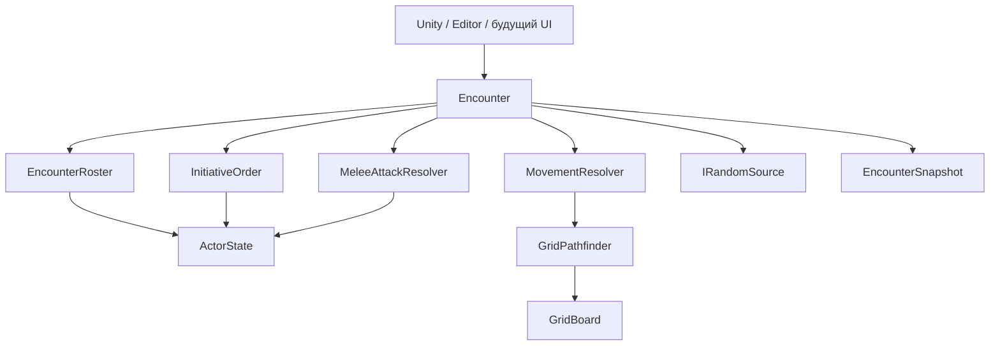

## Как работать с этой заметкой

Это справочник и полный текстовый снимок исходников систем проекта Aethel. Он предназначен для чтения в Obsidian, поиска классов и продолжения разработки вручную. Источник истины — файлы Unity-проекта. Правки внутри блоков кода этой заметки не попадают в `.cs` автоматически.

Корень проекта: `D:\UnityPetProject\PetProject`. Исходники: `Assets/_project/CodeBase`. В конце каждой группы находятся полные файлы, включая интерфейсы, тесты и asmdef. Для каждого файла указаны относительный путь, SHA-256 исходных байтов и число строк. Пути в блоках относятся к корню проекта. Встроенное оглавление Obsidian позволяет перейти к конкретной сборке или файлу.

Для обновления снимка после правок выполните из корня проекта:

```powershell
node Tools/export-system-code.mjs
node Tools/export-system-code.mjs --verify
```

Первая команда пересобирает `Docs/Codebase/Aethel-Systems-Codebase.md`; вторая сверяет состав файлов, содержимое всех кодовых блоков, контрольные суммы и карту сборок. Копию в Obsidian можно обновить этой командой, если в неё не добавлены ручные записи:

```powershell
Copy-Item -LiteralPath 'D:\UnityPetProject\PetProject\Docs\Codebase\Aethel-Systems-Codebase.md' -Destination 'C:\Users\п\OneDrive\Documents\Делишки\Aethel\01_Архитектура\04_Кодовая_база_систем.md'
```

Ручные проектные решения записывайте в отдельных заметках GD, а пояснения для будущих экспортов — в `Docs/Codebase/Handbook-Guide.md`. Экспорт перезаписывает только сгенерированные файлы в `Docs/Codebase`; автоматического импорта кода из Markdown нет.

## Что реализовано сейчас

Проект находится в переходе от прототипа RPG с одним героем и боем в реальном времени к изометрической тактической RPG по актуальному GDD. Основной игровой запуск пока использует прежние системы. Независимое тактическое ядро D1 и два технических полигона уже существуют отдельно от кампании.

Цель GDD: главный герой и четыре фиксированных спутника, шесть характеристик, тактические столкновения, кампания, путешествия, лагерь и развитие. Само наличие типов `Encounter`, `ActorDefinition` и `MotionTestSession` ещё не означает, что отряд, сохранение боя или полноценная кампания подключены к игре.

| Контур | Текущее состояние | Основная точка входа |
|---|---|---|
| Приложение | Запуск, главное меню, выбор слотов, создание героя, загрузка мира | `BootstrapInstaller`, `CharacterMenuService`, состояния приложения |
| Персонаж | Пять старых характеристик и их модификаторы, создание профиля | `Character/Domain`, `CharacterSession` |
| Сохранения | JSON-слоты, checksum, резервная копия, адаптер старого прогресса | `JsonSlotStore<T>`, `SaveLoadService`, `GameSaveAdapter` |
| Старый игровой мир | Один герой, враги, спавнеры, добыча, старый HUD | `GameWorldBuilder`, фабрики, `Gameplay` |
| Тактика D1 | Сетка, направленные переходы, путь, инициатива, ОД, ближняя атака d20, победа | `Encounter` |
| Полигон D1 | Два участника, ручные команды обеих сторон из EditorWindow | `TacticsSandboxBehaviour`, `TacticsSandboxWindow` |
| Полигон движения | NavMesh, сеточное движение одного героя, камера, предпросмотр ОД | `MotionTestWorld`, `MotionTestController`, `MotionTestSession` |
| Инфраструктура | Addressables, пулы, ввод, Audio/VFX, AI/Blackboard | Соответствующие модули и `_myPlugins` |

Unity: **6000.3.5f2**, URP. Указание Unity 2022 в старом GDD не является инструкцией по откату Editor. Точные версии UPM находятся в приложенном `Packages/manifest.json`; Zenject, UniRx, Wwise, Odin и другие зависимости также могут находиться в Assets, поэтому один UPM manifest не описывает все SDK.

## Карта ответственности

| Область | Где менять код | Чего эта область не должна брать на себя |
|---|---|---|
| `PetProject.Tactics` | `Modules/Tactics/Runtime`: чистые правила, команды, состояние боя | Transform, поиск объектов сцены, загрузка ассетов, UI, чтение файлов |
| `PetProject.Character` | `Character/Domain`: атрибуты, модификаторы, профиль, черновик создания | Открытие меню, смена сцены, файловые слоты |
| `PetProject.App.Contracts` | `Modules/App.Contracts`: порты меню, прогресса, мира и SDK | Реализация представлений, конкретные фабрики и SDK-клиенты |
| `PetProject.Application` | `Modules/Application`: сценарии меню, сессия, состояния загрузки | Построение Canvas, конкретная геометрия уровня |
| `PetProject.UI` | `Modules/UI`: окна, слоты, атрибуты, HUD, презентация | Правила боя и владение долгоживущим игровым прогрессом |
| `PetProject.Progress.Model` | `Modules/Progress.Model`: сериализуемые данные и игровой адаптер | Прямое чтение/запись файлов, создание GameObject |
| `PetProject.Progress.Runtime` | `Modules/Progress.Runtime`: capture/apply, слоты и окружение | Правила характеристик и интерфейс конкретного окна |
| `PetProject.SaveStorage` | `SaveStorage`: envelope, проверка, backup, архивирование | Знание о герое, кампании, фабриках мира |
| `PetProject.Gameplay` | `Modules/Gameplay`: Unity-компоненты героя, врагов, мира и полигонов | Разрешение DI-контейнера и копия правил тактического ядра |
| `PetProject.Composition` | `Modules/Composition`: installers, фабрики, связывание, сборка мира | Правила урона, начисление атрибутов и поведение экранов |
| `PetProject.Input` | `Modules/Input` и generated Input Actions | Правила атаки/передвижения и сохранение состояния |
| `PetProject.Pooling` | `Modules/Pooling`: аренда/возврат и очистка экземпляров | Регистрация убийств и выдача награды |
| `PetProject.Assets` | `Modules/Assets`: загрузка ресурсов и владение экземплярами | Правила отряда и кампании |
| `PetProject.AI` | `Modules/AI`: Blackboard, дерево поведения, стратегии | Зависимость от Composition и конкретного UI |
| `PetProject.Commerce` | `Modules/Commerce`: старые Ads/IAP | Экономика NPC и правила покупки предметов за игровые монеты |
| Audio / VFX / Shared / Dialogue | `_myPlugins`: собственные адаптеры и библиотеки | Неявное управление жизненным циклом кампании |
| Editor / Tests | `Editor`, соответствующие каталоги Tests | Обязательные runtime-зависимости player-сборок |

Ссылки asmdef через GUID сохраняют связи при переносе. Новая сборка нужна для самостоятельной границы зависимостей, а не для каждого класса. Точный граф прямых ссылок приведён ниже. Auto-referenced DLL и неявные зависимости Unity этот граф не заменяет.

## Порядок запуска и владельцы состояния

Основной маршрут: `BootstrapState → WarmUpState → MainMenuState`. Подтверждение героя или выбор слота запускает `ReloadGameState → LoadProgressState → LoadLevelState → GameLoopState`.

`CharacterMenuService` координирует пользовательские сценарии; `CharacterMenuPresentation` владеет представлениями; `CharacterSession` — восстановленным персонажем и подписками характеристик. `GameWorldBuilder` создаёт и восстанавливает мир. `ProgressRegistry.ApplyAsync` ждёт асинхронных участников, после чего загрузка может объявить мир готовым.

| Ресурс | Владелец | Завершение жизни |
|---|---|---|
| Характеристики и подписки профиля | `CharacterSession` | Смена профиля / Dispose |
| Активное окно, блокировка ввода/пауза окна | `CharacterMenuPresentation` | Clear / Dispose |
| Блокировка ввода при загрузке | `CharacterMenuService` | WorldLoaded / ошибка / Dispose |
| Участники capture/apply | `ProgressRegistry` | Unregister при уходе объекта, Clear при смене мира |
| Addressables handles / экземпляры | `AssetProvider` | CleanUp / Dispose |
| Активные и свободные pooled objects | `PoolService` / `Pool<T>` | Despawn / Dispose |
| Логическое состояние боя и RNG | `Encounter` и закрытые от внешнего кода collaborators | Жизнь одного столкновения |
| Логическая позиция и ОД одиночного полигона | `MotionTestSession` | Reset сессии |
| Воспроизведение маршрута и Transform | `MotionTestController` | Завершение принятого маршрута / Reset / разрушение |

## Устройство тактического ядра после разделения

Публичный вход для боя — `Encounter`; внутренние mutable-типы наружу не выдаются. UI и Unity-компоненты читают immutable snapshots и отправляют команды.

| Тип | Ответственность |
|---|---|
| `Encounter` | Проверка общих условий команды, idempotent replay, маршрутизация, ревизия и снимок |
| `EncounterRoster` | Создание участников, уникальность ID/клеток, живая занятость, определение победы |
| `ActorState` | Инкапсулированные HP/ОД/позиция/инициатива участника |
| `InitiativeOrder` | Каноническое распределение бросков, сортировка, пропуск погибших, раунды, восстановление ОД |
| `MovementResolver` | Предпросмотр пути и проверка полной стоимости перед перемещением |
| `MeleeAttackResolver` | Проверки цели/дальности/высоты/ОД, d20, урон и события поражения |
| `GridBoard`, `GridCell`, `GridTransition` | Неизменяемый рельеф, цена входа, высота и запреты направленных переходов |
| `GridPathfinder`, `GridPath` | Взвешенный поиск Dijkstra с воспроизводимым разрешением равных стоимостей |
| `TacticalCommand`, `CommandResult`, `TacticalEvent` | Командный контракт и результат для адаптера/представления |
| `EncounterSnapshot`, `ActorSnapshot` | Снимок для чтения; не DTO сохранённой кампании |
| `IRandomSource`, `DeterministicRandom` | Единственный поток RNG боя, xorshift32-v1 |
| `MotionTestSession`, `MotionMoveResult` | Отдельная тестовая сессия одного героя, без выдуманной второй фракции |



Не меняйте порядок общих проверок без теста: replay принятой команды обрабатывается до проверки завершённости боя и текущего хода. Replay возвращает прежнюю ревизию результата, не расходует ОД/RNG и не повторяет события. Отклонённый ID не резервируется. Новый пользовательский запрос должен получать новый ID; повтор передачи того же запроса использует старый.

Пример использования существующего API (его можно поместить внутрь метода теста/адаптера):

```csharp
var battle = new PetProject.Tactics.Encounter(
    new PetProject.Tactics.GridBoard(8, 5),
    new[]
    {
        new PetProject.Tactics.ActorDefinition("hero", "allies",
            new PetProject.Tactics.GridPosition(1, 1), initiativeBonus: 20),
        new PetProject.Tactics.ActorDefinition("enemy", "enemies",
            new PetProject.Tactics.GridPosition(5, 1))
    },
    new PetProject.Tactics.DeterministicRandom(718));

var result = battle.Execute(PetProject.Tactics.TacticalCommand.Move(
    "input-001", "hero", new PetProject.Tactics.GridPosition(2, 1)));
if (result.Accepted && !result.IsReplay)
{
    var snapshot = battle.GetSnapshot();
    // Передать snapshot/events представлению; не менять HP/ОД в Unity-компоненте.
}
```

Числа полигона условные. D1 пока не реализует натуральные 1/20, критические попадания, LOS, укрытия, дальний бой, заклинания, сетевую репликацию и сохранение столкновения. Ограничения прохода через рёбра участвуют в движении; правила ближней атаки пока проверяют соседство и высоту, отдельного LOS нет.

## Как продолжать разработку вручную

### Добавление игрового правила

1. Опишите наблюдаемое поведение и пограничные случаи в GD. Отделите утверждённое правило от временного значения полигона.
2. Правило без Unity-зависимостей помещайте в соответствующий доменный модуль. Для тактики используйте `Modules/Tactics/Runtime`.
3. Изменение атаки начинайте с `MeleeAttackResolver`; очереди — с `InitiativeOrder`; рельефа/проходимости — с `GridBoard` и `GridPathfinder`. `Encounter` сохраняет общую командную границу.
4. Новую команду проводите через `TacticalCommandKind`, фабрику команды, маршрутизацию `Encounter` и типизированный результат. Проверяйте replay, конфликт ID и отказ без частичного изменения состояния.
5. Unity-адаптер воспроизводит принятый результат. Не дублируйте расход ОД/урон в `MonoBehaviour`.

### Изменение атрибутов и сохранений

Текущие сохранения используют пять атрибутов со старым ключом `inte`. `CharacterProfileData.Restore` проверяет старый формат; простое добавление `CHA` сделает его несовместимым. Не переименовывайте JSON-поля и не ограничивайте старые значения молча: старое создание допускает значения выше будущего базового лимита 20.

Для D2 сначала нужны версия данных кампании, fixtures старых профилей, политика конвертации/резервной копии и тесты чтения. Разделяйте definition персонажа и instance кампании. Поля старого `RunProgress` пока обслуживают прежний цикл и не являются готовой моделью трёх актов GDD.

Новый участник сохранений регистрируется через существующий `IProgressRegistry`; при подборе/возврате в пул/удалении снимает регистрацию. Если восстановление создаёт объекты асинхронно, реализуйте `IAsyncProgressReader`: готовность мира объявляется после завершения apply. Файловые операции остаются в SaveStorage; UI получает `SaveSlotInfo`, а не внутренний JSON envelope.

### Добавление экрана и Unity-компонента

Экран открывается через application-сценарий и существующее представление. Сохраняйте владельца подписок и блокировки ввода. Для pooled-компонента отдельно проверьте повторный spawn/despawn, очистку ссылок и остановку незавершённых async/coroutine.

Привязку конкретных реализаций добавляйте в Composition. Не передавайте `DiContainer` в доменные правила и не создавайте второй глобальный service locator. При переносе существующего `.cs` переносите вместе с ним `.meta`; при переименовании сериализованного поля используйте `FormerlySerializedAs` и проверьте prefab overrides.

### Проверка изменений

Независимое ядро можно проверить без работающего Editor при установленном .NET 9 и ранее загруженном пакете Unity NUnit:

```powershell
node Tools/check-tactics.mjs current
# Те же текущие тесты на исходниках Runtime из HEAD:
node Tools/check-tactics.mjs comparison --head
```

Это вспомогательный синхронный reflection runner, а не Unity Test Runner: он не проверяет сцены, MonoBehaviour, player API и полный жизненный цикл NUnit. При неподдерживаемых TestCase/async/lifecycle hooks он завершает работу с ошибкой. Полный прогон в Unity: Test Runner → EditMode → `PetProject.Tactics.Tests`.

Если установлен нужный Editor по стандартному пути, та же команда сначала компилирует production-исходники его Roslyn-компилятором с reference `.NET Standard 2.1`. Для нестандартной установки можно задать `UNITY_EDITOR_DATA`. Эта дополнительная проверка совместимости C# не запускает Editor, импорт ассетов или player build. Результаты находятся в `Library/TacticsCodeChecks`.

Для проверки интеграций используйте существующие меню:

- `Tools/PetProject/Refactoring/Run Regression Checks` — собственные регрессии и ссылки prefab.
- `Tools/PetProject/Tactics/Run Runtime Checks` — изолированное столкновение D1.
- `Tools/PetProject/Motion/Run Runtime Checks` — движение/камера/переходы полигона.
- `Tools/PetProject/Motion/Run Editor Checks` — генерация и Undo/Redo полигона.

Перед runtime-проверкой сохраните текущую сцену и выйдите из Play. После изменения Unity-компонентов нужна проверка в Play; после изменения платформенных зависимостей — соответствующая player-сборка. Старый успешный отчёт в Library не доказывает состояние нового кода.

## Следующие границы работ по GDD

1. **D2:** шесть характеристик, определения/экземпляры персонажей, версии кампании и безопасная миграция старых профилей.
2. **D3:** отряд из пяти персонажей, управление выбранным участником, связывание кампании и столкновения.
3. **D4:** способности, дальность/LOS, укрытия, эффекты, классы и ресурсы боя — после фиксации правил в GD.
4. **Дальше:** инвентарь/экипировка/отдых, повествование, карта и лагерь, вертикальный срез, проверка PC-релиза.

Отдельные инженерные долги: широкие старые AudioService/AudioFacade и парсер Google Sheets, валидация отсутствующих ссылок Wwise/SteamAudio, окончательное отделение Ads/IAP от премиальной модели GDD. Эти системы включены в снимок для дальнейшей работы; наличие исходника не означает завершённый аудит SDK или реализацию соответствующего пункта GDD.
