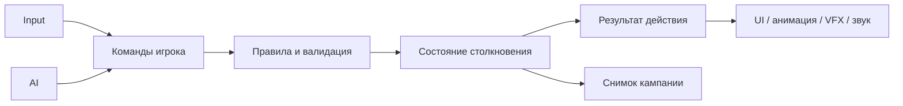
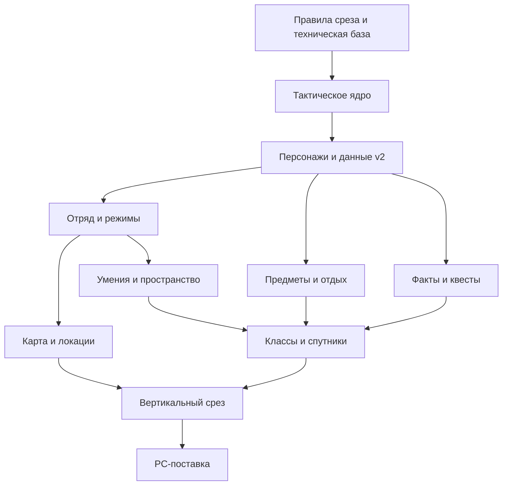

# План перехода Aethel к текущему Game Design Document

<!-- TACTICS-D1-STATUS -->
> **Обновление 29.10.2026:** D1 реализован и проверен как техническое ядро/полигон. Числа прототипа остаются настройками для обсуждения. [Отчёт](Tactics-D1-Report.md), [системные контракты](Systems/README.md). D2–D10 остаются дальнейшими этапами; данные персонажа и кампания не мигрировались автоматически.

**Дата:** 29.10.2026. **Статус:** предложение для согласования; игровые системы ниже ещё не реализованы этим документом.

**Источник требований:** `C:\Users\п\OneDrive\Documents\Делишки\Aethel\GD\0_О Проекте Game Design Document.md`, версия 1.0. **Исходный код:** `D:\UnityPetProject\PetProject`. **Техническая база:** [архитектура после рефакторинга](../Architecture/Architecture-Current.md), [отчёт и проверки](../Architecture/Refactoring-Report.md).

## 1. Цель перехода

Целевая игра по GDD — одиночная изометрическая тактическая RPG: квадратная сетка, инициатива, очки действия, d20, главный герой и четыре фиксированных сопартийца, сюжетная кампания, отдых и экономика ресурсов. Текущий прототип даёт инфраструктуру, создание одного персонажа, real-time бой и загрузку уровней.

Рефакторинг сборок готовит основу для перехода. Он сам по себе не реализует пошаговый бой, кампанию или отряд. Прежний план «хаб → порталы → волны» считается историческим вариантом; его поля сохранений поддерживаются для совместимости. В текущую дорожную карту не закладывается обязательная разработка wave-loop. Лагерь и переходы между локациями рассматриваются в рамках нового GDD.

Рекомендуемый первый игровой результат — короткая миссия Акта I «кража печати из усыпальницы»: исследование → диалог/решение → тактическое столкновение → награда → лагерь/отдых → сохранение → продолжение. Это проверяемый вертикальный срез перед производством трёх актов.

## 2. Фактическое состояние и расхождения

| Область | Уже есть в коде | Требуется для GDD |
|---|---|---|
| Техническая база | Unity 6000.3.5f2, URP, Zenject, UniRx, UniTask, Addressables; 14 основных runtime-сборок | Сохранить стек; исправить в технических заметках расхождение с Unity 2022 LTS. Downgrade не планируется |
| Персонаж | Каталог 9 классов, создание/черновик, пять атрибутов, окно характеристик | Шестой атрибут CHA, новая политика генерации/покупки, предыстории, игровые способности классов |
| Формат профиля | CharacterProfileData.Restore требует ровно 5 атрибутов; CharacterSchemaVersion = 1 | Версионированная миграция. Простое добавление CHA сломает восстановление старых профилей |
| Баланс | Legacy HP/урон через HeroStats; старое распределение может дать базовый STR > 20 | Отдельный согласованный ruleset для d20, капов и прогрессии. Старые профили не обрезать молча |
| Мир и управление | Один HeroFacade, NavMesh, мышь/клавиатура, загрузка уровней | Выбор участника отряда, приказ группе, переключение исследование/тактика, сеточный расчёт хода |
| Бой | HeroAttack/Attack, real-time стратегии, cooldown и Animator-события | Инициатива, очередность, ОД, команды, дистанции, проверки, сохранение состояния столкновения |
| Враги | EnemyFactory получает одного HeroFacade; AI и Follow/Attack работают в реальном времени | Выбор целей из нескольких фракций/участников, решения AI на своём ходу, прекращение real-time атак во время тактики |
| Сохранение | 3 слота, backup/checksum/legacy import, один профиль и положение уровня | Пять ActorId, кампания, квесты, инвентарь, ресурсы отдыха, ruleset/version и выбранная политика сохранения боя |
| Нарратив | Dialogue System и собственный модуль расширений | Факты мира, отношения, квестовые состояния, уникальные механики 4 NPC, развилки и 5 концовок |
| Экономика | Числовая добыча, legacy Shop, Ads/IAP | Золото/материалы/еда, предметы, экипировка, торговля и крафт за игровые ресурсы |
| Монетизация | Commerce изолирует SDK и пока связан с существующим интерфейсом | Для premium Steam/VK Play убрать Ads/IAP из обязательного запуска; магазин NPC отделить от покупок за реальные деньги |
| Аудио | Код фасадов и обработчиков работает в проверенном Editor-сценарии | В build обнаружены отсутствующие SDK script GUID Wwise/SteamAudio. Статус «интеграция завершена» требует отдельной проверки player |
| Кооператив | Реализации нет | Перспектива после одиночного среза. Сейчас достаточно стабильных ActorId и команд; сетевой стек не добавлять заранее |

## 3. Что переиспользуем и что меняем

| Основа | Решение |
|---|---|
| Character/Domain | Сохранить модификаторы, владение ресурсами героя, черновик создания. Развивать определения персонажа и политику правил, сохраняя чтение v1 |
| SaveStorage | Переиспользовать файловый контейнер и backup. Версию игрового payload и маршрутизацию загрузки вводить отдельно от версии контейнера |
| Progress.Model / Progress.Runtime | Добавить campaign/party DTO и адаптеры миграции. Реестр capture/apply оставить для связи мира с сохранением |
| App.Contracts / Application | Использовать порты сценариев и представления. Добавлять переходы режима игры без зависимости от конкретного Canvas или NavMeshAgent |
| Gameplay | Оставить Unity-компоненты, фабрики, представления и адаптеры мира. Real-time поведение временно доступно как legacy-режим для сравнения |
| AI | Переиспользовать общий BT/blackboard, проверив его turn-based адаптер. В тактике AI предлагает допустимые команды, а не наносит урон напрямую из Update |
| Input / MenuInputScope | Сохранить raw input и блокировки; разделить интерпретацию команд исследования, тактики и UI |
| UI | Переиспользовать загрузку окон, окно профиля и владение подписками. Добавить выбранного персонажа, портреты отряда, ОД, умения и preview пути |
| Assets / Pooling / Audio / VFX | Переиспользовать владельцев ресурсов и узкие фасады. Анимация/эффекты отображают результат правил |
| Composition | Связывать новые реализации; расширить создание мира от одного героя до состава отряда. Не превращать GameFactory в универсальный сервис |
| Commerce | Оставить изолированным до отдельной задачи по premium-сборке; не переносить его модель покупок в экономику NPC |

### Граница тактических правил

После минимального прототипа предлагается одна независимая `PetProject.Tactics` для правил, если подтвердится самостоятельность границы. Там находятся координаты клеток, occupancy, порядок ходов, расчёт ОД, броски и проверка команд. Unity-компоненты и визуализация остаются в Gameplay/UI. `noEngineReferences` включается только если фактический код не использует Unity-типы.

Предлагаемые имена — `EncounterState`, `ActorId`, `GridPosition`, `ActionDefinition`, `ActionCommand`, `ActionResult`, `IRandomSource`. Это будущие контракты, а не уже добавленные файлы. Дополнительные Party/Inventory/Quests asmdef выделять по устойчивым зависимостям; сначала достаточно соответствующих подпапок существующих модулей.

Команда проходит проверку, затем атомарно меняет состояние. Движение по клеткам и списание ОД не зависят от частоты кадров и длительности анимации. Повторная доставка одного command ID не должна повторно тратить ресурсы или наносить урон. UI и AI используют одну проверку допустимости действия.

## 4. Решения до реализации — D0

| ID | Решение | Предлагаемая отправная точка | Что нужно согласовать |
|---|---|---|---|
| GD-01 | Техническая версия | Unity 6000.3.5f2 и текущие пакеты | Исправление упоминания 2022 LTS в GDD отдельной редакцией автора |
| GD-02 | Правила боя | Авторский ruleset: d20 + система ОД из GDD | Формулы атаки/защиты/спасброска, инициатива при равенстве, действие при 0 HP |
| GD-03 | ОД и перемещение | 3 ОД — кандидат из GDD, не зафиксированное число | Стоимость движения/атаки/предмета, диагонали, высоты, занятость клетки, прерывания |
| GD-04 | Создание героя | Шесть атрибутов, политика покупки/генерации, отдельные ограничения базы и баффов | Стартовый бюджет, стоимость, диапазоны, значение CHA при конверсии старых профилей |
| GD-05 | Legacy-профили | Читать v1 без изменения; конверсия только с backup и явной политикой | STR > 20: оставить legacy-режим, предложить перераспределение или иной согласованный вариант |
| GD-06 | Сохранение боя | Для первого среза сохранять в устойчивых границах хода | Нужна ли загрузка посреди анимации; что сохранять из RNG, очереди, AP и эффектов |
| GD-07 | Управление отрядом | Игрок управляет пятью героями в тактике | Выбор лидера/групповой приказ в исследовании, формирование путей, падение/смерть спутника |
| GD-08 | Объём среза | Одна миссия и один лагерь, ограниченный набор действий | Сколько классов/уровней реально показываем в демо; полный GDD по-прежнему требует 9 классов и уровни 1–20 |
| GD-09 | Premium и SDK | Экономика за игровые ресурсы; Ads/IAP не обязательны для запуска | Что оставить в проекте для будущего, какие legacy-экраны снять с production-навигации |
| GD-10 | Высоты/укрытия/зоны | Общая клеточная модель + валидатор целей | Правила LOS, частичного укрытия, стоимости подъёма, AoE и friendly fire |

Предложения выше не подменяют решения GD. До закрытия конкретного решения можно делать независимые технические проверки и тестовые адаптеры; зависимые игровые правила не фиксировать молча.

## 5. Поэтапный пайплайн

D1 реализован как технический прототип по последующему разрешению пользователя продолжать. D2–D10 остаются **предложенными**; их игровые правила и переход данных уточняются по новым заметкам GD.

### D0. Принять техническую основу и зафиксировать правила среза

- Проверить отчёт рефакторинга, поведение меню/сохранений и границы модулей.
- Разобрать Wwise/SteamAudio script references и ошибки записи importer metadata, появлявшиеся при повторной сборке. Подтвердить звук в player.
- Зафиксировать решения GD-01…GD-10, состав миссии и список входящих систем.
- Сохранить проверяемый checkpoint в используемой системе контроля версий после review.

**Готовность:** известны технические блокеры, набор правил первого столкновения, политика старых данных и критерии среза. Нет обещания «рефакторинг завершил весь GDD».

### D1. Тактическое ядро и технический полигон

- Квадратная сетка, высота/проходимость/занятость, путь и его стоимость.
- Участники, фракции, инициатива, начало/конец хода, ОД, завершение столкновения.
- Броски через отдельный подменяемый RNG столкновения, запрос/валидация/исполнение команды и результат действия. Визуальные эффекты не расходуют этот поток случайности. Для продолжения сохраняется состояние генератора либо seed и позиция потока.
- Первый внутренний полигон: два юнита, движение, базовая атака, пропуск хода. Это техническая проверка, не состав продуктового отряда.

**Проверки:** одинаковые входы/seed дают одинаковый результат; отрицательных ОД нет; недопустимая команда не меняет мир; занятая/недоступная клетка отклоняется; активный ход единственный; повтор команды не дублирует урон.

### D2. Модель персонажа и версионированные данные кампании

- Разделить определения (class/companion/item/ability) и изменяемое состояние экземпляра (ActorId, HP, ресурсы, эффекты).
- Добавить CHA, согласованную политику создания и правила ограничения базовых характеристик.
- Добавить три предыстории-архетипа из GDD и кастомный вариант через данные определения; расы, происхождения и таланты остаются отдельным будущим объёмом.
- Проектировать root payload v2 с `payloadVersion` и `rulesetId`: кампания, отряд, локация, инвентарь, квесты, ресурсы; снимок боя — по GD-06.
- Сделать маршрутизацию версии до legacy-десериализации/валидации. Текущий JsonSlotStore<GameSaveData> нельзя считать автоматически совместимым с новым содержимым.
- Версию файлового envelope менять только при изменении контейнера; новая версия игрового payload не обязана требовать новый формат backup/checksum.
- Миграция v1 → v2 получает исходную копию и явное сопоставление `str/agi/stm/inte/wis` с целевой моделью. Существующие ClassId сохранить или конвертировать по таблице.

**Проверки:** старые сейвы продолжают читаться; шесть атрибутов проходят round-trip; неизвестная версия не перезаписывается; профиль STR > 20 не теряет очки; неуспешная конверсия оставляет исходник и соседние слоты неизменными.

### D3. Отряд и переход между исследованием и тактикой

- Ввести состав: игрок + Кора Вельн, Эзрин Дей, Рейк Морн, Веспер Ир с устойчивыми ActorId.
- Создание юнитов обобщить на UnitFactory/адаптеры: GameFactory и EnemyFactory не должны иметь единственный глобальный HeroFacade как источник всех целей.
- Выбор участника/группы, исследование через NavMesh, сбор участников в Encounter, режим тактики и выход из него.
- Отключать real-time Follow/Attack/cooldown-авторитет во время тактики. Animator и NavMeshAgent исполняют представление согласованного результата, а не решают правила боя.
- AI получает актуальный snapshot и предлагает команду на своём ходу. Проверку цели и затрат выполняет общее ядро.
- HUD: портреты пяти героев, выбранный участник, очередь ходов, ОД, путь, окончание хода.

**Проверки:** в продуктовой сцене ровно пять участников отряда; выбор персонажа меняет правильный HUD; чужой ход не принимает ввод; враг выбирает допустимую цель; меню/загрузка не продвигают бой; повторный вход в Encounter не дублирует подписки.

### D4. Умения и пространственные правила

- Описывать действия данными: цена, дальность, тип цели, проверка/спасбросок, эффекты, расходы ресурсов.
- Подключить укрытия, высоту, линии видимости и зоны: конус/линия/радиус согласно GD-10.
- Наложение/снятие модификаторов использовать через источник эффекта; отделить длительность в ходах от legacy-таймеров real-time.
- Анимация, VFX и звук следуют одному результату действия. Ошибка отображения не должна повторно исполнять атаку.
- Сначала завершить небольшой согласованный набор действий; затем расширять каталоги классов.

**Проверки:** preview совпадает с исполнением; AoE затрагивает правильные клетки; недоступная цель не тратит ресурс; бафф снимается один раз; смерть/конец хода не оставляют заблокированное состояние.

### D5. Инвентарь, игровая экономика, крафт и отдых

- ItemDefinition/ItemInstance, стаки, золото, редкие/уникальные материалы, общая еда и личная экипировка.
- Торговля NPC за игровую валюту — отдельный доменный сценарий от IIAPService/Unity Purchasing.
- Экипировка: ограничения слотов и максимум три легендарных предмета; модификаторы обновляются без накопления.
- Рецепты зелий/свитков/стрел и атомарное списание ингредиентов с выдачей результата.
- Короткий отдых — 1 час игрового времени, длинный — 8; тратят согласованное количество еды, восстанавливают оговоренные ресурсы и spell slots.
- Время кампании отделить от Time.timeScale и длительности UI-анимации.

**Проверки:** отрицательных стаков/валюты нет; операция не исполняется дважды; четвёртый легендарный предмет отклоняется; недостаток еды не запускает отдых; загрузка не выдаёт повторную награду/восстановление.

### D6. Диалоги, отношения и квесты

- Связать Dialogue System с FactStore/QuestState через адаптер, не передавать в диалог весь DI-контейнер.
- Факты, отношения и награды имеют устойчивые ID и сохраняются вместе с кампанией.
- UI сообщает изменение отношений по результату решения.
- Первая цепочка: вход в усыпальницу, задача с печатью, выбор, последствие, награда и возврат.
- Будущие концовки и квестовые ветви выражать условиями фактов/решений; три акта не зашивать в цепочку специальных MonoBehaviour-классов.

**Проверки:** продолжение диалога после загрузки соответствует фактам; завершённый этап/награда не исполняются повторно; имена/ссылки диалоговых записей валидны.

### D7. Глобальная карта, локации и лагерь

- Разделить исследование локальной сцены, переход по карте и тактическое столкновение.
- Данные маршрута, лагеря, данжа, торговца и случайного события; согласованная стоимость времени/ресурсов.
- Случайное событие выбирается один раз и сохраняется. Reload не превращается в бесплатное повторное получение награды.
- Лагерь открывает отдых и связанные с отрядом сценарии.
- Загрузка локации сохраняет roster/кампанию; не использовать legacy RunProgress.HubLevelId как универсальное правило отката всей кампании.

**Проверки:** переход туда/обратно сохраняет отряд, добычу и факты; прерванная загрузка не повреждает слот; повторное посещение использует правильное состояние Encounter/quest.

### D8. Прогрессия, классы и особенности четырёх спутников

- Опыт за бои/квесты/исследование, таблицы уровней до 20, выбор специализации на 3-м уровне.
- Согласовать объём классов среза; механики всех девяти классов GDD — отдельные проверяемые наборы действий/ресурсов.
- Кора: «Ложная клятва», усиление и согласованный триггер раскрытия/дебаффа.
- Эзрин: «Драконье пламя», огненные действия и горение в рамках общей системы эффектов.
- Рейк: факты памяти, личная цепочка и ветвление развития через данные прогрессии.
- Веспер: состояние «Пламяглота», накопление ярости и её трата; правила сохранения/сброса определить в GD.

**Проверки:** level-up не выдаётся повторно после load; смена источника модификатора не накапливает бонусы; уникальное состояние спутника восстанавливается; личный квест не заменяет фиксированного члена отряда.

### D9. Вертикальный срез и контентный pipeline

- Собрать полную короткую миссию и лагерь с пятью героями, выбранным набором классов/умений, диалогом, выбором, боем и отдыхом.
- Новая кампания → создание → исследование → тактика → награда/выбор → лагерь → save → выход → continue.
- Дать GD/нарративу/артистам валидируемые определения и инструкции; отделить контентные таблицы от изменения кода.
- Проверить LowPoly/URP стиль, читаемость клеток и HUD, разрешения PC, подсказки затрат и последствий.
- После оценки среза разложить производство 3 актов и 5 концовок на контентные задачи. Не считать их выполненными наличием инфраструктуры FactStore.

**Готовность:** end-to-end сценарий воспроизводится в player, нет потери save и блокировки ввода/хода; каждое заявленное правило имеет тест или ручной сценарий. Ограничения демо согласованы, а не скрыты уменьшением объёма GDD.

### D10. Проверка поставки PC

- Windows x64 Development для диагностики и отдельная release-конфигурация; существование exe не заменяет его запуск.
- Проверка сборки на целевой Windows: старт, аудио/банки, вход/выход, save paths, пять героев, завершение сражения, загрузка кампании.
- Убрать Ads/IAP из обязательного premium-boot и меню по GD-09; интеграцию Steam/VK Play вводить только при определённых потребностях платформы.
- Проверить Addressables-каталог, дубликаты ресурсов и отсутствие test Resources в production.
- Зафиксировать сборку/версию/сценарии и необходимый CI-процесс. Кооператив, мобильные платформы и C++23 R&D — отдельные инициативы.

**Готовность:** платформа, конфигурация, результаты тестов, артефакты и незакрытые ограничения записаны в отчёте; SDK/сцены не объявлены готовыми без проверки на player.

## 6. Миграция сохранений и поэтапное переключение

1. Сохранить legacy-сценарий для воспроизведения регрессий до стабилизации новой кампании.
2. Ввести различение форматов/режимов, чтобы кнопка Continue могла выбрать корректный use case. Не загружать campaign save через старый одногероевый WorldBuilder.
3. Добавить новую схему и fixtures заранее: roster, атрибуты, выбранный персонаж, квесты, предметы, время и ресурсы; бой — только в согласованных границах.
4. Перед конверсией сделать backup; преобразовать копию; проверить ссылки/лимиты/ActorId; только затем записать новый формат атомарно.
5. Не объединять и не удалять пользовательские слоты автоматически. Неизвестные версии и неуспешные миграции должны оставаться доступными для восстановления.
6. Удалять legacy-адаптеры после проверки новых сценариев и решения о поддержке старых профилей, а не сразу после появления Tactics-сборки.

## 7. Приёмка и порядок зависимостей

Сохранения, обработка ошибок и тесты добавляются вместе с каждой системой. Этап D2 задаёт основу; он не заменяет проверку новых данных в D3–D9. Диаграмма показывает зависимости и не является разрешением автоматически запускать все этапы.

| Требование GDD | Основные этапы | Доказательство готовности |
|---|---|---|
| §3.1 исследование/карта | D3, D7 | Навигация и переход с восстановлением состояния |
| §3.2 сетка, d20, ОД, высоты/укрытия/AoE | D1, D4 | Детерминированные тесты правил + player Encounter |
| §3.3 отряд и 4 уникальные механики | D3, D8 | 5 участников, отдельные сценарии каждого спутника |
| §4 создание/6 атрибутов/9 классов/специализации | D2, D8 | Создание, миграция, level-up и действия классов |
| §5 ресурсы, ограничения, крафт/отдых | D5 | Проверки транзакций, капов и save/load |
| §2 сюжет, 3 акта, 5 финалов | D6, D8, после среза — контентное производство | Квестовые факты и прохождение соответствующих ветвей |
| §6 UI/визуал | D3–D9 | Читаемость и ручная проверка целевых экранов |
| §7 инфраструктура/аудио/диалоги | D0, D6, D10 | Сборка и работа соответствующей интеграции в player |
| §8 premium PC | D9, D10 | Согласованный объём демо и проверенный premium-boot |

## 8. Как уточнять план по мере роста GD

В GD добавлять системные заметки с ID требования, статусом и ссылкой на раздел GDD. Для каждой системы отдельно фиксировать: правила, входы/выходы, состояние и сохранение, граничные случаи, UI, зависимости и приёмку. Рекомендуемый шаблон хранится рядом.

Перед новой задачей перечитать актуальные связанные заметки и обновить решения GD-01…GD-10. Новая запись GD не означает, что соответствующий код уже готов; статус «проверено» требует ссылки на тест/сценарий/артефакт.

Оценки бюджета, 6–8 месяцев и 500 часов из GDD здесь не подтверждены. Сначала разбить согласованный срез на задачи и оценить их после D0/D1. Условные названия будущих типов и сцен не являются обещанием конкретного API.

**Рекомендуемая следующая задача после review:** D0 — уточнение правил первого столкновения и политики миграции, затем D1 — минимальное тактическое ядро и полигон. Это предложение для следующего задания, а не начатая реализация GDD.
